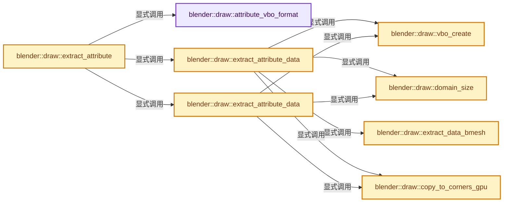
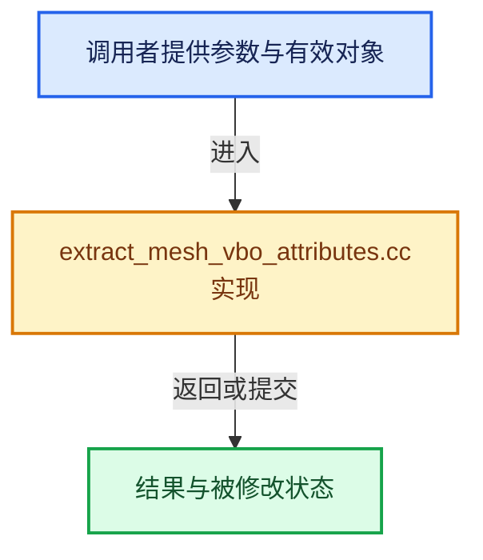

# 实现依赖专题：source/blender/draw/intern/mesh_extractors/extract_mesh_vbo_attributes.cc

[实现依赖导航](../../../../README.md) · [符号索引](../../../../../00-课程指南/02-源码与提交索引/符号依赖与实现索引.md)

本专题从正文实际调用进入，集中保存共享实现。函数有稳定锚点，可从调用处直接跳到对应完整函数；递归与互相调用通过回链组织。

## 本文件的实现关系






## 完整成员与函数实现

<a id="f-c805047b4016f4be"></a>

### `blender::draw::attribute_vbo_format`

实现位置：[source/blender/draw/intern/mesh_extractors/extract_mesh_vbo_attributes.cc](../../../../../../../../../source/blender/draw/intern/mesh_extractors/extract_mesh_vbo_attributes.cc) · L29—L48。

接口参数：

- `const MeshRenderData &mr`
- `const StringRef name`
- `const bke::AttrType type`

**教学注释版**

<!-- annotated:c38005d7e6ac7f -->

```cpp
static GPUVertFormat attribute_vbo_format(const MeshRenderData &mr,
                                          const StringRef name,
                                          const bke::AttrType type)
{
  char attr_name[32], attr_safe_name[GPU_MAX_SAFE_ATTR_NAME];
  GPU_vertformat_safe_attr_name(name, attr_safe_name, GPU_MAX_SAFE_ATTR_NAME);
  /* Attributes use auto-name. */
  SNPRINTF(attr_name, "a%s", attr_safe_name);

  GPUVertFormat format = init_format_for_attribute(type, attr_name);
  GPU_vertformat_deinterleave(&format);

  if (mr.active_color_name && name == mr.active_color_name) {
    GPU_vertformat_alias_add(&format, "ac");
  }
  if (mr.default_color_name && name == mr.default_color_name) {
    GPU_vertformat_alias_add(&format, "c");
  }
  return format;
}
```

<details>
<summary>核对原始源码：source/blender/draw/intern/mesh_extractors/extract_mesh_vbo_attributes.cc · L29—L48</summary>

<!-- original:c38005d7e6ac7f:source/blender/draw/intern/mesh_extractors/extract_mesh_vbo_attributes.cc:29:48 -->

```cpp
static GPUVertFormat attribute_vbo_format(const MeshRenderData &mr,
                                          const StringRef name,
                                          const bke::AttrType type)
{
  char attr_name[32], attr_safe_name[GPU_MAX_SAFE_ATTR_NAME];
  GPU_vertformat_safe_attr_name(name, attr_safe_name, GPU_MAX_SAFE_ATTR_NAME);
  /* Attributes use auto-name. */
  SNPRINTF(attr_name, "a%s", attr_safe_name);

  GPUVertFormat format = init_format_for_attribute(type, attr_name);
  GPU_vertformat_deinterleave(&format);

  if (mr.active_color_name && name == mr.active_color_name) {
    GPU_vertformat_alias_add(&format, "ac");
  }
  if (mr.default_color_name && name == mr.default_color_name) {
    GPU_vertformat_alias_add(&format, "c");
  }
  return format;
}
```

</details>

**结果出口**

- `return format;`

**继续追踪实现**

- `GPU_vertformat_safe_attr_name` → [blender::GPU_vertformat_safe_attr_name · L504](../../../gpu/intern/gpu_vertex_format.cc.md#f-eee6d101d3a4213e)。
- `SNPRINTF` → [SNPRINTF · L601](../../../../01-BLI基础库/BLI_string.hh.md#m-6193d55b5ab8)。宏定义由构建条件选择。
- `init_format_for_attribute` → [blender::draw::init_format_for_attribute · L19](../attribute_convert.cc.md#f-60f0d5be1794d46d)。
- `GPU_vertformat_deinterleave` → [blender::GPU_vertformat_deinterleave · L535](../../../gpu/intern/gpu_vertex_format.cc.md#f-a5e5e2b43e5e9f26)。
- `GPU_vertformat_alias_add` → [blender::GPU_vertformat_alias_add · L418](../../../gpu/intern/gpu_vertex_format.cc.md#f-5b19cd8281d0191e)。

<a id="f-a100998dd29d79ea"></a>

### `blender::draw::vbo_create`

实现位置：[source/blender/draw/intern/mesh_extractors/extract_mesh_vbo_attributes.cc](../../../../../../../../../source/blender/draw/intern/mesh_extractors/extract_mesh_vbo_attributes.cc) · L50—L55。

接口参数：

- `const GPUVertFormat &format`
- `const int size`

**教学注释版**

<!-- annotated:3d1d99bc17b679 -->

```cpp
static gpu::VertBufPtr vbo_create(const GPUVertFormat &format, const int size)
{
  gpu::VertBufPtr vbo = gpu::VertBufPtr(GPU_vertbuf_create_with_format(format));
  GPU_vertbuf_data_alloc(*vbo, size);
  return vbo;
}
```

<details>
<summary>核对原始源码：source/blender/draw/intern/mesh_extractors/extract_mesh_vbo_attributes.cc · L50—L55</summary>

<!-- original:3d1d99bc17b679:source/blender/draw/intern/mesh_extractors/extract_mesh_vbo_attributes.cc:50:55 -->

```cpp
static gpu::VertBufPtr vbo_create(const GPUVertFormat &format, const int size)
{
  gpu::VertBufPtr vbo = gpu::VertBufPtr(GPU_vertbuf_create_with_format(format));
  GPU_vertbuf_data_alloc(*vbo, size);
  return vbo;
}
```

</details>

**结果出口**

- `return vbo;`

**继续追踪实现**

- `gpu::VertBufPtr` → [调用协议](../../../../../00-课程指南/01-路线与规范/模板宏与动态分派协议.md)：函数指针、局部可调用对象或未展开的宏；必须结合调用者环境。调用位置L52。
- `GPU_vertbuf_create_with_format` → [blender::GPU_vertbuf_create_with_format · L71](../../../gpu/GPU_vertex_buffer.hh.md#f-bd43fe034e852138)。
- `GPU_vertbuf_data_alloc` → [blender::GPU_vertbuf_data_alloc · L172](../../../gpu/intern/gpu_vertex_buffer.cc.md#f-8ee5cf106e0f2b0f)。

<a id="f-5bc3e7ed17e4290b"></a>

### `blender::draw::domain_size`

实现位置：[source/blender/draw/intern/mesh_extractors/extract_mesh_vbo_attributes.cc](../../../../../../../../../source/blender/draw/intern/mesh_extractors/extract_mesh_vbo_attributes.cc) · L57—L72。

接口参数：

- `const MeshRenderData &mr`
- `const bke::AttrDomain domain`

**教学注释版**

<!-- annotated:afee078bc9a040 -->

```cpp
static int domain_size(const MeshRenderData &mr, const bke::AttrDomain domain)
{
  switch (domain) {
    case bke::AttrDomain::Point:
      return mr.verts_num;
    case bke::AttrDomain::Edge:
      return mr.edges_num;
    case bke::AttrDomain::Face:
      return mr.faces_num;
    case bke::AttrDomain::Corner:
      return mr.corners_num;
    default:
      BLI_assert_unreachable();
      return 0;
  }
}
```

<details>
<summary>核对原始源码：source/blender/draw/intern/mesh_extractors/extract_mesh_vbo_attributes.cc · L57—L72</summary>

<!-- original:afee078bc9a040:source/blender/draw/intern/mesh_extractors/extract_mesh_vbo_attributes.cc:57:72 -->

```cpp
static int domain_size(const MeshRenderData &mr, const bke::AttrDomain domain)
{
  switch (domain) {
    case bke::AttrDomain::Point:
      return mr.verts_num;
    case bke::AttrDomain::Edge:
      return mr.edges_num;
    case bke::AttrDomain::Face:
      return mr.faces_num;
    case bke::AttrDomain::Corner:
      return mr.corners_num;
    default:
      BLI_assert_unreachable();
      return 0;
  }
}
```

</details>

**结果出口**

- `return mr.verts_num;`
- `return mr.edges_num;`
- `return mr.faces_num;`
- `return mr.corners_num;`
- `return 0;`

**继续追踪实现**

- `BLI_assert_unreachable` → [BLI_assert_unreachable · L77](../../../../01-BLI基础库/BLI_assert.hh.md#m-7a2d91a67d8e)。宏定义由构建条件选择。

<a id="f-c98eac01d1919081"></a>

### `blender::draw::copy_to_corners_gpu`

实现位置：[source/blender/draw/intern/mesh_extractors/extract_mesh_vbo_attributes.cc](../../../../../../../../../source/blender/draw/intern/mesh_extractors/extract_mesh_vbo_attributes.cc) · L78—L99。

接口参数：

- `const MeshRenderData &mr`
- `MeshBufferCache &cache`
- `const bke::AttrDomain domain`
- `gpu::VertBuf &src`
- `const GPUVertFormat &format`

**教学注释版**

<!-- annotated:3d3c8fc943f3ac -->

```cpp
static gpu::VertBufPtr copy_to_corners_gpu(const MeshRenderData &mr,
                                           MeshBufferCache &cache,
                                           const bke::AttrDomain domain,
                                           gpu::VertBuf &src,
                                           const GPUVertFormat &format)
{
  gpu::VertBufPtr vbo = gpu::VertBufPtr(GPU_vertbuf_create_on_device(format, mr.corners_num));
  switch (domain) {
    case bke::AttrDomain::Point:
      gather_vert_to_corner_gpu(mr, cache, src, *vbo);
      break;
    case bke::AttrDomain::Edge:
      gather_edge_to_corner_gpu(mr, cache, src, *vbo);
      break;
    case bke::AttrDomain::Face:
      scatter_face_to_corner_gpu(mr, cache, src, *vbo);
      break;
    default:
      BLI_assert_unreachable();
  }
  return vbo;
}
```

<details>
<summary>核对原始源码：source/blender/draw/intern/mesh_extractors/extract_mesh_vbo_attributes.cc · L78—L99</summary>

<!-- original:3d3c8fc943f3ac:source/blender/draw/intern/mesh_extractors/extract_mesh_vbo_attributes.cc:78:99 -->

```cpp
static gpu::VertBufPtr copy_to_corners_gpu(const MeshRenderData &mr,
                                           MeshBufferCache &cache,
                                           const bke::AttrDomain domain,
                                           gpu::VertBuf &src,
                                           const GPUVertFormat &format)
{
  gpu::VertBufPtr vbo = gpu::VertBufPtr(GPU_vertbuf_create_on_device(format, mr.corners_num));
  switch (domain) {
    case bke::AttrDomain::Point:
      gather_vert_to_corner_gpu(mr, cache, src, *vbo);
      break;
    case bke::AttrDomain::Edge:
      gather_edge_to_corner_gpu(mr, cache, src, *vbo);
      break;
    case bke::AttrDomain::Face:
      scatter_face_to_corner_gpu(mr, cache, src, *vbo);
      break;
    default:
      BLI_assert_unreachable();
  }
  return vbo;
}
```

</details>

**结果出口**

- `return vbo;`

**继续追踪实现**

- `gpu::VertBufPtr` → [调用协议](../../../../../00-课程指南/01-路线与规范/模板宏与动态分派协议.md)：函数指针、局部可调用对象或未展开的宏；必须结合调用者环境。调用位置L84。
- `GPU_vertbuf_create_on_device` → [blender::GPU_vertbuf_create_on_device · L137](../../../gpu/intern/gpu_vertex_buffer.cc.md#f-abf244a18691f929)。
- `gather_vert_to_corner_gpu` → [blender::draw::gather_vert_to_corner_gpu · L129](extract_mesh_corner_gpu.cc.md#f-6a7db1cdc2e15e6c)。
- `gather_edge_to_corner_gpu` → [blender::draw::gather_edge_to_corner_gpu · L141](extract_mesh_corner_gpu.cc.md#f-44bab2edeebc8bd1)。
- `scatter_face_to_corner_gpu` → [blender::draw::scatter_face_to_corner_gpu · L153](extract_mesh_corner_gpu.cc.md#f-b8163289de9be0fd)。
- `BLI_assert_unreachable` → [BLI_assert_unreachable · L77](../../../../01-BLI基础库/BLI_assert.hh.md#m-7a2d91a67d8e)。宏定义由构建条件选择。

<a id="f-16600a1c8a4ca946"></a>

### `blender::draw::extract_data_bmesh`

实现位置：[source/blender/draw/intern/mesh_extractors/extract_mesh_vbo_attributes.cc](../../../../../../../../../source/blender/draw/intern/mesh_extractors/extract_mesh_vbo_attributes.cc) · L102—L154。

接口参数：

- `const MeshRenderData &mr`
- `const BMDataLayerLookup &attr`
- `gpu::VertBuf &vbo`

**教学注释版**

<!-- annotated:3fc461b628d59b -->

```cpp
static void extract_data_bmesh(const MeshRenderData &mr,
                               const BMDataLayerLookup &attr,
                               gpu::VertBuf &vbo)
{
  BMesh &bm = *mr.bm;
  bke::attribute_math::to_static_type(attr.type, [&]<typename T>() {
    using Converter = AttributeConverter<T>;
    using VBOType = typename Converter::VBOType;
    if constexpr (!std::is_void_v<VBOType>) {
      MutableSpan data = vbo.data<VBOType>();
      const auto convert = [&](const BMHeader &head) {
        return Converter::convert(*static_cast<const T *>(POINTER_OFFSET(head.data, attr.offset)));
      };
      switch (attr.domain) {
        case bke::AttrDomain::Point:
          threading::parallel_for(IndexRange(bm.totvert), 4096, [&](const IndexRange range) {
            for (const int i : range) {
              data[i] = convert(BM_vert_at_index(&bm, i)->head);
            }
          });
          break;
        case bke::AttrDomain::Edge:
          threading::parallel_for(IndexRange(bm.totedge), 4096, [&](const IndexRange range) {
            for (const int i : range) {
              data[i] = convert(BM_edge_at_index(&bm, i)->head);
            }
          });
          break;
        case bke::AttrDomain::Face:
          threading::parallel_for(IndexRange(bm.totface), 4096, [&](const IndexRange range) {
            for (const int i : range) {
              data[i] = convert(BM_face_at_index(&bm, i)->head);
            }
          });
          break;
        case bke::AttrDomain::Corner:
          threading::parallel_for(IndexRange(bm.totface), 2048, [&](const IndexRange range) {
            for (const int face_index : range) {
              const BMFace &face = *BM_face_at_index(&bm, face_index);
              const BMLoop *loop = BM_FACE_FIRST_LOOP(&face);
              for ([[maybe_unused]] const int i : IndexRange(face.len)) {
                data[BM_elem_index_get(loop)] = convert(loop->head);
                loop = loop->next;
              }
            }
          });
          break;
        default:
          BLI_assert_unreachable();
      }
    }
  });
}
```

<details>
<summary>核对原始源码：source/blender/draw/intern/mesh_extractors/extract_mesh_vbo_attributes.cc · L102—L154</summary>

<!-- original:3fc461b628d59b:source/blender/draw/intern/mesh_extractors/extract_mesh_vbo_attributes.cc:102:154 -->

```cpp
static void extract_data_bmesh(const MeshRenderData &mr,
                               const BMDataLayerLookup &attr,
                               gpu::VertBuf &vbo)
{
  BMesh &bm = *mr.bm;
  bke::attribute_math::to_static_type(attr.type, [&]<typename T>() {
    using Converter = AttributeConverter<T>;
    using VBOType = typename Converter::VBOType;
    if constexpr (!std::is_void_v<VBOType>) {
      MutableSpan data = vbo.data<VBOType>();
      const auto convert = [&](const BMHeader &head) {
        return Converter::convert(*static_cast<const T *>(POINTER_OFFSET(head.data, attr.offset)));
      };
      switch (attr.domain) {
        case bke::AttrDomain::Point:
          threading::parallel_for(IndexRange(bm.totvert), 4096, [&](const IndexRange range) {
            for (const int i : range) {
              data[i] = convert(BM_vert_at_index(&bm, i)->head);
            }
          });
          break;
        case bke::AttrDomain::Edge:
          threading::parallel_for(IndexRange(bm.totedge), 4096, [&](const IndexRange range) {
            for (const int i : range) {
              data[i] = convert(BM_edge_at_index(&bm, i)->head);
            }
          });
          break;
        case bke::AttrDomain::Face:
          threading::parallel_for(IndexRange(bm.totface), 4096, [&](const IndexRange range) {
            for (const int i : range) {
              data[i] = convert(BM_face_at_index(&bm, i)->head);
            }
          });
          break;
        case bke::AttrDomain::Corner:
          threading::parallel_for(IndexRange(bm.totface), 2048, [&](const IndexRange range) {
            for (const int face_index : range) {
              const BMFace &face = *BM_face_at_index(&bm, face_index);
              const BMLoop *loop = BM_FACE_FIRST_LOOP(&face);
              for ([[maybe_unused]] const int i : IndexRange(face.len)) {
                data[BM_elem_index_get(loop)] = convert(loop->head);
                loop = loop->next;
              }
            }
          });
          break;
        default:
          BLI_assert_unreachable();
      }
    }
  });
}
```

</details>

**沿实际写入检查状态**

- `data[i] = convert(BM_vert_at_index(&bm, i)->head);`
- `data[i] = convert(BM_edge_at_index(&bm, i)->head);`
- `data[i] = convert(BM_face_at_index(&bm, i)->head);`
- `loop = loop->next;`

**结果出口**

- `return Converter::convert(*static_cast<const T *>(POINTER_OFFSET(head.data, attr.offset)));`

**继续追踪实现**

- `bke::attribute_math::to_static_type` → [blender::bke::attribute_math::to_static_type · L35](../../../../02-BKE几何与数据/BKE_attribute_math.hh.md#f-fdfaf0b86a24f278)；[blender::bke::attribute_math::to_static_type · L52](../../../../02-BKE几何与数据/BKE_attribute_math.hh.md#f-5346ade4e816ebd6)。同名重载需按实参类型选择。
- `vbo.data<VBOType>` → [blender::gpu::VertBuf::data · L220](../../../gpu/GPU_vertex_buffer.hh.md#f-e72412fdddda8bf5)。
- `Converter::convert` → [调用协议](../../../../../00-课程指南/01-路线与规范/模板宏与动态分派协议.md)：局部可调用对象，须结合其初始化与捕获环境。调用位置L113。
- `POINTER_OFFSET` → [POINTER_OFFSET · L316](../../../../01-BLI基础库/BLI_utildefines.hh.md#m-c812e199f26c)。宏定义由构建条件选择。
- `threading::parallel_for` → [blender::threading::parallel_for · L68](../../../../../11-Depsgraph与并行任务系统/07-任务池与TBB接入.md#f-838294754c24426c)。
- `IndexRange` → [blender::IndexRange](../../../../01-BLI基础库/BLI_index_range.hh.md#t-caa3466d6776)；[blender::gpu::shader::parser::IndexRange](../../../gpu/shader_tool/utils.hh.md#t-82d2bd4ea71c)；[blender::IndexRange](../../../makesdna/DNA_node_types.h.md#t-0448cc889d39)。
- `convert` → [调用协议](../../../../../00-课程指南/01-路线与规范/模板宏与动态分派协议.md)：局部可调用对象，须结合其初始化与捕获环境。调用位置L119。
- `BM_vert_at_index` → [blender::BM_vert_at_index · L110](../../../bmesh/intern/bmesh_mesh.hh.md#f-aced0ebcd417a2f4)。
- `BM_edge_at_index` → [blender::BM_edge_at_index · L116](../../../bmesh/intern/bmesh_mesh.hh.md#f-81d027fd9e6b4c84)。
- `BM_face_at_index` → [blender::BM_face_at_index · L122](../../../bmesh/intern/bmesh_mesh.hh.md#f-366df62c166d5094)。
- `BM_FACE_FIRST_LOOP` → [BM_FACE_FIRST_LOOP · L697](../../../bmesh/bmesh_class.hh.md#m-c7e10ffb38e6)；[BM_FACE_FIRST_LOOP · L699](../../../bmesh/bmesh_class.hh.md#m-76a054cc4770)。宏定义由构建条件选择。
- `BM_elem_index_get` → [BM_elem_index_get · L120](../../../bmesh/intern/bmesh_inline.hh.md#m-201981cdc62d)。宏定义由构建条件选择。
- `BLI_assert_unreachable` → [BLI_assert_unreachable · L77](../../../../01-BLI基础库/BLI_assert.hh.md#m-7a2d91a67d8e)。宏定义由构建条件选择。

<a id="f-ccff486576aeb3f8"></a>

### `blender::draw::extract_attribute_data`

实现位置：[source/blender/draw/intern/mesh_extractors/extract_mesh_vbo_attributes.cc](../../../../../../../../../source/blender/draw/intern/mesh_extractors/extract_mesh_vbo_attributes.cc) · L156—L167。

接口参数：

- `const MeshRenderData &mr`
- `MeshBufferCache &cache`
- `const BMDataLayerLookup &attr`
- `const GPUVertFormat &format`

**教学注释版**

<!-- annotated:e7d5fcc041b8da -->

```cpp
static gpu::VertBufPtr extract_attribute_data(const MeshRenderData &mr,
                                              MeshBufferCache &cache,
                                              const BMDataLayerLookup &attr,
                                              const GPUVertFormat &format)
{
  gpu::VertBufPtr src = vbo_create(format, domain_size(mr, attr.domain));
  extract_data_bmesh(mr, attr, *src);
  if (attr.domain == bke::AttrDomain::Corner) {
    return src;
  }
  return copy_to_corners_gpu(mr, cache, attr.domain, *src, format);
}
```

<details>
<summary>核对原始源码：source/blender/draw/intern/mesh_extractors/extract_mesh_vbo_attributes.cc · L156—L167</summary>

<!-- original:e7d5fcc041b8da:source/blender/draw/intern/mesh_extractors/extract_mesh_vbo_attributes.cc:156:167 -->

```cpp
static gpu::VertBufPtr extract_attribute_data(const MeshRenderData &mr,
                                              MeshBufferCache &cache,
                                              const BMDataLayerLookup &attr,
                                              const GPUVertFormat &format)
{
  gpu::VertBufPtr src = vbo_create(format, domain_size(mr, attr.domain));
  extract_data_bmesh(mr, attr, *src);
  if (attr.domain == bke::AttrDomain::Corner) {
    return src;
  }
  return copy_to_corners_gpu(mr, cache, attr.domain, *src, format);
}
```

</details>

**结果出口**

- `return src;`
- `return copy_to_corners_gpu(mr, cache, attr.domain, *src, format);`

**继续追踪实现**

- `vbo_create` → [blender::draw::vbo_create · L50](extract_mesh_vbo_attributes.cc.md#f-a100998dd29d79ea)。
- `domain_size` → [blender::draw::domain_size · L57](extract_mesh_vbo_attributes.cc.md#f-5bc3e7ed17e4290b)。
- `extract_data_bmesh` → [blender::draw::extract_data_bmesh · L102](extract_mesh_vbo_attributes.cc.md#f-16600a1c8a4ca946)。
- `copy_to_corners_gpu` → [blender::draw::copy_to_corners_gpu · L78](extract_mesh_vbo_attributes.cc.md#f-c98eac01d1919081)。

<a id="f-119524fd55488a28"></a>

### `blender::draw::extract_attribute_data`

实现位置：[source/blender/draw/intern/mesh_extractors/extract_mesh_vbo_attributes.cc](../../../../../../../../../source/blender/draw/intern/mesh_extractors/extract_mesh_vbo_attributes.cc) · L169—L193。

接口参数：

- `const MeshRenderData &mr`
- `MeshBufferCache &cache`
- `const bke::GAttributeReader &attr`
- `const GPUVertFormat &format`

**教学注释版**

<!-- annotated:d4794e9a3de75d -->

```cpp
static gpu::VertBufPtr extract_attribute_data(const MeshRenderData &mr,
                                              MeshBufferCache &cache,
                                              const bke::GAttributeReader &attr,
                                              const GPUVertFormat &format)
{
  if (attr.varray.is_single()) {
    gpu::VertBufPtr vbo = vbo_create(format, mr.corners_num);
    bke::attribute_math::to_static_type(attr.varray.type(), [&]<typename T>() {
      const VArray<T> &src = attr.varray.typed<T>();
      if constexpr (!std::is_void_v<typename AttributeConverter<T>::VBOType>) {
        using Converter = AttributeConverter<T>;
        using VBOType = typename Converter::VBOType;
        MutableSpan data = vbo->data<VBOType>();
        // [讲解] data.fill：修改已有目标元素，不改变底层容器长度。
        data.fill(Converter::convert(src.get_internal_single()));
      }
    });
    return vbo;
  }
  gpu::VertBufPtr src = vbo_create(format, domain_size(mr, attr.domain));
  vertbuf_data_extract_direct(GVArraySpan(*attr), *src);
  if (attr.domain == bke::AttrDomain::Corner) {
    return src;
  }
  return copy_to_corners_gpu(mr, cache, attr.domain, *src, format);
}
```

<details>
<summary>核对原始源码：source/blender/draw/intern/mesh_extractors/extract_mesh_vbo_attributes.cc · L169—L193</summary>

<!-- original:d4794e9a3de75d:source/blender/draw/intern/mesh_extractors/extract_mesh_vbo_attributes.cc:169:193 -->

```cpp
static gpu::VertBufPtr extract_attribute_data(const MeshRenderData &mr,
                                              MeshBufferCache &cache,
                                              const bke::GAttributeReader &attr,
                                              const GPUVertFormat &format)
{
  if (attr.varray.is_single()) {
    gpu::VertBufPtr vbo = vbo_create(format, mr.corners_num);
    bke::attribute_math::to_static_type(attr.varray.type(), [&]<typename T>() {
      const VArray<T> &src = attr.varray.typed<T>();
      if constexpr (!std::is_void_v<typename AttributeConverter<T>::VBOType>) {
        using Converter = AttributeConverter<T>;
        using VBOType = typename Converter::VBOType;
        MutableSpan data = vbo->data<VBOType>();
        data.fill(Converter::convert(src.get_internal_single()));
      }
    });
    return vbo;
  }
  gpu::VertBufPtr src = vbo_create(format, domain_size(mr, attr.domain));
  vertbuf_data_extract_direct(GVArraySpan(*attr), *src);
  if (attr.domain == bke::AttrDomain::Corner) {
    return src;
  }
  return copy_to_corners_gpu(mr, cache, attr.domain, *src, format);
}
```

</details>

**结果出口**

- `return vbo;`
- `return src;`
- `return copy_to_corners_gpu(mr, cache, attr.domain, *src, format);`

**继续追踪实现**

- `attr.varray.is_single` → [调用协议](../../../../../00-课程指南/01-路线与规范/模板宏与动态分派协议.md)：接收对象类型依赖auto、返回值或模板实例；不按同名猜测目标。调用位置L174。
- `vbo_create` → [blender::draw::vbo_create · L50](extract_mesh_vbo_attributes.cc.md#f-a100998dd29d79ea)。
- `bke::attribute_math::to_static_type` → [blender::bke::attribute_math::to_static_type · L35](../../../../02-BKE几何与数据/BKE_attribute_math.hh.md#f-fdfaf0b86a24f278)；[blender::bke::attribute_math::to_static_type · L52](../../../../02-BKE几何与数据/BKE_attribute_math.hh.md#f-5346ade4e816ebd6)。同名重载需按实参类型选择。
- `attr.varray.type` → [调用协议](../../../../../00-课程指南/01-路线与规范/模板宏与动态分派协议.md)：接收对象类型依赖auto、返回值或模板实例；不按同名猜测目标。调用位置L176。
- `attr.varray.typed<T>` → [调用协议](../../../../../00-课程指南/01-路线与规范/模板宏与动态分派协议.md)：接收对象类型依赖auto、返回值或模板实例；不按同名猜测目标。调用位置L177。
- `vbo->data<VBOType>` → [blender::draw::data · L124](../DRW_gpu_wrapper.hh.md#f-dc115dc22e0c9f33)；[blender::draw::data · L129](../DRW_gpu_wrapper.hh.md#f-5f325cb75387045c)。同名重载需按实参类型选择。
- `data.fill` → [blender::MutableSpan::fill · L523](../../../../../01-基础容器与现代CPP/06-MutableSpan可写视图.md#f-8daedd52c727ec26)。
- `Converter::convert` → [调用协议](../../../../../00-课程指南/01-路线与规范/模板宏与动态分派协议.md)：函数指针、局部可调用对象或未展开的宏；必须结合调用者环境。调用位置L182。
- `src.get_internal_single` → [调用协议](../../../../../00-课程指南/01-路线与规范/模板宏与动态分派协议.md)：由接收对象具体类型或运行时策略提供实现。调用位置L182。
- `domain_size` → [blender::draw::domain_size · L57](extract_mesh_vbo_attributes.cc.md#f-5bc3e7ed17e4290b)。
- `vertbuf_data_extract_direct` → [blender::draw::vertbuf_data_extract_direct · L35](../attribute_convert.cc.md#f-a98e2bf92cee2387)。
- `GVArraySpan` → [blender::GVArraySpan](../../../../01-BLI基础库/BLI_generic_virtual_array.hh.md#t-231ca0de7a32)。
- `copy_to_corners_gpu` → [blender::draw::copy_to_corners_gpu · L78](extract_mesh_vbo_attributes.cc.md#f-c98eac01d1919081)。

<a id="f-4fe6fa23e07621b1"></a>

### `blender::draw::extract_attribute`

实现位置：[source/blender/draw/intern/mesh_extractors/extract_mesh_vbo_attributes.cc](../../../../../../../../../source/blender/draw/intern/mesh_extractors/extract_mesh_vbo_attributes.cc) · L195—L213。

接口参数：

- `const MeshRenderData &mr`
- `MeshBufferCache &cache`
- `const StringRef name`

**教学注释版**

<!-- annotated:18f45d8cdec54d -->

```cpp
gpu::VertBufPtr extract_attribute(const MeshRenderData &mr,
                                  MeshBufferCache &cache,
                                  const StringRef name)
{
  if (mr.extract_type == MeshExtractType::BMesh) {
    const BMDataLayerLookup attr = BM_data_layer_lookup(*mr.bm, name);
    if (!attr) {
      return {};
    }
    return extract_attribute_data(mr, cache, attr, attribute_vbo_format(mr, name, attr.type));
  }
  const bke::AttributeAccessor attributes = mr.mesh->attributes();
  const bke::GAttributeReader attr = attributes.lookup(name);
  if (!attr) {
    return {};
  }
  const bke::AttrType type = bke::cpp_type_to_attribute_type(attr.varray.type());
  return extract_attribute_data(mr, cache, attr, attribute_vbo_format(mr, name, type));
}
```

<details>
<summary>核对原始源码：source/blender/draw/intern/mesh_extractors/extract_mesh_vbo_attributes.cc · L195—L213</summary>

<!-- original:18f45d8cdec54d:source/blender/draw/intern/mesh_extractors/extract_mesh_vbo_attributes.cc:195:213 -->

```cpp
gpu::VertBufPtr extract_attribute(const MeshRenderData &mr,
                                  MeshBufferCache &cache,
                                  const StringRef name)
{
  if (mr.extract_type == MeshExtractType::BMesh) {
    const BMDataLayerLookup attr = BM_data_layer_lookup(*mr.bm, name);
    if (!attr) {
      return {};
    }
    return extract_attribute_data(mr, cache, attr, attribute_vbo_format(mr, name, attr.type));
  }
  const bke::AttributeAccessor attributes = mr.mesh->attributes();
  const bke::GAttributeReader attr = attributes.lookup(name);
  if (!attr) {
    return {};
  }
  const bke::AttrType type = bke::cpp_type_to_attribute_type(attr.varray.type());
  return extract_attribute_data(mr, cache, attr, attribute_vbo_format(mr, name, type));
}
```

</details>

**结果出口**

- `return {};`
- `return extract_attribute_data(mr, cache, attr, attribute_vbo_format(mr, name, attr.type));`
- `return extract_attribute_data(mr, cache, attr, attribute_vbo_format(mr, name, type));`

**继续追踪实现**

- `BM_data_layer_lookup` → [blender::BM_data_layer_lookup · L1040](../../../bmesh/intern/bmesh_interp.cc.md#f-93b89f2eabbb100b)。
- `extract_attribute_data` → [blender::draw::extract_attribute_data · L156](extract_mesh_vbo_attributes.cc.md#f-ccff486576aeb3f8)；[blender::draw::extract_attribute_data · L169](extract_mesh_vbo_attributes.cc.md#f-119524fd55488a28)。同名重载需按实参类型选择。
- `attribute_vbo_format` → [blender::draw::attribute_vbo_format · L29](extract_mesh_vbo_attributes.cc.md#f-c805047b4016f4be)。
- `mr.mesh->attributes` → [调用协议](../../../../../00-课程指南/01-路线与规范/模板宏与动态分派协议.md)：接收对象类型依赖auto、返回值或模板实例；不按同名猜测目标。调用位置L206。
- `attributes.lookup` → [blender::bke::AttributeAccessor::lookup · L401](../../../../02-BKE几何与数据/intern/attribute_access.cc.md#f-4673351b7bb3b651)；[blender::bke::AttributeAccessor::lookup · L585](../../../../../05-几何存储与拓扑映射/08-AttributeAccessor接口.md#f-432b90c796a80893)；[blender::bke::AttributeAccessor::lookup · L602](../../../../../05-几何存储与拓扑映射/08-AttributeAccessor接口.md#f-a60c1a45b85155d9)；[blender::bke::AttributeAccessor::lookup · L611](../../../../../05-几何存储与拓扑映射/08-AttributeAccessor接口.md#f-16ca459803fc30a6)；[blender::bke::AttributeAccessor::lookup · L620](../../../../../05-几何存储与拓扑映射/08-AttributeAccessor接口.md#f-403fd8a9d1a16c6d)。同名重载需按实参类型选择。
- `bke::cpp_type_to_attribute_type` → [blender::bke::cpp_type_to_attribute_type · L80](../../../../02-BKE几何与数据/intern/attribute_access.cc.md#f-6ce44c9d2f385cb5)。
- `attr.varray.type` → [调用协议](../../../../../00-课程指南/01-路线与规范/模板宏与动态分派协议.md)：接收对象类型依赖auto、返回值或模板实例；不按同名猜测目标。调用位置L211。

<a id="f-54bfe2eef0e77ebd"></a>

### `blender::draw::extract_attribute_subdiv`

实现位置：[source/blender/draw/intern/mesh_extractors/extract_mesh_vbo_attributes.cc](../../../../../../../../../source/blender/draw/intern/mesh_extractors/extract_mesh_vbo_attributes.cc) · L215—L260。

接口参数：

- `const MeshRenderData &mr`
- `MeshBufferCache &cache`
- `const DRWSubdivCache &subdiv_cache`
- `const StringRef name`

**教学注释版**

<!-- annotated:7b8cd38704fd51 -->

```cpp
gpu::VertBufPtr extract_attribute_subdiv(const MeshRenderData &mr,
                                         MeshBufferCache &cache,
                                         const DRWSubdivCache &subdiv_cache,
                                         const StringRef name)
{
  BLI_assert(mr.corners_num == subdiv_cache.mesh->corners_num);

  /* Extract the attribute on the coarse face corners, to be interpolated to the subdivided face
   * corners. The compute shader only expects floats. */
  gpu::VertBufPtr coarse_vbo;
  bke::AttrType type;
  if (mr.extract_type == MeshExtractType::BMesh) {
    const BMDataLayerLookup attr = BM_data_layer_lookup(*mr.bm, name);
    if (!attr) {
      return {};
    }
    type = attr.type;
    coarse_vbo = extract_attribute_data(mr, cache, attr, init_format_for_attribute(type, "data"));
  }
  else {
    const bke::AttributeAccessor attributes = mr.mesh->attributes();
    const bke::GAttributeReader attr = attributes.lookup(name);
    if (!attr) {
      return {};
    }
    type = bke::cpp_type_to_attribute_type(attr.varray.type());
    coarse_vbo = extract_attribute_data(mr, cache, attr, init_format_for_attribute(type, "data"));
  }

  gpu::VertBufPtr vbo = gpu::VertBufPtr(GPU_vertbuf_create_on_device(
      attribute_vbo_format(mr, name, type), subdiv_cache.num_subdiv_loops));

  bke::attribute_math::to_static_type(type, [&]<typename T>() {
    using Converter = AttributeConverter<T>;
    if constexpr (!std::is_void_v<typename Converter::VBOType>) {
      draw_subdiv_interp_custom_data(subdiv_cache,
                                     *coarse_vbo,
                                     *vbo,
                                     Converter::gpu_component_type,
                                     Converter::gpu_component_len,
                                     0);
    }
  });

  return vbo;
}
```

<details>
<summary>核对原始源码：source/blender/draw/intern/mesh_extractors/extract_mesh_vbo_attributes.cc · L215—L260</summary>

<!-- original:7b8cd38704fd51:source/blender/draw/intern/mesh_extractors/extract_mesh_vbo_attributes.cc:215:260 -->

```cpp
gpu::VertBufPtr extract_attribute_subdiv(const MeshRenderData &mr,
                                         MeshBufferCache &cache,
                                         const DRWSubdivCache &subdiv_cache,
                                         const StringRef name)
{
  BLI_assert(mr.corners_num == subdiv_cache.mesh->corners_num);

  /* Extract the attribute on the coarse face corners, to be interpolated to the subdivided face
   * corners. The compute shader only expects floats. */
  gpu::VertBufPtr coarse_vbo;
  bke::AttrType type;
  if (mr.extract_type == MeshExtractType::BMesh) {
    const BMDataLayerLookup attr = BM_data_layer_lookup(*mr.bm, name);
    if (!attr) {
      return {};
    }
    type = attr.type;
    coarse_vbo = extract_attribute_data(mr, cache, attr, init_format_for_attribute(type, "data"));
  }
  else {
    const bke::AttributeAccessor attributes = mr.mesh->attributes();
    const bke::GAttributeReader attr = attributes.lookup(name);
    if (!attr) {
      return {};
    }
    type = bke::cpp_type_to_attribute_type(attr.varray.type());
    coarse_vbo = extract_attribute_data(mr, cache, attr, init_format_for_attribute(type, "data"));
  }

  gpu::VertBufPtr vbo = gpu::VertBufPtr(GPU_vertbuf_create_on_device(
      attribute_vbo_format(mr, name, type), subdiv_cache.num_subdiv_loops));

  bke::attribute_math::to_static_type(type, [&]<typename T>() {
    using Converter = AttributeConverter<T>;
    if constexpr (!std::is_void_v<typename Converter::VBOType>) {
      draw_subdiv_interp_custom_data(subdiv_cache,
                                     *coarse_vbo,
                                     *vbo,
                                     Converter::gpu_component_type,
                                     Converter::gpu_component_len,
                                     0);
    }
  });

  return vbo;
}
```

</details>

**沿实际写入检查状态**

- `type = attr.type;`
- `coarse_vbo = extract_attribute_data(mr, cache, attr, init_format_for_attribute(type, "data"));`
- `type = bke::cpp_type_to_attribute_type(attr.varray.type());`

**结果出口**

- `return {};`
- `return vbo;`

**继续追踪实现**

- `BLI_assert` → [BLI_assert · L48](../../../../01-BLI基础库/BLI_assert.hh.md#m-57a88495704d)；[BLI_assert · L63](../../../../01-BLI基础库/BLI_assert.hh.md#m-d07050020cb5)。宏定义由构建条件选择。
- `BM_data_layer_lookup` → [blender::BM_data_layer_lookup · L1040](../../../bmesh/intern/bmesh_interp.cc.md#f-93b89f2eabbb100b)。
- `extract_attribute_data` → [blender::draw::extract_attribute_data · L156](extract_mesh_vbo_attributes.cc.md#f-ccff486576aeb3f8)；[blender::draw::extract_attribute_data · L169](extract_mesh_vbo_attributes.cc.md#f-119524fd55488a28)。同名重载需按实参类型选择。
- `init_format_for_attribute` → [blender::draw::init_format_for_attribute · L19](../attribute_convert.cc.md#f-60f0d5be1794d46d)。
- `mr.mesh->attributes` → [调用协议](../../../../../00-课程指南/01-路线与规范/模板宏与动态分派协议.md)：接收对象类型依赖auto、返回值或模板实例；不按同名猜测目标。调用位置L235。
- `attributes.lookup` → [blender::bke::AttributeAccessor::lookup · L401](../../../../02-BKE几何与数据/intern/attribute_access.cc.md#f-4673351b7bb3b651)；[blender::bke::AttributeAccessor::lookup · L585](../../../../../05-几何存储与拓扑映射/08-AttributeAccessor接口.md#f-432b90c796a80893)；[blender::bke::AttributeAccessor::lookup · L602](../../../../../05-几何存储与拓扑映射/08-AttributeAccessor接口.md#f-a60c1a45b85155d9)；[blender::bke::AttributeAccessor::lookup · L611](../../../../../05-几何存储与拓扑映射/08-AttributeAccessor接口.md#f-16ca459803fc30a6)；[blender::bke::AttributeAccessor::lookup · L620](../../../../../05-几何存储与拓扑映射/08-AttributeAccessor接口.md#f-403fd8a9d1a16c6d)。同名重载需按实参类型选择。
- `bke::cpp_type_to_attribute_type` → [blender::bke::cpp_type_to_attribute_type · L80](../../../../02-BKE几何与数据/intern/attribute_access.cc.md#f-6ce44c9d2f385cb5)。
- `attr.varray.type` → [调用协议](../../../../../00-课程指南/01-路线与规范/模板宏与动态分派协议.md)：接收对象类型依赖auto、返回值或模板实例；不按同名猜测目标。调用位置L240。
- `gpu::VertBufPtr` → [调用协议](../../../../../00-课程指南/01-路线与规范/模板宏与动态分派协议.md)：函数指针、局部可调用对象或未展开的宏；必须结合调用者环境。调用位置L244。
- `GPU_vertbuf_create_on_device` → [blender::GPU_vertbuf_create_on_device · L137](../../../gpu/intern/gpu_vertex_buffer.cc.md#f-abf244a18691f929)。
- `attribute_vbo_format` → [blender::draw::attribute_vbo_format · L29](extract_mesh_vbo_attributes.cc.md#f-c805047b4016f4be)。
- `bke::attribute_math::to_static_type` → [blender::bke::attribute_math::to_static_type · L35](../../../../02-BKE几何与数据/BKE_attribute_math.hh.md#f-fdfaf0b86a24f278)；[blender::bke::attribute_math::to_static_type · L52](../../../../02-BKE几何与数据/BKE_attribute_math.hh.md#f-5346ade4e816ebd6)。同名重载需按实参类型选择。
- `draw_subdiv_interp_custom_data` → [blender::draw::draw_subdiv_interp_custom_data · L1101](../draw_cache_impl_subdivision.cc.md#f-ceae47d7fb7a30da)。

<a id="f-98baf309c6ca730f"></a>

### `blender::draw::extract_attr_viewer`

实现位置：[source/blender/draw/intern/mesh_extractors/extract_mesh_vbo_attributes.cc](../../../../../../../../../source/blender/draw/intern/mesh_extractors/extract_mesh_vbo_attributes.cc) · L262—L271。

接口参数：

- `const MeshRenderData &mr`
- `MeshBufferCache &cache`

**教学注释版**

<!-- annotated:3dc7b6574e24ca -->

```cpp
gpu::VertBufPtr extract_attr_viewer(const MeshRenderData &mr, MeshBufferCache &cache)
{
  static const GPUVertFormat format = GPU_vertformat_from_attribute(
      "attribute_value", gpu::VertAttrType::SFLOAT_32_32_32_32);
  const StringRefNull attr_name = ".viewer";
  const bke::AttributeAccessor attributes = mr.mesh->attributes();
  const bke::GAttributeReader attr = attributes.lookup(
      attr_name, std::nullopt, bke::AttrType::ColorFloat);
  return extract_attribute_data(mr, cache, attr, format);
}
```

<details>
<summary>核对原始源码：source/blender/draw/intern/mesh_extractors/extract_mesh_vbo_attributes.cc · L262—L271</summary>

<!-- original:3dc7b6574e24ca:source/blender/draw/intern/mesh_extractors/extract_mesh_vbo_attributes.cc:262:271 -->

```cpp
gpu::VertBufPtr extract_attr_viewer(const MeshRenderData &mr, MeshBufferCache &cache)
{
  static const GPUVertFormat format = GPU_vertformat_from_attribute(
      "attribute_value", gpu::VertAttrType::SFLOAT_32_32_32_32);
  const StringRefNull attr_name = ".viewer";
  const bke::AttributeAccessor attributes = mr.mesh->attributes();
  const bke::GAttributeReader attr = attributes.lookup(
      attr_name, std::nullopt, bke::AttrType::ColorFloat);
  return extract_attribute_data(mr, cache, attr, format);
}
```

</details>

**结果出口**

- `return extract_attribute_data(mr, cache, attr, format);`

**继续追踪实现**

- `GPU_vertformat_from_attribute` → [blender::GPU_vertformat_from_attribute · L427](../../../gpu/intern/gpu_vertex_format.cc.md#f-2643d25087989f8e)。
- `mr.mesh->attributes` → [调用协议](../../../../../00-课程指南/01-路线与规范/模板宏与动态分派协议.md)：接收对象类型依赖auto、返回值或模板实例；不按同名猜测目标。调用位置L267。
- `attributes.lookup` → [blender::bke::AttributeAccessor::lookup · L401](../../../../02-BKE几何与数据/intern/attribute_access.cc.md#f-4673351b7bb3b651)；[blender::bke::AttributeAccessor::lookup · L585](../../../../../05-几何存储与拓扑映射/08-AttributeAccessor接口.md#f-432b90c796a80893)；[blender::bke::AttributeAccessor::lookup · L602](../../../../../05-几何存储与拓扑映射/08-AttributeAccessor接口.md#f-a60c1a45b85155d9)；[blender::bke::AttributeAccessor::lookup · L611](../../../../../05-几何存储与拓扑映射/08-AttributeAccessor接口.md#f-16ca459803fc30a6)；[blender::bke::AttributeAccessor::lookup · L620](../../../../../05-几何存储与拓扑映射/08-AttributeAccessor接口.md#f-403fd8a9d1a16c6d)。同名重载需按实参类型选择。
- `extract_attribute_data` → [blender::draw::extract_attribute_data · L156](extract_mesh_vbo_attributes.cc.md#f-ccff486576aeb3f8)；[blender::draw::extract_attribute_data · L169](extract_mesh_vbo_attributes.cc.md#f-119524fd55488a28)。同名重载需按实参类型选择。
