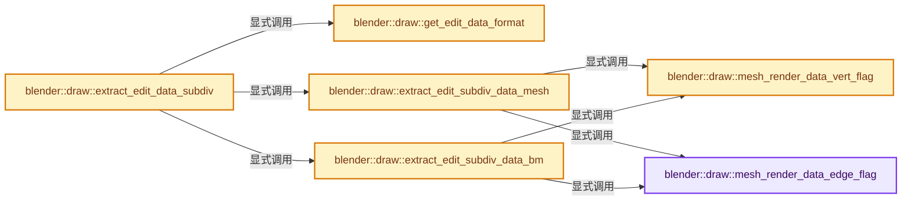
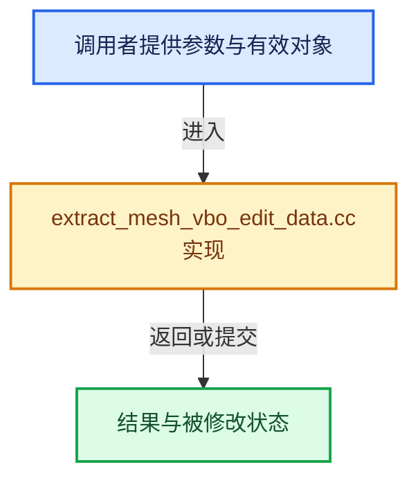

# 实现依赖专题：source/blender/draw/intern/mesh_extractors/extract_mesh_vbo_edit_data.cc

[实现依赖导航](../../../../README.md) · [符号索引](../../../../../00-课程指南/02-源码与提交索引/符号依赖与实现索引.md)

本专题从正文实际调用进入，集中保存共享实现。函数有稳定锚点，可从调用处直接跳到对应完整函数；递归与互相调用通过回链组织。

## 本文件的实现关系






## 完整成员与函数实现

<a id="f-99e176c607526cea"></a>

### `blender::draw::mesh_render_data_edge_flag`

实现位置：[source/blender/draw/intern/mesh_extractors/extract_mesh_vbo_edit_data.cc](../../../../../../../../../source/blender/draw/intern/mesh_extractors/extract_mesh_vbo_edit_data.cc) · L19—L80。

接口参数：

- `const MeshRenderData &mr`
- `const BMEdge *eed`
- `EditLoopData &eattr`

**教学注释版**

<!-- annotated:0f7ae3abfe1667 -->

```cpp
static void mesh_render_data_edge_flag(const MeshRenderData &mr,
                                       const BMEdge *eed,
                                       EditLoopData &eattr)
{
  const ToolSettings *ts = mr.toolsettings;
  const bool is_vertex_select_mode = (ts != nullptr) && (ts->selectmode & SCE_SELECT_VERTEX) != 0;
  const bool is_face_only_select_mode = (ts != nullptr) && (ts->selectmode == SCE_SELECT_FACE);

  if (eed == mr.eed_act) {
    eattr.e_flag |= VFLAG_EDGE_ACTIVE;
  }
  if (!is_vertex_select_mode && BM_elem_flag_test(eed, BM_ELEM_SELECT)) {
    eattr.e_flag |= VFLAG_EDGE_SELECTED;
  }
  if (is_vertex_select_mode && BM_elem_flag_test(eed->v1, BM_ELEM_SELECT) &&
      BM_elem_flag_test(eed->v2, BM_ELEM_SELECT))
  {
    eattr.e_flag |= VFLAG_EDGE_SELECTED;
    eattr.e_flag |= VFLAG_VERT_SELECTED;
  }
  if (BM_elem_flag_test(eed, BM_ELEM_SEAM)) {
    eattr.e_flag |= VFLAG_EDGE_SEAM;
  }
  if (!BM_elem_flag_test(eed, BM_ELEM_SMOOTH)) {
    eattr.e_flag |= VFLAG_EDGE_SHARP;
  }

  /* Use active edge color for active face edges because
   * specular highlights make it hard to see #55456#510873.
   *
   * This isn't ideal since it can't be used when mixing edge/face modes
   * but it's still better than not being able to see the active face. */
  if (is_face_only_select_mode) {
    if (mr.efa_act != nullptr) {
      if (BM_edge_in_face(eed, mr.efa_act)) {
        eattr.e_flag |= VFLAG_EDGE_ACTIVE;
      }
    }
  }

  /* Use half a byte for value range */
  if (mr.edge_crease_ofs != -1) {
    float crease = BM_ELEM_CD_GET_FLOAT(eed, mr.edge_crease_ofs);
    if (crease > 0) {
      eattr.crease = uchar(ceil(crease * 15.0f));
    }
  }
  /* Use a byte for value range */
  if (mr.bweight_ofs != -1) {
    float bweight = BM_ELEM_CD_GET_FLOAT(eed, mr.bweight_ofs);
    if (bweight > 0) {
      eattr.bweight = uchar(bweight * 255.0f);
    }
  }
#ifdef WITH_FREESTYLE
  if (mr.freestyle_edge_ofs != -1) {
    if (BM_ELEM_CD_GET_BOOL(eed, mr.freestyle_edge_ofs)) {
      eattr.e_flag |= VFLAG_EDGE_FREESTYLE;
    }
  }
#endif
}
```

<details>
<summary>核对原始源码：source/blender/draw/intern/mesh_extractors/extract_mesh_vbo_edit_data.cc · L19—L80</summary>

<!-- original:0f7ae3abfe1667:source/blender/draw/intern/mesh_extractors/extract_mesh_vbo_edit_data.cc:19:80 -->

```cpp
static void mesh_render_data_edge_flag(const MeshRenderData &mr,
                                       const BMEdge *eed,
                                       EditLoopData &eattr)
{
  const ToolSettings *ts = mr.toolsettings;
  const bool is_vertex_select_mode = (ts != nullptr) && (ts->selectmode & SCE_SELECT_VERTEX) != 0;
  const bool is_face_only_select_mode = (ts != nullptr) && (ts->selectmode == SCE_SELECT_FACE);

  if (eed == mr.eed_act) {
    eattr.e_flag |= VFLAG_EDGE_ACTIVE;
  }
  if (!is_vertex_select_mode && BM_elem_flag_test(eed, BM_ELEM_SELECT)) {
    eattr.e_flag |= VFLAG_EDGE_SELECTED;
  }
  if (is_vertex_select_mode && BM_elem_flag_test(eed->v1, BM_ELEM_SELECT) &&
      BM_elem_flag_test(eed->v2, BM_ELEM_SELECT))
  {
    eattr.e_flag |= VFLAG_EDGE_SELECTED;
    eattr.e_flag |= VFLAG_VERT_SELECTED;
  }
  if (BM_elem_flag_test(eed, BM_ELEM_SEAM)) {
    eattr.e_flag |= VFLAG_EDGE_SEAM;
  }
  if (!BM_elem_flag_test(eed, BM_ELEM_SMOOTH)) {
    eattr.e_flag |= VFLAG_EDGE_SHARP;
  }

  /* Use active edge color for active face edges because
   * specular highlights make it hard to see #55456#510873.
   *
   * This isn't ideal since it can't be used when mixing edge/face modes
   * but it's still better than not being able to see the active face. */
  if (is_face_only_select_mode) {
    if (mr.efa_act != nullptr) {
      if (BM_edge_in_face(eed, mr.efa_act)) {
        eattr.e_flag |= VFLAG_EDGE_ACTIVE;
      }
    }
  }

  /* Use half a byte for value range */
  if (mr.edge_crease_ofs != -1) {
    float crease = BM_ELEM_CD_GET_FLOAT(eed, mr.edge_crease_ofs);
    if (crease > 0) {
      eattr.crease = uchar(ceil(crease * 15.0f));
    }
  }
  /* Use a byte for value range */
  if (mr.bweight_ofs != -1) {
    float bweight = BM_ELEM_CD_GET_FLOAT(eed, mr.bweight_ofs);
    if (bweight > 0) {
      eattr.bweight = uchar(bweight * 255.0f);
    }
  }
#ifdef WITH_FREESTYLE
  if (mr.freestyle_edge_ofs != -1) {
    if (BM_ELEM_CD_GET_BOOL(eed, mr.freestyle_edge_ofs)) {
      eattr.e_flag |= VFLAG_EDGE_FREESTYLE;
    }
  }
#endif
}
```

</details>

**沿实际写入检查状态**

- `eattr.e_flag |= VFLAG_EDGE_ACTIVE;`
- `eattr.e_flag |= VFLAG_EDGE_SELECTED;`
- `eattr.e_flag |= VFLAG_VERT_SELECTED;`
- `eattr.e_flag |= VFLAG_EDGE_SEAM;`
- `eattr.e_flag |= VFLAG_EDGE_SHARP;`
- `eattr.crease = uchar(ceil(crease * 15.0f));`
- `eattr.bweight = uchar(bweight * 255.0f);`
- `eattr.e_flag |= VFLAG_EDGE_FREESTYLE;`

**继续追踪实现**

- `BM_elem_flag_test` → [BM_elem_flag_test · L21](../../../bmesh/intern/bmesh_inline.hh.md#m-2431d1179b41)。宏定义由构建条件选择。
- `BM_edge_in_face` → [blender::BM_edge_in_face · L432](../../../bmesh/intern/bmesh_query.cc.md#f-35ed5d132fbe244d)。
- `BM_ELEM_CD_GET_FLOAT` → [BM_ELEM_CD_GET_FLOAT · L630](../../../bmesh/bmesh_class.hh.md#m-f02a9920f7a0)。宏定义由构建条件选择。
- `uchar` → [调用协议](../../../../../00-课程指南/01-路线与规范/模板宏与动态分派协议.md)：函数指针、局部可调用对象或未展开的宏；必须结合调用者环境。调用位置L63。
- `ceil` → [外部契约](https://eel.is/c++draft/)：这个边界按实际表达式及所属类型核对参数、返回值、寿命与失败行为。这里提供接口入口，不声称已解释该第三方版本的内部实现。
- `BM_ELEM_CD_GET_BOOL` → [BM_ELEM_CD_GET_BOOL · L593](../../../bmesh/bmesh_class.hh.md#m-6cba9d53d692)。宏定义由构建条件选择。

<a id="f-13211b24952cc533"></a>

### `blender::draw::mesh_render_data_vert_flag`

实现位置：[source/blender/draw/intern/mesh_extractors/extract_mesh_vbo_edit_data.cc](../../../../../../../../../source/blender/draw/intern/mesh_extractors/extract_mesh_vbo_edit_data.cc) · L82—L99。

接口参数：

- `const MeshRenderData &mr`
- `const BMVert *eve`
- `EditLoopData &eattr`

**教学注释版**

<!-- annotated:2c5cc2993f95e5 -->

```cpp
static void mesh_render_data_vert_flag(const MeshRenderData &mr,
                                       const BMVert *eve,
                                       EditLoopData &eattr)
{
  if (eve == mr.eve_act) {
    eattr.e_flag |= VFLAG_VERT_ACTIVE;
  }
  if (BM_elem_flag_test(eve, BM_ELEM_SELECT)) {
    eattr.e_flag |= VFLAG_VERT_SELECTED;
  }
  /* Use half a byte for value range */
  if (mr.vert_crease_ofs != -1) {
    float crease = BM_ELEM_CD_GET_FLOAT(eve, mr.vert_crease_ofs);
    if (crease > 0) {
      eattr.crease |= uchar(ceil(crease * 15.0f)) << 4;
    }
  }
}
```

<details>
<summary>核对原始源码：source/blender/draw/intern/mesh_extractors/extract_mesh_vbo_edit_data.cc · L82—L99</summary>

<!-- original:2c5cc2993f95e5:source/blender/draw/intern/mesh_extractors/extract_mesh_vbo_edit_data.cc:82:99 -->

```cpp
static void mesh_render_data_vert_flag(const MeshRenderData &mr,
                                       const BMVert *eve,
                                       EditLoopData &eattr)
{
  if (eve == mr.eve_act) {
    eattr.e_flag |= VFLAG_VERT_ACTIVE;
  }
  if (BM_elem_flag_test(eve, BM_ELEM_SELECT)) {
    eattr.e_flag |= VFLAG_VERT_SELECTED;
  }
  /* Use half a byte for value range */
  if (mr.vert_crease_ofs != -1) {
    float crease = BM_ELEM_CD_GET_FLOAT(eve, mr.vert_crease_ofs);
    if (crease > 0) {
      eattr.crease |= uchar(ceil(crease * 15.0f)) << 4;
    }
  }
}
```

</details>

**沿实际写入检查状态**

- `eattr.e_flag |= VFLAG_VERT_ACTIVE;`
- `eattr.e_flag |= VFLAG_VERT_SELECTED;`
- `eattr.crease |= uchar(ceil(crease * 15.0f)) << 4;`

**继续追踪实现**

- `BM_elem_flag_test` → [BM_elem_flag_test · L21](../../../bmesh/intern/bmesh_inline.hh.md#m-2431d1179b41)。宏定义由构建条件选择。
- `BM_ELEM_CD_GET_FLOAT` → [BM_ELEM_CD_GET_FLOAT · L630](../../../bmesh/bmesh_class.hh.md#m-f02a9920f7a0)。宏定义由构建条件选择。
- `uchar` → [调用协议](../../../../../00-课程指南/01-路线与规范/模板宏与动态分派协议.md)：函数指针、局部可调用对象或未展开的宏；必须结合调用者环境。调用位置L96。
- `ceil` → [外部契约](https://eel.is/c++draft/)：这个边界按实际表达式及所属类型核对参数、返回值、寿命与失败行为。这里提供接口入口，不声称已解释该第三方版本的内部实现。

<a id="f-4bb04d5beb93c97c"></a>

### `blender::draw::get_edit_data_format`

实现位置：[source/blender/draw/intern/mesh_extractors/extract_mesh_vbo_edit_data.cc](../../../../../../../../../source/blender/draw/intern/mesh_extractors/extract_mesh_vbo_edit_data.cc) · L101—L111。

**教学注释版**

<!-- annotated:8f5e7d04ddf364 -->

```cpp
static const GPUVertFormat &get_edit_data_format()
{
  static const GPUVertFormat format = []() {
    GPUVertFormat format{};
    /* WARNING: Adjust #EditLoopData struct accordingly. */
    GPU_vertformat_attr_add(&format, "data", gpu::VertAttrType::UINT_8_8_8_8);
    GPU_vertformat_alias_add(&format, "flag");
    return format;
  }();
  return format;
}
```

<details>
<summary>核对原始源码：source/blender/draw/intern/mesh_extractors/extract_mesh_vbo_edit_data.cc · L101—L111</summary>

<!-- original:8f5e7d04ddf364:source/blender/draw/intern/mesh_extractors/extract_mesh_vbo_edit_data.cc:101:111 -->

```cpp
static const GPUVertFormat &get_edit_data_format()
{
  static const GPUVertFormat format = []() {
    GPUVertFormat format{};
    /* WARNING: Adjust #EditLoopData struct accordingly. */
    GPU_vertformat_attr_add(&format, "data", gpu::VertAttrType::UINT_8_8_8_8);
    GPU_vertformat_alias_add(&format, "flag");
    return format;
  }();
  return format;
}
```

</details>

**结果出口**

- `return format;`

**继续追踪实现**

- `[]() { GPUVertFormat format{}; /* WARNING: Adjust #EditLoopData struct accordingly. */ GPU_vertformat_attr_add(&format, "data", gpu::VertAttrType::UINT_8_8_8_8); GPU_vertformat_alias_add(&format, "flag"); return format; }` → [调用协议](../../../../../00-课程指南/01-路线与规范/模板宏与动态分派协议.md)：函数指针、局部可调用对象或未展开的宏；必须结合调用者环境。调用位置L103。
- `GPU_vertformat_attr_add` → [blender::GPU_vertformat_attr_add · L389](../../../gpu/intern/gpu_vertex_format.cc.md#f-a36e23f37b97fff4)。
- `GPU_vertformat_alias_add` → [blender::GPU_vertformat_alias_add · L418](../../../gpu/intern/gpu_vertex_format.cc.md#f-5b19cd8281d0191e)。

<a id="f-1ec103343a8e836f"></a>

### `blender::draw::extract_edit_subdiv_data_mesh`

实现位置：[source/blender/draw/intern/mesh_extractors/extract_mesh_vbo_edit_data.cc](../../../../../../../../../source/blender/draw/intern/mesh_extractors/extract_mesh_vbo_edit_data.cc) · L238—L315。

接口参数：

- `const MeshRenderData &mr`
- `const DRWSubdivCache &subdiv_cache`
- `MutableSpan<EditLoopData> vbo_data`

**教学注释版**

<!-- annotated:6d73dacd7a314d -->

```cpp
static void extract_edit_subdiv_data_mesh(const MeshRenderData &mr,
                                          const DRWSubdivCache &subdiv_cache,
                                          MutableSpan<EditLoopData> vbo_data)
{
  const BMUVOffsets uv_offsets_none = BMUVOFFSETS_NONE;
  const int corners_num = subdiv_cache.num_subdiv_loops;
  const int loose_edges_num = mr.loose_edges.size();
  const int verts_per_edge = subdiv_verts_per_coarse_edge(subdiv_cache);
  const Span<int> subdiv_loop_face_index(subdiv_cache.subdiv_loop_face_index, corners_num);
  const Span<int> subdiv_loop_vert_index = subdiv_cache.verts_orig_index->data<int>();
  /* NOTE: #subdiv_loop_edge_index already has the origindex layer baked in. */
  const Span<int> subdiv_loop_edge_index = subdiv_cache.edges_orig_index->data<int>();

  // [讲解] vbo_data.take_front：从两端裁去或选取一定数量元素形成新视图。
  MutableSpan corners_data = vbo_data.take_front(corners_num);
  // [讲解] vbo_data.slice：建立原连续范围的子视图。
  MutableSpan loose_edge_data = vbo_data.slice(corners_num, loose_edges_num * verts_per_edge);
  // [讲解] vbo_data.take_back：从两端裁去或选取一定数量元素形成新视图。
  MutableSpan loose_vert_data = vbo_data.take_back(mr.loose_verts.size());

  threading::parallel_for(IndexRange(subdiv_cache.num_subdiv_quads), 2048, [&](IndexRange range) {
    for (const int subdiv_quad : range) {
      const int coarse_face = subdiv_loop_face_index[subdiv_quad * 4];

      EditLoopData face_value = {};
      if (const BMFace *bm_face = bm_original_face_get(mr, coarse_face)) {
        mesh_render_data_face_flag(mr, bm_face, uv_offsets_none, face_value);
      }
      for (const int subdiv_corner : IndexRange(subdiv_quad * 4, 4)) {
        EditLoopData &value = corners_data[subdiv_corner];
        value = face_value;

        const int vert_origindex = subdiv_loop_vert_index[subdiv_corner];
        if (vert_origindex != -1) {
          if (const BMVert *bm_vert = bm_original_vert_get(mr, vert_origindex)) {
            mesh_render_data_vert_flag(mr, bm_vert, value);
          }
        }

        const int edge_origindex = subdiv_loop_edge_index[subdiv_corner];
        if (edge_origindex != -1) {
          if (const BMEdge *bm_edge = BM_edge_at_index(mr.bm, edge_origindex)) {
            mesh_render_data_edge_flag(mr, bm_edge, value);
          }
        }
      }
    }
  });

  const Span<int2> edges = mr.edges;
  mr.loose_edges.foreach_index(
      [&](const int edge_i, const int pos) {
        MutableSpan<EditLoopData> data = loose_edge_data.slice(pos * verts_per_edge,
                                                               verts_per_edge);
        if (const BMEdge *edge = bm_original_edge_get(mr, edge_i)) {
          EditLoopData value{};
          mesh_render_data_edge_flag(mr, edge, value);
          // [讲解] data.fill：修改已有目标元素，不改变底层容器长度。
          data.fill(value);
        }
        else {
          data.fill({});
        }
        const int2 edge = edges[edge_i];
        if (const BMVert *bm_vert = bm_original_vert_get(mr, edge[0])) {
          // [讲解] data.first：按视图边界访问元素。
          mesh_render_data_vert_flag(mr, bm_vert, data.first());
        }
        if (const BMVert *bm_vert = bm_original_vert_get(mr, edge[1])) {
          // [讲解] data.last：按视图边界访问元素。
          mesh_render_data_vert_flag(mr, bm_vert, data.last());
        }
      },
      exec_mode::grain_size(2048));

  mr.loose_verts.foreach_index(
      [&](const int vert, const int pos) {
        loose_vert_data[pos] = {};
        if (const BMVert *eve = bm_original_vert_get(mr, vert)) {
          mesh_render_data_vert_flag(mr, eve, loose_vert_data[pos]);
        }
      },
      exec_mode::grain_size(2048));
}
```

<details>
<summary>核对原始源码：source/blender/draw/intern/mesh_extractors/extract_mesh_vbo_edit_data.cc · L238—L315</summary>

<!-- original:6d73dacd7a314d:source/blender/draw/intern/mesh_extractors/extract_mesh_vbo_edit_data.cc:238:315 -->

```cpp
static void extract_edit_subdiv_data_mesh(const MeshRenderData &mr,
                                          const DRWSubdivCache &subdiv_cache,
                                          MutableSpan<EditLoopData> vbo_data)
{
  const BMUVOffsets uv_offsets_none = BMUVOFFSETS_NONE;
  const int corners_num = subdiv_cache.num_subdiv_loops;
  const int loose_edges_num = mr.loose_edges.size();
  const int verts_per_edge = subdiv_verts_per_coarse_edge(subdiv_cache);
  const Span<int> subdiv_loop_face_index(subdiv_cache.subdiv_loop_face_index, corners_num);
  const Span<int> subdiv_loop_vert_index = subdiv_cache.verts_orig_index->data<int>();
  /* NOTE: #subdiv_loop_edge_index already has the origindex layer baked in. */
  const Span<int> subdiv_loop_edge_index = subdiv_cache.edges_orig_index->data<int>();

  MutableSpan corners_data = vbo_data.take_front(corners_num);
  MutableSpan loose_edge_data = vbo_data.slice(corners_num, loose_edges_num * verts_per_edge);
  MutableSpan loose_vert_data = vbo_data.take_back(mr.loose_verts.size());

  threading::parallel_for(IndexRange(subdiv_cache.num_subdiv_quads), 2048, [&](IndexRange range) {
    for (const int subdiv_quad : range) {
      const int coarse_face = subdiv_loop_face_index[subdiv_quad * 4];

      EditLoopData face_value = {};
      if (const BMFace *bm_face = bm_original_face_get(mr, coarse_face)) {
        mesh_render_data_face_flag(mr, bm_face, uv_offsets_none, face_value);
      }
      for (const int subdiv_corner : IndexRange(subdiv_quad * 4, 4)) {
        EditLoopData &value = corners_data[subdiv_corner];
        value = face_value;

        const int vert_origindex = subdiv_loop_vert_index[subdiv_corner];
        if (vert_origindex != -1) {
          if (const BMVert *bm_vert = bm_original_vert_get(mr, vert_origindex)) {
            mesh_render_data_vert_flag(mr, bm_vert, value);
          }
        }

        const int edge_origindex = subdiv_loop_edge_index[subdiv_corner];
        if (edge_origindex != -1) {
          if (const BMEdge *bm_edge = BM_edge_at_index(mr.bm, edge_origindex)) {
            mesh_render_data_edge_flag(mr, bm_edge, value);
          }
        }
      }
    }
  });

  const Span<int2> edges = mr.edges;
  mr.loose_edges.foreach_index(
      [&](const int edge_i, const int pos) {
        MutableSpan<EditLoopData> data = loose_edge_data.slice(pos * verts_per_edge,
                                                               verts_per_edge);
        if (const BMEdge *edge = bm_original_edge_get(mr, edge_i)) {
          EditLoopData value{};
          mesh_render_data_edge_flag(mr, edge, value);
          data.fill(value);
        }
        else {
          data.fill({});
        }
        const int2 edge = edges[edge_i];
        if (const BMVert *bm_vert = bm_original_vert_get(mr, edge[0])) {
          mesh_render_data_vert_flag(mr, bm_vert, data.first());
        }
        if (const BMVert *bm_vert = bm_original_vert_get(mr, edge[1])) {
          mesh_render_data_vert_flag(mr, bm_vert, data.last());
        }
      },
      exec_mode::grain_size(2048));

  mr.loose_verts.foreach_index(
      [&](const int vert, const int pos) {
        loose_vert_data[pos] = {};
        if (const BMVert *eve = bm_original_vert_get(mr, vert)) {
          mesh_render_data_vert_flag(mr, eve, loose_vert_data[pos]);
        }
      },
      exec_mode::grain_size(2048));
}
```

</details>

**沿实际写入检查状态**

- `value = face_value;`
- `loose_vert_data[pos] = {};`

**继续追踪实现**

- `mr.loose_edges.size` → [调用协议](../../../../../00-课程指南/01-路线与规范/模板宏与动态分派协议.md)：接收对象类型依赖auto、返回值或模板实例；不按同名猜测目标。调用位置L244。
- `subdiv_verts_per_coarse_edge` → [blender::draw::subdiv_verts_per_coarse_edge · L266](../draw_subdivision.hh.md#f-57bd5b1d183a1da8)。
- `subdiv_cache.verts_orig_index->data<int>` → [调用协议](../../../../../00-课程指南/01-路线与规范/模板宏与动态分派协议.md)：接收对象类型依赖auto、返回值或模板实例；不按同名猜测目标。调用位置L247。
- `subdiv_cache.edges_orig_index->data<int>` → [调用协议](../../../../../00-课程指南/01-路线与规范/模板宏与动态分派协议.md)：接收对象类型依赖auto、返回值或模板实例；不按同名猜测目标。调用位置L249。
- `vbo_data.take_front` → [blender::MutableSpan::take_front · L635](../../../../../01-基础容器与现代CPP/06-MutableSpan可写视图.md#f-0a0235d84ddc265d)。
- `vbo_data.slice` → [blender::MutableSpan::slice · L579](../../../../../01-基础容器与现代CPP/06-MutableSpan可写视图.md#f-6808b4aefbf58808)；[blender::MutableSpan::slice · L587](../../../../../01-基础容器与现代CPP/06-MutableSpan可写视图.md#f-c05b010821861e4f)。同名重载需按实参类型选择。
- `vbo_data.take_back` → [blender::MutableSpan::take_back · L646](../../../../../01-基础容器与现代CPP/06-MutableSpan可写视图.md#f-3fce5fbbe328c130)。
- `mr.loose_verts.size` → [调用协议](../../../../../00-课程指南/01-路线与规范/模板宏与动态分派协议.md)：接收对象类型依赖auto、返回值或模板实例；不按同名猜测目标。调用位置L253。
- `threading::parallel_for` → [blender::threading::parallel_for · L68](../../../../../11-Depsgraph与并行任务系统/07-任务池与TBB接入.md#f-838294754c24426c)。
- `IndexRange` → [blender::IndexRange](../../../../01-BLI基础库/BLI_index_range.hh.md#t-caa3466d6776)；[blender::gpu::shader::parser::IndexRange](../../../gpu/shader_tool/utils.hh.md#t-82d2bd4ea71c)；[blender::IndexRange](../../../makesdna/DNA_node_types.h.md#t-0448cc889d39)。
- `bm_original_face_get` → [blender::draw::bm_original_face_get · L138](extract_mesh.hh.md#f-50ae48e6025f345a)。
- `mesh_render_data_face_flag` → [blender::draw::mesh_render_data_face_flag · L25](extract_mesh.cc.md#f-78bb4555cc3bf13e)。
- `bm_original_vert_get` → [blender::draw::bm_original_vert_get · L154](extract_mesh.hh.md#f-45547245e3f51daa)。
- `mesh_render_data_vert_flag` → [blender::draw::mesh_render_data_vert_flag · L82](extract_mesh_vbo_edit_data.cc.md#f-13211b24952cc533)。
- `BM_edge_at_index` → [blender::BM_edge_at_index · L116](../../../bmesh/intern/bmesh_mesh.hh.md#f-81d027fd9e6b4c84)。
- `mesh_render_data_edge_flag` → [blender::draw::mesh_render_data_edge_flag · L19](extract_mesh_vbo_edit_data.cc.md#f-99e176c607526cea)。
- `mr.loose_edges.foreach_index` → [调用协议](../../../../../00-课程指南/01-路线与规范/模板宏与动态分派协议.md)：接收对象类型依赖auto、返回值或模板实例；不按同名猜测目标。调用位置L285。
- `loose_edge_data.slice` → [blender::MutableSpan::slice · L579](../../../../../01-基础容器与现代CPP/06-MutableSpan可写视图.md#f-6808b4aefbf58808)；[blender::MutableSpan::slice · L587](../../../../../01-基础容器与现代CPP/06-MutableSpan可写视图.md#f-c05b010821861e4f)。同名重载需按实参类型选择。
- `bm_original_edge_get` → [blender::draw::bm_original_edge_get · L146](extract_mesh.hh.md#f-5abdd93646642da5)。
- `data.fill` → [blender::MutableSpan::fill · L523](../../../../../01-基础容器与现代CPP/06-MutableSpan可写视图.md#f-8daedd52c727ec26)。
- `data.first` → [blender::MutableSpan::first · L685](../../../../../01-基础容器与现代CPP/06-MutableSpan可写视图.md#f-3126bab9f43cee1c)。
- `data.last` → [blender::MutableSpan::last · L695](../../../../../01-基础容器与现代CPP/06-MutableSpan可写视图.md#f-73191eeabe29aab7)。
- `exec_mode::grain_size` → [blender::exec_mode::grain_size · L79](../../../../01-BLI基础库/BLI_execution_mode.hh.md#f-0b4fc2f9fa6e66e7)。
- `mr.loose_verts.foreach_index` → [调用协议](../../../../../00-课程指南/01-路线与规范/模板宏与动态分派协议.md)：接收对象类型依赖auto、返回值或模板实例；不按同名猜测目标。调用位置L307。

<a id="f-13a07b2e6fc40f71"></a>

### `blender::draw::extract_edit_subdiv_data_bm`

实现位置：[source/blender/draw/intern/mesh_extractors/extract_mesh_vbo_edit_data.cc](../../../../../../../../../source/blender/draw/intern/mesh_extractors/extract_mesh_vbo_edit_data.cc) · L317—L381。

接口参数：

- `const MeshRenderData &mr`
- `const DRWSubdivCache &subdiv_cache`
- `MutableSpan<EditLoopData> vbo_data`

**教学注释版**

<!-- annotated:20772797be43e5 -->

```cpp
static void extract_edit_subdiv_data_bm(const MeshRenderData &mr,
                                        const DRWSubdivCache &subdiv_cache,
                                        MutableSpan<EditLoopData> vbo_data)
{
  const BMUVOffsets uv_offsets_none = BMUVOFFSETS_NONE;
  const int corners_num = subdiv_cache.num_subdiv_loops;
  const int loose_edges_num = mr.loose_edges.size();
  const int verts_per_edge = subdiv_verts_per_coarse_edge(subdiv_cache);
  const Span<int> subdiv_loop_face_index(subdiv_cache.subdiv_loop_face_index, corners_num);
  const Span<int> subdiv_loop_vert_index = subdiv_cache.verts_orig_index->data<int>();
  const Span<int> subdiv_loop_edge_index = subdiv_cache.edges_orig_index->data<int>();

  // [讲解] vbo_data.take_front：从两端裁去或选取一定数量元素形成新视图。
  MutableSpan corners_data = vbo_data.take_front(corners_num);
  // [讲解] vbo_data.slice：建立原连续范围的子视图。
  MutableSpan loose_edge_data = vbo_data.slice(corners_num, loose_edges_num * verts_per_edge);
  // [讲解] vbo_data.take_back：从两端裁去或选取一定数量元素形成新视图。
  MutableSpan loose_vert_data = vbo_data.take_back(mr.loose_verts.size());

  BMesh &bm = *mr.bm;
  threading::parallel_for(IndexRange(subdiv_cache.num_subdiv_quads), 2048, [&](IndexRange range) {
    for (const int subdiv_quad : range) {
      const int coarse_face = subdiv_loop_face_index[subdiv_quad * 4];
      const BMFace *bm_face = BM_face_at_index(&bm, coarse_face);

      EditLoopData face_value = {};
      mesh_render_data_face_flag(mr, bm_face, uv_offsets_none, face_value);

      for (const int subdiv_corner : IndexRange(subdiv_quad * 4, 4)) {
        EditLoopData &value = corners_data[subdiv_corner];
        value = face_value;

        const int vert_origindex = subdiv_loop_vert_index[subdiv_corner];
        if (vert_origindex != -1) {
          const BMVert *bm_vert = BM_vert_at_index(mr.bm, vert_origindex);
          mesh_render_data_vert_flag(mr, bm_vert, value);
        }

        const int edge_origindex = subdiv_loop_edge_index[subdiv_corner];
        if (edge_origindex != -1) {
          const BMEdge *bm_edge = BM_edge_at_index(mr.bm, edge_origindex);
          mesh_render_data_edge_flag(mr, bm_edge, value);
        }
      }
    }
  });

  mr.loose_edges.foreach_index(
      [&](const int edge_i, const int pos) {
        MutableSpan<EditLoopData> data = loose_edge_data.slice(pos * verts_per_edge,
                                                               verts_per_edge);
        const BMEdge *edge = BM_edge_at_index(&bm, edge_i);
        EditLoopData value{};
        mesh_render_data_edge_flag(mr, edge, value);
        // [讲解] data.fill：修改已有目标元素，不改变底层容器长度。
        data.fill(value);
        // [讲解] data.first：按视图边界访问元素。
        mesh_render_data_vert_flag(mr, edge->v1, data.first());
        // [讲解] data.last：按视图边界访问元素。
        mesh_render_data_vert_flag(mr, edge->v2, data.last());
      },
      exec_mode::grain_size(2048));

  mr.loose_verts.foreach_index(
      [&](const int vert_i, const int pos) {
        loose_vert_data[pos] = {};
        const BMVert *vert = BM_vert_at_index(&bm, vert_i);
        mesh_render_data_vert_flag(mr, vert, loose_vert_data[pos]);
      },
      exec_mode::grain_size(2048));
}
```

<details>
<summary>核对原始源码：source/blender/draw/intern/mesh_extractors/extract_mesh_vbo_edit_data.cc · L317—L381</summary>

<!-- original:20772797be43e5:source/blender/draw/intern/mesh_extractors/extract_mesh_vbo_edit_data.cc:317:381 -->

```cpp
static void extract_edit_subdiv_data_bm(const MeshRenderData &mr,
                                        const DRWSubdivCache &subdiv_cache,
                                        MutableSpan<EditLoopData> vbo_data)
{
  const BMUVOffsets uv_offsets_none = BMUVOFFSETS_NONE;
  const int corners_num = subdiv_cache.num_subdiv_loops;
  const int loose_edges_num = mr.loose_edges.size();
  const int verts_per_edge = subdiv_verts_per_coarse_edge(subdiv_cache);
  const Span<int> subdiv_loop_face_index(subdiv_cache.subdiv_loop_face_index, corners_num);
  const Span<int> subdiv_loop_vert_index = subdiv_cache.verts_orig_index->data<int>();
  const Span<int> subdiv_loop_edge_index = subdiv_cache.edges_orig_index->data<int>();

  MutableSpan corners_data = vbo_data.take_front(corners_num);
  MutableSpan loose_edge_data = vbo_data.slice(corners_num, loose_edges_num * verts_per_edge);
  MutableSpan loose_vert_data = vbo_data.take_back(mr.loose_verts.size());

  BMesh &bm = *mr.bm;
  threading::parallel_for(IndexRange(subdiv_cache.num_subdiv_quads), 2048, [&](IndexRange range) {
    for (const int subdiv_quad : range) {
      const int coarse_face = subdiv_loop_face_index[subdiv_quad * 4];
      const BMFace *bm_face = BM_face_at_index(&bm, coarse_face);

      EditLoopData face_value = {};
      mesh_render_data_face_flag(mr, bm_face, uv_offsets_none, face_value);

      for (const int subdiv_corner : IndexRange(subdiv_quad * 4, 4)) {
        EditLoopData &value = corners_data[subdiv_corner];
        value = face_value;

        const int vert_origindex = subdiv_loop_vert_index[subdiv_corner];
        if (vert_origindex != -1) {
          const BMVert *bm_vert = BM_vert_at_index(mr.bm, vert_origindex);
          mesh_render_data_vert_flag(mr, bm_vert, value);
        }

        const int edge_origindex = subdiv_loop_edge_index[subdiv_corner];
        if (edge_origindex != -1) {
          const BMEdge *bm_edge = BM_edge_at_index(mr.bm, edge_origindex);
          mesh_render_data_edge_flag(mr, bm_edge, value);
        }
      }
    }
  });

  mr.loose_edges.foreach_index(
      [&](const int edge_i, const int pos) {
        MutableSpan<EditLoopData> data = loose_edge_data.slice(pos * verts_per_edge,
                                                               verts_per_edge);
        const BMEdge *edge = BM_edge_at_index(&bm, edge_i);
        EditLoopData value{};
        mesh_render_data_edge_flag(mr, edge, value);
        data.fill(value);
        mesh_render_data_vert_flag(mr, edge->v1, data.first());
        mesh_render_data_vert_flag(mr, edge->v2, data.last());
      },
      exec_mode::grain_size(2048));

  mr.loose_verts.foreach_index(
      [&](const int vert_i, const int pos) {
        loose_vert_data[pos] = {};
        const BMVert *vert = BM_vert_at_index(&bm, vert_i);
        mesh_render_data_vert_flag(mr, vert, loose_vert_data[pos]);
      },
      exec_mode::grain_size(2048));
}
```

</details>

**沿实际写入检查状态**

- `value = face_value;`
- `loose_vert_data[pos] = {};`

**继续追踪实现**

- `mr.loose_edges.size` → [调用协议](../../../../../00-课程指南/01-路线与规范/模板宏与动态分派协议.md)：接收对象类型依赖auto、返回值或模板实例；不按同名猜测目标。调用位置L323。
- `subdiv_verts_per_coarse_edge` → [blender::draw::subdiv_verts_per_coarse_edge · L266](../draw_subdivision.hh.md#f-57bd5b1d183a1da8)。
- `subdiv_cache.verts_orig_index->data<int>` → [调用协议](../../../../../00-课程指南/01-路线与规范/模板宏与动态分派协议.md)：接收对象类型依赖auto、返回值或模板实例；不按同名猜测目标。调用位置L326。
- `subdiv_cache.edges_orig_index->data<int>` → [调用协议](../../../../../00-课程指南/01-路线与规范/模板宏与动态分派协议.md)：接收对象类型依赖auto、返回值或模板实例；不按同名猜测目标。调用位置L327。
- `vbo_data.take_front` → [blender::MutableSpan::take_front · L635](../../../../../01-基础容器与现代CPP/06-MutableSpan可写视图.md#f-0a0235d84ddc265d)。
- `vbo_data.slice` → [blender::MutableSpan::slice · L579](../../../../../01-基础容器与现代CPP/06-MutableSpan可写视图.md#f-6808b4aefbf58808)；[blender::MutableSpan::slice · L587](../../../../../01-基础容器与现代CPP/06-MutableSpan可写视图.md#f-c05b010821861e4f)。同名重载需按实参类型选择。
- `vbo_data.take_back` → [blender::MutableSpan::take_back · L646](../../../../../01-基础容器与现代CPP/06-MutableSpan可写视图.md#f-3fce5fbbe328c130)。
- `mr.loose_verts.size` → [调用协议](../../../../../00-课程指南/01-路线与规范/模板宏与动态分派协议.md)：接收对象类型依赖auto、返回值或模板实例；不按同名猜测目标。调用位置L331。
- `threading::parallel_for` → [blender::threading::parallel_for · L68](../../../../../11-Depsgraph与并行任务系统/07-任务池与TBB接入.md#f-838294754c24426c)。
- `IndexRange` → [blender::IndexRange](../../../../01-BLI基础库/BLI_index_range.hh.md#t-caa3466d6776)；[blender::gpu::shader::parser::IndexRange](../../../gpu/shader_tool/utils.hh.md#t-82d2bd4ea71c)；[blender::IndexRange](../../../makesdna/DNA_node_types.h.md#t-0448cc889d39)。
- `BM_face_at_index` → [blender::BM_face_at_index · L122](../../../bmesh/intern/bmesh_mesh.hh.md#f-366df62c166d5094)。
- `mesh_render_data_face_flag` → [blender::draw::mesh_render_data_face_flag · L25](extract_mesh.cc.md#f-78bb4555cc3bf13e)。
- `BM_vert_at_index` → [blender::BM_vert_at_index · L110](../../../bmesh/intern/bmesh_mesh.hh.md#f-aced0ebcd417a2f4)。
- `mesh_render_data_vert_flag` → [blender::draw::mesh_render_data_vert_flag · L82](extract_mesh_vbo_edit_data.cc.md#f-13211b24952cc533)。
- `BM_edge_at_index` → [blender::BM_edge_at_index · L116](../../../bmesh/intern/bmesh_mesh.hh.md#f-81d027fd9e6b4c84)。
- `mesh_render_data_edge_flag` → [blender::draw::mesh_render_data_edge_flag · L19](extract_mesh_vbo_edit_data.cc.md#f-99e176c607526cea)。
- `mr.loose_edges.foreach_index` → [调用协议](../../../../../00-课程指南/01-路线与规范/模板宏与动态分派协议.md)：接收对象类型依赖auto、返回值或模板实例；不按同名猜测目标。调用位置L361。
- `loose_edge_data.slice` → [blender::MutableSpan::slice · L579](../../../../../01-基础容器与现代CPP/06-MutableSpan可写视图.md#f-6808b4aefbf58808)；[blender::MutableSpan::slice · L587](../../../../../01-基础容器与现代CPP/06-MutableSpan可写视图.md#f-c05b010821861e4f)。同名重载需按实参类型选择。
- `data.fill` → [blender::MutableSpan::fill · L523](../../../../../01-基础容器与现代CPP/06-MutableSpan可写视图.md#f-8daedd52c727ec26)。
- `data.first` → [blender::MutableSpan::first · L685](../../../../../01-基础容器与现代CPP/06-MutableSpan可写视图.md#f-3126bab9f43cee1c)。
- `data.last` → [blender::MutableSpan::last · L695](../../../../../01-基础容器与现代CPP/06-MutableSpan可写视图.md#f-73191eeabe29aab7)。
- `exec_mode::grain_size` → [blender::exec_mode::grain_size · L79](../../../../01-BLI基础库/BLI_execution_mode.hh.md#f-0b4fc2f9fa6e66e7)。
- `mr.loose_verts.foreach_index` → [调用协议](../../../../../00-课程指南/01-路线与规范/模板宏与动态分派协议.md)：接收对象类型依赖auto、返回值或模板实例；不按同名猜测目标。调用位置L374。

<a id="f-a8e44bef70851ece"></a>

### `blender::draw::extract_edit_data_subdiv`

实现位置：[source/blender/draw/intern/mesh_extractors/extract_mesh_vbo_edit_data.cc](../../../../../../../../../source/blender/draw/intern/mesh_extractors/extract_mesh_vbo_edit_data.cc) · L383—L397。

接口参数：

- `const MeshRenderData &mr`
- `const DRWSubdivCache &subdiv_cache`

**教学注释版**

<!-- annotated:5402be50ee0ff9 -->

```cpp
gpu::VertBufPtr extract_edit_data_subdiv(const MeshRenderData &mr,
                                         const DRWSubdivCache &subdiv_cache)
{
  gpu::VertBufPtr vbo = gpu::VertBufPtr(GPU_vertbuf_create_with_format(get_edit_data_format()));
  const int size = subdiv_full_vbo_size(mr, subdiv_cache);
  GPU_vertbuf_data_alloc(*vbo, size);
  MutableSpan vbo_data = vbo->data<EditLoopData>();
  if (mr.extract_type == MeshExtractType::Mesh) {
    extract_edit_subdiv_data_mesh(mr, subdiv_cache, vbo_data);
  }
  else {
    extract_edit_subdiv_data_bm(mr, subdiv_cache, vbo_data);
  }
  return vbo;
}
```

<details>
<summary>核对原始源码：source/blender/draw/intern/mesh_extractors/extract_mesh_vbo_edit_data.cc · L383—L397</summary>

<!-- original:5402be50ee0ff9:source/blender/draw/intern/mesh_extractors/extract_mesh_vbo_edit_data.cc:383:397 -->

```cpp
gpu::VertBufPtr extract_edit_data_subdiv(const MeshRenderData &mr,
                                         const DRWSubdivCache &subdiv_cache)
{
  gpu::VertBufPtr vbo = gpu::VertBufPtr(GPU_vertbuf_create_with_format(get_edit_data_format()));
  const int size = subdiv_full_vbo_size(mr, subdiv_cache);
  GPU_vertbuf_data_alloc(*vbo, size);
  MutableSpan vbo_data = vbo->data<EditLoopData>();
  if (mr.extract_type == MeshExtractType::Mesh) {
    extract_edit_subdiv_data_mesh(mr, subdiv_cache, vbo_data);
  }
  else {
    extract_edit_subdiv_data_bm(mr, subdiv_cache, vbo_data);
  }
  return vbo;
}
```

</details>

**结果出口**

- `return vbo;`

**继续追踪实现**

- `gpu::VertBufPtr` → [调用协议](../../../../../00-课程指南/01-路线与规范/模板宏与动态分派协议.md)：函数指针、局部可调用对象或未展开的宏；必须结合调用者环境。调用位置L386。
- `GPU_vertbuf_create_with_format` → [blender::GPU_vertbuf_create_with_format · L71](../../../gpu/GPU_vertex_buffer.hh.md#f-bd43fe034e852138)。
- `get_edit_data_format` → [blender::draw::get_edit_data_format · L101](extract_mesh_vbo_edit_data.cc.md#f-4bb04d5beb93c97c)。
- `subdiv_full_vbo_size` → [blender::draw::subdiv_full_vbo_size · L278](../draw_subdivision.hh.md#f-9ffb9094e78cfdac)。
- `GPU_vertbuf_data_alloc` → [blender::GPU_vertbuf_data_alloc · L172](../../../gpu/intern/gpu_vertex_buffer.cc.md#f-8ee5cf106e0f2b0f)。
- `vbo->data<EditLoopData>` → [blender::draw::data · L124](../DRW_gpu_wrapper.hh.md#f-dc115dc22e0c9f33)；[blender::draw::data · L129](../DRW_gpu_wrapper.hh.md#f-5f325cb75387045c)。同名重载需按实参类型选择。
- `extract_edit_subdiv_data_mesh` → [blender::draw::extract_edit_subdiv_data_mesh · L238](extract_mesh_vbo_edit_data.cc.md#f-1ec103343a8e836f)。
- `extract_edit_subdiv_data_bm` → [blender::draw::extract_edit_subdiv_data_bm · L317](extract_mesh_vbo_edit_data.cc.md#f-13a07b2e6fc40f71)。
