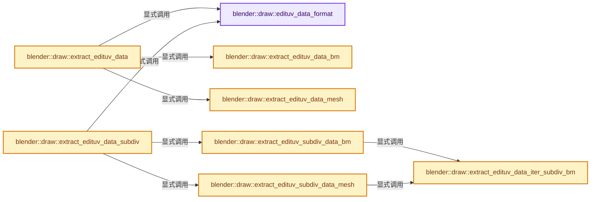
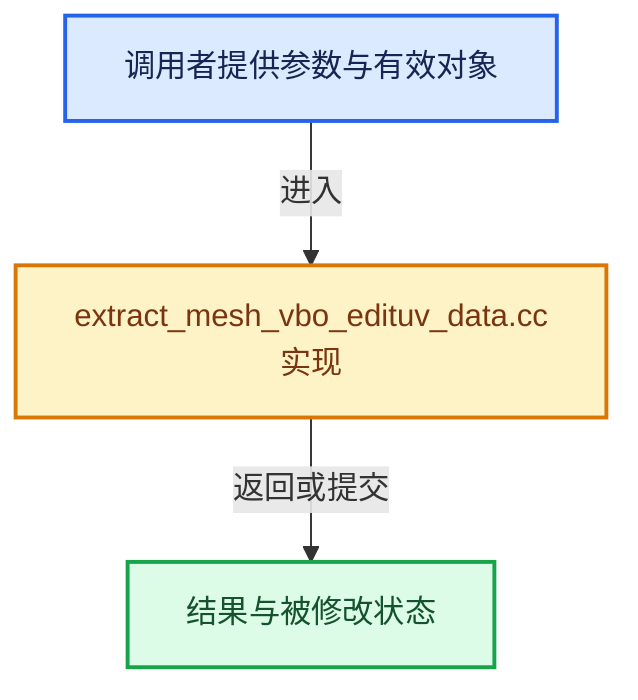

# 实现依赖专题：source/blender/draw/intern/mesh_extractors/extract_mesh_vbo_edituv_data.cc

[实现依赖导航](../../../../README.md) · [符号索引](../../../../../00-课程指南/02-源码与提交索引/符号依赖与实现索引.md)

本专题从正文实际调用进入，集中保存共享实现。函数有稳定锚点，可从调用处直接跳到对应完整函数；递归与互相调用通过回链组织。

## 本文件的实现关系






## 完整成员与函数实现

<a id="f-e337407e4ae49203"></a>

### `blender::draw::edituv_data_format`

实现位置：[source/blender/draw/intern/mesh_extractors/extract_mesh_vbo_edituv_data.cc](../../../../../../../../../source/blender/draw/intern/mesh_extractors/extract_mesh_vbo_edituv_data.cc) · L23—L33。

**教学注释版**

<!-- annotated:6029676dc65a04 -->

```cpp
static const GPUVertFormat &edituv_data_format()
{
  static const GPUVertFormat format = []() {
    GPUVertFormat format{};
    /* WARNING: Adjust #EditLoopData struct accordingly. */
    GPU_vertformat_attr_add(&format, "data", gpu::VertAttrType::UINT_8_8_8_8);
    GPU_vertformat_alias_add(&format, "flag");
    return format;
  }();
  return format;
}
```

<details>
<summary>核对原始源码：source/blender/draw/intern/mesh_extractors/extract_mesh_vbo_edituv_data.cc · L23—L33</summary>

<!-- original:6029676dc65a04:source/blender/draw/intern/mesh_extractors/extract_mesh_vbo_edituv_data.cc:23:33 -->

```cpp
static const GPUVertFormat &edituv_data_format()
{
  static const GPUVertFormat format = []() {
    GPUVertFormat format{};
    /* WARNING: Adjust #EditLoopData struct accordingly. */
    GPU_vertformat_attr_add(&format, "data", gpu::VertAttrType::UINT_8_8_8_8);
    GPU_vertformat_alias_add(&format, "flag");
    return format;
  }();
  return format;
}
```

</details>

**结果出口**

- `return format;`

**继续追踪实现**

- `[]() { GPUVertFormat format{}; /* WARNING: Adjust #EditLoopData struct accordingly. */ GPU_vertformat_attr_add(&format, "data", gpu::VertAttrType::UINT_8_8_8_8); GPU_vertformat_alias_add(&format, "flag"); return format; }` → [调用协议](../../../../../00-课程指南/01-路线与规范/模板宏与动态分派协议.md)：函数指针、局部可调用对象或未展开的宏；必须结合调用者环境。调用位置L25。
- `GPU_vertformat_attr_add` → [blender::GPU_vertformat_attr_add · L389](../../../gpu/intern/gpu_vertex_format.cc.md#f-a36e23f37b97fff4)。
- `GPU_vertformat_alias_add` → [blender::GPU_vertformat_alias_add · L418](../../../gpu/intern/gpu_vertex_format.cc.md#f-5b19cd8281d0191e)。

<a id="f-ca30f50c26c9be70"></a>

### `blender::draw::extract_edituv_data_bm`

实现位置：[source/blender/draw/intern/mesh_extractors/extract_mesh_vbo_edituv_data.cc](../../../../../../../../../source/blender/draw/intern/mesh_extractors/extract_mesh_vbo_edituv_data.cc) · L35—L55。

接口参数：

- `const MeshRenderData &mr`
- `MutableSpan<EditLoopData> vbo_data`

**教学注释版**

<!-- annotated:3b3a979b0a9af0 -->

```cpp
static void extract_edituv_data_bm(const MeshRenderData &mr, MutableSpan<EditLoopData> vbo_data)
{
  const BMesh &bm = *mr.bm;
  const BMUVOffsets offsets = BM_uv_map_offsets_get(&bm);
  threading::parallel_for(IndexRange(bm.totface), 2048, [&](const IndexRange range) {
    for (const int face_index : range) {
      const BMFace &face = *BM_face_at_index(&const_cast<BMesh &>(bm), face_index);
      EditLoopData face_value = {};
      mesh_render_data_face_flag(mr, &face, offsets, face_value);
      const BMLoop *loop = BM_FACE_FIRST_LOOP(&face);
      for ([[maybe_unused]] const int i : IndexRange(face.len)) {
        const int index = BM_elem_index_get(loop);
        EditLoopData &value = vbo_data[index];
        value = face_value;
        mesh_render_data_loop_flag(mr, loop, offsets, value);
        mesh_render_data_loop_edge_flag(mr, loop, offsets, value);
        loop = loop->next;
      }
    }
  });
}
```

<details>
<summary>核对原始源码：source/blender/draw/intern/mesh_extractors/extract_mesh_vbo_edituv_data.cc · L35—L55</summary>

<!-- original:3b3a979b0a9af0:source/blender/draw/intern/mesh_extractors/extract_mesh_vbo_edituv_data.cc:35:55 -->

```cpp
static void extract_edituv_data_bm(const MeshRenderData &mr, MutableSpan<EditLoopData> vbo_data)
{
  const BMesh &bm = *mr.bm;
  const BMUVOffsets offsets = BM_uv_map_offsets_get(&bm);
  threading::parallel_for(IndexRange(bm.totface), 2048, [&](const IndexRange range) {
    for (const int face_index : range) {
      const BMFace &face = *BM_face_at_index(&const_cast<BMesh &>(bm), face_index);
      EditLoopData face_value = {};
      mesh_render_data_face_flag(mr, &face, offsets, face_value);
      const BMLoop *loop = BM_FACE_FIRST_LOOP(&face);
      for ([[maybe_unused]] const int i : IndexRange(face.len)) {
        const int index = BM_elem_index_get(loop);
        EditLoopData &value = vbo_data[index];
        value = face_value;
        mesh_render_data_loop_flag(mr, loop, offsets, value);
        mesh_render_data_loop_edge_flag(mr, loop, offsets, value);
        loop = loop->next;
      }
    }
  });
}
```

</details>

**沿实际写入检查状态**

- `value = face_value;`
- `loop = loop->next;`

**继续追踪实现**

- `BM_uv_map_offsets_get` → [blender::BM_uv_map_offsets_get · L41](../../../bmesh/intern/bmesh_query_uv.cc.md#f-3ed93ab53a3df44e)。
- `threading::parallel_for` → [blender::threading::parallel_for · L68](../../../../../11-Depsgraph与并行任务系统/07-任务池与TBB接入.md#f-838294754c24426c)。
- `IndexRange` → [blender::IndexRange](../../../../01-BLI基础库/BLI_index_range.hh.md#t-caa3466d6776)；[blender::gpu::shader::parser::IndexRange](../../../gpu/shader_tool/utils.hh.md#t-82d2bd4ea71c)；[blender::IndexRange](../../../makesdna/DNA_node_types.h.md#t-0448cc889d39)。
- `BM_face_at_index` → [blender::BM_face_at_index · L122](../../../bmesh/intern/bmesh_mesh.hh.md#f-366df62c166d5094)。
- `mesh_render_data_face_flag` → [blender::draw::mesh_render_data_face_flag · L25](extract_mesh.cc.md#f-78bb4555cc3bf13e)。
- `BM_FACE_FIRST_LOOP` → [BM_FACE_FIRST_LOOP · L697](../../../bmesh/bmesh_class.hh.md#m-c7e10ffb38e6)；[BM_FACE_FIRST_LOOP · L699](../../../bmesh/bmesh_class.hh.md#m-76a054cc4770)。宏定义由构建条件选择。
- `BM_elem_index_get` → [BM_elem_index_get · L120](../../../bmesh/intern/bmesh_inline.hh.md#m-201981cdc62d)。宏定义由构建条件选择。
- `mesh_render_data_loop_flag` → [blender::draw::mesh_render_data_loop_flag · L55](extract_mesh.cc.md#f-a1fd01bc7b0f896a)。
- `mesh_render_data_loop_edge_flag` → [blender::draw::mesh_render_data_loop_edge_flag · L71](extract_mesh.cc.md#f-5c08a17389b379d1)。

<a id="f-60849f521b8bbfe9"></a>

### `blender::draw::extract_edituv_data_mesh`

实现位置：[source/blender/draw/intern/mesh_extractors/extract_mesh_vbo_edituv_data.cc](../../../../../../../../../source/blender/draw/intern/mesh_extractors/extract_mesh_vbo_edituv_data.cc) · L57—L99。

接口参数：

- `const MeshRenderData &mr`
- `MutableSpan<EditLoopData> vbo_data`

**教学注释版**

<!-- annotated:9d934fe0eab008 -->

```cpp
static void extract_edituv_data_mesh(const MeshRenderData &mr, MutableSpan<EditLoopData> vbo_data)
{
  const BMesh &bm = *mr.bm;
  const BMUVOffsets offsets = BM_uv_map_offsets_get(&bm);
  const OffsetIndices faces = mr.faces;
  const Span<int> corner_verts = mr.corner_verts;
  const Span<int> corner_edges = mr.corner_edges;
  threading::parallel_for(faces.index_range(), 2048, [&](const IndexRange range) {
    for (const int face_index : range) {
      const IndexRange face = faces[face_index];
      BMFace *face_orig = bm_original_face_get(mr, face_index);
      if (!face_orig) {
        // [讲解] vbo_data.slice：建立原连续范围的子视图。
        vbo_data.slice(face).fill({});
        continue;
      }
      for (const int corner : face) {
        EditLoopData &value = vbo_data[corner];
        value = {};
        BMVert *vert = bm_original_vert_get(mr, corner_verts[corner]);
        BMEdge *edge = bm_original_edge_get(mr, corner_edges[corner]);
        if (edge && vert) {
          /* Loop on an edge endpoint. */
          BMLoop *l = BM_face_edge_share_loop(face_orig, edge);
          mesh_render_data_loop_flag(mr, l, offsets, value);
          mesh_render_data_loop_edge_flag(mr, l, offsets, value);
        }
        else {
          if (edge == nullptr) {
            /* Find if the loop's vert is not part of an edit edge.
             * For this, we check if the previous loop was on an edge. */
            const int corner_prev = bke::mesh::face_corner_prev(face, corner);
            edge = bm_original_edge_get(mr, corner_edges[corner_prev]);
          }
          if (edge) {
            /* Mapped points on an edge between two edit verts. */
            BMLoop *l = BM_face_edge_share_loop(face_orig, edge);
            mesh_render_data_loop_edge_flag(mr, l, offsets, value);
          }
        }
      }
    }
  });
}
```

<details>
<summary>核对原始源码：source/blender/draw/intern/mesh_extractors/extract_mesh_vbo_edituv_data.cc · L57—L99</summary>

<!-- original:9d934fe0eab008:source/blender/draw/intern/mesh_extractors/extract_mesh_vbo_edituv_data.cc:57:99 -->

```cpp
static void extract_edituv_data_mesh(const MeshRenderData &mr, MutableSpan<EditLoopData> vbo_data)
{
  const BMesh &bm = *mr.bm;
  const BMUVOffsets offsets = BM_uv_map_offsets_get(&bm);
  const OffsetIndices faces = mr.faces;
  const Span<int> corner_verts = mr.corner_verts;
  const Span<int> corner_edges = mr.corner_edges;
  threading::parallel_for(faces.index_range(), 2048, [&](const IndexRange range) {
    for (const int face_index : range) {
      const IndexRange face = faces[face_index];
      BMFace *face_orig = bm_original_face_get(mr, face_index);
      if (!face_orig) {
        vbo_data.slice(face).fill({});
        continue;
      }
      for (const int corner : face) {
        EditLoopData &value = vbo_data[corner];
        value = {};
        BMVert *vert = bm_original_vert_get(mr, corner_verts[corner]);
        BMEdge *edge = bm_original_edge_get(mr, corner_edges[corner]);
        if (edge && vert) {
          /* Loop on an edge endpoint. */
          BMLoop *l = BM_face_edge_share_loop(face_orig, edge);
          mesh_render_data_loop_flag(mr, l, offsets, value);
          mesh_render_data_loop_edge_flag(mr, l, offsets, value);
        }
        else {
          if (edge == nullptr) {
            /* Find if the loop's vert is not part of an edit edge.
             * For this, we check if the previous loop was on an edge. */
            const int corner_prev = bke::mesh::face_corner_prev(face, corner);
            edge = bm_original_edge_get(mr, corner_edges[corner_prev]);
          }
          if (edge) {
            /* Mapped points on an edge between two edit verts. */
            BMLoop *l = BM_face_edge_share_loop(face_orig, edge);
            mesh_render_data_loop_edge_flag(mr, l, offsets, value);
          }
        }
      }
    }
  });
}
```

</details>

**沿实际写入检查状态**

- `value = {};`
- `edge = bm_original_edge_get(mr, corner_edges[corner_prev]);`

**继续追踪实现**

- `BM_uv_map_offsets_get` → [blender::BM_uv_map_offsets_get · L41](../../../bmesh/intern/bmesh_query_uv.cc.md#f-3ed93ab53a3df44e)。
- `threading::parallel_for` → [blender::threading::parallel_for · L68](../../../../../11-Depsgraph与并行任务系统/07-任务池与TBB接入.md#f-838294754c24426c)。
- `faces.index_range` → [blender::offset_indices::OffsetIndices::index_range · L77](../../../../../05-几何存储与拓扑映射/02-OffsetIndices完整接口.md#f-19b5ca1456de007d)。
- `bm_original_face_get` → [blender::draw::bm_original_face_get · L138](extract_mesh.hh.md#f-50ae48e6025f345a)。
- `vbo_data.slice(face).fill` → [调用协议](../../../../../00-课程指南/01-路线与规范/模板宏与动态分派协议.md)：接收对象类型依赖auto、返回值或模板实例；不按同名猜测目标。调用位置L69。
- `vbo_data.slice` → [blender::MutableSpan::slice · L579](../../../../../01-基础容器与现代CPP/06-MutableSpan可写视图.md#f-6808b4aefbf58808)；[blender::MutableSpan::slice · L587](../../../../../01-基础容器与现代CPP/06-MutableSpan可写视图.md#f-c05b010821861e4f)。同名重载需按实参类型选择。
- `bm_original_vert_get` → [blender::draw::bm_original_vert_get · L154](extract_mesh.hh.md#f-45547245e3f51daa)。
- `bm_original_edge_get` → [blender::draw::bm_original_edge_get · L146](extract_mesh.hh.md#f-5abdd93646642da5)。
- `BM_face_edge_share_loop` → [blender::BM_face_edge_share_loop · L1129](../../../bmesh/intern/bmesh_query.cc.md#f-8f44ad7055b40482)。
- `mesh_render_data_loop_flag` → [blender::draw::mesh_render_data_loop_flag · L55](extract_mesh.cc.md#f-a1fd01bc7b0f896a)。
- `mesh_render_data_loop_edge_flag` → [blender::draw::mesh_render_data_loop_edge_flag · L71](extract_mesh.cc.md#f-5c08a17389b379d1)。
- `bke::mesh::face_corner_prev` → [blender::bke::mesh::face_corner_prev · L306](../../../../../05-几何存储与拓扑映射/01-Mesh顶点边面角点.md#f-7d8f15af3216c9f5)。

<a id="f-a6cb4e07c749d492"></a>

### `blender::draw::extract_edituv_data`

实现位置：[source/blender/draw/intern/mesh_extractors/extract_mesh_vbo_edituv_data.cc](../../../../../../../../../source/blender/draw/intern/mesh_extractors/extract_mesh_vbo_edituv_data.cc) · L101—L114。

接口参数：

- `const MeshRenderData &mr`

**教学注释版**

<!-- annotated:47716c98df255d -->

```cpp
gpu::VertBufPtr extract_edituv_data(const MeshRenderData &mr)
{
  gpu::VertBufPtr vbo = gpu::VertBufPtr(GPU_vertbuf_create_with_format(edituv_data_format()));
  GPU_vertbuf_data_alloc(*vbo, mr.corners_num);
  MutableSpan vbo_data = vbo->data<EditLoopData>();

  if (mr.extract_type == MeshExtractType::BMesh) {
    extract_edituv_data_bm(mr, vbo_data);
  }
  else {
    extract_edituv_data_mesh(mr, vbo_data);
  }
  return vbo;
}
```

<details>
<summary>核对原始源码：source/blender/draw/intern/mesh_extractors/extract_mesh_vbo_edituv_data.cc · L101—L114</summary>

<!-- original:47716c98df255d:source/blender/draw/intern/mesh_extractors/extract_mesh_vbo_edituv_data.cc:101:114 -->

```cpp
gpu::VertBufPtr extract_edituv_data(const MeshRenderData &mr)
{
  gpu::VertBufPtr vbo = gpu::VertBufPtr(GPU_vertbuf_create_with_format(edituv_data_format()));
  GPU_vertbuf_data_alloc(*vbo, mr.corners_num);
  MutableSpan vbo_data = vbo->data<EditLoopData>();

  if (mr.extract_type == MeshExtractType::BMesh) {
    extract_edituv_data_bm(mr, vbo_data);
  }
  else {
    extract_edituv_data_mesh(mr, vbo_data);
  }
  return vbo;
}
```

</details>

**结果出口**

- `return vbo;`

**继续追踪实现**

- `gpu::VertBufPtr` → [调用协议](../../../../../00-课程指南/01-路线与规范/模板宏与动态分派协议.md)：函数指针、局部可调用对象或未展开的宏；必须结合调用者环境。调用位置L103。
- `GPU_vertbuf_create_with_format` → [blender::GPU_vertbuf_create_with_format · L71](../../../gpu/GPU_vertex_buffer.hh.md#f-bd43fe034e852138)。
- `edituv_data_format` → [blender::draw::edituv_data_format · L23](extract_mesh_vbo_edituv_data.cc.md#f-e337407e4ae49203)。
- `GPU_vertbuf_data_alloc` → [blender::GPU_vertbuf_data_alloc · L172](../../../gpu/intern/gpu_vertex_buffer.cc.md#f-8ee5cf106e0f2b0f)。
- `vbo->data<EditLoopData>` → [blender::draw::data · L124](../DRW_gpu_wrapper.hh.md#f-dc115dc22e0c9f33)；[blender::draw::data · L129](../DRW_gpu_wrapper.hh.md#f-5f325cb75387045c)。同名重载需按实参类型选择。
- `extract_edituv_data_bm` → [blender::draw::extract_edituv_data_bm · L35](extract_mesh_vbo_edituv_data.cc.md#f-ca30f50c26c9be70)。
- `extract_edituv_data_mesh` → [blender::draw::extract_edituv_data_mesh · L57](extract_mesh_vbo_edituv_data.cc.md#f-60849f521b8bbfe9)。

<a id="f-7612d6df9690ca49"></a>

### `blender::draw::extract_edituv_data_iter_subdiv_bm`

实现位置：[source/blender/draw/intern/mesh_extractors/extract_mesh_vbo_edituv_data.cc](../../../../../../../../../source/blender/draw/intern/mesh_extractors/extract_mesh_vbo_edituv_data.cc) · L116—L158。

接口参数：

- `const MeshRenderData &mr`
- `const BMUVOffsets &offsets`
- `const Span<int> subdiv_loop_vert_index`
- `const Span<int> subdiv_loop_edge_index`
- `const int subdiv_quad_index`
- `const BMFace *coarse_quad`
- `MutableSpan<EditLoopData> vbo_data`

**教学注释版**

<!-- annotated:5920bfcef69817 -->

```cpp
static void extract_edituv_data_iter_subdiv_bm(const MeshRenderData &mr,
                                               const BMUVOffsets &offsets,
                                               const Span<int> subdiv_loop_vert_index,
                                               const Span<int> subdiv_loop_edge_index,
                                               const int subdiv_quad_index,
                                               const BMFace *coarse_quad,
                                               MutableSpan<EditLoopData> vbo_data)
{

  uint start_loop_idx = subdiv_quad_index * 4;
  uint end_loop_idx = (subdiv_quad_index + 1) * 4;
  EditLoopData edit_loop_data_face = {};
  mesh_render_data_face_flag(mr, coarse_quad, offsets, edit_loop_data_face);
  for (uint i = start_loop_idx; i < end_loop_idx; i++) {
    const int vert_origindex = subdiv_loop_vert_index[i];
    int edge_origindex = subdiv_loop_edge_index[i];

    EditLoopData *edit_loop_data = &vbo_data[i];
    *edit_loop_data = edit_loop_data_face;

    if (vert_origindex != -1 && edge_origindex != -1) {
      BMEdge *eed = BM_edge_at_index(mr.bm, edge_origindex);
      /* Loop on an edge endpoint. */
      BMLoop *l = BM_face_edge_share_loop(const_cast<BMFace *>(coarse_quad), eed);
      mesh_render_data_loop_flag(mr, l, offsets, *edit_loop_data);
      mesh_render_data_loop_edge_flag(mr, l, offsets, *edit_loop_data);
    }
    else {
      if (edge_origindex == -1) {
        /* Find if the loop's vert is not part of an edit edge.
         * For this, we check if the previous loop was on an edge. */
        const uint loop_index_last = (i == start_loop_idx) ? end_loop_idx - 1 : i - 1;
        edge_origindex = subdiv_loop_edge_index[loop_index_last];
      }
      if (edge_origindex != -1) {
        /* Mapped points on an edge between two edit verts. */
        BMEdge *eed = BM_edge_at_index(mr.bm, edge_origindex);
        BMLoop *l = BM_face_edge_share_loop(const_cast<BMFace *>(coarse_quad), eed);
        mesh_render_data_loop_edge_flag(mr, l, offsets, *edit_loop_data);
      }
    }
  }
}
```

<details>
<summary>核对原始源码：source/blender/draw/intern/mesh_extractors/extract_mesh_vbo_edituv_data.cc · L116—L158</summary>

<!-- original:5920bfcef69817:source/blender/draw/intern/mesh_extractors/extract_mesh_vbo_edituv_data.cc:116:158 -->

```cpp
static void extract_edituv_data_iter_subdiv_bm(const MeshRenderData &mr,
                                               const BMUVOffsets &offsets,
                                               const Span<int> subdiv_loop_vert_index,
                                               const Span<int> subdiv_loop_edge_index,
                                               const int subdiv_quad_index,
                                               const BMFace *coarse_quad,
                                               MutableSpan<EditLoopData> vbo_data)
{

  uint start_loop_idx = subdiv_quad_index * 4;
  uint end_loop_idx = (subdiv_quad_index + 1) * 4;
  EditLoopData edit_loop_data_face = {};
  mesh_render_data_face_flag(mr, coarse_quad, offsets, edit_loop_data_face);
  for (uint i = start_loop_idx; i < end_loop_idx; i++) {
    const int vert_origindex = subdiv_loop_vert_index[i];
    int edge_origindex = subdiv_loop_edge_index[i];

    EditLoopData *edit_loop_data = &vbo_data[i];
    *edit_loop_data = edit_loop_data_face;

    if (vert_origindex != -1 && edge_origindex != -1) {
      BMEdge *eed = BM_edge_at_index(mr.bm, edge_origindex);
      /* Loop on an edge endpoint. */
      BMLoop *l = BM_face_edge_share_loop(const_cast<BMFace *>(coarse_quad), eed);
      mesh_render_data_loop_flag(mr, l, offsets, *edit_loop_data);
      mesh_render_data_loop_edge_flag(mr, l, offsets, *edit_loop_data);
    }
    else {
      if (edge_origindex == -1) {
        /* Find if the loop's vert is not part of an edit edge.
         * For this, we check if the previous loop was on an edge. */
        const uint loop_index_last = (i == start_loop_idx) ? end_loop_idx - 1 : i - 1;
        edge_origindex = subdiv_loop_edge_index[loop_index_last];
      }
      if (edge_origindex != -1) {
        /* Mapped points on an edge between two edit verts. */
        BMEdge *eed = BM_edge_at_index(mr.bm, edge_origindex);
        BMLoop *l = BM_face_edge_share_loop(const_cast<BMFace *>(coarse_quad), eed);
        mesh_render_data_loop_edge_flag(mr, l, offsets, *edit_loop_data);
      }
    }
  }
}
```

</details>

**沿实际写入检查状态**

- `edge_origindex = subdiv_loop_edge_index[loop_index_last];`

**继续追踪实现**

- `mesh_render_data_face_flag` → [blender::draw::mesh_render_data_face_flag · L25](extract_mesh.cc.md#f-78bb4555cc3bf13e)。
- `BM_edge_at_index` → [blender::BM_edge_at_index · L116](../../../bmesh/intern/bmesh_mesh.hh.md#f-81d027fd9e6b4c84)。
- `BM_face_edge_share_loop` → [blender::BM_face_edge_share_loop · L1129](../../../bmesh/intern/bmesh_query.cc.md#f-8f44ad7055b40482)。
- `mesh_render_data_loop_flag` → [blender::draw::mesh_render_data_loop_flag · L55](extract_mesh.cc.md#f-a1fd01bc7b0f896a)。
- `mesh_render_data_loop_edge_flag` → [blender::draw::mesh_render_data_loop_edge_flag · L71](extract_mesh.cc.md#f-5c08a17389b379d1)。

<a id="f-dce6ef5bffd18f21"></a>

### `blender::draw::extract_edituv_subdiv_data_bm`

实现位置：[source/blender/draw/intern/mesh_extractors/extract_mesh_vbo_edituv_data.cc](../../../../../../../../../source/blender/draw/intern/mesh_extractors/extract_mesh_vbo_edituv_data.cc) · L160—L183。

接口参数：

- `const MeshRenderData &mr`
- `const DRWSubdivCache &subdiv_cache`
- `MutableSpan<EditLoopData> vbo_data`

**教学注释版**

<!-- annotated:6d37695486811a -->

```cpp
static void extract_edituv_subdiv_data_bm(const MeshRenderData &mr,
                                          const DRWSubdivCache &subdiv_cache,
                                          MutableSpan<EditLoopData> vbo_data)
{
  const int corners_num = subdiv_cache.num_subdiv_loops;
  const Span<int> subdiv_loop_face_index(subdiv_cache.subdiv_loop_face_index, corners_num);
  const Span<int> subdiv_loop_vert_index = subdiv_cache.verts_orig_index->data<int>();
  /* NOTE: #subdiv_loop_edge_index already has the origindex layer baked in. */
  const Span<int> subdiv_loop_edge_index = subdiv_cache.edges_orig_index->data<int>();

  const BMUVOffsets offsets = BM_uv_map_offsets_get(mr.bm);
  threading::parallel_for(IndexRange(subdiv_cache.num_subdiv_quads), 2048, [&](IndexRange range) {
    for (const int subdiv_quad : range) {
      const int coarse_face = subdiv_loop_face_index[subdiv_quad * 4];
      extract_edituv_data_iter_subdiv_bm(mr,
                                         offsets,
                                         subdiv_loop_vert_index,
                                         subdiv_loop_edge_index,
                                         subdiv_quad,
                                         BM_face_at_index(mr.bm, coarse_face),
                                         vbo_data);
    }
  });
}
```

<details>
<summary>核对原始源码：source/blender/draw/intern/mesh_extractors/extract_mesh_vbo_edituv_data.cc · L160—L183</summary>

<!-- original:6d37695486811a:source/blender/draw/intern/mesh_extractors/extract_mesh_vbo_edituv_data.cc:160:183 -->

```cpp
static void extract_edituv_subdiv_data_bm(const MeshRenderData &mr,
                                          const DRWSubdivCache &subdiv_cache,
                                          MutableSpan<EditLoopData> vbo_data)
{
  const int corners_num = subdiv_cache.num_subdiv_loops;
  const Span<int> subdiv_loop_face_index(subdiv_cache.subdiv_loop_face_index, corners_num);
  const Span<int> subdiv_loop_vert_index = subdiv_cache.verts_orig_index->data<int>();
  /* NOTE: #subdiv_loop_edge_index already has the origindex layer baked in. */
  const Span<int> subdiv_loop_edge_index = subdiv_cache.edges_orig_index->data<int>();

  const BMUVOffsets offsets = BM_uv_map_offsets_get(mr.bm);
  threading::parallel_for(IndexRange(subdiv_cache.num_subdiv_quads), 2048, [&](IndexRange range) {
    for (const int subdiv_quad : range) {
      const int coarse_face = subdiv_loop_face_index[subdiv_quad * 4];
      extract_edituv_data_iter_subdiv_bm(mr,
                                         offsets,
                                         subdiv_loop_vert_index,
                                         subdiv_loop_edge_index,
                                         subdiv_quad,
                                         BM_face_at_index(mr.bm, coarse_face),
                                         vbo_data);
    }
  });
}
```

</details>

**继续追踪实现**

- `subdiv_cache.verts_orig_index->data<int>` → [调用协议](../../../../../00-课程指南/01-路线与规范/模板宏与动态分派协议.md)：接收对象类型依赖auto、返回值或模板实例；不按同名猜测目标。调用位置L166。
- `subdiv_cache.edges_orig_index->data<int>` → [调用协议](../../../../../00-课程指南/01-路线与规范/模板宏与动态分派协议.md)：接收对象类型依赖auto、返回值或模板实例；不按同名猜测目标。调用位置L168。
- `BM_uv_map_offsets_get` → [blender::BM_uv_map_offsets_get · L41](../../../bmesh/intern/bmesh_query_uv.cc.md#f-3ed93ab53a3df44e)。
- `threading::parallel_for` → [blender::threading::parallel_for · L68](../../../../../11-Depsgraph与并行任务系统/07-任务池与TBB接入.md#f-838294754c24426c)。
- `IndexRange` → [blender::IndexRange](../../../../01-BLI基础库/BLI_index_range.hh.md#t-caa3466d6776)；[blender::gpu::shader::parser::IndexRange](../../../gpu/shader_tool/utils.hh.md#t-82d2bd4ea71c)；[blender::IndexRange](../../../makesdna/DNA_node_types.h.md#t-0448cc889d39)。
- `extract_edituv_data_iter_subdiv_bm` → [blender::draw::extract_edituv_data_iter_subdiv_bm · L116](extract_mesh_vbo_edituv_data.cc.md#f-7612d6df9690ca49)。
- `BM_face_at_index` → [blender::BM_face_at_index · L122](../../../bmesh/intern/bmesh_mesh.hh.md#f-366df62c166d5094)。

<a id="f-d58c7bcc3d896a1f"></a>

### `blender::draw::extract_edituv_subdiv_data_mesh`

实现位置：[source/blender/draw/intern/mesh_extractors/extract_mesh_vbo_edituv_data.cc](../../../../../../../../../source/blender/draw/intern/mesh_extractors/extract_mesh_vbo_edituv_data.cc) · L185—L208。

接口参数：

- `const MeshRenderData &mr`
- `const DRWSubdivCache &subdiv_cache`
- `MutableSpan<EditLoopData> vbo_data`

**教学注释版**

<!-- annotated:e8e3bebe3531f8 -->

```cpp
static void extract_edituv_subdiv_data_mesh(const MeshRenderData &mr,
                                            const DRWSubdivCache &subdiv_cache,
                                            MutableSpan<EditLoopData> vbo_data)
{
  const int corners_num = subdiv_cache.num_subdiv_loops;
  const Span<int> subdiv_loop_face_index(subdiv_cache.subdiv_loop_face_index, corners_num);
  const Span<int> subdiv_loop_vert_index = subdiv_cache.verts_orig_index->data<int>();
  /* NOTE: #subdiv_loop_edge_index already has the origindex layer baked in. */
  const Span<int> subdiv_loop_edge_index = subdiv_cache.edges_orig_index->data<int>();

  const BMUVOffsets offsets = BM_uv_map_offsets_get(mr.bm);
  threading::parallel_for(IndexRange(subdiv_cache.num_subdiv_quads), 2048, [&](IndexRange range) {
    for (const int subdiv_quad : range) {
      const int coarse_face = subdiv_loop_face_index[subdiv_quad * 4];
      extract_edituv_data_iter_subdiv_bm(mr,
                                         offsets,
                                         subdiv_loop_vert_index,
                                         subdiv_loop_edge_index,
                                         subdiv_quad,
                                         bm_original_face_get(mr, coarse_face),
                                         vbo_data);
    }
  });
}
```

<details>
<summary>核对原始源码：source/blender/draw/intern/mesh_extractors/extract_mesh_vbo_edituv_data.cc · L185—L208</summary>

<!-- original:e8e3bebe3531f8:source/blender/draw/intern/mesh_extractors/extract_mesh_vbo_edituv_data.cc:185:208 -->

```cpp
static void extract_edituv_subdiv_data_mesh(const MeshRenderData &mr,
                                            const DRWSubdivCache &subdiv_cache,
                                            MutableSpan<EditLoopData> vbo_data)
{
  const int corners_num = subdiv_cache.num_subdiv_loops;
  const Span<int> subdiv_loop_face_index(subdiv_cache.subdiv_loop_face_index, corners_num);
  const Span<int> subdiv_loop_vert_index = subdiv_cache.verts_orig_index->data<int>();
  /* NOTE: #subdiv_loop_edge_index already has the origindex layer baked in. */
  const Span<int> subdiv_loop_edge_index = subdiv_cache.edges_orig_index->data<int>();

  const BMUVOffsets offsets = BM_uv_map_offsets_get(mr.bm);
  threading::parallel_for(IndexRange(subdiv_cache.num_subdiv_quads), 2048, [&](IndexRange range) {
    for (const int subdiv_quad : range) {
      const int coarse_face = subdiv_loop_face_index[subdiv_quad * 4];
      extract_edituv_data_iter_subdiv_bm(mr,
                                         offsets,
                                         subdiv_loop_vert_index,
                                         subdiv_loop_edge_index,
                                         subdiv_quad,
                                         bm_original_face_get(mr, coarse_face),
                                         vbo_data);
    }
  });
}
```

</details>

**继续追踪实现**

- `subdiv_cache.verts_orig_index->data<int>` → [调用协议](../../../../../00-课程指南/01-路线与规范/模板宏与动态分派协议.md)：接收对象类型依赖auto、返回值或模板实例；不按同名猜测目标。调用位置L191。
- `subdiv_cache.edges_orig_index->data<int>` → [调用协议](../../../../../00-课程指南/01-路线与规范/模板宏与动态分派协议.md)：接收对象类型依赖auto、返回值或模板实例；不按同名猜测目标。调用位置L193。
- `BM_uv_map_offsets_get` → [blender::BM_uv_map_offsets_get · L41](../../../bmesh/intern/bmesh_query_uv.cc.md#f-3ed93ab53a3df44e)。
- `threading::parallel_for` → [blender::threading::parallel_for · L68](../../../../../11-Depsgraph与并行任务系统/07-任务池与TBB接入.md#f-838294754c24426c)。
- `IndexRange` → [blender::IndexRange](../../../../01-BLI基础库/BLI_index_range.hh.md#t-caa3466d6776)；[blender::gpu::shader::parser::IndexRange](../../../gpu/shader_tool/utils.hh.md#t-82d2bd4ea71c)；[blender::IndexRange](../../../makesdna/DNA_node_types.h.md#t-0448cc889d39)。
- `extract_edituv_data_iter_subdiv_bm` → [blender::draw::extract_edituv_data_iter_subdiv_bm · L116](extract_mesh_vbo_edituv_data.cc.md#f-7612d6df9690ca49)。
- `bm_original_face_get` → [blender::draw::bm_original_face_get · L138](extract_mesh.hh.md#f-50ae48e6025f345a)。

<a id="f-ba6c058f49dc7e99"></a>

### `blender::draw::extract_edituv_data_subdiv`

实现位置：[source/blender/draw/intern/mesh_extractors/extract_mesh_vbo_edituv_data.cc](../../../../../../../../../source/blender/draw/intern/mesh_extractors/extract_mesh_vbo_edituv_data.cc) · L210—L225。

接口参数：

- `const MeshRenderData &mr`
- `const DRWSubdivCache &subdiv_cache`

**教学注释版**

<!-- annotated:3c31c34bfe3495 -->

```cpp
gpu::VertBufPtr extract_edituv_data_subdiv(const MeshRenderData &mr,
                                           const DRWSubdivCache &subdiv_cache)
{
  gpu::VertBufPtr vbo = gpu::VertBufPtr(GPU_vertbuf_create_with_format(edituv_data_format()));
  const int size = subdiv_cache.num_subdiv_loops;
  GPU_vertbuf_data_alloc(*vbo, size);
  MutableSpan vbo_data = vbo->data<EditLoopData>();

  if (mr.extract_type == MeshExtractType::BMesh) {
    extract_edituv_subdiv_data_bm(mr, subdiv_cache, vbo_data);
  }
  else {
    extract_edituv_subdiv_data_mesh(mr, subdiv_cache, vbo_data);
  }
  return vbo;
}
```

<details>
<summary>核对原始源码：source/blender/draw/intern/mesh_extractors/extract_mesh_vbo_edituv_data.cc · L210—L225</summary>

<!-- original:3c31c34bfe3495:source/blender/draw/intern/mesh_extractors/extract_mesh_vbo_edituv_data.cc:210:225 -->

```cpp
gpu::VertBufPtr extract_edituv_data_subdiv(const MeshRenderData &mr,
                                           const DRWSubdivCache &subdiv_cache)
{
  gpu::VertBufPtr vbo = gpu::VertBufPtr(GPU_vertbuf_create_with_format(edituv_data_format()));
  const int size = subdiv_cache.num_subdiv_loops;
  GPU_vertbuf_data_alloc(*vbo, size);
  MutableSpan vbo_data = vbo->data<EditLoopData>();

  if (mr.extract_type == MeshExtractType::BMesh) {
    extract_edituv_subdiv_data_bm(mr, subdiv_cache, vbo_data);
  }
  else {
    extract_edituv_subdiv_data_mesh(mr, subdiv_cache, vbo_data);
  }
  return vbo;
}
```

</details>

**结果出口**

- `return vbo;`

**继续追踪实现**

- `gpu::VertBufPtr` → [调用协议](../../../../../00-课程指南/01-路线与规范/模板宏与动态分派协议.md)：函数指针、局部可调用对象或未展开的宏；必须结合调用者环境。调用位置L213。
- `GPU_vertbuf_create_with_format` → [blender::GPU_vertbuf_create_with_format · L71](../../../gpu/GPU_vertex_buffer.hh.md#f-bd43fe034e852138)。
- `edituv_data_format` → [blender::draw::edituv_data_format · L23](extract_mesh_vbo_edituv_data.cc.md#f-e337407e4ae49203)。
- `GPU_vertbuf_data_alloc` → [blender::GPU_vertbuf_data_alloc · L172](../../../gpu/intern/gpu_vertex_buffer.cc.md#f-8ee5cf106e0f2b0f)。
- `vbo->data<EditLoopData>` → [blender::draw::data · L124](../DRW_gpu_wrapper.hh.md#f-dc115dc22e0c9f33)；[blender::draw::data · L129](../DRW_gpu_wrapper.hh.md#f-5f325cb75387045c)。同名重载需按实参类型选择。
- `extract_edituv_subdiv_data_bm` → [blender::draw::extract_edituv_subdiv_data_bm · L160](extract_mesh_vbo_edituv_data.cc.md#f-dce6ef5bffd18f21)。
- `extract_edituv_subdiv_data_mesh` → [blender::draw::extract_edituv_subdiv_data_mesh · L185](extract_mesh_vbo_edituv_data.cc.md#f-d58c7bcc3d896a1f)。
