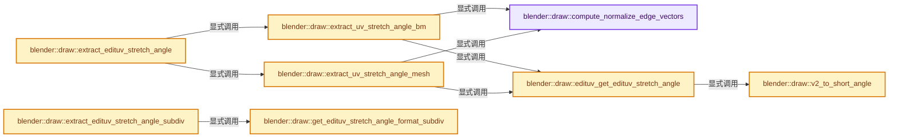
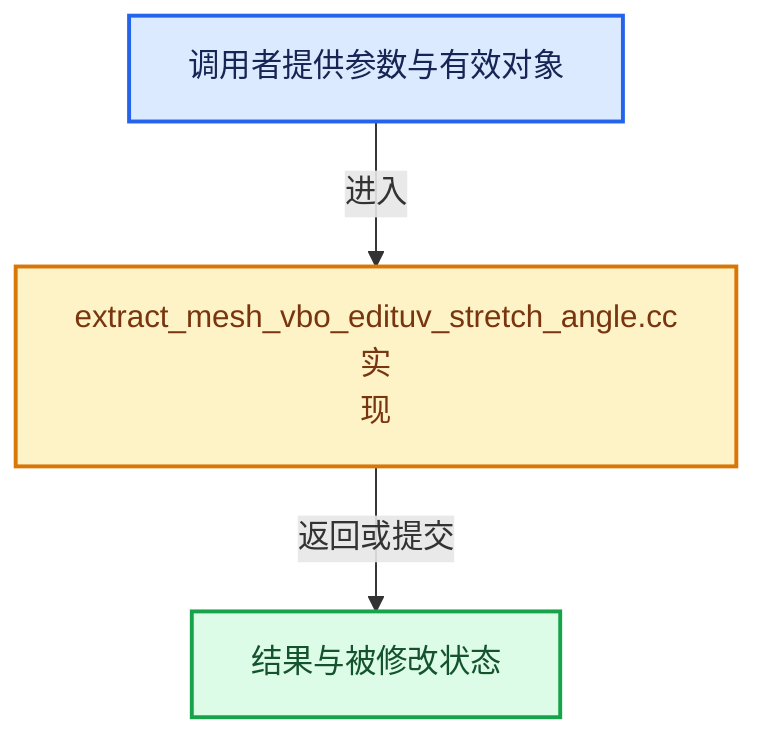

# 实现依赖专题：source/blender/draw/intern/mesh_extractors/extract_mesh_vbo_edituv_stretch_angle.cc

[实现依赖导航](../../../../README.md) · [符号索引](../../../../../00-课程指南/02-源码与提交索引/符号依赖与实现索引.md)

本专题从正文实际调用进入，集中保存共享实现。函数有稳定锚点，可从调用处直接跳到对应完整函数；递归与互相调用通过回链组织。

## 本文件的实现关系






## 完整成员与函数实现

<a id="f-5167d88bb7f7ff87"></a>

### `blender::draw::compute_normalize_edge_vectors`

实现位置：[source/blender/draw/intern/mesh_extractors/extract_mesh_vbo_edituv_stretch_angle.cc](../../../../../../../../../source/blender/draw/intern/mesh_extractors/extract_mesh_vbo_edituv_stretch_angle.cc) · L34—L50。

接口参数：

- `float auv[2][2]`
- `float av[2][3]`
- `const float uv[2]`
- `const float uv_prev[2]`
- `const float co[3]`
- `const float co_prev[3]`

**教学注释版**

<!-- annotated:55016ab3581ef5 -->

```cpp
static void compute_normalize_edge_vectors(float auv[2][2],
                                           float av[2][3],
                                           const float uv[2],
                                           const float uv_prev[2],
                                           const float co[3],
                                           const float co_prev[3])
{
  /* Move previous edge. */
  copy_v2_v2(auv[0], auv[1]);
  copy_v3_v3(av[0], av[1]);
  /* 2d edge */
  sub_v2_v2v2(auv[1], uv_prev, uv);
  normalize_v2(auv[1]);
  /* 3d edge */
  sub_v3_v3v3(av[1], co_prev, co);
  normalize_v3(av[1]);
}
```

<details>
<summary>核对原始源码：source/blender/draw/intern/mesh_extractors/extract_mesh_vbo_edituv_stretch_angle.cc · L34—L50</summary>

<!-- original:55016ab3581ef5:source/blender/draw/intern/mesh_extractors/extract_mesh_vbo_edituv_stretch_angle.cc:34:50 -->

```cpp
static void compute_normalize_edge_vectors(float auv[2][2],
                                           float av[2][3],
                                           const float uv[2],
                                           const float uv_prev[2],
                                           const float co[3],
                                           const float co_prev[3])
{
  /* Move previous edge. */
  copy_v2_v2(auv[0], auv[1]);
  copy_v3_v3(av[0], av[1]);
  /* 2d edge */
  sub_v2_v2v2(auv[1], uv_prev, uv);
  normalize_v2(auv[1]);
  /* 3d edge */
  sub_v3_v3v3(av[1], co_prev, co);
  normalize_v3(av[1]);
}
```

</details>

**继续追踪实现**

- `copy_v2_v2` → [blender::copy_v2_v2 · L41](../../../../01-BLI基础库/intern/math_vector_inline.cc.md#f-e736ee2dd71cd821)。
- `copy_v3_v3` → [调用协议](../../../../../00-课程指南/01-路线与规范/模板宏与动态分派协议.md)：函数指针、局部可调用对象或未展开的宏；必须结合调用者环境。调用位置L43。
- `sub_v2_v2v2` → [blender::sub_v2_v2v2 · L335](../../../../01-BLI基础库/intern/math_vector_inline.cc.md#f-f37d18ab53de26ca)。
- `normalize_v2` → [blender::normalize_v2 · L868](../../../../01-BLI基础库/intern/math_vector_inline.cc.md#f-fe336b5a5c42cb6e)。
- `sub_v3_v3v3` → [blender::sub_v3_v3v3 · L360](../../../../01-BLI基础库/intern/math_vector_inline.cc.md#f-23781c252db8b30c)。
- `normalize_v3` → [blender::normalize_v3 · L933](../../../../01-BLI基础库/intern/math_vector_inline.cc.md#f-5f3257e657ef732c)。

<a id="f-bd0d8b41b9a12868"></a>

### `blender::draw::v2_to_short_angle`

实现位置：[source/blender/draw/intern/mesh_extractors/extract_mesh_vbo_edituv_stretch_angle.cc](../../../../../../../../../source/blender/draw/intern/mesh_extractors/extract_mesh_vbo_edituv_stretch_angle.cc) · L52—L55。

接口参数：

- `const float v[2]`

**教学注释版**

<!-- annotated:04127c531d8147 -->

```cpp
static short v2_to_short_angle(const float v[2])
{
  return atan2f(v[1], v[0]) * float(M_1_PI) * SHRT_MAX;
}
```

<details>
<summary>核对原始源码：source/blender/draw/intern/mesh_extractors/extract_mesh_vbo_edituv_stretch_angle.cc · L52—L55</summary>

<!-- original:04127c531d8147:source/blender/draw/intern/mesh_extractors/extract_mesh_vbo_edituv_stretch_angle.cc:52:55 -->

```cpp
static short v2_to_short_angle(const float v[2])
{
  return atan2f(v[1], v[0]) * float(M_1_PI) * SHRT_MAX;
}
```

</details>

**结果出口**

- `return atan2f(v[1], v[0]) * float(M_1_PI) * SHRT_MAX;`

**继续追踪实现**

- `atan2f` → [atan2f · L18](../../../../07-Intern运行时与平台/cycles/kernel/svm/radial_tiling_shared.h.md#m-a77af3382db2)；[atan2f · L40](../../../../07-Intern运行时与平台/cycles/kernel/svm/radial_tiling_shared.h.md#m-cec47b2ce998)；[atan2f · L71](../../../../07-Intern运行时与平台/cycles/kernel/svm/radial_tiling_shared.h.md#m-bd31b1779092)；[atan2f · L22](../../../../01-BLI基础库/intern/radial_tiling_shared.hh.md#m-9b9c2a707484)；[atan2f · L44](../../../../01-BLI基础库/intern/radial_tiling_shared.hh.md#m-63f49b7d81dc)；[atan2f · L75](../../../../01-BLI基础库/intern/radial_tiling_shared.hh.md#m-4201e8b4c423)；[atan2f · L18](../../../../07-Intern运行时与平台/cycles/kernel/osl/shaders/node_radial_tiling_shared.h.md#m-ec4f8238af32)；[atan2f · L40](../../../../07-Intern运行时与平台/cycles/kernel/osl/shaders/node_radial_tiling_shared.h.md#m-980162d675e3)；[atan2f · L71](../../../../07-Intern运行时与平台/cycles/kernel/osl/shaders/node_radial_tiling_shared.h.md#m-bcd4c102a83d)；[atan2f · L179](../../../../07-Intern运行时与平台/cycles/kernel/device/oneapi/compat.h.md#m-5be26d38bfa7)；[atan2f · L274](../../../../07-Intern运行时与平台/cycles/kernel/device/metal/compat.h.md#m-1b9636d3b02f)。宏定义由构建条件选择。

<a id="f-ef13cb8aacdf0907"></a>

### `blender::draw::edituv_get_edituv_stretch_angle`

实现位置：[source/blender/draw/intern/mesh_extractors/extract_mesh_vbo_edituv_stretch_angle.cc](../../../../../../../../../source/blender/draw/intern/mesh_extractors/extract_mesh_vbo_edituv_stretch_angle.cc) · L57—L73。

接口参数：

- `float auv[2][2]`
- `const float av[2][3]`
- `UVStretchAngle *r_stretch`

**教学注释版**

<!-- annotated:91741efbc76088 -->

```cpp
static void edituv_get_edituv_stretch_angle(float auv[2][2],
                                            const float av[2][3],
                                            UVStretchAngle *r_stretch)
{
  /* Send UVs to the shader and let it compute the aspect corrected angle. */
  r_stretch->uv_angles[0] = v2_to_short_angle(auv[0]);
  r_stretch->uv_angles[1] = v2_to_short_angle(auv[1]);
  /* Compute 3D angle here. */
  r_stretch->angle = angle_normalized_v3v3(av[0], av[1]) * float(M_1_PI);

#if 0 /* here for reference, this is done in shader now. */
  float uvang = angle_normalized_v2v2(auv0, auv1);
  float ang = angle_normalized_v3v3(av0, av1);
  float stretch = fabsf(uvang - ang) / float(M_PI);
  return 1.0f - pow2f(1.0f - stretch);
#endif
}
```

<details>
<summary>核对原始源码：source/blender/draw/intern/mesh_extractors/extract_mesh_vbo_edituv_stretch_angle.cc · L57—L73</summary>

<!-- original:91741efbc76088:source/blender/draw/intern/mesh_extractors/extract_mesh_vbo_edituv_stretch_angle.cc:57:73 -->

```cpp
static void edituv_get_edituv_stretch_angle(float auv[2][2],
                                            const float av[2][3],
                                            UVStretchAngle *r_stretch)
{
  /* Send UVs to the shader and let it compute the aspect corrected angle. */
  r_stretch->uv_angles[0] = v2_to_short_angle(auv[0]);
  r_stretch->uv_angles[1] = v2_to_short_angle(auv[1]);
  /* Compute 3D angle here. */
  r_stretch->angle = angle_normalized_v3v3(av[0], av[1]) * float(M_1_PI);

#if 0 /* here for reference, this is done in shader now. */
  float uvang = angle_normalized_v2v2(auv0, auv1);
  float ang = angle_normalized_v3v3(av0, av1);
  float stretch = fabsf(uvang - ang) / float(M_PI);
  return 1.0f - pow2f(1.0f - stretch);
#endif
}
```

</details>

**沿实际写入检查状态**

- `r_stretch->uv_angles[0] = v2_to_short_angle(auv[0]);`
- `r_stretch->uv_angles[1] = v2_to_short_angle(auv[1]);`
- `r_stretch->angle = angle_normalized_v3v3(av[0], av[1]) * float(M_1_PI);`

**结果出口**

- `return 1.0f - pow2f(1.0f - stretch);`

**继续追踪实现**

- `v2_to_short_angle` → [blender::draw::v2_to_short_angle · L52](extract_mesh_vbo_edituv_stretch_angle.cc.md#f-bd0d8b41b9a12868)。
- `angle_normalized_v3v3` → [调用协议](../../../../../00-课程指南/01-路线与规范/模板宏与动态分派协议.md)：函数指针、局部可调用对象或未展开的宏；必须结合调用者环境。调用位置L65。
- `angle_normalized_v2v2` → [blender::angle_normalized_v2v2 · L352](../../../../01-BLI基础库/intern/math_vector.cc.md#f-0a487719b6ff69d2)。
- `fabsf` → [fabsf · L21](../../../../07-Intern运行时与平台/cycles/kernel/svm/radial_tiling_shared.h.md#m-02cc4c69cfb3)；[fabsf · L43](../../../../07-Intern运行时与平台/cycles/kernel/svm/radial_tiling_shared.h.md#m-04effe61803b)；[fabsf · L74](../../../../07-Intern运行时与平台/cycles/kernel/svm/radial_tiling_shared.h.md#m-927dd4eba7dc)；[fabsf · L25](../../../../01-BLI基础库/intern/radial_tiling_shared.hh.md#m-8348d6b3d08f)；[fabsf · L47](../../../../01-BLI基础库/intern/radial_tiling_shared.hh.md#m-13b7e0b6d84f)；[fabsf · L78](../../../../01-BLI基础库/intern/radial_tiling_shared.hh.md#m-326c83464a0d)；[fabsf · L21](../../../../07-Intern运行时与平台/cycles/kernel/osl/shaders/node_radial_tiling_shared.h.md#m-7c3ee12fc119)；[fabsf · L43](../../../../07-Intern运行时与平台/cycles/kernel/osl/shaders/node_radial_tiling_shared.h.md#m-9112db0e2dd1)；[fabsf · L74](../../../../07-Intern运行时与平台/cycles/kernel/osl/shaders/node_radial_tiling_shared.h.md#m-ee4e61908a6f)；[fabsf · L167](../../../../07-Intern运行时与平台/cycles/kernel/device/oneapi/compat.h.md#m-b039ee6c1601)；[fabsf · L265](../../../../07-Intern运行时与平台/cycles/kernel/device/metal/compat.h.md#m-6b21869e9f3f)。宏定义由构建条件选择。
- `pow2f` → [调用协议](../../../../../00-课程指南/01-路线与规范/模板宏与动态分派协议.md)：函数指针、局部可调用对象或未展开的宏；必须结合调用者环境。调用位置L71。

<a id="f-649db082138f2265"></a>

### `blender::draw::extract_uv_stretch_angle_bm`

实现位置：[source/blender/draw/intern/mesh_extractors/extract_mesh_vbo_edituv_stretch_angle.cc](../../../../../../../../../source/blender/draw/intern/mesh_extractors/extract_mesh_vbo_edituv_stretch_angle.cc) · L75—L132。

接口参数：

- `const MeshRenderData &mr`
- `MutableSpan<UVStretchAngle> vbo_data`

**教学注释版**

<!-- annotated:10c03e8b357bb4 -->

```cpp
static void extract_uv_stretch_angle_bm(const MeshRenderData &mr,
                                        MutableSpan<UVStretchAngle> vbo_data)
{
  const BMesh &bm = *mr.bm;
  const StringRef active_name = mr.mesh->active_uv_map_name();
  const int uv_offset = CustomData_get_offset_named(&bm.ldata, CD_PROP_FLOAT2, active_name);

  float auv[2][2], last_auv[2];
  float av[2][3], last_av[3];

  const BMFace *face;
  BMIter f_iter;
  BM_ITER_MESH (face, &f_iter, &const_cast<BMesh &>(bm), BM_FACES_OF_MESH) {
    BMLoop *l_iter, *l_first;
    l_iter = l_first = BM_FACE_FIRST_LOOP(face);
    do {
      const int l_index = BM_elem_index_get(l_iter);

      const float (*luv)[2], (*luv_next)[2];
      BMLoop *l_next = l_iter->next;
      if (l_iter == BM_FACE_FIRST_LOOP(face)) {
        /* First loop in face. */
        BMLoop *l_tmp = l_iter->prev;
        BMLoop *l_next_tmp = l_iter;
        luv = BM_ELEM_CD_GET_FLOAT2_P(l_tmp, uv_offset);
        luv_next = BM_ELEM_CD_GET_FLOAT2_P(l_next_tmp, uv_offset);
        compute_normalize_edge_vectors(auv,
                                       av,
                                       *luv,
                                       *luv_next,
                                       bm_vert_co_get(mr, l_tmp->v),
                                       bm_vert_co_get(mr, l_next_tmp->v));
        /* Save last edge. */
        copy_v2_v2(last_auv, auv[1]);
        copy_v3_v3(last_av, av[1]);
      }
      if (l_next == BM_FACE_FIRST_LOOP(face)) {
        /* Move previous edge. */
        copy_v2_v2(auv[0], auv[1]);
        copy_v3_v3(av[0], av[1]);
        /* Copy already calculated last edge. */
        copy_v2_v2(auv[1], last_auv);
        copy_v3_v3(av[1], last_av);
      }
      else {
        luv = BM_ELEM_CD_GET_FLOAT2_P(l_iter, uv_offset);
        luv_next = BM_ELEM_CD_GET_FLOAT2_P(l_next, uv_offset);
        compute_normalize_edge_vectors(auv,
                                       av,
                                       *luv,
                                       *luv_next,
                                       bm_vert_co_get(mr, l_iter->v),
                                       bm_vert_co_get(mr, l_next->v));
      }
      edituv_get_edituv_stretch_angle(auv, av, &vbo_data[l_index]);
    } while ((l_iter = l_iter->next) != l_first);
  }
}
```

<details>
<summary>核对原始源码：source/blender/draw/intern/mesh_extractors/extract_mesh_vbo_edituv_stretch_angle.cc · L75—L132</summary>

<!-- original:10c03e8b357bb4:source/blender/draw/intern/mesh_extractors/extract_mesh_vbo_edituv_stretch_angle.cc:75:132 -->

```cpp
static void extract_uv_stretch_angle_bm(const MeshRenderData &mr,
                                        MutableSpan<UVStretchAngle> vbo_data)
{
  const BMesh &bm = *mr.bm;
  const StringRef active_name = mr.mesh->active_uv_map_name();
  const int uv_offset = CustomData_get_offset_named(&bm.ldata, CD_PROP_FLOAT2, active_name);

  float auv[2][2], last_auv[2];
  float av[2][3], last_av[3];

  const BMFace *face;
  BMIter f_iter;
  BM_ITER_MESH (face, &f_iter, &const_cast<BMesh &>(bm), BM_FACES_OF_MESH) {
    BMLoop *l_iter, *l_first;
    l_iter = l_first = BM_FACE_FIRST_LOOP(face);
    do {
      const int l_index = BM_elem_index_get(l_iter);

      const float (*luv)[2], (*luv_next)[2];
      BMLoop *l_next = l_iter->next;
      if (l_iter == BM_FACE_FIRST_LOOP(face)) {
        /* First loop in face. */
        BMLoop *l_tmp = l_iter->prev;
        BMLoop *l_next_tmp = l_iter;
        luv = BM_ELEM_CD_GET_FLOAT2_P(l_tmp, uv_offset);
        luv_next = BM_ELEM_CD_GET_FLOAT2_P(l_next_tmp, uv_offset);
        compute_normalize_edge_vectors(auv,
                                       av,
                                       *luv,
                                       *luv_next,
                                       bm_vert_co_get(mr, l_tmp->v),
                                       bm_vert_co_get(mr, l_next_tmp->v));
        /* Save last edge. */
        copy_v2_v2(last_auv, auv[1]);
        copy_v3_v3(last_av, av[1]);
      }
      if (l_next == BM_FACE_FIRST_LOOP(face)) {
        /* Move previous edge. */
        copy_v2_v2(auv[0], auv[1]);
        copy_v3_v3(av[0], av[1]);
        /* Copy already calculated last edge. */
        copy_v2_v2(auv[1], last_auv);
        copy_v3_v3(av[1], last_av);
      }
      else {
        luv = BM_ELEM_CD_GET_FLOAT2_P(l_iter, uv_offset);
        luv_next = BM_ELEM_CD_GET_FLOAT2_P(l_next, uv_offset);
        compute_normalize_edge_vectors(auv,
                                       av,
                                       *luv,
                                       *luv_next,
                                       bm_vert_co_get(mr, l_iter->v),
                                       bm_vert_co_get(mr, l_next->v));
      }
      edituv_get_edituv_stretch_angle(auv, av, &vbo_data[l_index]);
    } while ((l_iter = l_iter->next) != l_first);
  }
}
```

</details>

**沿实际写入检查状态**

- `l_iter = l_first = BM_FACE_FIRST_LOOP(face);`
- `luv = BM_ELEM_CD_GET_FLOAT2_P(l_tmp, uv_offset);`
- `luv_next = BM_ELEM_CD_GET_FLOAT2_P(l_next_tmp, uv_offset);`
- `luv = BM_ELEM_CD_GET_FLOAT2_P(l_iter, uv_offset);`
- `luv_next = BM_ELEM_CD_GET_FLOAT2_P(l_next, uv_offset);`

**继续追踪实现**

- `mr.mesh->active_uv_map_name` → [调用协议](../../../../../00-课程指南/01-路线与规范/模板宏与动态分派协议.md)：接收对象类型依赖auto、返回值或模板实例；不按同名猜测目标。调用位置L79。
- `CustomData_get_offset_named` → [blender::CustomData_get_offset_named · L3398](../../../../02-BKE几何与数据/intern/customdata.cc.md#f-fe199f3da62e9c30)。
- `BM_ITER_MESH` → [BM_ITER_MESH · L72](../../../bmesh/intern/bmesh_iterators.hh.md#m-cfc837c73218)。宏定义由构建条件选择。
- `BM_FACE_FIRST_LOOP` → [BM_FACE_FIRST_LOOP · L697](../../../bmesh/bmesh_class.hh.md#m-c7e10ffb38e6)；[BM_FACE_FIRST_LOOP · L699](../../../bmesh/bmesh_class.hh.md#m-76a054cc4770)。宏定义由构建条件选择。
- `BM_elem_index_get` → [BM_elem_index_get · L120](../../../bmesh/intern/bmesh_inline.hh.md#m-201981cdc62d)。宏定义由构建条件选择。
- `BM_ELEM_CD_GET_FLOAT2_P` → [BM_ELEM_CD_GET_FLOAT2_P · L643](../../../bmesh/bmesh_class.hh.md#m-10ef07da11b4)；[BM_ELEM_CD_GET_FLOAT2_P · L664](../../../bmesh/bmesh_class.hh.md#m-153e8251a2c9)。宏定义由构建条件选择。
- `compute_normalize_edge_vectors` → [blender::draw::compute_normalize_edge_vectors · L34](extract_mesh_vbo_edituv_stretch_angle.cc.md#f-5167d88bb7f7ff87)。
- `bm_vert_co_get` → [blender::draw::bm_vert_co_get · L162](extract_mesh.hh.md#f-b669e5a0bcf94c9f)。
- `copy_v2_v2` → [blender::copy_v2_v2 · L41](../../../../01-BLI基础库/intern/math_vector_inline.cc.md#f-e736ee2dd71cd821)。
- `copy_v3_v3` → [调用协议](../../../../../00-课程指南/01-路线与规范/模板宏与动态分派协议.md)：函数指针、局部可调用对象或未展开的宏；必须结合调用者环境。调用位置L109。
- `edituv_get_edituv_stretch_angle` → [blender::draw::edituv_get_edituv_stretch_angle · L57](extract_mesh_vbo_edituv_stretch_angle.cc.md#f-ef13cb8aacdf0907)。

<a id="f-7242e3330565fd26"></a>

### `blender::draw::extract_uv_stretch_angle_mesh`

实现位置：[source/blender/draw/intern/mesh_extractors/extract_mesh_vbo_edituv_stretch_angle.cc](../../../../../../../../../source/blender/draw/intern/mesh_extractors/extract_mesh_vbo_edituv_stretch_angle.cc) · L134—L187。

接口参数：

- `const MeshRenderData &mr`
- `MutableSpan<UVStretchAngle> vbo_data`

**教学注释版**

<!-- annotated:b0d8035d0ade8d -->

```cpp
static void extract_uv_stretch_angle_mesh(const MeshRenderData &mr,
                                          MutableSpan<UVStretchAngle> vbo_data)
{
  const Span<float3> positions = mr.vert_positions;
  const OffsetIndices faces = mr.faces;
  const Span<int> corner_verts = mr.corner_verts;
  const Mesh &mesh = *mr.mesh;
  const bke::AttributeAccessor attributes = mesh.attributes();
  const StringRef name = mesh.active_uv_map_name();
  const VArraySpan uv_map = *attributes.lookup<float2>(name, bke::AttrDomain::Corner);

  float auv[2][2], last_auv[2];
  float av[2][3], last_av[3];

  for (const int face_index : faces.index_range()) {
    const IndexRange face = faces[face_index];
    // [讲解] face.start：读取连续区间或分组的边界信息。
    const int corner_end = face.start() + face.size();
    for (int corner = face.start(); corner < corner_end; corner += 1) {
      int l_next = corner + 1;
      if (corner == face.start()) {
        /* First loop in face. */
        const int corner_last = corner_end - 1;
        const int l_next_tmp = face.start();
        compute_normalize_edge_vectors(auv,
                                       av,
                                       uv_map[corner_last],
                                       uv_map[l_next_tmp],
                                       positions[corner_verts[corner_last]],
                                       positions[corner_verts[l_next_tmp]]);
        /* Save last edge. */
        copy_v2_v2(last_auv, auv[1]);
        copy_v3_v3(last_av, av[1]);
      }
      if (l_next == corner_end) {
        l_next = face.start();
        /* Move previous edge. */
        copy_v2_v2(auv[0], auv[1]);
        copy_v3_v3(av[0], av[1]);
        /* Copy already calculated last edge. */
        copy_v2_v2(auv[1], last_auv);
        copy_v3_v3(av[1], last_av);
      }
      else {
        compute_normalize_edge_vectors(auv,
                                       av,
                                       uv_map[corner],
                                       uv_map[l_next],
                                       positions[corner_verts[corner]],
                                       positions[corner_verts[l_next]]);
      }
      edituv_get_edituv_stretch_angle(auv, av, &vbo_data[corner]);
    }
  }
}
```

<details>
<summary>核对原始源码：source/blender/draw/intern/mesh_extractors/extract_mesh_vbo_edituv_stretch_angle.cc · L134—L187</summary>

<!-- original:b0d8035d0ade8d:source/blender/draw/intern/mesh_extractors/extract_mesh_vbo_edituv_stretch_angle.cc:134:187 -->

```cpp
static void extract_uv_stretch_angle_mesh(const MeshRenderData &mr,
                                          MutableSpan<UVStretchAngle> vbo_data)
{
  const Span<float3> positions = mr.vert_positions;
  const OffsetIndices faces = mr.faces;
  const Span<int> corner_verts = mr.corner_verts;
  const Mesh &mesh = *mr.mesh;
  const bke::AttributeAccessor attributes = mesh.attributes();
  const StringRef name = mesh.active_uv_map_name();
  const VArraySpan uv_map = *attributes.lookup<float2>(name, bke::AttrDomain::Corner);

  float auv[2][2], last_auv[2];
  float av[2][3], last_av[3];

  for (const int face_index : faces.index_range()) {
    const IndexRange face = faces[face_index];
    const int corner_end = face.start() + face.size();
    for (int corner = face.start(); corner < corner_end; corner += 1) {
      int l_next = corner + 1;
      if (corner == face.start()) {
        /* First loop in face. */
        const int corner_last = corner_end - 1;
        const int l_next_tmp = face.start();
        compute_normalize_edge_vectors(auv,
                                       av,
                                       uv_map[corner_last],
                                       uv_map[l_next_tmp],
                                       positions[corner_verts[corner_last]],
                                       positions[corner_verts[l_next_tmp]]);
        /* Save last edge. */
        copy_v2_v2(last_auv, auv[1]);
        copy_v3_v3(last_av, av[1]);
      }
      if (l_next == corner_end) {
        l_next = face.start();
        /* Move previous edge. */
        copy_v2_v2(auv[0], auv[1]);
        copy_v3_v3(av[0], av[1]);
        /* Copy already calculated last edge. */
        copy_v2_v2(auv[1], last_auv);
        copy_v3_v3(av[1], last_av);
      }
      else {
        compute_normalize_edge_vectors(auv,
                                       av,
                                       uv_map[corner],
                                       uv_map[l_next],
                                       positions[corner_verts[corner]],
                                       positions[corner_verts[l_next]]);
      }
      edituv_get_edituv_stretch_angle(auv, av, &vbo_data[corner]);
    }
  }
}
```

</details>

**沿实际写入检查状态**

- `l_next = face.start();`

**继续追踪实现**

- `mesh.attributes` → [Mesh::attributes · L1298](../../../../../05-几何存储与拓扑映射/03-MPoly迁移与兼容.md#f-607bbfe3e57cfc7f)。
- `mesh.active_uv_map_name` → [Mesh::active_uv_map_name · L1319](../../../../../05-几何存储与拓扑映射/03-MPoly迁移与兼容.md#f-9b4762e851836e79)。
- `attributes.lookup<float2>` → [blender::bke::AttributeAccessor::lookup · L401](../../../../02-BKE几何与数据/intern/attribute_access.cc.md#f-4673351b7bb3b651)；[blender::bke::AttributeAccessor::lookup · L585](../../../../../05-几何存储与拓扑映射/08-AttributeAccessor接口.md#f-432b90c796a80893)；[blender::bke::AttributeAccessor::lookup · L602](../../../../../05-几何存储与拓扑映射/08-AttributeAccessor接口.md#f-a60c1a45b85155d9)；[blender::bke::AttributeAccessor::lookup · L611](../../../../../05-几何存储与拓扑映射/08-AttributeAccessor接口.md#f-16ca459803fc30a6)；[blender::bke::AttributeAccessor::lookup · L620](../../../../../05-几何存储与拓扑映射/08-AttributeAccessor接口.md#f-403fd8a9d1a16c6d)。同名重载需按实参类型选择。
- `faces.index_range` → [blender::offset_indices::OffsetIndices::index_range · L77](../../../../../05-几何存储与拓扑映射/02-OffsetIndices完整接口.md#f-19b5ca1456de007d)。
- `face.start` → [blender::IndexRange::start · L243](../../../../../01-基础容器与现代CPP/04-IndexRange连续整数区间.md#f-99d2195bd9cfd1f0)。
- `face.size` → [blender::IndexRange::size · L156](../../../../../01-基础容器与现代CPP/04-IndexRange连续整数区间.md#f-05f66c3ebb2fdfec)。
- `compute_normalize_edge_vectors` → [blender::draw::compute_normalize_edge_vectors · L34](extract_mesh_vbo_edituv_stretch_angle.cc.md#f-5167d88bb7f7ff87)。
- `copy_v2_v2` → [blender::copy_v2_v2 · L41](../../../../01-BLI基础库/intern/math_vector_inline.cc.md#f-e736ee2dd71cd821)。
- `copy_v3_v3` → [调用协议](../../../../../00-课程指南/01-路线与规范/模板宏与动态分派协议.md)：函数指针、局部可调用对象或未展开的宏；必须结合调用者环境。调用位置L165。
- `edituv_get_edituv_stretch_angle` → [blender::draw::edituv_get_edituv_stretch_angle · L57](extract_mesh_vbo_edituv_stretch_angle.cc.md#f-ef13cb8aacdf0907)。

<a id="f-fae08aae1ad33278"></a>

### `blender::draw::extract_edituv_stretch_angle`

实现位置：[source/blender/draw/intern/mesh_extractors/extract_mesh_vbo_edituv_stretch_angle.cc](../../../../../../../../../source/blender/draw/intern/mesh_extractors/extract_mesh_vbo_edituv_stretch_angle.cc) · L189—L210。

接口参数：

- `const MeshRenderData &mr`

**教学注释版**

<!-- annotated:200e11c7efa30b -->

```cpp
gpu::VertBufPtr extract_edituv_stretch_angle(const MeshRenderData &mr)
{
  static const GPUVertFormat format = []() {
    GPUVertFormat format{};
    /* Waning: adjust #UVStretchAngle struct accordingly. */
    GPU_vertformat_attr_add(&format, "angle", gpu::VertAttrType::SFLOAT_32);
    GPU_vertformat_attr_add(&format, "uv_angles", gpu::VertAttrType::SNORM_16_16);
    return format;
  }();

  gpu::VertBufPtr vbo = gpu::VertBufPtr(GPU_vertbuf_create_with_format(format));
  GPU_vertbuf_data_alloc(*vbo, mr.corners_num);
  MutableSpan vbo_data = vbo->data<UVStretchAngle>();

  if (mr.extract_type == MeshExtractType::BMesh) {
    extract_uv_stretch_angle_bm(mr, vbo_data);
  }
  else {
    extract_uv_stretch_angle_mesh(mr, vbo_data);
  }
  return vbo;
}
```

<details>
<summary>核对原始源码：source/blender/draw/intern/mesh_extractors/extract_mesh_vbo_edituv_stretch_angle.cc · L189—L210</summary>

<!-- original:200e11c7efa30b:source/blender/draw/intern/mesh_extractors/extract_mesh_vbo_edituv_stretch_angle.cc:189:210 -->

```cpp
gpu::VertBufPtr extract_edituv_stretch_angle(const MeshRenderData &mr)
{
  static const GPUVertFormat format = []() {
    GPUVertFormat format{};
    /* Waning: adjust #UVStretchAngle struct accordingly. */
    GPU_vertformat_attr_add(&format, "angle", gpu::VertAttrType::SFLOAT_32);
    GPU_vertformat_attr_add(&format, "uv_angles", gpu::VertAttrType::SNORM_16_16);
    return format;
  }();

  gpu::VertBufPtr vbo = gpu::VertBufPtr(GPU_vertbuf_create_with_format(format));
  GPU_vertbuf_data_alloc(*vbo, mr.corners_num);
  MutableSpan vbo_data = vbo->data<UVStretchAngle>();

  if (mr.extract_type == MeshExtractType::BMesh) {
    extract_uv_stretch_angle_bm(mr, vbo_data);
  }
  else {
    extract_uv_stretch_angle_mesh(mr, vbo_data);
  }
  return vbo;
}
```

</details>

**结果出口**

- `return format;`
- `return vbo;`

**继续追踪实现**

- `[]() { GPUVertFormat format{}; /* Waning: adjust #UVStretchAngle struct accordingly. */ GPU_vertformat_attr_add(&format, "angle", gpu::VertAttrType::SFLOAT_32); GPU_vertformat_attr …（完整表达式见本函数源码）` → [调用协议](../../../../../00-课程指南/01-路线与规范/模板宏与动态分派协议.md)：函数指针、局部可调用对象或未展开的宏；必须结合调用者环境。调用位置L191。
- `GPU_vertformat_attr_add` → [blender::GPU_vertformat_attr_add · L389](../../../gpu/intern/gpu_vertex_format.cc.md#f-a36e23f37b97fff4)。
- `gpu::VertBufPtr` → [调用协议](../../../../../00-课程指南/01-路线与规范/模板宏与动态分派协议.md)：函数指针、局部可调用对象或未展开的宏；必须结合调用者环境。调用位置L199。
- `GPU_vertbuf_create_with_format` → [blender::GPU_vertbuf_create_with_format · L71](../../../gpu/GPU_vertex_buffer.hh.md#f-bd43fe034e852138)。
- `GPU_vertbuf_data_alloc` → [blender::GPU_vertbuf_data_alloc · L172](../../../gpu/intern/gpu_vertex_buffer.cc.md#f-8ee5cf106e0f2b0f)。
- `vbo->data<UVStretchAngle>` → [blender::draw::data · L124](../DRW_gpu_wrapper.hh.md#f-dc115dc22e0c9f33)；[blender::draw::data · L129](../DRW_gpu_wrapper.hh.md#f-5f325cb75387045c)。同名重载需按实参类型选择。
- `extract_uv_stretch_angle_bm` → [blender::draw::extract_uv_stretch_angle_bm · L75](extract_mesh_vbo_edituv_stretch_angle.cc.md#f-649db082138f2265)。
- `extract_uv_stretch_angle_mesh` → [blender::draw::extract_uv_stretch_angle_mesh · L134](extract_mesh_vbo_edituv_stretch_angle.cc.md#f-7242e3330565fd26)。

<a id="f-3231b521ad5ee8e5"></a>

### `blender::draw::get_edituv_stretch_angle_format_subdiv`

实现位置：[source/blender/draw/intern/mesh_extractors/extract_mesh_vbo_edituv_stretch_angle.cc](../../../../../../../../../source/blender/draw/intern/mesh_extractors/extract_mesh_vbo_edituv_stretch_angle.cc) · L212—L222。

**教学注释版**

<!-- annotated:ff9e0d951ea554 -->

```cpp
static const GPUVertFormat &get_edituv_stretch_angle_format_subdiv()
{
  static const GPUVertFormat format = []() {
    GPUVertFormat format{};
    /* Waning: adjust #UVStretchAngle struct accordingly. */
    GPU_vertformat_attr_add(&format, "angle", gpu::VertAttrType::SFLOAT_32);
    GPU_vertformat_attr_add(&format, "uv_angles", gpu::VertAttrType::SFLOAT_32_32);
    return format;
  }();
  return format;
}
```

<details>
<summary>核对原始源码：source/blender/draw/intern/mesh_extractors/extract_mesh_vbo_edituv_stretch_angle.cc · L212—L222</summary>

<!-- original:ff9e0d951ea554:source/blender/draw/intern/mesh_extractors/extract_mesh_vbo_edituv_stretch_angle.cc:212:222 -->

```cpp
static const GPUVertFormat &get_edituv_stretch_angle_format_subdiv()
{
  static const GPUVertFormat format = []() {
    GPUVertFormat format{};
    /* Waning: adjust #UVStretchAngle struct accordingly. */
    GPU_vertformat_attr_add(&format, "angle", gpu::VertAttrType::SFLOAT_32);
    GPU_vertformat_attr_add(&format, "uv_angles", gpu::VertAttrType::SFLOAT_32_32);
    return format;
  }();
  return format;
}
```

</details>

**结果出口**

- `return format;`

**继续追踪实现**

- `[]() { GPUVertFormat format{}; /* Waning: adjust #UVStretchAngle struct accordingly. */ GPU_vertformat_attr_add(&format, "angle", gpu::VertAttrType::SFLOAT_32); GPU_vertformat_attr …（完整表达式见本函数源码）` → [调用协议](../../../../../00-课程指南/01-路线与规范/模板宏与动态分派协议.md)：函数指针、局部可调用对象或未展开的宏；必须结合调用者环境。调用位置L214。
- `GPU_vertformat_attr_add` → [blender::GPU_vertformat_attr_add · L389](../../../gpu/intern/gpu_vertex_format.cc.md#f-a36e23f37b97fff4)。

<a id="f-a18557083ce375b2"></a>

### `blender::draw::extract_edituv_stretch_angle_subdiv`

实现位置：[source/blender/draw/intern/mesh_extractors/extract_mesh_vbo_edituv_stretch_angle.cc](../../../../../../../../../source/blender/draw/intern/mesh_extractors/extract_mesh_vbo_edituv_stretch_angle.cc) · L224—L266。

接口参数：

- `const MeshRenderData &mr`
- `const DRWSubdivCache &subdiv_cache`
- `const MeshBatchCache &cache`

**教学注释版**

<!-- annotated:bc968118882554 -->

```cpp
gpu::VertBufPtr extract_edituv_stretch_angle_subdiv(const MeshRenderData &mr,
                                                    const DRWSubdivCache &subdiv_cache,
                                                    const MeshBatchCache &cache)
{
  gpu::VertBufPtr vbo = gpu::VertBufPtr(GPU_vertbuf_create_on_device(
      get_edituv_stretch_angle_format_subdiv(), subdiv_cache.num_subdiv_loops));

  gpu::VertBuf *pos = cache.final.buff.vbos.lookup(VBOType::Position).get();
  gpu::VertBuf *uvs = cache.final.buff.vbos.lookup(VBOType::UVs).get();

  /* It may happen that the data for the UV editor is requested before (as a separate draw update)
   * the data for the mesh when switching to the `UV Editing` workspace, and therefore the position
   * buffer might not be created yet. In this case, create a buffer it locally, the subdivision
   * data should already be evaluated if we are here. This can happen if the subsurf modifier is
   * only enabled in edit-mode. See #96338. */
  if (!pos) {
    pos = GPU_vertbuf_calloc();
    static const GPUVertFormat pos_format = GPU_vertformat_from_attribute(
        "pos", gpu::VertAttrType::SFLOAT_32_32_32);
    GPU_vertbuf_init_build_on_device(*pos, pos_format, subdiv_full_vbo_size(mr, subdiv_cache));
    draw_subdiv_extract_pos(subdiv_cache, pos, nullptr);
  }

  /* UVs are stored contiguously so we need to compute the offset in the UVs buffer for the active
   * UV layer. */

  VectorSet<std::string> uv_layers = cache.cd_used.uv;
  /* HACK to fix #68857 */
  if (mr.extract_type == MeshExtractType::BMesh && cache.cd_used.edit_uv == 1) {
    const StringRef active_name = mr.mesh->active_uv_map_name();
    if (!active_name.is_empty()) {
      // [讲解] uv_layers.add_as：按哈希与相等关系加入键或键值。
      uv_layers.add_as(active_name);
    }
  }

  int uvs_offset = uv_layers.index_of(mr.mesh->active_uv_map_name());

  /* The data is at `offset * num loops`, and we have 2 values per index. */
  uvs_offset *= subdiv_cache.num_subdiv_loops * 2;

  draw_subdiv_build_edituv_stretch_angle_buffer(subdiv_cache, pos, uvs, uvs_offset, vbo.get());
  return vbo;
}
```

<details>
<summary>核对原始源码：source/blender/draw/intern/mesh_extractors/extract_mesh_vbo_edituv_stretch_angle.cc · L224—L266</summary>

<!-- original:bc968118882554:source/blender/draw/intern/mesh_extractors/extract_mesh_vbo_edituv_stretch_angle.cc:224:266 -->

```cpp
gpu::VertBufPtr extract_edituv_stretch_angle_subdiv(const MeshRenderData &mr,
                                                    const DRWSubdivCache &subdiv_cache,
                                                    const MeshBatchCache &cache)
{
  gpu::VertBufPtr vbo = gpu::VertBufPtr(GPU_vertbuf_create_on_device(
      get_edituv_stretch_angle_format_subdiv(), subdiv_cache.num_subdiv_loops));

  gpu::VertBuf *pos = cache.final.buff.vbos.lookup(VBOType::Position).get();
  gpu::VertBuf *uvs = cache.final.buff.vbos.lookup(VBOType::UVs).get();

  /* It may happen that the data for the UV editor is requested before (as a separate draw update)
   * the data for the mesh when switching to the `UV Editing` workspace, and therefore the position
   * buffer might not be created yet. In this case, create a buffer it locally, the subdivision
   * data should already be evaluated if we are here. This can happen if the subsurf modifier is
   * only enabled in edit-mode. See #96338. */
  if (!pos) {
    pos = GPU_vertbuf_calloc();
    static const GPUVertFormat pos_format = GPU_vertformat_from_attribute(
        "pos", gpu::VertAttrType::SFLOAT_32_32_32);
    GPU_vertbuf_init_build_on_device(*pos, pos_format, subdiv_full_vbo_size(mr, subdiv_cache));
    draw_subdiv_extract_pos(subdiv_cache, pos, nullptr);
  }

  /* UVs are stored contiguously so we need to compute the offset in the UVs buffer for the active
   * UV layer. */

  VectorSet<std::string> uv_layers = cache.cd_used.uv;
  /* HACK to fix #68857 */
  if (mr.extract_type == MeshExtractType::BMesh && cache.cd_used.edit_uv == 1) {
    const StringRef active_name = mr.mesh->active_uv_map_name();
    if (!active_name.is_empty()) {
      uv_layers.add_as(active_name);
    }
  }

  int uvs_offset = uv_layers.index_of(mr.mesh->active_uv_map_name());

  /* The data is at `offset * num loops`, and we have 2 values per index. */
  uvs_offset *= subdiv_cache.num_subdiv_loops * 2;

  draw_subdiv_build_edituv_stretch_angle_buffer(subdiv_cache, pos, uvs, uvs_offset, vbo.get());
  return vbo;
}
```

</details>

**沿实际写入检查状态**

- `pos = GPU_vertbuf_calloc();`
- `uvs_offset *= subdiv_cache.num_subdiv_loops * 2;`

**结果出口**

- `return vbo;`

**继续追踪实现**

- `gpu::VertBufPtr` → [调用协议](../../../../../00-课程指南/01-路线与规范/模板宏与动态分派协议.md)：函数指针、局部可调用对象或未展开的宏；必须结合调用者环境。调用位置L228。
- `GPU_vertbuf_create_on_device` → [blender::GPU_vertbuf_create_on_device · L137](../../../gpu/intern/gpu_vertex_buffer.cc.md#f-abf244a18691f929)。
- `get_edituv_stretch_angle_format_subdiv` → [blender::draw::get_edituv_stretch_angle_format_subdiv · L212](extract_mesh_vbo_edituv_stretch_angle.cc.md#f-3231b521ad5ee8e5)。
- `cache.final.buff.vbos.lookup(VBOType::Position).get` → [调用协议](../../../../../00-课程指南/01-路线与规范/模板宏与动态分派协议.md)：接收对象类型依赖auto、返回值或模板实例；不按同名猜测目标。调用位置L231。
- `cache.final.buff.vbos.lookup` → [调用协议](../../../../../00-课程指南/01-路线与规范/模板宏与动态分派协议.md)：接收对象类型依赖auto、返回值或模板实例；不按同名猜测目标。调用位置L231。
- `cache.final.buff.vbos.lookup(VBOType::UVs).get` → [调用协议](../../../../../00-课程指南/01-路线与规范/模板宏与动态分派协议.md)：接收对象类型依赖auto、返回值或模板实例；不按同名猜测目标。调用位置L232。
- `GPU_vertbuf_calloc` → [blender::GPU_vertbuf_calloc · L112](../../../gpu/intern/gpu_vertex_buffer.cc.md#f-bddd6e0944c513f4)。
- `GPU_vertformat_from_attribute` → [blender::GPU_vertformat_from_attribute · L427](../../../gpu/intern/gpu_vertex_format.cc.md#f-2643d25087989f8e)。
- `GPU_vertbuf_init_build_on_device` → [blender::GPU_vertbuf_init_build_on_device · L131](../../../gpu/intern/gpu_vertex_buffer.cc.md#f-715cf1b164e85ce8)。
- `subdiv_full_vbo_size` → [blender::draw::subdiv_full_vbo_size · L278](../draw_subdivision.hh.md#f-9ffb9094e78cfdac)。
- `draw_subdiv_extract_pos` → [blender::draw::draw_subdiv_extract_pos · L985](../draw_cache_impl_subdivision.cc.md#f-531a356fd72b2534)。
- `mr.mesh->active_uv_map_name` → [调用协议](../../../../../00-课程指南/01-路线与规范/模板宏与动态分派协议.md)：接收对象类型依赖auto、返回值或模板实例；不按同名猜测目标。调用位置L253。
- `active_name.is_empty` → [调用协议](../../../../../00-课程指南/01-路线与规范/模板宏与动态分派协议.md)：由接收对象具体类型或运行时策略提供实现。调用位置L254。
- `uv_layers.add_as` → [blender::VectorSet::add_as · L359](../../../../../01-基础容器与现代CPP/14-VectorSet稳定索引与去重.md#f-867376d1e0927f2f)。
- `uv_layers.index_of` → [blender::VectorSet::index_of · L479](../../../../../01-基础容器与现代CPP/14-VectorSet稳定索引与去重.md#f-cdcdb1260c0182b5)。
- `draw_subdiv_build_edituv_stretch_angle_buffer` → [blender::draw::draw_subdiv_build_edituv_stretch_angle_buffer · L1460](../draw_cache_impl_subdivision.cc.md#f-02410ae2446215f5)。
- `vbo.get` → [blender::draw::GSplatEvalCache::get · L545](../draw_cache_impl_gsplat.cc.md#f-3fb704a0b74cb9e4)。
