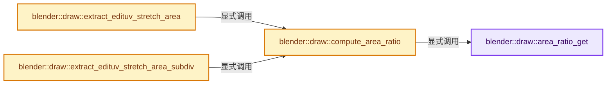
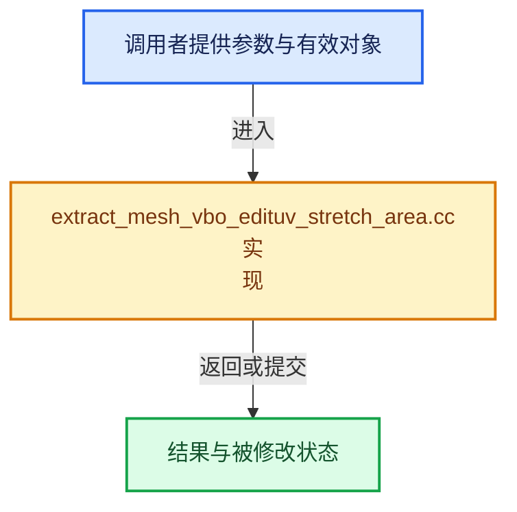

# 实现依赖专题：source/blender/draw/intern/mesh_extractors/extract_mesh_vbo_edituv_stretch_area.cc

[实现依赖导航](../../../../README.md) · [符号索引](../../../../../00-课程指南/02-源码与提交索引/符号依赖与实现索引.md)

本专题从正文实际调用进入，集中保存共享实现。函数有稳定锚点，可从调用处直接跳到对应完整函数；递归与互相调用通过回链组织。

## 本文件的实现关系






## 完整成员与函数实现

<a id="f-7304aabc0e612c66"></a>

### `blender::draw::area_ratio_get`

实现位置：[source/blender/draw/intern/mesh_extractors/extract_mesh_vbo_edituv_stretch_area.cc](../../../../../../../../../source/blender/draw/intern/mesh_extractors/extract_mesh_vbo_edituv_stretch_area.cc) · L21—L27。

接口参数：

- `float area`
- `float uvarea`

**教学注释版**

<!-- annotated:343fba127e3c05 -->

```cpp
BLI_INLINE float area_ratio_get(float area, float uvarea)
{
  if (area >= FLT_EPSILON && uvarea >= FLT_EPSILON) {
    return uvarea / area;
  }
  return 0.0f;
}
```

<details>
<summary>核对原始源码：source/blender/draw/intern/mesh_extractors/extract_mesh_vbo_edituv_stretch_area.cc · L21—L27</summary>

<!-- original:343fba127e3c05:source/blender/draw/intern/mesh_extractors/extract_mesh_vbo_edituv_stretch_area.cc:21:27 -->

```cpp
BLI_INLINE float area_ratio_get(float area, float uvarea)
{
  if (area >= FLT_EPSILON && uvarea >= FLT_EPSILON) {
    return uvarea / area;
  }
  return 0.0f;
}
```

</details>

**结果出口**

- `return uvarea / area;`
- `return 0.0f;`

**继续追踪实现**

本实现没有需要继续展开的显式调用；检查返回表达式、对象转换和调用者前置条件。

<a id="f-a94e2bd8cd61aa1f"></a>

### `blender::draw::compute_area_ratio`

实现位置：[source/blender/draw/intern/mesh_extractors/extract_mesh_vbo_edituv_stretch_area.cc](../../../../../../../../../source/blender/draw/intern/mesh_extractors/extract_mesh_vbo_edituv_stretch_area.cc) · L39—L92。

接口参数：

- `const MeshRenderData &mr`
- `MutableSpan<float> r_area_ratio`

**教学注释版**

<!-- annotated:5c2ab9416746b0 -->

```cpp
static AreaInfo compute_area_ratio(const MeshRenderData &mr, MutableSpan<float> r_area_ratio)
{
  if (mr.extract_type == MeshExtractType::BMesh) {
    const BMesh &bm = *mr.bm;
    const StringRef active_name = mr.mesh->active_uv_map_name();
    const int uv_offset = CustomData_get_offset_named(&bm.ldata, CD_PROP_FLOAT2, active_name);
    return threading::parallel_reduce(
        IndexRange(bm.totface),
        1024,
        AreaInfo{},
        [&](const IndexRange range, AreaInfo info) {
          for (const int face_index : range) {
            const BMFace &face = *BM_face_at_index(&const_cast<BMesh &>(bm), face_index);
            const float area = BM_face_calc_area(&face);
            const float uvarea = BM_face_calc_area_uv(&face, uv_offset);
            info.tot_area += area;
            info.tot_uv_area += uvarea;
            r_area_ratio[face_index] = area_ratio_get(area, uvarea);
          }
          return info;
        },
        [](const AreaInfo &a, const AreaInfo &b) {
          return AreaInfo{a.tot_area + b.tot_area, a.tot_uv_area + b.tot_uv_area};
        });
  }

  const Span<float3> positions = mr.vert_positions;
  const OffsetIndices<int> faces = mr.faces;
  const Span<int> corner_verts = mr.corner_verts;
  const Mesh &mesh = *mr.mesh;
  const bke::AttributeAccessor attributes = mesh.attributes();
  const StringRef name = mesh.active_uv_map_name();
  const VArraySpan uv_map = *attributes.lookup<float2>(name, bke::AttrDomain::Corner);

  return threading::parallel_reduce(
      faces.index_range(),
      1024,
      AreaInfo{},
      [&](const IndexRange range, AreaInfo info) {
        for (const int face_index : range) {
          const IndexRange face = faces[face_index];
          // [讲解] corner_verts.slice：建立原连续范围的子视图。
          const float area = bke::mesh::face_area_calc(positions, corner_verts.slice(face));
          // [讲解] face.start：读取连续区间或分组的边界信息。
          float uvarea = area_poly_v2(reinterpret_cast<const float (*)[2]>(&uv_map[face.start()]),
                                      // [讲解] face.size：读取连续区间或分组的边界信息。
                                      face.size());
          info.tot_area += area;
          info.tot_uv_area += uvarea;
          r_area_ratio[face_index] = area_ratio_get(area, uvarea);
        }
        return info;
      },
      [](const AreaInfo &a, const AreaInfo &b) {
        return AreaInfo{a.tot_area + b.tot_area, a.tot_uv_area + b.tot_uv_area};
      });
}
```

<details>
<summary>核对原始源码：source/blender/draw/intern/mesh_extractors/extract_mesh_vbo_edituv_stretch_area.cc · L39—L92</summary>

<!-- original:5c2ab9416746b0:source/blender/draw/intern/mesh_extractors/extract_mesh_vbo_edituv_stretch_area.cc:39:92 -->

```cpp
static AreaInfo compute_area_ratio(const MeshRenderData &mr, MutableSpan<float> r_area_ratio)
{
  if (mr.extract_type == MeshExtractType::BMesh) {
    const BMesh &bm = *mr.bm;
    const StringRef active_name = mr.mesh->active_uv_map_name();
    const int uv_offset = CustomData_get_offset_named(&bm.ldata, CD_PROP_FLOAT2, active_name);
    return threading::parallel_reduce(
        IndexRange(bm.totface),
        1024,
        AreaInfo{},
        [&](const IndexRange range, AreaInfo info) {
          for (const int face_index : range) {
            const BMFace &face = *BM_face_at_index(&const_cast<BMesh &>(bm), face_index);
            const float area = BM_face_calc_area(&face);
            const float uvarea = BM_face_calc_area_uv(&face, uv_offset);
            info.tot_area += area;
            info.tot_uv_area += uvarea;
            r_area_ratio[face_index] = area_ratio_get(area, uvarea);
          }
          return info;
        },
        [](const AreaInfo &a, const AreaInfo &b) {
          return AreaInfo{a.tot_area + b.tot_area, a.tot_uv_area + b.tot_uv_area};
        });
  }

  const Span<float3> positions = mr.vert_positions;
  const OffsetIndices<int> faces = mr.faces;
  const Span<int> corner_verts = mr.corner_verts;
  const Mesh &mesh = *mr.mesh;
  const bke::AttributeAccessor attributes = mesh.attributes();
  const StringRef name = mesh.active_uv_map_name();
  const VArraySpan uv_map = *attributes.lookup<float2>(name, bke::AttrDomain::Corner);

  return threading::parallel_reduce(
      faces.index_range(),
      1024,
      AreaInfo{},
      [&](const IndexRange range, AreaInfo info) {
        for (const int face_index : range) {
          const IndexRange face = faces[face_index];
          const float area = bke::mesh::face_area_calc(positions, corner_verts.slice(face));
          float uvarea = area_poly_v2(reinterpret_cast<const float (*)[2]>(&uv_map[face.start()]),
                                      face.size());
          info.tot_area += area;
          info.tot_uv_area += uvarea;
          r_area_ratio[face_index] = area_ratio_get(area, uvarea);
        }
        return info;
      },
      [](const AreaInfo &a, const AreaInfo &b) {
        return AreaInfo{a.tot_area + b.tot_area, a.tot_uv_area + b.tot_uv_area};
      });
}
```

</details>

**沿实际写入检查状态**

- `info.tot_area += area;`
- `info.tot_uv_area += uvarea;`
- `r_area_ratio[face_index] = area_ratio_get(area, uvarea);`

**结果出口**

- `return threading::parallel_reduce(`
- `return info;`
- `return AreaInfo{a.tot_area + b.tot_area, a.tot_uv_area + b.tot_uv_area};`

**继续追踪实现**

- `mr.mesh->active_uv_map_name` → [调用协议](../../../../../00-课程指南/01-路线与规范/模板宏与动态分派协议.md)：接收对象类型依赖auto、返回值或模板实例；不按同名猜测目标。调用位置L43。
- `CustomData_get_offset_named` → [blender::CustomData_get_offset_named · L3398](../../../../02-BKE几何与数据/intern/customdata.cc.md#f-fe199f3da62e9c30)。
- `threading::parallel_reduce` → [blender::threading::parallel_reduce · L126](../../../../../11-Depsgraph与并行任务系统/07-任务池与TBB接入.md#f-9225ddb5efb97fcc)。
- `IndexRange` → [blender::IndexRange](../../../../01-BLI基础库/BLI_index_range.hh.md#t-caa3466d6776)；[blender::gpu::shader::parser::IndexRange](../../../gpu/shader_tool/utils.hh.md#t-82d2bd4ea71c)；[blender::IndexRange](../../../makesdna/DNA_node_types.h.md#t-0448cc889d39)。
- `BM_face_at_index` → [blender::BM_face_at_index · L122](../../../bmesh/intern/bmesh_mesh.hh.md#f-366df62c166d5094)。
- `BM_face_calc_area` → [blender::BM_face_calc_area · L214](../../../bmesh/intern/bmesh_polygon.cc.md#f-68093575f608c8ea)。
- `BM_face_calc_area_uv` → [blender::BM_face_calc_area_uv · L264](../../../bmesh/intern/bmesh_polygon.cc.md#f-d0a027e9bb559e5c)。
- `area_ratio_get` → [blender::draw::area_ratio_get · L21](extract_mesh_vbo_edituv_stretch_area.cc.md#f-7304aabc0e612c66)。
- `mesh.attributes` → [Mesh::attributes · L1298](../../../../../05-几何存储与拓扑映射/03-MPoly迁移与兼容.md#f-607bbfe3e57cfc7f)。
- `mesh.active_uv_map_name` → [Mesh::active_uv_map_name · L1319](../../../../../05-几何存储与拓扑映射/03-MPoly迁移与兼容.md#f-9b4762e851836e79)。
- `attributes.lookup<float2>` → [blender::bke::AttributeAccessor::lookup · L401](../../../../02-BKE几何与数据/intern/attribute_access.cc.md#f-4673351b7bb3b651)；[blender::bke::AttributeAccessor::lookup · L585](../../../../../05-几何存储与拓扑映射/08-AttributeAccessor接口.md#f-432b90c796a80893)；[blender::bke::AttributeAccessor::lookup · L602](../../../../../05-几何存储与拓扑映射/08-AttributeAccessor接口.md#f-a60c1a45b85155d9)；[blender::bke::AttributeAccessor::lookup · L611](../../../../../05-几何存储与拓扑映射/08-AttributeAccessor接口.md#f-16ca459803fc30a6)；[blender::bke::AttributeAccessor::lookup · L620](../../../../../05-几何存储与拓扑映射/08-AttributeAccessor接口.md#f-403fd8a9d1a16c6d)。同名重载需按实参类型选择。
- `faces.index_range` → [blender::offset_indices::OffsetIndices::index_range · L77](../../../../../05-几何存储与拓扑映射/02-OffsetIndices完整接口.md#f-19b5ca1456de007d)。
- `bke::mesh::face_area_calc` → [blender::bke::mesh::face_area_calc · L67](../../../../02-BKE几何与数据/intern/mesh_evaluate.cc.md#f-ce18cacfc44bbb37)。
- `corner_verts.slice` → [blender::Span::slice · L141](../../../../../01-基础容器与现代CPP/05-Span只读连续视图.md#f-380a0e8fdcbd53cc)；[blender::Span::slice · L149](../../../../../01-基础容器与现代CPP/05-Span只读连续视图.md#f-9b9c15e78dd54eec)。同名重载需按实参类型选择。
- `area_poly_v2` → [blender::area_poly_v2 · L186](../../../../01-BLI基础库/intern/math_geom.cc.md#f-10e5cd7992ac6839)。
- `face.start` → [blender::IndexRange::start · L243](../../../../../01-基础容器与现代CPP/04-IndexRange连续整数区间.md#f-99d2195bd9cfd1f0)。
- `face.size` → [blender::IndexRange::size · L156](../../../../../01-基础容器与现代CPP/04-IndexRange连续整数区间.md#f-05f66c3ebb2fdfec)。

<a id="f-15d681f3e7b6b184"></a>

### `blender::draw::extract_edituv_stretch_area`

实现位置：[source/blender/draw/intern/mesh_extractors/extract_mesh_vbo_edituv_stretch_area.cc](../../../../../../../../../source/blender/draw/intern/mesh_extractors/extract_mesh_vbo_edituv_stretch_area.cc) · L94—L132。

接口参数：

- `const MeshRenderData &mr`
- `float &tot_area`
- `float &tot_uv_area`

**教学注释版**

<!-- annotated:9e36ee7089e8cb -->

```cpp
gpu::VertBufPtr extract_edituv_stretch_area(const MeshRenderData &mr,
                                            float &tot_area,
                                            float &tot_uv_area)
{
  Array<float> area_ratio(mr.faces_num);
  const AreaInfo info = compute_area_ratio(mr, area_ratio);
  tot_area = info.tot_area;
  tot_uv_area = info.tot_uv_area;

  static const GPUVertFormat format = GPU_vertformat_from_attribute("ratio",
                                                                    gpu::VertAttrType::SFLOAT_32);
  gpu::VertBufPtr vbo = gpu::VertBufPtr(GPU_vertbuf_create_with_format(format));
  GPU_vertbuf_data_alloc(*vbo, mr.corners_num);
  MutableSpan<float> vbo_data = vbo->data<float>();

  // [讲解] area_ratio.as_span：提供数组的借用访问入口。
  const int64_t bytes = area_ratio.as_span().size_in_bytes() + vbo_data.size_in_bytes();
  threading::memory_bandwidth_bound_task(bytes, [&]() {
    if (mr.extract_type == MeshExtractType::BMesh) {
      const BMesh &bm = *mr.bm;
      threading::parallel_for(IndexRange(bm.totface), 2048, [&](const IndexRange range) {
        for (const int face_index : range) {
          const BMFace &face = *BM_face_at_index(&const_cast<BMesh &>(bm), face_index);
          const IndexRange face_range(BM_elem_index_get(BM_FACE_FIRST_LOOP(&face)), face.len);
          // [讲解] vbo_data.slice：建立原连续范围的子视图。
          vbo_data.slice(face_range).fill(area_ratio[face_index]);
        }
      });
    }
    else {
      BLI_assert(mr.extract_type == MeshExtractType::Mesh);
      const OffsetIndices<int> faces = mr.faces;
      threading::parallel_for(faces.index_range(), 2048, [&](const IndexRange range) {
        for (const int face : range) {
          vbo_data.slice(faces[face]).fill(area_ratio[face]);
        }
      });
    }
  });
  return vbo;
}
```

<details>
<summary>核对原始源码：source/blender/draw/intern/mesh_extractors/extract_mesh_vbo_edituv_stretch_area.cc · L94—L132</summary>

<!-- original:9e36ee7089e8cb:source/blender/draw/intern/mesh_extractors/extract_mesh_vbo_edituv_stretch_area.cc:94:132 -->

```cpp
gpu::VertBufPtr extract_edituv_stretch_area(const MeshRenderData &mr,
                                            float &tot_area,
                                            float &tot_uv_area)
{
  Array<float> area_ratio(mr.faces_num);
  const AreaInfo info = compute_area_ratio(mr, area_ratio);
  tot_area = info.tot_area;
  tot_uv_area = info.tot_uv_area;

  static const GPUVertFormat format = GPU_vertformat_from_attribute("ratio",
                                                                    gpu::VertAttrType::SFLOAT_32);
  gpu::VertBufPtr vbo = gpu::VertBufPtr(GPU_vertbuf_create_with_format(format));
  GPU_vertbuf_data_alloc(*vbo, mr.corners_num);
  MutableSpan<float> vbo_data = vbo->data<float>();

  const int64_t bytes = area_ratio.as_span().size_in_bytes() + vbo_data.size_in_bytes();
  threading::memory_bandwidth_bound_task(bytes, [&]() {
    if (mr.extract_type == MeshExtractType::BMesh) {
      const BMesh &bm = *mr.bm;
      threading::parallel_for(IndexRange(bm.totface), 2048, [&](const IndexRange range) {
        for (const int face_index : range) {
          const BMFace &face = *BM_face_at_index(&const_cast<BMesh &>(bm), face_index);
          const IndexRange face_range(BM_elem_index_get(BM_FACE_FIRST_LOOP(&face)), face.len);
          vbo_data.slice(face_range).fill(area_ratio[face_index]);
        }
      });
    }
    else {
      BLI_assert(mr.extract_type == MeshExtractType::Mesh);
      const OffsetIndices<int> faces = mr.faces;
      threading::parallel_for(faces.index_range(), 2048, [&](const IndexRange range) {
        for (const int face : range) {
          vbo_data.slice(faces[face]).fill(area_ratio[face]);
        }
      });
    }
  });
  return vbo;
}
```

</details>

**沿实际写入检查状态**

- `tot_area = info.tot_area;`
- `tot_uv_area = info.tot_uv_area;`

**结果出口**

- `return vbo;`

**继续追踪实现**

- `compute_area_ratio` → [blender::draw::compute_area_ratio · L39](extract_mesh_vbo_edituv_stretch_area.cc.md#f-a94e2bd8cd61aa1f)。
- `GPU_vertformat_from_attribute` → [blender::GPU_vertformat_from_attribute · L427](../../../gpu/intern/gpu_vertex_format.cc.md#f-2643d25087989f8e)。
- `gpu::VertBufPtr` → [调用协议](../../../../../00-课程指南/01-路线与规范/模板宏与动态分派协议.md)：函数指针、局部可调用对象或未展开的宏；必须结合调用者环境。调用位置L105。
- `GPU_vertbuf_create_with_format` → [blender::GPU_vertbuf_create_with_format · L71](../../../gpu/GPU_vertex_buffer.hh.md#f-bd43fe034e852138)。
- `GPU_vertbuf_data_alloc` → [blender::GPU_vertbuf_data_alloc · L172](../../../gpu/intern/gpu_vertex_buffer.cc.md#f-8ee5cf106e0f2b0f)。
- `vbo->data<float>` → [blender::draw::data · L124](../DRW_gpu_wrapper.hh.md#f-dc115dc22e0c9f33)；[blender::draw::data · L129](../DRW_gpu_wrapper.hh.md#f-5f325cb75387045c)。同名重载需按实参类型选择。
- `area_ratio.as_span().size_in_bytes` → [调用协议](../../../../../00-课程指南/01-路线与规范/模板宏与动态分派协议.md)：接收对象类型依赖auto、返回值或模板实例；不按同名猜测目标。调用位置L109。
- `area_ratio.as_span` → [blender::Array::as_span · L254](../../../../../01-基础容器与现代CPP/08-Array复制移动与销毁.md#f-05fc77056a242032)。
- `vbo_data.size_in_bytes` → [blender::MutableSpan::size_in_bytes · L507](../../../../../01-基础容器与现代CPP/06-MutableSpan可写视图.md#f-2e42823b970a8406)。
- `threading::memory_bandwidth_bound_task` → [blender::threading::memory_bandwidth_bound_task · L250](../../../../../11-Depsgraph与并行任务系统/07-任务池与TBB接入.md#f-aa412ccec656928d)。
- `threading::parallel_for` → [blender::threading::parallel_for · L68](../../../../../11-Depsgraph与并行任务系统/07-任务池与TBB接入.md#f-838294754c24426c)。
- `IndexRange` → [blender::IndexRange](../../../../01-BLI基础库/BLI_index_range.hh.md#t-caa3466d6776)；[blender::gpu::shader::parser::IndexRange](../../../gpu/shader_tool/utils.hh.md#t-82d2bd4ea71c)；[blender::IndexRange](../../../makesdna/DNA_node_types.h.md#t-0448cc889d39)。
- `BM_face_at_index` → [blender::BM_face_at_index · L122](../../../bmesh/intern/bmesh_mesh.hh.md#f-366df62c166d5094)。
- `BM_elem_index_get` → [BM_elem_index_get · L120](../../../bmesh/intern/bmesh_inline.hh.md#m-201981cdc62d)。宏定义由构建条件选择。
- `BM_FACE_FIRST_LOOP` → [BM_FACE_FIRST_LOOP · L697](../../../bmesh/bmesh_class.hh.md#m-c7e10ffb38e6)；[BM_FACE_FIRST_LOOP · L699](../../../bmesh/bmesh_class.hh.md#m-76a054cc4770)。宏定义由构建条件选择。
- `vbo_data.slice(face_range).fill` → [调用协议](../../../../../00-课程指南/01-路线与规范/模板宏与动态分派协议.md)：接收对象类型依赖auto、返回值或模板实例；不按同名猜测目标。调用位置L117。
- `vbo_data.slice` → [blender::MutableSpan::slice · L579](../../../../../01-基础容器与现代CPP/06-MutableSpan可写视图.md#f-6808b4aefbf58808)；[blender::MutableSpan::slice · L587](../../../../../01-基础容器与现代CPP/06-MutableSpan可写视图.md#f-c05b010821861e4f)。同名重载需按实参类型选择。
- `BLI_assert` → [BLI_assert · L48](../../../../01-BLI基础库/BLI_assert.hh.md#m-57a88495704d)；[BLI_assert · L63](../../../../01-BLI基础库/BLI_assert.hh.md#m-d07050020cb5)。宏定义由构建条件选择。
- `faces.index_range` → [blender::offset_indices::OffsetIndices::index_range · L77](../../../../../05-几何存储与拓扑映射/02-OffsetIndices完整接口.md#f-19b5ca1456de007d)。
- `vbo_data.slice(faces[face]).fill` → [调用协议](../../../../../00-课程指南/01-路线与规范/模板宏与动态分派协议.md)：接收对象类型依赖auto、返回值或模板实例；不按同名猜测目标。调用位置L126。

<a id="f-518b48740fc9e582"></a>

### `blender::draw::extract_edituv_stretch_area_subdiv`

实现位置：[source/blender/draw/intern/mesh_extractors/extract_mesh_vbo_edituv_stretch_area.cc](../../../../../../../../../source/blender/draw/intern/mesh_extractors/extract_mesh_vbo_edituv_stretch_area.cc) · L134—L156。

接口参数：

- `const MeshRenderData &mr`
- `const DRWSubdivCache &subdiv_cache`
- `float &tot_area`
- `float &tot_uv_area`

**教学注释版**

<!-- annotated:891712a6f8042e -->

```cpp
gpu::VertBufPtr extract_edituv_stretch_area_subdiv(const MeshRenderData &mr,
                                                   const DRWSubdivCache &subdiv_cache,
                                                   float &tot_area,
                                                   float &tot_uv_area)
{
  static const GPUVertFormat format = GPU_vertformat_from_attribute("ratio",
                                                                    gpu::VertAttrType::SFLOAT_32);
  gpu::VertBufPtr vbo = gpu::VertBufPtr(
      GPU_vertbuf_create_on_device(format, subdiv_cache.num_subdiv_loops));

  gpu::VertBuf *coarse_vbo = GPU_vertbuf_calloc();
  GPU_vertbuf_init_with_format(*coarse_vbo, format);
  GPU_vertbuf_data_alloc(*coarse_vbo, mr.faces_num);
  MutableSpan coarse_vbo_data = coarse_vbo->data<float>();
  const AreaInfo info = compute_area_ratio(mr, coarse_vbo_data);
  tot_area = info.tot_area;
  tot_uv_area = info.tot_uv_area;

  draw_subdiv_build_edituv_stretch_area_buffer(subdiv_cache, coarse_vbo, vbo.get());

  GPU_vertbuf_discard(coarse_vbo);
  return vbo;
}
```

<details>
<summary>核对原始源码：source/blender/draw/intern/mesh_extractors/extract_mesh_vbo_edituv_stretch_area.cc · L134—L156</summary>

<!-- original:891712a6f8042e:source/blender/draw/intern/mesh_extractors/extract_mesh_vbo_edituv_stretch_area.cc:134:156 -->

```cpp
gpu::VertBufPtr extract_edituv_stretch_area_subdiv(const MeshRenderData &mr,
                                                   const DRWSubdivCache &subdiv_cache,
                                                   float &tot_area,
                                                   float &tot_uv_area)
{
  static const GPUVertFormat format = GPU_vertformat_from_attribute("ratio",
                                                                    gpu::VertAttrType::SFLOAT_32);
  gpu::VertBufPtr vbo = gpu::VertBufPtr(
      GPU_vertbuf_create_on_device(format, subdiv_cache.num_subdiv_loops));

  gpu::VertBuf *coarse_vbo = GPU_vertbuf_calloc();
  GPU_vertbuf_init_with_format(*coarse_vbo, format);
  GPU_vertbuf_data_alloc(*coarse_vbo, mr.faces_num);
  MutableSpan coarse_vbo_data = coarse_vbo->data<float>();
  const AreaInfo info = compute_area_ratio(mr, coarse_vbo_data);
  tot_area = info.tot_area;
  tot_uv_area = info.tot_uv_area;

  draw_subdiv_build_edituv_stretch_area_buffer(subdiv_cache, coarse_vbo, vbo.get());

  GPU_vertbuf_discard(coarse_vbo);
  return vbo;
}
```

</details>

**沿实际写入检查状态**

- `tot_area = info.tot_area;`
- `tot_uv_area = info.tot_uv_area;`

**结果出口**

- `return vbo;`

**继续追踪实现**

- `GPU_vertformat_from_attribute` → [blender::GPU_vertformat_from_attribute · L427](../../../gpu/intern/gpu_vertex_format.cc.md#f-2643d25087989f8e)。
- `gpu::VertBufPtr` → [调用协议](../../../../../00-课程指南/01-路线与规范/模板宏与动态分派协议.md)：函数指针、局部可调用对象或未展开的宏；必须结合调用者环境。调用位置L141。
- `GPU_vertbuf_create_on_device` → [blender::GPU_vertbuf_create_on_device · L137](../../../gpu/intern/gpu_vertex_buffer.cc.md#f-abf244a18691f929)。
- `GPU_vertbuf_calloc` → [blender::GPU_vertbuf_calloc · L112](../../../gpu/intern/gpu_vertex_buffer.cc.md#f-bddd6e0944c513f4)。
- `GPU_vertbuf_init_with_format` → [GPU_vertbuf_init_with_format · L277](../../../gpu/GPU_vertex_buffer.hh.md#m-7100390733f1)。宏定义由构建条件选择。
- `GPU_vertbuf_data_alloc` → [blender::GPU_vertbuf_data_alloc · L172](../../../gpu/intern/gpu_vertex_buffer.cc.md#f-8ee5cf106e0f2b0f)。
- `coarse_vbo->data<float>` → [blender::gpu::VertBuf::data · L220](../../../gpu/GPU_vertex_buffer.hh.md#f-e72412fdddda8bf5)。
- `compute_area_ratio` → [blender::draw::compute_area_ratio · L39](extract_mesh_vbo_edituv_stretch_area.cc.md#f-a94e2bd8cd61aa1f)。
- `draw_subdiv_build_edituv_stretch_area_buffer` → [blender::draw::draw_subdiv_build_edituv_stretch_area_buffer · L1437](../draw_cache_impl_subdivision.cc.md#f-08a2f541eda625c5)。
- `vbo.get` → [blender::draw::GSplatEvalCache::get · L545](../draw_cache_impl_gsplat.cc.md#f-3fb704a0b74cb9e4)。
- `GPU_vertbuf_discard` → [blender::GPU_vertbuf_discard · L154](../../../gpu/intern/gpu_vertex_buffer.cc.md#f-05a0c4598ede18a4)。
