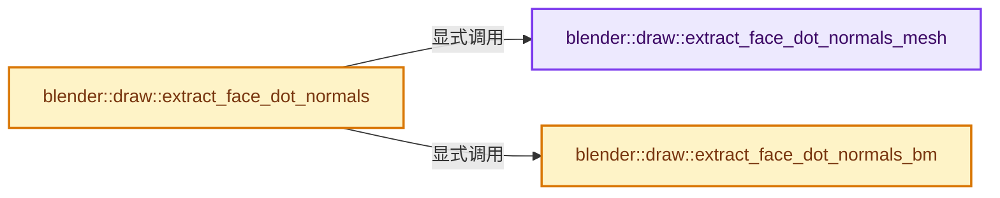
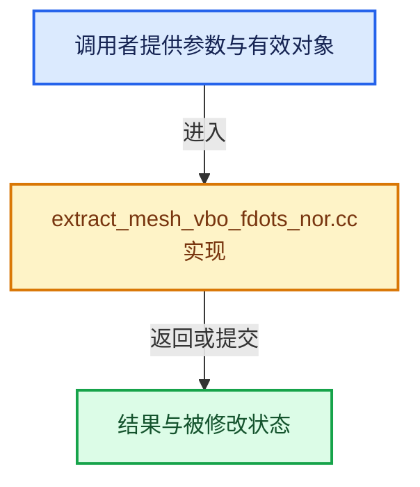

# 实现依赖专题：source/blender/draw/intern/mesh_extractors/extract_mesh_vbo_fdots_nor.cc

[实现依赖导航](../../../../README.md) · [符号索引](../../../../../00-课程指南/02-源码与提交索引/符号依赖与实现索引.md)

本专题从正文实际调用进入，集中保存共享实现。函数有稳定锚点，可从调用处直接跳到对应完整函数；递归与互相调用通过回链组织。

## 本文件的实现关系






## 完整成员与函数实现

<a id="f-3eb97862d0234c23"></a>

### `blender::draw::extract_face_dot_normals_mesh`

实现位置：[source/blender/draw/intern/mesh_extractors/extract_mesh_vbo_fdots_nor.cc](../../../../../../../../../source/blender/draw/intern/mesh_extractors/extract_mesh_vbo_fdots_nor.cc) · L20—L37。

接口参数：

- `const MeshRenderData &mr`
- `MutableSpan<GPUType> normals`

**教学注释版**

<!-- annotated:a664eca45cb847 -->

```cpp
template<typename GPUType>
static void extract_face_dot_normals_mesh(const MeshRenderData &mr, MutableSpan<GPUType> normals)
{
  gpu::convert_normals(mr.face_normals, normals);
  const GPUType invalid_normal = gpu::convert_normal<GPUType>(float3(0));
  threading::parallel_for(IndexRange(mr.faces_num), 4096, [&](const IndexRange range) {
    for (const int i : range) {
      const BMFace *face = bm_original_face_get(mr, i);
      if (!face || BM_elem_flag_test(face, BM_ELEM_HIDDEN)) {
        normals[i] = invalid_normal;
        normals[i].w = NOR_AND_FLAG_HIDDEN;
      }
      else if (BM_elem_flag_test(face, BM_ELEM_SELECT)) {
        normals[i].w = (face == mr.efa_act) ? NOR_AND_FLAG_ACTIVE : NOR_AND_FLAG_SELECT;
      }
    }
  });
}
```

<details>
<summary>核对原始源码：source/blender/draw/intern/mesh_extractors/extract_mesh_vbo_fdots_nor.cc · L20—L37</summary>

<!-- original:a664eca45cb847:source/blender/draw/intern/mesh_extractors/extract_mesh_vbo_fdots_nor.cc:20:37 -->

```cpp
template<typename GPUType>
static void extract_face_dot_normals_mesh(const MeshRenderData &mr, MutableSpan<GPUType> normals)
{
  gpu::convert_normals(mr.face_normals, normals);
  const GPUType invalid_normal = gpu::convert_normal<GPUType>(float3(0));
  threading::parallel_for(IndexRange(mr.faces_num), 4096, [&](const IndexRange range) {
    for (const int i : range) {
      const BMFace *face = bm_original_face_get(mr, i);
      if (!face || BM_elem_flag_test(face, BM_ELEM_HIDDEN)) {
        normals[i] = invalid_normal;
        normals[i].w = NOR_AND_FLAG_HIDDEN;
      }
      else if (BM_elem_flag_test(face, BM_ELEM_SELECT)) {
        normals[i].w = (face == mr.efa_act) ? NOR_AND_FLAG_ACTIVE : NOR_AND_FLAG_SELECT;
      }
    }
  });
}
```

</details>

**沿实际写入检查状态**

- `normals[i] = invalid_normal;`
- `normals[i].w = NOR_AND_FLAG_HIDDEN;`
- `normals[i].w = (face == mr.efa_act) ? NOR_AND_FLAG_ACTIVE : NOR_AND_FLAG_SELECT;`

**继续追踪实现**

- `gpu::convert_normals` → [blender::gpu::convert_normals · L27](../../../gpu/intern/gpu_vertex_format_normals.cc.md#f-8089add92715f800)；[blender::gpu::convert_normals · L31](../../../gpu/intern/gpu_vertex_format_normals.cc.md#f-c169df59eea7544c)。同名重载需按实参类型选择。
- `gpu::convert_normal<GPUType>` → [blender::gpu::convert_normal · L21](../../../gpu/GPU_attribute_convert.hh.md#f-d24eef906ebcd8b5)；[blender::gpu::convert_normal · L26](../../../gpu/GPU_attribute_convert.hh.md#f-40f0824f9b7edbbb)。同名重载需按实参类型选择。
- `float3` → [float3 · L641](../../../compositor/algorithms/intern/smaa.cc.md#m-0ea8254cfdb4)。宏定义由构建条件选择。
- `threading::parallel_for` → [blender::threading::parallel_for · L68](../../../../../11-Depsgraph与并行任务系统/07-任务池与TBB接入.md#f-838294754c24426c)。
- `IndexRange` → [blender::IndexRange](../../../../01-BLI基础库/BLI_index_range.hh.md#t-caa3466d6776)；[blender::gpu::shader::parser::IndexRange](../../../gpu/shader_tool/utils.hh.md#t-82d2bd4ea71c)；[blender::IndexRange](../../../makesdna/DNA_node_types.h.md#t-0448cc889d39)。
- `bm_original_face_get` → [blender::draw::bm_original_face_get · L138](extract_mesh.hh.md#f-50ae48e6025f345a)。
- `BM_elem_flag_test` → [BM_elem_flag_test · L21](../../../bmesh/intern/bmesh_inline.hh.md#m-2431d1179b41)。宏定义由构建条件选择。

<a id="f-c7f9293043678028"></a>

### `blender::draw::extract_face_dot_normals_bm`

实现位置：[source/blender/draw/intern/mesh_extractors/extract_mesh_vbo_fdots_nor.cc](../../../../../../../../../source/blender/draw/intern/mesh_extractors/extract_mesh_vbo_fdots_nor.cc) · L39—L58。

接口参数：

- `const MeshRenderData &mr`
- `MutableSpan<GPUType> normals`

**教学注释版**

<!-- annotated:559cd09044ce00 -->

```cpp
template<typename GPUType>
void extract_face_dot_normals_bm(const MeshRenderData &mr, MutableSpan<GPUType> normals)
{
  const GPUType invalid_normal = gpu::convert_normal<GPUType>(float3(0));
  threading::parallel_for(IndexRange(mr.faces_num), 4096, [&](const IndexRange range) {
    for (const int i : range) {
      BMFace *face = BM_face_at_index(mr.bm, i);
      if (BM_elem_flag_test(face, BM_ELEM_HIDDEN)) {
        normals[i] = invalid_normal;
        normals[i].w = NOR_AND_FLAG_HIDDEN;
      }
      else {
        normals[i] = gpu::convert_normal<GPUType>(bm_face_no_get(mr, face));
        normals[i].w = (BM_elem_flag_test(face, BM_ELEM_SELECT) ?
                            ((face == mr.efa_act) ? NOR_AND_FLAG_ACTIVE : NOR_AND_FLAG_SELECT) :
                            NOR_AND_FLAG_DEFAULT);
      }
    }
  });
}
```

<details>
<summary>核对原始源码：source/blender/draw/intern/mesh_extractors/extract_mesh_vbo_fdots_nor.cc · L39—L58</summary>

<!-- original:559cd09044ce00:source/blender/draw/intern/mesh_extractors/extract_mesh_vbo_fdots_nor.cc:39:58 -->

```cpp
template<typename GPUType>
void extract_face_dot_normals_bm(const MeshRenderData &mr, MutableSpan<GPUType> normals)
{
  const GPUType invalid_normal = gpu::convert_normal<GPUType>(float3(0));
  threading::parallel_for(IndexRange(mr.faces_num), 4096, [&](const IndexRange range) {
    for (const int i : range) {
      BMFace *face = BM_face_at_index(mr.bm, i);
      if (BM_elem_flag_test(face, BM_ELEM_HIDDEN)) {
        normals[i] = invalid_normal;
        normals[i].w = NOR_AND_FLAG_HIDDEN;
      }
      else {
        normals[i] = gpu::convert_normal<GPUType>(bm_face_no_get(mr, face));
        normals[i].w = (BM_elem_flag_test(face, BM_ELEM_SELECT) ?
                            ((face == mr.efa_act) ? NOR_AND_FLAG_ACTIVE : NOR_AND_FLAG_SELECT) :
                            NOR_AND_FLAG_DEFAULT);
      }
    }
  });
}
```

</details>

**沿实际写入检查状态**

- `normals[i] = invalid_normal;`
- `normals[i].w = NOR_AND_FLAG_HIDDEN;`
- `normals[i] = gpu::convert_normal<GPUType>(bm_face_no_get(mr, face));`
- `normals[i].w = (BM_elem_flag_test(face, BM_ELEM_SELECT) ?`

**继续追踪实现**

- `gpu::convert_normal<GPUType>` → [blender::gpu::convert_normal · L21](../../../gpu/GPU_attribute_convert.hh.md#f-d24eef906ebcd8b5)；[blender::gpu::convert_normal · L26](../../../gpu/GPU_attribute_convert.hh.md#f-40f0824f9b7edbbb)。同名重载需按实参类型选择。
- `float3` → [float3 · L641](../../../compositor/algorithms/intern/smaa.cc.md#m-0ea8254cfdb4)。宏定义由构建条件选择。
- `threading::parallel_for` → [blender::threading::parallel_for · L68](../../../../../11-Depsgraph与并行任务系统/07-任务池与TBB接入.md#f-838294754c24426c)。
- `IndexRange` → [blender::IndexRange](../../../../01-BLI基础库/BLI_index_range.hh.md#t-caa3466d6776)；[blender::gpu::shader::parser::IndexRange](../../../gpu/shader_tool/utils.hh.md#t-82d2bd4ea71c)；[blender::IndexRange](../../../makesdna/DNA_node_types.h.md#t-0448cc889d39)。
- `BM_face_at_index` → [blender::BM_face_at_index · L122](../../../bmesh/intern/bmesh_mesh.hh.md#f-366df62c166d5094)。
- `BM_elem_flag_test` → [BM_elem_flag_test · L21](../../../bmesh/intern/bmesh_inline.hh.md#m-2431d1179b41)。宏定义由构建条件选择。
- `bm_face_no_get` → [blender::draw::bm_face_no_get · L181](extract_mesh.hh.md#f-40a3dcea78714956)。

<a id="f-a480779dec322f3a"></a>

### `blender::draw::extract_face_dot_normals`

实现位置：[source/blender/draw/intern/mesh_extractors/extract_mesh_vbo_fdots_nor.cc](../../../../../../../../../source/blender/draw/intern/mesh_extractors/extract_mesh_vbo_fdots_nor.cc) · L60—L90。

接口参数：

- `const MeshRenderData &mr`
- `const bool use_hq`

**教学注释版**

<!-- annotated:ea1560ab903099 -->

```cpp
gpu::VertBufPtr extract_face_dot_normals(const MeshRenderData &mr, const bool use_hq)
{
  if (use_hq) {
    static const GPUVertFormat format = GPU_vertformat_from_attribute(
        "norAndFlag", gpu::VertAttrType::SNORM_16_16_16_16);
    gpu::VertBufPtr vbo = gpu::VertBufPtr(GPU_vertbuf_create_with_format(format));
    GPU_vertbuf_data_alloc(*vbo, mr.faces_num);
    MutableSpan vbo_data = vbo->data<short4>();

    if (mr.extract_type == MeshExtractType::Mesh) {
      extract_face_dot_normals_mesh(mr, vbo_data);
    }
    else {
      extract_face_dot_normals_bm(mr, vbo_data);
    }
    return vbo;
  }
  static const GPUVertFormat format = GPU_vertformat_from_attribute(
      "norAndFlag", gpu::VertAttrType::SNORM_10_10_10_2);
  gpu::VertBufPtr vbo = gpu::VertBufPtr(GPU_vertbuf_create_with_format(format));
  GPU_vertbuf_data_alloc(*vbo, mr.faces_num);
  MutableSpan vbo_data = vbo->data<int1010102_norm>();

  if (mr.extract_type == MeshExtractType::Mesh) {
    extract_face_dot_normals_mesh(mr, vbo_data);
  }
  else {
    extract_face_dot_normals_bm(mr, vbo_data);
  }
  return vbo;
}
```

<details>
<summary>核对原始源码：source/blender/draw/intern/mesh_extractors/extract_mesh_vbo_fdots_nor.cc · L60—L90</summary>

<!-- original:ea1560ab903099:source/blender/draw/intern/mesh_extractors/extract_mesh_vbo_fdots_nor.cc:60:90 -->

```cpp
gpu::VertBufPtr extract_face_dot_normals(const MeshRenderData &mr, const bool use_hq)
{
  if (use_hq) {
    static const GPUVertFormat format = GPU_vertformat_from_attribute(
        "norAndFlag", gpu::VertAttrType::SNORM_16_16_16_16);
    gpu::VertBufPtr vbo = gpu::VertBufPtr(GPU_vertbuf_create_with_format(format));
    GPU_vertbuf_data_alloc(*vbo, mr.faces_num);
    MutableSpan vbo_data = vbo->data<short4>();

    if (mr.extract_type == MeshExtractType::Mesh) {
      extract_face_dot_normals_mesh(mr, vbo_data);
    }
    else {
      extract_face_dot_normals_bm(mr, vbo_data);
    }
    return vbo;
  }
  static const GPUVertFormat format = GPU_vertformat_from_attribute(
      "norAndFlag", gpu::VertAttrType::SNORM_10_10_10_2);
  gpu::VertBufPtr vbo = gpu::VertBufPtr(GPU_vertbuf_create_with_format(format));
  GPU_vertbuf_data_alloc(*vbo, mr.faces_num);
  MutableSpan vbo_data = vbo->data<int1010102_norm>();

  if (mr.extract_type == MeshExtractType::Mesh) {
    extract_face_dot_normals_mesh(mr, vbo_data);
  }
  else {
    extract_face_dot_normals_bm(mr, vbo_data);
  }
  return vbo;
}
```

</details>

**结果出口**

- `return vbo;`

**继续追踪实现**

- `GPU_vertformat_from_attribute` → [blender::GPU_vertformat_from_attribute · L427](../../../gpu/intern/gpu_vertex_format.cc.md#f-2643d25087989f8e)。
- `gpu::VertBufPtr` → [调用协议](../../../../../00-课程指南/01-路线与规范/模板宏与动态分派协议.md)：函数指针、局部可调用对象或未展开的宏；必须结合调用者环境。调用位置L65。
- `GPU_vertbuf_create_with_format` → [blender::GPU_vertbuf_create_with_format · L71](../../../gpu/GPU_vertex_buffer.hh.md#f-bd43fe034e852138)。
- `GPU_vertbuf_data_alloc` → [blender::GPU_vertbuf_data_alloc · L172](../../../gpu/intern/gpu_vertex_buffer.cc.md#f-8ee5cf106e0f2b0f)。
- `vbo->data<short4>` → [blender::draw::data · L124](../DRW_gpu_wrapper.hh.md#f-dc115dc22e0c9f33)；[blender::draw::data · L129](../DRW_gpu_wrapper.hh.md#f-5f325cb75387045c)。同名重载需按实参类型选择。
- `extract_face_dot_normals_mesh` → [blender::draw::extract_face_dot_normals_mesh · L20](extract_mesh_vbo_fdots_nor.cc.md#f-3eb97862d0234c23)。
- `extract_face_dot_normals_bm` → [blender::draw::extract_face_dot_normals_bm · L39](extract_mesh_vbo_fdots_nor.cc.md#f-c7f9293043678028)。
- `vbo->data<int1010102_norm>` → [blender::draw::data · L124](../DRW_gpu_wrapper.hh.md#f-dc115dc22e0c9f33)；[blender::draw::data · L129](../DRW_gpu_wrapper.hh.md#f-5f325cb75387045c)。同名重载需按实参类型选择。
