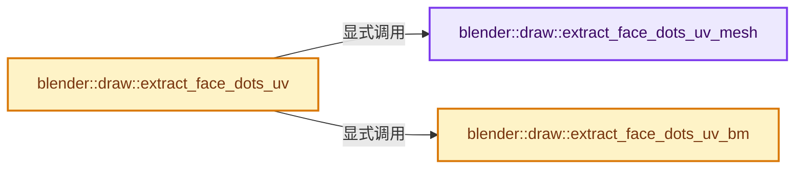
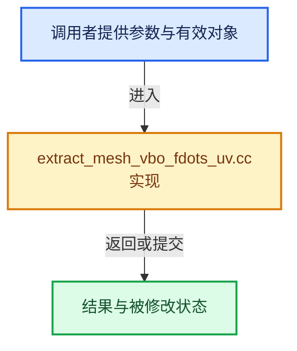

# 实现依赖专题：source/blender/draw/intern/mesh_extractors/extract_mesh_vbo_fdots_uv.cc

[实现依赖导航](../../../../README.md) · [符号索引](../../../../../00-课程指南/02-源码与提交索引/符号依赖与实现索引.md)

本专题从正文实际调用进入，集中保存共享实现。函数有稳定锚点，可从调用处直接跳到对应完整函数；递归与互相调用通过回链组织。

## 本文件的实现关系






## 完整成员与函数实现

<a id="f-cdb24d060377723d"></a>

### `blender::draw::extract_face_dots_uv_mesh`

实现位置：[source/blender/draw/intern/mesh_extractors/extract_mesh_vbo_fdots_uv.cc](../../../../../../../../../source/blender/draw/intern/mesh_extractors/extract_mesh_vbo_fdots_uv.cc) · L15—L45。

接口参数：

- `const MeshRenderData &mr`
- `MutableSpan<float2> vbo_data`

**教学注释版**

<!-- annotated:ba02e85380c530 -->

```cpp
static void extract_face_dots_uv_mesh(const MeshRenderData &mr, MutableSpan<float2> vbo_data)
{
  const Mesh &mesh = *mr.mesh;
  const StringRef name = mesh.active_uv_map_name();
  const bke::AttributeAccessor attributes = mesh.attributes();
  if (mr.use_subsurf_fdots) {
    const BitSpan facedot_tags = mesh.runtime->subsurf_face_dot_tags;
    const OffsetIndices faces = mr.faces;
    const Span<int> corner_verts = mr.corner_verts;
    const VArraySpan uv_map = *attributes.lookup<float2>(name, bke::AttrDomain::Corner);
    threading::parallel_for(faces.index_range(), 4096, [&](const IndexRange range) {
      for (const int face_index : range) {
        const IndexRange face = faces[face_index];
        const auto corner = std::find_if(face.begin(), face.end(), [&](const int corner) {
          return facedot_tags[corner_verts[corner]].test();
        });
        if (corner == face.end()) {
          vbo_data[face_index] = float2(0);
        }
        else {
          vbo_data[face_index] = uv_map[*corner];
        }
      }
    });
  }
  else {
    /* Use the attribute API to average the attribute on the face domain. */
    const VArray uv_map = *attributes.lookup<float2>(name, bke::AttrDomain::Face);
    uv_map.materialize(vbo_data);
  }
}
```

<details>
<summary>核对原始源码：source/blender/draw/intern/mesh_extractors/extract_mesh_vbo_fdots_uv.cc · L15—L45</summary>

<!-- original:ba02e85380c530:source/blender/draw/intern/mesh_extractors/extract_mesh_vbo_fdots_uv.cc:15:45 -->

```cpp
static void extract_face_dots_uv_mesh(const MeshRenderData &mr, MutableSpan<float2> vbo_data)
{
  const Mesh &mesh = *mr.mesh;
  const StringRef name = mesh.active_uv_map_name();
  const bke::AttributeAccessor attributes = mesh.attributes();
  if (mr.use_subsurf_fdots) {
    const BitSpan facedot_tags = mesh.runtime->subsurf_face_dot_tags;
    const OffsetIndices faces = mr.faces;
    const Span<int> corner_verts = mr.corner_verts;
    const VArraySpan uv_map = *attributes.lookup<float2>(name, bke::AttrDomain::Corner);
    threading::parallel_for(faces.index_range(), 4096, [&](const IndexRange range) {
      for (const int face_index : range) {
        const IndexRange face = faces[face_index];
        const auto corner = std::find_if(face.begin(), face.end(), [&](const int corner) {
          return facedot_tags[corner_verts[corner]].test();
        });
        if (corner == face.end()) {
          vbo_data[face_index] = float2(0);
        }
        else {
          vbo_data[face_index] = uv_map[*corner];
        }
      }
    });
  }
  else {
    /* Use the attribute API to average the attribute on the face domain. */
    const VArray uv_map = *attributes.lookup<float2>(name, bke::AttrDomain::Face);
    uv_map.materialize(vbo_data);
  }
}
```

</details>

**沿实际写入检查状态**

- `vbo_data[face_index] = float2(0);`
- `vbo_data[face_index] = uv_map[*corner];`

**结果出口**

- `return facedot_tags[corner_verts[corner]].test();`

**继续追踪实现**

- `mesh.active_uv_map_name` → [Mesh::active_uv_map_name · L1319](../../../../../05-几何存储与拓扑映射/03-MPoly迁移与兼容.md#f-9b4762e851836e79)。
- `mesh.attributes` → [Mesh::attributes · L1298](../../../../../05-几何存储与拓扑映射/03-MPoly迁移与兼容.md#f-607bbfe3e57cfc7f)。
- `attributes.lookup<float2>` → [blender::bke::AttributeAccessor::lookup · L401](../../../../02-BKE几何与数据/intern/attribute_access.cc.md#f-4673351b7bb3b651)；[blender::bke::AttributeAccessor::lookup · L585](../../../../../05-几何存储与拓扑映射/08-AttributeAccessor接口.md#f-432b90c796a80893)；[blender::bke::AttributeAccessor::lookup · L602](../../../../../05-几何存储与拓扑映射/08-AttributeAccessor接口.md#f-a60c1a45b85155d9)；[blender::bke::AttributeAccessor::lookup · L611](../../../../../05-几何存储与拓扑映射/08-AttributeAccessor接口.md#f-16ca459803fc30a6)；[blender::bke::AttributeAccessor::lookup · L620](../../../../../05-几何存储与拓扑映射/08-AttributeAccessor接口.md#f-403fd8a9d1a16c6d)。同名重载需按实参类型选择。
- `threading::parallel_for` → [blender::threading::parallel_for · L68](../../../../../11-Depsgraph与并行任务系统/07-任务池与TBB接入.md#f-838294754c24426c)。
- `faces.index_range` → [blender::offset_indices::OffsetIndices::index_range · L77](../../../../../05-几何存储与拓扑映射/02-OffsetIndices完整接口.md#f-19b5ca1456de007d)。
- `std::find_if` → [外部契约](https://eel.is/c++draft/)：这个边界按实际表达式及所属类型核对参数、返回值、寿命与失败行为。这里提供接口入口，不声称已解释该第三方版本的内部实现。
- `face.begin` → [blender::IndexRange::begin · L121](../../../../../01-基础容器与现代CPP/04-IndexRange连续整数区间.md#f-1ea3c945dec55d0a)。
- `face.end` → [blender::IndexRange::end · L126](../../../../../01-基础容器与现代CPP/04-IndexRange连续整数区间.md#f-119dd529d7090e64)。
- `facedot_tags[corner_verts[corner]].test` → [调用协议](../../../../../00-课程指南/01-路线与规范/模板宏与动态分派协议.md)：接收对象类型依赖auto、返回值或模板实例；不按同名猜测目标。调用位置L29。
- `float2` → [float2::float2 · L45](../../../../07-Intern运行时与平台/sky/source/sky_math.h.md#f-04c2783f21f996aa)；[float2::float2 · L47](../../../../07-Intern运行时与平台/sky/source/sky_math.h.md#f-dba79c4c10e5ea46)；[float2::float2 · L49](../../../../07-Intern运行时与平台/sky/source/sky_math.h.md#f-920ca90efa37bf0b)；[float2::float2 · L51](../../../../07-Intern运行时与平台/sky/source/sky_math.h.md#f-4b3fbf848d719a63)；[float2::float2 · L53](../../../../07-Intern运行时与平台/sky/source/sky_math.h.md#f-9b2acd8475cc2843)；[float2::float2 · L55](../../../../07-Intern运行时与平台/sky/source/sky_math.h.md#f-1e9233a9a231be51)。同名重载需按实参类型选择。
- `uv_map.materialize` → [调用协议](../../../../../00-课程指南/01-路线与规范/模板宏与动态分派协议.md)：由接收对象具体类型或运行时策略提供实现。调用位置L43。

<a id="f-4b3c7ed6e51959cd"></a>

### `blender::draw::extract_face_dots_uv_bm`

实现位置：[source/blender/draw/intern/mesh_extractors/extract_mesh_vbo_fdots_uv.cc](../../../../../../../../../source/blender/draw/intern/mesh_extractors/extract_mesh_vbo_fdots_uv.cc) · L47—L64。

接口参数：

- `const MeshRenderData &mr`
- `MutableSpan<float2> vbo_data`

**教学注释版**

<!-- annotated:a272d85525aa5c -->

```cpp
static void extract_face_dots_uv_bm(const MeshRenderData &mr, MutableSpan<float2> vbo_data)
{
  const BMesh &bm = *mr.bm;
  const int offset = CustomData_get_offset(&bm.ldata, CD_PROP_FLOAT2);

  threading::parallel_for(IndexRange(bm.totface), 2048, [&](const IndexRange range) {
    for (const int face_index : range) {
      const BMFace &face = *BM_face_at_index(&const_cast<BMesh &>(bm), face_index);
      const BMLoop *loop = BM_FACE_FIRST_LOOP(&face);
      vbo_data[face_index] = float2(0);
      for ([[maybe_unused]] const int i : IndexRange(face.len)) {
        vbo_data[face_index] += *BM_ELEM_CD_GET_FLOAT2_P(loop, offset);
        loop = loop->next;
      }
      vbo_data[face_index] /= face.len;
    }
  });
}
```

<details>
<summary>核对原始源码：source/blender/draw/intern/mesh_extractors/extract_mesh_vbo_fdots_uv.cc · L47—L64</summary>

<!-- original:a272d85525aa5c:source/blender/draw/intern/mesh_extractors/extract_mesh_vbo_fdots_uv.cc:47:64 -->

```cpp
static void extract_face_dots_uv_bm(const MeshRenderData &mr, MutableSpan<float2> vbo_data)
{
  const BMesh &bm = *mr.bm;
  const int offset = CustomData_get_offset(&bm.ldata, CD_PROP_FLOAT2);

  threading::parallel_for(IndexRange(bm.totface), 2048, [&](const IndexRange range) {
    for (const int face_index : range) {
      const BMFace &face = *BM_face_at_index(&const_cast<BMesh &>(bm), face_index);
      const BMLoop *loop = BM_FACE_FIRST_LOOP(&face);
      vbo_data[face_index] = float2(0);
      for ([[maybe_unused]] const int i : IndexRange(face.len)) {
        vbo_data[face_index] += *BM_ELEM_CD_GET_FLOAT2_P(loop, offset);
        loop = loop->next;
      }
      vbo_data[face_index] /= face.len;
    }
  });
}
```

</details>

**沿实际写入检查状态**

- `vbo_data[face_index] = float2(0);`
- `vbo_data[face_index] += *BM_ELEM_CD_GET_FLOAT2_P(loop, offset);`
- `loop = loop->next;`

**继续追踪实现**

- `CustomData_get_offset` → [blender::CustomData_get_offset · L3379](../../../../02-BKE几何与数据/intern/customdata.cc.md#f-e0e230c6120acc9a)。
- `threading::parallel_for` → [blender::threading::parallel_for · L68](../../../../../11-Depsgraph与并行任务系统/07-任务池与TBB接入.md#f-838294754c24426c)。
- `IndexRange` → [blender::IndexRange](../../../../01-BLI基础库/BLI_index_range.hh.md#t-caa3466d6776)；[blender::gpu::shader::parser::IndexRange](../../../gpu/shader_tool/utils.hh.md#t-82d2bd4ea71c)；[blender::IndexRange](../../../makesdna/DNA_node_types.h.md#t-0448cc889d39)。
- `BM_face_at_index` → [blender::BM_face_at_index · L122](../../../bmesh/intern/bmesh_mesh.hh.md#f-366df62c166d5094)。
- `BM_FACE_FIRST_LOOP` → [BM_FACE_FIRST_LOOP · L697](../../../bmesh/bmesh_class.hh.md#m-c7e10ffb38e6)；[BM_FACE_FIRST_LOOP · L699](../../../bmesh/bmesh_class.hh.md#m-76a054cc4770)。宏定义由构建条件选择。
- `float2` → [float2::float2 · L45](../../../../07-Intern运行时与平台/sky/source/sky_math.h.md#f-04c2783f21f996aa)；[float2::float2 · L47](../../../../07-Intern运行时与平台/sky/source/sky_math.h.md#f-dba79c4c10e5ea46)；[float2::float2 · L49](../../../../07-Intern运行时与平台/sky/source/sky_math.h.md#f-920ca90efa37bf0b)；[float2::float2 · L51](../../../../07-Intern运行时与平台/sky/source/sky_math.h.md#f-4b3fbf848d719a63)；[float2::float2 · L53](../../../../07-Intern运行时与平台/sky/source/sky_math.h.md#f-9b2acd8475cc2843)；[float2::float2 · L55](../../../../07-Intern运行时与平台/sky/source/sky_math.h.md#f-1e9233a9a231be51)。同名重载需按实参类型选择。
- `BM_ELEM_CD_GET_FLOAT2_P` → [BM_ELEM_CD_GET_FLOAT2_P · L643](../../../bmesh/bmesh_class.hh.md#m-10ef07da11b4)；[BM_ELEM_CD_GET_FLOAT2_P · L664](../../../bmesh/bmesh_class.hh.md#m-153e8251a2c9)。宏定义由构建条件选择。

<a id="f-6dcbba737f32f7e1"></a>

### `blender::draw::extract_face_dots_uv`

实现位置：[source/blender/draw/intern/mesh_extractors/extract_mesh_vbo_fdots_uv.cc](../../../../../../../../../source/blender/draw/intern/mesh_extractors/extract_mesh_vbo_fdots_uv.cc) · L66—L86。

接口参数：

- `const MeshRenderData &mr`

**教学注释版**

<!-- annotated:e9b30180e97f6e -->

```cpp
gpu::VertBufPtr extract_face_dots_uv(const MeshRenderData &mr)
{
  static const GPUVertFormat format = []() {
    GPUVertFormat format{};
    GPU_vertformat_attr_add(&format, "u", gpu::VertAttrType::SFLOAT_32_32);
    GPU_vertformat_alias_add(&format, "au");
    GPU_vertformat_alias_add(&format, "pos");
    return format;
  }();
  gpu::VertBufPtr vbo = gpu::VertBufPtr(GPU_vertbuf_create_with_format(format));
  GPU_vertbuf_data_alloc(*vbo, mr.faces_num);
  MutableSpan<float2> vbo_data = vbo->data<float2>();

  if (mr.extract_type == MeshExtractType::Mesh) {
    extract_face_dots_uv_mesh(mr, vbo_data);
  }
  else {
    extract_face_dots_uv_bm(mr, vbo_data);
  }
  return vbo;
}
```

<details>
<summary>核对原始源码：source/blender/draw/intern/mesh_extractors/extract_mesh_vbo_fdots_uv.cc · L66—L86</summary>

<!-- original:e9b30180e97f6e:source/blender/draw/intern/mesh_extractors/extract_mesh_vbo_fdots_uv.cc:66:86 -->

```cpp
gpu::VertBufPtr extract_face_dots_uv(const MeshRenderData &mr)
{
  static const GPUVertFormat format = []() {
    GPUVertFormat format{};
    GPU_vertformat_attr_add(&format, "u", gpu::VertAttrType::SFLOAT_32_32);
    GPU_vertformat_alias_add(&format, "au");
    GPU_vertformat_alias_add(&format, "pos");
    return format;
  }();
  gpu::VertBufPtr vbo = gpu::VertBufPtr(GPU_vertbuf_create_with_format(format));
  GPU_vertbuf_data_alloc(*vbo, mr.faces_num);
  MutableSpan<float2> vbo_data = vbo->data<float2>();

  if (mr.extract_type == MeshExtractType::Mesh) {
    extract_face_dots_uv_mesh(mr, vbo_data);
  }
  else {
    extract_face_dots_uv_bm(mr, vbo_data);
  }
  return vbo;
}
```

</details>

**结果出口**

- `return format;`
- `return vbo;`

**继续追踪实现**

- `[]() { GPUVertFormat format{}; GPU_vertformat_attr_add(&format, "u", gpu::VertAttrType::SFLOAT_32_32); GPU_vertformat_alias_add(&format, "au"); GPU_vertformat_alias_add(&format, "pos"); return format; }` → [调用协议](../../../../../00-课程指南/01-路线与规范/模板宏与动态分派协议.md)：函数指针、局部可调用对象或未展开的宏；必须结合调用者环境。调用位置L68。
- `GPU_vertformat_attr_add` → [blender::GPU_vertformat_attr_add · L389](../../../gpu/intern/gpu_vertex_format.cc.md#f-a36e23f37b97fff4)。
- `GPU_vertformat_alias_add` → [blender::GPU_vertformat_alias_add · L418](../../../gpu/intern/gpu_vertex_format.cc.md#f-5b19cd8281d0191e)。
- `gpu::VertBufPtr` → [调用协议](../../../../../00-课程指南/01-路线与规范/模板宏与动态分派协议.md)：函数指针、局部可调用对象或未展开的宏；必须结合调用者环境。调用位置L75。
- `GPU_vertbuf_create_with_format` → [blender::GPU_vertbuf_create_with_format · L71](../../../gpu/GPU_vertex_buffer.hh.md#f-bd43fe034e852138)。
- `GPU_vertbuf_data_alloc` → [blender::GPU_vertbuf_data_alloc · L172](../../../gpu/intern/gpu_vertex_buffer.cc.md#f-8ee5cf106e0f2b0f)。
- `vbo->data<float2>` → [blender::draw::data · L124](../DRW_gpu_wrapper.hh.md#f-dc115dc22e0c9f33)；[blender::draw::data · L129](../DRW_gpu_wrapper.hh.md#f-5f325cb75387045c)。同名重载需按实参类型选择。
- `extract_face_dots_uv_mesh` → [blender::draw::extract_face_dots_uv_mesh · L15](extract_mesh_vbo_fdots_uv.cc.md#f-cdb24d060377723d)。
- `extract_face_dots_uv_bm` → [blender::draw::extract_face_dots_uv_bm · L47](extract_mesh_vbo_fdots_uv.cc.md#f-4b3c7ed6e51959cd)。
