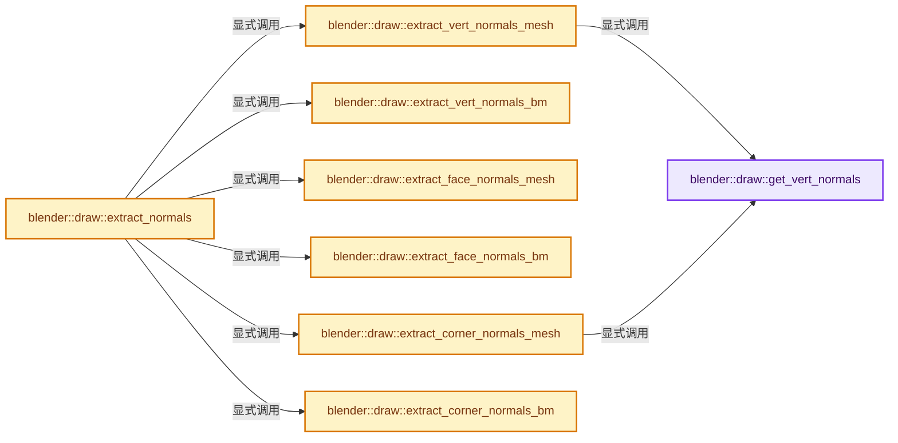
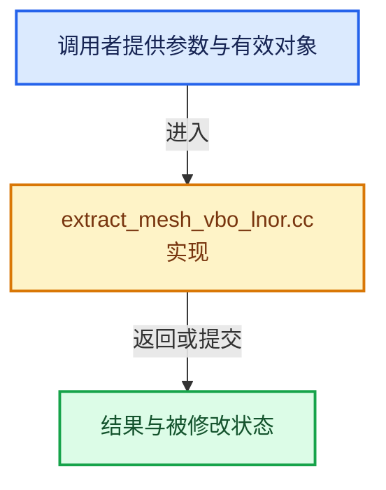

# 实现依赖专题：source/blender/draw/intern/mesh_extractors/extract_mesh_vbo_lnor.cc

[实现依赖导航](../../../../README.md) · [符号索引](../../../../../00-课程指南/02-源码与提交索引/符号依赖与实现索引.md)

本专题从正文实际调用进入，集中保存共享实现。函数有稳定锚点，可从调用处直接跳到对应完整函数；递归与互相调用通过回链组织。

## 本文件的实现关系






## 完整成员与函数实现

<a id="f-55ece0063ba879da"></a>

### `blender::draw::get_vert_normals`

实现位置：[source/blender/draw/intern/mesh_extractors/extract_mesh_vbo_lnor.cc](../../../../../../../../../source/blender/draw/intern/mesh_extractors/extract_mesh_vbo_lnor.cc) · L17—L20。

接口参数：

- `const MeshRenderData &mr`

**教学注释版**

<!-- annotated:e35fd11877f046 -->

```cpp
static Span<float3> get_vert_normals(const MeshRenderData &mr)
{
  return mr.use_simplify_normals ? mr.mesh->vert_normals_true() : mr.mesh->vert_normals();
}
```

<details>
<summary>核对原始源码：source/blender/draw/intern/mesh_extractors/extract_mesh_vbo_lnor.cc · L17—L20</summary>

<!-- original:e35fd11877f046:source/blender/draw/intern/mesh_extractors/extract_mesh_vbo_lnor.cc:17:20 -->

```cpp
static Span<float3> get_vert_normals(const MeshRenderData &mr)
{
  return mr.use_simplify_normals ? mr.mesh->vert_normals_true() : mr.mesh->vert_normals();
}
```

</details>

**结果出口**

- `return mr.use_simplify_normals ? mr.mesh->vert_normals_true() : mr.mesh->vert_normals();`

**继续追踪实现**

- `mr.mesh->vert_normals_true` → [调用协议](../../../../../00-课程指南/01-路线与规范/模板宏与动态分派协议.md)：接收对象类型依赖auto、返回值或模板实例；不按同名猜测目标。调用位置L19。
- `mr.mesh->vert_normals` → [调用协议](../../../../../00-课程指南/01-路线与规范/模板宏与动态分派协议.md)：接收对象类型依赖auto、返回值或模板实例；不按同名猜测目标。调用位置L19。

<a id="f-97009bceec4fb785"></a>

### `blender::draw::extract_vert_normals_mesh`

实现位置：[source/blender/draw/intern/mesh_extractors/extract_mesh_vbo_lnor.cc](../../../../../../../../../source/blender/draw/intern/mesh_extractors/extract_mesh_vbo_lnor.cc) · L22—L26。

接口参数：

- `const MeshRenderData &mr`
- `MutableSpan<GPUType> vert_data`

**教学注释版**

<!-- annotated:06ea23e6f7a72c -->

```cpp
template<typename GPUType>
static void extract_vert_normals_mesh(const MeshRenderData &mr, MutableSpan<GPUType> vert_data)
{
  gpu::convert_normals(get_vert_normals(mr), vert_data);
}
```

<details>
<summary>核对原始源码：source/blender/draw/intern/mesh_extractors/extract_mesh_vbo_lnor.cc · L22—L26</summary>

<!-- original:06ea23e6f7a72c:source/blender/draw/intern/mesh_extractors/extract_mesh_vbo_lnor.cc:22:26 -->

```cpp
template<typename GPUType>
static void extract_vert_normals_mesh(const MeshRenderData &mr, MutableSpan<GPUType> vert_data)
{
  gpu::convert_normals(get_vert_normals(mr), vert_data);
}
```

</details>

**继续追踪实现**

- `gpu::convert_normals` → [blender::gpu::convert_normals · L27](../../../gpu/intern/gpu_vertex_format_normals.cc.md#f-8089add92715f800)；[blender::gpu::convert_normals · L31](../../../gpu/intern/gpu_vertex_format_normals.cc.md#f-c169df59eea7544c)。同名重载需按实参类型选择。
- `get_vert_normals` → [blender::draw::get_vert_normals · L17](extract_mesh_vbo_lnor.cc.md#f-55ece0063ba879da)。

<a id="f-ef6d499888f96aaf"></a>

### `blender::draw::extract_vert_normals_bm`

实现位置：[source/blender/draw/intern/mesh_extractors/extract_mesh_vbo_lnor.cc](../../../../../../../../../source/blender/draw/intern/mesh_extractors/extract_mesh_vbo_lnor.cc) · L28—L38。

接口参数：

- `const MeshRenderData &mr`
- `MutableSpan<GPUType> vert_data`

**教学注释版**

<!-- annotated:7e761bdba51032 -->

```cpp
template<typename GPUType>
static void extract_vert_normals_bm(const MeshRenderData &mr, MutableSpan<GPUType> vert_data)
{
  const BMesh &bm = *mr.bm;
  threading::parallel_for(IndexRange(bm.totvert), 4096, [&](const IndexRange range) {
    for (const int i : range) {
      const BMVert *vert = BM_vert_at_index(&const_cast<BMesh &>(bm), i);
      vert_data[i] = gpu::convert_normal<GPUType>(bm_vert_no_get(mr, vert));
    }
  });
}
```

<details>
<summary>核对原始源码：source/blender/draw/intern/mesh_extractors/extract_mesh_vbo_lnor.cc · L28—L38</summary>

<!-- original:7e761bdba51032:source/blender/draw/intern/mesh_extractors/extract_mesh_vbo_lnor.cc:28:38 -->

```cpp
template<typename GPUType>
static void extract_vert_normals_bm(const MeshRenderData &mr, MutableSpan<GPUType> vert_data)
{
  const BMesh &bm = *mr.bm;
  threading::parallel_for(IndexRange(bm.totvert), 4096, [&](const IndexRange range) {
    for (const int i : range) {
      const BMVert *vert = BM_vert_at_index(&const_cast<BMesh &>(bm), i);
      vert_data[i] = gpu::convert_normal<GPUType>(bm_vert_no_get(mr, vert));
    }
  });
}
```

</details>

**沿实际写入检查状态**

- `vert_data[i] = gpu::convert_normal<GPUType>(bm_vert_no_get(mr, vert));`

**继续追踪实现**

- `threading::parallel_for` → [blender::threading::parallel_for · L68](../../../../../11-Depsgraph与并行任务系统/07-任务池与TBB接入.md#f-838294754c24426c)。
- `IndexRange` → [blender::IndexRange](../../../../01-BLI基础库/BLI_index_range.hh.md#t-caa3466d6776)；[blender::gpu::shader::parser::IndexRange](../../../gpu/shader_tool/utils.hh.md#t-82d2bd4ea71c)；[blender::IndexRange](../../../makesdna/DNA_node_types.h.md#t-0448cc889d39)。
- `BM_vert_at_index` → [blender::BM_vert_at_index · L110](../../../bmesh/intern/bmesh_mesh.hh.md#f-aced0ebcd417a2f4)。
- `gpu::convert_normal<GPUType>` → [blender::gpu::convert_normal · L21](../../../gpu/GPU_attribute_convert.hh.md#f-d24eef906ebcd8b5)；[blender::gpu::convert_normal · L26](../../../gpu/GPU_attribute_convert.hh.md#f-40f0824f9b7edbbb)。同名重载需按实参类型选择。
- `bm_vert_no_get` → [blender::draw::bm_vert_no_get · L170](extract_mesh.hh.md#f-c2d47f6477827d01)。

<a id="f-158d91ca6098f894"></a>

### `blender::draw::extract_face_normals_mesh`

实现位置：[source/blender/draw/intern/mesh_extractors/extract_mesh_vbo_lnor.cc](../../../../../../../../../source/blender/draw/intern/mesh_extractors/extract_mesh_vbo_lnor.cc) · L40—L44。

接口参数：

- `const MeshRenderData &mr`
- `MutableSpan<GPUType> face_data`

**教学注释版**

<!-- annotated:3479d94e178797 -->

```cpp
template<typename GPUType>
static void extract_face_normals_mesh(const MeshRenderData &mr, MutableSpan<GPUType> face_data)
{
  gpu::convert_normals(mr.face_normals, face_data);
}
```

<details>
<summary>核对原始源码：source/blender/draw/intern/mesh_extractors/extract_mesh_vbo_lnor.cc · L40—L44</summary>

<!-- original:3479d94e178797:source/blender/draw/intern/mesh_extractors/extract_mesh_vbo_lnor.cc:40:44 -->

```cpp
template<typename GPUType>
static void extract_face_normals_mesh(const MeshRenderData &mr, MutableSpan<GPUType> face_data)
{
  gpu::convert_normals(mr.face_normals, face_data);
}
```

</details>

**继续追踪实现**

- `gpu::convert_normals` → [blender::gpu::convert_normals · L27](../../../gpu/intern/gpu_vertex_format_normals.cc.md#f-8089add92715f800)；[blender::gpu::convert_normals · L31](../../../gpu/intern/gpu_vertex_format_normals.cc.md#f-c169df59eea7544c)。同名重载需按实参类型选择。

<a id="f-a8e42a9967c12b18"></a>

### `blender::draw::extract_face_normals_bm`

实现位置：[source/blender/draw/intern/mesh_extractors/extract_mesh_vbo_lnor.cc](../../../../../../../../../source/blender/draw/intern/mesh_extractors/extract_mesh_vbo_lnor.cc) · L46—L56。

接口参数：

- `const MeshRenderData &mr`
- `MutableSpan<GPUType> face_data`

**教学注释版**

<!-- annotated:3a65a063f66809 -->

```cpp
template<typename GPUType>
static void extract_face_normals_bm(const MeshRenderData &mr, MutableSpan<GPUType> face_data)
{
  const BMesh &bm = *mr.bm;
  threading::parallel_for(IndexRange(bm.totface), 4096, [&](const IndexRange range) {
    for (const int i : range) {
      const BMFace *face = BM_face_at_index(&const_cast<BMesh &>(bm), i);
      face_data[i] = gpu::convert_normal<GPUType>(bm_face_no_get(mr, face));
    }
  });
}
```

<details>
<summary>核对原始源码：source/blender/draw/intern/mesh_extractors/extract_mesh_vbo_lnor.cc · L46—L56</summary>

<!-- original:3a65a063f66809:source/blender/draw/intern/mesh_extractors/extract_mesh_vbo_lnor.cc:46:56 -->

```cpp
template<typename GPUType>
static void extract_face_normals_bm(const MeshRenderData &mr, MutableSpan<GPUType> face_data)
{
  const BMesh &bm = *mr.bm;
  threading::parallel_for(IndexRange(bm.totface), 4096, [&](const IndexRange range) {
    for (const int i : range) {
      const BMFace *face = BM_face_at_index(&const_cast<BMesh &>(bm), i);
      face_data[i] = gpu::convert_normal<GPUType>(bm_face_no_get(mr, face));
    }
  });
}
```

</details>

**沿实际写入检查状态**

- `face_data[i] = gpu::convert_normal<GPUType>(bm_face_no_get(mr, face));`

**继续追踪实现**

- `threading::parallel_for` → [blender::threading::parallel_for · L68](../../../../../11-Depsgraph与并行任务系统/07-任务池与TBB接入.md#f-838294754c24426c)。
- `IndexRange` → [blender::IndexRange](../../../../01-BLI基础库/BLI_index_range.hh.md#t-caa3466d6776)；[blender::gpu::shader::parser::IndexRange](../../../gpu/shader_tool/utils.hh.md#t-82d2bd4ea71c)；[blender::IndexRange](../../../makesdna/DNA_node_types.h.md#t-0448cc889d39)。
- `BM_face_at_index` → [blender::BM_face_at_index · L122](../../../bmesh/intern/bmesh_mesh.hh.md#f-366df62c166d5094)。
- `gpu::convert_normal<GPUType>` → [blender::gpu::convert_normal · L21](../../../gpu/GPU_attribute_convert.hh.md#f-d24eef906ebcd8b5)；[blender::gpu::convert_normal · L26](../../../gpu/GPU_attribute_convert.hh.md#f-40f0824f9b7edbbb)。同名重载需按实参类型选择。
- `bm_face_no_get` → [blender::draw::bm_face_no_get · L181](extract_mesh.hh.md#f-40a3dcea78714956)。

<a id="f-fbf44f2d6a64ef52"></a>

### `blender::draw::extract_corner_normals_mesh`

实现位置：[source/blender/draw/intern/mesh_extractors/extract_mesh_vbo_lnor.cc](../../../../../../../../../source/blender/draw/intern/mesh_extractors/extract_mesh_vbo_lnor.cc) · L58—L84。

接口参数：

- `const MeshRenderData &mr`
- `MutableSpan<GPUType> normals`

**教学注释版**

<!-- annotated:c6a6b4fd2fabc4 -->

```cpp
template<typename GPUType>
static void extract_corner_normals_mesh(const MeshRenderData &mr, MutableSpan<GPUType> normals)
{
  if (!mr.corner_normals.is_empty()) {
    gpu::convert_normals(mr.corner_normals, normals);
    return;
  }
  /* The corner normals span can still be empty with the "simplify" option. That forces
   * mixed face and vertex normals. */
  const OffsetIndices faces = mr.faces;
  const Span<int> corner_verts = mr.corner_verts;
  const Span<bool> sharp_faces = mr.sharp_faces;
  const Span<float3> vert_normals = get_vert_normals(mr);
  const Span<float3> face_normals = mr.face_normals;
  threading::parallel_for(faces.index_range(), 2048, [&](const IndexRange range) {
    for (const int face : range) {
      // [讲解] sharp_faces.is_empty：查询视图长度或生成对应有效索引区间。
      if (!sharp_faces.is_empty() && sharp_faces[face]) {
        // [讲解] normals.slice：建立原连续范围的子视图。
        normals.slice(faces[face]).fill(gpu::convert_normal<GPUType>(face_normals[face]));
      }
      else {
        for (const int corner : faces[face]) {
          normals[corner] = gpu::convert_normal<GPUType>(vert_normals[corner_verts[corner]]);
        }
      }
    }
  });
}
```

<details>
<summary>核对原始源码：source/blender/draw/intern/mesh_extractors/extract_mesh_vbo_lnor.cc · L58—L84</summary>

<!-- original:c6a6b4fd2fabc4:source/blender/draw/intern/mesh_extractors/extract_mesh_vbo_lnor.cc:58:84 -->

```cpp
template<typename GPUType>
static void extract_corner_normals_mesh(const MeshRenderData &mr, MutableSpan<GPUType> normals)
{
  if (!mr.corner_normals.is_empty()) {
    gpu::convert_normals(mr.corner_normals, normals);
    return;
  }
  /* The corner normals span can still be empty with the "simplify" option. That forces
   * mixed face and vertex normals. */
  const OffsetIndices faces = mr.faces;
  const Span<int> corner_verts = mr.corner_verts;
  const Span<bool> sharp_faces = mr.sharp_faces;
  const Span<float3> vert_normals = get_vert_normals(mr);
  const Span<float3> face_normals = mr.face_normals;
  threading::parallel_for(faces.index_range(), 2048, [&](const IndexRange range) {
    for (const int face : range) {
      if (!sharp_faces.is_empty() && sharp_faces[face]) {
        normals.slice(faces[face]).fill(gpu::convert_normal<GPUType>(face_normals[face]));
      }
      else {
        for (const int corner : faces[face]) {
          normals[corner] = gpu::convert_normal<GPUType>(vert_normals[corner_verts[corner]]);
        }
      }
    }
  });
}
```

</details>

**沿实际写入检查状态**

- `normals[corner] = gpu::convert_normal<GPUType>(vert_normals[corner_verts[corner]]);`

**继续追踪实现**

- `mr.corner_normals.is_empty` → [调用协议](../../../../../00-课程指南/01-路线与规范/模板宏与动态分派协议.md)：接收对象类型依赖auto、返回值或模板实例；不按同名猜测目标。调用位置L61。
- `gpu::convert_normals` → [blender::gpu::convert_normals · L27](../../../gpu/intern/gpu_vertex_format_normals.cc.md#f-8089add92715f800)；[blender::gpu::convert_normals · L31](../../../gpu/intern/gpu_vertex_format_normals.cc.md#f-c169df59eea7544c)。同名重载需按实参类型选择。
- `get_vert_normals` → [blender::draw::get_vert_normals · L17](extract_mesh_vbo_lnor.cc.md#f-55ece0063ba879da)。
- `threading::parallel_for` → [blender::threading::parallel_for · L68](../../../../../11-Depsgraph与并行任务系统/07-任务池与TBB接入.md#f-838294754c24426c)。
- `faces.index_range` → [blender::offset_indices::OffsetIndices::index_range · L77](../../../../../05-几何存储与拓扑映射/02-OffsetIndices完整接口.md#f-19b5ca1456de007d)。
- `sharp_faces.is_empty` → [blender::Span::is_empty · L264](../../../../../01-基础容器与现代CPP/05-Span只读连续视图.md#f-8cc1d7ba8feb50e6)。
- `normals.slice(faces[face]).fill` → [调用协议](../../../../../00-课程指南/01-路线与规范/模板宏与动态分派协议.md)：接收对象类型依赖auto、返回值或模板实例；不按同名猜测目标。调用位置L75。
- `normals.slice` → [blender::MutableSpan::slice · L579](../../../../../01-基础容器与现代CPP/06-MutableSpan可写视图.md#f-6808b4aefbf58808)；[blender::MutableSpan::slice · L587](../../../../../01-基础容器与现代CPP/06-MutableSpan可写视图.md#f-c05b010821861e4f)。同名重载需按实参类型选择。
- `gpu::convert_normal<GPUType>` → [blender::gpu::convert_normal · L21](../../../gpu/GPU_attribute_convert.hh.md#f-d24eef906ebcd8b5)；[blender::gpu::convert_normal · L26](../../../gpu/GPU_attribute_convert.hh.md#f-40f0824f9b7edbbb)。同名重载需按实参类型选择。

<a id="f-8383c236dade14c9"></a>

### `blender::draw::extract_corner_normals_bm`

实现位置：[source/blender/draw/intern/mesh_extractors/extract_mesh_vbo_lnor.cc](../../../../../../../../../source/blender/draw/intern/mesh_extractors/extract_mesh_vbo_lnor.cc) · L86—L125。

接口参数：

- `const MeshRenderData &mr`
- `MutableSpan<GPUType> normals`

**教学注释版**

<!-- annotated:acf97040e9e962 -->

```cpp
template<typename GPUType>
static void extract_corner_normals_bm(const MeshRenderData &mr, MutableSpan<GPUType> normals)
{
  const BMesh &bm = *mr.bm;
  if (mr.bm_free_normal_offset_corner != -1) {
    threading::parallel_for(IndexRange(bm.totface), 2048, [&](const IndexRange range) {
      for (const int face_index : range) {
        const BMFace &face = *BM_face_at_index(&const_cast<BMesh &>(bm), face_index);
        const BMLoop *loop = BM_FACE_FIRST_LOOP(&face);
        const IndexRange face_range(BM_elem_index_get(loop), face.len);
        for (const int corner : face_range) {
          normals[corner] = gpu::convert_normal<GPUType>(
              BM_ELEM_CD_GET_FLOAT_P(loop, mr.bm_free_normal_offset_corner));
          loop = loop->next;
        }
      }
    });
    return;
  }
  if (!mr.bm_loop_normals.is_empty()) {
    gpu::convert_normals(mr.bm_loop_normals, normals);
    return;
  }
  threading::parallel_for(IndexRange(bm.totface), 2048, [&](const IndexRange range) {
    for (const int face_index : range) {
      const BMFace &face = *BM_face_at_index(&const_cast<BMesh &>(bm), face_index);
      const BMLoop *loop = BM_FACE_FIRST_LOOP(&face);
      const IndexRange face_range(BM_elem_index_get(loop), face.len);
      if (!BM_elem_flag_test(&face, BM_ELEM_SMOOTH)) {
        // [讲解] normals.slice：建立原连续范围的子视图。
        normals.slice(face_range).fill(gpu::convert_normal<GPUType>(bm_face_no_get(mr, &face)));
      }
      else {
        for (const int corner : face_range) {
          normals[corner] = gpu::convert_normal<GPUType>(bm_vert_no_get(mr, loop->v));
          loop = loop->next;
        }
      }
    }
  });
}
```

<details>
<summary>核对原始源码：source/blender/draw/intern/mesh_extractors/extract_mesh_vbo_lnor.cc · L86—L125</summary>

<!-- original:acf97040e9e962:source/blender/draw/intern/mesh_extractors/extract_mesh_vbo_lnor.cc:86:125 -->

```cpp
template<typename GPUType>
static void extract_corner_normals_bm(const MeshRenderData &mr, MutableSpan<GPUType> normals)
{
  const BMesh &bm = *mr.bm;
  if (mr.bm_free_normal_offset_corner != -1) {
    threading::parallel_for(IndexRange(bm.totface), 2048, [&](const IndexRange range) {
      for (const int face_index : range) {
        const BMFace &face = *BM_face_at_index(&const_cast<BMesh &>(bm), face_index);
        const BMLoop *loop = BM_FACE_FIRST_LOOP(&face);
        const IndexRange face_range(BM_elem_index_get(loop), face.len);
        for (const int corner : face_range) {
          normals[corner] = gpu::convert_normal<GPUType>(
              BM_ELEM_CD_GET_FLOAT_P(loop, mr.bm_free_normal_offset_corner));
          loop = loop->next;
        }
      }
    });
    return;
  }
  if (!mr.bm_loop_normals.is_empty()) {
    gpu::convert_normals(mr.bm_loop_normals, normals);
    return;
  }
  threading::parallel_for(IndexRange(bm.totface), 2048, [&](const IndexRange range) {
    for (const int face_index : range) {
      const BMFace &face = *BM_face_at_index(&const_cast<BMesh &>(bm), face_index);
      const BMLoop *loop = BM_FACE_FIRST_LOOP(&face);
      const IndexRange face_range(BM_elem_index_get(loop), face.len);
      if (!BM_elem_flag_test(&face, BM_ELEM_SMOOTH)) {
        normals.slice(face_range).fill(gpu::convert_normal<GPUType>(bm_face_no_get(mr, &face)));
      }
      else {
        for (const int corner : face_range) {
          normals[corner] = gpu::convert_normal<GPUType>(bm_vert_no_get(mr, loop->v));
          loop = loop->next;
        }
      }
    }
  });
}
```

</details>

**沿实际写入检查状态**

- `normals[corner] = gpu::convert_normal<GPUType>(`
- `loop = loop->next;`
- `normals[corner] = gpu::convert_normal<GPUType>(bm_vert_no_get(mr, loop->v));`

**继续追踪实现**

- `threading::parallel_for` → [blender::threading::parallel_for · L68](../../../../../11-Depsgraph与并行任务系统/07-任务池与TBB接入.md#f-838294754c24426c)。
- `IndexRange` → [blender::IndexRange](../../../../01-BLI基础库/BLI_index_range.hh.md#t-caa3466d6776)；[blender::gpu::shader::parser::IndexRange](../../../gpu/shader_tool/utils.hh.md#t-82d2bd4ea71c)；[blender::IndexRange](../../../makesdna/DNA_node_types.h.md#t-0448cc889d39)。
- `BM_face_at_index` → [blender::BM_face_at_index · L122](../../../bmesh/intern/bmesh_mesh.hh.md#f-366df62c166d5094)。
- `BM_FACE_FIRST_LOOP` → [BM_FACE_FIRST_LOOP · L697](../../../bmesh/bmesh_class.hh.md#m-c7e10ffb38e6)；[BM_FACE_FIRST_LOOP · L699](../../../bmesh/bmesh_class.hh.md#m-76a054cc4770)。宏定义由构建条件选择。
- `BM_elem_index_get` → [BM_elem_index_get · L120](../../../bmesh/intern/bmesh_inline.hh.md#m-201981cdc62d)。宏定义由构建条件选择。
- `gpu::convert_normal<GPUType>` → [blender::gpu::convert_normal · L21](../../../gpu/GPU_attribute_convert.hh.md#f-d24eef906ebcd8b5)；[blender::gpu::convert_normal · L26](../../../gpu/GPU_attribute_convert.hh.md#f-40f0824f9b7edbbb)。同名重载需按实参类型选择。
- `BM_ELEM_CD_GET_FLOAT_P` → [BM_ELEM_CD_GET_FLOAT_P · L635](../../../bmesh/bmesh_class.hh.md#m-544f72c45c1b)；[BM_ELEM_CD_GET_FLOAT_P · L661](../../../bmesh/bmesh_class.hh.md#m-c11efbe96e86)。宏定义由构建条件选择。
- `mr.bm_loop_normals.is_empty` → [调用协议](../../../../../00-课程指南/01-路线与规范/模板宏与动态分派协议.md)：接收对象类型依赖auto、返回值或模板实例；不按同名猜测目标。调用位置L105。
- `gpu::convert_normals` → [blender::gpu::convert_normals · L27](../../../gpu/intern/gpu_vertex_format_normals.cc.md#f-8089add92715f800)；[blender::gpu::convert_normals · L31](../../../gpu/intern/gpu_vertex_format_normals.cc.md#f-c169df59eea7544c)。同名重载需按实参类型选择。
- `BM_elem_flag_test` → [BM_elem_flag_test · L21](../../../bmesh/intern/bmesh_inline.hh.md#m-2431d1179b41)。宏定义由构建条件选择。
- `normals.slice(face_range).fill` → [调用协议](../../../../../00-课程指南/01-路线与规范/模板宏与动态分派协议.md)：接收对象类型依赖auto、返回值或模板实例；不按同名猜测目标。调用位置L115。
- `normals.slice` → [blender::MutableSpan::slice · L579](../../../../../01-基础容器与现代CPP/06-MutableSpan可写视图.md#f-6808b4aefbf58808)；[blender::MutableSpan::slice · L587](../../../../../01-基础容器与现代CPP/06-MutableSpan可写视图.md#f-c05b010821861e4f)。同名重载需按实参类型选择。
- `bm_face_no_get` → [blender::draw::bm_face_no_get · L181](extract_mesh.hh.md#f-40a3dcea78714956)。
- `bm_vert_no_get` → [blender::draw::bm_vert_no_get · L170](extract_mesh.hh.md#f-c2d47f6477827d01)。

<a id="f-33f41666c740861f"></a>

### `blender::draw::extract_normals`

实现位置：[source/blender/draw/intern/mesh_extractors/extract_mesh_vbo_lnor.cc](../../../../../../../../../source/blender/draw/intern/mesh_extractors/extract_mesh_vbo_lnor.cc) · L127—L181。

接口参数：

- `const MeshRenderData &mr`
- `MeshBufferCache &cache`
- `const GPUVertFormat &format`

**教学注释版**

<!-- annotated:a5f93ffa0cc169 -->

```cpp
template<typename GPUType>
static gpu::VertBufPtr extract_normals(const MeshRenderData &mr,
                                       MeshBufferCache &cache,
                                       const GPUVertFormat &format)
{
  const bool is_mesh = mr.extract_type == MeshExtractType::Mesh;
  const int size = mr.corners_num + mr.loose_indices_num;
  const Array<GPUType> loose_data(mr.loose_indices_num, GPUType{});

  switch (mr.normals_domain) {
    case bke::MeshNormalDomain::Point: {
      gpu::VertBufPtr vert_vbo = gpu::VertBufPtr(GPU_vertbuf_create_with_format(format));
      GPU_vertbuf_data_alloc(*vert_vbo, mr.verts_num);
      if (is_mesh) {
        extract_vert_normals_mesh(mr, vert_vbo->data<GPUType>());
      }
      else {
        extract_vert_normals_bm(mr, vert_vbo->data<GPUType>());
      }
      gpu::VertBufPtr vbo = gpu::VertBufPtr(GPU_vertbuf_create_on_device(format, size));
      gather_vert_to_corner_gpu(mr, cache, *vert_vbo, *vbo);
      // [讲解] loose_data.as_span：提供数组的借用访问入口。
      loose_data_upload(mr, loose_data.as_span(), *vbo);
      return vbo;
    }
    case bke::MeshNormalDomain::Face: {
      gpu::VertBufPtr face_vbo = gpu::VertBufPtr(GPU_vertbuf_create_with_format(format));
      GPU_vertbuf_data_alloc(*face_vbo, mr.faces_num);
      if (is_mesh) {
        extract_face_normals_mesh(mr, face_vbo->data<GPUType>());
      }
      else {
        extract_face_normals_bm(mr, face_vbo->data<GPUType>());
      }
      gpu::VertBufPtr vbo = gpu::VertBufPtr(GPU_vertbuf_create_on_device(format, size));
      scatter_face_to_corner_gpu(mr, cache, *face_vbo, *vbo);
      loose_data_upload(mr, loose_data.as_span(), *vbo);
      return vbo;
    }
    case bke::MeshNormalDomain::Corner: {
      gpu::VertBufPtr vbo = gpu::VertBufPtr(GPU_vertbuf_create_with_format(format));
      GPU_vertbuf_data_alloc(*vbo, size);
      MutableSpan vbo_data = vbo->data<GPUType>();
      if (is_mesh) {
        // [讲解] vbo_data.take_front：从两端裁去或选取一定数量元素形成新视图。
        extract_corner_normals_mesh(mr, vbo_data.take_front(mr.corners_num));
      }
      else {
        extract_corner_normals_bm(mr, vbo_data.take_front(mr.corners_num));
      }
      // [讲解] vbo_data.take_back：从两端裁去或选取一定数量元素形成新视图。
      vbo_data.take_back(mr.loose_indices_num).copy_from(loose_data);
      return vbo;
    }
  }
  BLI_assert_unreachable();
  return {};
}
```

<details>
<summary>核对原始源码：source/blender/draw/intern/mesh_extractors/extract_mesh_vbo_lnor.cc · L127—L181</summary>

<!-- original:a5f93ffa0cc169:source/blender/draw/intern/mesh_extractors/extract_mesh_vbo_lnor.cc:127:181 -->

```cpp
template<typename GPUType>
static gpu::VertBufPtr extract_normals(const MeshRenderData &mr,
                                       MeshBufferCache &cache,
                                       const GPUVertFormat &format)
{
  const bool is_mesh = mr.extract_type == MeshExtractType::Mesh;
  const int size = mr.corners_num + mr.loose_indices_num;
  const Array<GPUType> loose_data(mr.loose_indices_num, GPUType{});

  switch (mr.normals_domain) {
    case bke::MeshNormalDomain::Point: {
      gpu::VertBufPtr vert_vbo = gpu::VertBufPtr(GPU_vertbuf_create_with_format(format));
      GPU_vertbuf_data_alloc(*vert_vbo, mr.verts_num);
      if (is_mesh) {
        extract_vert_normals_mesh(mr, vert_vbo->data<GPUType>());
      }
      else {
        extract_vert_normals_bm(mr, vert_vbo->data<GPUType>());
      }
      gpu::VertBufPtr vbo = gpu::VertBufPtr(GPU_vertbuf_create_on_device(format, size));
      gather_vert_to_corner_gpu(mr, cache, *vert_vbo, *vbo);
      loose_data_upload(mr, loose_data.as_span(), *vbo);
      return vbo;
    }
    case bke::MeshNormalDomain::Face: {
      gpu::VertBufPtr face_vbo = gpu::VertBufPtr(GPU_vertbuf_create_with_format(format));
      GPU_vertbuf_data_alloc(*face_vbo, mr.faces_num);
      if (is_mesh) {
        extract_face_normals_mesh(mr, face_vbo->data<GPUType>());
      }
      else {
        extract_face_normals_bm(mr, face_vbo->data<GPUType>());
      }
      gpu::VertBufPtr vbo = gpu::VertBufPtr(GPU_vertbuf_create_on_device(format, size));
      scatter_face_to_corner_gpu(mr, cache, *face_vbo, *vbo);
      loose_data_upload(mr, loose_data.as_span(), *vbo);
      return vbo;
    }
    case bke::MeshNormalDomain::Corner: {
      gpu::VertBufPtr vbo = gpu::VertBufPtr(GPU_vertbuf_create_with_format(format));
      GPU_vertbuf_data_alloc(*vbo, size);
      MutableSpan vbo_data = vbo->data<GPUType>();
      if (is_mesh) {
        extract_corner_normals_mesh(mr, vbo_data.take_front(mr.corners_num));
      }
      else {
        extract_corner_normals_bm(mr, vbo_data.take_front(mr.corners_num));
      }
      vbo_data.take_back(mr.loose_indices_num).copy_from(loose_data);
      return vbo;
    }
  }
  BLI_assert_unreachable();
  return {};
}
```

</details>

**结果出口**

- `return vbo;`
- `return {};`

**继续追踪实现**

- `gpu::VertBufPtr` → [调用协议](../../../../../00-课程指南/01-路线与规范/模板宏与动态分派协议.md)：函数指针、局部可调用对象或未展开的宏；必须结合调用者环境。调用位置L138。
- `GPU_vertbuf_create_with_format` → [blender::GPU_vertbuf_create_with_format · L71](../../../gpu/GPU_vertex_buffer.hh.md#f-bd43fe034e852138)。
- `GPU_vertbuf_data_alloc` → [blender::GPU_vertbuf_data_alloc · L172](../../../gpu/intern/gpu_vertex_buffer.cc.md#f-8ee5cf106e0f2b0f)。
- `extract_vert_normals_mesh` → [blender::draw::extract_vert_normals_mesh · L22](extract_mesh_vbo_lnor.cc.md#f-97009bceec4fb785)。
- `vert_vbo->data<GPUType>` → [blender::draw::data · L124](../DRW_gpu_wrapper.hh.md#f-dc115dc22e0c9f33)；[blender::draw::data · L129](../DRW_gpu_wrapper.hh.md#f-5f325cb75387045c)。同名重载需按实参类型选择。
- `extract_vert_normals_bm` → [blender::draw::extract_vert_normals_bm · L28](extract_mesh_vbo_lnor.cc.md#f-ef6d499888f96aaf)。
- `GPU_vertbuf_create_on_device` → [blender::GPU_vertbuf_create_on_device · L137](../../../gpu/intern/gpu_vertex_buffer.cc.md#f-abf244a18691f929)。
- `gather_vert_to_corner_gpu` → [blender::draw::gather_vert_to_corner_gpu · L129](extract_mesh_corner_gpu.cc.md#f-6a7db1cdc2e15e6c)。
- `loose_data_upload` → [blender::draw::loose_data_upload · L289](extract_mesh.hh.md#f-1d43c35d50f54c24)。
- `loose_data.as_span` → [blender::Array::as_span · L254](../../../../../01-基础容器与现代CPP/08-Array复制移动与销毁.md#f-05fc77056a242032)。
- `extract_face_normals_mesh` → [blender::draw::extract_face_normals_mesh · L40](extract_mesh_vbo_lnor.cc.md#f-158d91ca6098f894)。
- `face_vbo->data<GPUType>` → [blender::draw::data · L124](../DRW_gpu_wrapper.hh.md#f-dc115dc22e0c9f33)；[blender::draw::data · L129](../DRW_gpu_wrapper.hh.md#f-5f325cb75387045c)。同名重载需按实参类型选择。
- `extract_face_normals_bm` → [blender::draw::extract_face_normals_bm · L46](extract_mesh_vbo_lnor.cc.md#f-a8e42a9967c12b18)。
- `scatter_face_to_corner_gpu` → [blender::draw::scatter_face_to_corner_gpu · L153](extract_mesh_corner_gpu.cc.md#f-b8163289de9be0fd)。
- `vbo->data<GPUType>` → [blender::draw::data · L124](../DRW_gpu_wrapper.hh.md#f-dc115dc22e0c9f33)；[blender::draw::data · L129](../DRW_gpu_wrapper.hh.md#f-5f325cb75387045c)。同名重载需按实参类型选择。
- `extract_corner_normals_mesh` → [blender::draw::extract_corner_normals_mesh · L58](extract_mesh_vbo_lnor.cc.md#f-fbf44f2d6a64ef52)。
- `vbo_data.take_front` → [blender::MutableSpan::take_front · L635](../../../../../01-基础容器与现代CPP/06-MutableSpan可写视图.md#f-0a0235d84ddc265d)。
- `extract_corner_normals_bm` → [blender::draw::extract_corner_normals_bm · L86](extract_mesh_vbo_lnor.cc.md#f-8383c236dade14c9)。
- `vbo_data.take_back(mr.loose_indices_num).copy_from` → [调用协议](../../../../../00-课程指南/01-路线与规范/模板宏与动态分派协议.md)：接收对象类型依赖auto、返回值或模板实例；不按同名猜测目标。调用位置L175。
- `vbo_data.take_back` → [blender::MutableSpan::take_back · L646](../../../../../01-基础容器与现代CPP/06-MutableSpan可写视图.md#f-3fce5fbbe328c130)。
- `BLI_assert_unreachable` → [BLI_assert_unreachable · L77](../../../../01-BLI基础库/BLI_assert.hh.md#m-7a2d91a67d8e)。宏定义由构建条件选择。

<a id="f-8e0d715988bd87f2"></a>

### `blender::draw::extract_normals`

实现位置：[source/blender/draw/intern/mesh_extractors/extract_mesh_vbo_lnor.cc](../../../../../../../../../source/blender/draw/intern/mesh_extractors/extract_mesh_vbo_lnor.cc) · L183—L205。

接口参数：

- `const MeshRenderData &mr`
- `MeshBufferCache &cache`
- `const bool use_hq`

**教学注释版**

<!-- annotated:93a023ba0d3553 -->

```cpp
gpu::VertBufPtr extract_normals(const MeshRenderData &mr,
                                MeshBufferCache &cache,
                                const bool use_hq)
{
  if (use_hq) {
    static const GPUVertFormat format = []() {
      GPUVertFormat format{};
      GPU_vertformat_attr_add(&format, "nor", gpu::VertAttrType::SNORM_16_16_16_16);
      GPU_vertformat_alias_add(&format, "lnor");
      GPU_vertformat_alias_add(&format, "vnor");
      return format;
    }();
    return extract_normals<short4>(mr, cache, format);
  }
  static const GPUVertFormat format = []() {
    GPUVertFormat format{};
    GPU_vertformat_attr_add(&format, "nor", gpu::VertAttrType::SNORM_10_10_10_2);
    GPU_vertformat_alias_add(&format, "lnor");
    GPU_vertformat_alias_add(&format, "vnor");
    return format;
  }();
  return extract_normals<int1010102_norm>(mr, cache, format);
}
```

<details>
<summary>核对原始源码：source/blender/draw/intern/mesh_extractors/extract_mesh_vbo_lnor.cc · L183—L205</summary>

<!-- original:93a023ba0d3553:source/blender/draw/intern/mesh_extractors/extract_mesh_vbo_lnor.cc:183:205 -->

```cpp
gpu::VertBufPtr extract_normals(const MeshRenderData &mr,
                                MeshBufferCache &cache,
                                const bool use_hq)
{
  if (use_hq) {
    static const GPUVertFormat format = []() {
      GPUVertFormat format{};
      GPU_vertformat_attr_add(&format, "nor", gpu::VertAttrType::SNORM_16_16_16_16);
      GPU_vertformat_alias_add(&format, "lnor");
      GPU_vertformat_alias_add(&format, "vnor");
      return format;
    }();
    return extract_normals<short4>(mr, cache, format);
  }
  static const GPUVertFormat format = []() {
    GPUVertFormat format{};
    GPU_vertformat_attr_add(&format, "nor", gpu::VertAttrType::SNORM_10_10_10_2);
    GPU_vertformat_alias_add(&format, "lnor");
    GPU_vertformat_alias_add(&format, "vnor");
    return format;
  }();
  return extract_normals<int1010102_norm>(mr, cache, format);
}
```

</details>

**结果出口**

- `return format;`
- `return extract_normals<short4>(mr, cache, format);`
- `return extract_normals<int1010102_norm>(mr, cache, format);`

**继续追踪实现**

- `[]() { GPUVertFormat format{}; GPU_vertformat_attr_add(&format, "nor", gpu::VertAttrType::SNORM_16_16_16_16); GPU_vertformat_alias_add(&format, "lnor"); GPU_vertformat_alias_add(&format, "vnor"); return format; }` → [调用协议](../../../../../00-课程指南/01-路线与规范/模板宏与动态分派协议.md)：函数指针、局部可调用对象或未展开的宏；必须结合调用者环境。调用位置L188。
- `GPU_vertformat_attr_add` → [blender::GPU_vertformat_attr_add · L389](../../../gpu/intern/gpu_vertex_format.cc.md#f-a36e23f37b97fff4)。
- `GPU_vertformat_alias_add` → [blender::GPU_vertformat_alias_add · L418](../../../gpu/intern/gpu_vertex_format.cc.md#f-5b19cd8281d0191e)。
- `extract_normals<short4>` → [blender::draw::extract_normals · L127](extract_mesh_vbo_lnor.cc.md#f-33f41666c740861f)；[blender::draw::extract_normals · L183](extract_mesh_vbo_lnor.cc.md#f-8e0d715988bd87f2)。同名重载需按实参类型选择。
- `[]() { GPUVertFormat format{}; GPU_vertformat_attr_add(&format, "nor", gpu::VertAttrType::SNORM_10_10_10_2); GPU_vertformat_alias_add(&format, "lnor"); GPU_vertformat_alias_add(&format, "vnor"); return format; }` → [调用协议](../../../../../00-课程指南/01-路线与规范/模板宏与动态分派协议.md)：函数指针、局部可调用对象或未展开的宏；必须结合调用者环境。调用位置L197。
- `extract_normals<int1010102_norm>` → [blender::draw::extract_normals · L127](extract_mesh_vbo_lnor.cc.md#f-33f41666c740861f)；[blender::draw::extract_normals · L183](extract_mesh_vbo_lnor.cc.md#f-8e0d715988bd87f2)。同名重载需按实参类型选择。

<a id="f-ba74d3e57c3385bf"></a>

### `blender::draw::get_normals_format`

实现位置：[source/blender/draw/intern/mesh_extractors/extract_mesh_vbo_lnor.cc](../../../../../../../../../source/blender/draw/intern/mesh_extractors/extract_mesh_vbo_lnor.cc) · L207—L217。

**教学注释版**

<!-- annotated:b74fc19d90cb63 -->

```cpp
static const GPUVertFormat &get_normals_format()
{
  static const GPUVertFormat format = []() {
    GPUVertFormat format{};
    GPU_vertformat_attr_add(&format, "nor", gpu::VertAttrType::SFLOAT_32_32_32);
    GPU_vertformat_alias_add(&format, "lnor");
    GPU_vertformat_alias_add(&format, "vnor");
    return format;
  }();
  return format;
}
```

<details>
<summary>核对原始源码：source/blender/draw/intern/mesh_extractors/extract_mesh_vbo_lnor.cc · L207—L217</summary>

<!-- original:b74fc19d90cb63:source/blender/draw/intern/mesh_extractors/extract_mesh_vbo_lnor.cc:207:217 -->

```cpp
static const GPUVertFormat &get_normals_format()
{
  static const GPUVertFormat format = []() {
    GPUVertFormat format{};
    GPU_vertformat_attr_add(&format, "nor", gpu::VertAttrType::SFLOAT_32_32_32);
    GPU_vertformat_alias_add(&format, "lnor");
    GPU_vertformat_alias_add(&format, "vnor");
    return format;
  }();
  return format;
}
```

</details>

**结果出口**

- `return format;`

**继续追踪实现**

- `[]() { GPUVertFormat format{}; GPU_vertformat_attr_add(&format, "nor", gpu::VertAttrType::SFLOAT_32_32_32); GPU_vertformat_alias_add(&format, "lnor"); GPU_vertformat_alias_add(&format, "vnor"); return format; }` → [调用协议](../../../../../00-课程指南/01-路线与规范/模板宏与动态分派协议.md)：函数指针、局部可调用对象或未展开的宏；必须结合调用者环境。调用位置L209。
- `GPU_vertformat_attr_add` → [blender::GPU_vertformat_attr_add · L389](../../../gpu/intern/gpu_vertex_format.cc.md#f-a36e23f37b97fff4)。
- `GPU_vertformat_alias_add` → [blender::GPU_vertformat_alias_add · L418](../../../gpu/intern/gpu_vertex_format.cc.md#f-5b19cd8281d0191e)。

<a id="f-0f8178537c7a1809"></a>

### `blender::draw::update_loose_normals`

实现位置：[source/blender/draw/intern/mesh_extractors/extract_mesh_vbo_lnor.cc](../../../../../../../../../source/blender/draw/intern/mesh_extractors/extract_mesh_vbo_lnor.cc) · L219—L237。

接口参数：

- `const MeshRenderData &mr`
- `const DRWSubdivCache &subdiv_cache`
- `gpu::VertBuf &lnor`

**教学注释版**

<!-- annotated:bc19784983ae05 -->

```cpp
static void update_loose_normals(const MeshRenderData &mr,
                                 const DRWSubdivCache &subdiv_cache,
                                 gpu::VertBuf &lnor)
{
  const int vbo_size = subdiv_full_vbo_size(mr, subdiv_cache);
  const int loose_geom_start = subdiv_cache.num_subdiv_loops;

  /* Push VBO content to the GPU and bind the VBO so that #GPU_vertbuf_update_sub can work. */
  GPU_vertbuf_use(&lnor);

  /* Default to zeroed attribute. The overlay shader should expect this and render engines should
   * never draw loose geometry. */
  const float3 default_normal(0.0f, 0.0f, 0.0f);
  for (const int i : IndexRange::from_begin_end(loose_geom_start, vbo_size)) {
    /* TODO(fclem): This has HORRENDOUS performance. Prefer clearing the buffer on device with
     * something like glClearBufferSubData. */
    GPU_vertbuf_update_sub(&lnor, i * sizeof(float3), sizeof(float3), &default_normal);
  }
}
```

<details>
<summary>核对原始源码：source/blender/draw/intern/mesh_extractors/extract_mesh_vbo_lnor.cc · L219—L237</summary>

<!-- original:bc19784983ae05:source/blender/draw/intern/mesh_extractors/extract_mesh_vbo_lnor.cc:219:237 -->

```cpp
static void update_loose_normals(const MeshRenderData &mr,
                                 const DRWSubdivCache &subdiv_cache,
                                 gpu::VertBuf &lnor)
{
  const int vbo_size = subdiv_full_vbo_size(mr, subdiv_cache);
  const int loose_geom_start = subdiv_cache.num_subdiv_loops;

  /* Push VBO content to the GPU and bind the VBO so that #GPU_vertbuf_update_sub can work. */
  GPU_vertbuf_use(&lnor);

  /* Default to zeroed attribute. The overlay shader should expect this and render engines should
   * never draw loose geometry. */
  const float3 default_normal(0.0f, 0.0f, 0.0f);
  for (const int i : IndexRange::from_begin_end(loose_geom_start, vbo_size)) {
    /* TODO(fclem): This has HORRENDOUS performance. Prefer clearing the buffer on device with
     * something like glClearBufferSubData. */
    GPU_vertbuf_update_sub(&lnor, i * sizeof(float3), sizeof(float3), &default_normal);
  }
}
```

</details>

**继续追踪实现**

- `subdiv_full_vbo_size` → [blender::draw::subdiv_full_vbo_size · L278](../draw_subdivision.hh.md#f-9ffb9094e78cfdac)。
- `GPU_vertbuf_use` → [blender::GPU_vertbuf_use · L295](../../../gpu/intern/gpu_vertex_buffer.cc.md#f-f2ce61da8df3615a)。
- `IndexRange::from_begin_end` → [blender::IndexRange::from_begin_end · L78](../../../../../01-基础容器与现代CPP/04-IndexRange连续整数区间.md#f-a523839fb9650253)。
- `GPU_vertbuf_update_sub` → [blender::GPU_vertbuf_update_sub · L315](../../../gpu/intern/gpu_vertex_buffer.cc.md#f-dbb703497ad88d1b)。

<a id="f-822e6debc7566584"></a>

### `blender::draw::extract_normals_subdiv`

实现位置：[source/blender/draw/intern/mesh_extractors/extract_mesh_vbo_lnor.cc](../../../../../../../../../source/blender/draw/intern/mesh_extractors/extract_mesh_vbo_lnor.cc) · L239—L291。

接口参数：

- `const MeshRenderData &mr`
- `const DRWSubdivCache &subdiv_cache`
- `gpu::VertBuf &pos`

**教学注释版**

<!-- annotated:3178be39d3aa2f -->

```cpp
gpu::VertBufPtr extract_normals_subdiv(const MeshRenderData &mr,
                                       const DRWSubdivCache &subdiv_cache,
                                       gpu::VertBuf &pos)
{
  const int vbo_size = subdiv_full_vbo_size(mr, subdiv_cache);

  gpu::VertBufPtr lnor = gpu::VertBufPtr(
      GPU_vertbuf_create_on_device(get_normals_format(), vbo_size));
  if (subdiv_cache.num_subdiv_loops == 0) {
    update_loose_normals(mr, subdiv_cache, *lnor);
    return lnor;
  }

  if (subdiv_cache.use_custom_loop_normals) {
    const Mesh *coarse_mesh = subdiv_cache.mesh;
    static GPUVertFormat src_normals_format = GPU_vertformat_from_attribute(
        "vnor", gpu::VertAttrType::SFLOAT_32_32_32);
    gpu::VertBufPtr src = gpu::VertBufPtr(GPU_vertbuf_create_with_format(src_normals_format));
    GPU_vertbuf_data_alloc(*src, coarse_mesh->corners_num);
    src->data<float3>().copy_from(coarse_mesh->corner_normals());
    draw_subdiv_interp_corner_normals(subdiv_cache, *src, *lnor);

    update_loose_normals(mr, subdiv_cache, *lnor);
    return lnor;
  }

  gpu::VertBufPtr subdiv_corner_verts = gpu::VertBufPtr(draw_subdiv_build_origindex_buffer(
      subdiv_cache.subdiv_loop_subdiv_vert_index, subdiv_cache.num_subdiv_loops));

  /* Calculate vertex normals (stored here per subdivided vertex rather than per subdivided face
   * corner). The values are used for smooth shaded faces later. */
  static GPUVertFormat vert_normals_format = GPU_vertformat_from_attribute(
      "vnor", gpu::VertAttrType::SFLOAT_32_32_32);
  gpu::VertBufPtr vert_normals = gpu::VertBufPtr(
      GPU_vertbuf_create_on_device(vert_normals_format, subdiv_cache.num_subdiv_verts));
  draw_subdiv_accumulate_normals(subdiv_cache,
                                 &pos,
                                 subdiv_cache.subdiv_vert_face_adjacency_offsets,
                                 subdiv_cache.subdiv_vert_face_adjacency,
                                 subdiv_corner_verts.get(),
                                 vert_normals.get());

  /* Compute final normals for face corners, either using the vertex normal corresponding to the
   * corner, or by calculating the face normal.
   *
   * TODO: Avoid using face normals or vertex normals if possible, using `mr.normals_domain`. */
  draw_subdiv_build_lnor_buffer(
      subdiv_cache, &pos, vert_normals.get(), subdiv_corner_verts.get(), lnor.get());

  update_loose_normals(mr, subdiv_cache, *lnor);

  return lnor;
}
```

<details>
<summary>核对原始源码：source/blender/draw/intern/mesh_extractors/extract_mesh_vbo_lnor.cc · L239—L291</summary>

<!-- original:3178be39d3aa2f:source/blender/draw/intern/mesh_extractors/extract_mesh_vbo_lnor.cc:239:291 -->

```cpp
gpu::VertBufPtr extract_normals_subdiv(const MeshRenderData &mr,
                                       const DRWSubdivCache &subdiv_cache,
                                       gpu::VertBuf &pos)
{
  const int vbo_size = subdiv_full_vbo_size(mr, subdiv_cache);

  gpu::VertBufPtr lnor = gpu::VertBufPtr(
      GPU_vertbuf_create_on_device(get_normals_format(), vbo_size));
  if (subdiv_cache.num_subdiv_loops == 0) {
    update_loose_normals(mr, subdiv_cache, *lnor);
    return lnor;
  }

  if (subdiv_cache.use_custom_loop_normals) {
    const Mesh *coarse_mesh = subdiv_cache.mesh;
    static GPUVertFormat src_normals_format = GPU_vertformat_from_attribute(
        "vnor", gpu::VertAttrType::SFLOAT_32_32_32);
    gpu::VertBufPtr src = gpu::VertBufPtr(GPU_vertbuf_create_with_format(src_normals_format));
    GPU_vertbuf_data_alloc(*src, coarse_mesh->corners_num);
    src->data<float3>().copy_from(coarse_mesh->corner_normals());
    draw_subdiv_interp_corner_normals(subdiv_cache, *src, *lnor);

    update_loose_normals(mr, subdiv_cache, *lnor);
    return lnor;
  }

  gpu::VertBufPtr subdiv_corner_verts = gpu::VertBufPtr(draw_subdiv_build_origindex_buffer(
      subdiv_cache.subdiv_loop_subdiv_vert_index, subdiv_cache.num_subdiv_loops));

  /* Calculate vertex normals (stored here per subdivided vertex rather than per subdivided face
   * corner). The values are used for smooth shaded faces later. */
  static GPUVertFormat vert_normals_format = GPU_vertformat_from_attribute(
      "vnor", gpu::VertAttrType::SFLOAT_32_32_32);
  gpu::VertBufPtr vert_normals = gpu::VertBufPtr(
      GPU_vertbuf_create_on_device(vert_normals_format, subdiv_cache.num_subdiv_verts));
  draw_subdiv_accumulate_normals(subdiv_cache,
                                 &pos,
                                 subdiv_cache.subdiv_vert_face_adjacency_offsets,
                                 subdiv_cache.subdiv_vert_face_adjacency,
                                 subdiv_corner_verts.get(),
                                 vert_normals.get());

  /* Compute final normals for face corners, either using the vertex normal corresponding to the
   * corner, or by calculating the face normal.
   *
   * TODO: Avoid using face normals or vertex normals if possible, using `mr.normals_domain`. */
  draw_subdiv_build_lnor_buffer(
      subdiv_cache, &pos, vert_normals.get(), subdiv_corner_verts.get(), lnor.get());

  update_loose_normals(mr, subdiv_cache, *lnor);

  return lnor;
}
```

</details>

**结果出口**

- `return lnor;`

**继续追踪实现**

- `subdiv_full_vbo_size` → [blender::draw::subdiv_full_vbo_size · L278](../draw_subdivision.hh.md#f-9ffb9094e78cfdac)。
- `gpu::VertBufPtr` → [调用协议](../../../../../00-课程指南/01-路线与规范/模板宏与动态分派协议.md)：函数指针、局部可调用对象或未展开的宏；必须结合调用者环境。调用位置L245。
- `GPU_vertbuf_create_on_device` → [blender::GPU_vertbuf_create_on_device · L137](../../../gpu/intern/gpu_vertex_buffer.cc.md#f-abf244a18691f929)。
- `get_normals_format` → [blender::draw::get_normals_format · L207](extract_mesh_vbo_lnor.cc.md#f-ba74d3e57c3385bf)。
- `update_loose_normals` → [blender::draw::update_loose_normals · L219](extract_mesh_vbo_lnor.cc.md#f-0f8178537c7a1809)。
- `GPU_vertformat_from_attribute` → [blender::GPU_vertformat_from_attribute · L427](../../../gpu/intern/gpu_vertex_format.cc.md#f-2643d25087989f8e)。
- `GPU_vertbuf_create_with_format` → [blender::GPU_vertbuf_create_with_format · L71](../../../gpu/GPU_vertex_buffer.hh.md#f-bd43fe034e852138)。
- `GPU_vertbuf_data_alloc` → [blender::GPU_vertbuf_data_alloc · L172](../../../gpu/intern/gpu_vertex_buffer.cc.md#f-8ee5cf106e0f2b0f)。
- `src->data<float3>().copy_from` → [调用协议](../../../../../00-课程指南/01-路线与规范/模板宏与动态分派协议.md)：接收对象类型依赖auto、返回值或模板实例；不按同名猜测目标。调用位置L258。
- `src->data<float3>` → [blender::draw::data · L124](../DRW_gpu_wrapper.hh.md#f-dc115dc22e0c9f33)；[blender::draw::data · L129](../DRW_gpu_wrapper.hh.md#f-5f325cb75387045c)。同名重载需按实参类型选择。
- `coarse_mesh->corner_normals` → [blender::Mesh::corner_normals · L468](../../../../../06-隐式共享与缓存系统/08-法线缓存的真实依赖.md#f-91d46c2a581e44bc)。
- `draw_subdiv_interp_corner_normals` → [blender::draw::draw_subdiv_interp_corner_normals · L1135](../draw_cache_impl_subdivision.cc.md#f-51561b06a99548b9)。
- `draw_subdiv_build_origindex_buffer` → [blender::draw::draw_subdiv_build_origindex_buffer · L155](../draw_cache_impl_subdivision.cc.md#f-c337413dc8956aac)；[blender::draw::draw_subdiv_build_origindex_buffer · L170](../draw_cache_impl_subdivision.cc.md#f-49e3db44146640b1)。同名重载需按实参类型选择。
- `draw_subdiv_accumulate_normals` → [blender::draw::draw_subdiv_accumulate_normals · L1190](../draw_cache_impl_subdivision.cc.md#f-1359a169ef92ecb7)。
- `subdiv_corner_verts.get` → [blender::draw::GSplatEvalCache::get · L545](../draw_cache_impl_gsplat.cc.md#f-3fb704a0b74cb9e4)。
- `vert_normals.get` → [blender::draw::GSplatEvalCache::get · L545](../draw_cache_impl_gsplat.cc.md#f-3fb704a0b74cb9e4)。
- `draw_subdiv_build_lnor_buffer` → [blender::draw::draw_subdiv_build_lnor_buffer · L1375](../draw_cache_impl_subdivision.cc.md#f-19842530b2a31fa7)。
- `lnor.get` → [blender::draw::GSplatEvalCache::get · L545](../draw_cache_impl_gsplat.cc.md#f-3fb704a0b74cb9e4)。
