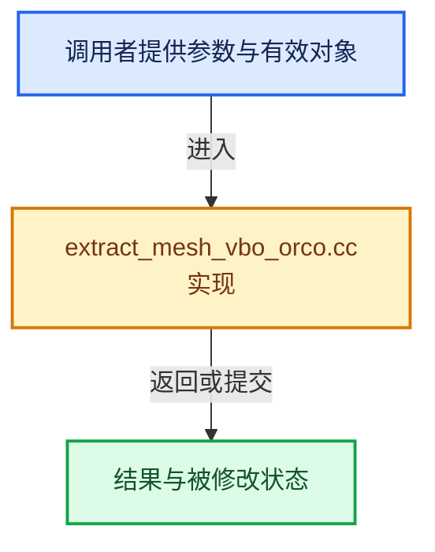

# 实现依赖专题：source/blender/draw/intern/mesh_extractors/extract_mesh_vbo_orco.cc

[实现依赖导航](../../../../README.md) · [符号索引](../../../../../00-课程指南/02-源码与提交索引/符号依赖与实现索引.md)

本专题从正文实际调用进入，集中保存共享实现。函数有稳定锚点，可从调用处直接跳到对应完整函数；递归与互相调用通过回链组织。

## 本文件的实现关系





## 完整成员与函数实现

<a id="f-b742b7d7a80fc539"></a>

### `blender::draw::extract_orco`

实现位置：[source/blender/draw/intern/mesh_extractors/extract_mesh_vbo_orco.cc](../../../../../../../../../source/blender/draw/intern/mesh_extractors/extract_mesh_vbo_orco.cc) · L13—L41。

接口参数：

- `const MeshRenderData &mr`
- `MeshBufferCache &cache`

**教学注释版**

<!-- annotated:cddf0fc5816545 -->

```cpp
gpu::VertBufPtr extract_orco(const MeshRenderData &mr, MeshBufferCache &cache)
{
  const Span<float3> orco_data(
      static_cast<const float3 *>(CustomData_get_layer(&mr.mesh->vert_data, CD_ORCO)),
      mr.corners_num);

  /* FIXME(fclem): We use the last component as a way to differentiate from generic vertex
   * attributes. This is a substantial waste of video-ram and should be done another way.
   * Unfortunately, at the time of writing, I did not found any other "non disruptive"
   * alternative. */
  static const GPUVertFormat format = GPU_vertformat_from_attribute(
      "orco", gpu::VertAttrType::SFLOAT_32_32_32_32);

  gpu::VertBufPtr vert_vbo = gpu::VertBufPtr(GPU_vertbuf_create_with_format(format));
  GPU_vertbuf_data_alloc(*vert_vbo, mr.verts_num);
  MutableSpan vbo_data = vert_vbo->data<float4>();
  const int64_t bytes = orco_data.size_in_bytes() + vbo_data.size_in_bytes();
  threading::memory_bandwidth_bound_task(bytes, [&]() {
    threading::parallel_for(IndexRange(mr.verts_num), 2048, [&](const IndexRange range) {
      for (const int vert : range) {
        vbo_data[vert] = float4(orco_data[vert], 0.0f);
      }
    });
  });

  gpu::VertBufPtr vbo = gpu::VertBufPtr(GPU_vertbuf_create_on_device(format, mr.corners_num));
  gather_vert_to_corner_gpu(mr, cache, *vert_vbo, *vbo);
  return vbo;
}
```

<details>
<summary>核对原始源码：source/blender/draw/intern/mesh_extractors/extract_mesh_vbo_orco.cc · L13—L41</summary>

<!-- original:cddf0fc5816545:source/blender/draw/intern/mesh_extractors/extract_mesh_vbo_orco.cc:13:41 -->

```cpp
gpu::VertBufPtr extract_orco(const MeshRenderData &mr, MeshBufferCache &cache)
{
  const Span<float3> orco_data(
      static_cast<const float3 *>(CustomData_get_layer(&mr.mesh->vert_data, CD_ORCO)),
      mr.corners_num);

  /* FIXME(fclem): We use the last component as a way to differentiate from generic vertex
   * attributes. This is a substantial waste of video-ram and should be done another way.
   * Unfortunately, at the time of writing, I did not found any other "non disruptive"
   * alternative. */
  static const GPUVertFormat format = GPU_vertformat_from_attribute(
      "orco", gpu::VertAttrType::SFLOAT_32_32_32_32);

  gpu::VertBufPtr vert_vbo = gpu::VertBufPtr(GPU_vertbuf_create_with_format(format));
  GPU_vertbuf_data_alloc(*vert_vbo, mr.verts_num);
  MutableSpan vbo_data = vert_vbo->data<float4>();
  const int64_t bytes = orco_data.size_in_bytes() + vbo_data.size_in_bytes();
  threading::memory_bandwidth_bound_task(bytes, [&]() {
    threading::parallel_for(IndexRange(mr.verts_num), 2048, [&](const IndexRange range) {
      for (const int vert : range) {
        vbo_data[vert] = float4(orco_data[vert], 0.0f);
      }
    });
  });

  gpu::VertBufPtr vbo = gpu::VertBufPtr(GPU_vertbuf_create_on_device(format, mr.corners_num));
  gather_vert_to_corner_gpu(mr, cache, *vert_vbo, *vbo);
  return vbo;
}
```

</details>

**沿实际写入检查状态**

- `vbo_data[vert] = float4(orco_data[vert], 0.0f);`

**结果出口**

- `return vbo;`

**继续追踪实现**

- `CustomData_get_layer` → [blender::CustomData_get_layer · L3308](../../../../02-BKE几何与数据/intern/customdata.cc.md#f-add1273f3ef3e57b)。
- `GPU_vertformat_from_attribute` → [blender::GPU_vertformat_from_attribute · L427](../../../gpu/intern/gpu_vertex_format.cc.md#f-2643d25087989f8e)。
- `gpu::VertBufPtr` → [调用协议](../../../../../00-课程指南/01-路线与规范/模板宏与动态分派协议.md)：函数指针、局部可调用对象或未展开的宏；必须结合调用者环境。调用位置L26。
- `GPU_vertbuf_create_with_format` → [blender::GPU_vertbuf_create_with_format · L71](../../../gpu/GPU_vertex_buffer.hh.md#f-bd43fe034e852138)。
- `GPU_vertbuf_data_alloc` → [blender::GPU_vertbuf_data_alloc · L172](../../../gpu/intern/gpu_vertex_buffer.cc.md#f-8ee5cf106e0f2b0f)。
- `vert_vbo->data<float4>` → [blender::draw::data · L124](../DRW_gpu_wrapper.hh.md#f-dc115dc22e0c9f33)；[blender::draw::data · L129](../DRW_gpu_wrapper.hh.md#f-5f325cb75387045c)。同名重载需按实参类型选择。
- `orco_data.size_in_bytes` → [blender::Span::size_in_bytes · L272](../../../../../01-基础容器与现代CPP/05-Span只读连续视图.md#f-1369fbdcc037fcaf)。
- `vbo_data.size_in_bytes` → [blender::MutableSpan::size_in_bytes · L507](../../../../../01-基础容器与现代CPP/06-MutableSpan可写视图.md#f-2e42823b970a8406)。
- `threading::memory_bandwidth_bound_task` → [blender::threading::memory_bandwidth_bound_task · L250](../../../../../11-Depsgraph与并行任务系统/07-任务池与TBB接入.md#f-aa412ccec656928d)。
- `threading::parallel_for` → [blender::threading::parallel_for · L68](../../../../../11-Depsgraph与并行任务系统/07-任务池与TBB接入.md#f-838294754c24426c)。
- `IndexRange` → [blender::IndexRange](../../../../01-BLI基础库/BLI_index_range.hh.md#t-caa3466d6776)；[blender::gpu::shader::parser::IndexRange](../../../gpu/shader_tool/utils.hh.md#t-82d2bd4ea71c)；[blender::IndexRange](../../../makesdna/DNA_node_types.h.md#t-0448cc889d39)。
- `float4` → [float4 · L56](../../../../07-Intern运行时与平台/cycles/kernel/svm/radial_tiling_shared.h.md#m-f0908e385c5b)；[float4 · L60](../../../../01-BLI基础库/intern/radial_tiling_shared.hh.md#m-7962dcdc288b)；[float4 · L56](../../../../07-Intern运行时与平台/cycles/kernel/osl/shaders/node_radial_tiling_shared.h.md#m-adb8e9e87775)；[float4 · L642](../../../compositor/algorithms/intern/smaa.cc.md#m-9362daaa821c)。宏定义由构建条件选择。
- `GPU_vertbuf_create_on_device` → [blender::GPU_vertbuf_create_on_device · L137](../../../gpu/intern/gpu_vertex_buffer.cc.md#f-abf244a18691f929)。
- `gather_vert_to_corner_gpu` → [blender::draw::gather_vert_to_corner_gpu · L129](extract_mesh_corner_gpu.cc.md#f-6a7db1cdc2e15e6c)。
