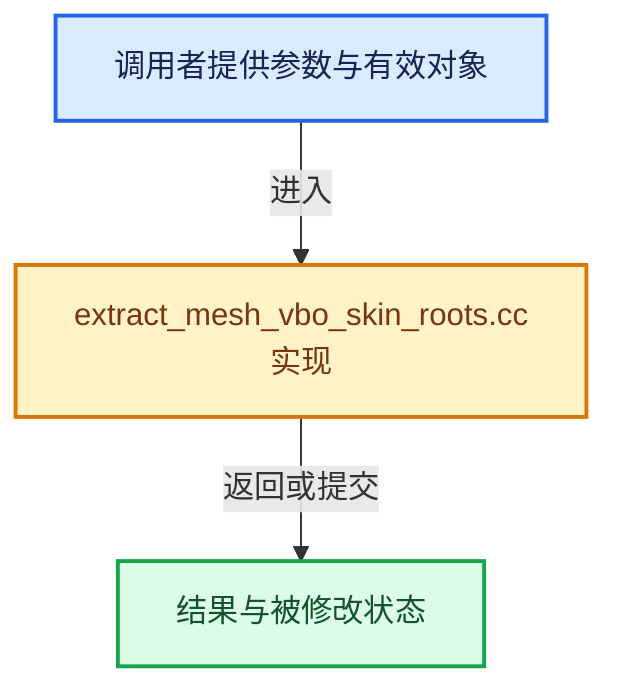

# 实现依赖专题：source/blender/draw/intern/mesh_extractors/extract_mesh_vbo_skin_roots.cc

[实现依赖导航](../../../../README.md) · [符号索引](../../../../../00-课程指南/02-源码与提交索引/符号依赖与实现索引.md)

本专题从正文实际调用进入，集中保存共享实现。函数有稳定锚点，可从调用处直接跳到对应完整函数；递归与互相调用通过回链组织。

## 本文件的实现关系





## 完整成员与函数实现

<a id="f-47476b2dbf525d00"></a>

### `blender::draw::extract_skin_roots`

实现位置：[source/blender/draw/intern/mesh_extractors/extract_mesh_vbo_skin_roots.cc](../../../../../../../../../source/blender/draw/intern/mesh_extractors/extract_mesh_vbo_skin_roots.cc) · L20—L55。

接口参数：

- `const MeshRenderData &mr`

**教学注释版**

<!-- annotated:2b72a791aba9f6 -->

```cpp
gpu::VertBufPtr extract_skin_roots(const MeshRenderData &mr)
{
  /* Exclusively for edit mode. */
  BLI_assert(mr.bm);

  static const GPUVertFormat format = []() {
    GPUVertFormat format{};
    GPU_vertformat_attr_add(&format, "size", gpu::VertAttrType::SFLOAT_32);
    GPU_vertformat_attr_add(&format, "local_pos", gpu::VertAttrType::SFLOAT_32_32_32);
    return format;
  }();

  Vector<SkinRootData> skin_roots;
  const int radius_offset = CustomData_get_offset_named(
      &mr.bm->vdata, CD_PROP_FLOAT2, "skin_modifier_radius");
  const int root_offset = CustomData_get_offset_named(
      &mr.bm->vdata, CD_PROP_BOOL, "skin_modifier_root");
  if (radius_offset == -1 || root_offset == -1) {
    return {};
  }

  BMIter iter;
  BMVert *vert;
  BM_ITER_MESH (vert, &iter, mr.bm, BM_VERTS_OF_MESH) {
    if (BM_ELEM_CD_GET_BOOL(vert, root_offset)) {
      const float2 *radius = static_cast<const float2 *>(
          BM_ELEM_CD_GET_VOID_P(vert, radius_offset));
      // [讲解] skin_roots.append：在尾部建立新元素，必要时先扩大存储。
      skin_roots.append({((*radius)[0] + (*radius)[1]) * 0.5f, bm_vert_co_get(mr, vert)});
    }
  }

  gpu::VertBufPtr vbo = gpu::VertBufPtr(GPU_vertbuf_create_with_format(format));
  // [讲解] skin_roots.size：用end_减begin_得到活元素数量。
  GPU_vertbuf_data_alloc(*vbo, skin_roots.size());
  vbo->data<SkinRootData>().copy_from(skin_roots);
  return vbo;
}
```

<details>
<summary>核对原始源码：source/blender/draw/intern/mesh_extractors/extract_mesh_vbo_skin_roots.cc · L20—L55</summary>

<!-- original:2b72a791aba9f6:source/blender/draw/intern/mesh_extractors/extract_mesh_vbo_skin_roots.cc:20:55 -->

```cpp
gpu::VertBufPtr extract_skin_roots(const MeshRenderData &mr)
{
  /* Exclusively for edit mode. */
  BLI_assert(mr.bm);

  static const GPUVertFormat format = []() {
    GPUVertFormat format{};
    GPU_vertformat_attr_add(&format, "size", gpu::VertAttrType::SFLOAT_32);
    GPU_vertformat_attr_add(&format, "local_pos", gpu::VertAttrType::SFLOAT_32_32_32);
    return format;
  }();

  Vector<SkinRootData> skin_roots;
  const int radius_offset = CustomData_get_offset_named(
      &mr.bm->vdata, CD_PROP_FLOAT2, "skin_modifier_radius");
  const int root_offset = CustomData_get_offset_named(
      &mr.bm->vdata, CD_PROP_BOOL, "skin_modifier_root");
  if (radius_offset == -1 || root_offset == -1) {
    return {};
  }

  BMIter iter;
  BMVert *vert;
  BM_ITER_MESH (vert, &iter, mr.bm, BM_VERTS_OF_MESH) {
    if (BM_ELEM_CD_GET_BOOL(vert, root_offset)) {
      const float2 *radius = static_cast<const float2 *>(
          BM_ELEM_CD_GET_VOID_P(vert, radius_offset));
      skin_roots.append({((*radius)[0] + (*radius)[1]) * 0.5f, bm_vert_co_get(mr, vert)});
    }
  }

  gpu::VertBufPtr vbo = gpu::VertBufPtr(GPU_vertbuf_create_with_format(format));
  GPU_vertbuf_data_alloc(*vbo, skin_roots.size());
  vbo->data<SkinRootData>().copy_from(skin_roots);
  return vbo;
}
```

</details>

**结果出口**

- `return format;`
- `return {};`
- `return vbo;`

**继续追踪实现**

- `BLI_assert` → [BLI_assert · L48](../../../../01-BLI基础库/BLI_assert.hh.md#m-57a88495704d)；[BLI_assert · L63](../../../../01-BLI基础库/BLI_assert.hh.md#m-d07050020cb5)。宏定义由构建条件选择。
- `[]() { GPUVertFormat format{}; GPU_vertformat_attr_add(&format, "size", gpu::VertAttrType::SFLOAT_32); GPU_vertformat_attr_add(&format, "local_pos", gpu::VertAttrType::SFLOAT_32_32_32); return format; }` → [调用协议](../../../../../00-课程指南/01-路线与规范/模板宏与动态分派协议.md)：函数指针、局部可调用对象或未展开的宏；必须结合调用者环境。调用位置L25。
- `GPU_vertformat_attr_add` → [blender::GPU_vertformat_attr_add · L389](../../../gpu/intern/gpu_vertex_format.cc.md#f-a36e23f37b97fff4)。
- `CustomData_get_offset_named` → [blender::CustomData_get_offset_named · L3398](../../../../02-BKE几何与数据/intern/customdata.cc.md#f-fe199f3da62e9c30)。
- `BM_ITER_MESH` → [BM_ITER_MESH · L72](../../../bmesh/intern/bmesh_iterators.hh.md#m-cfc837c73218)。宏定义由构建条件选择。
- `BM_ELEM_CD_GET_BOOL` → [BM_ELEM_CD_GET_BOOL · L593](../../../bmesh/bmesh_class.hh.md#m-6cba9d53d692)。宏定义由构建条件选择。
- `BM_ELEM_CD_GET_VOID_P` → [BM_ELEM_CD_GET_VOID_P · L610](../../../bmesh/bmesh_class.hh.md#m-cdfe9f3023fa)；[BM_ELEM_CD_GET_VOID_P · L618](../../../bmesh/bmesh_class.hh.md#m-126b1260772d)。宏定义由构建条件选择。
- `skin_roots.append` → [blender::Vector::append · L498](../../../../../01-基础容器与现代CPP/11-Vector插入删除与重排.md#f-5bde268a69e443ec)；[blender::Vector::append · L502](../../../../../01-基础容器与现代CPP/11-Vector插入删除与重排.md#f-591e0b15e6308532)。同名重载需按实参类型选择。
- `bm_vert_co_get` → [blender::draw::bm_vert_co_get · L162](extract_mesh.hh.md#f-b669e5a0bcf94c9f)。
- `gpu::VertBufPtr` → [调用协议](../../../../../00-课程指南/01-路线与规范/模板宏与动态分派协议.md)：函数指针、局部可调用对象或未展开的宏；必须结合调用者环境。调用位置L51。
- `GPU_vertbuf_create_with_format` → [blender::GPU_vertbuf_create_with_format · L71](../../../gpu/GPU_vertex_buffer.hh.md#f-bd43fe034e852138)。
- `GPU_vertbuf_data_alloc` → [blender::GPU_vertbuf_data_alloc · L172](../../../gpu/intern/gpu_vertex_buffer.cc.md#f-8ee5cf106e0f2b0f)。
- `skin_roots.size` → [blender::Vector::size · L780](../../../../../01-基础容器与现代CPP/11-Vector插入删除与重排.md#f-714773731767349c)。
- `vbo->data<SkinRootData>().copy_from` → [调用协议](../../../../../00-课程指南/01-路线与规范/模板宏与动态分派协议.md)：接收对象类型依赖auto、返回值或模板实例；不按同名猜测目标。调用位置L53。
- `vbo->data<SkinRootData>` → [blender::draw::data · L124](../DRW_gpu_wrapper.hh.md#f-dc115dc22e0c9f33)；[blender::draw::data · L129](../DRW_gpu_wrapper.hh.md#f-5f325cb75387045c)。同名重载需按实参类型选择。
