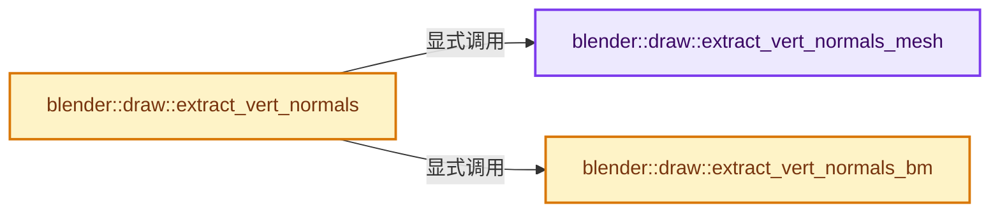
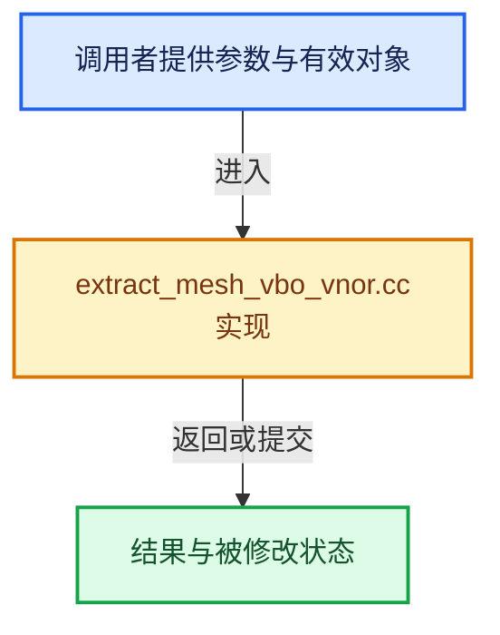

# 实现依赖专题：source/blender/draw/intern/mesh_extractors/extract_mesh_vbo_vnor.cc

[实现依赖导航](../../../../README.md) · [符号索引](../../../../../00-课程指南/02-源码与提交索引/符号依赖与实现索引.md)

本专题从正文实际调用进入，集中保存共享实现。函数有稳定锚点，可从调用处直接跳到对应完整函数；递归与互相调用通过回链组织。

## 本文件的实现关系






## 完整成员与函数实现

<a id="f-8d760010ff725b01"></a>

### `blender::draw::extract_vert_normals_mesh`

实现位置：[source/blender/draw/intern/mesh_extractors/extract_mesh_vbo_vnor.cc](../../../../../../../../../source/blender/draw/intern/mesh_extractors/extract_mesh_vbo_vnor.cc) · L17—L28。

接口参数：

- `const MeshRenderData &mr`
- `MutableSpan<int1010102_norm> vert_data`
- `MutableSpan<int1010102_norm> loose_data`

**教学注释版**

<!-- annotated:98b65b8f50c95e -->

```cpp
static void extract_vert_normals_mesh(const MeshRenderData &mr,
                                      MutableSpan<int1010102_norm> vert_data,
                                      MutableSpan<int1010102_norm> loose_data)
{
  // [讲解] loose_data.take_front：从两端裁去或选取一定数量元素形成新视图。
  MutableSpan loose_edge_data = loose_data.take_front(mr.loose_edges.size() * 2);
  // [讲解] loose_data.take_back：从两端裁去或选取一定数量元素形成新视图。
  MutableSpan loose_vert_data = loose_data.take_back(mr.loose_verts.size());
  gpu::convert_normals(mr.mesh->vert_normals(), vert_data);
  extract_mesh_loose_edge_data(vert_data.as_span(), mr.edges, mr.loose_edges, loose_edge_data);
  static_assert(sizeof(int1010102_norm) == sizeof(int32_t));
  array_utils::gather(
      // [讲解] loose_vert_data.cast<int32_t>：按类型与布局约束重新解释视图。
      vert_data.as_span().cast<int32_t>(), mr.loose_verts, loose_vert_data.cast<int32_t>());
}
```

<details>
<summary>核对原始源码：source/blender/draw/intern/mesh_extractors/extract_mesh_vbo_vnor.cc · L17—L28</summary>

<!-- original:98b65b8f50c95e:source/blender/draw/intern/mesh_extractors/extract_mesh_vbo_vnor.cc:17:28 -->

```cpp
static void extract_vert_normals_mesh(const MeshRenderData &mr,
                                      MutableSpan<int1010102_norm> vert_data,
                                      MutableSpan<int1010102_norm> loose_data)
{
  MutableSpan loose_edge_data = loose_data.take_front(mr.loose_edges.size() * 2);
  MutableSpan loose_vert_data = loose_data.take_back(mr.loose_verts.size());
  gpu::convert_normals(mr.mesh->vert_normals(), vert_data);
  extract_mesh_loose_edge_data(vert_data.as_span(), mr.edges, mr.loose_edges, loose_edge_data);
  static_assert(sizeof(int1010102_norm) == sizeof(int32_t));
  array_utils::gather(
      vert_data.as_span().cast<int32_t>(), mr.loose_verts, loose_vert_data.cast<int32_t>());
}
```

</details>

**继续追踪实现**

- `loose_data.take_front` → [blender::MutableSpan::take_front · L635](../../../../../01-基础容器与现代CPP/06-MutableSpan可写视图.md#f-0a0235d84ddc265d)。
- `mr.loose_edges.size` → [调用协议](../../../../../00-课程指南/01-路线与规范/模板宏与动态分派协议.md)：接收对象类型依赖auto、返回值或模板实例；不按同名猜测目标。调用位置L21。
- `loose_data.take_back` → [blender::MutableSpan::take_back · L646](../../../../../01-基础容器与现代CPP/06-MutableSpan可写视图.md#f-3fce5fbbe328c130)。
- `mr.loose_verts.size` → [调用协议](../../../../../00-课程指南/01-路线与规范/模板宏与动态分派协议.md)：接收对象类型依赖auto、返回值或模板实例；不按同名猜测目标。调用位置L22。
- `gpu::convert_normals` → [blender::gpu::convert_normals · L27](../../../gpu/intern/gpu_vertex_format_normals.cc.md#f-8089add92715f800)；[blender::gpu::convert_normals · L31](../../../gpu/intern/gpu_vertex_format_normals.cc.md#f-c169df59eea7544c)。同名重载需按实参类型选择。
- `mr.mesh->vert_normals` → [调用协议](../../../../../00-课程指南/01-路线与规范/模板宏与动态分派协议.md)：接收对象类型依赖auto、返回值或模板实例；不按同名猜测目标。调用位置L23。
- `extract_mesh_loose_edge_data` → [blender::draw::extract_mesh_loose_edge_data · L246](extract_mesh.hh.md#f-0d5eeb9cb9333f7e)。
- `vert_data.as_span` → [blender::MutableSpan::as_span · L667](../../../../../01-基础容器与现代CPP/06-MutableSpan可写视图.md#f-d0c35de0cfb9761e)。
- `array_utils::gather` → [blender::array_utils::gather · L187](../../../../../01-基础容器与现代CPP/20-容器选择与独立实现.md#f-1760adec5858a42f)；[blender::array_utils::gather · L209](../../../../../01-基础容器与现代CPP/20-容器选择与独立实现.md#f-a9f65820788454bf)；[blender::array_utils::gather · L225](../../../../../01-基础容器与现代CPP/20-容器选择与独立实现.md#f-279764b4196f0b63)；[blender::array_utils::gather · L237](../../../../../01-基础容器与现代CPP/20-容器选择与独立实现.md#f-e310fd489b49341b)；[blender::array_utils::gather · L268](../../../../../01-基础容器与现代CPP/20-容器选择与独立实现.md#f-7b21c29791903615)；[blender::array_utils::gather · L63](../../../../01-BLI基础库/intern/array_utils.cc.md#f-5c2b501b03ddbb1f)；[blender::array_utils::gather · L82](../../../../01-BLI基础库/intern/array_utils.cc.md#f-ea4dd9e673fe81e4)。同名重载需按实参类型选择。
- `vert_data.as_span().cast<int32_t>` → [调用协议](../../../../../00-课程指南/01-路线与规范/模板宏与动态分派协议.md)：接收对象类型依赖auto、返回值或模板实例；不按同名猜测目标。调用位置L27。
- `loose_vert_data.cast<int32_t>` → [blender::MutableSpan::cast · L755](../../../../../01-基础容器与现代CPP/06-MutableSpan可写视图.md#f-360354e608371779)。

<a id="f-433693caee1be19b"></a>

### `blender::draw::extract_vert_normals_bm`

实现位置：[source/blender/draw/intern/mesh_extractors/extract_mesh_vbo_vnor.cc](../../../../../../../../../source/blender/draw/intern/mesh_extractors/extract_mesh_vbo_vnor.cc) · L30—L56。

接口参数：

- `const MeshRenderData &mr`
- `MutableSpan<int1010102_norm> vert_data`
- `MutableSpan<int1010102_norm> loose_data`

**教学注释版**

<!-- annotated:778226b2af6a5f -->

```cpp
static void extract_vert_normals_bm(const MeshRenderData &mr,
                                    MutableSpan<int1010102_norm> vert_data,
                                    MutableSpan<int1010102_norm> loose_data)
{
  const BMesh &bm = *mr.bm;
  // [讲解] loose_data.take_front：从两端裁去或选取一定数量元素形成新视图。
  MutableSpan loose_edge_data = loose_data.take_front(mr.loose_edges.size() * 2);
  // [讲解] loose_data.take_back：从两端裁去或选取一定数量元素形成新视图。
  MutableSpan loose_vert_data = loose_data.take_back(mr.loose_verts.size());

  threading::parallel_for(IndexRange(bm.totvert), 4096, [&](const IndexRange range) {
    for (const int i : range) {
      const BMVert *vert = BM_vert_at_index(&const_cast<BMesh &>(bm), i);
      vert_data[i] = gpu::convert_normal<int1010102_norm>(bm_vert_no_get(mr, vert));
    }
  });

  mr.loose_edges.foreach_index(
      [&](const int i, const int pos) {
        const BMEdge &edge = *BM_edge_at_index(&const_cast<BMesh &>(bm), i);
        loose_edge_data[pos * 2 + 0] = vert_data[BM_elem_index_get(edge.v1)];
        loose_edge_data[pos * 2 + 1] = vert_data[BM_elem_index_get(edge.v2)];
      },
      exec_mode::grain_size(2048));

  mr.loose_verts.foreach_index(
      [&](const int i, const int pos) { loose_vert_data[pos] = vert_data[i]; },
      exec_mode::grain_size(2048));
}
```

<details>
<summary>核对原始源码：source/blender/draw/intern/mesh_extractors/extract_mesh_vbo_vnor.cc · L30—L56</summary>

<!-- original:778226b2af6a5f:source/blender/draw/intern/mesh_extractors/extract_mesh_vbo_vnor.cc:30:56 -->

```cpp
static void extract_vert_normals_bm(const MeshRenderData &mr,
                                    MutableSpan<int1010102_norm> vert_data,
                                    MutableSpan<int1010102_norm> loose_data)
{
  const BMesh &bm = *mr.bm;
  MutableSpan loose_edge_data = loose_data.take_front(mr.loose_edges.size() * 2);
  MutableSpan loose_vert_data = loose_data.take_back(mr.loose_verts.size());

  threading::parallel_for(IndexRange(bm.totvert), 4096, [&](const IndexRange range) {
    for (const int i : range) {
      const BMVert *vert = BM_vert_at_index(&const_cast<BMesh &>(bm), i);
      vert_data[i] = gpu::convert_normal<int1010102_norm>(bm_vert_no_get(mr, vert));
    }
  });

  mr.loose_edges.foreach_index(
      [&](const int i, const int pos) {
        const BMEdge &edge = *BM_edge_at_index(&const_cast<BMesh &>(bm), i);
        loose_edge_data[pos * 2 + 0] = vert_data[BM_elem_index_get(edge.v1)];
        loose_edge_data[pos * 2 + 1] = vert_data[BM_elem_index_get(edge.v2)];
      },
      exec_mode::grain_size(2048));

  mr.loose_verts.foreach_index(
      [&](const int i, const int pos) { loose_vert_data[pos] = vert_data[i]; },
      exec_mode::grain_size(2048));
}
```

</details>

**沿实际写入检查状态**

- `vert_data[i] = gpu::convert_normal<int1010102_norm>(bm_vert_no_get(mr, vert));`

**继续追踪实现**

- `loose_data.take_front` → [blender::MutableSpan::take_front · L635](../../../../../01-基础容器与现代CPP/06-MutableSpan可写视图.md#f-0a0235d84ddc265d)。
- `mr.loose_edges.size` → [调用协议](../../../../../00-课程指南/01-路线与规范/模板宏与动态分派协议.md)：接收对象类型依赖auto、返回值或模板实例；不按同名猜测目标。调用位置L35。
- `loose_data.take_back` → [blender::MutableSpan::take_back · L646](../../../../../01-基础容器与现代CPP/06-MutableSpan可写视图.md#f-3fce5fbbe328c130)。
- `mr.loose_verts.size` → [调用协议](../../../../../00-课程指南/01-路线与规范/模板宏与动态分派协议.md)：接收对象类型依赖auto、返回值或模板实例；不按同名猜测目标。调用位置L36。
- `threading::parallel_for` → [blender::threading::parallel_for · L68](../../../../../11-Depsgraph与并行任务系统/07-任务池与TBB接入.md#f-838294754c24426c)。
- `IndexRange` → [blender::IndexRange](../../../../01-BLI基础库/BLI_index_range.hh.md#t-caa3466d6776)；[blender::gpu::shader::parser::IndexRange](../../../gpu/shader_tool/utils.hh.md#t-82d2bd4ea71c)；[blender::IndexRange](../../../makesdna/DNA_node_types.h.md#t-0448cc889d39)。
- `BM_vert_at_index` → [blender::BM_vert_at_index · L110](../../../bmesh/intern/bmesh_mesh.hh.md#f-aced0ebcd417a2f4)。
- `gpu::convert_normal<int1010102_norm>` → [blender::gpu::convert_normal · L21](../../../gpu/GPU_attribute_convert.hh.md#f-d24eef906ebcd8b5)；[blender::gpu::convert_normal · L26](../../../gpu/GPU_attribute_convert.hh.md#f-40f0824f9b7edbbb)。同名重载需按实参类型选择。
- `bm_vert_no_get` → [blender::draw::bm_vert_no_get · L170](extract_mesh.hh.md#f-c2d47f6477827d01)。
- `mr.loose_edges.foreach_index` → [调用协议](../../../../../00-课程指南/01-路线与规范/模板宏与动态分派协议.md)：接收对象类型依赖auto、返回值或模板实例；不按同名猜测目标。调用位置L45。
- `BM_edge_at_index` → [blender::BM_edge_at_index · L116](../../../bmesh/intern/bmesh_mesh.hh.md#f-81d027fd9e6b4c84)。
- `BM_elem_index_get` → [BM_elem_index_get · L120](../../../bmesh/intern/bmesh_inline.hh.md#m-201981cdc62d)。宏定义由构建条件选择。
- `exec_mode::grain_size` → [blender::exec_mode::grain_size · L79](../../../../01-BLI基础库/BLI_execution_mode.hh.md#f-0b4fc2f9fa6e66e7)。
- `mr.loose_verts.foreach_index` → [调用协议](../../../../../00-课程指南/01-路线与规范/模板宏与动态分派协议.md)：接收对象类型依赖auto、返回值或模板实例；不按同名猜测目标。调用位置L53。

<a id="f-b026b31a02833ec7"></a>

### `blender::draw::extract_vert_normals`

实现位置：[source/blender/draw/intern/mesh_extractors/extract_mesh_vbo_vnor.cc](../../../../../../../../../source/blender/draw/intern/mesh_extractors/extract_mesh_vbo_vnor.cc) · L58—L78。

接口参数：

- `const MeshRenderData &mr`
- `MeshBufferCache &cache`

**教学注释版**

<!-- annotated:9359a4dff864fc -->

```cpp
gpu::VertBufPtr extract_vert_normals(const MeshRenderData &mr, MeshBufferCache &cache)
{
  static GPUVertFormat format = GPU_vertformat_from_attribute("vnor",
                                                              gpu::VertAttrType::SNORM_10_10_10_2);

  gpu::VertBufPtr vert_vbo = gpu::VertBufPtr(GPU_vertbuf_create_with_format(format));
  GPU_vertbuf_data_alloc(*vert_vbo, mr.verts_num);
  Array<int1010102_norm> loose_data(mr.loose_indices_num);
  if (mr.extract_type == MeshExtractType::Mesh) {
    extract_vert_normals_mesh(mr, vert_vbo->data<int1010102_norm>(), loose_data);
  }
  else {
    extract_vert_normals_bm(mr, vert_vbo->data<int1010102_norm>(), loose_data);
  }

  gpu::VertBufPtr vbo = gpu::VertBufPtr(
      GPU_vertbuf_create_on_device(format, mr.corners_num + mr.loose_indices_num));
  gather_vert_to_corner_gpu(mr, cache, *vert_vbo, *vbo);
  // [讲解] loose_data.as_span：提供数组的借用访问入口。
  loose_data_upload(mr, loose_data.as_span(), *vbo);
  return vbo;
}
```

<details>
<summary>核对原始源码：source/blender/draw/intern/mesh_extractors/extract_mesh_vbo_vnor.cc · L58—L78</summary>

<!-- original:9359a4dff864fc:source/blender/draw/intern/mesh_extractors/extract_mesh_vbo_vnor.cc:58:78 -->

```cpp
gpu::VertBufPtr extract_vert_normals(const MeshRenderData &mr, MeshBufferCache &cache)
{
  static GPUVertFormat format = GPU_vertformat_from_attribute("vnor",
                                                              gpu::VertAttrType::SNORM_10_10_10_2);

  gpu::VertBufPtr vert_vbo = gpu::VertBufPtr(GPU_vertbuf_create_with_format(format));
  GPU_vertbuf_data_alloc(*vert_vbo, mr.verts_num);
  Array<int1010102_norm> loose_data(mr.loose_indices_num);
  if (mr.extract_type == MeshExtractType::Mesh) {
    extract_vert_normals_mesh(mr, vert_vbo->data<int1010102_norm>(), loose_data);
  }
  else {
    extract_vert_normals_bm(mr, vert_vbo->data<int1010102_norm>(), loose_data);
  }

  gpu::VertBufPtr vbo = gpu::VertBufPtr(
      GPU_vertbuf_create_on_device(format, mr.corners_num + mr.loose_indices_num));
  gather_vert_to_corner_gpu(mr, cache, *vert_vbo, *vbo);
  loose_data_upload(mr, loose_data.as_span(), *vbo);
  return vbo;
}
```

</details>

**结果出口**

- `return vbo;`

**继续追踪实现**

- `GPU_vertformat_from_attribute` → [blender::GPU_vertformat_from_attribute · L427](../../../gpu/intern/gpu_vertex_format.cc.md#f-2643d25087989f8e)。
- `gpu::VertBufPtr` → [调用协议](../../../../../00-课程指南/01-路线与规范/模板宏与动态分派协议.md)：函数指针、局部可调用对象或未展开的宏；必须结合调用者环境。调用位置L63。
- `GPU_vertbuf_create_with_format` → [blender::GPU_vertbuf_create_with_format · L71](../../../gpu/GPU_vertex_buffer.hh.md#f-bd43fe034e852138)。
- `GPU_vertbuf_data_alloc` → [blender::GPU_vertbuf_data_alloc · L172](../../../gpu/intern/gpu_vertex_buffer.cc.md#f-8ee5cf106e0f2b0f)。
- `extract_vert_normals_mesh` → [blender::draw::extract_vert_normals_mesh · L17](extract_mesh_vbo_vnor.cc.md#f-8d760010ff725b01)。
- `vert_vbo->data<int1010102_norm>` → [blender::draw::data · L124](../DRW_gpu_wrapper.hh.md#f-dc115dc22e0c9f33)；[blender::draw::data · L129](../DRW_gpu_wrapper.hh.md#f-5f325cb75387045c)。同名重载需按实参类型选择。
- `extract_vert_normals_bm` → [blender::draw::extract_vert_normals_bm · L30](extract_mesh_vbo_vnor.cc.md#f-433693caee1be19b)。
- `GPU_vertbuf_create_on_device` → [blender::GPU_vertbuf_create_on_device · L137](../../../gpu/intern/gpu_vertex_buffer.cc.md#f-abf244a18691f929)。
- `gather_vert_to_corner_gpu` → [blender::draw::gather_vert_to_corner_gpu · L129](extract_mesh_corner_gpu.cc.md#f-6a7db1cdc2e15e6c)。
- `loose_data_upload` → [blender::draw::loose_data_upload · L289](extract_mesh.hh.md#f-1d43c35d50f54c24)。
- `loose_data.as_span` → [blender::Array::as_span · L254](../../../../../01-基础容器与现代CPP/08-Array复制移动与销毁.md#f-05fc77056a242032)。
