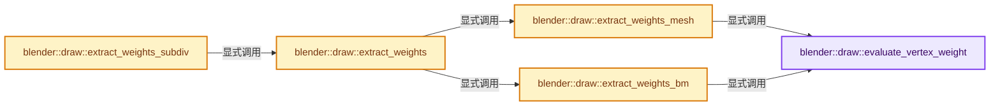
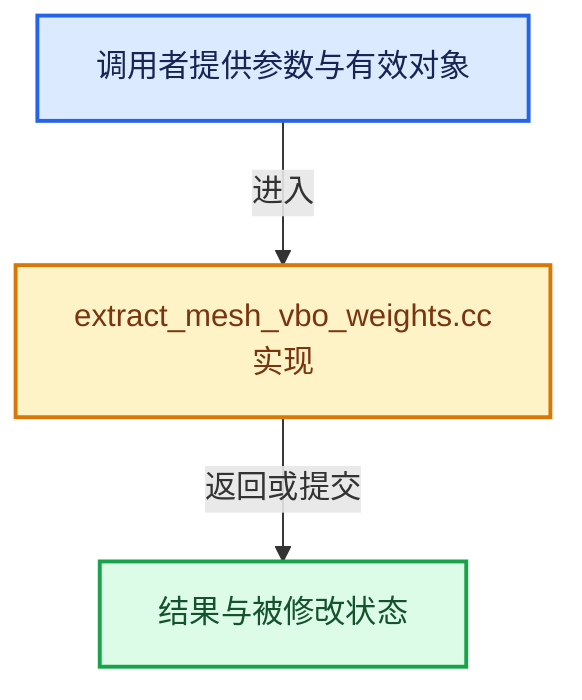

# 实现依赖专题：source/blender/draw/intern/mesh_extractors/extract_mesh_vbo_weights.cc

[实现依赖导航](../../../../README.md) · [符号索引](../../../../../00-课程指南/02-源码与提交索引/符号依赖与实现索引.md)

本专题从正文实际调用进入，集中保存共享实现。函数有稳定锚点，可从调用处直接跳到对应完整函数；递归与互相调用通过回链组织。

## 本文件的实现关系






## 完整成员与函数实现

<a id="f-32730ac708cb24cf"></a>

### `blender::draw::evaluate_vertex_weight`

实现位置：[source/blender/draw/intern/mesh_extractors/extract_mesh_vbo_weights.cc](../../../../../../../../../source/blender/draw/intern/mesh_extractors/extract_mesh_vbo_weights.cc) · L20—L68。

接口参数：

- `const MDeformVert *dvert`
- `const DRW_MeshWeightState *wstate`

**教学注释版**

<!-- annotated:b18b058febda9a -->

```cpp
static float evaluate_vertex_weight(const MDeformVert *dvert, const DRW_MeshWeightState *wstate)
{
  /* Error state. */
  if ((wstate->defgroup_active < 0) && (wstate->defgroup_len > 0)) {
    return -2.0f;
  }

  float input = 0.0f;
  if (wstate->flags & DRW_MESH_WEIGHT_STATE_MULTIPAINT) {
    /* Multi-Paint feature */
    bool is_normalized = (wstate->flags & (DRW_MESH_WEIGHT_STATE_AUTO_NORMALIZE |
                                           DRW_MESH_WEIGHT_STATE_LOCK_RELATIVE));
    input = BKE_defvert_multipaint_collective_weight(dvert,
                                                     wstate->defgroup_len,
                                                     wstate->defgroup_sel,
                                                     wstate->defgroup_sel_count,
                                                     is_normalized);
    /* make it black if the selected groups have no weight on a vertex */
    if (input == 0.0f) {
      return -1.0f;
    }
  }
  else {
    /* default, non tricky behavior */
    input = BKE_defvert_find_weight(dvert, wstate->defgroup_active);

    if (input == 0.0f) {
      switch (wstate->alert_mode) {
        case OB_DRAW_GROUPUSER_ACTIVE:
          return -1.0f;
          break;
        case OB_DRAW_GROUPUSER_ALL:
          if (BKE_defvert_is_weight_zero(dvert, wstate->defgroup_len)) {
            return -1.0f;
          }
          break;
      }
    }
  }

  /* Lock-Relative: display the fraction of current weight vs total unlocked weight. */
  if (wstate->flags & DRW_MESH_WEIGHT_STATE_LOCK_RELATIVE) {
    input = BKE_defvert_lock_relative_weight(
        input, dvert, wstate->defgroup_len, wstate->defgroup_locked, wstate->defgroup_unlocked);
  }

  CLAMP(input, 0.0f, 1.0f);
  return input;
}
```

<details>
<summary>核对原始源码：source/blender/draw/intern/mesh_extractors/extract_mesh_vbo_weights.cc · L20—L68</summary>

<!-- original:b18b058febda9a:source/blender/draw/intern/mesh_extractors/extract_mesh_vbo_weights.cc:20:68 -->

```cpp
static float evaluate_vertex_weight(const MDeformVert *dvert, const DRW_MeshWeightState *wstate)
{
  /* Error state. */
  if ((wstate->defgroup_active < 0) && (wstate->defgroup_len > 0)) {
    return -2.0f;
  }

  float input = 0.0f;
  if (wstate->flags & DRW_MESH_WEIGHT_STATE_MULTIPAINT) {
    /* Multi-Paint feature */
    bool is_normalized = (wstate->flags & (DRW_MESH_WEIGHT_STATE_AUTO_NORMALIZE |
                                           DRW_MESH_WEIGHT_STATE_LOCK_RELATIVE));
    input = BKE_defvert_multipaint_collective_weight(dvert,
                                                     wstate->defgroup_len,
                                                     wstate->defgroup_sel,
                                                     wstate->defgroup_sel_count,
                                                     is_normalized);
    /* make it black if the selected groups have no weight on a vertex */
    if (input == 0.0f) {
      return -1.0f;
    }
  }
  else {
    /* default, non tricky behavior */
    input = BKE_defvert_find_weight(dvert, wstate->defgroup_active);

    if (input == 0.0f) {
      switch (wstate->alert_mode) {
        case OB_DRAW_GROUPUSER_ACTIVE:
          return -1.0f;
          break;
        case OB_DRAW_GROUPUSER_ALL:
          if (BKE_defvert_is_weight_zero(dvert, wstate->defgroup_len)) {
            return -1.0f;
          }
          break;
      }
    }
  }

  /* Lock-Relative: display the fraction of current weight vs total unlocked weight. */
  if (wstate->flags & DRW_MESH_WEIGHT_STATE_LOCK_RELATIVE) {
    input = BKE_defvert_lock_relative_weight(
        input, dvert, wstate->defgroup_len, wstate->defgroup_locked, wstate->defgroup_unlocked);
  }

  CLAMP(input, 0.0f, 1.0f);
  return input;
}
```

</details>

**沿实际写入检查状态**

- `input = BKE_defvert_multipaint_collective_weight(dvert,`
- `input = BKE_defvert_find_weight(dvert, wstate->defgroup_active);`
- `input = BKE_defvert_lock_relative_weight(`

**结果出口**

- `return -2.0f;`
- `return -1.0f;`
- `return input;`

**继续追踪实现**

- `BKE_defvert_multipaint_collective_weight` → [blender::BKE_defvert_multipaint_collective_weight · L977](../../../../02-BKE几何与数据/intern/deform.cc.md#f-a8c8aec40a330373)。
- `BKE_defvert_find_weight` → [blender::BKE_defvert_find_weight · L779](../../../../02-BKE几何与数据/intern/deform.cc.md#f-c117fcd05c4fd453)。
- `BKE_defvert_is_weight_zero` → [blender::BKE_defvert_is_weight_zero · L941](../../../../02-BKE几何与数据/intern/deform.cc.md#f-8da08361597d28ff)。
- `BKE_defvert_lock_relative_weight` → [blender::BKE_defvert_lock_relative_weight · L1022](../../../../02-BKE几何与数据/intern/deform.cc.md#f-bbe2d0c0f5c9f830)。
- `CLAMP` → [CLAMP · L200](../../../../01-BLI基础库/BLI_utildefines.hh.md#m-69703e497120)。宏定义由构建条件选择。

<a id="f-04d609cb254f6506"></a>

### `blender::draw::extract_weights_mesh`

实现位置：[source/blender/draw/intern/mesh_extractors/extract_mesh_vbo_weights.cc](../../../../../../../../../source/blender/draw/intern/mesh_extractors/extract_mesh_vbo_weights.cc) · L70—L86。

接口参数：

- `const MeshRenderData &mr`
- `const DRW_MeshWeightState &weight_state`
- `MutableSpan<float> vbo_data`

**教学注释版**

<!-- annotated:d9b19c385c3692 -->

```cpp
static void extract_weights_mesh(const MeshRenderData &mr,
                                 const DRW_MeshWeightState &weight_state,
                                 MutableSpan<float> vbo_data)
{
  const Mesh &mesh = *mr.mesh;
  const Span<MDeformVert> dverts = mesh.deform_verts();
  // [讲解] dverts.is_empty：查询视图长度或生成对应有效索引区间。
  if (dverts.is_empty()) {
    // [讲解] vbo_data.fill：修改已有目标元素，不改变底层容器长度。
    vbo_data.fill(weight_state.alert_mode == OB_DRAW_GROUPUSER_NONE ? 0.0f : -1.0f);
    return;
  }

  // [讲解] vbo_data.index_range：查询视图长度或生成对应有效索引区间。
  threading::parallel_for(vbo_data.index_range(), 1024, [&](const IndexRange range) {
    for (const int vert : range) {
      vbo_data[vert] = evaluate_vertex_weight(&dverts[vert], &weight_state);
    }
  });
}
```

<details>
<summary>核对原始源码：source/blender/draw/intern/mesh_extractors/extract_mesh_vbo_weights.cc · L70—L86</summary>

<!-- original:d9b19c385c3692:source/blender/draw/intern/mesh_extractors/extract_mesh_vbo_weights.cc:70:86 -->

```cpp
static void extract_weights_mesh(const MeshRenderData &mr,
                                 const DRW_MeshWeightState &weight_state,
                                 MutableSpan<float> vbo_data)
{
  const Mesh &mesh = *mr.mesh;
  const Span<MDeformVert> dverts = mesh.deform_verts();
  if (dverts.is_empty()) {
    vbo_data.fill(weight_state.alert_mode == OB_DRAW_GROUPUSER_NONE ? 0.0f : -1.0f);
    return;
  }

  threading::parallel_for(vbo_data.index_range(), 1024, [&](const IndexRange range) {
    for (const int vert : range) {
      vbo_data[vert] = evaluate_vertex_weight(&dverts[vert], &weight_state);
    }
  });
}
```

</details>

**沿实际写入检查状态**

- `vbo_data[vert] = evaluate_vertex_weight(&dverts[vert], &weight_state);`

**继续追踪实现**

- `mesh.deform_verts` → [Mesh::deform_verts · L1266](../../../../../05-几何存储与拓扑映射/03-MPoly迁移与兼容.md#f-4c0433aad24aa301)。
- `dverts.is_empty` → [blender::Span::is_empty · L264](../../../../../01-基础容器与现代CPP/05-Span只读连续视图.md#f-8cc1d7ba8feb50e6)。
- `vbo_data.fill` → [blender::MutableSpan::fill · L523](../../../../../01-基础容器与现代CPP/06-MutableSpan可写视图.md#f-8daedd52c727ec26)。
- `threading::parallel_for` → [blender::threading::parallel_for · L68](../../../../../11-Depsgraph与并行任务系统/07-任务池与TBB接入.md#f-838294754c24426c)。
- `vbo_data.index_range` → [blender::MutableSpan::index_range · L676](../../../../../01-基础容器与现代CPP/06-MutableSpan可写视图.md#f-f9a9d59a69ca64b5)。
- `evaluate_vertex_weight` → [blender::draw::evaluate_vertex_weight · L20](extract_mesh_vbo_weights.cc.md#f-32730ac708cb24cf)。

<a id="f-45cda16e4e944a3a"></a>

### `blender::draw::extract_weights_bm`

实现位置：[source/blender/draw/intern/mesh_extractors/extract_mesh_vbo_weights.cc](../../../../../../../../../source/blender/draw/intern/mesh_extractors/extract_mesh_vbo_weights.cc) · L88—L106。

接口参数：

- `const MeshRenderData &mr`
- `const DRW_MeshWeightState &weight_state`
- `MutableSpan<float> vbo_data`

**教学注释版**

<!-- annotated:d3d121341589e3 -->

```cpp
static void extract_weights_bm(const MeshRenderData &mr,
                               const DRW_MeshWeightState &weight_state,
                               MutableSpan<float> vbo_data)
{
  const BMesh &bm = *mr.bm;
  const int offset = CustomData_get_offset(&bm.vdata, CD_MDEFORMVERT);
  if (offset == -1) {
    // [讲解] vbo_data.fill：修改已有目标元素，不改变底层容器长度。
    vbo_data.fill(weight_state.alert_mode == OB_DRAW_GROUPUSER_NONE ? 0.0f : -1.0f);
    return;
  }

  threading::parallel_for(IndexRange(bm.totvert), 2048, [&](const IndexRange range) {
    for (const int vert_index : range) {
      const BMVert &vert = *BM_vert_at_index(&const_cast<BMesh &>(bm), vert_index);
      vbo_data[vert_index] = evaluate_vertex_weight(
          static_cast<const MDeformVert *>(BM_ELEM_CD_GET_VOID_P(&vert, offset)), &weight_state);
    }
  });
}
```

<details>
<summary>核对原始源码：source/blender/draw/intern/mesh_extractors/extract_mesh_vbo_weights.cc · L88—L106</summary>

<!-- original:d3d121341589e3:source/blender/draw/intern/mesh_extractors/extract_mesh_vbo_weights.cc:88:106 -->

```cpp
static void extract_weights_bm(const MeshRenderData &mr,
                               const DRW_MeshWeightState &weight_state,
                               MutableSpan<float> vbo_data)
{
  const BMesh &bm = *mr.bm;
  const int offset = CustomData_get_offset(&bm.vdata, CD_MDEFORMVERT);
  if (offset == -1) {
    vbo_data.fill(weight_state.alert_mode == OB_DRAW_GROUPUSER_NONE ? 0.0f : -1.0f);
    return;
  }

  threading::parallel_for(IndexRange(bm.totvert), 2048, [&](const IndexRange range) {
    for (const int vert_index : range) {
      const BMVert &vert = *BM_vert_at_index(&const_cast<BMesh &>(bm), vert_index);
      vbo_data[vert_index] = evaluate_vertex_weight(
          static_cast<const MDeformVert *>(BM_ELEM_CD_GET_VOID_P(&vert, offset)), &weight_state);
    }
  });
}
```

</details>

**沿实际写入检查状态**

- `vbo_data[vert_index] = evaluate_vertex_weight(`

**继续追踪实现**

- `CustomData_get_offset` → [blender::CustomData_get_offset · L3379](../../../../02-BKE几何与数据/intern/customdata.cc.md#f-e0e230c6120acc9a)。
- `vbo_data.fill` → [blender::MutableSpan::fill · L523](../../../../../01-基础容器与现代CPP/06-MutableSpan可写视图.md#f-8daedd52c727ec26)。
- `threading::parallel_for` → [blender::threading::parallel_for · L68](../../../../../11-Depsgraph与并行任务系统/07-任务池与TBB接入.md#f-838294754c24426c)。
- `IndexRange` → [blender::IndexRange](../../../../01-BLI基础库/BLI_index_range.hh.md#t-caa3466d6776)；[blender::gpu::shader::parser::IndexRange](../../../gpu/shader_tool/utils.hh.md#t-82d2bd4ea71c)；[blender::IndexRange](../../../makesdna/DNA_node_types.h.md#t-0448cc889d39)。
- `BM_vert_at_index` → [blender::BM_vert_at_index · L110](../../../bmesh/intern/bmesh_mesh.hh.md#f-aced0ebcd417a2f4)。
- `evaluate_vertex_weight` → [blender::draw::evaluate_vertex_weight · L20](extract_mesh_vbo_weights.cc.md#f-32730ac708cb24cf)。
- `BM_ELEM_CD_GET_VOID_P` → [BM_ELEM_CD_GET_VOID_P · L610](../../../bmesh/bmesh_class.hh.md#m-cdfe9f3023fa)；[BM_ELEM_CD_GET_VOID_P · L618](../../../bmesh/bmesh_class.hh.md#m-126b1260772d)。宏定义由构建条件选择。

<a id="f-8b4662e5a7d35d83"></a>

### `blender::draw::extract_weights`

实现位置：[source/blender/draw/intern/mesh_extractors/extract_mesh_vbo_weights.cc](../../../../../../../../../source/blender/draw/intern/mesh_extractors/extract_mesh_vbo_weights.cc) · L108—L137。

接口参数：

- `const MeshRenderData &mr`
- `const MeshBatchCache &batch_cache`
- `MeshBufferCache &cache`

**教学注释版**

<!-- annotated:88200ccdf1b15e -->

```cpp
gpu::VertBufPtr extract_weights(const MeshRenderData &mr,
                                const MeshBatchCache &batch_cache,
                                MeshBufferCache &cache)
{
  static GPUVertFormat format = GPU_vertformat_from_attribute("weight",
                                                              gpu::VertAttrType::SFLOAT_32);

  gpu::VertBufPtr vert_vbo = gpu::VertBufPtr(GPU_vertbuf_create_with_format(format));
  GPU_vertbuf_data_alloc(*vert_vbo, mr.verts_num);
  MutableSpan<float> vbo_data = vert_vbo->data<float>();

  const DRW_MeshWeightState &weight_state = batch_cache.weight_state;
  if (weight_state.defgroup_active == -1) {
    // [讲解] vbo_data.fill：修改已有目标元素，不改变底层容器长度。
    vbo_data.fill(weight_state.alert_mode == OB_DRAW_GROUPUSER_NONE ? 0.0f : -1.0f);
  }
  else {
    if (mr.extract_type == MeshExtractType::Mesh) {
      extract_weights_mesh(mr, weight_state, vbo_data);
    }
    else {
      extract_weights_bm(mr, weight_state, vbo_data);
    }
  }

  gpu::VertBufPtr vbo = gpu::VertBufPtr(GPU_vertbuf_create_on_device(format, mr.corners_num));

  gather_vert_to_corner_gpu(mr, cache, *vert_vbo, *vbo);

  return vbo;
}
```

<details>
<summary>核对原始源码：source/blender/draw/intern/mesh_extractors/extract_mesh_vbo_weights.cc · L108—L137</summary>

<!-- original:88200ccdf1b15e:source/blender/draw/intern/mesh_extractors/extract_mesh_vbo_weights.cc:108:137 -->

```cpp
gpu::VertBufPtr extract_weights(const MeshRenderData &mr,
                                const MeshBatchCache &batch_cache,
                                MeshBufferCache &cache)
{
  static GPUVertFormat format = GPU_vertformat_from_attribute("weight",
                                                              gpu::VertAttrType::SFLOAT_32);

  gpu::VertBufPtr vert_vbo = gpu::VertBufPtr(GPU_vertbuf_create_with_format(format));
  GPU_vertbuf_data_alloc(*vert_vbo, mr.verts_num);
  MutableSpan<float> vbo_data = vert_vbo->data<float>();

  const DRW_MeshWeightState &weight_state = batch_cache.weight_state;
  if (weight_state.defgroup_active == -1) {
    vbo_data.fill(weight_state.alert_mode == OB_DRAW_GROUPUSER_NONE ? 0.0f : -1.0f);
  }
  else {
    if (mr.extract_type == MeshExtractType::Mesh) {
      extract_weights_mesh(mr, weight_state, vbo_data);
    }
    else {
      extract_weights_bm(mr, weight_state, vbo_data);
    }
  }

  gpu::VertBufPtr vbo = gpu::VertBufPtr(GPU_vertbuf_create_on_device(format, mr.corners_num));

  gather_vert_to_corner_gpu(mr, cache, *vert_vbo, *vbo);

  return vbo;
}
```

</details>

**结果出口**

- `return vbo;`

**继续追踪实现**

- `GPU_vertformat_from_attribute` → [blender::GPU_vertformat_from_attribute · L427](../../../gpu/intern/gpu_vertex_format.cc.md#f-2643d25087989f8e)。
- `gpu::VertBufPtr` → [调用协议](../../../../../00-课程指南/01-路线与规范/模板宏与动态分派协议.md)：函数指针、局部可调用对象或未展开的宏；必须结合调用者环境。调用位置L115。
- `GPU_vertbuf_create_with_format` → [blender::GPU_vertbuf_create_with_format · L71](../../../gpu/GPU_vertex_buffer.hh.md#f-bd43fe034e852138)。
- `GPU_vertbuf_data_alloc` → [blender::GPU_vertbuf_data_alloc · L172](../../../gpu/intern/gpu_vertex_buffer.cc.md#f-8ee5cf106e0f2b0f)。
- `vert_vbo->data<float>` → [blender::draw::data · L124](../DRW_gpu_wrapper.hh.md#f-dc115dc22e0c9f33)；[blender::draw::data · L129](../DRW_gpu_wrapper.hh.md#f-5f325cb75387045c)。同名重载需按实参类型选择。
- `vbo_data.fill` → [blender::MutableSpan::fill · L523](../../../../../01-基础容器与现代CPP/06-MutableSpan可写视图.md#f-8daedd52c727ec26)。
- `extract_weights_mesh` → [blender::draw::extract_weights_mesh · L70](extract_mesh_vbo_weights.cc.md#f-04d609cb254f6506)。
- `extract_weights_bm` → [blender::draw::extract_weights_bm · L88](extract_mesh_vbo_weights.cc.md#f-45cda16e4e944a3a)。
- `GPU_vertbuf_create_on_device` → [blender::GPU_vertbuf_create_on_device · L137](../../../gpu/intern/gpu_vertex_buffer.cc.md#f-abf244a18691f929)。
- `gather_vert_to_corner_gpu` → [blender::draw::gather_vert_to_corner_gpu · L129](extract_mesh_corner_gpu.cc.md#f-6a7db1cdc2e15e6c)。

<a id="f-8c1de6cc67c1bc67"></a>

### `blender::draw::extract_weights_subdiv`

实现位置：[source/blender/draw/intern/mesh_extractors/extract_mesh_vbo_weights.cc](../../../../../../../../../source/blender/draw/intern/mesh_extractors/extract_mesh_vbo_weights.cc) · L139—L153。

接口参数：

- `const MeshRenderData &mr`
- `const DRWSubdivCache &subdiv_cache`
- `const MeshBatchCache &batch_cache`
- `MeshBufferCache &cache`

**教学注释版**

<!-- annotated:8b84f23d4dbb10 -->

```cpp
gpu::VertBufPtr extract_weights_subdiv(const MeshRenderData &mr,
                                       const DRWSubdivCache &subdiv_cache,
                                       const MeshBatchCache &batch_cache,
                                       MeshBufferCache &cache)
{
  static GPUVertFormat format = GPU_vertformat_from_attribute("weight",
                                                              gpu::VertAttrType::SFLOAT_32);

  gpu::VertBufPtr vbo = gpu::VertBufPtr(
      GPU_vertbuf_create_on_device(format, subdiv_cache.num_subdiv_loops));

  gpu::VertBufPtr coarse_weights = extract_weights(mr, batch_cache, cache);
  draw_subdiv_interp_custom_data(subdiv_cache, *coarse_weights, *vbo, GPU_COMP_F32, 1, 0);
  return vbo;
}
```

<details>
<summary>核对原始源码：source/blender/draw/intern/mesh_extractors/extract_mesh_vbo_weights.cc · L139—L153</summary>

<!-- original:8b84f23d4dbb10:source/blender/draw/intern/mesh_extractors/extract_mesh_vbo_weights.cc:139:153 -->

```cpp
gpu::VertBufPtr extract_weights_subdiv(const MeshRenderData &mr,
                                       const DRWSubdivCache &subdiv_cache,
                                       const MeshBatchCache &batch_cache,
                                       MeshBufferCache &cache)
{
  static GPUVertFormat format = GPU_vertformat_from_attribute("weight",
                                                              gpu::VertAttrType::SFLOAT_32);

  gpu::VertBufPtr vbo = gpu::VertBufPtr(
      GPU_vertbuf_create_on_device(format, subdiv_cache.num_subdiv_loops));

  gpu::VertBufPtr coarse_weights = extract_weights(mr, batch_cache, cache);
  draw_subdiv_interp_custom_data(subdiv_cache, *coarse_weights, *vbo, GPU_COMP_F32, 1, 0);
  return vbo;
}
```

</details>

**结果出口**

- `return vbo;`

**继续追踪实现**

- `GPU_vertformat_from_attribute` → [blender::GPU_vertformat_from_attribute · L427](../../../gpu/intern/gpu_vertex_format.cc.md#f-2643d25087989f8e)。
- `gpu::VertBufPtr` → [调用协议](../../../../../00-课程指南/01-路线与规范/模板宏与动态分派协议.md)：函数指针、局部可调用对象或未展开的宏；必须结合调用者环境。调用位置L147。
- `GPU_vertbuf_create_on_device` → [blender::GPU_vertbuf_create_on_device · L137](../../../gpu/intern/gpu_vertex_buffer.cc.md#f-abf244a18691f929)。
- `extract_weights` → [blender::draw::extract_weights · L108](extract_mesh_vbo_weights.cc.md#f-8b4662e5a7d35d83)。
- `draw_subdiv_interp_custom_data` → [blender::draw::draw_subdiv_interp_custom_data · L1101](../draw_cache_impl_subdivision.cc.md#f-ceae47d7fb7a30da)。
