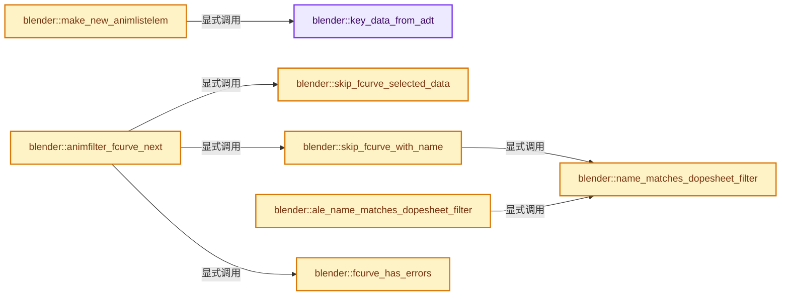
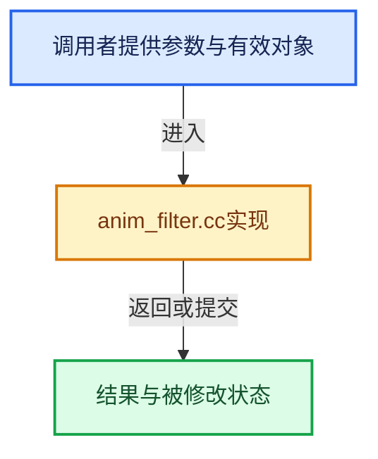

# 实现依赖专题：source/blender/editors/animation/anim_filter.cc

[实现依赖导航](../../../README.md) · [符号索引](../../../../00-课程指南/02-源码与提交索引/符号依赖与实现索引.md)

本专题从正文实际调用进入，集中保存共享实现。函数有稳定锚点，可从调用处直接跳到对应完整函数；递归与互相调用通过回链组织。

## 本文件的实现关系






<a id="m-25b55c199596"></a>

## 宏 `BEGIN_ANIMFILTER_SUBCHANNELS`

<!-- annotated:10c80d2fd6e0da -->

```cpp
#define BEGIN_ANIMFILTER_SUBCHANNELS(expanded_check) \
  { \
    const eAnimFilter_Flags _filter = filter_mode; \
    short _doSubChannels = 0; \
    if (!(filter_mode & ANIMFILTER_LIST_VISIBLE) || (expanded_check)) { \
      _doSubChannels = 1; \
    } \
    else if (!(filter_mode & ANIMFILTER_LIST_CHANNELS)) { \
      _doSubChannels = 2; \
    } \
    else { \
      filter_mode |= ANIMFILTER_TMP_PEEK; \
    } \
\
    { \
      (void)_doSubChannels; \
    }
/* ... standard sub-channel filtering can go on here now ... */
```

<details>
<summary>核对原始源码：source/blender/editors/animation/anim_filter.cc · L475—L492</summary>

<!-- original:10c80d2fd6e0da:source/blender/editors/animation/anim_filter.cc:475:492 -->

```cpp
#define BEGIN_ANIMFILTER_SUBCHANNELS(expanded_check) \
  { \
    const eAnimFilter_Flags _filter = filter_mode; \
    short _doSubChannels = 0; \
    if (!(filter_mode & ANIMFILTER_LIST_VISIBLE) || (expanded_check)) { \
      _doSubChannels = 1; \
    } \
    else if (!(filter_mode & ANIMFILTER_LIST_CHANNELS)) { \
      _doSubChannels = 2; \
    } \
    else { \
      filter_mode |= ANIMFILTER_TMP_PEEK; \
    } \
\
    { \
      (void)_doSubChannels; \
    }
/* ... standard sub-channel filtering can go on here now ... */
```

</details>

宏在预处理阶段展开，参数替换、重复求值和条件编译应直接从该定义检查。与普通函数不同，宏不会自动提供参数类型检查；构建配置选择哪个定义需结合外围条件。

<a id="m-a6bea7ba6059"></a>

## 宏 `ANIMDATA_FILTER_CASES`

<!-- annotated:c8db31533346cc -->

```cpp
#define ANIMDATA_FILTER_CASES( \
    id, adtOk, nlaOk, driversOk, nlaKeysOk, legacyActionOk, layeredActionOk) \
  { \
    if ((id)->adt) { \
      if (!(filter_mode & ANIMFILTER_CURVE_VISIBLE) || \
          !((id)->adt->flag & ADT_CURVES_NOT_VISIBLE)) \
      { \
        if (filter_mode & ANIMFILTER_ANIMDATA) { \
          adtOk \
        } \
        else if (ac->filters.flag & ADS_FILTER_ONLYNLA) { \
          if (ANIMDATA_HAS_NLA(id)) { \
            nlaOk \
          } \
          else if (!(ac->filters.flag & ADS_FILTER_NLA_NOACT) || ANIMDATA_HAS_ACTION(id)) { \
            nlaOk \
          } \
        } \
        else if (ac->filters.flag & ADS_FILTER_ONLYDRIVERS) { \
          if (ANIMDATA_HAS_DRIVERS(id)) { \
            driversOk \
          } \
        } \
        else { \
          if (ANIMDATA_HAS_NLA(id)) { \
            nlaKeysOk \
          } \
          if (ANIMDATA_HAS_ACTION(id)) { \
            layeredActionOk \
          } \
        } \
      } \
    } \
  } \
  (void)0

```

<details>
<summary>核对原始源码：source/blender/editors/animation/anim_filter.cc · L547—L582</summary>

<!-- original:c8db31533346cc:source/blender/editors/animation/anim_filter.cc:547:582 -->

```cpp
#define ANIMDATA_FILTER_CASES( \
    id, adtOk, nlaOk, driversOk, nlaKeysOk, legacyActionOk, layeredActionOk) \
  { \
    if ((id)->adt) { \
      if (!(filter_mode & ANIMFILTER_CURVE_VISIBLE) || \
          !((id)->adt->flag & ADT_CURVES_NOT_VISIBLE)) \
      { \
        if (filter_mode & ANIMFILTER_ANIMDATA) { \
          adtOk \
        } \
        else if (ac->filters.flag & ADS_FILTER_ONLYNLA) { \
          if (ANIMDATA_HAS_NLA(id)) { \
            nlaOk \
          } \
          else if (!(ac->filters.flag & ADS_FILTER_NLA_NOACT) || ANIMDATA_HAS_ACTION(id)) { \
            nlaOk \
          } \
        } \
        else if (ac->filters.flag & ADS_FILTER_ONLYDRIVERS) { \
          if (ANIMDATA_HAS_DRIVERS(id)) { \
            driversOk \
          } \
        } \
        else { \
          if (ANIMDATA_HAS_NLA(id)) { \
            nlaKeysOk \
          } \
          if (ANIMDATA_HAS_ACTION(id)) { \
            layeredActionOk \
          } \
        } \
      } \
    } \
  } \
  (void)0

```

</details>

宏在预处理阶段展开，参数替换、重复求值和条件编译应直接从该定义检查。与普通函数不同，宏不会自动提供参数类型检查；构建配置选择哪个定义需结合外围条件。

<a id="m-41639eaeaa82"></a>

## 宏 `ANIMCHANNEL_NEW_CHANNEL_FULL`

<!-- annotated:8d4467a8780e27 -->

```cpp
#define ANIMCHANNEL_NEW_CHANNEL_FULL( \
    bmain, channel_data, channel_type, owner_id, fcurve_owner_id, ale_statement) \
  if (filter_mode & ANIMFILTER_TMP_PEEK) { \
    return 1; \
  } \
  { \
    bAnimListElem *ale = make_new_animlistelem( \
        bmain, channel_data, channel_type, (ID *)owner_id, fcurve_owner_id); \
    if (ale) { \
      BLI_addtail(anim_data, ale); \
      items++; \
      ale_statement \
    } \
  } \
  (void)0

```

<details>
<summary>核对原始源码：source/blender/editors/animation/anim_filter.cc · L591—L606</summary>

<!-- original:8d4467a8780e27:source/blender/editors/animation/anim_filter.cc:591:606 -->

```cpp
#define ANIMCHANNEL_NEW_CHANNEL_FULL( \
    bmain, channel_data, channel_type, owner_id, fcurve_owner_id, ale_statement) \
  if (filter_mode & ANIMFILTER_TMP_PEEK) { \
    return 1; \
  } \
  { \
    bAnimListElem *ale = make_new_animlistelem( \
        bmain, channel_data, channel_type, (ID *)owner_id, fcurve_owner_id); \
    if (ale) { \
      BLI_addtail(anim_data, ale); \
      items++; \
      ale_statement \
    } \
  } \
  (void)0

```

</details>

宏在预处理阶段展开，参数替换、重复求值和条件编译应直接从该定义检查。与普通函数不同，宏不会自动提供参数类型检查；构建配置选择哪个定义需结合外围条件。

<a id="m-9e4067e8a469"></a>

## 宏 `ANIMCHANNEL_NEW_CHANNEL`

<!-- annotated:f003d144a333ad -->

```cpp
#define ANIMCHANNEL_NEW_CHANNEL(bmain, channel_data, channel_type, owner_id, fcurve_owner_id) \
  ANIMCHANNEL_NEW_CHANNEL_FULL(bmain, channel_data, channel_type, owner_id, fcurve_owner_id, {})

```

<details>
<summary>核对原始源码：source/blender/editors/animation/anim_filter.cc · L607—L609</summary>

<!-- original:f003d144a333ad:source/blender/editors/animation/anim_filter.cc:607:609 -->

```cpp
#define ANIMCHANNEL_NEW_CHANNEL(bmain, channel_data, channel_type, owner_id, fcurve_owner_id) \
  ANIMCHANNEL_NEW_CHANNEL_FULL(bmain, channel_data, channel_type, owner_id, fcurve_owner_id, {})

```

</details>

宏在预处理阶段展开，参数替换、重复求值和条件编译应直接从该定义检查。与普通函数不同，宏不会自动提供参数类型检查；构建配置选择哪个定义需结合外围条件。

<a id="m-37d29e4997db"></a>

## 宏 `ANIMCHANNEL_ACTIVEOK`

<!-- annotated:663e4fa04d2a6e -->

```cpp
#define ANIMCHANNEL_ACTIVEOK(ale) \
  (!(filter_mode & ANIMFILTER_ACTIVE) || !(ale->adt) || (ale->adt->flag & ADT_UI_ACTIVE))

```

<details>
<summary>核对原始源码：source/blender/editors/animation/anim_filter.cc · L613—L615</summary>

<!-- original:663e4fa04d2a6e:source/blender/editors/animation/anim_filter.cc:613:615 -->

```cpp
#define ANIMCHANNEL_ACTIVEOK(ale) \
  (!(filter_mode & ANIMFILTER_ACTIVE) || !(ale->adt) || (ale->adt->flag & ADT_UI_ACTIVE))

```

</details>

宏在预处理阶段展开，参数替换、重复求值和条件编译应直接从该定义检查。与普通函数不同，宏不会自动提供参数类型检查；构建配置选择哪个定义需结合外围条件。

<a id="m-731c814ee507"></a>

## 宏 `ANIMCHANNEL_SELOK`

<!-- annotated:fac0fa54c896a7 -->

```cpp
#define ANIMCHANNEL_SELOK(test_func) \
  (!(filter_mode & (ANIMFILTER_SEL | ANIMFILTER_UNSEL)) || \
   ((filter_mode & ANIMFILTER_SEL) && test_func) || \
   ((filter_mode & ANIMFILTER_UNSEL) && test_func == 0))

```

<details>
<summary>核对原始源码：source/blender/editors/animation/anim_filter.cc · L618—L622</summary>

<!-- original:fac0fa54c896a7:source/blender/editors/animation/anim_filter.cc:618:622 -->

```cpp
#define ANIMCHANNEL_SELOK(test_func) \
  (!(filter_mode & (ANIMFILTER_SEL | ANIMFILTER_UNSEL)) || \
   ((filter_mode & ANIMFILTER_SEL) && test_func) || \
   ((filter_mode & ANIMFILTER_UNSEL) && test_func == 0))

```

</details>

宏在预处理阶段展开，参数替换、重复求值和条件编译应直接从该定义检查。与普通函数不同，宏不会自动提供参数类型检查；构建配置选择哪个定义需结合外围条件。

<a id="m-74f3cc63d4c5"></a>

## 宏 `ANIMCHANNEL_SELEDITOK`

<!-- annotated:04bf2be63e6dba -->

```cpp
#define ANIMCHANNEL_SELEDITOK(test_func) \
  (!(filter_mode & ANIMFILTER_SELEDIT) || !(filter_mode & ANIMFILTER_FOREDIT) || (test_func))

```

<details>
<summary>核对原始源码：source/blender/editors/animation/anim_filter.cc · L632—L634</summary>

<!-- original:04bf2be63e6dba:source/blender/editors/animation/anim_filter.cc:632:634 -->

```cpp
#define ANIMCHANNEL_SELEDITOK(test_func) \
  (!(filter_mode & ANIMFILTER_SELEDIT) || !(filter_mode & ANIMFILTER_FOREDIT) || (test_func))

```

</details>

宏在预处理阶段展开，参数替换、重复求值和条件编译应直接从该定义检查。与普通函数不同，宏不会自动提供参数类型检查；构建配置选择哪个定义需结合外围条件。

## 完整成员与函数实现

<a id="f-681026d39e8bebe4"></a>

### `blender::key_data_from_adt`

实现位置：[source/blender/editors/animation/anim_filter.cc](../../../../../../../../source/blender/editors/animation/anim_filter.cc) · L641—L654。

接口参数：

- `bAnimListElem &ale`
- `AnimData *adt`

**教学注释版**

<!-- annotated:8d0641d7fe90a2 -->

```cpp
static void key_data_from_adt(bAnimListElem &ale, AnimData *adt)
{
  ale.adt = adt;

  if (!adt || !adt->action) {
    ale.key_data = nullptr;
    ale.datatype = ALE_NONE;
    return;
  }

  animrig::Action &action = adt->action->wrap();
  ale.key_data = &action;
  ale.datatype = ALE_ACTION_LAYERED;
}
```

<details>
<summary>核对原始源码：source/blender/editors/animation/anim_filter.cc · L641—L654</summary>

<!-- original:8d0641d7fe90a2:source/blender/editors/animation/anim_filter.cc:641:654 -->

```cpp
static void key_data_from_adt(bAnimListElem &ale, AnimData *adt)
{
  ale.adt = adt;

  if (!adt || !adt->action) {
    ale.key_data = nullptr;
    ale.datatype = ALE_NONE;
    return;
  }

  animrig::Action &action = adt->action->wrap();
  ale.key_data = &action;
  ale.datatype = ALE_ACTION_LAYERED;
}
```

</details>

**沿实际写入检查状态**

- `ale.adt = adt;`
- `ale.key_data = nullptr;`
- `ale.datatype = ALE_NONE;`
- `ale.key_data = &action;`
- `ale.datatype = ALE_ACTION_LAYERED;`

**继续追踪实现**

- `adt->action->wrap` → [调用协议](../../../../00-课程指南/01-路线与规范/模板宏与动态分派协议.md)：接收对象类型依赖auto、返回值或模板实例；不按同名猜测目标。调用位置L651。

<a id="f-73be8b48873a9de4"></a>

### `blender::make_new_animlistelem`

实现位置：[source/blender/editors/animation/anim_filter.cc](../../../../../../../../source/blender/editors/animation/anim_filter.cc) · L659—L1004。

接口参数：

- `Main *bmain`
- `void *data`
- `const eAnim_ChannelType datatype`
- `ID *owner_id`
- `ID *fcurve_owner_id`

**教学注释版**

<!-- annotated:bca091d29f251d -->

```cpp
static bAnimListElem *make_new_animlistelem(
    Main *bmain, void *data, const eAnim_ChannelType datatype, ID *owner_id, ID *fcurve_owner_id)
{
  /* Only allocate memory if there is data to convert. */
  if (!data) {
    return nullptr;
  }

  /* Allocate and set generic data. */
  bAnimListElem *ale = MEM_new_zeroed<bAnimListElem>("bAnimListElem");

  ale->data = data;
  ale->type = datatype;

  ale->bmain = bmain;
  ale->id = owner_id;
  ale->adt = BKE_animdata_from_id(owner_id);
  ale->fcurve_owner_id = fcurve_owner_id;

  /* do specifics */
  switch (datatype) {
    case ANIMTYPE_SUMMARY: {
      /* Nothing to include for now... this is just a dummy wrapper around
       * all the other channels in the DopeSheet, and gets included at the start of the list. */
      ale->key_data = nullptr;
      ale->datatype = ALE_ALL;
      break;
    }
    case ANIMTYPE_SCENE: {
      Scene *sce = static_cast<Scene *>(data);

      ale->flag = sce->flag;

      ale->key_data = sce;
      ale->datatype = ALE_SCE;

      ale->adt = BKE_animdata_from_id(static_cast<ID *>(data));
      break;
    }
    case ANIMTYPE_OBJECT: {
      Base *base = static_cast<Base *>(data);
      Object *ob = base->object;

      ale->flag = ob->flag;

      ale->key_data = ob;
      ale->datatype = ALE_OB;

      ale->adt = BKE_animdata_from_id(&ob->id);
      break;
    }
    case ANIMTYPE_FILLACT_LAYERED: {
      bAction *action = static_cast<bAction *>(data);

      ale->flag = action->flag;

      ale->key_data = action;
      ale->datatype = ALE_ACTION_LAYERED;
      break;
    }
    case ANIMTYPE_ACTION_SLOT: {
      animrig::Slot *slot = static_cast<animrig::Slot *>(data);
      ale->flag = slot->slot_flags;

      BLI_assert_msg(GS(fcurve_owner_id->name) == ID_AC, "fcurve_owner_id should be an Action");
      /* ale->data = the slot itself, key_data = the Action. */
      ale->key_data = fcurve_owner_id;
      ale->datatype = ALE_ACTION_SLOT;
      break;
    }
    case ANIMTYPE_FILLACTD: {
      bAction *act = static_cast<bAction *>(data);

      ale->flag = act->flag;

      ale->key_data = act;
      ale->datatype = ALE_ACT;
      break;
    }
    case ANIMTYPE_FILLDRIVERS: {
      AnimData *adt = static_cast<AnimData *>(data);

      ale->flag = adt->flag;

      /* XXX drivers don't show summary for now. */
      ale->key_data = nullptr;
      ale->datatype = ALE_NONE;
      break;
    }
    case ANIMTYPE_DSMAT: {
      Material *ma = static_cast<Material *>(data);
      ale->flag = FILTER_MAT_OBJD(ma);
      key_data_from_adt(*ale, ma->adt);
      break;
    }
    case ANIMTYPE_DSLAM: {
      Light *la = static_cast<Light *>(data);
      ale->flag = FILTER_LAM_OBJD(la);
      key_data_from_adt(*ale, la->adt);
      break;
    }
    case ANIMTYPE_DSCAM: {
      Camera *ca = static_cast<Camera *>(data);
      ale->flag = FILTER_CAM_OBJD(ca);
      key_data_from_adt(*ale, ca->adt);
      break;
    }
    case ANIMTYPE_DSCACHEFILE: {
      CacheFile *cache_file = static_cast<CacheFile *>(data);
      ale->flag = FILTER_CACHEFILE_OBJD(cache_file);
      key_data_from_adt(*ale, cache_file->adt);
      break;
    }
    case ANIMTYPE_DSCUR: {
      Curve *cu = static_cast<Curve *>(data);
      ale->flag = FILTER_CUR_OBJD(cu);
      key_data_from_adt(*ale, cu->adt);
      break;
    }
    case ANIMTYPE_DSARM: {
      bArmature *arm = static_cast<bArmature *>(data);
      ale->flag = FILTER_ARM_OBJD(arm);
      key_data_from_adt(*ale, arm->adt);
      break;
    }
    case ANIMTYPE_DSMESH: {
      Mesh *mesh = static_cast<Mesh *>(data);
      ale->flag = FILTER_MESH_OBJD(mesh);
      key_data_from_adt(*ale, mesh->adt);
      break;
    }
    case ANIMTYPE_DSLAT: {
      Lattice *lt = static_cast<Lattice *>(data);
      ale->flag = FILTER_LATTICE_OBJD(lt);
      key_data_from_adt(*ale, lt->adt);
      break;
    }
    case ANIMTYPE_DSSPK: {
      Speaker *spk = static_cast<Speaker *>(data);
      ale->flag = FILTER_SPK_OBJD(spk);
      key_data_from_adt(*ale, spk->adt);
      break;
    }
    case ANIMTYPE_DSHAIR: {
      Curves *curves = static_cast<Curves *>(data);
      ale->flag = FILTER_CURVES_OBJD(curves);
      key_data_from_adt(*ale, curves->adt);
      break;
    }
    case ANIMTYPE_DSPOINTCLOUD: {
      PointCloud *pointcloud = static_cast<PointCloud *>(data);
      ale->flag = FILTER_POINTS_OBJD(pointcloud);
      key_data_from_adt(*ale, pointcloud->adt);
      break;
    }
    case ANIMTYPE_DSVOLUME: {
      Volume *volume = static_cast<Volume *>(data);
      ale->flag = FILTER_VOLUME_OBJD(volume);
      key_data_from_adt(*ale, volume->adt);
      break;
    }
    case ANIMTYPE_DSLIGHTPROBE: {
      LightProbe *probe = static_cast<LightProbe *>(data);
      ale->flag = FILTER_LIGHTPROBE_OBJD(probe);
      key_data_from_adt(*ale, probe->adt);
      break;
    }
    case ANIMTYPE_DSSKEY: {
      Key *key = static_cast<Key *>(data);
      ale->flag = FILTER_SKE_OBJD(key);
      key_data_from_adt(*ale, key->adt);
      break;
    }
    case ANIMTYPE_DSWOR: {
      World *wo = static_cast<World *>(data);
      ale->flag = FILTER_WOR_SCED(wo);
      key_data_from_adt(*ale, wo->adt);
      break;
    }
    case ANIMTYPE_DSNTREE: {
      bNodeTree *ntree = static_cast<bNodeTree *>(data);
      ale->flag = FILTER_NTREE_DATA(ntree);
      key_data_from_adt(*ale, ntree->adt);
      break;
    }
    case ANIMTYPE_DSLINESTYLE: {
      FreestyleLineStyle *linestyle = static_cast<FreestyleLineStyle *>(data);
      ale->flag = FILTER_LS_SCED(linestyle);
      key_data_from_adt(*ale, linestyle->adt);
      break;
    }
    case ANIMTYPE_DSPART: {
      ParticleSettings *part = static_cast<ParticleSettings *>(ale->data);
      ale->flag = FILTER_PART_OBJD(part);
      key_data_from_adt(*ale, part->adt);
      break;
    }
    case ANIMTYPE_DSTEX: {
      Tex *tex = static_cast<Tex *>(data);
      ale->flag = FILTER_TEX_DATA(tex);
      key_data_from_adt(*ale, tex->adt);
      break;
    }
    case ANIMTYPE_DSGPENCIL: {
      bGPdata *gpd = static_cast<bGPdata *>(data);
      /* NOTE: we just reuse the same expand filter for this case */
      ale->flag = EXPANDED_GPD(gpd);

      /* XXX: currently, this is only used for access to its animation data */
      key_data_from_adt(*ale, gpd->adt);
      break;
    }
    case ANIMTYPE_DSMCLIP: {
      MovieClip *clip = static_cast<MovieClip *>(data);
      ale->flag = EXPANDED_MCLIP(clip);
      key_data_from_adt(*ale, clip->adt);
      break;
    }
    case ANIMTYPE_NLACONTROLS: {
      AnimData *adt = static_cast<AnimData *>(data);

      ale->flag = adt->flag;

      ale->key_data = nullptr;
      ale->datatype = ALE_NONE;
      break;
    }
    case ANIMTYPE_GROUP: {
      BLI_assert_msg(GS(fcurve_owner_id->name) == ID_AC, "fcurve_owner_id should be an Action");

      bActionGroup *agrp = static_cast<bActionGroup *>(data);

      ale->flag = agrp->flag;

      ale->key_data = nullptr;
      ale->datatype = ALE_GROUP;
      break;
    }
    case ANIMTYPE_FCURVE:
    case ANIMTYPE_NLACURVE: /* practically the same as ANIMTYPE_FCURVE.
                             * Differences are applied post-creation */
    {
      FCurve *fcu = static_cast<FCurve *>(data);

      ale->flag = fcu->flag;

      ale->key_data = fcu;
      ale->datatype = ALE_FCURVE;
      break;
    }
    case ANIMTYPE_SHAPEKEY: {
      KeyBlock *kb = static_cast<KeyBlock *>(data);
      Key *key = reinterpret_cast<Key *>(ale->id);

      ale->flag = kb->flag;

      /* whether we have keyframes depends on whether there is a Key block to find it from */
      if (key) {
        /* index of shapekey is defined by place in key's list */
        ale->index = BLI_findindex(&key->block, kb);

        /* the corresponding keyframes are from the animdata */
        if (ale->adt && ale->adt->action) {
          /* Try to find the F-Curve which corresponds to this exactly. */
          if (std::optional<std::string> rna_path = BKE_keyblock_curval_rnapath_get(key, kb)) {
            ale->key_data = static_cast<void *>(
                animrig::fcurve_find_in_assigned_slot(*ale->adt, {*rna_path, 0}));
          }
        }
        ale->datatype = (ale->key_data) ? ALE_FCURVE : ALE_NONE;
      }
      break;
    }
    case ANIMTYPE_GPLAYER: {
      bGPDlayer *gpl = static_cast<bGPDlayer *>(data);

      ale->flag = gpl->flag;

      ale->key_data = nullptr;
      ale->datatype = ALE_GPFRAME;
      break;
    }
    case ANIMTYPE_GREASE_PENCIL_LAYER: {
      GreasePencilLayer *layer = static_cast<GreasePencilLayer *>(data);

      ale->flag = layer->base.flag;

      ale->key_data = nullptr;
      ale->datatype = ALE_GREASE_PENCIL_CEL;
      break;
    }
    case ANIMTYPE_GREASE_PENCIL_LAYER_GROUP: {
      GreasePencilLayerTreeGroup *layer_group = static_cast<GreasePencilLayerTreeGroup *>(data);

      ale->flag = layer_group->base.flag;

      ale->key_data = nullptr;
      ale->datatype = ALE_GREASE_PENCIL_GROUP;
      break;
    }
    case ANIMTYPE_GREASE_PENCIL_DATABLOCK: {
      GreasePencil *grease_pencil = static_cast<GreasePencil *>(data);

      ale->flag = grease_pencil->flag;

      ale->key_data = nullptr;
      ale->datatype = ALE_GREASE_PENCIL_DATA;
      break;
    }
    case ANIMTYPE_MASKLAYER: {
      MaskLayer *masklay = static_cast<MaskLayer *>(data);

      ale->flag = masklay->flag;

      ale->key_data = nullptr;
      ale->datatype = ALE_MASKLAY;
      break;
    }
    case ANIMTYPE_NLATRACK: {
      NlaTrack *nlt = static_cast<NlaTrack *>(data);

      ale->flag = nlt->flag;

      ale->key_data = &nlt->strips;
      ale->datatype = ALE_NLASTRIP;
      break;
    }
    case ANIMTYPE_NLAACTION: {
      /* nothing to include for now... nothing editable from NLA-perspective here */
      ale->key_data = nullptr;
      ale->datatype = ALE_NONE;
      break;
    }

    case ANIMTYPE_NONE:
    case ANIMTYPE_ANIMDATA:
    case ANIMTYPE_SPECIALDATA__UNUSED:
    case ANIMTYPE_DSMBALL:
    case ANIMTYPE_MASKDATABLOCK:
    case ANIMTYPE_PALETTE:
    case ANIMTYPE_NUM_TYPES:
      break;
  }

  return ale;
}
```

<details>
<summary>核对原始源码：source/blender/editors/animation/anim_filter.cc · L659—L1004</summary>

<!-- original:bca091d29f251d:source/blender/editors/animation/anim_filter.cc:659:1004 -->

```cpp
static bAnimListElem *make_new_animlistelem(
    Main *bmain, void *data, const eAnim_ChannelType datatype, ID *owner_id, ID *fcurve_owner_id)
{
  /* Only allocate memory if there is data to convert. */
  if (!data) {
    return nullptr;
  }

  /* Allocate and set generic data. */
  bAnimListElem *ale = MEM_new_zeroed<bAnimListElem>("bAnimListElem");

  ale->data = data;
  ale->type = datatype;

  ale->bmain = bmain;
  ale->id = owner_id;
  ale->adt = BKE_animdata_from_id(owner_id);
  ale->fcurve_owner_id = fcurve_owner_id;

  /* do specifics */
  switch (datatype) {
    case ANIMTYPE_SUMMARY: {
      /* Nothing to include for now... this is just a dummy wrapper around
       * all the other channels in the DopeSheet, and gets included at the start of the list. */
      ale->key_data = nullptr;
      ale->datatype = ALE_ALL;
      break;
    }
    case ANIMTYPE_SCENE: {
      Scene *sce = static_cast<Scene *>(data);

      ale->flag = sce->flag;

      ale->key_data = sce;
      ale->datatype = ALE_SCE;

      ale->adt = BKE_animdata_from_id(static_cast<ID *>(data));
      break;
    }
    case ANIMTYPE_OBJECT: {
      Base *base = static_cast<Base *>(data);
      Object *ob = base->object;

      ale->flag = ob->flag;

      ale->key_data = ob;
      ale->datatype = ALE_OB;

      ale->adt = BKE_animdata_from_id(&ob->id);
      break;
    }
    case ANIMTYPE_FILLACT_LAYERED: {
      bAction *action = static_cast<bAction *>(data);

      ale->flag = action->flag;

      ale->key_data = action;
      ale->datatype = ALE_ACTION_LAYERED;
      break;
    }
    case ANIMTYPE_ACTION_SLOT: {
      animrig::Slot *slot = static_cast<animrig::Slot *>(data);
      ale->flag = slot->slot_flags;

      BLI_assert_msg(GS(fcurve_owner_id->name) == ID_AC, "fcurve_owner_id should be an Action");
      /* ale->data = the slot itself, key_data = the Action. */
      ale->key_data = fcurve_owner_id;
      ale->datatype = ALE_ACTION_SLOT;
      break;
    }
    case ANIMTYPE_FILLACTD: {
      bAction *act = static_cast<bAction *>(data);

      ale->flag = act->flag;

      ale->key_data = act;
      ale->datatype = ALE_ACT;
      break;
    }
    case ANIMTYPE_FILLDRIVERS: {
      AnimData *adt = static_cast<AnimData *>(data);

      ale->flag = adt->flag;

      /* XXX drivers don't show summary for now. */
      ale->key_data = nullptr;
      ale->datatype = ALE_NONE;
      break;
    }
    case ANIMTYPE_DSMAT: {
      Material *ma = static_cast<Material *>(data);
      ale->flag = FILTER_MAT_OBJD(ma);
      key_data_from_adt(*ale, ma->adt);
      break;
    }
    case ANIMTYPE_DSLAM: {
      Light *la = static_cast<Light *>(data);
      ale->flag = FILTER_LAM_OBJD(la);
      key_data_from_adt(*ale, la->adt);
      break;
    }
    case ANIMTYPE_DSCAM: {
      Camera *ca = static_cast<Camera *>(data);
      ale->flag = FILTER_CAM_OBJD(ca);
      key_data_from_adt(*ale, ca->adt);
      break;
    }
    case ANIMTYPE_DSCACHEFILE: {
      CacheFile *cache_file = static_cast<CacheFile *>(data);
      ale->flag = FILTER_CACHEFILE_OBJD(cache_file);
      key_data_from_adt(*ale, cache_file->adt);
      break;
    }
    case ANIMTYPE_DSCUR: {
      Curve *cu = static_cast<Curve *>(data);
      ale->flag = FILTER_CUR_OBJD(cu);
      key_data_from_adt(*ale, cu->adt);
      break;
    }
    case ANIMTYPE_DSARM: {
      bArmature *arm = static_cast<bArmature *>(data);
      ale->flag = FILTER_ARM_OBJD(arm);
      key_data_from_adt(*ale, arm->adt);
      break;
    }
    case ANIMTYPE_DSMESH: {
      Mesh *mesh = static_cast<Mesh *>(data);
      ale->flag = FILTER_MESH_OBJD(mesh);
      key_data_from_adt(*ale, mesh->adt);
      break;
    }
    case ANIMTYPE_DSLAT: {
      Lattice *lt = static_cast<Lattice *>(data);
      ale->flag = FILTER_LATTICE_OBJD(lt);
      key_data_from_adt(*ale, lt->adt);
      break;
    }
    case ANIMTYPE_DSSPK: {
      Speaker *spk = static_cast<Speaker *>(data);
      ale->flag = FILTER_SPK_OBJD(spk);
      key_data_from_adt(*ale, spk->adt);
      break;
    }
    case ANIMTYPE_DSHAIR: {
      Curves *curves = static_cast<Curves *>(data);
      ale->flag = FILTER_CURVES_OBJD(curves);
      key_data_from_adt(*ale, curves->adt);
      break;
    }
    case ANIMTYPE_DSPOINTCLOUD: {
      PointCloud *pointcloud = static_cast<PointCloud *>(data);
      ale->flag = FILTER_POINTS_OBJD(pointcloud);
      key_data_from_adt(*ale, pointcloud->adt);
      break;
    }
    case ANIMTYPE_DSVOLUME: {
      Volume *volume = static_cast<Volume *>(data);
      ale->flag = FILTER_VOLUME_OBJD(volume);
      key_data_from_adt(*ale, volume->adt);
      break;
    }
    case ANIMTYPE_DSLIGHTPROBE: {
      LightProbe *probe = static_cast<LightProbe *>(data);
      ale->flag = FILTER_LIGHTPROBE_OBJD(probe);
      key_data_from_adt(*ale, probe->adt);
      break;
    }
    case ANIMTYPE_DSSKEY: {
      Key *key = static_cast<Key *>(data);
      ale->flag = FILTER_SKE_OBJD(key);
      key_data_from_adt(*ale, key->adt);
      break;
    }
    case ANIMTYPE_DSWOR: {
      World *wo = static_cast<World *>(data);
      ale->flag = FILTER_WOR_SCED(wo);
      key_data_from_adt(*ale, wo->adt);
      break;
    }
    case ANIMTYPE_DSNTREE: {
      bNodeTree *ntree = static_cast<bNodeTree *>(data);
      ale->flag = FILTER_NTREE_DATA(ntree);
      key_data_from_adt(*ale, ntree->adt);
      break;
    }
    case ANIMTYPE_DSLINESTYLE: {
      FreestyleLineStyle *linestyle = static_cast<FreestyleLineStyle *>(data);
      ale->flag = FILTER_LS_SCED(linestyle);
      key_data_from_adt(*ale, linestyle->adt);
      break;
    }
    case ANIMTYPE_DSPART: {
      ParticleSettings *part = static_cast<ParticleSettings *>(ale->data);
      ale->flag = FILTER_PART_OBJD(part);
      key_data_from_adt(*ale, part->adt);
      break;
    }
    case ANIMTYPE_DSTEX: {
      Tex *tex = static_cast<Tex *>(data);
      ale->flag = FILTER_TEX_DATA(tex);
      key_data_from_adt(*ale, tex->adt);
      break;
    }
    case ANIMTYPE_DSGPENCIL: {
      bGPdata *gpd = static_cast<bGPdata *>(data);
      /* NOTE: we just reuse the same expand filter for this case */
      ale->flag = EXPANDED_GPD(gpd);

      /* XXX: currently, this is only used for access to its animation data */
      key_data_from_adt(*ale, gpd->adt);
      break;
    }
    case ANIMTYPE_DSMCLIP: {
      MovieClip *clip = static_cast<MovieClip *>(data);
      ale->flag = EXPANDED_MCLIP(clip);
      key_data_from_adt(*ale, clip->adt);
      break;
    }
    case ANIMTYPE_NLACONTROLS: {
      AnimData *adt = static_cast<AnimData *>(data);

      ale->flag = adt->flag;

      ale->key_data = nullptr;
      ale->datatype = ALE_NONE;
      break;
    }
    case ANIMTYPE_GROUP: {
      BLI_assert_msg(GS(fcurve_owner_id->name) == ID_AC, "fcurve_owner_id should be an Action");

      bActionGroup *agrp = static_cast<bActionGroup *>(data);

      ale->flag = agrp->flag;

      ale->key_data = nullptr;
      ale->datatype = ALE_GROUP;
      break;
    }
    case ANIMTYPE_FCURVE:
    case ANIMTYPE_NLACURVE: /* practically the same as ANIMTYPE_FCURVE.
                             * Differences are applied post-creation */
    {
      FCurve *fcu = static_cast<FCurve *>(data);

      ale->flag = fcu->flag;

      ale->key_data = fcu;
      ale->datatype = ALE_FCURVE;
      break;
    }
    case ANIMTYPE_SHAPEKEY: {
      KeyBlock *kb = static_cast<KeyBlock *>(data);
      Key *key = reinterpret_cast<Key *>(ale->id);

      ale->flag = kb->flag;

      /* whether we have keyframes depends on whether there is a Key block to find it from */
      if (key) {
        /* index of shapekey is defined by place in key's list */
        ale->index = BLI_findindex(&key->block, kb);

        /* the corresponding keyframes are from the animdata */
        if (ale->adt && ale->adt->action) {
          /* Try to find the F-Curve which corresponds to this exactly. */
          if (std::optional<std::string> rna_path = BKE_keyblock_curval_rnapath_get(key, kb)) {
            ale->key_data = static_cast<void *>(
                animrig::fcurve_find_in_assigned_slot(*ale->adt, {*rna_path, 0}));
          }
        }
        ale->datatype = (ale->key_data) ? ALE_FCURVE : ALE_NONE;
      }
      break;
    }
    case ANIMTYPE_GPLAYER: {
      bGPDlayer *gpl = static_cast<bGPDlayer *>(data);

      ale->flag = gpl->flag;

      ale->key_data = nullptr;
      ale->datatype = ALE_GPFRAME;
      break;
    }
    case ANIMTYPE_GREASE_PENCIL_LAYER: {
      GreasePencilLayer *layer = static_cast<GreasePencilLayer *>(data);

      ale->flag = layer->base.flag;

      ale->key_data = nullptr;
      ale->datatype = ALE_GREASE_PENCIL_CEL;
      break;
    }
    case ANIMTYPE_GREASE_PENCIL_LAYER_GROUP: {
      GreasePencilLayerTreeGroup *layer_group = static_cast<GreasePencilLayerTreeGroup *>(data);

      ale->flag = layer_group->base.flag;

      ale->key_data = nullptr;
      ale->datatype = ALE_GREASE_PENCIL_GROUP;
      break;
    }
    case ANIMTYPE_GREASE_PENCIL_DATABLOCK: {
      GreasePencil *grease_pencil = static_cast<GreasePencil *>(data);

      ale->flag = grease_pencil->flag;

      ale->key_data = nullptr;
      ale->datatype = ALE_GREASE_PENCIL_DATA;
      break;
    }
    case ANIMTYPE_MASKLAYER: {
      MaskLayer *masklay = static_cast<MaskLayer *>(data);

      ale->flag = masklay->flag;

      ale->key_data = nullptr;
      ale->datatype = ALE_MASKLAY;
      break;
    }
    case ANIMTYPE_NLATRACK: {
      NlaTrack *nlt = static_cast<NlaTrack *>(data);

      ale->flag = nlt->flag;

      ale->key_data = &nlt->strips;
      ale->datatype = ALE_NLASTRIP;
      break;
    }
    case ANIMTYPE_NLAACTION: {
      /* nothing to include for now... nothing editable from NLA-perspective here */
      ale->key_data = nullptr;
      ale->datatype = ALE_NONE;
      break;
    }

    case ANIMTYPE_NONE:
    case ANIMTYPE_ANIMDATA:
    case ANIMTYPE_SPECIALDATA__UNUSED:
    case ANIMTYPE_DSMBALL:
    case ANIMTYPE_MASKDATABLOCK:
    case ANIMTYPE_PALETTE:
    case ANIMTYPE_NUM_TYPES:
      break;
  }

  return ale;
}
```

</details>

**沿实际写入检查状态**

- `ale->data = data;`
- `ale->type = datatype;`
- `ale->bmain = bmain;`
- `ale->id = owner_id;`
- `ale->adt = BKE_animdata_from_id(owner_id);`
- `ale->fcurve_owner_id = fcurve_owner_id;`
- `ale->key_data = nullptr;`
- `ale->datatype = ALE_ALL;`
- `ale->flag = sce->flag;`
- `ale->key_data = sce;`
- `ale->datatype = ALE_SCE;`
- `ale->adt = BKE_animdata_from_id(static_cast<ID *>(data));`
- `ale->flag = ob->flag;`
- `ale->key_data = ob;`
- `ale->datatype = ALE_OB;`
- `ale->adt = BKE_animdata_from_id(&ob->id);`
- `ale->flag = action->flag;`
- `ale->key_data = action;`
- `ale->datatype = ALE_ACTION_LAYERED;`
- `ale->flag = slot->slot_flags;`
- `ale->key_data = fcurve_owner_id;`
- `ale->datatype = ALE_ACTION_SLOT;`
- `ale->flag = act->flag;`
- `ale->key_data = act;`
- `ale->datatype = ALE_ACT;`
- `ale->flag = adt->flag;`
- `ale->datatype = ALE_NONE;`
- `ale->flag = FILTER_MAT_OBJD(ma);`
- `ale->flag = FILTER_LAM_OBJD(la);`
- `ale->flag = FILTER_CAM_OBJD(ca);`
- `ale->flag = FILTER_CACHEFILE_OBJD(cache_file);`
- `ale->flag = FILTER_CUR_OBJD(cu);`
- `ale->flag = FILTER_ARM_OBJD(arm);`
- `ale->flag = FILTER_MESH_OBJD(mesh);`
- `ale->flag = FILTER_LATTICE_OBJD(lt);`
- `ale->flag = FILTER_SPK_OBJD(spk);`
- `ale->flag = FILTER_CURVES_OBJD(curves);`
- `ale->flag = FILTER_POINTS_OBJD(pointcloud);`
- `ale->flag = FILTER_VOLUME_OBJD(volume);`
- `ale->flag = FILTER_LIGHTPROBE_OBJD(probe);`
- `ale->flag = FILTER_SKE_OBJD(key);`
- `ale->flag = FILTER_WOR_SCED(wo);`
- `ale->flag = FILTER_NTREE_DATA(ntree);`
- `ale->flag = FILTER_LS_SCED(linestyle);`
- `ale->flag = FILTER_PART_OBJD(part);`
- `ale->flag = FILTER_TEX_DATA(tex);`
- `ale->flag = EXPANDED_GPD(gpd);`
- `ale->flag = EXPANDED_MCLIP(clip);`
- `ale->flag = agrp->flag;`
- `ale->datatype = ALE_GROUP;`
- `ale->flag = fcu->flag;`
- `ale->key_data = fcu;`
- `ale->datatype = ALE_FCURVE;`
- `ale->flag = kb->flag;`
- `ale->index = BLI_findindex(&key->block, kb);`
- `ale->key_data = static_cast<void *>(`
- `ale->datatype = (ale->key_data) ? ALE_FCURVE : ALE_NONE;`
- `ale->flag = gpl->flag;`
- `ale->datatype = ALE_GPFRAME;`
- `ale->flag = layer->base.flag;`
- `ale->datatype = ALE_GREASE_PENCIL_CEL;`
- `ale->flag = layer_group->base.flag;`
- `ale->datatype = ALE_GREASE_PENCIL_GROUP;`
- `ale->flag = grease_pencil->flag;`
- `ale->datatype = ALE_GREASE_PENCIL_DATA;`
- `ale->flag = masklay->flag;`
- `ale->datatype = ALE_MASKLAY;`
- `ale->flag = nlt->flag;`
- `ale->key_data = &nlt->strips;`
- `ale->datatype = ALE_NLASTRIP;`

**结果出口**

- `return nullptr;`
- `return ale;`

**继续追踪实现**

- `MEM_new_zeroed<bAnimListElem>` → [MEM_new_zeroed · L550](../../../07-Intern运行时与平台/guardedalloc/MEM_guardedalloc.h.md#f-eeb1e2a7f57dd231)；[MEM_new_zeroed · L114](../../../07-Intern运行时与平台/guardedalloc/intern/mallocn.cc.md#f-e04cf01c64c8b180)。同名重载需按实参类型选择。
- `BKE_animdata_from_id` → [blender::BKE_animdata_from_id · L93](../../../02-BKE几何与数据/intern/anim_data.cc.md#f-354e5421ff0a6c96)。
- `BLI_assert_msg` → [BLI_assert_msg · L55](../../../01-BLI基础库/BLI_assert.hh.md#m-695eed20dceb)；[BLI_assert_msg · L64](../../../01-BLI基础库/BLI_assert.hh.md#m-7de5563de4db)。宏定义由构建条件选择。
- `GS` → [blender::GS · L410](../../makesdna/DNA_ID.h.md#f-c3ff509f79f21b05)。
- `FILTER_MAT_OBJD` → [FILTER_MAT_OBJD · L471](../include/ED_anim_api.hh.md#m-a9e70ea92413)。宏定义由构建条件选择。
- `key_data_from_adt` → [blender::key_data_from_adt · L641](anim_filter.cc.md#f-681026d39e8bebe4)。
- `FILTER_LAM_OBJD` → [FILTER_LAM_OBJD · L472](../include/ED_anim_api.hh.md#m-97c4e501d69b)。宏定义由构建条件选择。
- `FILTER_CAM_OBJD` → [FILTER_CAM_OBJD · L473](../include/ED_anim_api.hh.md#m-d38568f272e8)。宏定义由构建条件选择。
- `FILTER_CACHEFILE_OBJD` → [FILTER_CACHEFILE_OBJD · L474](../include/ED_anim_api.hh.md#m-a9f3e5988694)。宏定义由构建条件选择。
- `FILTER_CUR_OBJD` → [FILTER_CUR_OBJD · L476](../include/ED_anim_api.hh.md#m-029023ad4cd2)。宏定义由构建条件选择。
- `FILTER_ARM_OBJD` → [FILTER_ARM_OBJD · L480](../include/ED_anim_api.hh.md#m-c76eddcf2f99)。宏定义由构建条件选择。
- `FILTER_MESH_OBJD` → [FILTER_MESH_OBJD · L481](../include/ED_anim_api.hh.md#m-5d6df7cda258)。宏定义由构建条件选择。
- `FILTER_LATTICE_OBJD` → [FILTER_LATTICE_OBJD · L482](../include/ED_anim_api.hh.md#m-eaba10c43f82)。宏定义由构建条件选择。
- `FILTER_SPK_OBJD` → [FILTER_SPK_OBJD · L483](../include/ED_anim_api.hh.md#m-358aad130efd)。宏定义由构建条件选择。
- `FILTER_CURVES_OBJD` → [FILTER_CURVES_OBJD · L484](../include/ED_anim_api.hh.md#m-b078a8ea3ad8)。宏定义由构建条件选择。
- `FILTER_POINTS_OBJD` → [FILTER_POINTS_OBJD · L485](../include/ED_anim_api.hh.md#m-c05c4e7f1454)。宏定义由构建条件选择。
- `FILTER_VOLUME_OBJD` → [FILTER_VOLUME_OBJD · L486](../include/ED_anim_api.hh.md#m-8e03e7dd45fd)。宏定义由构建条件选择。
- `FILTER_LIGHTPROBE_OBJD` → [FILTER_LIGHTPROBE_OBJD · L487](../include/ED_anim_api.hh.md#m-10f4eebce1bb)。宏定义由构建条件选择。
- `FILTER_SKE_OBJD` → [FILTER_SKE_OBJD · L470](../include/ED_anim_api.hh.md#m-c838c0c9057d)。宏定义由构建条件选择。
- `FILTER_WOR_SCED` → [FILTER_WOR_SCED · L463](../include/ED_anim_api.hh.md#m-aa8a5bed9b49)。宏定义由构建条件选择。
- `FILTER_NTREE_DATA` → [FILTER_NTREE_DATA · L490](../include/ED_anim_api.hh.md#m-52c6f9bbc031)。宏定义由构建条件选择。
- `FILTER_LS_SCED` → [FILTER_LS_SCED · L464](../include/ED_anim_api.hh.md#m-e34264ae8d89)。宏定义由构建条件选择。
- `FILTER_PART_OBJD` → [FILTER_PART_OBJD · L477](../include/ED_anim_api.hh.md#m-41dd29d4ee75)。宏定义由构建条件选择。
- `FILTER_TEX_DATA` → [FILTER_TEX_DATA · L492](../include/ED_anim_api.hh.md#m-9e168e8167c4)。宏定义由构建条件选择。
- `EXPANDED_GPD` → [EXPANDED_GPD · L518](../include/ED_anim_api.hh.md#m-6427c3afb96e)。宏定义由构建条件选择。
- `EXPANDED_MCLIP` → [EXPANDED_MCLIP · L534](../include/ED_anim_api.hh.md#m-cdcd2446a07a)。宏定义由构建条件选择。
- `BLI_findindex` → [blender::BLI_findindex · L593](../../../01-BLI基础库/intern/listbase.cc.md#f-cb9036f12bd486b7)。
- `BKE_keyblock_curval_rnapath_get` → [blender::BKE_keyblock_curval_rnapath_get · L1460](../../../02-BKE几何与数据/intern/key.cc.md#f-abe1d8497349716b)。
- `animrig::fcurve_find_in_assigned_slot` → [blender::animrig::fcurve_find_in_assigned_slot · L2593](../../animrig/intern/action.cc.md#f-a71ae37dc3354ca7)。

<a id="f-5c0aac7da022f93a"></a>

### `blender::skip_fcurve_selected_data`

实现位置：[source/blender/editors/animation/anim_filter.cc](../../../../../../../../source/blender/editors/animation/anim_filter.cc) · L1011—L1123。

接口参数：

- `bAnimContext *ac`
- `FCurve *fcu`
- `ID *owner_id`
- `const eAnimFilter_Flags filter_mode`

**教学注释版**

<!-- annotated:400da7af5b2f34 -->

```cpp
static bool skip_fcurve_selected_data(bAnimContext *ac,
                                      FCurve *fcu,
                                      ID *owner_id,
                                      const eAnimFilter_Flags filter_mode)
{
  if (fcu->grp != nullptr && fcu->grp->flag & AGRP_CURVES_ALWAYS_VISIBLE) {
    return false;
  }
  /* hidden items should be skipped if we only care about visible data,
   * but we aren't interested in hidden stuff */
  const bool skip_hidden = (filter_mode & ANIMFILTER_DATA_VISIBLE) &&
                           !(ac->filters.flag & ADS_FILTER_INCL_HIDDEN);

  if (GS(owner_id->name) == ID_OB) {
    Object *ob = reinterpret_cast<Object *>(owner_id);
    bPoseChannel *pchan = nullptr;
    char bone_name[sizeof(pchan->name)];

    /* Only consider if F-Curve involves `pose.bones`. */
    if (BLI_str_quoted_substr(
            fcu->rna_path().c_str(), "pose.bones[", bone_name, sizeof(bone_name)))
    {
      /* Get bone-name, and check if this bone is selected. */
      pchan = BKE_pose_channel_find_name(ob->pose, bone_name);

      /* check whether to continue or skip */
      if (pchan && pchan->bone_get(*ob)) {
        /* If only visible channels,
         * skip if bone not visible unless user wants channels from hidden data too. */
        if (skip_hidden) {
          bArmature *arm = id_cast<bArmature *>(ob->data);

          /* Skipping - is currently hidden. */
          if (!animrig::bone_is_visible(arm, {pchan, pchan->bone_get(*ob)})) {
            return true;
          }
        }

        /* can only add this F-Curve if it is selected */
        if (ac->filters.flag & ADS_FILTER_ONLYSEL) {
          if ((pchan->flag & POSE_SELECTED) == 0) {
            return true;
          }
        }
      }
    }
  }
  else if (GS(owner_id->name) == ID_SCE) {
    Scene *scene = reinterpret_cast<Scene *>(owner_id);
    Strip *strip = nullptr;
    char strip_name[sizeof(strip->name)];

    /* Only consider if F-Curve involves `sequence_editor.strips`. */
    if (BLI_str_quoted_substr(
            fcu->rna_path().c_str(), "strips_all[", strip_name, sizeof(strip_name)))
    {
      /* Get strip name, and check if this strip is selected. */
      Editing *ed = seq::editing_get(scene);
      if (ed) {
        strip = seq::get_strip_by_name(ed->current_strips(), strip_name, false);
      }

      /* Can only add this F-Curve if it is selected. */
      if (ac->filters.flag & ADS_FILTER_ONLYSEL) {

        /* NOTE(@ideasman42): The `strip == nullptr` check doesn't look right
         * (compared to other checks in this function which skip data that can't be found).
         *
         * This is done since the search for sequence strips doesn't use a global lookup:
         * - Nested meta-strips are excluded.
         * - When inside a meta-strip - strips outside the meta-strip excluded.
         *
         * Instead, only the strips directly visible to the user are considered for selection.
         * The nullptr check here means everything else is considered unselected and is not shown.
         *
         * There is a subtle difference between nodes, pose-bones ... etc
         * since data-paths that point to missing strips are not shown.
         * If this is an important difference, the nullptr case could perform a global lookup,
         * only returning `true` if the sequence strip exists elsewhere
         * (ignoring its selection state). */
        if (strip == nullptr) {
          return true;
        }

        if ((strip->flag & SEQ_SELECT) == 0) {
          return true;
        }
      }
    }
  }
  else if (GS(owner_id->name) == ID_NT) {
    bNodeTree *ntree = reinterpret_cast<bNodeTree *>(owner_id);
    bNode *node = nullptr;
    char node_name[sizeof(node->name)];

    /* Check for selected nodes. */
    if (BLI_str_quoted_substr(fcu->rna_path().c_str(), "nodes[", node_name, sizeof(node_name))) {
      /* Get strip name, and check if this strip is selected. */
      node = bke::node_find_node_by_name(*ntree, node_name);

      /* Can only add this F-Curve if it is selected. */
      if (node) {
        if (ac->filters.flag & ADS_FILTER_ONLYSEL) {
          if (!node->is_selected()) {
            return true;
          }
        }
      }
    }
  }

  return false;
}
```

<details>
<summary>核对原始源码：source/blender/editors/animation/anim_filter.cc · L1011—L1123</summary>

<!-- original:400da7af5b2f34:source/blender/editors/animation/anim_filter.cc:1011:1123 -->

```cpp
static bool skip_fcurve_selected_data(bAnimContext *ac,
                                      FCurve *fcu,
                                      ID *owner_id,
                                      const eAnimFilter_Flags filter_mode)
{
  if (fcu->grp != nullptr && fcu->grp->flag & AGRP_CURVES_ALWAYS_VISIBLE) {
    return false;
  }
  /* hidden items should be skipped if we only care about visible data,
   * but we aren't interested in hidden stuff */
  const bool skip_hidden = (filter_mode & ANIMFILTER_DATA_VISIBLE) &&
                           !(ac->filters.flag & ADS_FILTER_INCL_HIDDEN);

  if (GS(owner_id->name) == ID_OB) {
    Object *ob = reinterpret_cast<Object *>(owner_id);
    bPoseChannel *pchan = nullptr;
    char bone_name[sizeof(pchan->name)];

    /* Only consider if F-Curve involves `pose.bones`. */
    if (BLI_str_quoted_substr(
            fcu->rna_path().c_str(), "pose.bones[", bone_name, sizeof(bone_name)))
    {
      /* Get bone-name, and check if this bone is selected. */
      pchan = BKE_pose_channel_find_name(ob->pose, bone_name);

      /* check whether to continue or skip */
      if (pchan && pchan->bone_get(*ob)) {
        /* If only visible channels,
         * skip if bone not visible unless user wants channels from hidden data too. */
        if (skip_hidden) {
          bArmature *arm = id_cast<bArmature *>(ob->data);

          /* Skipping - is currently hidden. */
          if (!animrig::bone_is_visible(arm, {pchan, pchan->bone_get(*ob)})) {
            return true;
          }
        }

        /* can only add this F-Curve if it is selected */
        if (ac->filters.flag & ADS_FILTER_ONLYSEL) {
          if ((pchan->flag & POSE_SELECTED) == 0) {
            return true;
          }
        }
      }
    }
  }
  else if (GS(owner_id->name) == ID_SCE) {
    Scene *scene = reinterpret_cast<Scene *>(owner_id);
    Strip *strip = nullptr;
    char strip_name[sizeof(strip->name)];

    /* Only consider if F-Curve involves `sequence_editor.strips`. */
    if (BLI_str_quoted_substr(
            fcu->rna_path().c_str(), "strips_all[", strip_name, sizeof(strip_name)))
    {
      /* Get strip name, and check if this strip is selected. */
      Editing *ed = seq::editing_get(scene);
      if (ed) {
        strip = seq::get_strip_by_name(ed->current_strips(), strip_name, false);
      }

      /* Can only add this F-Curve if it is selected. */
      if (ac->filters.flag & ADS_FILTER_ONLYSEL) {

        /* NOTE(@ideasman42): The `strip == nullptr` check doesn't look right
         * (compared to other checks in this function which skip data that can't be found).
         *
         * This is done since the search for sequence strips doesn't use a global lookup:
         * - Nested meta-strips are excluded.
         * - When inside a meta-strip - strips outside the meta-strip excluded.
         *
         * Instead, only the strips directly visible to the user are considered for selection.
         * The nullptr check here means everything else is considered unselected and is not shown.
         *
         * There is a subtle difference between nodes, pose-bones ... etc
         * since data-paths that point to missing strips are not shown.
         * If this is an important difference, the nullptr case could perform a global lookup,
         * only returning `true` if the sequence strip exists elsewhere
         * (ignoring its selection state). */
        if (strip == nullptr) {
          return true;
        }

        if ((strip->flag & SEQ_SELECT) == 0) {
          return true;
        }
      }
    }
  }
  else if (GS(owner_id->name) == ID_NT) {
    bNodeTree *ntree = reinterpret_cast<bNodeTree *>(owner_id);
    bNode *node = nullptr;
    char node_name[sizeof(node->name)];

    /* Check for selected nodes. */
    if (BLI_str_quoted_substr(fcu->rna_path().c_str(), "nodes[", node_name, sizeof(node_name))) {
      /* Get strip name, and check if this strip is selected. */
      node = bke::node_find_node_by_name(*ntree, node_name);

      /* Can only add this F-Curve if it is selected. */
      if (node) {
        if (ac->filters.flag & ADS_FILTER_ONLYSEL) {
          if (!node->is_selected()) {
            return true;
          }
        }
      }
    }
  }

  return false;
}
```

</details>

**沿实际写入检查状态**

- `pchan = BKE_pose_channel_find_name(ob->pose, bone_name);`
- `strip = seq::get_strip_by_name(ed->current_strips(), strip_name, false);`
- `node = bke::node_find_node_by_name(*ntree, node_name);`

**结果出口**

- `return false;`
- `return true;`

**继续追踪实现**

- `GS` → [blender::GS · L410](../../makesdna/DNA_ID.h.md#f-c3ff509f79f21b05)。
- `BLI_str_quoted_substr` → [blender::BLI_str_quoted_substr · L527](../../../01-BLI基础库/intern/string.cc.md#f-1f02ab716623972c)。
- `fcu->rna_path().c_str` → [调用协议](../../../../00-课程指南/01-路线与规范/模板宏与动态分派协议.md)：接收对象类型依赖auto、返回值或模板实例；不按同名猜测目标。调用位置L1031。
- `fcu->rna_path` → [blender::FCurve::rna_path · L189](../../../02-BKE几何与数据/intern/fcurve.cc.md#f-b3be61588d36ab9c)。
- `BKE_pose_channel_find_name` → [blender::BKE_pose_channel_find_name · L895](../../../02-BKE几何与数据/intern/action.cc.md#f-5997206551bfc9f9)。
- `pchan->bone_get` → [blender::bPoseChannel::bone_get · L847](../../../02-BKE几何与数据/intern/action.cc.md#f-0eb8bfcf060715cf)；[blender::bPoseChannel::bone_get · L862](../../../02-BKE几何与数据/intern/action.cc.md#f-ccec81f60dc65040)；[blender::bPoseChannel::bone_get · L875](../../../02-BKE几何与数据/intern/action.cc.md#f-b7d34ff46210a1f3)；[blender::bPoseChannel::bone_get · L881](../../../02-BKE几何与数据/intern/action.cc.md#f-0bf83e1e4d68c624)。同名重载需按实参类型选择。
- `id_cast<bArmature *>` → [blender::id_cast · L1417](../../makesdna/DNA_ID.h.md#f-6c8ac6412850ac5a)。
- `animrig::bone_is_visible` → [blender::animrig::bone_is_visible · L25](../../animrig/ANIM_armature.hh.md#f-e926c36821dc8b61)；[blender::animrig::bone_is_visible · L31](../../animrig/ANIM_armature.hh.md#f-5e82ccf415aba741)；[blender::animrig::bone_is_visible · L37](../../animrig/ANIM_armature.hh.md#f-9466cbf3f6488b5f)。同名重载需按实参类型选择。
- `seq::editing_get` → [blender::seq::editing_get · L304](../../sequencer/intern/sequencer.cc.md#f-6332e57a33c5dd16)。
- `seq::get_strip_by_name` → [blender::seq::get_strip_by_name · L313](../../sequencer/intern/utils.cc.md#f-b1939056b9613b80)。
- `ed->current_strips` → [blender::Editing::current_strips · L1343](../../sequencer/intern/sequencer.cc.md#f-d22a33b0c208727d)；[blender::Editing::current_strips · L1351](../../sequencer/intern/sequencer.cc.md#f-50ac1d9f5024b8b8)。同名重载需按实参类型选择。
- `bke::node_find_node_by_name` → [blender::bke::node_find_node_by_name · L4047](../../../02-BKE几何与数据/intern/node.cc.md#f-584f0c90bb9eb92a)。
- `node->is_selected` → [blender::bNode::is_selected · L891](../../../02-BKE几何与数据/BKE_node_runtime.hh.md#f-6d61eef1a15aafb3)。

<a id="f-aca0b3ebea5b2d93"></a>

### `blender::name_matches_dopesheet_filter`

实现位置：[source/blender/editors/animation/anim_filter.cc](../../../../../../../../source/blender/editors/animation/anim_filter.cc) · L1126—L1152。

接口参数：

- `const bDopeSheet *ads`
- `const char *name`

**教学注释版**

<!-- annotated:7b3b4ac6163125 -->

```cpp
static bool name_matches_dopesheet_filter(const bDopeSheet *ads, const char *name)
{
  if (ads->flag & ADS_FLAG_FUZZY_NAMES) {
    /* full fuzzy, multi-word, case insensitive matches */
    const size_t str_len = strlen(ads->searchstr);
    const int words_max = BLI_string_max_possible_word_count(str_len);

    int (*words)[2] = static_cast<int (*)[2]>(BLI_array_alloca(words, words_max));
    const int words_len = BLI_string_find_split_words(
        ads->searchstr, str_len, ' ', words, words_max);
    bool found = false;

    /* match name against all search words */
    for (int index = 0; index < words_len; index++) {
      if (BLI_strncasestr(name, ads->searchstr + words[index][0], words[index][1])) {
        found = true;
        break;
      }
    }

    /* if we have a match somewhere, this returns true */
    return ((ads->flag & ADS_FLAG_INVERT_FILTER) == 0) ? found : !found;
  }
  /* fallback/default - just case insensitive, but starts from start of word */
  bool found = BLI_strcasestr(name, ads->searchstr) != nullptr;
  return ((ads->flag & ADS_FLAG_INVERT_FILTER) == 0) ? found : !found;
}
```

<details>
<summary>核对原始源码：source/blender/editors/animation/anim_filter.cc · L1126—L1152</summary>

<!-- original:7b3b4ac6163125:source/blender/editors/animation/anim_filter.cc:1126:1152 -->

```cpp
static bool name_matches_dopesheet_filter(const bDopeSheet *ads, const char *name)
{
  if (ads->flag & ADS_FLAG_FUZZY_NAMES) {
    /* full fuzzy, multi-word, case insensitive matches */
    const size_t str_len = strlen(ads->searchstr);
    const int words_max = BLI_string_max_possible_word_count(str_len);

    int (*words)[2] = static_cast<int (*)[2]>(BLI_array_alloca(words, words_max));
    const int words_len = BLI_string_find_split_words(
        ads->searchstr, str_len, ' ', words, words_max);
    bool found = false;

    /* match name against all search words */
    for (int index = 0; index < words_len; index++) {
      if (BLI_strncasestr(name, ads->searchstr + words[index][0], words[index][1])) {
        found = true;
        break;
      }
    }

    /* if we have a match somewhere, this returns true */
    return ((ads->flag & ADS_FLAG_INVERT_FILTER) == 0) ? found : !found;
  }
  /* fallback/default - just case insensitive, but starts from start of word */
  bool found = BLI_strcasestr(name, ads->searchstr) != nullptr;
  return ((ads->flag & ADS_FLAG_INVERT_FILTER) == 0) ? found : !found;
}
```

</details>

**沿实际写入检查状态**

- `found = true;`

**结果出口**

- `return ((ads->flag & ADS_FLAG_INVERT_FILTER) == 0) ? found : !found;`

**继续追踪实现**

- `strlen` → [外部契约](https://eel.is/c++draft/)：这个边界按实际表达式及所属类型核对参数、返回值、寿命与失败行为。这里提供接口入口，不声称已解释该第三方版本的内部实现。
- `BLI_string_max_possible_word_count` → [blender::BLI_string_max_possible_word_count · L579](../../../01-BLI基础库/intern/string.cc.md#f-a90b31cb354bb342)。
- `BLI_array_alloca` → [BLI_array_alloca · L18](../../../01-BLI基础库/BLI_alloca.hh.md#m-6f2643116b59)。宏定义由构建条件选择。
- `BLI_string_find_split_words` → [blender::BLI_string_find_split_words · L1095](../../../01-BLI基础库/intern/string.cc.md#f-3c49366fc536cd4f)。
- `BLI_strncasestr` → [blender::BLI_strncasestr · L612](../../../01-BLI基础库/intern/string.cc.md#f-8978fdd24255c357)。
- `BLI_strcasestr` → [blender::BLI_strcasestr · L558](../../../01-BLI基础库/intern/string.cc.md#f-4da372dc496a9c1f)。

<a id="f-99f828de284a9140"></a>

### `blender::skip_fcurve_with_name`

实现位置：[source/blender/editors/animation/anim_filter.cc](../../../../../../../../source/blender/editors/animation/anim_filter.cc) · L1157—L1185。

接口参数：

- `bAnimContext *ac`
- `FCurve *fcu`
- `eAnim_ChannelType channel_type`
- `void *owner`
- `ID *owner_id`

**教学注释版**

<!-- annotated:ece4d1952bd7b6 -->

```cpp
static bool skip_fcurve_with_name(
    bAnimContext *ac, FCurve *fcu, eAnim_ChannelType channel_type, void *owner, ID *owner_id)
{
  bAnimListElem ale_dummy = {nullptr};
  const bAnimChannelType *acf;

  /* create a dummy wrapper for the F-Curve, so we can get typeinfo for it */
  ale_dummy.type = channel_type;
  ale_dummy.owner = owner;
  ale_dummy.id = owner_id;
  ale_dummy.data = fcu;

  /* get type info for channel */
  acf = ANIM_channel_get_typeinfo(&ale_dummy);
  if (acf && acf->name) {
    char name[ANIM_CHAN_NAME_SIZE];

    /* get name */
    acf->name(&ale_dummy, name);

    /* check for partial match with the match string, assuming case insensitive filtering
     * if match, this channel shouldn't be ignored!
     */
    return !name_matches_dopesheet_filter(ac->ads, name);
  }

  /* just let this go... */
  return true;
}
```

<details>
<summary>核对原始源码：source/blender/editors/animation/anim_filter.cc · L1157—L1185</summary>

<!-- original:ece4d1952bd7b6:source/blender/editors/animation/anim_filter.cc:1157:1185 -->

```cpp
static bool skip_fcurve_with_name(
    bAnimContext *ac, FCurve *fcu, eAnim_ChannelType channel_type, void *owner, ID *owner_id)
{
  bAnimListElem ale_dummy = {nullptr};
  const bAnimChannelType *acf;

  /* create a dummy wrapper for the F-Curve, so we can get typeinfo for it */
  ale_dummy.type = channel_type;
  ale_dummy.owner = owner;
  ale_dummy.id = owner_id;
  ale_dummy.data = fcu;

  /* get type info for channel */
  acf = ANIM_channel_get_typeinfo(&ale_dummy);
  if (acf && acf->name) {
    char name[ANIM_CHAN_NAME_SIZE];

    /* get name */
    acf->name(&ale_dummy, name);

    /* check for partial match with the match string, assuming case insensitive filtering
     * if match, this channel shouldn't be ignored!
     */
    return !name_matches_dopesheet_filter(ac->ads, name);
  }

  /* just let this go... */
  return true;
}
```

</details>

**沿实际写入检查状态**

- `ale_dummy.type = channel_type;`
- `ale_dummy.owner = owner;`
- `ale_dummy.id = owner_id;`
- `ale_dummy.data = fcu;`
- `acf = ANIM_channel_get_typeinfo(&ale_dummy);`

**结果出口**

- `return !name_matches_dopesheet_filter(ac->ads, name);`
- `return true;`

**继续追踪实现**

- `ANIM_channel_get_typeinfo` → [blender::ANIM_channel_get_typeinfo · L4768](anim_channels_defines.cc.md#f-cb1ba3bedf5ec2a9)。
- `acf->name` → [blender::CPPType::name · L497](../../../../03-内存分配与运行时类型/08-CPPType构造与析构.md#f-e5ab6239f7e97c8e)；[blender::bNodeTreeInterfaceSocket::name · L760](../../../02-BKE几何与数据/intern/node_tree_interface.cc.md#f-17b06c8fb888e080)；[blender::bNodeTreeInterfacePanel::name · L898](../../../02-BKE几何与数据/intern/node_tree_interface.cc.md#f-c2125cd86d6ecd9f)。同名重载需按实参类型选择。
- `name_matches_dopesheet_filter` → [blender::name_matches_dopesheet_filter · L1126](anim_filter.cc.md#f-aca0b3ebea5b2d93)。

<a id="f-7f0097a242842c2e"></a>

### `blender::ale_name_matches_dopesheet_filter`

实现位置：[source/blender/editors/animation/anim_filter.cc](../../../../../../../../source/blender/editors/animation/anim_filter.cc) · L1187—L1199。

接口参数：

- `const bDopeSheet &ads`
- `bAnimListElem &ale`

**教学注释版**

<!-- annotated:de37b27499ebd4 -->

```cpp
static bool ale_name_matches_dopesheet_filter(const bDopeSheet &ads, bAnimListElem &ale)
{
  const bAnimChannelType *acf = ANIM_channel_get_typeinfo(&ale);
  if (!acf) {
    BLI_assert_unreachable();
    /* Do not filter out stuff unless we know it can be filtered out. */
    return true;
  }

  char name[ANIM_CHAN_NAME_SIZE];
  acf->name(&ale, name);
  return name_matches_dopesheet_filter(&ads, name);
}
```

<details>
<summary>核对原始源码：source/blender/editors/animation/anim_filter.cc · L1187—L1199</summary>

<!-- original:de37b27499ebd4:source/blender/editors/animation/anim_filter.cc:1187:1199 -->

```cpp
static bool ale_name_matches_dopesheet_filter(const bDopeSheet &ads, bAnimListElem &ale)
{
  const bAnimChannelType *acf = ANIM_channel_get_typeinfo(&ale);
  if (!acf) {
    BLI_assert_unreachable();
    /* Do not filter out stuff unless we know it can be filtered out. */
    return true;
  }

  char name[ANIM_CHAN_NAME_SIZE];
  acf->name(&ale, name);
  return name_matches_dopesheet_filter(&ads, name);
}
```

</details>

**结果出口**

- `return true;`
- `return name_matches_dopesheet_filter(&ads, name);`

**继续追踪实现**

- `ANIM_channel_get_typeinfo` → [blender::ANIM_channel_get_typeinfo · L4768](anim_channels_defines.cc.md#f-cb1ba3bedf5ec2a9)。
- `BLI_assert_unreachable` → [BLI_assert_unreachable · L77](../../../01-BLI基础库/BLI_assert.hh.md#m-7a2d91a67d8e)。宏定义由构建条件选择。
- `acf->name` → [blender::CPPType::name · L497](../../../../03-内存分配与运行时类型/08-CPPType构造与析构.md#f-e5ab6239f7e97c8e)；[blender::bNodeTreeInterfaceSocket::name · L760](../../../02-BKE几何与数据/intern/node_tree_interface.cc.md#f-17b06c8fb888e080)；[blender::bNodeTreeInterfacePanel::name · L898](../../../02-BKE几何与数据/intern/node_tree_interface.cc.md#f-c2125cd86d6ecd9f)。同名重载需按实参类型选择。
- `name_matches_dopesheet_filter` → [blender::name_matches_dopesheet_filter · L1126](anim_filter.cc.md#f-aca0b3ebea5b2d93)。

<a id="f-47ff77ed01f14946"></a>

### `blender::fcurve_has_errors`

实现位置：[source/blender/editors/animation/anim_filter.cc](../../../../../../../../source/blender/editors/animation/anim_filter.cc) · L1206—L1245。

接口参数：

- `bAnimContext *ac`
- `const FCurve *fcu`

**教学注释版**

<!-- annotated:aee7508bad8ac5 -->

```cpp
static bool fcurve_has_errors(bAnimContext *ac, const FCurve *fcu)
{
  /* F-Curve disabled (path evaluation error). */
  if (fcu->flag & FCURVE_DISABLED) {
    return true;
  }

  /* driver? */
  if (fcu->driver) {
    const ChannelDriver *driver = fcu->driver;

    /* error flag on driver usually means that there is an error
     * BUT this may not hold with PyDrivers as this flag gets cleared
     *     if no critical errors prevent the driver from working...
     */
    if (driver->flag & DRIVER_FLAG_INVALID) {
      return true;
    }

    /* check variables for other things that need linting... */
    /* TODO: maybe it would be more efficient just to have a quick flag for this? */
    for (DriverVar &dvar : driver->variables) {
      DRIVER_TARGETS_USED_LOOPER_BEGIN (&dvar) {
        if (dtar->flag & DTAR_FLAG_INVALID) {
          return true;
        }

        if ((dtar->flag & DTAR_FLAG_FALLBACK_USED) &&
            (ac->filters.flag2 & ADS_FILTER_DRIVER_FALLBACK_AS_ERROR))
        {
          return true;
        }
      }
      DRIVER_TARGETS_LOOPER_END;
    }
  }

  /* no errors found */
  return false;
}
```

<details>
<summary>核对原始源码：source/blender/editors/animation/anim_filter.cc · L1206—L1245</summary>

<!-- original:aee7508bad8ac5:source/blender/editors/animation/anim_filter.cc:1206:1245 -->

```cpp
static bool fcurve_has_errors(bAnimContext *ac, const FCurve *fcu)
{
  /* F-Curve disabled (path evaluation error). */
  if (fcu->flag & FCURVE_DISABLED) {
    return true;
  }

  /* driver? */
  if (fcu->driver) {
    const ChannelDriver *driver = fcu->driver;

    /* error flag on driver usually means that there is an error
     * BUT this may not hold with PyDrivers as this flag gets cleared
     *     if no critical errors prevent the driver from working...
     */
    if (driver->flag & DRIVER_FLAG_INVALID) {
      return true;
    }

    /* check variables for other things that need linting... */
    /* TODO: maybe it would be more efficient just to have a quick flag for this? */
    for (DriverVar &dvar : driver->variables) {
      DRIVER_TARGETS_USED_LOOPER_BEGIN (&dvar) {
        if (dtar->flag & DTAR_FLAG_INVALID) {
          return true;
        }

        if ((dtar->flag & DTAR_FLAG_FALLBACK_USED) &&
            (ac->filters.flag2 & ADS_FILTER_DRIVER_FALLBACK_AS_ERROR))
        {
          return true;
        }
      }
      DRIVER_TARGETS_LOOPER_END;
    }
  }

  /* no errors found */
  return false;
}
```

</details>

**结果出口**

- `return true;`
- `return false;`

**继续追踪实现**

本实现没有需要继续展开的显式调用；检查返回表达式、对象转换和调用者前置条件。

<a id="f-b40450f7acdd2730"></a>

### `blender::animfilter_fcurve_next`

实现位置：[source/blender/editors/animation/anim_filter.cc](../../../../../../../../source/blender/editors/animation/anim_filter.cc) · L1248—L1320。

接口参数：

- `bAnimContext *ac`
- `FCurve *first`
- `eAnim_ChannelType channel_type`
- `const eAnimFilter_Flags filter_mode`
- `void *owner`
- `ID *owner_id`

**教学注释版**

<!-- annotated:f11bf81a8cfa7f -->

```cpp
static FCurve *animfilter_fcurve_next(bAnimContext *ac,
                                      FCurve *first,
                                      eAnim_ChannelType channel_type,
                                      const eAnimFilter_Flags filter_mode,
                                      void *owner,
                                      ID *owner_id)
{
  bActionGroup *grp = (channel_type == ANIMTYPE_FCURVE) ? static_cast<bActionGroup *>(owner) :
                                                          nullptr;
  FCurve *fcu = nullptr;

  /* Loop over F-Curves - assume that the caller of this has already checked
   * that these should be included.
   * NOTE: we need to check if the F-Curves belong to the same group,
   * as this gets called for groups too...
   */
  for (fcu = first; ((fcu) && (fcu->grp == grp)); fcu = fcu->next) {
    /* special exception for Pose-Channel/Sequence-Strip/Node Based F-Curves:
     * - The 'Only Selected' and 'Include Hidden' data filters should be applied to sub-ID data
     *   which can be independently selected/hidden, such as Pose-Channels, Sequence Strips,
     *   and Nodes. Since these checks were traditionally done as first check for objects,
     *   we do the same here.
     * - We currently use an 'approximate' method for getting these F-Curves that doesn't require
     *   carefully checking the entire path.
     * - This will also affect things like Drivers, and also works for Bone Constraints.
     */
    if (ac->ads && owner_id) {
      if ((filter_mode & ANIMFILTER_TMP_IGNORE_ONLYSEL) == 0) {
        if ((ac->filters.flag & ADS_FILTER_ONLYSEL) ||
            (ac->filters.flag & ADS_FILTER_INCL_HIDDEN) == 0)
        {
          if (skip_fcurve_selected_data(ac, fcu, owner_id, filter_mode)) {
            continue;
          }
        }
      }
    }

    /* only include if visible (Graph Editor check, not channels check) */
    if (!(filter_mode & ANIMFILTER_CURVE_VISIBLE) || (fcu->flag & FCURVE_VISIBLE)) {
      /* only work with this channel and its subchannels if it is editable */
      if (!(filter_mode & ANIMFILTER_FOREDIT) || EDITABLE_FCU(fcu)) {
        /* Only include this curve if selected in a way consistent
         * with the filtering requirements. */
        if (ANIMCHANNEL_SELOK(SEL_FCU(fcu)) && ANIMCHANNEL_SELEDITOK(SEL_FCU(fcu))) {
          /* only include if this curve is active */
          if (!(filter_mode & ANIMFILTER_ACTIVE) || (fcu->flag & FCURVE_ACTIVE)) {
            /* name based filtering... */
            if (((ac->ads) && (ac->ads->searchstr[0] != '\0')) && (owner_id)) {
              if (skip_fcurve_with_name(ac, fcu, channel_type, owner, owner_id)) {
                continue;
              }
            }

            /* error-based filtering... */
            if ((ac->ads) && (ac->filters.flag & ADS_FILTER_ONLY_ERRORS)) {
              /* skip if no errors... */
              if (!fcurve_has_errors(ac, fcu)) {
                continue;
              }
            }

            /* this F-Curve can be used, so return it */
            return fcu;
          }
        }
      }
    }
  }

  /* no (more) F-Curves from the list are suitable... */
  return nullptr;
}
```

<details>
<summary>核对原始源码：source/blender/editors/animation/anim_filter.cc · L1248—L1320</summary>

<!-- original:f11bf81a8cfa7f:source/blender/editors/animation/anim_filter.cc:1248:1320 -->

```cpp
static FCurve *animfilter_fcurve_next(bAnimContext *ac,
                                      FCurve *first,
                                      eAnim_ChannelType channel_type,
                                      const eAnimFilter_Flags filter_mode,
                                      void *owner,
                                      ID *owner_id)
{
  bActionGroup *grp = (channel_type == ANIMTYPE_FCURVE) ? static_cast<bActionGroup *>(owner) :
                                                          nullptr;
  FCurve *fcu = nullptr;

  /* Loop over F-Curves - assume that the caller of this has already checked
   * that these should be included.
   * NOTE: we need to check if the F-Curves belong to the same group,
   * as this gets called for groups too...
   */
  for (fcu = first; ((fcu) && (fcu->grp == grp)); fcu = fcu->next) {
    /* special exception for Pose-Channel/Sequence-Strip/Node Based F-Curves:
     * - The 'Only Selected' and 'Include Hidden' data filters should be applied to sub-ID data
     *   which can be independently selected/hidden, such as Pose-Channels, Sequence Strips,
     *   and Nodes. Since these checks were traditionally done as first check for objects,
     *   we do the same here.
     * - We currently use an 'approximate' method for getting these F-Curves that doesn't require
     *   carefully checking the entire path.
     * - This will also affect things like Drivers, and also works for Bone Constraints.
     */
    if (ac->ads && owner_id) {
      if ((filter_mode & ANIMFILTER_TMP_IGNORE_ONLYSEL) == 0) {
        if ((ac->filters.flag & ADS_FILTER_ONLYSEL) ||
            (ac->filters.flag & ADS_FILTER_INCL_HIDDEN) == 0)
        {
          if (skip_fcurve_selected_data(ac, fcu, owner_id, filter_mode)) {
            continue;
          }
        }
      }
    }

    /* only include if visible (Graph Editor check, not channels check) */
    if (!(filter_mode & ANIMFILTER_CURVE_VISIBLE) || (fcu->flag & FCURVE_VISIBLE)) {
      /* only work with this channel and its subchannels if it is editable */
      if (!(filter_mode & ANIMFILTER_FOREDIT) || EDITABLE_FCU(fcu)) {
        /* Only include this curve if selected in a way consistent
         * with the filtering requirements. */
        if (ANIMCHANNEL_SELOK(SEL_FCU(fcu)) && ANIMCHANNEL_SELEDITOK(SEL_FCU(fcu))) {
          /* only include if this curve is active */
          if (!(filter_mode & ANIMFILTER_ACTIVE) || (fcu->flag & FCURVE_ACTIVE)) {
            /* name based filtering... */
            if (((ac->ads) && (ac->ads->searchstr[0] != '\0')) && (owner_id)) {
              if (skip_fcurve_with_name(ac, fcu, channel_type, owner, owner_id)) {
                continue;
              }
            }

            /* error-based filtering... */
            if ((ac->ads) && (ac->filters.flag & ADS_FILTER_ONLY_ERRORS)) {
              /* skip if no errors... */
              if (!fcurve_has_errors(ac, fcu)) {
                continue;
              }
            }

            /* this F-Curve can be used, so return it */
            return fcu;
          }
        }
      }
    }
  }

  /* no (more) F-Curves from the list are suitable... */
  return nullptr;
}
```

</details>

**结果出口**

- `return fcu;`
- `return nullptr;`

**继续追踪实现**

- `skip_fcurve_selected_data` → [blender::skip_fcurve_selected_data · L1011](anim_filter.cc.md#f-5c0aac7da022f93a)。
- `EDITABLE_FCU` → [EDITABLE_FCU · L509](../include/ED_anim_api.hh.md#m-9535e1548c3c)。宏定义由构建条件选择。
- `ANIMCHANNEL_SELOK` → [ANIMCHANNEL_SELOK · L618](anim_filter.cc.md#m-731c814ee507)。宏定义由构建条件选择。
- `SEL_FCU` → [SEL_FCU · L510](../include/ED_anim_api.hh.md#m-0077ade4332b)。宏定义由构建条件选择。
- `ANIMCHANNEL_SELEDITOK` → [ANIMCHANNEL_SELEDITOK · L632](anim_filter.cc.md#m-74f3cc63d4c5)。宏定义由构建条件选择。
- `skip_fcurve_with_name` → [blender::skip_fcurve_with_name · L1157](anim_filter.cc.md#f-99f828de284a9140)。
- `fcurve_has_errors` → [blender::fcurve_has_errors · L1206](anim_filter.cc.md#f-47ff77ed01f14946)。

<a id="f-e44ca8be8b968c24"></a>

### `blender::animfilter_fcurves`

实现位置：[source/blender/editors/animation/anim_filter.cc](../../../../../../../../source/blender/editors/animation/anim_filter.cc) · L1322—L1371。

接口参数：

- `bAnimContext *ac`
- `ListBaseT<bAnimListElem> *anim_data`
- `FCurve *first`
- `eAnim_ChannelType fcurve_type`
- `const eAnimFilter_Flags filter_mode`
- `void *owner`
- `ID *owner_id`
- `ID *fcurve_owner_id`

**教学注释版**

<!-- annotated:f5bc789d0f7e71 -->

```cpp
static size_t animfilter_fcurves(bAnimContext *ac,
                                 ListBaseT<bAnimListElem> *anim_data,
                                 FCurve *first,
                                 eAnim_ChannelType fcurve_type,
                                 const eAnimFilter_Flags filter_mode,
                                 void *owner,
                                 ID *owner_id,
                                 ID *fcurve_owner_id)
{
  FCurve *fcu;
  size_t items = 0;

  /* Loop over every F-Curve able to be included.
   *
   * This for-loop works like this:
   * 1) The starting F-Curve is assigned to the fcu pointer
   *    so that we have a starting point to search from.
   * 2) The first valid F-Curve to start from (which may include the one given as 'first')
   *    in the remaining list of F-Curves is found, and verified to be non-null.
   * 3) The F-Curve referenced by fcu pointer is added to the list
   * 4) The fcu pointer is set to the F-Curve after the one we just added,
   *    so that we can keep going through the rest of the F-Curve list without an eternal loop.
   *    Back to step 2 :)
   */
  for (fcu = first;
       (fcu = animfilter_fcurve_next(ac, fcu, fcurve_type, filter_mode, owner, owner_id));
       fcu = fcu->next)
  {
    if (fcurve_type == ANIMTYPE_NLACURVE) [[unlikely]] {
      /* NLA Control Curve - Basically the same as normal F-Curves,
       * except we need to set some stuff differently */
      ANIMCHANNEL_NEW_CHANNEL_FULL(ac->bmain, fcu, ANIMTYPE_NLACURVE, owner_id, fcurve_owner_id, {
        ale->owner = owner; /* strip */
        /* Since #130440 landed, this should now in theory be something like
         * `ale->adt = BKE_animdata_from_id(owner_id)`, rather than a nullptr.
         * However, at the moment the nullptr doesn't hurt, and it helps us
         * catch bugs like #147803 via the assert in `fcurve_to_keylist()`. If
         * the nullptr does start to hurt at some point, please change it! */
        ale->adt = nullptr;
      });
    }
    else {
      /* Normal FCurve */
      ANIMCHANNEL_NEW_CHANNEL(ac->bmain, fcu, ANIMTYPE_FCURVE, owner_id, fcurve_owner_id);
    }
  }

  /* return the number of items added to the list */
  return items;
}
```

<details>
<summary>核对原始源码：source/blender/editors/animation/anim_filter.cc · L1322—L1371</summary>

<!-- original:f5bc789d0f7e71:source/blender/editors/animation/anim_filter.cc:1322:1371 -->

```cpp
static size_t animfilter_fcurves(bAnimContext *ac,
                                 ListBaseT<bAnimListElem> *anim_data,
                                 FCurve *first,
                                 eAnim_ChannelType fcurve_type,
                                 const eAnimFilter_Flags filter_mode,
                                 void *owner,
                                 ID *owner_id,
                                 ID *fcurve_owner_id)
{
  FCurve *fcu;
  size_t items = 0;

  /* Loop over every F-Curve able to be included.
   *
   * This for-loop works like this:
   * 1) The starting F-Curve is assigned to the fcu pointer
   *    so that we have a starting point to search from.
   * 2) The first valid F-Curve to start from (which may include the one given as 'first')
   *    in the remaining list of F-Curves is found, and verified to be non-null.
   * 3) The F-Curve referenced by fcu pointer is added to the list
   * 4) The fcu pointer is set to the F-Curve after the one we just added,
   *    so that we can keep going through the rest of the F-Curve list without an eternal loop.
   *    Back to step 2 :)
   */
  for (fcu = first;
       (fcu = animfilter_fcurve_next(ac, fcu, fcurve_type, filter_mode, owner, owner_id));
       fcu = fcu->next)
  {
    if (fcurve_type == ANIMTYPE_NLACURVE) [[unlikely]] {
      /* NLA Control Curve - Basically the same as normal F-Curves,
       * except we need to set some stuff differently */
      ANIMCHANNEL_NEW_CHANNEL_FULL(ac->bmain, fcu, ANIMTYPE_NLACURVE, owner_id, fcurve_owner_id, {
        ale->owner = owner; /* strip */
        /* Since #130440 landed, this should now in theory be something like
         * `ale->adt = BKE_animdata_from_id(owner_id)`, rather than a nullptr.
         * However, at the moment the nullptr doesn't hurt, and it helps us
         * catch bugs like #147803 via the assert in `fcurve_to_keylist()`. If
         * the nullptr does start to hurt at some point, please change it! */
        ale->adt = nullptr;
      });
    }
    else {
      /* Normal FCurve */
      ANIMCHANNEL_NEW_CHANNEL(ac->bmain, fcu, ANIMTYPE_FCURVE, owner_id, fcurve_owner_id);
    }
  }

  /* return the number of items added to the list */
  return items;
}
```

</details>

**沿实际写入检查状态**

- `fcu = fcu->next)`
- `ale->owner = owner; /* strip */`
- `ale->adt = nullptr;`

**结果出口**

- `return items;`

**继续追踪实现**

- `animfilter_fcurve_next` → [blender::animfilter_fcurve_next · L1248](anim_filter.cc.md#f-b40450f7acdd2730)。
- `ANIMCHANNEL_NEW_CHANNEL_FULL` → [ANIMCHANNEL_NEW_CHANNEL_FULL · L591](anim_filter.cc.md#m-41639eaeaa82)。宏定义由构建条件选择。
- `ANIMCHANNEL_NEW_CHANNEL` → [ANIMCHANNEL_NEW_CHANNEL · L607](anim_filter.cc.md#m-9e4067e8a469)。宏定义由构建条件选择。

<a id="f-8ade4c79c099687d"></a>

### `blender::fcurve_span_selection_matters`

实现位置：[source/blender/editors/animation/anim_filter.cc](../../../../../../../../source/blender/editors/animation/anim_filter.cc) · L1373—L1381。

接口参数：

- `const eAnimFilter_Flags filter_mode`

**教学注释版**

<!-- annotated:7ac665ac7a0a0a -->

```cpp
static inline bool fcurve_span_selection_matters(const eAnimFilter_Flags filter_mode)
{
  /* This means that ANIMFILTER_SELEDIT only works if ANIMFILTER_FOREDIT is also set. Given the
   * description on ANIMFILTER_SELEDIT this seems reasonable. */
  if ((filter_mode & ANIMFILTER_FOREDIT) && (filter_mode & ANIMFILTER_SELEDIT)) {
    return true;
  }
  return filter_mode & (ANIMFILTER_SEL | ANIMFILTER_UNSEL);
}
```

<details>
<summary>核对原始源码：source/blender/editors/animation/anim_filter.cc · L1373—L1381</summary>

<!-- original:7ac665ac7a0a0a:source/blender/editors/animation/anim_filter.cc:1373:1381 -->

```cpp
static inline bool fcurve_span_selection_matters(const eAnimFilter_Flags filter_mode)
{
  /* This means that ANIMFILTER_SELEDIT only works if ANIMFILTER_FOREDIT is also set. Given the
   * description on ANIMFILTER_SELEDIT this seems reasonable. */
  if ((filter_mode & ANIMFILTER_FOREDIT) && (filter_mode & ANIMFILTER_SELEDIT)) {
    return true;
  }
  return filter_mode & (ANIMFILTER_SEL | ANIMFILTER_UNSEL);
}
```

</details>

**结果出口**

- `return true;`
- `return filter_mode & (ANIMFILTER_SEL | ANIMFILTER_UNSEL);`

**继续追踪实现**

本实现没有需要继续展开的显式调用；检查返回表达式、对象转换和调用者前置条件。

<a id="f-0204822f33606e76"></a>

### `blender::fcurve_span_must_be_selected`

实现位置：[source/blender/editors/animation/anim_filter.cc](../../../../../../../../source/blender/editors/animation/anim_filter.cc) · L1383—L1389。

接口参数：

- `const eAnimFilter_Flags filter_mode`

**教学注释版**

<!-- annotated:2b8bbec0c75106 -->

```cpp
static inline bool fcurve_span_must_be_selected(const eAnimFilter_Flags filter_mode)
{
  if ((filter_mode & ANIMFILTER_FOREDIT) && (filter_mode & ANIMFILTER_SELEDIT)) {
    return true;
  }
  return filter_mode & ANIMFILTER_SEL;
}
```

<details>
<summary>核对原始源码：source/blender/editors/animation/anim_filter.cc · L1383—L1389</summary>

<!-- original:2b8bbec0c75106:source/blender/editors/animation/anim_filter.cc:1383:1389 -->

```cpp
static inline bool fcurve_span_must_be_selected(const eAnimFilter_Flags filter_mode)
{
  if ((filter_mode & ANIMFILTER_FOREDIT) && (filter_mode & ANIMFILTER_SELEDIT)) {
    return true;
  }
  return filter_mode & ANIMFILTER_SEL;
}
```

</details>

**结果出口**

- `return true;`
- `return filter_mode & ANIMFILTER_SEL;`

**继续追踪实现**

本实现没有需要继续展开的显式调用；检查返回表达式、对象转换和调用者前置条件。

<a id="f-63327ac724110608"></a>

### `blender::animfilter_fcurves_span`

实现位置：[source/blender/editors/animation/anim_filter.cc](../../../../../../../../source/blender/editors/animation/anim_filter.cc) · L1406—L1489。

接口参数：

- `bAnimContext *ac`
- `ListBaseT<bAnimListElem> *anim_data`
- `Span<FCurve *> fcurves`
- `const animrig::slot_handle_t slot_handle`
- `const eAnimFilter_Flags filter_mode`
- `ID *animated_id`
- `ID *fcurve_owner_id`

**教学注释版**

<!-- annotated:7e4cbf41bcb0b3 -->

```cpp
static size_t animfilter_fcurves_span(bAnimContext *ac,
                                      ListBaseT<bAnimListElem> *anim_data,
                                      Span<FCurve *> fcurves,
                                      const animrig::slot_handle_t slot_handle,
                                      const eAnimFilter_Flags filter_mode,
                                      ID *animated_id,
                                      ID *fcurve_owner_id)
{
  size_t num_items = 0;
  BLI_assert(animated_id);

  const bool active_matters = filter_mode & ANIMFILTER_ACTIVE;
  const bool selection_matters = fcurve_span_selection_matters(filter_mode);
  const bool must_be_selected = fcurve_span_must_be_selected(filter_mode);
  const bool visibility_matters = filter_mode & ANIMFILTER_CURVE_VISIBLE;
  const bool editability_matters = filter_mode & ANIMFILTER_FOREDIT;
  const bool show_only_errors = ac->ads && (ac->filters.flag & ADS_FILTER_ONLY_ERRORS);
  const bool filter_by_name = ac->ads && (ac->ads->searchstr[0] != '\0');

  for (FCurve *fcu : fcurves) {
    /* make_new_animlistelem will return nullptr when fcu == nullptr, and that's
     * going to cause problems. */
    BLI_assert(fcu);

    if (editability_matters && (fcu->flag & FCURVE_PROTECTED)) {
      continue;
    }

    if (selection_matters && bool(fcu->flag & FCURVE_SELECTED) != must_be_selected) {
      continue;
    }
    if (active_matters && !(fcu->flag & FCURVE_ACTIVE)) {
      continue;
    }
    if (visibility_matters && !(fcu->flag & FCURVE_VISIBLE)) {
      continue;
    }
    if (show_only_errors && !fcurve_has_errors(ac, fcu)) {
      continue;
    }
    if (skip_fcurve_selected_data(ac, fcu, animated_id, filter_mode)) {
      continue;
    }
    if (ac->spacetype == SPACE_GRAPH) {
      const SpaceGraph *sipo = reinterpret_cast<SpaceGraph *>(ac->sl);
      if ((sipo->local_view_bit) && (fcu->local_view_bits & sipo->local_view_bit) == 0) {
        continue;
      }
    }

    bAnimListElem *ale = make_new_animlistelem(
        ac->bmain, fcu, ANIMTYPE_FCURVE, animated_id, fcurve_owner_id);

    /* Filtering by name needs a way to look up the name, which is easiest if
     * there is already an #bAnimListElem. */
    if (filter_by_name && !ale_name_matches_dopesheet_filter(*ac->ads, *ale)) {
      MEM_delete(ale);
      continue;
    }

    if (filter_mode & ANIMFILTER_TMP_PEEK) {
      /* Found an animation channel, which is good enough for the 'TMP_PEEK' mode. */
      MEM_delete(ale);
      return 1;
    }

    /* bAnimListElem::slot_handle is exposed as int32_t and not as slot_handle_t, so better
     * ensure that these are still equivalent.
     * TODO: move to another part of the code. */
    static_assert(
        std::is_same_v<decltype(ActionSlot::handle), decltype(bAnimListElem::slot_handle)>);

    /* Note that this might not be the same as ale->adt->slot_handle. The reason this F-Curve is
     * shown could be because it's in the Action editor, showing ale->adt->action with _all_
     * slots, and this F-Curve could be from a different slot than what's used by the owner
     * of `ale->adt`. */
    ale->slot_handle = slot_handle;

    BLI_addtail(anim_data, ale);
    num_items++;
  }

  return num_items;
}
```

<details>
<summary>核对原始源码：source/blender/editors/animation/anim_filter.cc · L1406—L1489</summary>

<!-- original:7e4cbf41bcb0b3:source/blender/editors/animation/anim_filter.cc:1406:1489 -->

```cpp
static size_t animfilter_fcurves_span(bAnimContext *ac,
                                      ListBaseT<bAnimListElem> *anim_data,
                                      Span<FCurve *> fcurves,
                                      const animrig::slot_handle_t slot_handle,
                                      const eAnimFilter_Flags filter_mode,
                                      ID *animated_id,
                                      ID *fcurve_owner_id)
{
  size_t num_items = 0;
  BLI_assert(animated_id);

  const bool active_matters = filter_mode & ANIMFILTER_ACTIVE;
  const bool selection_matters = fcurve_span_selection_matters(filter_mode);
  const bool must_be_selected = fcurve_span_must_be_selected(filter_mode);
  const bool visibility_matters = filter_mode & ANIMFILTER_CURVE_VISIBLE;
  const bool editability_matters = filter_mode & ANIMFILTER_FOREDIT;
  const bool show_only_errors = ac->ads && (ac->filters.flag & ADS_FILTER_ONLY_ERRORS);
  const bool filter_by_name = ac->ads && (ac->ads->searchstr[0] != '\0');

  for (FCurve *fcu : fcurves) {
    /* make_new_animlistelem will return nullptr when fcu == nullptr, and that's
     * going to cause problems. */
    BLI_assert(fcu);

    if (editability_matters && (fcu->flag & FCURVE_PROTECTED)) {
      continue;
    }

    if (selection_matters && bool(fcu->flag & FCURVE_SELECTED) != must_be_selected) {
      continue;
    }
    if (active_matters && !(fcu->flag & FCURVE_ACTIVE)) {
      continue;
    }
    if (visibility_matters && !(fcu->flag & FCURVE_VISIBLE)) {
      continue;
    }
    if (show_only_errors && !fcurve_has_errors(ac, fcu)) {
      continue;
    }
    if (skip_fcurve_selected_data(ac, fcu, animated_id, filter_mode)) {
      continue;
    }
    if (ac->spacetype == SPACE_GRAPH) {
      const SpaceGraph *sipo = reinterpret_cast<SpaceGraph *>(ac->sl);
      if ((sipo->local_view_bit) && (fcu->local_view_bits & sipo->local_view_bit) == 0) {
        continue;
      }
    }

    bAnimListElem *ale = make_new_animlistelem(
        ac->bmain, fcu, ANIMTYPE_FCURVE, animated_id, fcurve_owner_id);

    /* Filtering by name needs a way to look up the name, which is easiest if
     * there is already an #bAnimListElem. */
    if (filter_by_name && !ale_name_matches_dopesheet_filter(*ac->ads, *ale)) {
      MEM_delete(ale);
      continue;
    }

    if (filter_mode & ANIMFILTER_TMP_PEEK) {
      /* Found an animation channel, which is good enough for the 'TMP_PEEK' mode. */
      MEM_delete(ale);
      return 1;
    }

    /* bAnimListElem::slot_handle is exposed as int32_t and not as slot_handle_t, so better
     * ensure that these are still equivalent.
     * TODO: move to another part of the code. */
    static_assert(
        std::is_same_v<decltype(ActionSlot::handle), decltype(bAnimListElem::slot_handle)>);

    /* Note that this might not be the same as ale->adt->slot_handle. The reason this F-Curve is
     * shown could be because it's in the Action editor, showing ale->adt->action with _all_
     * slots, and this F-Curve could be from a different slot than what's used by the owner
     * of `ale->adt`. */
    ale->slot_handle = slot_handle;

    BLI_addtail(anim_data, ale);
    num_items++;
  }

  return num_items;
}
```

</details>

**沿实际写入检查状态**

- `ale->slot_handle = slot_handle;`

**结果出口**

- `return 1;`
- `return num_items;`

**继续追踪实现**

- `BLI_assert` → [BLI_assert · L48](../../../01-BLI基础库/BLI_assert.hh.md#m-57a88495704d)；[BLI_assert · L63](../../../01-BLI基础库/BLI_assert.hh.md#m-d07050020cb5)。宏定义由构建条件选择。
- `fcurve_span_selection_matters` → [blender::fcurve_span_selection_matters · L1373](anim_filter.cc.md#f-8ade4c79c099687d)。
- `fcurve_span_must_be_selected` → [blender::fcurve_span_must_be_selected · L1383](anim_filter.cc.md#f-0204822f33606e76)。
- `fcurve_has_errors` → [blender::fcurve_has_errors · L1206](anim_filter.cc.md#f-47ff77ed01f14946)。
- `skip_fcurve_selected_data` → [blender::skip_fcurve_selected_data · L1011](anim_filter.cc.md#f-5c0aac7da022f93a)。
- `make_new_animlistelem` → [blender::make_new_animlistelem · L659](anim_filter.cc.md#f-73be8b48873a9de4)。
- `ale_name_matches_dopesheet_filter` → [blender::ale_name_matches_dopesheet_filter · L1187](anim_filter.cc.md#f-7f0097a242842c2e)。
- `MEM_delete` → [MEM_delete · L400](../../../07-Intern运行时与平台/guardedalloc/MEM_guardedalloc.h.md#f-9049ffdd1682887c)。
- `BLI_addtail` → [blender::BLI_addtail · L118](../../../01-BLI基础库/intern/listbase.cc.md#f-4fb027713fa3115b)。

<a id="f-22d5a44839d77f42"></a>

### `blender::animfilter_act_group`

实现位置：[source/blender/editors/animation/anim_filter.cc](../../../../../../../../source/blender/editors/animation/anim_filter.cc) · L1499—L1588。

接口参数：

- `bAnimContext *ac`
- `ListBaseT<bAnimListElem> *anim_data`
- `bAction *act`
- `animrig::slot_handle_t slot_handle`
- `bActionGroup *agrp`
- `eAnimFilter_Flags filter_mode`
- `ID *owner_id`

**教学注释版**

<!-- annotated:c732cfa67b5dc1 -->

```cpp
static size_t animfilter_act_group(bAnimContext *ac,
                                   ListBaseT<bAnimListElem> *anim_data,
                                   bAction *act,
                                   animrig::slot_handle_t slot_handle,
                                   bActionGroup *agrp,
                                   eAnimFilter_Flags filter_mode,
                                   ID *owner_id)
{
  BLI_assert(act != nullptr);
  BLI_assert(agrp != nullptr);

  ListBaseT<bAnimListElem> tmp_data = {nullptr, nullptr};
  size_t tmp_items = 0;
  size_t items = 0;

  /* if we care about the selection status of the channels,
   * but the group isn't expanded (1)...
   * (1) this only matters if we actually care about the hierarchy though.
   *     - Hierarchy matters: this hack should be applied
   *     - Hierarchy ignored: cases like #21276 won't work properly, unless we skip this hack
   */
  if (
      /* Care about hierarchy but group isn't expanded. */
      ((filter_mode & ANIMFILTER_LIST_VISIBLE) && EXPANDED_AGRP(ac, agrp) == 0) &&
      /* Care about selection status. */
      (filter_mode & (ANIMFILTER_SEL | ANIMFILTER_UNSEL)))
  {
    /* If the group itself isn't selected appropriately,
     * we shouldn't consider its children either. */
    if (ANIMCHANNEL_SELOK(SEL_AGRP(agrp)) == 0) {
      return 0;
    }

    /* if we're still here,
     * then the selection status of the curves within this group should not matter,
     * since this creates too much overhead for animators (i.e. making a slow workflow).
     *
     * Tools affected by this at time of coding (2010 Feb 09):
     * - Inserting keyframes on selected channels only.
     * - Pasting keyframes.
     * - Creating ghost curves in Graph Editor.
     */
    filter_mode &= ~(ANIMFILTER_SEL | ANIMFILTER_UNSEL | ANIMFILTER_LIST_VISIBLE);
  }

  /* add grouped F-Curves */
  BEGIN_ANIMFILTER_SUBCHANNELS (EXPANDED_AGRP(ac, agrp)) {
    /* special filter so that we can get just the F-Curves within the active group */
    if (!(filter_mode & ANIMFILTER_ACTGROUPED) || (agrp->flag & AGRP_ACTIVE)) {
      /* for the Graph Editor, curves may be set to not be visible in the view to lessen
       * clutter, but to do this, we need to check that the group doesn't have its
       * not-visible flag set preventing all its sub-curves to be shown
       */
      if (!(filter_mode & ANIMFILTER_CURVE_VISIBLE) || !(agrp->flag & AGRP_NOTVISIBLE)) {
        /* group must be editable for its children to be editable (if we care about this) */
        if (!(filter_mode & ANIMFILTER_FOREDIT) || EDITABLE_AGRP(agrp)) {
          /* Filter the fcurves in this group, adding them to the temporary
           * filter list. */
          BLI_assert(agrp->channelbag != nullptr);
          Span<FCurve *> fcurves = agrp->wrap().fcurves();
          tmp_items += animfilter_fcurves_span(
              ac, &tmp_data, fcurves, slot_handle, filter_mode, owner_id, &act->id);
        }
      }
    }
  }
  END_ANIMFILTER_SUBCHANNELS;

  /* did we find anything? */
  if (tmp_items) {
    /* add this group as a channel first */
    if (filter_mode & ANIMFILTER_LIST_CHANNELS) {
      /* filter selection of channel specially here again,
       * since may be open and not subject to previous test */
      if (ANIMCHANNEL_SELOK(SEL_AGRP(agrp))) {
        ANIMCHANNEL_NEW_CHANNEL_FULL(ac->bmain, agrp, ANIMTYPE_GROUP, owner_id, &act->id, {
          ale->slot_handle = slot_handle;
        });
      }
    }

    /* now add the list of collected channels */
    BLI_movelisttolist(anim_data, &tmp_data);
    BLI_assert(tmp_data.is_empty());
    items += tmp_items;
  }

  /* return the number of items added to the list */
  return items;
}
```

<details>
<summary>核对原始源码：source/blender/editors/animation/anim_filter.cc · L1499—L1588</summary>

<!-- original:c732cfa67b5dc1:source/blender/editors/animation/anim_filter.cc:1499:1588 -->

```cpp
static size_t animfilter_act_group(bAnimContext *ac,
                                   ListBaseT<bAnimListElem> *anim_data,
                                   bAction *act,
                                   animrig::slot_handle_t slot_handle,
                                   bActionGroup *agrp,
                                   eAnimFilter_Flags filter_mode,
                                   ID *owner_id)
{
  BLI_assert(act != nullptr);
  BLI_assert(agrp != nullptr);

  ListBaseT<bAnimListElem> tmp_data = {nullptr, nullptr};
  size_t tmp_items = 0;
  size_t items = 0;

  /* if we care about the selection status of the channels,
   * but the group isn't expanded (1)...
   * (1) this only matters if we actually care about the hierarchy though.
   *     - Hierarchy matters: this hack should be applied
   *     - Hierarchy ignored: cases like #21276 won't work properly, unless we skip this hack
   */
  if (
      /* Care about hierarchy but group isn't expanded. */
      ((filter_mode & ANIMFILTER_LIST_VISIBLE) && EXPANDED_AGRP(ac, agrp) == 0) &&
      /* Care about selection status. */
      (filter_mode & (ANIMFILTER_SEL | ANIMFILTER_UNSEL)))
  {
    /* If the group itself isn't selected appropriately,
     * we shouldn't consider its children either. */
    if (ANIMCHANNEL_SELOK(SEL_AGRP(agrp)) == 0) {
      return 0;
    }

    /* if we're still here,
     * then the selection status of the curves within this group should not matter,
     * since this creates too much overhead for animators (i.e. making a slow workflow).
     *
     * Tools affected by this at time of coding (2010 Feb 09):
     * - Inserting keyframes on selected channels only.
     * - Pasting keyframes.
     * - Creating ghost curves in Graph Editor.
     */
    filter_mode &= ~(ANIMFILTER_SEL | ANIMFILTER_UNSEL | ANIMFILTER_LIST_VISIBLE);
  }

  /* add grouped F-Curves */
  BEGIN_ANIMFILTER_SUBCHANNELS (EXPANDED_AGRP(ac, agrp)) {
    /* special filter so that we can get just the F-Curves within the active group */
    if (!(filter_mode & ANIMFILTER_ACTGROUPED) || (agrp->flag & AGRP_ACTIVE)) {
      /* for the Graph Editor, curves may be set to not be visible in the view to lessen
       * clutter, but to do this, we need to check that the group doesn't have its
       * not-visible flag set preventing all its sub-curves to be shown
       */
      if (!(filter_mode & ANIMFILTER_CURVE_VISIBLE) || !(agrp->flag & AGRP_NOTVISIBLE)) {
        /* group must be editable for its children to be editable (if we care about this) */
        if (!(filter_mode & ANIMFILTER_FOREDIT) || EDITABLE_AGRP(agrp)) {
          /* Filter the fcurves in this group, adding them to the temporary
           * filter list. */
          BLI_assert(agrp->channelbag != nullptr);
          Span<FCurve *> fcurves = agrp->wrap().fcurves();
          tmp_items += animfilter_fcurves_span(
              ac, &tmp_data, fcurves, slot_handle, filter_mode, owner_id, &act->id);
        }
      }
    }
  }
  END_ANIMFILTER_SUBCHANNELS;

  /* did we find anything? */
  if (tmp_items) {
    /* add this group as a channel first */
    if (filter_mode & ANIMFILTER_LIST_CHANNELS) {
      /* filter selection of channel specially here again,
       * since may be open and not subject to previous test */
      if (ANIMCHANNEL_SELOK(SEL_AGRP(agrp))) {
        ANIMCHANNEL_NEW_CHANNEL_FULL(ac->bmain, agrp, ANIMTYPE_GROUP, owner_id, &act->id, {
          ale->slot_handle = slot_handle;
        });
      }
    }

    /* now add the list of collected channels */
    BLI_movelisttolist(anim_data, &tmp_data);
    BLI_assert(tmp_data.is_empty());
    items += tmp_items;
  }

  /* return the number of items added to the list */
  return items;
}
```

</details>

**沿实际写入检查状态**

- `filter_mode &= ~(ANIMFILTER_SEL | ANIMFILTER_UNSEL | ANIMFILTER_LIST_VISIBLE);`
- `tmp_items += animfilter_fcurves_span(`
- `ale->slot_handle = slot_handle;`
- `items += tmp_items;`

**结果出口**

- `return 0;`
- `return items;`

**继续追踪实现**

- `BLI_assert` → [BLI_assert · L48](../../../01-BLI基础库/BLI_assert.hh.md#m-57a88495704d)；[BLI_assert · L63](../../../01-BLI基础库/BLI_assert.hh.md#m-d07050020cb5)。宏定义由构建条件选择。
- `EXPANDED_AGRP` → [EXPANDED_AGRP · L504](../include/ED_anim_api.hh.md#m-f4c8c0cb2882)。宏定义由构建条件选择。
- `ANIMCHANNEL_SELOK` → [ANIMCHANNEL_SELOK · L618](anim_filter.cc.md#m-731c814ee507)。宏定义由构建条件选择。
- `SEL_AGRP` → [SEL_AGRP · L507](../include/ED_anim_api.hh.md#m-433e56443686)。宏定义由构建条件选择。
- `EDITABLE_AGRP` → [EDITABLE_AGRP · L503](../include/ED_anim_api.hh.md#m-82b0bd7ac5ba)。宏定义由构建条件选择。
- `agrp->wrap().fcurves` → [调用协议](../../../../00-课程指南/01-路线与规范/模板宏与动态分派协议.md)：接收对象类型依赖auto、返回值或模板实例；不按同名猜测目标。调用位置L1558。
- `agrp->wrap` → [blender::bActionGroup::wrap · L1920](../../animrig/ANIM_action.hh.md#f-9a08743218798134)；[blender::bActionGroup::wrap · L1924](../../animrig/ANIM_action.hh.md#f-8c9475f8d3f02347)。同名重载需按实参类型选择。
- `animfilter_fcurves_span` → [blender::animfilter_fcurves_span · L1406](anim_filter.cc.md#f-63327ac724110608)。
- `ANIMCHANNEL_NEW_CHANNEL_FULL` → [ANIMCHANNEL_NEW_CHANNEL_FULL · L591](anim_filter.cc.md#m-41639eaeaa82)。宏定义由构建条件选择。
- `BLI_movelisttolist` → [blender::BLI_movelisttolist · L32](../../../01-BLI基础库/intern/listbase.cc.md#f-c7a706073038a4be)。
- `tmp_data.is_empty` → [blender::ListBaseT::is_empty · L54](../../makesdna/DNA_listBase.h.md#f-189938e5bf0f989b)。

<a id="f-2ca710ef165379d1"></a>

### `blender::ANIM_animfilter_action_slot`

实现位置：[source/blender/editors/animation/anim_filter.cc](../../../../../../../../source/blender/editors/animation/anim_filter.cc) · L1590—L1684。

接口参数：

- `bAnimContext *ac`
- `ListBaseT<bAnimListElem> *anim_data`
- `animrig::Action &action`
- `animrig::Slot &slot`
- `const eAnimFilter_Flags filter_mode`
- `ID *animated_id`

**教学注释版**

<!-- annotated:d611f9230fcd50 -->

```cpp
size_t ANIM_animfilter_action_slot(bAnimContext *ac,
                                   ListBaseT<bAnimListElem> *anim_data,
                                   animrig::Action &action,
                                   animrig::Slot &slot,
                                   const eAnimFilter_Flags filter_mode,
                                   ID *animated_id)
{
  BLI_assert(ac);

  /* In some cases (see `ob_to_keylist()` and friends) fake bDopeSheet and fake bAnimContext are
   * created. These are mostly null-initialized, and so do not have a bmain. This means that
   * lookup of the animated ID is not possible, which can result in failure to look up the proper
   * F-Curve display name. For the `..._to_keylist` functions that doesn't matter, as those are
   * only interested in the key data anyway. So rather than trying to get a reliable `bmain`
   * through the maze, this code just treats it as optional (even though ideally it should always
   * be known). */
  ID *slot_user_id = nullptr;
  if (ac->bmain) {
    slot_user_id = animrig::action_slot_get_id_best_guess(*ac->bmain, slot, animated_id);
  }
  if (!slot_user_id) {
    BLI_assert(animated_id);
    /* At the time of writing this (PR #134922), downstream code (see e.g.
     * `animfilter_fcurves_span()`) assumes this is non-null, so we need to set
     * it to *something*. If it's not an actual user of the slot then channels
     * might not resolve to an actual property and thus be displayed oddly in
     * the channel list, but that's not technically a problem, it's just a
     * little strange for the end user. */
    slot_user_id = animated_id;
  }

  /* Don't include anything from this animation if it is linked in from another
   * file, and we're getting stuff for editing... */
  if ((filter_mode & ANIMFILTER_FOREDIT) &&
      (ID_IS_LINKED(&action) || ID_IS_OVERRIDE_LIBRARY(&action)))
  {
    return 0;
  }

  const bool selection_matters = filter_mode & (ANIMFILTER_SEL | ANIMFILTER_UNSEL);
  const bool must_be_selected = filter_mode & ANIMFILTER_SEL;
  const bool selection_ok_for_slot = !selection_matters || slot.is_selected() == must_be_selected;

  int items = 0;

  /* Add a list element for the Slot itself, but only if in Action mode. The Dopesheet mode
   * shouldn't display Slots, as F-Curves are always shown in the context of the animated ID
   * anyway. */
  const bool is_action_mode = (ac->spacetype == SPACE_ACTION &&
                               ac->dopesheet_mode == SACTCONT_ACTION);
  const bool show_active_group_only = filter_mode & ANIMFILTER_ACTGROUPED;
  const bool include_summary_channels = (filter_mode & ANIMFILTER_LIST_CHANNELS);
  const bool show_slot_channel = (is_action_mode && selection_ok_for_slot &&
                                  include_summary_channels);
  if (show_slot_channel) {
    ANIMCHANNEL_NEW_CHANNEL(ac->bmain, &slot, ANIMTYPE_ACTION_SLOT, slot_user_id, &action.id);
    items++;
  }

  /* If the 'list visible' flag is used, the expansion state of the Slot
   * matters. Otherwise the sub-channels can always be listed. */
  const bool visible_only = (filter_mode & ANIMFILTER_LIST_VISIBLE);
  const bool expansion_is_ok = !visible_only || !show_slot_channel || slot.is_expanded();

  animrig::Channelbag *channelbag = animrig::channelbag_for_action_slot(action, slot.handle);
  if (channelbag == nullptr) {
    return items;
  }

  if (!expansion_is_ok) {
    return items;
  }

  /* Add channel groups and their member channels. */
  for (bActionGroup *group : channelbag->channel_groups()) {
    items += animfilter_act_group(
        ac, anim_data, &action, slot.handle, group, filter_mode, slot_user_id);
  }

  /* Add ungrouped channels. */
  if (!show_active_group_only) {
    int first_ungrouped_fcurve_index = 0;
    if (!channelbag->channel_groups().is_empty()) {
      const bActionGroup *last_group = channelbag->channel_groups().last();
      first_ungrouped_fcurve_index = last_group->fcurve_range_start +
                                     last_group->fcurve_range_length;
    }

    Span<FCurve *> fcurves = channelbag->fcurves().drop_front(first_ungrouped_fcurve_index);
    items += animfilter_fcurves_span(
        ac, anim_data, fcurves, slot.handle, filter_mode, slot_user_id, &action.id);
  }

  return items;
}
```

<details>
<summary>核对原始源码：source/blender/editors/animation/anim_filter.cc · L1590—L1684</summary>

<!-- original:d611f9230fcd50:source/blender/editors/animation/anim_filter.cc:1590:1684 -->

```cpp
size_t ANIM_animfilter_action_slot(bAnimContext *ac,
                                   ListBaseT<bAnimListElem> *anim_data,
                                   animrig::Action &action,
                                   animrig::Slot &slot,
                                   const eAnimFilter_Flags filter_mode,
                                   ID *animated_id)
{
  BLI_assert(ac);

  /* In some cases (see `ob_to_keylist()` and friends) fake bDopeSheet and fake bAnimContext are
   * created. These are mostly null-initialized, and so do not have a bmain. This means that
   * lookup of the animated ID is not possible, which can result in failure to look up the proper
   * F-Curve display name. For the `..._to_keylist` functions that doesn't matter, as those are
   * only interested in the key data anyway. So rather than trying to get a reliable `bmain`
   * through the maze, this code just treats it as optional (even though ideally it should always
   * be known). */
  ID *slot_user_id = nullptr;
  if (ac->bmain) {
    slot_user_id = animrig::action_slot_get_id_best_guess(*ac->bmain, slot, animated_id);
  }
  if (!slot_user_id) {
    BLI_assert(animated_id);
    /* At the time of writing this (PR #134922), downstream code (see e.g.
     * `animfilter_fcurves_span()`) assumes this is non-null, so we need to set
     * it to *something*. If it's not an actual user of the slot then channels
     * might not resolve to an actual property and thus be displayed oddly in
     * the channel list, but that's not technically a problem, it's just a
     * little strange for the end user. */
    slot_user_id = animated_id;
  }

  /* Don't include anything from this animation if it is linked in from another
   * file, and we're getting stuff for editing... */
  if ((filter_mode & ANIMFILTER_FOREDIT) &&
      (ID_IS_LINKED(&action) || ID_IS_OVERRIDE_LIBRARY(&action)))
  {
    return 0;
  }

  const bool selection_matters = filter_mode & (ANIMFILTER_SEL | ANIMFILTER_UNSEL);
  const bool must_be_selected = filter_mode & ANIMFILTER_SEL;
  const bool selection_ok_for_slot = !selection_matters || slot.is_selected() == must_be_selected;

  int items = 0;

  /* Add a list element for the Slot itself, but only if in Action mode. The Dopesheet mode
   * shouldn't display Slots, as F-Curves are always shown in the context of the animated ID
   * anyway. */
  const bool is_action_mode = (ac->spacetype == SPACE_ACTION &&
                               ac->dopesheet_mode == SACTCONT_ACTION);
  const bool show_active_group_only = filter_mode & ANIMFILTER_ACTGROUPED;
  const bool include_summary_channels = (filter_mode & ANIMFILTER_LIST_CHANNELS);
  const bool show_slot_channel = (is_action_mode && selection_ok_for_slot &&
                                  include_summary_channels);
  if (show_slot_channel) {
    ANIMCHANNEL_NEW_CHANNEL(ac->bmain, &slot, ANIMTYPE_ACTION_SLOT, slot_user_id, &action.id);
    items++;
  }

  /* If the 'list visible' flag is used, the expansion state of the Slot
   * matters. Otherwise the sub-channels can always be listed. */
  const bool visible_only = (filter_mode & ANIMFILTER_LIST_VISIBLE);
  const bool expansion_is_ok = !visible_only || !show_slot_channel || slot.is_expanded();

  animrig::Channelbag *channelbag = animrig::channelbag_for_action_slot(action, slot.handle);
  if (channelbag == nullptr) {
    return items;
  }

  if (!expansion_is_ok) {
    return items;
  }

  /* Add channel groups and their member channels. */
  for (bActionGroup *group : channelbag->channel_groups()) {
    items += animfilter_act_group(
        ac, anim_data, &action, slot.handle, group, filter_mode, slot_user_id);
  }

  /* Add ungrouped channels. */
  if (!show_active_group_only) {
    int first_ungrouped_fcurve_index = 0;
    if (!channelbag->channel_groups().is_empty()) {
      const bActionGroup *last_group = channelbag->channel_groups().last();
      first_ungrouped_fcurve_index = last_group->fcurve_range_start +
                                     last_group->fcurve_range_length;
    }

    Span<FCurve *> fcurves = channelbag->fcurves().drop_front(first_ungrouped_fcurve_index);
    items += animfilter_fcurves_span(
        ac, anim_data, fcurves, slot.handle, filter_mode, slot_user_id, &action.id);
  }

  return items;
}
```

</details>

**沿实际写入检查状态**

- `slot_user_id = animrig::action_slot_get_id_best_guess(*ac->bmain, slot, animated_id);`
- `slot_user_id = animated_id;`
- `items += animfilter_act_group(`
- `first_ungrouped_fcurve_index = last_group->fcurve_range_start +`
- `items += animfilter_fcurves_span(`

**结果出口**

- `return 0;`
- `return items;`

**继续追踪实现**

- `BLI_assert` → [BLI_assert · L48](../../../01-BLI基础库/BLI_assert.hh.md#m-57a88495704d)；[BLI_assert · L63](../../../01-BLI基础库/BLI_assert.hh.md#m-d07050020cb5)。宏定义由构建条件选择。
- `animrig::action_slot_get_id_best_guess` → [blender::animrig::action_slot_get_id_best_guess · L2940](../../animrig/intern/action.cc.md#f-1ba28ee006900a44)。
- `ID_IS_LINKED` → [ID_IS_LINKED · L697](../../makesdna/DNA_ID.h.md#m-7e1e1e9b20e6)。宏定义由构建条件选择。
- `ID_IS_OVERRIDE_LIBRARY` → [ID_IS_OVERRIDE_LIBRARY · L736](../../makesdna/DNA_ID.h.md#m-c84b86cfb14f)。宏定义由构建条件选择。
- `slot.is_selected` → [blender::animrig::Slot::is_selected · L1040](../../animrig/intern/action.cc.md#f-dc8a80c45d9c0364)。
- `ANIMCHANNEL_NEW_CHANNEL` → [ANIMCHANNEL_NEW_CHANNEL · L607](anim_filter.cc.md#m-9e4067e8a469)。宏定义由构建条件选择。
- `slot.is_expanded` → [blender::animrig::Slot::is_expanded · L1026](../../animrig/intern/action.cc.md#f-76844926d6e5ece7)。
- `animrig::channelbag_for_action_slot` → [blender::animrig::channelbag_for_action_slot · L2480](../../animrig/intern/action.cc.md#f-18a33399c4b501d4)；[blender::animrig::channelbag_for_action_slot · L2537](../../animrig/intern/action.cc.md#f-55e254f60bca7fbf)。同名重载需按实参类型选择。
- `channelbag->channel_groups` → [blender::animrig::Channelbag::channel_groups · L2247](../../animrig/intern/action.cc.md#f-40214d8d1eb986d7)；[blender::animrig::Channelbag::channel_groups · L2251](../../animrig/intern/action.cc.md#f-c8752739ad6b5950)。同名重载需按实参类型选择。
- `animfilter_act_group` → [blender::animfilter_act_group · L1499](anim_filter.cc.md#f-22d5a44839d77f42)。
- `channelbag->channel_groups().is_empty` → [调用协议](../../../../00-课程指南/01-路线与规范/模板宏与动态分派协议.md)：接收对象类型依赖auto、返回值或模板实例；不按同名猜测目标。调用位置L1672。
- `channelbag->channel_groups().last` → [调用协议](../../../../00-课程指南/01-路线与规范/模板宏与动态分派协议.md)：接收对象类型依赖auto、返回值或模板实例；不按同名猜测目标。调用位置L1673。
- `channelbag->fcurves().drop_front` → [调用协议](../../../../00-课程指南/01-路线与规范/模板宏与动态分派协议.md)：接收对象类型依赖auto、返回值或模板实例；不按同名猜测目标。调用位置L1678。
- `channelbag->fcurves` → [blender::animrig::Channelbag::fcurves · L2230](../../animrig/intern/action.cc.md#f-d3bca85b565c58e9)；[blender::animrig::Channelbag::fcurves · L2234](../../animrig/intern/action.cc.md#f-dcfb89e067173b12)。同名重载需按实参类型选择。
- `animfilter_fcurves_span` → [blender::animfilter_fcurves_span · L1406](anim_filter.cc.md#f-63327ac724110608)。

<a id="f-90e6d5766abbff08"></a>

### `blender::animfilter_action_slots`

实现位置：[source/blender/editors/animation/anim_filter.cc](../../../../../../../../source/blender/editors/animation/anim_filter.cc) · L1686—L1708。

接口参数：

- `bAnimContext *ac`
- `ListBaseT<bAnimListElem> *anim_data`
- `animrig::Action &action`
- `const eAnimFilter_Flags filter_mode`
- `ID *owner_id`

**教学注释版**

<!-- annotated:75adf06a0b07d0 -->

```cpp
static size_t animfilter_action_slots(bAnimContext *ac,
                                      ListBaseT<bAnimListElem> *anim_data,
                                      animrig::Action &action,
                                      const eAnimFilter_Flags filter_mode,
                                      ID *owner_id)
{
  /* Don't include anything from this animation if it is linked in from another
   * file, and we're getting stuff for editing... */
  if ((filter_mode & ANIMFILTER_FOREDIT) &&
      (ID_IS_LINKED(&action) || ID_IS_OVERRIDE_LIBRARY(&action)))
  {
    return 0;
  }

  int num_items = 0;
  for (animrig::Slot *slot : action.slots()) {
    BLI_assert(slot);

    num_items += ANIM_animfilter_action_slot(ac, anim_data, action, *slot, filter_mode, owner_id);
  }

  return num_items;
}
```

<details>
<summary>核对原始源码：source/blender/editors/animation/anim_filter.cc · L1686—L1708</summary>

<!-- original:75adf06a0b07d0:source/blender/editors/animation/anim_filter.cc:1686:1708 -->

```cpp
static size_t animfilter_action_slots(bAnimContext *ac,
                                      ListBaseT<bAnimListElem> *anim_data,
                                      animrig::Action &action,
                                      const eAnimFilter_Flags filter_mode,
                                      ID *owner_id)
{
  /* Don't include anything from this animation if it is linked in from another
   * file, and we're getting stuff for editing... */
  if ((filter_mode & ANIMFILTER_FOREDIT) &&
      (ID_IS_LINKED(&action) || ID_IS_OVERRIDE_LIBRARY(&action)))
  {
    return 0;
  }

  int num_items = 0;
  for (animrig::Slot *slot : action.slots()) {
    BLI_assert(slot);

    num_items += ANIM_animfilter_action_slot(ac, anim_data, action, *slot, filter_mode, owner_id);
  }

  return num_items;
}
```

</details>

**沿实际写入检查状态**

- `num_items += ANIM_animfilter_action_slot(ac, anim_data, action, *slot, filter_mode, owner_id);`

**结果出口**

- `return 0;`
- `return num_items;`

**继续追踪实现**

- `ID_IS_LINKED` → [ID_IS_LINKED · L697](../../makesdna/DNA_ID.h.md#m-7e1e1e9b20e6)。宏定义由构建条件选择。
- `ID_IS_OVERRIDE_LIBRARY` → [ID_IS_OVERRIDE_LIBRARY · L736](../../makesdna/DNA_ID.h.md#m-c84b86cfb14f)。宏定义由构建条件选择。
- `action.slots` → [blender::animrig::Action::slots · L335](../../animrig/intern/action.cc.md#f-09f0ee82f767ecad)；[blender::animrig::Action::slots · L339](../../animrig/intern/action.cc.md#f-908f78ba1be8926d)。同名重载需按实参类型选择。
- `BLI_assert` → [BLI_assert · L48](../../../01-BLI基础库/BLI_assert.hh.md#m-57a88495704d)；[BLI_assert · L63](../../../01-BLI基础库/BLI_assert.hh.md#m-d07050020cb5)。宏定义由构建条件选择。
- `ANIM_animfilter_action_slot` → [blender::ANIM_animfilter_action_slot · L1590](anim_filter.cc.md#f-2ca710ef165379d1)。

<a id="f-52de552b6116da2a"></a>

### `blender::animfilter_action`

实现位置：[source/blender/editors/animation/anim_filter.cc](../../../../../../../../source/blender/editors/animation/anim_filter.cc) · L1710—L1747。

接口参数：

- `bAnimContext *ac`
- `ListBaseT<bAnimListElem> *anim_data`
- `animrig::Action &action`
- `const animrig::slot_handle_t slot_handle`
- `const eAnimFilter_Flags filter_mode`
- `ID *owner_id`

**教学注释版**

<!-- annotated:5e646a0506f868 -->

```cpp
static size_t animfilter_action(bAnimContext *ac,
                                ListBaseT<bAnimListElem> *anim_data,
                                animrig::Action &action,
                                const animrig::slot_handle_t slot_handle,
                                const eAnimFilter_Flags filter_mode,
                                ID *owner_id)
{
  if (action.is_empty()) {
    return 0;
  }

  /* don't include anything from this action if it is linked in from another file,
   * and we're getting stuff for editing...
   */
  if ((filter_mode & ANIMFILTER_FOREDIT) &&
      (!ID_IS_EDITABLE(&action) || ID_IS_OVERRIDE_LIBRARY(&action)))
  {
    return 0;
  }

  /* For now we don't show layers anywhere, just the contained F-Curves. */

  /* Only show all Slots in Action editor mode. Otherwise the F-Curves ought to be displayed
   * underneath their animated ID anyway. */
  const bool is_action_mode = (ac->spacetype == SPACE_ACTION &&
                               ac->dopesheet_mode == SACTCONT_ACTION);
  const bool show_active_only = (ac->filters.flag & ADS_FILTER_ONLY_SLOTS_OF_ACTIVE);
  if (is_action_mode && !show_active_only) {
    return animfilter_action_slots(ac, anim_data, action, filter_mode, owner_id);
  }

  animrig::Slot *slot = action.slot_for_handle(slot_handle);
  if (!slot) {
    /* Can happen when an Action is assigned, but not a Slot. */
    return 0;
  }
  return ANIM_animfilter_action_slot(ac, anim_data, action, *slot, filter_mode, owner_id);
}
```

<details>
<summary>核对原始源码：source/blender/editors/animation/anim_filter.cc · L1710—L1747</summary>

<!-- original:5e646a0506f868:source/blender/editors/animation/anim_filter.cc:1710:1747 -->

```cpp
static size_t animfilter_action(bAnimContext *ac,
                                ListBaseT<bAnimListElem> *anim_data,
                                animrig::Action &action,
                                const animrig::slot_handle_t slot_handle,
                                const eAnimFilter_Flags filter_mode,
                                ID *owner_id)
{
  if (action.is_empty()) {
    return 0;
  }

  /* don't include anything from this action if it is linked in from another file,
   * and we're getting stuff for editing...
   */
  if ((filter_mode & ANIMFILTER_FOREDIT) &&
      (!ID_IS_EDITABLE(&action) || ID_IS_OVERRIDE_LIBRARY(&action)))
  {
    return 0;
  }

  /* For now we don't show layers anywhere, just the contained F-Curves. */

  /* Only show all Slots in Action editor mode. Otherwise the F-Curves ought to be displayed
   * underneath their animated ID anyway. */
  const bool is_action_mode = (ac->spacetype == SPACE_ACTION &&
                               ac->dopesheet_mode == SACTCONT_ACTION);
  const bool show_active_only = (ac->filters.flag & ADS_FILTER_ONLY_SLOTS_OF_ACTIVE);
  if (is_action_mode && !show_active_only) {
    return animfilter_action_slots(ac, anim_data, action, filter_mode, owner_id);
  }

  animrig::Slot *slot = action.slot_for_handle(slot_handle);
  if (!slot) {
    /* Can happen when an Action is assigned, but not a Slot. */
    return 0;
  }
  return ANIM_animfilter_action_slot(ac, anim_data, action, *slot, filter_mode, owner_id);
}
```

</details>

**结果出口**

- `return 0;`
- `return animfilter_action_slots(ac, anim_data, action, filter_mode, owner_id);`
- `return ANIM_animfilter_action_slot(ac, anim_data, action, *slot, filter_mode, owner_id);`

**继续追踪实现**

- `action.is_empty` → [blender::animrig::Action::is_empty · L218](../../animrig/intern/action.cc.md#f-ac5fa5477cb9b770)。
- `ID_IS_EDITABLE` → [ID_IS_EDITABLE · L708](../../makesdna/DNA_ID.h.md#m-57579f93767f)。宏定义由构建条件选择。
- `ID_IS_OVERRIDE_LIBRARY` → [ID_IS_OVERRIDE_LIBRARY · L736](../../makesdna/DNA_ID.h.md#m-c84b86cfb14f)。宏定义由构建条件选择。
- `animfilter_action_slots` → [blender::animfilter_action_slots · L1686](anim_filter.cc.md#f-90e6d5766abbff08)。
- `action.slot_for_handle` → [blender::animrig::Action::slot_for_handle · L352](../../animrig/intern/action.cc.md#f-0ca66427ea102118)；[blender::animrig::Action::slot_for_handle · L358](../../animrig/intern/action.cc.md#f-85ad4c7b53315484)。同名重载需按实参类型选择。
- `ANIM_animfilter_action_slot` → [blender::ANIM_animfilter_action_slot · L1590](anim_filter.cc.md#f-2ca710ef165379d1)。

<a id="f-28839bcb03c2e239"></a>

### `blender::animfilter_nla`

实现位置：[source/blender/editors/animation/anim_filter.cc](../../../../../../../../source/blender/editors/animation/anim_filter.cc) · L1758—L1846。

接口参数：

- `bAnimContext *ac`
- `ListBaseT<bAnimListElem> *anim_data`
- `AnimData *adt`
- `const eAnimFilter_Flags filter_mode`
- `ID *owner_id`

**教学注释版**

<!-- annotated:b73afb7069cac1 -->

```cpp
static size_t animfilter_nla(bAnimContext *ac,
                             ListBaseT<bAnimListElem> *anim_data,
                             AnimData *adt,
                             const eAnimFilter_Flags filter_mode,
                             ID *owner_id)
{
  NlaTrack *nlt;
  NlaTrack *first = nullptr, *next = nullptr;
  size_t items = 0;

  /* if showing channels, include active action */
  if (filter_mode & ANIMFILTER_LIST_CHANNELS) {
    /* if NLA action-line filtering is off, don't show unless there are keyframes,
     * in order to keep things more compact for doing transforms
     */
    if (!(ac->filters.flag & ADS_FILTER_NLA_NOACT) || (adt->action)) {
      /* there isn't really anything editable here, so skip if need editable */
      if ((filter_mode & ANIMFILTER_FOREDIT) == 0) {
        /* Just add the action track now (this MUST appear for drawing):
         * - As AnimData may not have an action,
         *   we pass a dummy pointer just to get the list elem created,
         *   then overwrite this with the real value - REVIEW THIS.
         */
        ANIMCHANNEL_NEW_CHANNEL_FULL(
            ac->bmain, (void *)(&adt->action), ANIMTYPE_NLAACTION, owner_id, nullptr, {
              ale->data = adt->action ? adt->action : nullptr;
            });
      }
    }

    /* first track to include will be the last one if we're filtering by channels */
    first = adt->nla_tracks.last();
  }
  else {
    /* first track to include will the first one (as per normal) */
    first = adt->nla_tracks.first();
  }

  /* loop over NLA Tracks -
   * assume that the caller of this has already checked that these should be included */
  for (nlt = first; nlt; nlt = next) {
    /* 'next' NLA-Track to use depends on whether we're filtering for drawing or not */
    if (filter_mode & ANIMFILTER_LIST_CHANNELS) {
      next = nlt->prev;
    }
    else {
      next = nlt->next;
    }

    /* only work with this channel and its subchannels if it is editable */
    if (!(filter_mode & ANIMFILTER_FOREDIT) || EDITABLE_NLT(nlt)) {
      /* only include this track if selected in a way consistent with the filtering requirements */
      if (ANIMCHANNEL_SELOK(SEL_NLT(nlt))) {
        /* only include if this track is active */
        if (!(filter_mode & ANIMFILTER_ACTIVE) || (nlt->flag & NLATRACK_ACTIVE)) {
          /* name based filtering... */
          if (((ac->ads) && (ac->ads->searchstr[0] != '\0')) && (owner_id)) {
            bool track_ok = false, strip_ok = false;

            /* check if the name of the track, or the strips it has are ok... */
            track_ok = name_matches_dopesheet_filter(ac->ads, nlt->name);

            if (track_ok == false) {
              for (NlaStrip &strip : nlt->strips) {
                if (name_matches_dopesheet_filter(ac->ads, strip.name) ||
                    (strip.flag & NLASTRIP_FLAG_TEMP_META))
                {
                  strip_ok = true;
                  break;
                }
              }
            }

            /* skip if both fail this test... */
            if (!track_ok && !strip_ok) {
              continue;
            }
          }

          /* add the track now that it has passed all our tests */
          ANIMCHANNEL_NEW_CHANNEL(ac->bmain, nlt, ANIMTYPE_NLATRACK, owner_id, nullptr);
        }
      }
    }
  }

  /* return the number of items added to the list */
  return items;
}
```

<details>
<summary>核对原始源码：source/blender/editors/animation/anim_filter.cc · L1758—L1846</summary>

<!-- original:b73afb7069cac1:source/blender/editors/animation/anim_filter.cc:1758:1846 -->

```cpp
static size_t animfilter_nla(bAnimContext *ac,
                             ListBaseT<bAnimListElem> *anim_data,
                             AnimData *adt,
                             const eAnimFilter_Flags filter_mode,
                             ID *owner_id)
{
  NlaTrack *nlt;
  NlaTrack *first = nullptr, *next = nullptr;
  size_t items = 0;

  /* if showing channels, include active action */
  if (filter_mode & ANIMFILTER_LIST_CHANNELS) {
    /* if NLA action-line filtering is off, don't show unless there are keyframes,
     * in order to keep things more compact for doing transforms
     */
    if (!(ac->filters.flag & ADS_FILTER_NLA_NOACT) || (adt->action)) {
      /* there isn't really anything editable here, so skip if need editable */
      if ((filter_mode & ANIMFILTER_FOREDIT) == 0) {
        /* Just add the action track now (this MUST appear for drawing):
         * - As AnimData may not have an action,
         *   we pass a dummy pointer just to get the list elem created,
         *   then overwrite this with the real value - REVIEW THIS.
         */
        ANIMCHANNEL_NEW_CHANNEL_FULL(
            ac->bmain, (void *)(&adt->action), ANIMTYPE_NLAACTION, owner_id, nullptr, {
              ale->data = adt->action ? adt->action : nullptr;
            });
      }
    }

    /* first track to include will be the last one if we're filtering by channels */
    first = adt->nla_tracks.last();
  }
  else {
    /* first track to include will the first one (as per normal) */
    first = adt->nla_tracks.first();
  }

  /* loop over NLA Tracks -
   * assume that the caller of this has already checked that these should be included */
  for (nlt = first; nlt; nlt = next) {
    /* 'next' NLA-Track to use depends on whether we're filtering for drawing or not */
    if (filter_mode & ANIMFILTER_LIST_CHANNELS) {
      next = nlt->prev;
    }
    else {
      next = nlt->next;
    }

    /* only work with this channel and its subchannels if it is editable */
    if (!(filter_mode & ANIMFILTER_FOREDIT) || EDITABLE_NLT(nlt)) {
      /* only include this track if selected in a way consistent with the filtering requirements */
      if (ANIMCHANNEL_SELOK(SEL_NLT(nlt))) {
        /* only include if this track is active */
        if (!(filter_mode & ANIMFILTER_ACTIVE) || (nlt->flag & NLATRACK_ACTIVE)) {
          /* name based filtering... */
          if (((ac->ads) && (ac->ads->searchstr[0] != '\0')) && (owner_id)) {
            bool track_ok = false, strip_ok = false;

            /* check if the name of the track, or the strips it has are ok... */
            track_ok = name_matches_dopesheet_filter(ac->ads, nlt->name);

            if (track_ok == false) {
              for (NlaStrip &strip : nlt->strips) {
                if (name_matches_dopesheet_filter(ac->ads, strip.name) ||
                    (strip.flag & NLASTRIP_FLAG_TEMP_META))
                {
                  strip_ok = true;
                  break;
                }
              }
            }

            /* skip if both fail this test... */
            if (!track_ok && !strip_ok) {
              continue;
            }
          }

          /* add the track now that it has passed all our tests */
          ANIMCHANNEL_NEW_CHANNEL(ac->bmain, nlt, ANIMTYPE_NLATRACK, owner_id, nullptr);
        }
      }
    }
  }

  /* return the number of items added to the list */
  return items;
}
```

</details>

**沿实际写入检查状态**

- `ale->data = adt->action ? adt->action : nullptr;`
- `first = adt->nla_tracks.last();`
- `first = adt->nla_tracks.first();`
- `next = nlt->prev;`
- `next = nlt->next;`
- `track_ok = name_matches_dopesheet_filter(ac->ads, nlt->name);`
- `strip_ok = true;`

**结果出口**

- `return items;`

**继续追踪实现**

- `ANIMCHANNEL_NEW_CHANNEL_FULL` → [ANIMCHANNEL_NEW_CHANNEL_FULL · L591](anim_filter.cc.md#m-41639eaeaa82)。宏定义由构建条件选择。
- `adt->nla_tracks.last` → [调用协议](../../../../00-课程指南/01-路线与规范/模板宏与动态分派协议.md)：接收对象类型依赖auto、返回值或模板实例；不按同名猜测目标。调用位置L1789。
- `adt->nla_tracks.first` → [调用协议](../../../../00-课程指南/01-路线与规范/模板宏与动态分派协议.md)：接收对象类型依赖auto、返回值或模板实例；不按同名猜测目标。调用位置L1793。
- `EDITABLE_NLT` → [EDITABLE_NLT · L531](../include/ED_anim_api.hh.md#m-2a1d16d4a470)。宏定义由构建条件选择。
- `ANIMCHANNEL_SELOK` → [ANIMCHANNEL_SELOK · L618](anim_filter.cc.md#m-731c814ee507)。宏定义由构建条件选择。
- `SEL_NLT` → [SEL_NLT · L530](../include/ED_anim_api.hh.md#m-7eac21d7d963)。宏定义由构建条件选择。
- `name_matches_dopesheet_filter` → [blender::name_matches_dopesheet_filter · L1126](anim_filter.cc.md#f-aca0b3ebea5b2d93)。
- `ANIMCHANNEL_NEW_CHANNEL` → [ANIMCHANNEL_NEW_CHANNEL · L607](anim_filter.cc.md#m-9e4067e8a469)。宏定义由构建条件选择。

<a id="f-1b26bf31386d0b82"></a>

### `blender::animfilter_nla_controls`

实现位置：[source/blender/editors/animation/anim_filter.cc](../../../../../../../../source/blender/editors/animation/anim_filter.cc) · L1851—L1902。

接口参数：

- `bAnimContext *ac`
- `ListBaseT<bAnimListElem> *anim_data`
- `AnimData *adt`
- `eAnimFilter_Flags filter_mode`
- `ID *owner_id`

**教学注释版**

<!-- annotated:c0cfd44122e5d4 -->

```cpp
static size_t animfilter_nla_controls(bAnimContext *ac,
                                      ListBaseT<bAnimListElem> *anim_data,
                                      AnimData *adt,
                                      eAnimFilter_Flags filter_mode,
                                      ID *owner_id)
{
  ListBaseT<bAnimListElem> tmp_data = {nullptr, nullptr};
  size_t tmp_items = 0;
  size_t items = 0;

  /* add control curves from each NLA strip... */
  /* NOTE: ANIMTYPE_FCURVES are created here, to avoid duplicating the code needed */
  BEGIN_ANIMFILTER_SUBCHANNELS ((adt->flag & ADT_NLA_SKEYS_COLLAPSED) == 0) {
    /* for now, we only go one level deep - so controls on grouped FCurves are not handled */
    for (NlaTrack &nlt : adt->nla_tracks) {
      for (NlaStrip &strip : nlt.strips) {
        /* pass strip as the "owner",
         * so that the name lookups (used while filtering) will resolve */
        /* NLA tracks are coming from AnimData, so owner of f-curves
         * is the same as owner of animation data. */
        tmp_items += animfilter_fcurves(ac,
                                        &tmp_data,
                                        strip.fcurves.first(),
                                        ANIMTYPE_NLACURVE,
                                        filter_mode,
                                        &strip,
                                        owner_id,
                                        owner_id);
      }
    }
  }
  END_ANIMFILTER_SUBCHANNELS;

  /* did we find anything? */
  if (tmp_items) {
    /* add the expander as a channel first */
    if (filter_mode & ANIMFILTER_LIST_CHANNELS) {
      /* currently these channels cannot be selected, so they should be skipped */
      if ((filter_mode & (ANIMFILTER_SEL | ANIMFILTER_UNSEL)) == 0) {
        ANIMCHANNEL_NEW_CHANNEL(ac->bmain, adt, ANIMTYPE_NLACONTROLS, owner_id, nullptr);
      }
    }

    /* now add the list of collected channels */
    BLI_movelisttolist(anim_data, &tmp_data);
    BLI_assert(tmp_data.is_empty());
    items += tmp_items;
  }

  /* return the number of items added to the list */
  return items;
}
```

<details>
<summary>核对原始源码：source/blender/editors/animation/anim_filter.cc · L1851—L1902</summary>

<!-- original:c0cfd44122e5d4:source/blender/editors/animation/anim_filter.cc:1851:1902 -->

```cpp
static size_t animfilter_nla_controls(bAnimContext *ac,
                                      ListBaseT<bAnimListElem> *anim_data,
                                      AnimData *adt,
                                      eAnimFilter_Flags filter_mode,
                                      ID *owner_id)
{
  ListBaseT<bAnimListElem> tmp_data = {nullptr, nullptr};
  size_t tmp_items = 0;
  size_t items = 0;

  /* add control curves from each NLA strip... */
  /* NOTE: ANIMTYPE_FCURVES are created here, to avoid duplicating the code needed */
  BEGIN_ANIMFILTER_SUBCHANNELS ((adt->flag & ADT_NLA_SKEYS_COLLAPSED) == 0) {
    /* for now, we only go one level deep - so controls on grouped FCurves are not handled */
    for (NlaTrack &nlt : adt->nla_tracks) {
      for (NlaStrip &strip : nlt.strips) {
        /* pass strip as the "owner",
         * so that the name lookups (used while filtering) will resolve */
        /* NLA tracks are coming from AnimData, so owner of f-curves
         * is the same as owner of animation data. */
        tmp_items += animfilter_fcurves(ac,
                                        &tmp_data,
                                        strip.fcurves.first(),
                                        ANIMTYPE_NLACURVE,
                                        filter_mode,
                                        &strip,
                                        owner_id,
                                        owner_id);
      }
    }
  }
  END_ANIMFILTER_SUBCHANNELS;

  /* did we find anything? */
  if (tmp_items) {
    /* add the expander as a channel first */
    if (filter_mode & ANIMFILTER_LIST_CHANNELS) {
      /* currently these channels cannot be selected, so they should be skipped */
      if ((filter_mode & (ANIMFILTER_SEL | ANIMFILTER_UNSEL)) == 0) {
        ANIMCHANNEL_NEW_CHANNEL(ac->bmain, adt, ANIMTYPE_NLACONTROLS, owner_id, nullptr);
      }
    }

    /* now add the list of collected channels */
    BLI_movelisttolist(anim_data, &tmp_data);
    BLI_assert(tmp_data.is_empty());
    items += tmp_items;
  }

  /* return the number of items added to the list */
  return items;
}
```

</details>

**沿实际写入检查状态**

- `tmp_items += animfilter_fcurves(ac,`
- `items += tmp_items;`

**结果出口**

- `return items;`

**继续追踪实现**

- `BEGIN_ANIMFILTER_SUBCHANNELS` → [BEGIN_ANIMFILTER_SUBCHANNELS · L475](anim_filter.cc.md#m-25b55c199596)。宏定义由构建条件选择。
- `animfilter_fcurves` → [blender::animfilter_fcurves · L1322](anim_filter.cc.md#f-e44ca8be8b968c24)。
- `strip.fcurves.first` → [调用协议](../../../../00-课程指南/01-路线与规范/模板宏与动态分派协议.md)：接收对象类型依赖auto、返回值或模板实例；不按同名猜测目标。调用位置L1873。
- `ANIMCHANNEL_NEW_CHANNEL` → [ANIMCHANNEL_NEW_CHANNEL · L607](anim_filter.cc.md#m-9e4067e8a469)。宏定义由构建条件选择。
- `BLI_movelisttolist` → [blender::BLI_movelisttolist · L32](../../../01-BLI基础库/intern/listbase.cc.md#f-c7a706073038a4be)。
- `BLI_assert` → [BLI_assert · L48](../../../01-BLI基础库/BLI_assert.hh.md#m-57a88495704d)；[BLI_assert · L63](../../../01-BLI基础库/BLI_assert.hh.md#m-d07050020cb5)。宏定义由构建条件选择。
- `tmp_data.is_empty` → [blender::ListBaseT::is_empty · L54](../../makesdna/DNA_listBase.h.md#f-189938e5bf0f989b)。

<a id="f-198892da195b9b69"></a>

### `blender::animfilter_block_data`

实现位置：[source/blender/editors/animation/anim_filter.cc](../../../../../../../../source/blender/editors/animation/anim_filter.cc) · L1905—L1959。

接口参数：

- `bAnimContext *ac`
- `ListBaseT<bAnimListElem> *anim_data`
- `ID *id`
- `const eAnimFilter_Flags filter_mode`

**教学注释版**

<!-- annotated:be98d1c86210a2 -->

```cpp
static size_t animfilter_block_data(bAnimContext *ac,
                                    ListBaseT<bAnimListElem> *anim_data,
                                    ID *id,
                                    const eAnimFilter_Flags filter_mode)
{
  AnimData *adt = BKE_animdata_from_id(id);
  size_t items = 0;

  /* image object data-blocks have no anim-data so check for nullptr */
  if (adt) {
    IdAdtTemplate *iat = reinterpret_cast<IdAdtTemplate *>(id);

    /* NOTE: this macro is used instead of inlining the logic here,
     * since this sort of filtering is still needed in a few places in the rest of the code still -
     * notably for the few cases where special mode-based
     * different types of data expanders are required.
     */
    ANIMDATA_FILTER_CASES(
        iat,
        { /* AnimData */
          /* specifically filter animdata block */
          if (ANIMCHANNEL_SELOK(SEL_ANIMDATA(adt))) {
            ANIMCHANNEL_NEW_CHANNEL(ac->bmain, adt, ANIMTYPE_ANIMDATA, id, nullptr);
          }
        },
        { /* NLA */
          items += animfilter_nla(ac, anim_data, adt, filter_mode, id);
        },
        { /* Drivers */
          items += animfilter_fcurves(
              ac, anim_data, adt->drivers.first(), ANIMTYPE_FCURVE, filter_mode, nullptr, id, id);
        },
        { /* NLA Control Keyframes */
          items += animfilter_nla_controls(ac, anim_data, adt, filter_mode, id);
        },
        { /* Keyframes from legacy Action. */
          items += animfilter_action(ac,
                                     anim_data,
                                     adt->action->wrap(),
                                     adt->slot_handle,
                                     eAnimFilter_Flags(filter_mode),
                                     id);
        },
        { /* Keyframes from layered Action. */
          items += animfilter_action(ac,
                                     anim_data,
                                     adt->action->wrap(),
                                     adt->slot_handle,
                                     eAnimFilter_Flags(filter_mode),
                                     id);
        });
  }

  return items;
}
```

<details>
<summary>核对原始源码：source/blender/editors/animation/anim_filter.cc · L1905—L1959</summary>

<!-- original:be98d1c86210a2:source/blender/editors/animation/anim_filter.cc:1905:1959 -->

```cpp
static size_t animfilter_block_data(bAnimContext *ac,
                                    ListBaseT<bAnimListElem> *anim_data,
                                    ID *id,
                                    const eAnimFilter_Flags filter_mode)
{
  AnimData *adt = BKE_animdata_from_id(id);
  size_t items = 0;

  /* image object data-blocks have no anim-data so check for nullptr */
  if (adt) {
    IdAdtTemplate *iat = reinterpret_cast<IdAdtTemplate *>(id);

    /* NOTE: this macro is used instead of inlining the logic here,
     * since this sort of filtering is still needed in a few places in the rest of the code still -
     * notably for the few cases where special mode-based
     * different types of data expanders are required.
     */
    ANIMDATA_FILTER_CASES(
        iat,
        { /* AnimData */
          /* specifically filter animdata block */
          if (ANIMCHANNEL_SELOK(SEL_ANIMDATA(adt))) {
            ANIMCHANNEL_NEW_CHANNEL(ac->bmain, adt, ANIMTYPE_ANIMDATA, id, nullptr);
          }
        },
        { /* NLA */
          items += animfilter_nla(ac, anim_data, adt, filter_mode, id);
        },
        { /* Drivers */
          items += animfilter_fcurves(
              ac, anim_data, adt->drivers.first(), ANIMTYPE_FCURVE, filter_mode, nullptr, id, id);
        },
        { /* NLA Control Keyframes */
          items += animfilter_nla_controls(ac, anim_data, adt, filter_mode, id);
        },
        { /* Keyframes from legacy Action. */
          items += animfilter_action(ac,
                                     anim_data,
                                     adt->action->wrap(),
                                     adt->slot_handle,
                                     eAnimFilter_Flags(filter_mode),
                                     id);
        },
        { /* Keyframes from layered Action. */
          items += animfilter_action(ac,
                                     anim_data,
                                     adt->action->wrap(),
                                     adt->slot_handle,
                                     eAnimFilter_Flags(filter_mode),
                                     id);
        });
  }

  return items;
}
```

</details>

**沿实际写入检查状态**

- `items += animfilter_nla(ac, anim_data, adt, filter_mode, id);`
- `items += animfilter_fcurves(`
- `items += animfilter_nla_controls(ac, anim_data, adt, filter_mode, id);`
- `items += animfilter_action(ac,`

**结果出口**

- `return items;`

**继续追踪实现**

- `BKE_animdata_from_id` → [blender::BKE_animdata_from_id · L93](../../../02-BKE几何与数据/intern/anim_data.cc.md#f-354e5421ff0a6c96)。
- `ANIMDATA_FILTER_CASES` → [ANIMDATA_FILTER_CASES · L547](anim_filter.cc.md#m-a6bea7ba6059)。宏定义由构建条件选择。
- `ANIMCHANNEL_SELOK` → [ANIMCHANNEL_SELOK · L618](anim_filter.cc.md#m-731c814ee507)。宏定义由构建条件选择。
- `SEL_ANIMDATA` → [SEL_ANIMDATA · L540](../include/ED_anim_api.hh.md#m-9ea8db53d641)。宏定义由构建条件选择。
- `ANIMCHANNEL_NEW_CHANNEL` → [ANIMCHANNEL_NEW_CHANNEL · L607](anim_filter.cc.md#m-9e4067e8a469)。宏定义由构建条件选择。
- `animfilter_nla` → [blender::animfilter_nla · L1758](anim_filter.cc.md#f-28839bcb03c2e239)。
- `animfilter_fcurves` → [blender::animfilter_fcurves · L1322](anim_filter.cc.md#f-e44ca8be8b968c24)。
- `adt->drivers.first` → [调用协议](../../../../00-课程指南/01-路线与规范/模板宏与动态分派协议.md)：接收对象类型依赖auto、返回值或模板实例；不按同名猜测目标。调用位置L1935。
- `animfilter_nla_controls` → [blender::animfilter_nla_controls · L1851](anim_filter.cc.md#f-1b26bf31386d0b82)。
- `animfilter_action` → [blender::animfilter_action · L1710](anim_filter.cc.md#f-52de552b6116da2a)。
- `adt->action->wrap` → [调用协议](../../../../00-课程指南/01-路线与规范/模板宏与动态分派协议.md)：接收对象类型依赖auto、返回值或模板实例；不按同名猜测目标。调用位置L1943。
- `eAnimFilter_Flags` → [blender::eAnimFilter_Flags](../include/ED_anim_api.hh.md#t-97eee1d02e33)。

<a id="f-1b011879a82b37bb"></a>

### `blender::animdata_filter_shapekey`

实现位置：[source/blender/editors/animation/anim_filter.cc](../../../../../../../../source/blender/editors/animation/anim_filter.cc) · L1962—L2048。

接口参数：

- `bAnimContext *ac`
- `ListBaseT<bAnimListElem> *anim_data`
- `Key *key`
- `const eAnimFilter_Flags filter_mode`

**教学注释版**

<!-- annotated:bf64fd589e81c9 -->

```cpp
static size_t animdata_filter_shapekey(bAnimContext *ac,
                                       ListBaseT<bAnimListElem> *anim_data,
                                       Key *key,
                                       const eAnimFilter_Flags filter_mode)
{
  using namespace blender::animrig;

  size_t items = 0;

  /* check if channels or only F-Curves */
  if (filter_mode & ANIMFILTER_LIST_CHANNELS) {
    bDopeSheet *ads = ac->ads;

    if (key->type == KEY_RELATIVE) {
      /* TODO: This currently doesn't take into account the animatable "Range Min/Max" keys on the
       * key-blocks. */

      /* loop through the channels adding ShapeKeys as appropriate */
      for (KeyBlock &kb : key->block) {
        /* skip the first one, since that's the non-animatable basis */
        if (&kb == key->block.first_) {
          continue;
        }

        /* Skip shapekey if the name doesn't match the filter string. */
        if (ads != nullptr && ads->searchstr[0] != '\0' &&
            name_matches_dopesheet_filter(ads, kb.name) == false)
        {
          continue;
        }

        /* only work with this channel and its subchannels if it is editable */
        if (!(filter_mode & ANIMFILTER_FOREDIT) || EDITABLE_SHAPEKEY(&kb)) {
          /* Only include this track if selected in a way consistent
           * with the filtering requirements. */
          if (ANIMCHANNEL_SELOK(SEL_SHAPEKEY(&kb))) {
            /* TODO: consider 'active' too? */

            /* owner-id here must be key so that the F-Curve can be resolved... */
            ANIMCHANNEL_NEW_CHANNEL(ac->bmain, &kb, ANIMTYPE_SHAPEKEY, key, nullptr);
          }
        }
      }
    }
    else {
      /* key->type == KEY_NORMAL */
      if (!key->adt || !key->adt->action) {
        return 0;
      }
      Action &action = key->adt->action->wrap();

      Vector<FCurve *> key_fcurves;
      for (FCurve *fcurve : fcurves_for_action_slot(action, key->adt->slot_handle)) {
        if (fcurve->rna_path() == "eval_time" ||
            BLI_str_endswith(fcurve->rna_path().c_str(), ".interpolation"))
        {
          // [讲解] key_fcurves.append：在尾部建立新元素，必要时先扩大存储。
          key_fcurves.append(fcurve);
        }
      }

      items += animfilter_fcurves_span(
          ac, anim_data, key_fcurves, key->adt->slot_handle, filter_mode, &key->id, &action.id);
    }
  }
  else {
    /* just use the action associated with the shapekey */
    /* TODO: somehow manage to pass dopesheet info down here too? */
    if (key->adt) {
      if (filter_mode & ANIMFILTER_ANIMDATA) {
        if (ANIMCHANNEL_SELOK(SEL_ANIMDATA(key->adt))) {
          ANIMCHANNEL_NEW_CHANNEL(ac->bmain, key->adt, ANIMTYPE_ANIMDATA, key, nullptr);
        }
      }
      else if (key->adt->action) {
        items = animfilter_action(ac,
                                  anim_data,
                                  key->adt->action->wrap(),
                                  key->adt->slot_handle,
                                  eAnimFilter_Flags(filter_mode),
                                  reinterpret_cast<ID *>(key));
      }
    }
  }

  /* return the number of items added to the list */
  return items;
}
```

<details>
<summary>核对原始源码：source/blender/editors/animation/anim_filter.cc · L1962—L2048</summary>

<!-- original:bf64fd589e81c9:source/blender/editors/animation/anim_filter.cc:1962:2048 -->

```cpp
static size_t animdata_filter_shapekey(bAnimContext *ac,
                                       ListBaseT<bAnimListElem> *anim_data,
                                       Key *key,
                                       const eAnimFilter_Flags filter_mode)
{
  using namespace blender::animrig;

  size_t items = 0;

  /* check if channels or only F-Curves */
  if (filter_mode & ANIMFILTER_LIST_CHANNELS) {
    bDopeSheet *ads = ac->ads;

    if (key->type == KEY_RELATIVE) {
      /* TODO: This currently doesn't take into account the animatable "Range Min/Max" keys on the
       * key-blocks. */

      /* loop through the channels adding ShapeKeys as appropriate */
      for (KeyBlock &kb : key->block) {
        /* skip the first one, since that's the non-animatable basis */
        if (&kb == key->block.first_) {
          continue;
        }

        /* Skip shapekey if the name doesn't match the filter string. */
        if (ads != nullptr && ads->searchstr[0] != '\0' &&
            name_matches_dopesheet_filter(ads, kb.name) == false)
        {
          continue;
        }

        /* only work with this channel and its subchannels if it is editable */
        if (!(filter_mode & ANIMFILTER_FOREDIT) || EDITABLE_SHAPEKEY(&kb)) {
          /* Only include this track if selected in a way consistent
           * with the filtering requirements. */
          if (ANIMCHANNEL_SELOK(SEL_SHAPEKEY(&kb))) {
            /* TODO: consider 'active' too? */

            /* owner-id here must be key so that the F-Curve can be resolved... */
            ANIMCHANNEL_NEW_CHANNEL(ac->bmain, &kb, ANIMTYPE_SHAPEKEY, key, nullptr);
          }
        }
      }
    }
    else {
      /* key->type == KEY_NORMAL */
      if (!key->adt || !key->adt->action) {
        return 0;
      }
      Action &action = key->adt->action->wrap();

      Vector<FCurve *> key_fcurves;
      for (FCurve *fcurve : fcurves_for_action_slot(action, key->adt->slot_handle)) {
        if (fcurve->rna_path() == "eval_time" ||
            BLI_str_endswith(fcurve->rna_path().c_str(), ".interpolation"))
        {
          key_fcurves.append(fcurve);
        }
      }

      items += animfilter_fcurves_span(
          ac, anim_data, key_fcurves, key->adt->slot_handle, filter_mode, &key->id, &action.id);
    }
  }
  else {
    /* just use the action associated with the shapekey */
    /* TODO: somehow manage to pass dopesheet info down here too? */
    if (key->adt) {
      if (filter_mode & ANIMFILTER_ANIMDATA) {
        if (ANIMCHANNEL_SELOK(SEL_ANIMDATA(key->adt))) {
          ANIMCHANNEL_NEW_CHANNEL(ac->bmain, key->adt, ANIMTYPE_ANIMDATA, key, nullptr);
        }
      }
      else if (key->adt->action) {
        items = animfilter_action(ac,
                                  anim_data,
                                  key->adt->action->wrap(),
                                  key->adt->slot_handle,
                                  eAnimFilter_Flags(filter_mode),
                                  reinterpret_cast<ID *>(key));
      }
    }
  }

  /* return the number of items added to the list */
  return items;
}
```

</details>

**沿实际写入检查状态**

- `items += animfilter_fcurves_span(`
- `items = animfilter_action(ac,`

**结果出口**

- `return 0;`
- `return items;`

**继续追踪实现**

- `name_matches_dopesheet_filter` → [blender::name_matches_dopesheet_filter · L1126](anim_filter.cc.md#f-aca0b3ebea5b2d93)。
- `EDITABLE_SHAPEKEY` → [EDITABLE_SHAPEKEY · L513](../include/ED_anim_api.hh.md#m-d999c07070f1)。宏定义由构建条件选择。
- `ANIMCHANNEL_SELOK` → [ANIMCHANNEL_SELOK · L618](anim_filter.cc.md#m-731c814ee507)。宏定义由构建条件选择。
- `SEL_SHAPEKEY` → [SEL_SHAPEKEY · L514](../include/ED_anim_api.hh.md#m-d2a28eac2edc)。宏定义由构建条件选择。
- `ANIMCHANNEL_NEW_CHANNEL` → [ANIMCHANNEL_NEW_CHANNEL · L607](anim_filter.cc.md#m-9e4067e8a469)。宏定义由构建条件选择。
- `key->adt->action->wrap` → [调用协议](../../../../00-课程指南/01-路线与规范/模板宏与动态分派协议.md)：接收对象类型依赖auto、返回值或模板实例；不按同名猜测目标。调用位置L2011。
- `fcurves_for_action_slot` → [blender::animrig::fcurves_for_action_slot · L2544](../../animrig/intern/action.cc.md#f-78c71d42065fc00f)；[blender::animrig::fcurves_for_action_slot · L2554](../../animrig/intern/action.cc.md#f-c1c45d131d9cf075)。同名重载需按实参类型选择。
- `fcurve->rna_path` → [调用协议](../../../../00-课程指南/01-路线与规范/模板宏与动态分派协议.md)：接收对象类型依赖auto、返回值或模板实例；不按同名猜测目标。调用位置L2015。
- `BLI_str_endswith` → [blender::BLI_str_endswith · L907](../../../01-BLI基础库/intern/string.cc.md#f-2bf007208258ff88)。
- `fcurve->rna_path().c_str` → [调用协议](../../../../00-课程指南/01-路线与规范/模板宏与动态分派协议.md)：接收对象类型依赖auto、返回值或模板实例；不按同名猜测目标。调用位置L2016。
- `key_fcurves.append` → [blender::Vector::append · L498](../../../../01-基础容器与现代CPP/11-Vector插入删除与重排.md#f-5bde268a69e443ec)；[blender::Vector::append · L502](../../../../01-基础容器与现代CPP/11-Vector插入删除与重排.md#f-591e0b15e6308532)。同名重载需按实参类型选择。
- `animfilter_fcurves_span` → [blender::animfilter_fcurves_span · L1406](anim_filter.cc.md#f-63327ac724110608)。
- `SEL_ANIMDATA` → [SEL_ANIMDATA · L540](../include/ED_anim_api.hh.md#m-9ea8db53d641)。宏定义由构建条件选择。
- `animfilter_action` → [blender::animfilter_action · L1710](anim_filter.cc.md#f-52de552b6116da2a)。
- `eAnimFilter_Flags` → [blender::eAnimFilter_Flags](../include/ED_anim_api.hh.md#t-97eee1d02e33)。

<a id="f-cbe0443ed14bd65e"></a>

### `blender::animdata_filter_grease_pencil_layer`

实现位置：[source/blender/editors/animation/anim_filter.cc](../../../../../../../../source/blender/editors/animation/anim_filter.cc) · L2052—L2089。

接口参数：

- `bAnimContext *ac`
- `ListBaseT<bAnimListElem> *anim_data`
- `GreasePencil *grease_pencil`
- `bke::greasepencil::Layer &layer`
- `const eAnimFilter_Flags filter_mode`

**教学注释版**

<!-- annotated:ae85b6f7d76585 -->

```cpp
static size_t animdata_filter_grease_pencil_layer(bAnimContext *ac,
                                                  ListBaseT<bAnimListElem> *anim_data,
                                                  GreasePencil *grease_pencil,
                                                  bke::greasepencil::Layer &layer,
                                                  const eAnimFilter_Flags filter_mode)
{

  size_t items = 0;

  /* Only if the layer is selected. */
  if (!ANIMCHANNEL_SELOK(layer.is_selected())) {
    return items;
  }

  /* Only if the layer is editable. */
  if ((filter_mode & ANIMFILTER_FOREDIT) && layer.is_locked()) {
    return items;
  }

  /* Only if the layer is active. */
  if ((filter_mode & ANIMFILTER_ACTIVE) && grease_pencil->is_layer_active(&layer)) {
    return items;
  }

  /* Skip empty layers. */
  if (layer.is_empty()) {
    return items;
  }

  /* Add layer channel. */
  ANIMCHANNEL_NEW_CHANNEL(ac->bmain,
                          static_cast<void *>(&layer),
                          ANIMTYPE_GREASE_PENCIL_LAYER,
                          grease_pencil,
                          nullptr);

  return items;
}
```

<details>
<summary>核对原始源码：source/blender/editors/animation/anim_filter.cc · L2052—L2089</summary>

<!-- original:ae85b6f7d76585:source/blender/editors/animation/anim_filter.cc:2052:2089 -->

```cpp
static size_t animdata_filter_grease_pencil_layer(bAnimContext *ac,
                                                  ListBaseT<bAnimListElem> *anim_data,
                                                  GreasePencil *grease_pencil,
                                                  bke::greasepencil::Layer &layer,
                                                  const eAnimFilter_Flags filter_mode)
{

  size_t items = 0;

  /* Only if the layer is selected. */
  if (!ANIMCHANNEL_SELOK(layer.is_selected())) {
    return items;
  }

  /* Only if the layer is editable. */
  if ((filter_mode & ANIMFILTER_FOREDIT) && layer.is_locked()) {
    return items;
  }

  /* Only if the layer is active. */
  if ((filter_mode & ANIMFILTER_ACTIVE) && grease_pencil->is_layer_active(&layer)) {
    return items;
  }

  /* Skip empty layers. */
  if (layer.is_empty()) {
    return items;
  }

  /* Add layer channel. */
  ANIMCHANNEL_NEW_CHANNEL(ac->bmain,
                          static_cast<void *>(&layer),
                          ANIMTYPE_GREASE_PENCIL_LAYER,
                          grease_pencil,
                          nullptr);

  return items;
}
```

</details>

**结果出口**

- `return items;`

**继续追踪实现**

- `ANIMCHANNEL_SELOK` → [ANIMCHANNEL_SELOK · L618](anim_filter.cc.md#m-731c814ee507)。宏定义由构建条件选择。
- `layer.is_selected` → [blender::bNode::is_selected · L891](../../../02-BKE几何与数据/BKE_node_runtime.hh.md#f-6d61eef1a15aafb3)；[blender::GreasePencilFrame::is_selected · L1092](../../../02-BKE几何与数据/BKE_grease_pencil.hh.md#f-a6db8dd8d7a6ec70)。同名重载需按实参类型选择。
- `layer.is_locked` → [调用协议](../../../../00-课程指南/01-路线与规范/模板宏与动态分派协议.md)：由接收对象具体类型或运行时策略提供实现。调用位置L2067。
- `grease_pencil->is_layer_active` → [blender::GreasePencil::is_layer_active · L4061](../../../02-BKE几何与数据/intern/grease_pencil.cc.md#f-4457fe157225fb06)。
- `layer.is_empty` → [blender::bke::greasepencil::Layer::is_empty · L965](../../../02-BKE几何与数据/BKE_grease_pencil.hh.md#f-b2e1752679d2ec00)。
- `ANIMCHANNEL_NEW_CHANNEL` → [ANIMCHANNEL_NEW_CHANNEL · L607](anim_filter.cc.md#m-9e4067e8a469)。宏定义由构建条件选择。

<a id="f-11487b53075c528a"></a>

### `blender::animdata_filter_grease_pencil_layer_node_recursive`

实现位置：[source/blender/editors/animation/anim_filter.cc](../../../../../../../../source/blender/editors/animation/anim_filter.cc) · L2091—L2147。

接口参数：

- `bAnimContext *ac`
- `ListBaseT<bAnimListElem> *anim_data`
- `GreasePencil *grease_pencil`
- `bke::greasepencil::TreeNode &node`
- `eAnimFilter_Flags filter_mode`

**教学注释版**

<!-- annotated:7306e0bcdbd7db -->

```cpp
static size_t animdata_filter_grease_pencil_layer_node_recursive(
    bAnimContext *ac,
    ListBaseT<bAnimListElem> *anim_data,
    GreasePencil *grease_pencil,
    bke::greasepencil::TreeNode &node,
    eAnimFilter_Flags filter_mode)
{
  using namespace blender::bke::greasepencil;
  size_t items = 0;

  /* Skip node if the name doesn't match the filter string. */
  const bool name_search = (ac->ads->searchstr[0] != '\0');
  const bool skip_node = name_search &&
                         !name_matches_dopesheet_filter(ac->ads, node.name().c_str());

  if (node.is_layer() && !skip_node) {
    items += animdata_filter_grease_pencil_layer(
        ac, anim_data, grease_pencil, node.as_layer(), filter_mode);
  }
  else if (node.is_group()) {
    LayerGroup &layer_group = node.as_group();

    ListBaseT<bAnimListElem> tmp_data = {nullptr, nullptr};
    size_t tmp_items = 0;

    /* Add grease pencil layer channels. */
    BEGIN_ANIMFILTER_SUBCHANNELS (layer_group.is_expanded()) {
      for (GreasePencilLayerTreeNode &node_ : layer_group.children.items_reversed()) {
        tmp_items += animdata_filter_grease_pencil_layer_node_recursive(
            ac, &tmp_data, grease_pencil, node_.wrap(), filter_mode);
      }
    }
    END_ANIMFILTER_SUBCHANNELS;

    if ((tmp_items == 0) && !name_search) {
      /* If no sub-channels, return early.
       * Except if the search by name is on, because we might want to display the layer group alone
       * in that case. */
      return items;
    }

    if ((filter_mode & ANIMFILTER_LIST_CHANNELS) && !skip_node) {
      /* Add data block container (if for drawing, and it contains sub-channels). */
      ANIMCHANNEL_NEW_CHANNEL(ac->bmain,
                              static_cast<void *>(&node),
                              ANIMTYPE_GREASE_PENCIL_LAYER_GROUP,
                              grease_pencil,
                              nullptr);
    }

    /* Add the list of collected channels. */
    BLI_movelisttolist(anim_data, &tmp_data);
    BLI_assert(tmp_data.is_empty());
    items += tmp_items;
  }
  return items;
}
```

<details>
<summary>核对原始源码：source/blender/editors/animation/anim_filter.cc · L2091—L2147</summary>

<!-- original:7306e0bcdbd7db:source/blender/editors/animation/anim_filter.cc:2091:2147 -->

```cpp
static size_t animdata_filter_grease_pencil_layer_node_recursive(
    bAnimContext *ac,
    ListBaseT<bAnimListElem> *anim_data,
    GreasePencil *grease_pencil,
    bke::greasepencil::TreeNode &node,
    eAnimFilter_Flags filter_mode)
{
  using namespace blender::bke::greasepencil;
  size_t items = 0;

  /* Skip node if the name doesn't match the filter string. */
  const bool name_search = (ac->ads->searchstr[0] != '\0');
  const bool skip_node = name_search &&
                         !name_matches_dopesheet_filter(ac->ads, node.name().c_str());

  if (node.is_layer() && !skip_node) {
    items += animdata_filter_grease_pencil_layer(
        ac, anim_data, grease_pencil, node.as_layer(), filter_mode);
  }
  else if (node.is_group()) {
    LayerGroup &layer_group = node.as_group();

    ListBaseT<bAnimListElem> tmp_data = {nullptr, nullptr};
    size_t tmp_items = 0;

    /* Add grease pencil layer channels. */
    BEGIN_ANIMFILTER_SUBCHANNELS (layer_group.is_expanded()) {
      for (GreasePencilLayerTreeNode &node_ : layer_group.children.items_reversed()) {
        tmp_items += animdata_filter_grease_pencil_layer_node_recursive(
            ac, &tmp_data, grease_pencil, node_.wrap(), filter_mode);
      }
    }
    END_ANIMFILTER_SUBCHANNELS;

    if ((tmp_items == 0) && !name_search) {
      /* If no sub-channels, return early.
       * Except if the search by name is on, because we might want to display the layer group alone
       * in that case. */
      return items;
    }

    if ((filter_mode & ANIMFILTER_LIST_CHANNELS) && !skip_node) {
      /* Add data block container (if for drawing, and it contains sub-channels). */
      ANIMCHANNEL_NEW_CHANNEL(ac->bmain,
                              static_cast<void *>(&node),
                              ANIMTYPE_GREASE_PENCIL_LAYER_GROUP,
                              grease_pencil,
                              nullptr);
    }

    /* Add the list of collected channels. */
    BLI_movelisttolist(anim_data, &tmp_data);
    BLI_assert(tmp_data.is_empty());
    items += tmp_items;
  }
  return items;
}
```

</details>

**沿实际写入检查状态**

- `items += animdata_filter_grease_pencil_layer(`
- `tmp_items += animdata_filter_grease_pencil_layer_node_recursive(`
- `items += tmp_items;`

**结果出口**

- `return items;`

**继续追踪实现**

- `name_matches_dopesheet_filter` → [blender::name_matches_dopesheet_filter · L1126](anim_filter.cc.md#f-aca0b3ebea5b2d93)。
- `node.name().c_str` → [调用协议](../../../../00-课程指南/01-路线与规范/模板宏与动态分派协议.md)：接收对象类型依赖auto、返回值或模板实例；不按同名猜测目标。调用位置L2104。
- `node.name` → [blender::bke::greasepencil::TreeNode::name · L941](../../../02-BKE几何与数据/BKE_grease_pencil.hh.md#f-241823c76fc0da2b)。
- `node.is_layer` → [blender::bke::greasepencil::TreeNode::is_layer · L883](../../../02-BKE几何与数据/BKE_grease_pencil.hh.md#f-64d6a765be215846)。
- `animdata_filter_grease_pencil_layer` → [blender::animdata_filter_grease_pencil_layer · L2052](anim_filter.cc.md#f-cbe0443ed14bd65e)。
- `node.as_layer` → [blender::bke::greasepencil::TreeNode::as_layer · L1473](../../../02-BKE几何与数据/intern/grease_pencil.cc.md#f-49791c9dada26f0e)；[blender::bke::greasepencil::TreeNode::as_layer · L1483](../../../02-BKE几何与数据/intern/grease_pencil.cc.md#f-8c7e5294572067b4)。同名重载需按实参类型选择。
- `node.is_group` → [blender::bke::greasepencil::TreeNode::is_group · L879](../../../02-BKE几何与数据/BKE_grease_pencil.hh.md#f-d0de4d5ec686715f)。
- `node.as_group` → [blender::bke::greasepencil::TreeNode::as_group · L1468](../../../02-BKE几何与数据/intern/grease_pencil.cc.md#f-0873bcb89927e9c5)；[blender::bke::greasepencil::TreeNode::as_group · L1478](../../../02-BKE几何与数据/intern/grease_pencil.cc.md#f-baa3541d8318dd18)。同名重载需按实参类型选择。
- `BEGIN_ANIMFILTER_SUBCHANNELS` → [BEGIN_ANIMFILTER_SUBCHANNELS · L475](anim_filter.cc.md#m-25b55c199596)。宏定义由构建条件选择。
- `layer_group.is_expanded` → [blender::bke::greasepencil::LayerGroup::is_expanded · L2254](../../../02-BKE几何与数据/intern/grease_pencil.cc.md#f-23498a8076b70129)。
- `layer_group.children.items_reversed` → [调用协议](../../../../00-课程指南/01-路线与规范/模板宏与动态分派协议.md)：接收对象类型依赖auto、返回值或模板实例；不按同名猜测目标。调用位置L2118。
- `animdata_filter_grease_pencil_layer_node_recursive` → [blender::animdata_filter_grease_pencil_layer_node_recursive · L2091](anim_filter.cc.md#f-11487b53075c528a)。
- `node_.wrap` → [调用协议](../../../../00-课程指南/01-路线与规范/模板宏与动态分派协议.md)：接收对象类型依赖auto、返回值或模板实例；不按同名猜测目标。调用位置L2120。
- `ANIMCHANNEL_NEW_CHANNEL` → [ANIMCHANNEL_NEW_CHANNEL · L607](anim_filter.cc.md#m-9e4067e8a469)。宏定义由构建条件选择。
- `BLI_movelisttolist` → [blender::BLI_movelisttolist · L32](../../../01-BLI基础库/intern/listbase.cc.md#f-c7a706073038a4be)。
- `BLI_assert` → [BLI_assert · L48](../../../01-BLI基础库/BLI_assert.hh.md#m-57a88495704d)；[BLI_assert · L63](../../../01-BLI基础库/BLI_assert.hh.md#m-d07050020cb5)。宏定义由构建条件选择。
- `tmp_data.is_empty` → [blender::ListBaseT::is_empty · L54](../../makesdna/DNA_listBase.h.md#f-189938e5bf0f989b)。

<a id="f-52c63bf4b6b954ab"></a>

### `blender::animdata_filter_grease_pencil_layers_data`

实现位置：[source/blender/editors/animation/anim_filter.cc](../../../../../../../../source/blender/editors/animation/anim_filter.cc) · L2149—L2163。

接口参数：

- `bAnimContext *ac`
- `ListBaseT<bAnimListElem> *anim_data`
- `GreasePencil *grease_pencil`
- `const eAnimFilter_Flags filter_mode`

**教学注释版**

<!-- annotated:669bf76d6dc6ea -->

```cpp
static size_t animdata_filter_grease_pencil_layers_data(bAnimContext *ac,
                                                        ListBaseT<bAnimListElem> *anim_data,
                                                        GreasePencil *grease_pencil,
                                                        const eAnimFilter_Flags filter_mode)
{
  size_t items = 0;

  for (GreasePencilLayerTreeNode &node : grease_pencil->root_group_ptr->children.items_reversed())
  {
    items += animdata_filter_grease_pencil_layer_node_recursive(
        ac, anim_data, grease_pencil, node.wrap(), filter_mode);
  }

  return items;
}
```

<details>
<summary>核对原始源码：source/blender/editors/animation/anim_filter.cc · L2149—L2163</summary>

<!-- original:669bf76d6dc6ea:source/blender/editors/animation/anim_filter.cc:2149:2163 -->

```cpp
static size_t animdata_filter_grease_pencil_layers_data(bAnimContext *ac,
                                                        ListBaseT<bAnimListElem> *anim_data,
                                                        GreasePencil *grease_pencil,
                                                        const eAnimFilter_Flags filter_mode)
{
  size_t items = 0;

  for (GreasePencilLayerTreeNode &node : grease_pencil->root_group_ptr->children.items_reversed())
  {
    items += animdata_filter_grease_pencil_layer_node_recursive(
        ac, anim_data, grease_pencil, node.wrap(), filter_mode);
  }

  return items;
}
```

</details>

**沿实际写入检查状态**

- `items += animdata_filter_grease_pencil_layer_node_recursive(`

**结果出口**

- `return items;`

**继续追踪实现**

- `grease_pencil->root_group_ptr->children.items_reversed` → [调用协议](../../../../00-课程指南/01-路线与规范/模板宏与动态分派协议.md)：接收对象类型依赖auto、返回值或模板实例；不按同名猜测目标。调用位置L2156。
- `animdata_filter_grease_pencil_layer_node_recursive` → [blender::animdata_filter_grease_pencil_layer_node_recursive · L2091](anim_filter.cc.md#f-11487b53075c528a)。
- `node.wrap` → [调用协议](../../../../00-课程指南/01-路线与规范/模板宏与动态分派协议.md)：接收对象类型依赖auto、返回值或模板实例；不按同名猜测目标。调用位置L2159。

<a id="f-33ba7fbe12cc09e3"></a>

### `blender::animdata_filter_gpencil_layers_data_legacy`

实现位置：[source/blender/editors/animation/anim_filter.cc](../../../../../../../../source/blender/editors/animation/anim_filter.cc) · L2166—L2207。

接口参数：

- `bAnimContext *ac`
- `ListBaseT<bAnimListElem> *anim_data`
- `bGPdata *gpd`
- `const eAnimFilter_Flags filter_mode`

**教学注释版**

<!-- annotated:32fdfa6697e436 -->

```cpp
static size_t animdata_filter_gpencil_layers_data_legacy(bAnimContext *ac,
                                                         ListBaseT<bAnimListElem> *anim_data,
                                                         bGPdata *gpd,
                                                         const eAnimFilter_Flags filter_mode)
{
  size_t items = 0;

  /* loop over layers as the conditions are acceptable (top-Down order) */
  for (bGPDlayer &gpl : gpd->layers.items_reversed()) {
    /* only if selected */
    if (!ANIMCHANNEL_SELOK(SEL_GPL(&gpl))) {
      continue;
    }

    /* only if editable */
    if ((filter_mode & ANIMFILTER_FOREDIT) && !EDITABLE_GPL(&gpl)) {
      continue;
    }

    /* active... */
    if ((filter_mode & ANIMFILTER_ACTIVE) && (gpl.flag & GP_LAYER_ACTIVE) == 0) {
      continue;
    }

    /* skip layer if the name doesn't match the filter string */
    if (ac->ads != nullptr && ac->ads->searchstr[0] != '\0' &&
        name_matches_dopesheet_filter(ac->ads, gpl.info) == false)
    {
      continue;
    }

    /* Skip empty layers. */
    if (gpl.frames.is_empty()) {
      continue;
    }

    /* add to list */
    ANIMCHANNEL_NEW_CHANNEL(ac->bmain, &gpl, ANIMTYPE_GPLAYER, gpd, nullptr);
  }

  return items;
}
```

<details>
<summary>核对原始源码：source/blender/editors/animation/anim_filter.cc · L2166—L2207</summary>

<!-- original:32fdfa6697e436:source/blender/editors/animation/anim_filter.cc:2166:2207 -->

```cpp
static size_t animdata_filter_gpencil_layers_data_legacy(bAnimContext *ac,
                                                         ListBaseT<bAnimListElem> *anim_data,
                                                         bGPdata *gpd,
                                                         const eAnimFilter_Flags filter_mode)
{
  size_t items = 0;

  /* loop over layers as the conditions are acceptable (top-Down order) */
  for (bGPDlayer &gpl : gpd->layers.items_reversed()) {
    /* only if selected */
    if (!ANIMCHANNEL_SELOK(SEL_GPL(&gpl))) {
      continue;
    }

    /* only if editable */
    if ((filter_mode & ANIMFILTER_FOREDIT) && !EDITABLE_GPL(&gpl)) {
      continue;
    }

    /* active... */
    if ((filter_mode & ANIMFILTER_ACTIVE) && (gpl.flag & GP_LAYER_ACTIVE) == 0) {
      continue;
    }

    /* skip layer if the name doesn't match the filter string */
    if (ac->ads != nullptr && ac->ads->searchstr[0] != '\0' &&
        name_matches_dopesheet_filter(ac->ads, gpl.info) == false)
    {
      continue;
    }

    /* Skip empty layers. */
    if (gpl.frames.is_empty()) {
      continue;
    }

    /* add to list */
    ANIMCHANNEL_NEW_CHANNEL(ac->bmain, &gpl, ANIMTYPE_GPLAYER, gpd, nullptr);
  }

  return items;
}
```

</details>

**结果出口**

- `return items;`

**继续追踪实现**

- `gpd->layers.items_reversed` → [调用协议](../../../../00-课程指南/01-路线与规范/模板宏与动态分派协议.md)：接收对象类型依赖auto、返回值或模板实例；不按同名猜测目标。调用位置L2174。
- `ANIMCHANNEL_SELOK` → [ANIMCHANNEL_SELOK · L618](anim_filter.cc.md#m-731c814ee507)。宏定义由构建条件选择。
- `SEL_GPL` → [SEL_GPL · L521](../include/ED_anim_api.hh.md#m-0cd1927d033f)。宏定义由构建条件选择。
- `EDITABLE_GPL` → [EDITABLE_GPL · L520](../include/ED_anim_api.hh.md#m-9f697bf83d61)。宏定义由构建条件选择。
- `name_matches_dopesheet_filter` → [blender::name_matches_dopesheet_filter · L1126](anim_filter.cc.md#f-aca0b3ebea5b2d93)。
- `gpl.frames.is_empty` → [调用协议](../../../../00-课程指南/01-路线与规范/模板宏与动态分派协议.md)：接收对象类型依赖auto、返回值或模板实例；不按同名猜测目标。调用位置L2198。
- `ANIMCHANNEL_NEW_CHANNEL` → [ANIMCHANNEL_NEW_CHANNEL · L607](anim_filter.cc.md#m-9e4067e8a469)。宏定义由构建条件选择。

<a id="f-18fbf74eea4c5ed4"></a>

### `blender::animdata_filter_grease_pencil_data`

实现位置：[source/blender/editors/animation/anim_filter.cc](../../../../../../../../source/blender/editors/animation/anim_filter.cc) · L2209—L2267。

接口参数：

- `bAnimContext *ac`
- `ListBaseT<bAnimListElem> *anim_data`
- `GreasePencil *grease_pencil`
- `eAnimFilter_Flags filter_mode`

**教学注释版**

<!-- annotated:d1a2cba0848bf1 -->

```cpp
static size_t animdata_filter_grease_pencil_data(bAnimContext *ac,
                                                 ListBaseT<bAnimListElem> *anim_data,
                                                 GreasePencil *grease_pencil,
                                                 eAnimFilter_Flags filter_mode)
{
  size_t items = 0;

  /* The Grease Pencil mode is not supposed to show channels for regular F-Curves from regular
   * Actions. At some point this might be desirable, but it would also require changing the
   * filtering flags for pretty much all operators running there. */
  const bool show_animdata = grease_pencil->adt && (ac->datatype != ANIMCONT_GPENCIL);

  /* When asked from "AnimData" blocks (i.e. the top-level containers for normal animation),
   * for convenience, this will return grease pencil data-blocks instead.
   * This may cause issues down the track, but for now, this will do.
   */
  if (filter_mode & ANIMFILTER_ANIMDATA) {
    if (show_animdata) {
      items += animfilter_block_data(
          ac, anim_data, reinterpret_cast<ID *>(grease_pencil), filter_mode);
    }
  }
  else {
    ListBaseT<bAnimListElem> tmp_data = {nullptr, nullptr};
    size_t tmp_items = 0;

    /* Add grease pencil layer channels. */
    BEGIN_ANIMFILTER_SUBCHANNELS (grease_pencil->flag &GREASE_PENCIL_ANIM_CHANNEL_EXPANDED) {
      if (show_animdata) {
        tmp_items += animfilter_block_data(
            ac, &tmp_data, reinterpret_cast<ID *>(grease_pencil), filter_mode);
      }

      if (!(filter_mode & ANIMFILTER_FCURVESONLY)) {
        tmp_items += animdata_filter_grease_pencil_layers_data(
            ac, &tmp_data, grease_pencil, filter_mode);
      }
    }
    END_ANIMFILTER_SUBCHANNELS;

    if (tmp_items == 0) {
      /* If no sub-channels, return early. */
      return items;
    }

    if (filter_mode & ANIMFILTER_LIST_CHANNELS) {
      /* Add data block container (if for drawing, and it contains sub-channels). */
      ANIMCHANNEL_NEW_CHANNEL(
          ac->bmain, grease_pencil, ANIMTYPE_GREASE_PENCIL_DATABLOCK, grease_pencil, nullptr);
    }

    /* Add the list of collected channels. */
    BLI_movelisttolist(anim_data, &tmp_data);
    BLI_assert(tmp_data.is_empty());
    items += tmp_items;
  }

  return items;
}
```

<details>
<summary>核对原始源码：source/blender/editors/animation/anim_filter.cc · L2209—L2267</summary>

<!-- original:d1a2cba0848bf1:source/blender/editors/animation/anim_filter.cc:2209:2267 -->

```cpp
static size_t animdata_filter_grease_pencil_data(bAnimContext *ac,
                                                 ListBaseT<bAnimListElem> *anim_data,
                                                 GreasePencil *grease_pencil,
                                                 eAnimFilter_Flags filter_mode)
{
  size_t items = 0;

  /* The Grease Pencil mode is not supposed to show channels for regular F-Curves from regular
   * Actions. At some point this might be desirable, but it would also require changing the
   * filtering flags for pretty much all operators running there. */
  const bool show_animdata = grease_pencil->adt && (ac->datatype != ANIMCONT_GPENCIL);

  /* When asked from "AnimData" blocks (i.e. the top-level containers for normal animation),
   * for convenience, this will return grease pencil data-blocks instead.
   * This may cause issues down the track, but for now, this will do.
   */
  if (filter_mode & ANIMFILTER_ANIMDATA) {
    if (show_animdata) {
      items += animfilter_block_data(
          ac, anim_data, reinterpret_cast<ID *>(grease_pencil), filter_mode);
    }
  }
  else {
    ListBaseT<bAnimListElem> tmp_data = {nullptr, nullptr};
    size_t tmp_items = 0;

    /* Add grease pencil layer channels. */
    BEGIN_ANIMFILTER_SUBCHANNELS (grease_pencil->flag &GREASE_PENCIL_ANIM_CHANNEL_EXPANDED) {
      if (show_animdata) {
        tmp_items += animfilter_block_data(
            ac, &tmp_data, reinterpret_cast<ID *>(grease_pencil), filter_mode);
      }

      if (!(filter_mode & ANIMFILTER_FCURVESONLY)) {
        tmp_items += animdata_filter_grease_pencil_layers_data(
            ac, &tmp_data, grease_pencil, filter_mode);
      }
    }
    END_ANIMFILTER_SUBCHANNELS;

    if (tmp_items == 0) {
      /* If no sub-channels, return early. */
      return items;
    }

    if (filter_mode & ANIMFILTER_LIST_CHANNELS) {
      /* Add data block container (if for drawing, and it contains sub-channels). */
      ANIMCHANNEL_NEW_CHANNEL(
          ac->bmain, grease_pencil, ANIMTYPE_GREASE_PENCIL_DATABLOCK, grease_pencil, nullptr);
    }

    /* Add the list of collected channels. */
    BLI_movelisttolist(anim_data, &tmp_data);
    BLI_assert(tmp_data.is_empty());
    items += tmp_items;
  }

  return items;
}
```

</details>

**沿实际写入检查状态**

- `items += animfilter_block_data(`
- `tmp_items += animfilter_block_data(`
- `tmp_items += animdata_filter_grease_pencil_layers_data(`
- `items += tmp_items;`

**结果出口**

- `return items;`

**继续追踪实现**

- `animfilter_block_data` → [blender::animfilter_block_data · L1905](anim_filter.cc.md#f-198892da195b9b69)。
- `BEGIN_ANIMFILTER_SUBCHANNELS` → [BEGIN_ANIMFILTER_SUBCHANNELS · L475](anim_filter.cc.md#m-25b55c199596)。宏定义由构建条件选择。
- `animdata_filter_grease_pencil_layers_data` → [blender::animdata_filter_grease_pencil_layers_data · L2149](anim_filter.cc.md#f-52c63bf4b6b954ab)。
- `ANIMCHANNEL_NEW_CHANNEL` → [ANIMCHANNEL_NEW_CHANNEL · L607](anim_filter.cc.md#m-9e4067e8a469)。宏定义由构建条件选择。
- `BLI_movelisttolist` → [blender::BLI_movelisttolist · L32](../../../01-BLI基础库/intern/listbase.cc.md#f-c7a706073038a4be)。
- `BLI_assert` → [BLI_assert · L48](../../../01-BLI基础库/BLI_assert.hh.md#m-57a88495704d)；[BLI_assert · L63](../../../01-BLI基础库/BLI_assert.hh.md#m-d07050020cb5)。宏定义由构建条件选择。
- `tmp_data.is_empty` → [blender::ListBaseT::is_empty · L54](../../makesdna/DNA_listBase.h.md#f-189938e5bf0f989b)。

<a id="f-e15efecd981a8936"></a>

### `blender::animdata_filter_grease_pencil`

实现位置：[source/blender/editors/animation/anim_filter.cc](../../../../../../../../source/blender/editors/animation/anim_filter.cc) · L2269—L2318。

接口参数：

- `bAnimContext *ac`
- `ListBaseT<bAnimListElem> *anim_data`
- `const eAnimFilter_Flags filter_mode`

**教学注释版**

<!-- annotated:2602fceb16e1c2 -->

```cpp
static size_t animdata_filter_grease_pencil(bAnimContext *ac,
                                            ListBaseT<bAnimListElem> *anim_data,
                                            const eAnimFilter_Flags filter_mode)
{
  size_t items = 0;
  Scene *scene = ac->scene;
  ViewLayer *view_layer = ac->view_layer;
  bDopeSheet *ads = ac->ads;

  BKE_view_layer_synced_ensure(*ac->bmain, scene, view_layer);
  for (Base &base : *BKE_view_layer_object_bases_get(view_layer)) {
    if (!base.object || (base.object->type != OB_GREASE_PENCIL)) {
      continue;
    }
    Object *ob = base.object;

    if ((filter_mode & ANIMFILTER_DATA_VISIBLE) && !(ac->filters.flag & ADS_FILTER_INCL_HIDDEN)) {
      /* Layer visibility - we check both object and base,
       * since these may not be in sync yet. */
      if ((base.flag & BASE_ENABLED_AND_MAYBE_VISIBLE_IN_VIEWPORT) == 0 ||
          (base.flag & BASE_ENABLED_AND_VISIBLE_IN_DEFAULT_VIEWPORT) == 0)
      {
        continue;
      }

      /* Outliner restrict-flag */
      if (ob->visibility_flag & OB_HIDE_VIEWPORT) {
        continue;
      }
    }

    /* Check selection and object type filters */
    if ((ac->filters.flag & ADS_FILTER_ONLYSEL) && !(base.flag & BASE_SELECTED)) {
      /* Only selected should be shown */
      continue;
    }

    if (ads->filter_grp != nullptr) {
      if (BKE_collection_has_object_recursive(ads->filter_grp, ob) == 0) {
        continue;
      }
    }

    items += animdata_filter_grease_pencil_data(
        ac, anim_data, id_cast<GreasePencil *>(ob->data), filter_mode);
  }

  /* Return the number of items added to the list */
  return items;
}
```

<details>
<summary>核对原始源码：source/blender/editors/animation/anim_filter.cc · L2269—L2318</summary>

<!-- original:2602fceb16e1c2:source/blender/editors/animation/anim_filter.cc:2269:2318 -->

```cpp
static size_t animdata_filter_grease_pencil(bAnimContext *ac,
                                            ListBaseT<bAnimListElem> *anim_data,
                                            const eAnimFilter_Flags filter_mode)
{
  size_t items = 0;
  Scene *scene = ac->scene;
  ViewLayer *view_layer = ac->view_layer;
  bDopeSheet *ads = ac->ads;

  BKE_view_layer_synced_ensure(*ac->bmain, scene, view_layer);
  for (Base &base : *BKE_view_layer_object_bases_get(view_layer)) {
    if (!base.object || (base.object->type != OB_GREASE_PENCIL)) {
      continue;
    }
    Object *ob = base.object;

    if ((filter_mode & ANIMFILTER_DATA_VISIBLE) && !(ac->filters.flag & ADS_FILTER_INCL_HIDDEN)) {
      /* Layer visibility - we check both object and base,
       * since these may not be in sync yet. */
      if ((base.flag & BASE_ENABLED_AND_MAYBE_VISIBLE_IN_VIEWPORT) == 0 ||
          (base.flag & BASE_ENABLED_AND_VISIBLE_IN_DEFAULT_VIEWPORT) == 0)
      {
        continue;
      }

      /* Outliner restrict-flag */
      if (ob->visibility_flag & OB_HIDE_VIEWPORT) {
        continue;
      }
    }

    /* Check selection and object type filters */
    if ((ac->filters.flag & ADS_FILTER_ONLYSEL) && !(base.flag & BASE_SELECTED)) {
      /* Only selected should be shown */
      continue;
    }

    if (ads->filter_grp != nullptr) {
      if (BKE_collection_has_object_recursive(ads->filter_grp, ob) == 0) {
        continue;
      }
    }

    items += animdata_filter_grease_pencil_data(
        ac, anim_data, id_cast<GreasePencil *>(ob->data), filter_mode);
  }

  /* Return the number of items added to the list */
  return items;
}
```

</details>

**沿实际写入检查状态**

- `items += animdata_filter_grease_pencil_data(`

**结果出口**

- `return items;`

**继续追踪实现**

- `BKE_view_layer_synced_ensure` → [blender::BKE_view_layer_synced_ensure · L1035](../../../02-BKE几何与数据/intern/layer.cc.md#f-602c088654ebcb63)。
- `BKE_view_layer_object_bases_get` → [blender::BKE_view_layer_object_bases_get · L202](../../../02-BKE几何与数据/intern/layer_utils.cc.md#f-f7b3adc8941172e4)。
- `BKE_collection_has_object_recursive` → [blender::BKE_collection_has_object_recursive · L1131](../../../02-BKE几何与数据/intern/collection.cc.md#f-76920cc4fbcd22f6)。
- `animdata_filter_grease_pencil_data` → [blender::animdata_filter_grease_pencil_data · L2209](anim_filter.cc.md#f-18fbf74eea4c5ed4)。
- `id_cast<GreasePencil *>` → [blender::id_cast · L1417](../../makesdna/DNA_ID.h.md#f-6c8ac6412850ac5a)。

<a id="f-32ac0cb2ea90cf5d"></a>

### `blender::animdata_filter_ds_gpencil`

实现位置：[source/blender/editors/animation/anim_filter.cc](../../../../../../../../source/blender/editors/animation/anim_filter.cc) · L2321—L2364。

接口参数：

- `bAnimContext *ac`
- `ListBaseT<bAnimListElem> *anim_data`
- `bGPdata *gpd`
- `eAnimFilter_Flags filter_mode`

**教学注释版**

<!-- annotated:d6c091db67d914 -->

```cpp
static size_t animdata_filter_ds_gpencil(bAnimContext *ac,
                                         ListBaseT<bAnimListElem> *anim_data,
                                         bGPdata *gpd,
                                         eAnimFilter_Flags filter_mode)
{
  ListBaseT<bAnimListElem> tmp_data = {nullptr, nullptr};
  size_t tmp_items = 0;
  size_t items = 0;

  /* add relevant animation channels for Grease Pencil */
  BEGIN_ANIMFILTER_SUBCHANNELS (EXPANDED_GPD(gpd)) {
    /* add animation channels */
    tmp_items += animfilter_block_data(ac, &tmp_data, &gpd->id, filter_mode);

    /* add Grease Pencil layers */
    if (!(filter_mode & ANIMFILTER_FCURVESONLY)) {
      tmp_items += animdata_filter_gpencil_layers_data_legacy(ac, &tmp_data, gpd, filter_mode);
    }

    /* TODO: do these need a separate expander?
     * XXX:  what order should these go in? */
  }
  END_ANIMFILTER_SUBCHANNELS;

  /* did we find anything? */
  if (tmp_items) {
    /* include data-expand widget first */
    if (filter_mode & ANIMFILTER_LIST_CHANNELS) {
      /* check if filtering by active status */
      /* XXX: active check here needs checking */
      if (ANIMCHANNEL_ACTIVEOK(gpd)) {
        ANIMCHANNEL_NEW_CHANNEL(ac->bmain, gpd, ANIMTYPE_DSGPENCIL, gpd, nullptr);
      }
    }

    /* now add the list of collected channels */
    BLI_movelisttolist(anim_data, &tmp_data);
    BLI_assert(tmp_data.is_empty());
    items += tmp_items;
  }

  /* return the number of items added to the list */
  return items;
}
```

<details>
<summary>核对原始源码：source/blender/editors/animation/anim_filter.cc · L2321—L2364</summary>

<!-- original:d6c091db67d914:source/blender/editors/animation/anim_filter.cc:2321:2364 -->

```cpp
static size_t animdata_filter_ds_gpencil(bAnimContext *ac,
                                         ListBaseT<bAnimListElem> *anim_data,
                                         bGPdata *gpd,
                                         eAnimFilter_Flags filter_mode)
{
  ListBaseT<bAnimListElem> tmp_data = {nullptr, nullptr};
  size_t tmp_items = 0;
  size_t items = 0;

  /* add relevant animation channels for Grease Pencil */
  BEGIN_ANIMFILTER_SUBCHANNELS (EXPANDED_GPD(gpd)) {
    /* add animation channels */
    tmp_items += animfilter_block_data(ac, &tmp_data, &gpd->id, filter_mode);

    /* add Grease Pencil layers */
    if (!(filter_mode & ANIMFILTER_FCURVESONLY)) {
      tmp_items += animdata_filter_gpencil_layers_data_legacy(ac, &tmp_data, gpd, filter_mode);
    }

    /* TODO: do these need a separate expander?
     * XXX:  what order should these go in? */
  }
  END_ANIMFILTER_SUBCHANNELS;

  /* did we find anything? */
  if (tmp_items) {
    /* include data-expand widget first */
    if (filter_mode & ANIMFILTER_LIST_CHANNELS) {
      /* check if filtering by active status */
      /* XXX: active check here needs checking */
      if (ANIMCHANNEL_ACTIVEOK(gpd)) {
        ANIMCHANNEL_NEW_CHANNEL(ac->bmain, gpd, ANIMTYPE_DSGPENCIL, gpd, nullptr);
      }
    }

    /* now add the list of collected channels */
    BLI_movelisttolist(anim_data, &tmp_data);
    BLI_assert(tmp_data.is_empty());
    items += tmp_items;
  }

  /* return the number of items added to the list */
  return items;
}
```

</details>

**沿实际写入检查状态**

- `tmp_items += animfilter_block_data(ac, &tmp_data, &gpd->id, filter_mode);`
- `tmp_items += animdata_filter_gpencil_layers_data_legacy(ac, &tmp_data, gpd, filter_mode);`
- `items += tmp_items;`

**结果出口**

- `return items;`

**继续追踪实现**

- `animfilter_block_data` → [blender::animfilter_block_data · L1905](anim_filter.cc.md#f-198892da195b9b69)。
- `animdata_filter_gpencil_layers_data_legacy` → [blender::animdata_filter_gpencil_layers_data_legacy · L2166](anim_filter.cc.md#f-33ba7fbe12cc09e3)。
- `ANIMCHANNEL_ACTIVEOK` → [ANIMCHANNEL_ACTIVEOK · L613](anim_filter.cc.md#m-37d29e4997db)。宏定义由构建条件选择。
- `ANIMCHANNEL_NEW_CHANNEL` → [ANIMCHANNEL_NEW_CHANNEL · L607](anim_filter.cc.md#m-9e4067e8a469)。宏定义由构建条件选择。
- `BLI_movelisttolist` → [blender::BLI_movelisttolist · L32](../../../01-BLI基础库/intern/listbase.cc.md#f-c7a706073038a4be)。
- `BLI_assert` → [BLI_assert · L48](../../../01-BLI基础库/BLI_assert.hh.md#m-57a88495704d)；[BLI_assert · L63](../../../01-BLI基础库/BLI_assert.hh.md#m-d07050020cb5)。宏定义由构建条件选择。
- `tmp_data.is_empty` → [blender::ListBaseT::is_empty · L54](../../makesdna/DNA_listBase.h.md#f-189938e5bf0f989b)。

<a id="f-646386b0b05dbd81"></a>

### `blender::animdata_filter_ds_cachefile`

实现位置：[source/blender/editors/animation/anim_filter.cc](../../../../../../../../source/blender/editors/animation/anim_filter.cc) · L2367—L2402。

接口参数：

- `bAnimContext *ac`
- `ListBaseT<bAnimListElem> *anim_data`
- `CacheFile *cache_file`
- `eAnimFilter_Flags filter_mode`

**教学注释版**

<!-- annotated:53a34e5cba9a13 -->

```cpp
static size_t animdata_filter_ds_cachefile(bAnimContext *ac,
                                           ListBaseT<bAnimListElem> *anim_data,
                                           CacheFile *cache_file,
                                           eAnimFilter_Flags filter_mode)
{
  ListBaseT<bAnimListElem> tmp_data = {nullptr, nullptr};
  size_t tmp_items = 0;
  size_t items = 0;

  /* add relevant animation channels for Cache File */
  BEGIN_ANIMFILTER_SUBCHANNELS (FILTER_CACHEFILE_OBJD(cache_file)) {
    /* add animation channels */
    tmp_items += animfilter_block_data(ac, &tmp_data, &cache_file->id, filter_mode);
  }
  END_ANIMFILTER_SUBCHANNELS;

  /* did we find anything? */
  if (tmp_items) {
    /* include data-expand widget first */
    if (filter_mode & ANIMFILTER_LIST_CHANNELS) {
      /* check if filtering by active status */
      /* XXX: active check here needs checking */
      if (ANIMCHANNEL_ACTIVEOK(cache_file)) {
        ANIMCHANNEL_NEW_CHANNEL(ac->bmain, cache_file, ANIMTYPE_DSCACHEFILE, cache_file, nullptr);
      }
    }

    /* now add the list of collected channels */
    BLI_movelisttolist(anim_data, &tmp_data);
    BLI_assert(tmp_data.is_empty());
    items += tmp_items;
  }

  /* return the number of items added to the list */
  return items;
}
```

<details>
<summary>核对原始源码：source/blender/editors/animation/anim_filter.cc · L2367—L2402</summary>

<!-- original:53a34e5cba9a13:source/blender/editors/animation/anim_filter.cc:2367:2402 -->

```cpp
static size_t animdata_filter_ds_cachefile(bAnimContext *ac,
                                           ListBaseT<bAnimListElem> *anim_data,
                                           CacheFile *cache_file,
                                           eAnimFilter_Flags filter_mode)
{
  ListBaseT<bAnimListElem> tmp_data = {nullptr, nullptr};
  size_t tmp_items = 0;
  size_t items = 0;

  /* add relevant animation channels for Cache File */
  BEGIN_ANIMFILTER_SUBCHANNELS (FILTER_CACHEFILE_OBJD(cache_file)) {
    /* add animation channels */
    tmp_items += animfilter_block_data(ac, &tmp_data, &cache_file->id, filter_mode);
  }
  END_ANIMFILTER_SUBCHANNELS;

  /* did we find anything? */
  if (tmp_items) {
    /* include data-expand widget first */
    if (filter_mode & ANIMFILTER_LIST_CHANNELS) {
      /* check if filtering by active status */
      /* XXX: active check here needs checking */
      if (ANIMCHANNEL_ACTIVEOK(cache_file)) {
        ANIMCHANNEL_NEW_CHANNEL(ac->bmain, cache_file, ANIMTYPE_DSCACHEFILE, cache_file, nullptr);
      }
    }

    /* now add the list of collected channels */
    BLI_movelisttolist(anim_data, &tmp_data);
    BLI_assert(tmp_data.is_empty());
    items += tmp_items;
  }

  /* return the number of items added to the list */
  return items;
}
```

</details>

**沿实际写入检查状态**

- `tmp_items += animfilter_block_data(ac, &tmp_data, &cache_file->id, filter_mode);`
- `items += tmp_items;`

**结果出口**

- `return items;`

**继续追踪实现**

- `animfilter_block_data` → [blender::animfilter_block_data · L1905](anim_filter.cc.md#f-198892da195b9b69)。
- `ANIMCHANNEL_ACTIVEOK` → [ANIMCHANNEL_ACTIVEOK · L613](anim_filter.cc.md#m-37d29e4997db)。宏定义由构建条件选择。
- `ANIMCHANNEL_NEW_CHANNEL` → [ANIMCHANNEL_NEW_CHANNEL · L607](anim_filter.cc.md#m-9e4067e8a469)。宏定义由构建条件选择。
- `BLI_movelisttolist` → [blender::BLI_movelisttolist · L32](../../../01-BLI基础库/intern/listbase.cc.md#f-c7a706073038a4be)。
- `BLI_assert` → [BLI_assert · L48](../../../01-BLI基础库/BLI_assert.hh.md#m-57a88495704d)；[BLI_assert · L63](../../../01-BLI基础库/BLI_assert.hh.md#m-d07050020cb5)。宏定义由构建条件选择。
- `tmp_data.is_empty` → [blender::ListBaseT::is_empty · L54](../../makesdna/DNA_listBase.h.md#f-189938e5bf0f989b)。

<a id="f-384f955a72fea66d"></a>

### `blender::animdata_filter_mask_data`

实现位置：[source/blender/editors/animation/anim_filter.cc](../../../../../../../../source/blender/editors/animation/anim_filter.cc) · L2405—L2430。

接口参数：

- `bAnimContext *ac`
- `ListBaseT<bAnimListElem> *anim_data`
- `Mask *mask`
- `const eAnimFilter_Flags filter_mode`

**教学注释版**

<!-- annotated:7163e6e1b449cd -->

```cpp
static size_t animdata_filter_mask_data(bAnimContext *ac,
                                        ListBaseT<bAnimListElem> *anim_data,
                                        Mask *mask,
                                        const eAnimFilter_Flags filter_mode)
{
  const MaskLayer *masklay_act = BKE_mask_layer_active(mask);
  size_t items = 0;

  for (MaskLayer &masklay : mask->masklayers) {
    if (!ANIMCHANNEL_SELOK(SEL_MASKLAY(&masklay))) {
      continue;
    }

    if ((filter_mode & ANIMFILTER_FOREDIT) && !EDITABLE_MASK(&masklay)) {
      continue;
    }

    if ((filter_mode & ANIMFILTER_ACTIVE) & (masklay_act != &masklay)) {
      continue;
    }

    ANIMCHANNEL_NEW_CHANNEL(ac->bmain, &masklay, ANIMTYPE_MASKLAYER, mask, nullptr);
  }

  return items;
}
```

<details>
<summary>核对原始源码：source/blender/editors/animation/anim_filter.cc · L2405—L2430</summary>

<!-- original:7163e6e1b449cd:source/blender/editors/animation/anim_filter.cc:2405:2430 -->

```cpp
static size_t animdata_filter_mask_data(bAnimContext *ac,
                                        ListBaseT<bAnimListElem> *anim_data,
                                        Mask *mask,
                                        const eAnimFilter_Flags filter_mode)
{
  const MaskLayer *masklay_act = BKE_mask_layer_active(mask);
  size_t items = 0;

  for (MaskLayer &masklay : mask->masklayers) {
    if (!ANIMCHANNEL_SELOK(SEL_MASKLAY(&masklay))) {
      continue;
    }

    if ((filter_mode & ANIMFILTER_FOREDIT) && !EDITABLE_MASK(&masklay)) {
      continue;
    }

    if ((filter_mode & ANIMFILTER_ACTIVE) & (masklay_act != &masklay)) {
      continue;
    }

    ANIMCHANNEL_NEW_CHANNEL(ac->bmain, &masklay, ANIMTYPE_MASKLAYER, mask, nullptr);
  }

  return items;
}
```

</details>

**结果出口**

- `return items;`

**继续追踪实现**

- `BKE_mask_layer_active` → [blender::BKE_mask_layer_active · L329](../../../02-BKE几何与数据/intern/mask.cc.md#f-4ca37b5bf77eaaed)。
- `ANIMCHANNEL_SELOK` → [ANIMCHANNEL_SELOK · L618](anim_filter.cc.md#m-731c814ee507)。宏定义由构建条件选择。
- `SEL_MASKLAY` → [SEL_MASKLAY · L527](../include/ED_anim_api.hh.md#m-eab7ce4c7922)。宏定义由构建条件选择。
- `EDITABLE_MASK` → [EDITABLE_MASK · L526](../include/ED_anim_api.hh.md#m-d7b2abfac3e7)。宏定义由构建条件选择。
- `ANIMCHANNEL_NEW_CHANNEL` → [ANIMCHANNEL_NEW_CHANNEL · L607](anim_filter.cc.md#m-9e4067e8a469)。宏定义由构建条件选择。

<a id="f-b14e887c217e177f"></a>

### `blender::animdata_filter_mask`

实现位置：[source/blender/editors/animation/anim_filter.cc](../../../../../../../../source/blender/editors/animation/anim_filter.cc) · L2433—L2478。

接口参数：

- `bAnimContext *ac`
- `ListBaseT<bAnimListElem> *anim_data`
- `void *`
- `eAnimFilter_Flags filter_mode`

**教学注释版**

<!-- annotated:dee5dbe7917cde -->

```cpp
static size_t animdata_filter_mask(bAnimContext *ac,
                                   ListBaseT<bAnimListElem> *anim_data,
                                   void * /*data*/,
                                   eAnimFilter_Flags filter_mode)
{
  size_t items = 0;

  /* For now, grab mask data-blocks directly from main. */
  /* XXX: this is not good... */
  for (Mask &mask : ac->bmain->masks) {
    ListBaseT<bAnimListElem> tmp_data = {nullptr, nullptr};
    size_t tmp_items = 0;

    /* only show if mask is used by something... */
    if (ID_REAL_USERS(&mask) < 1) {
      continue;
    }

    /* add mask animation channels */
    if (!(filter_mode & ANIMFILTER_FCURVESONLY)) {
      BEGIN_ANIMFILTER_SUBCHANNELS (EXPANDED_MASK(&mask)) {
        tmp_items += animdata_filter_mask_data(ac, &tmp_data, &mask, filter_mode);
      }
      END_ANIMFILTER_SUBCHANNELS;
    }

    /* did we find anything? */
    if (!tmp_items) {
      continue;
    }

    /* include data-expand widget first */
    if (filter_mode & ANIMFILTER_LIST_CHANNELS) {
      /* add mask data-block as channel too (if for drawing, and it has layers) */
      ANIMCHANNEL_NEW_CHANNEL(ac->bmain, &mask, ANIMTYPE_MASKDATABLOCK, nullptr, nullptr);
    }

    /* now add the list of collected channels */
    BLI_movelisttolist(anim_data, &tmp_data);
    BLI_assert(tmp_data.is_empty());
    items += tmp_items;
  }

  /* return the number of items added to the list */
  return items;
}
```

<details>
<summary>核对原始源码：source/blender/editors/animation/anim_filter.cc · L2433—L2478</summary>

<!-- original:dee5dbe7917cde:source/blender/editors/animation/anim_filter.cc:2433:2478 -->

```cpp
static size_t animdata_filter_mask(bAnimContext *ac,
                                   ListBaseT<bAnimListElem> *anim_data,
                                   void * /*data*/,
                                   eAnimFilter_Flags filter_mode)
{
  size_t items = 0;

  /* For now, grab mask data-blocks directly from main. */
  /* XXX: this is not good... */
  for (Mask &mask : ac->bmain->masks) {
    ListBaseT<bAnimListElem> tmp_data = {nullptr, nullptr};
    size_t tmp_items = 0;

    /* only show if mask is used by something... */
    if (ID_REAL_USERS(&mask) < 1) {
      continue;
    }

    /* add mask animation channels */
    if (!(filter_mode & ANIMFILTER_FCURVESONLY)) {
      BEGIN_ANIMFILTER_SUBCHANNELS (EXPANDED_MASK(&mask)) {
        tmp_items += animdata_filter_mask_data(ac, &tmp_data, &mask, filter_mode);
      }
      END_ANIMFILTER_SUBCHANNELS;
    }

    /* did we find anything? */
    if (!tmp_items) {
      continue;
    }

    /* include data-expand widget first */
    if (filter_mode & ANIMFILTER_LIST_CHANNELS) {
      /* add mask data-block as channel too (if for drawing, and it has layers) */
      ANIMCHANNEL_NEW_CHANNEL(ac->bmain, &mask, ANIMTYPE_MASKDATABLOCK, nullptr, nullptr);
    }

    /* now add the list of collected channels */
    BLI_movelisttolist(anim_data, &tmp_data);
    BLI_assert(tmp_data.is_empty());
    items += tmp_items;
  }

  /* return the number of items added to the list */
  return items;
}
```

</details>

**沿实际写入检查状态**

- `tmp_items += animdata_filter_mask_data(ac, &tmp_data, &mask, filter_mode);`
- `items += tmp_items;`

**结果出口**

- `return items;`

**继续追踪实现**

- `ID_REAL_USERS` → [ID_REAL_USERS · L679](../../makesdna/DNA_ID.h.md#m-269119997db1)。宏定义由构建条件选择。
- `animdata_filter_mask_data` → [blender::animdata_filter_mask_data · L2405](anim_filter.cc.md#f-384f955a72fea66d)。
- `ANIMCHANNEL_NEW_CHANNEL` → [ANIMCHANNEL_NEW_CHANNEL · L607](anim_filter.cc.md#m-9e4067e8a469)。宏定义由构建条件选择。
- `BLI_movelisttolist` → [blender::BLI_movelisttolist · L32](../../../01-BLI基础库/intern/listbase.cc.md#f-c7a706073038a4be)。
- `BLI_assert` → [BLI_assert · L48](../../../01-BLI基础库/BLI_assert.hh.md#m-57a88495704d)；[BLI_assert · L63](../../../01-BLI基础库/BLI_assert.hh.md#m-d07050020cb5)。宏定义由构建条件选择。
- `tmp_data.is_empty` → [blender::ListBaseT::is_empty · L54](../../makesdna/DNA_listBase.h.md#f-189938e5bf0f989b)。

<a id="f-37d1476741b1d1aa"></a>

### `blender::animdata_filter_ds_nodetree_group`

实现位置：[source/blender/editors/animation/anim_filter.cc](../../../../../../../../source/blender/editors/animation/anim_filter.cc) · L2482—L2517。

接口参数：

- `bAnimContext *ac`
- `ListBaseT<bAnimListElem> *anim_data`
- `ID *owner_id`
- `bNodeTree *ntree`
- `eAnimFilter_Flags filter_mode`

**教学注释版**

<!-- annotated:673fdab007e6e1 -->

```cpp
static size_t animdata_filter_ds_nodetree_group(bAnimContext *ac,
                                                ListBaseT<bAnimListElem> *anim_data,
                                                ID *owner_id,
                                                bNodeTree *ntree,
                                                eAnimFilter_Flags filter_mode)
{
  ListBaseT<bAnimListElem> tmp_data = {nullptr, nullptr};
  size_t tmp_items = 0;
  size_t items = 0;

  /* add nodetree animation channels */
  BEGIN_ANIMFILTER_SUBCHANNELS (FILTER_NTREE_DATA(ntree)) {
    /* animation data filtering */
    tmp_items += animfilter_block_data(ac, &tmp_data, reinterpret_cast<ID *>(ntree), filter_mode);
  }
  END_ANIMFILTER_SUBCHANNELS;

  /* did we find anything? */
  if (tmp_items) {
    /* include data-expand widget first */
    if (filter_mode & ANIMFILTER_LIST_CHANNELS) {
      /* check if filtering by active status */
      if (ANIMCHANNEL_ACTIVEOK(ntree)) {
        ANIMCHANNEL_NEW_CHANNEL(ac->bmain, ntree, ANIMTYPE_DSNTREE, owner_id, nullptr);
      }
    }

    /* now add the list of collected channels */
    BLI_movelisttolist(anim_data, &tmp_data);
    BLI_assert(tmp_data.is_empty());
    items += tmp_items;
  }

  /* return the number of items added to the list */
  return items;
}
```

<details>
<summary>核对原始源码：source/blender/editors/animation/anim_filter.cc · L2482—L2517</summary>

<!-- original:673fdab007e6e1:source/blender/editors/animation/anim_filter.cc:2482:2517 -->

```cpp
static size_t animdata_filter_ds_nodetree_group(bAnimContext *ac,
                                                ListBaseT<bAnimListElem> *anim_data,
                                                ID *owner_id,
                                                bNodeTree *ntree,
                                                eAnimFilter_Flags filter_mode)
{
  ListBaseT<bAnimListElem> tmp_data = {nullptr, nullptr};
  size_t tmp_items = 0;
  size_t items = 0;

  /* add nodetree animation channels */
  BEGIN_ANIMFILTER_SUBCHANNELS (FILTER_NTREE_DATA(ntree)) {
    /* animation data filtering */
    tmp_items += animfilter_block_data(ac, &tmp_data, reinterpret_cast<ID *>(ntree), filter_mode);
  }
  END_ANIMFILTER_SUBCHANNELS;

  /* did we find anything? */
  if (tmp_items) {
    /* include data-expand widget first */
    if (filter_mode & ANIMFILTER_LIST_CHANNELS) {
      /* check if filtering by active status */
      if (ANIMCHANNEL_ACTIVEOK(ntree)) {
        ANIMCHANNEL_NEW_CHANNEL(ac->bmain, ntree, ANIMTYPE_DSNTREE, owner_id, nullptr);
      }
    }

    /* now add the list of collected channels */
    BLI_movelisttolist(anim_data, &tmp_data);
    BLI_assert(tmp_data.is_empty());
    items += tmp_items;
  }

  /* return the number of items added to the list */
  return items;
}
```

</details>

**沿实际写入检查状态**

- `tmp_items += animfilter_block_data(ac, &tmp_data, reinterpret_cast<ID *>(ntree), filter_mode);`
- `items += tmp_items;`

**结果出口**

- `return items;`

**继续追踪实现**

- `animfilter_block_data` → [blender::animfilter_block_data · L1905](anim_filter.cc.md#f-198892da195b9b69)。
- `ANIMCHANNEL_ACTIVEOK` → [ANIMCHANNEL_ACTIVEOK · L613](anim_filter.cc.md#m-37d29e4997db)。宏定义由构建条件选择。
- `ANIMCHANNEL_NEW_CHANNEL` → [ANIMCHANNEL_NEW_CHANNEL · L607](anim_filter.cc.md#m-9e4067e8a469)。宏定义由构建条件选择。
- `BLI_movelisttolist` → [blender::BLI_movelisttolist · L32](../../../01-BLI基础库/intern/listbase.cc.md#f-c7a706073038a4be)。
- `BLI_assert` → [BLI_assert · L48](../../../01-BLI基础库/BLI_assert.hh.md#m-57a88495704d)；[BLI_assert · L63](../../../01-BLI基础库/BLI_assert.hh.md#m-d07050020cb5)。宏定义由构建条件选择。
- `tmp_data.is_empty` → [blender::ListBaseT::is_empty · L54](../../makesdna/DNA_listBase.h.md#f-189938e5bf0f989b)。

<a id="f-e71cde2a7588b832"></a>

### `blender::animdata_filter_ds_nodetree`

实现位置：[source/blender/editors/animation/anim_filter.cc](../../../../../../../../source/blender/editors/animation/anim_filter.cc) · L2519—L2546。

接口参数：

- `bAnimContext *ac`
- `ListBaseT<bAnimListElem> *anim_data`
- `ID *owner_id`
- `bNodeTree *ntree`
- `const eAnimFilter_Flags filter_mode`

**教学注释版**

<!-- annotated:7662d512845248 -->

```cpp
static size_t animdata_filter_ds_nodetree(bAnimContext *ac,
                                          ListBaseT<bAnimListElem> *anim_data,
                                          ID *owner_id,
                                          bNodeTree *ntree,
                                          const eAnimFilter_Flags filter_mode)
{
  size_t items = 0;

  items += animdata_filter_ds_nodetree_group(ac, anim_data, owner_id, ntree, filter_mode);

  for (bNode *node : ntree->all_nodes()) {
    if (node->is_group()) {
      if (node->id) {
        if ((ac->filters.flag & ADS_FILTER_ONLYSEL) && !node->is_selected()) {
          continue;
        }
        /* Recurse into the node group */
        items += animdata_filter_ds_nodetree(ac,
                                             anim_data,
                                             owner_id,
                                             reinterpret_cast<bNodeTree *>(node->id),
                                             filter_mode | ANIMFILTER_TMP_IGNORE_ONLYSEL);
      }
    }
  }

  return items;
}
```

<details>
<summary>核对原始源码：source/blender/editors/animation/anim_filter.cc · L2519—L2546</summary>

<!-- original:7662d512845248:source/blender/editors/animation/anim_filter.cc:2519:2546 -->

```cpp
static size_t animdata_filter_ds_nodetree(bAnimContext *ac,
                                          ListBaseT<bAnimListElem> *anim_data,
                                          ID *owner_id,
                                          bNodeTree *ntree,
                                          const eAnimFilter_Flags filter_mode)
{
  size_t items = 0;

  items += animdata_filter_ds_nodetree_group(ac, anim_data, owner_id, ntree, filter_mode);

  for (bNode *node : ntree->all_nodes()) {
    if (node->is_group()) {
      if (node->id) {
        if ((ac->filters.flag & ADS_FILTER_ONLYSEL) && !node->is_selected()) {
          continue;
        }
        /* Recurse into the node group */
        items += animdata_filter_ds_nodetree(ac,
                                             anim_data,
                                             owner_id,
                                             reinterpret_cast<bNodeTree *>(node->id),
                                             filter_mode | ANIMFILTER_TMP_IGNORE_ONLYSEL);
      }
    }
  }

  return items;
}
```

</details>

**沿实际写入检查状态**

- `items += animdata_filter_ds_nodetree_group(ac, anim_data, owner_id, ntree, filter_mode);`
- `items += animdata_filter_ds_nodetree(ac,`

**结果出口**

- `return items;`

**继续追踪实现**

- `animdata_filter_ds_nodetree_group` → [blender::animdata_filter_ds_nodetree_group · L2482](anim_filter.cc.md#f-37d1476741b1d1aa)。
- `ntree->all_nodes` → [blender::bNodeTree::all_nodes · L500](../../../02-BKE几何与数据/BKE_node_runtime.hh.md#f-cda455cbcc6c7f36)；[blender::bNodeTree::all_nodes · L505](../../../02-BKE几何与数据/BKE_node_runtime.hh.md#f-358b65e5678f8a32)。同名重载需按实参类型选择。
- `node->is_group` → [调用协议](../../../../00-课程指南/01-路线与规范/模板宏与动态分派协议.md)：接收对象类型依赖auto、返回值或模板实例；不按同名猜测目标。调用位置L2530。
- `node->is_selected` → [调用协议](../../../../00-课程指南/01-路线与规范/模板宏与动态分派协议.md)：接收对象类型依赖auto、返回值或模板实例；不按同名猜测目标。调用位置L2532。
- `animdata_filter_ds_nodetree` → [blender::animdata_filter_ds_nodetree · L2519](anim_filter.cc.md#f-e71cde2a7588b832)。

<a id="f-2d75418612e90cd8"></a>

### `blender::animdata_filter_ds_linestyle`

实现位置：[source/blender/editors/animation/anim_filter.cc](../../../../../../../../source/blender/editors/animation/anim_filter.cc) · L2548—L2608。

接口参数：

- `bAnimContext *ac`
- `ListBaseT<bAnimListElem> *anim_data`
- `Scene *sce`
- `eAnimFilter_Flags filter_mode`

**教学注释版**

<!-- annotated:ca0c310550f0e1 -->

```cpp
static size_t animdata_filter_ds_linestyle(bAnimContext *ac,
                                           ListBaseT<bAnimListElem> *anim_data,
                                           Scene *sce,
                                           eAnimFilter_Flags filter_mode)
{
  size_t items = 0;

  for (ViewLayer &view_layer : sce->view_layers) {
    for (FreestyleLineSet &lineset : view_layer.freestyle_config.linesets) {
      if (lineset.linestyle) {
        lineset.linestyle->id.tag |= ID_TAG_DOIT;
      }
    }
  }

  for (ViewLayer &view_layer : sce->view_layers) {
    /* skip render layers without Freestyle enabled */
    if ((view_layer.flag & VIEW_LAYER_FREESTYLE) == 0) {
      continue;
    }

    /* loop over linesets defined in the render layer */
    for (FreestyleLineSet &lineset : view_layer.freestyle_config.linesets) {
      FreestyleLineStyle *linestyle = lineset.linestyle;
      ListBaseT<bAnimListElem> tmp_data = {nullptr, nullptr};
      size_t tmp_items = 0;

      if ((linestyle == nullptr) || !(linestyle->id.tag & ID_TAG_DOIT)) {
        continue;
      }
      linestyle->id.tag &= ~ID_TAG_DOIT;

      /* add scene-level animation channels */
      BEGIN_ANIMFILTER_SUBCHANNELS (FILTER_LS_SCED(linestyle)) {
        /* animation data filtering */
        tmp_items += animfilter_block_data(
            ac, &tmp_data, reinterpret_cast<ID *>(linestyle), filter_mode);
      }
      END_ANIMFILTER_SUBCHANNELS;

      /* did we find anything? */
      if (tmp_items) {
        /* include anim-expand widget first */
        if (filter_mode & ANIMFILTER_LIST_CHANNELS) {
          /* check if filtering by active status */
          if (ANIMCHANNEL_ACTIVEOK(linestyle)) {
            ANIMCHANNEL_NEW_CHANNEL(ac->bmain, linestyle, ANIMTYPE_DSLINESTYLE, sce, nullptr);
          }
        }

        /* now add the list of collected channels */
        BLI_movelisttolist(anim_data, &tmp_data);
        BLI_assert(tmp_data.is_empty());
        items += tmp_items;
      }
    }
  }

  /* return the number of items added to the list */
  return items;
}
```

<details>
<summary>核对原始源码：source/blender/editors/animation/anim_filter.cc · L2548—L2608</summary>

<!-- original:ca0c310550f0e1:source/blender/editors/animation/anim_filter.cc:2548:2608 -->

```cpp
static size_t animdata_filter_ds_linestyle(bAnimContext *ac,
                                           ListBaseT<bAnimListElem> *anim_data,
                                           Scene *sce,
                                           eAnimFilter_Flags filter_mode)
{
  size_t items = 0;

  for (ViewLayer &view_layer : sce->view_layers) {
    for (FreestyleLineSet &lineset : view_layer.freestyle_config.linesets) {
      if (lineset.linestyle) {
        lineset.linestyle->id.tag |= ID_TAG_DOIT;
      }
    }
  }

  for (ViewLayer &view_layer : sce->view_layers) {
    /* skip render layers without Freestyle enabled */
    if ((view_layer.flag & VIEW_LAYER_FREESTYLE) == 0) {
      continue;
    }

    /* loop over linesets defined in the render layer */
    for (FreestyleLineSet &lineset : view_layer.freestyle_config.linesets) {
      FreestyleLineStyle *linestyle = lineset.linestyle;
      ListBaseT<bAnimListElem> tmp_data = {nullptr, nullptr};
      size_t tmp_items = 0;

      if ((linestyle == nullptr) || !(linestyle->id.tag & ID_TAG_DOIT)) {
        continue;
      }
      linestyle->id.tag &= ~ID_TAG_DOIT;

      /* add scene-level animation channels */
      BEGIN_ANIMFILTER_SUBCHANNELS (FILTER_LS_SCED(linestyle)) {
        /* animation data filtering */
        tmp_items += animfilter_block_data(
            ac, &tmp_data, reinterpret_cast<ID *>(linestyle), filter_mode);
      }
      END_ANIMFILTER_SUBCHANNELS;

      /* did we find anything? */
      if (tmp_items) {
        /* include anim-expand widget first */
        if (filter_mode & ANIMFILTER_LIST_CHANNELS) {
          /* check if filtering by active status */
          if (ANIMCHANNEL_ACTIVEOK(linestyle)) {
            ANIMCHANNEL_NEW_CHANNEL(ac->bmain, linestyle, ANIMTYPE_DSLINESTYLE, sce, nullptr);
          }
        }

        /* now add the list of collected channels */
        BLI_movelisttolist(anim_data, &tmp_data);
        BLI_assert(tmp_data.is_empty());
        items += tmp_items;
      }
    }
  }

  /* return the number of items added to the list */
  return items;
}
```

</details>

**沿实际写入检查状态**

- `lineset.linestyle->id.tag |= ID_TAG_DOIT;`
- `linestyle->id.tag &= ~ID_TAG_DOIT;`
- `tmp_items += animfilter_block_data(`
- `items += tmp_items;`

**结果出口**

- `return items;`

**继续追踪实现**

- `animfilter_block_data` → [blender::animfilter_block_data · L1905](anim_filter.cc.md#f-198892da195b9b69)。
- `ANIMCHANNEL_ACTIVEOK` → [ANIMCHANNEL_ACTIVEOK · L613](anim_filter.cc.md#m-37d29e4997db)。宏定义由构建条件选择。
- `ANIMCHANNEL_NEW_CHANNEL` → [ANIMCHANNEL_NEW_CHANNEL · L607](anim_filter.cc.md#m-9e4067e8a469)。宏定义由构建条件选择。
- `BLI_movelisttolist` → [blender::BLI_movelisttolist · L32](../../../01-BLI基础库/intern/listbase.cc.md#f-c7a706073038a4be)。
- `BLI_assert` → [BLI_assert · L48](../../../01-BLI基础库/BLI_assert.hh.md#m-57a88495704d)；[BLI_assert · L63](../../../01-BLI基础库/BLI_assert.hh.md#m-d07050020cb5)。宏定义由构建条件选择。
- `tmp_data.is_empty` → [blender::ListBaseT::is_empty · L54](../../makesdna/DNA_listBase.h.md#f-189938e5bf0f989b)。

<a id="f-216cfe0bee13b72b"></a>

### `blender::animdata_filter_ds_texture`

实现位置：[source/blender/editors/animation/anim_filter.cc](../../../../../../../../source/blender/editors/animation/anim_filter.cc) · L2610—L2657。

接口参数：

- `bAnimContext *ac`
- `ListBaseT<bAnimListElem> *anim_data`
- `Tex *tex`
- `ID *owner_id`
- `eAnimFilter_Flags filter_mode`

**教学注释版**

<!-- annotated:f495b4ab717586 -->

```cpp
static size_t animdata_filter_ds_texture(bAnimContext *ac,
                                         ListBaseT<bAnimListElem> *anim_data,
                                         Tex *tex,
                                         ID *owner_id,
                                         eAnimFilter_Flags filter_mode)
{
  ListBaseT<bAnimListElem> tmp_data = {nullptr, nullptr};
  size_t tmp_items = 0;
  size_t items = 0;

  /* add texture's animation data to temp collection */
  BEGIN_ANIMFILTER_SUBCHANNELS (FILTER_TEX_DATA(tex)) {
    /* texture animdata */
    tmp_items += animfilter_block_data(ac, &tmp_data, reinterpret_cast<ID *>(tex), filter_mode);

    /* nodes */
    if ((tex->nodetree) && !(ac->filters.flag & ADS_FILTER_NONTREE)) {
      /* owner_id as id instead of texture,
       * since it'll otherwise be impossible to track the depth. */

      /* FIXME: perhaps as a result, textures should NOT be included under materials,
       * but under their own section instead so that free-floating textures can also be animated.
       */
      tmp_items += animdata_filter_ds_nodetree(
          ac, &tmp_data, reinterpret_cast<ID *>(tex), tex->nodetree, filter_mode);
    }
  }
  END_ANIMFILTER_SUBCHANNELS;

  /* did we find anything? */
  if (tmp_items) {
    /* include texture-expand widget? */
    if (filter_mode & ANIMFILTER_LIST_CHANNELS) {
      /* check if filtering by active status */
      if (ANIMCHANNEL_ACTIVEOK(tex)) {
        ANIMCHANNEL_NEW_CHANNEL(ac->bmain, tex, ANIMTYPE_DSTEX, owner_id, nullptr);
      }
    }

    /* now add the list of collected channels */
    BLI_movelisttolist(anim_data, &tmp_data);
    BLI_assert(tmp_data.is_empty());
    items += tmp_items;
  }

  /* return the number of items added to the list */
  return items;
}
```

<details>
<summary>核对原始源码：source/blender/editors/animation/anim_filter.cc · L2610—L2657</summary>

<!-- original:f495b4ab717586:source/blender/editors/animation/anim_filter.cc:2610:2657 -->

```cpp
static size_t animdata_filter_ds_texture(bAnimContext *ac,
                                         ListBaseT<bAnimListElem> *anim_data,
                                         Tex *tex,
                                         ID *owner_id,
                                         eAnimFilter_Flags filter_mode)
{
  ListBaseT<bAnimListElem> tmp_data = {nullptr, nullptr};
  size_t tmp_items = 0;
  size_t items = 0;

  /* add texture's animation data to temp collection */
  BEGIN_ANIMFILTER_SUBCHANNELS (FILTER_TEX_DATA(tex)) {
    /* texture animdata */
    tmp_items += animfilter_block_data(ac, &tmp_data, reinterpret_cast<ID *>(tex), filter_mode);

    /* nodes */
    if ((tex->nodetree) && !(ac->filters.flag & ADS_FILTER_NONTREE)) {
      /* owner_id as id instead of texture,
       * since it'll otherwise be impossible to track the depth. */

      /* FIXME: perhaps as a result, textures should NOT be included under materials,
       * but under their own section instead so that free-floating textures can also be animated.
       */
      tmp_items += animdata_filter_ds_nodetree(
          ac, &tmp_data, reinterpret_cast<ID *>(tex), tex->nodetree, filter_mode);
    }
  }
  END_ANIMFILTER_SUBCHANNELS;

  /* did we find anything? */
  if (tmp_items) {
    /* include texture-expand widget? */
    if (filter_mode & ANIMFILTER_LIST_CHANNELS) {
      /* check if filtering by active status */
      if (ANIMCHANNEL_ACTIVEOK(tex)) {
        ANIMCHANNEL_NEW_CHANNEL(ac->bmain, tex, ANIMTYPE_DSTEX, owner_id, nullptr);
      }
    }

    /* now add the list of collected channels */
    BLI_movelisttolist(anim_data, &tmp_data);
    BLI_assert(tmp_data.is_empty());
    items += tmp_items;
  }

  /* return the number of items added to the list */
  return items;
}
```

</details>

**沿实际写入检查状态**

- `tmp_items += animfilter_block_data(ac, &tmp_data, reinterpret_cast<ID *>(tex), filter_mode);`
- `tmp_items += animdata_filter_ds_nodetree(`
- `items += tmp_items;`

**结果出口**

- `return items;`

**继续追踪实现**

- `animfilter_block_data` → [blender::animfilter_block_data · L1905](anim_filter.cc.md#f-198892da195b9b69)。
- `animdata_filter_ds_nodetree` → [blender::animdata_filter_ds_nodetree · L2519](anim_filter.cc.md#f-e71cde2a7588b832)。
- `ANIMCHANNEL_ACTIVEOK` → [ANIMCHANNEL_ACTIVEOK · L613](anim_filter.cc.md#m-37d29e4997db)。宏定义由构建条件选择。
- `ANIMCHANNEL_NEW_CHANNEL` → [ANIMCHANNEL_NEW_CHANNEL · L607](anim_filter.cc.md#m-9e4067e8a469)。宏定义由构建条件选择。
- `BLI_movelisttolist` → [blender::BLI_movelisttolist · L32](../../../01-BLI基础库/intern/listbase.cc.md#f-c7a706073038a4be)。
- `BLI_assert` → [BLI_assert · L48](../../../01-BLI基础库/BLI_assert.hh.md#m-57a88495704d)；[BLI_assert · L63](../../../01-BLI基础库/BLI_assert.hh.md#m-d07050020cb5)。宏定义由构建条件选择。
- `tmp_data.is_empty` → [blender::ListBaseT::is_empty · L54](../../makesdna/DNA_listBase.h.md#f-189938e5bf0f989b)。

<a id="f-b850b1b895346df3"></a>

### `blender::animdata_filter_ds_textures`

实现位置：[source/blender/editors/animation/anim_filter.cc](../../../../../../../../source/blender/editors/animation/anim_filter.cc) · L2662—L2708。

接口参数：

- `bAnimContext *ac`
- `ListBaseT<bAnimListElem> *anim_data`
- `ID *owner_id`
- `const eAnimFilter_Flags filter_mode`

**教学注释版**

<!-- annotated:0ddce454791b84 -->

```cpp
static size_t animdata_filter_ds_textures(bAnimContext *ac,
                                          ListBaseT<bAnimListElem> *anim_data,
                                          ID *owner_id,
                                          const eAnimFilter_Flags filter_mode)
{
  MTex **mtex = nullptr;
  size_t items = 0;
  int a = 0;

  /* get datatype specific data first */
  if (owner_id == nullptr) {
    return 0;
  }

  switch (GS(owner_id->name)) {
    case ID_PA: {
      ParticleSettings *part = reinterpret_cast<ParticleSettings *>(owner_id);
      mtex = reinterpret_cast<MTex **>(&part->mtex);
      break;
    }
    default: {
      /* invalid/unsupported option */
      if (G.debug & G_DEBUG) {
        printf("ERROR: Unsupported owner_id (i.e. texture stack) for filter textures - %s\n",
               owner_id->name);
      }
      return 0;
    }
  }

  /* Firstly check that we actually have some textures,
   * by gathering all textures in a temp list. */
  for (a = 0; a < MAX_MTEX; a++) {
    Tex *tex = (mtex[a]) ? mtex[a]->tex : nullptr;

    /* for now, if no texture returned, skip (this shouldn't confuse the user I hope) */
    if (tex == nullptr) {
      continue;
    }

    /* add texture's anim channels */
    items += animdata_filter_ds_texture(ac, anim_data, tex, owner_id, filter_mode);
  }

  /* return the number of items added to the list */
  return items;
}
```

<details>
<summary>核对原始源码：source/blender/editors/animation/anim_filter.cc · L2662—L2708</summary>

<!-- original:0ddce454791b84:source/blender/editors/animation/anim_filter.cc:2662:2708 -->

```cpp
static size_t animdata_filter_ds_textures(bAnimContext *ac,
                                          ListBaseT<bAnimListElem> *anim_data,
                                          ID *owner_id,
                                          const eAnimFilter_Flags filter_mode)
{
  MTex **mtex = nullptr;
  size_t items = 0;
  int a = 0;

  /* get datatype specific data first */
  if (owner_id == nullptr) {
    return 0;
  }

  switch (GS(owner_id->name)) {
    case ID_PA: {
      ParticleSettings *part = reinterpret_cast<ParticleSettings *>(owner_id);
      mtex = reinterpret_cast<MTex **>(&part->mtex);
      break;
    }
    default: {
      /* invalid/unsupported option */
      if (G.debug & G_DEBUG) {
        printf("ERROR: Unsupported owner_id (i.e. texture stack) for filter textures - %s\n",
               owner_id->name);
      }
      return 0;
    }
  }

  /* Firstly check that we actually have some textures,
   * by gathering all textures in a temp list. */
  for (a = 0; a < MAX_MTEX; a++) {
    Tex *tex = (mtex[a]) ? mtex[a]->tex : nullptr;

    /* for now, if no texture returned, skip (this shouldn't confuse the user I hope) */
    if (tex == nullptr) {
      continue;
    }

    /* add texture's anim channels */
    items += animdata_filter_ds_texture(ac, anim_data, tex, owner_id, filter_mode);
  }

  /* return the number of items added to the list */
  return items;
}
```

</details>

**沿实际写入检查状态**

- `mtex = reinterpret_cast<MTex **>(&part->mtex);`
- `items += animdata_filter_ds_texture(ac, anim_data, tex, owner_id, filter_mode);`

**结果出口**

- `return 0;`
- `return items;`

**继续追踪实现**

- `GS` → [blender::GS · L410](../../makesdna/DNA_ID.h.md#f-c3ff509f79f21b05)。
- `printf` → [外部契约](https://eel.is/c++draft/)：这个边界按实际表达式及所属类型核对参数、返回值、寿命与失败行为。这里提供接口入口，不声称已解释该第三方版本的内部实现。
- `animdata_filter_ds_texture` → [blender::animdata_filter_ds_texture · L2610](anim_filter.cc.md#f-216cfe0bee13b72b)。

<a id="f-7b66aa712df55ff3"></a>

### `blender::animdata_filter_ds_material`

实现位置：[source/blender/editors/animation/anim_filter.cc](../../../../../../../../source/blender/editors/animation/anim_filter.cc) · L2710—L2749。

接口参数：

- `bAnimContext *ac`
- `ListBaseT<bAnimListElem> *anim_data`
- `Material *ma`
- `eAnimFilter_Flags filter_mode`

**教学注释版**

<!-- annotated:0ec79cd61713d7 -->

```cpp
static size_t animdata_filter_ds_material(bAnimContext *ac,
                                          ListBaseT<bAnimListElem> *anim_data,
                                          Material *ma,
                                          eAnimFilter_Flags filter_mode)
{
  ListBaseT<bAnimListElem> tmp_data = {nullptr, nullptr};
  size_t tmp_items = 0;
  size_t items = 0;

  /* add material's animation data to temp collection */
  BEGIN_ANIMFILTER_SUBCHANNELS (FILTER_MAT_OBJD(ma)) {
    /* material's animation data */
    tmp_items += animfilter_block_data(ac, &tmp_data, reinterpret_cast<ID *>(ma), filter_mode);

    /* nodes */
    if ((ma->nodetree) && !(ac->filters.flag & ADS_FILTER_NONTREE)) {
      tmp_items += animdata_filter_ds_nodetree(
          ac, &tmp_data, reinterpret_cast<ID *>(ma), ma->nodetree, filter_mode);
    }
  }
  END_ANIMFILTER_SUBCHANNELS;

  /* did we find anything? */
  if (tmp_items) {
    /* include material-expand widget first */
    if (filter_mode & ANIMFILTER_LIST_CHANNELS) {
      /* check if filtering by active status */
      if (ANIMCHANNEL_ACTIVEOK(ma)) {
        ANIMCHANNEL_NEW_CHANNEL(ac->bmain, ma, ANIMTYPE_DSMAT, ma, nullptr);
      }
    }

    /* now add the list of collected channels */
    BLI_movelisttolist(anim_data, &tmp_data);
    BLI_assert(tmp_data.is_empty());
    items += tmp_items;
  }

  return items;
}
```

<details>
<summary>核对原始源码：source/blender/editors/animation/anim_filter.cc · L2710—L2749</summary>

<!-- original:0ec79cd61713d7:source/blender/editors/animation/anim_filter.cc:2710:2749 -->

```cpp
static size_t animdata_filter_ds_material(bAnimContext *ac,
                                          ListBaseT<bAnimListElem> *anim_data,
                                          Material *ma,
                                          eAnimFilter_Flags filter_mode)
{
  ListBaseT<bAnimListElem> tmp_data = {nullptr, nullptr};
  size_t tmp_items = 0;
  size_t items = 0;

  /* add material's animation data to temp collection */
  BEGIN_ANIMFILTER_SUBCHANNELS (FILTER_MAT_OBJD(ma)) {
    /* material's animation data */
    tmp_items += animfilter_block_data(ac, &tmp_data, reinterpret_cast<ID *>(ma), filter_mode);

    /* nodes */
    if ((ma->nodetree) && !(ac->filters.flag & ADS_FILTER_NONTREE)) {
      tmp_items += animdata_filter_ds_nodetree(
          ac, &tmp_data, reinterpret_cast<ID *>(ma), ma->nodetree, filter_mode);
    }
  }
  END_ANIMFILTER_SUBCHANNELS;

  /* did we find anything? */
  if (tmp_items) {
    /* include material-expand widget first */
    if (filter_mode & ANIMFILTER_LIST_CHANNELS) {
      /* check if filtering by active status */
      if (ANIMCHANNEL_ACTIVEOK(ma)) {
        ANIMCHANNEL_NEW_CHANNEL(ac->bmain, ma, ANIMTYPE_DSMAT, ma, nullptr);
      }
    }

    /* now add the list of collected channels */
    BLI_movelisttolist(anim_data, &tmp_data);
    BLI_assert(tmp_data.is_empty());
    items += tmp_items;
  }

  return items;
}
```

</details>

**沿实际写入检查状态**

- `tmp_items += animfilter_block_data(ac, &tmp_data, reinterpret_cast<ID *>(ma), filter_mode);`
- `tmp_items += animdata_filter_ds_nodetree(`
- `items += tmp_items;`

**结果出口**

- `return items;`

**继续追踪实现**

- `animfilter_block_data` → [blender::animfilter_block_data · L1905](anim_filter.cc.md#f-198892da195b9b69)。
- `animdata_filter_ds_nodetree` → [blender::animdata_filter_ds_nodetree · L2519](anim_filter.cc.md#f-e71cde2a7588b832)。
- `ANIMCHANNEL_ACTIVEOK` → [ANIMCHANNEL_ACTIVEOK · L613](anim_filter.cc.md#m-37d29e4997db)。宏定义由构建条件选择。
- `ANIMCHANNEL_NEW_CHANNEL` → [ANIMCHANNEL_NEW_CHANNEL · L607](anim_filter.cc.md#m-9e4067e8a469)。宏定义由构建条件选择。
- `BLI_movelisttolist` → [blender::BLI_movelisttolist · L32](../../../01-BLI基础库/intern/listbase.cc.md#f-c7a706073038a4be)。
- `BLI_assert` → [BLI_assert · L48](../../../01-BLI基础库/BLI_assert.hh.md#m-57a88495704d)；[BLI_assert · L63](../../../01-BLI基础库/BLI_assert.hh.md#m-d07050020cb5)。宏定义由构建条件选择。
- `tmp_data.is_empty` → [blender::ListBaseT::is_empty · L54](../../makesdna/DNA_listBase.h.md#f-189938e5bf0f989b)。

<a id="f-536f7a4b9d5b4024"></a>

### `blender::animdata_filter_ds_materials`

实现位置：[source/blender/editors/animation/anim_filter.cc](../../../../../../../../source/blender/editors/animation/anim_filter.cc) · L2751—L2772。

接口参数：

- `bAnimContext *ac`
- `ListBaseT<bAnimListElem> *anim_data`
- `Object *ob`
- `const eAnimFilter_Flags filter_mode`

**教学注释版**

<!-- annotated:8067465b400ed5 -->

```cpp
static size_t animdata_filter_ds_materials(bAnimContext *ac,
                                           ListBaseT<bAnimListElem> *anim_data,
                                           Object *ob,
                                           const eAnimFilter_Flags filter_mode)
{
  size_t items = 0;
  int a = 0;

  /* First pass: take the materials referenced via the Material slots of the object. */
  for (a = 1; a <= ob->totcol; a++) {
    Material *ma = BKE_object_material_get(ob, a);

    /* if material is valid, try to add relevant contents from here */
    if (ma) {
      /* add channels */
      items += animdata_filter_ds_material(ac, anim_data, ma, filter_mode);
    }
  }

  /* return the number of items added to the list */
  return items;
}
```

<details>
<summary>核对原始源码：source/blender/editors/animation/anim_filter.cc · L2751—L2772</summary>

<!-- original:8067465b400ed5:source/blender/editors/animation/anim_filter.cc:2751:2772 -->

```cpp
static size_t animdata_filter_ds_materials(bAnimContext *ac,
                                           ListBaseT<bAnimListElem> *anim_data,
                                           Object *ob,
                                           const eAnimFilter_Flags filter_mode)
{
  size_t items = 0;
  int a = 0;

  /* First pass: take the materials referenced via the Material slots of the object. */
  for (a = 1; a <= ob->totcol; a++) {
    Material *ma = BKE_object_material_get(ob, a);

    /* if material is valid, try to add relevant contents from here */
    if (ma) {
      /* add channels */
      items += animdata_filter_ds_material(ac, anim_data, ma, filter_mode);
    }
  }

  /* return the number of items added to the list */
  return items;
}
```

</details>

**沿实际写入检查状态**

- `items += animdata_filter_ds_material(ac, anim_data, ma, filter_mode);`

**结果出口**

- `return items;`

**继续追踪实现**

- `BKE_object_material_get` → [blender::BKE_object_material_get · L759](../../../02-BKE几何与数据/intern/material.cc.md#f-9e9ad276ccef84b3)。
- `animdata_filter_ds_material` → [blender::animdata_filter_ds_material · L2710](anim_filter.cc.md#f-7b66aa712df55ff3)。

<a id="f-0faa8bb1509c66d4"></a>

### `blender::animdata_filter_ds_modifiers`

实现位置：[source/blender/editors/animation/anim_filter.cc](../../../../../../../../source/blender/editors/animation/anim_filter.cc) · L2847—L2877。

接口参数：

- `bAnimContext *ac`
- `ListBaseT<bAnimListElem> *anim_data`
- `Object *ob`
- `const eAnimFilter_Flags filter_mode`

**教学注释版**

<!-- annotated:4b01535a2ecc6d -->

```cpp
static size_t animdata_filter_ds_modifiers(bAnimContext *ac,
                                           ListBaseT<bAnimListElem> *anim_data,
                                           Object *ob,
                                           const eAnimFilter_Flags filter_mode)
{
  tAnimFilterModifiersContext afm = {nullptr};
  size_t items = 0;

  /* 1) create a temporary "context" containing all the info we have here to pass to the callback
   *    use to walk through the dependencies of the modifiers
   *
   * Assumes that all other unspecified values (i.e. accumulation buffers)
   * are zeroed out properly!
   */
  afm.ac = ac;
  afm.ads = ac->ads; /* TODO: Remove this pointer from the struct and just use afm.ac->ads. */
  afm.filter_mode = filter_mode;

  /* 2) walk over dependencies */
  BKE_modifiers_foreach_ID_link(ob, animfilter_modifier_idpoin_cb, &afm);

  /* 3) extract data from the context, merging it back into the standard list */
  if (afm.items) {
    /* now add the list of collected channels */
    BLI_movelisttolist(anim_data, &afm.tmp_data);
    BLI_assert(afm.tmp_data.is_empty());
    items += afm.items;
  }

  return items;
}
```

<details>
<summary>核对原始源码：source/blender/editors/animation/anim_filter.cc · L2847—L2877</summary>

<!-- original:4b01535a2ecc6d:source/blender/editors/animation/anim_filter.cc:2847:2877 -->

```cpp
static size_t animdata_filter_ds_modifiers(bAnimContext *ac,
                                           ListBaseT<bAnimListElem> *anim_data,
                                           Object *ob,
                                           const eAnimFilter_Flags filter_mode)
{
  tAnimFilterModifiersContext afm = {nullptr};
  size_t items = 0;

  /* 1) create a temporary "context" containing all the info we have here to pass to the callback
   *    use to walk through the dependencies of the modifiers
   *
   * Assumes that all other unspecified values (i.e. accumulation buffers)
   * are zeroed out properly!
   */
  afm.ac = ac;
  afm.ads = ac->ads; /* TODO: Remove this pointer from the struct and just use afm.ac->ads. */
  afm.filter_mode = filter_mode;

  /* 2) walk over dependencies */
  BKE_modifiers_foreach_ID_link(ob, animfilter_modifier_idpoin_cb, &afm);

  /* 3) extract data from the context, merging it back into the standard list */
  if (afm.items) {
    /* now add the list of collected channels */
    BLI_movelisttolist(anim_data, &afm.tmp_data);
    BLI_assert(afm.tmp_data.is_empty());
    items += afm.items;
  }

  return items;
}
```

</details>

**沿实际写入检查状态**

- `afm.ac = ac;`
- `afm.ads = ac->ads; /* TODO: Remove this pointer from the struct and just use afm.ac->ads. */`
- `afm.filter_mode = filter_mode;`
- `items += afm.items;`

**结果出口**

- `return items;`

**继续追踪实现**

- `BKE_modifiers_foreach_ID_link` → [blender::BKE_modifiers_foreach_ID_link · L292](../../../02-BKE几何与数据/intern/modifier.cc.md#f-c6237cc55b7ed988)。
- `BLI_movelisttolist` → [blender::BLI_movelisttolist · L32](../../../01-BLI基础库/intern/listbase.cc.md#f-c7a706073038a4be)。
- `BLI_assert` → [BLI_assert · L48](../../../01-BLI基础库/BLI_assert.hh.md#m-57a88495704d)；[BLI_assert · L63](../../../01-BLI基础库/BLI_assert.hh.md#m-d07050020cb5)。宏定义由构建条件选择。
- `afm.tmp_data.is_empty` → [调用协议](../../../../00-课程指南/01-路线与规范/模板宏与动态分派协议.md)：接收对象类型依赖auto、返回值或模板实例；不按同名猜测目标。调用位置L2872。

<a id="f-3011e729cea25335"></a>

### `blender::animdata_filter_ds_particles`

实现位置：[source/blender/editors/animation/anim_filter.cc](../../../../../../../../source/blender/editors/animation/anim_filter.cc) · L2881—L2931。

接口参数：

- `bAnimContext *ac`
- `ListBaseT<bAnimListElem> *anim_data`
- `Object *ob`
- `eAnimFilter_Flags filter_mode`

**教学注释版**

<!-- annotated:199142db63993a -->

```cpp
static size_t animdata_filter_ds_particles(bAnimContext *ac,
                                           ListBaseT<bAnimListElem> *anim_data,
                                           Object *ob,
                                           eAnimFilter_Flags filter_mode)
{
  size_t items = 0;

  for (ParticleSystem &psys : ob->particlesystem) {
    ListBaseT<bAnimListElem> tmp_data = {nullptr, nullptr};
    size_t tmp_items = 0;

    /* Note that when psys->part->adt is nullptr the textures can still be
     * animated. */
    if (psys.part == nullptr) {
      continue;
    }

    /* add particle-system's animation data to temp collection */
    BEGIN_ANIMFILTER_SUBCHANNELS (FILTER_PART_OBJD(psys.part)) {
      /* particle system's animation data */
      tmp_items += animfilter_block_data(
          ac, &tmp_data, reinterpret_cast<ID *>(psys.part), filter_mode);

      /* textures */
      if (!(ac->filters.flag & ADS_FILTER_NOTEX)) {
        tmp_items += animdata_filter_ds_textures(
            ac, &tmp_data, reinterpret_cast<ID *>(psys.part), filter_mode);
      }
    }
    END_ANIMFILTER_SUBCHANNELS;

    /* did we find anything? */
    if (tmp_items) {
      /* include particle-expand widget first */
      if (filter_mode & ANIMFILTER_LIST_CHANNELS) {
        /* check if filtering by active status */
        if (ANIMCHANNEL_ACTIVEOK(psys.part)) {
          ANIMCHANNEL_NEW_CHANNEL(ac->bmain, psys.part, ANIMTYPE_DSPART, psys.part, nullptr);
        }
      }

      /* now add the list of collected channels */
      BLI_movelisttolist(anim_data, &tmp_data);
      BLI_assert(tmp_data.is_empty());
      items += tmp_items;
    }
  }

  /* return the number of items added to the list */
  return items;
}
```

<details>
<summary>核对原始源码：source/blender/editors/animation/anim_filter.cc · L2881—L2931</summary>

<!-- original:199142db63993a:source/blender/editors/animation/anim_filter.cc:2881:2931 -->

```cpp
static size_t animdata_filter_ds_particles(bAnimContext *ac,
                                           ListBaseT<bAnimListElem> *anim_data,
                                           Object *ob,
                                           eAnimFilter_Flags filter_mode)
{
  size_t items = 0;

  for (ParticleSystem &psys : ob->particlesystem) {
    ListBaseT<bAnimListElem> tmp_data = {nullptr, nullptr};
    size_t tmp_items = 0;

    /* Note that when psys->part->adt is nullptr the textures can still be
     * animated. */
    if (psys.part == nullptr) {
      continue;
    }

    /* add particle-system's animation data to temp collection */
    BEGIN_ANIMFILTER_SUBCHANNELS (FILTER_PART_OBJD(psys.part)) {
      /* particle system's animation data */
      tmp_items += animfilter_block_data(
          ac, &tmp_data, reinterpret_cast<ID *>(psys.part), filter_mode);

      /* textures */
      if (!(ac->filters.flag & ADS_FILTER_NOTEX)) {
        tmp_items += animdata_filter_ds_textures(
            ac, &tmp_data, reinterpret_cast<ID *>(psys.part), filter_mode);
      }
    }
    END_ANIMFILTER_SUBCHANNELS;

    /* did we find anything? */
    if (tmp_items) {
      /* include particle-expand widget first */
      if (filter_mode & ANIMFILTER_LIST_CHANNELS) {
        /* check if filtering by active status */
        if (ANIMCHANNEL_ACTIVEOK(psys.part)) {
          ANIMCHANNEL_NEW_CHANNEL(ac->bmain, psys.part, ANIMTYPE_DSPART, psys.part, nullptr);
        }
      }

      /* now add the list of collected channels */
      BLI_movelisttolist(anim_data, &tmp_data);
      BLI_assert(tmp_data.is_empty());
      items += tmp_items;
    }
  }

  /* return the number of items added to the list */
  return items;
}
```

</details>

**沿实际写入检查状态**

- `tmp_items += animfilter_block_data(`
- `tmp_items += animdata_filter_ds_textures(`
- `items += tmp_items;`

**结果出口**

- `return items;`

**继续追踪实现**

- `BEGIN_ANIMFILTER_SUBCHANNELS` → [BEGIN_ANIMFILTER_SUBCHANNELS · L475](anim_filter.cc.md#m-25b55c199596)。宏定义由构建条件选择。
- `FILTER_PART_OBJD` → [FILTER_PART_OBJD · L477](../include/ED_anim_api.hh.md#m-41dd29d4ee75)。宏定义由构建条件选择。
- `animfilter_block_data` → [blender::animfilter_block_data · L1905](anim_filter.cc.md#f-198892da195b9b69)。
- `animdata_filter_ds_textures` → [blender::animdata_filter_ds_textures · L2662](anim_filter.cc.md#f-b850b1b895346df3)。
- `ANIMCHANNEL_ACTIVEOK` → [ANIMCHANNEL_ACTIVEOK · L613](anim_filter.cc.md#m-37d29e4997db)。宏定义由构建条件选择。
- `ANIMCHANNEL_NEW_CHANNEL` → [ANIMCHANNEL_NEW_CHANNEL · L607](anim_filter.cc.md#m-9e4067e8a469)。宏定义由构建条件选择。
- `BLI_movelisttolist` → [blender::BLI_movelisttolist · L32](../../../01-BLI基础库/intern/listbase.cc.md#f-c7a706073038a4be)。
- `BLI_assert` → [BLI_assert · L48](../../../01-BLI基础库/BLI_assert.hh.md#m-57a88495704d)；[BLI_assert · L63](../../../01-BLI基础库/BLI_assert.hh.md#m-d07050020cb5)。宏定义由构建条件选择。
- `tmp_data.is_empty` → [blender::ListBaseT::is_empty · L54](../../makesdna/DNA_listBase.h.md#f-189938e5bf0f989b)。

<a id="f-a6c57df827bbc511"></a>

### `blender::animdata_filter_ds_obdata`

实现位置：[source/blender/editors/animation/anim_filter.cc](../../../../../../../../source/blender/editors/animation/anim_filter.cc) · L2933—L3138。

接口参数：

- `bAnimContext *ac`
- `ListBaseT<bAnimListElem> *anim_data`
- `Object *ob`
- `eAnimFilter_Flags filter_mode`

**教学注释版**

<!-- annotated:5c5f24f887611b -->

```cpp
static size_t animdata_filter_ds_obdata(bAnimContext *ac,
                                        ListBaseT<bAnimListElem> *anim_data,
                                        Object *ob,
                                        eAnimFilter_Flags filter_mode)
{
  ListBaseT<bAnimListElem> tmp_data = {nullptr, nullptr};
  size_t tmp_items = 0;
  size_t items = 0;

  IdAdtTemplate *iat = reinterpret_cast<IdAdtTemplate *>(ob->data);
  eAnim_ChannelType type = ANIMTYPE_NONE;
  short expanded = 0;
  const eDopeSheet_FilterFlag ads_filterflag = ac->filters.flag;
  const eDopeSheet_FilterFlag2 ads_filterflag2 = ac->filters.flag2;

  /* get settings based on data type */
  switch (ob->type) {
    case OB_CAMERA: /* ------- Camera ------------ */
    {
      Camera *ca = id_cast<Camera *>(ob->data);

      if (ads_filterflag & ADS_FILTER_NOCAM) {
        return 0;
      }

      type = ANIMTYPE_DSCAM;
      expanded = FILTER_CAM_OBJD(ca);
      break;
    }
    case OB_LAMP: /* ---------- Light ----------- */
    {
      Light *la = id_cast<Light *>(ob->data);

      if (ads_filterflag & ADS_FILTER_NOLAM) {
        return 0;
      }

      type = ANIMTYPE_DSLAM;
      expanded = FILTER_LAM_OBJD(la);
      break;
    }
    case OB_CURVES_LEGACY: /* ------- Curve ---------- */
    case OB_SURF:          /* ------- Nurbs Surface ---------- */
    case OB_FONT:          /* ------- Text Curve ---------- */
    {
      Curve *cu = id_cast<Curve *>(ob->data);

      if (ads_filterflag & ADS_FILTER_NOCUR) {
        return 0;
      }

      type = ANIMTYPE_DSCUR;
      expanded = FILTER_CUR_OBJD(cu);
      break;
    }
    case OB_MBALL: /* ------- MetaBall ---------- */
    {
      MetaBall *mb = id_cast<MetaBall *>(ob->data);

      if (ads_filterflag & ADS_FILTER_NOMBA) {
        return 0;
      }

      type = ANIMTYPE_DSMBALL;
      expanded = FILTER_MBALL_OBJD(mb);
      break;
    }
    case OB_ARMATURE: /* ------- Armature ---------- */
    {
      bArmature *arm = id_cast<bArmature *>(ob->data);

      if (ads_filterflag & ADS_FILTER_NOARM) {
        return 0;
      }

      type = ANIMTYPE_DSARM;
      expanded = FILTER_ARM_OBJD(arm);
      break;
    }
    case OB_MESH: /* ------- Mesh ---------- */
    {
      Mesh *mesh = id_cast<Mesh *>(ob->data);

      if (ads_filterflag & ADS_FILTER_NOMESH) {
        return 0;
      }

      type = ANIMTYPE_DSMESH;
      expanded = FILTER_MESH_OBJD(mesh);
      break;
    }
    case OB_LATTICE: /* ---- Lattice ---- */
    {
      Lattice *lt = id_cast<Lattice *>(ob->data);

      if (ads_filterflag & ADS_FILTER_NOLAT) {
        return 0;
      }

      type = ANIMTYPE_DSLAT;
      expanded = FILTER_LATTICE_OBJD(lt);
      break;
    }
    case OB_SPEAKER: /* ---------- Speaker ----------- */
    {
      Speaker *spk = id_cast<Speaker *>(ob->data);

      type = ANIMTYPE_DSSPK;
      expanded = FILTER_SPK_OBJD(spk);
      break;
    }
    case OB_CURVES: /* ---------- Curves ----------- */
    {
      Curves *curves = id_cast<Curves *>(ob->data);

      if (ads_filterflag2 & ADS_FILTER_NOHAIR) {
        return 0;
      }

      type = ANIMTYPE_DSHAIR;
      expanded = FILTER_CURVES_OBJD(curves);
      break;
    }
    case OB_POINTCLOUD: /* ---------- PointCloud ----------- */
    {
      PointCloud *pointcloud = id_cast<PointCloud *>(ob->data);

      if (ads_filterflag2 & ADS_FILTER_NOPOINTCLOUD) {
        return 0;
      }

      type = ANIMTYPE_DSPOINTCLOUD;
      expanded = FILTER_POINTS_OBJD(pointcloud);
      break;
    }
    case OB_VOLUME: /* ---------- Volume ----------- */
    {
      Volume *volume = id_cast<Volume *>(ob->data);

      if (ads_filterflag2 & ADS_FILTER_NOVOLUME) {
        return 0;
      }

      type = ANIMTYPE_DSVOLUME;
      expanded = FILTER_VOLUME_OBJD(volume);
      break;
    }
    case OB_LIGHTPROBE: /* ---------- LightProbe ----------- */
    {
      LightProbe *probe = id_cast<LightProbe *>(ob->data);

      if (ads_filterflag2 & ADS_FILTER_NOLIGHTPROBE) {
        return 0;
      }

      type = ANIMTYPE_DSLIGHTPROBE;
      expanded = FILTER_LIGHTPROBE_OBJD(probe);
      break;
    }
    default:
      break;
  }

  /* add object data animation channels */
  BEGIN_ANIMFILTER_SUBCHANNELS (expanded) {
    /* animation data filtering */
    tmp_items += animfilter_block_data(ac, &tmp_data, reinterpret_cast<ID *>(iat), filter_mode);

    /* sub-data filtering... */
    switch (ob->type) {
      case OB_LAMP: /* light - textures + nodetree */
      {
        Light *la = id_cast<Light *>(ob->data);
        bNodeTree *ntree = la->nodetree;

        /* nodetree */
        if ((ntree) && !(ads_filterflag & ADS_FILTER_NONTREE)) {
          tmp_items += animdata_filter_ds_nodetree(ac, &tmp_data, &la->id, ntree, filter_mode);
        }
        break;
      }
      default:
        break;
    }
  }
  END_ANIMFILTER_SUBCHANNELS;

  /* did we find anything? */
  if (tmp_items) {
    /* include data-expand widget first */
    if (filter_mode & ANIMFILTER_LIST_CHANNELS) {
      /* check if filtering by active status */
      if (ANIMCHANNEL_ACTIVEOK(iat)) {
        ANIMCHANNEL_NEW_CHANNEL(ac->bmain, iat, type, iat, nullptr);
      }
    }

    /* now add the list of collected channels */
    BLI_movelisttolist(anim_data, &tmp_data);
    BLI_assert(tmp_data.is_empty());
    items += tmp_items;
  }

  /* return the number of items added to the list */
  return items;
}
```

<details>
<summary>核对原始源码：source/blender/editors/animation/anim_filter.cc · L2933—L3138</summary>

<!-- original:5c5f24f887611b:source/blender/editors/animation/anim_filter.cc:2933:3138 -->

```cpp
static size_t animdata_filter_ds_obdata(bAnimContext *ac,
                                        ListBaseT<bAnimListElem> *anim_data,
                                        Object *ob,
                                        eAnimFilter_Flags filter_mode)
{
  ListBaseT<bAnimListElem> tmp_data = {nullptr, nullptr};
  size_t tmp_items = 0;
  size_t items = 0;

  IdAdtTemplate *iat = reinterpret_cast<IdAdtTemplate *>(ob->data);
  eAnim_ChannelType type = ANIMTYPE_NONE;
  short expanded = 0;
  const eDopeSheet_FilterFlag ads_filterflag = ac->filters.flag;
  const eDopeSheet_FilterFlag2 ads_filterflag2 = ac->filters.flag2;

  /* get settings based on data type */
  switch (ob->type) {
    case OB_CAMERA: /* ------- Camera ------------ */
    {
      Camera *ca = id_cast<Camera *>(ob->data);

      if (ads_filterflag & ADS_FILTER_NOCAM) {
        return 0;
      }

      type = ANIMTYPE_DSCAM;
      expanded = FILTER_CAM_OBJD(ca);
      break;
    }
    case OB_LAMP: /* ---------- Light ----------- */
    {
      Light *la = id_cast<Light *>(ob->data);

      if (ads_filterflag & ADS_FILTER_NOLAM) {
        return 0;
      }

      type = ANIMTYPE_DSLAM;
      expanded = FILTER_LAM_OBJD(la);
      break;
    }
    case OB_CURVES_LEGACY: /* ------- Curve ---------- */
    case OB_SURF:          /* ------- Nurbs Surface ---------- */
    case OB_FONT:          /* ------- Text Curve ---------- */
    {
      Curve *cu = id_cast<Curve *>(ob->data);

      if (ads_filterflag & ADS_FILTER_NOCUR) {
        return 0;
      }

      type = ANIMTYPE_DSCUR;
      expanded = FILTER_CUR_OBJD(cu);
      break;
    }
    case OB_MBALL: /* ------- MetaBall ---------- */
    {
      MetaBall *mb = id_cast<MetaBall *>(ob->data);

      if (ads_filterflag & ADS_FILTER_NOMBA) {
        return 0;
      }

      type = ANIMTYPE_DSMBALL;
      expanded = FILTER_MBALL_OBJD(mb);
      break;
    }
    case OB_ARMATURE: /* ------- Armature ---------- */
    {
      bArmature *arm = id_cast<bArmature *>(ob->data);

      if (ads_filterflag & ADS_FILTER_NOARM) {
        return 0;
      }

      type = ANIMTYPE_DSARM;
      expanded = FILTER_ARM_OBJD(arm);
      break;
    }
    case OB_MESH: /* ------- Mesh ---------- */
    {
      Mesh *mesh = id_cast<Mesh *>(ob->data);

      if (ads_filterflag & ADS_FILTER_NOMESH) {
        return 0;
      }

      type = ANIMTYPE_DSMESH;
      expanded = FILTER_MESH_OBJD(mesh);
      break;
    }
    case OB_LATTICE: /* ---- Lattice ---- */
    {
      Lattice *lt = id_cast<Lattice *>(ob->data);

      if (ads_filterflag & ADS_FILTER_NOLAT) {
        return 0;
      }

      type = ANIMTYPE_DSLAT;
      expanded = FILTER_LATTICE_OBJD(lt);
      break;
    }
    case OB_SPEAKER: /* ---------- Speaker ----------- */
    {
      Speaker *spk = id_cast<Speaker *>(ob->data);

      type = ANIMTYPE_DSSPK;
      expanded = FILTER_SPK_OBJD(spk);
      break;
    }
    case OB_CURVES: /* ---------- Curves ----------- */
    {
      Curves *curves = id_cast<Curves *>(ob->data);

      if (ads_filterflag2 & ADS_FILTER_NOHAIR) {
        return 0;
      }

      type = ANIMTYPE_DSHAIR;
      expanded = FILTER_CURVES_OBJD(curves);
      break;
    }
    case OB_POINTCLOUD: /* ---------- PointCloud ----------- */
    {
      PointCloud *pointcloud = id_cast<PointCloud *>(ob->data);

      if (ads_filterflag2 & ADS_FILTER_NOPOINTCLOUD) {
        return 0;
      }

      type = ANIMTYPE_DSPOINTCLOUD;
      expanded = FILTER_POINTS_OBJD(pointcloud);
      break;
    }
    case OB_VOLUME: /* ---------- Volume ----------- */
    {
      Volume *volume = id_cast<Volume *>(ob->data);

      if (ads_filterflag2 & ADS_FILTER_NOVOLUME) {
        return 0;
      }

      type = ANIMTYPE_DSVOLUME;
      expanded = FILTER_VOLUME_OBJD(volume);
      break;
    }
    case OB_LIGHTPROBE: /* ---------- LightProbe ----------- */
    {
      LightProbe *probe = id_cast<LightProbe *>(ob->data);

      if (ads_filterflag2 & ADS_FILTER_NOLIGHTPROBE) {
        return 0;
      }

      type = ANIMTYPE_DSLIGHTPROBE;
      expanded = FILTER_LIGHTPROBE_OBJD(probe);
      break;
    }
    default:
      break;
  }

  /* add object data animation channels */
  BEGIN_ANIMFILTER_SUBCHANNELS (expanded) {
    /* animation data filtering */
    tmp_items += animfilter_block_data(ac, &tmp_data, reinterpret_cast<ID *>(iat), filter_mode);

    /* sub-data filtering... */
    switch (ob->type) {
      case OB_LAMP: /* light - textures + nodetree */
      {
        Light *la = id_cast<Light *>(ob->data);
        bNodeTree *ntree = la->nodetree;

        /* nodetree */
        if ((ntree) && !(ads_filterflag & ADS_FILTER_NONTREE)) {
          tmp_items += animdata_filter_ds_nodetree(ac, &tmp_data, &la->id, ntree, filter_mode);
        }
        break;
      }
      default:
        break;
    }
  }
  END_ANIMFILTER_SUBCHANNELS;

  /* did we find anything? */
  if (tmp_items) {
    /* include data-expand widget first */
    if (filter_mode & ANIMFILTER_LIST_CHANNELS) {
      /* check if filtering by active status */
      if (ANIMCHANNEL_ACTIVEOK(iat)) {
        ANIMCHANNEL_NEW_CHANNEL(ac->bmain, iat, type, iat, nullptr);
      }
    }

    /* now add the list of collected channels */
    BLI_movelisttolist(anim_data, &tmp_data);
    BLI_assert(tmp_data.is_empty());
    items += tmp_items;
  }

  /* return the number of items added to the list */
  return items;
}
```

</details>

**沿实际写入检查状态**

- `type = ANIMTYPE_DSCAM;`
- `expanded = FILTER_CAM_OBJD(ca);`
- `type = ANIMTYPE_DSLAM;`
- `expanded = FILTER_LAM_OBJD(la);`
- `type = ANIMTYPE_DSCUR;`
- `expanded = FILTER_CUR_OBJD(cu);`
- `type = ANIMTYPE_DSMBALL;`
- `expanded = FILTER_MBALL_OBJD(mb);`
- `type = ANIMTYPE_DSARM;`
- `expanded = FILTER_ARM_OBJD(arm);`
- `type = ANIMTYPE_DSMESH;`
- `expanded = FILTER_MESH_OBJD(mesh);`
- `type = ANIMTYPE_DSLAT;`
- `expanded = FILTER_LATTICE_OBJD(lt);`
- `type = ANIMTYPE_DSSPK;`
- `expanded = FILTER_SPK_OBJD(spk);`
- `type = ANIMTYPE_DSHAIR;`
- `expanded = FILTER_CURVES_OBJD(curves);`
- `type = ANIMTYPE_DSPOINTCLOUD;`
- `expanded = FILTER_POINTS_OBJD(pointcloud);`
- `type = ANIMTYPE_DSVOLUME;`
- `expanded = FILTER_VOLUME_OBJD(volume);`
- `type = ANIMTYPE_DSLIGHTPROBE;`
- `expanded = FILTER_LIGHTPROBE_OBJD(probe);`
- `tmp_items += animfilter_block_data(ac, &tmp_data, reinterpret_cast<ID *>(iat), filter_mode);`
- `tmp_items += animdata_filter_ds_nodetree(ac, &tmp_data, &la->id, ntree, filter_mode);`
- `items += tmp_items;`

**结果出口**

- `return 0;`
- `return items;`

**继续追踪实现**

- `id_cast<Camera *>` → [blender::id_cast · L1417](../../makesdna/DNA_ID.h.md#f-6c8ac6412850ac5a)。
- `FILTER_CAM_OBJD` → [FILTER_CAM_OBJD · L473](../include/ED_anim_api.hh.md#m-d38568f272e8)。宏定义由构建条件选择。
- `id_cast<Light *>` → [blender::id_cast · L1417](../../makesdna/DNA_ID.h.md#f-6c8ac6412850ac5a)。
- `FILTER_LAM_OBJD` → [FILTER_LAM_OBJD · L472](../include/ED_anim_api.hh.md#m-97c4e501d69b)。宏定义由构建条件选择。
- `id_cast<Curve *>` → [blender::id_cast · L1417](../../makesdna/DNA_ID.h.md#f-6c8ac6412850ac5a)。
- `FILTER_CUR_OBJD` → [FILTER_CUR_OBJD · L476](../include/ED_anim_api.hh.md#m-029023ad4cd2)。宏定义由构建条件选择。
- `id_cast<MetaBall *>` → [blender::id_cast · L1417](../../makesdna/DNA_ID.h.md#f-6c8ac6412850ac5a)。
- `FILTER_MBALL_OBJD` → [FILTER_MBALL_OBJD · L479](../include/ED_anim_api.hh.md#m-f78e59ac206c)。宏定义由构建条件选择。
- `id_cast<bArmature *>` → [blender::id_cast · L1417](../../makesdna/DNA_ID.h.md#f-6c8ac6412850ac5a)。
- `FILTER_ARM_OBJD` → [FILTER_ARM_OBJD · L480](../include/ED_anim_api.hh.md#m-c76eddcf2f99)。宏定义由构建条件选择。
- `id_cast<Mesh *>` → [blender::id_cast · L1417](../../makesdna/DNA_ID.h.md#f-6c8ac6412850ac5a)。
- `FILTER_MESH_OBJD` → [FILTER_MESH_OBJD · L481](../include/ED_anim_api.hh.md#m-5d6df7cda258)。宏定义由构建条件选择。
- `id_cast<Lattice *>` → [blender::id_cast · L1417](../../makesdna/DNA_ID.h.md#f-6c8ac6412850ac5a)。
- `FILTER_LATTICE_OBJD` → [FILTER_LATTICE_OBJD · L482](../include/ED_anim_api.hh.md#m-eaba10c43f82)。宏定义由构建条件选择。
- `id_cast<Speaker *>` → [blender::id_cast · L1417](../../makesdna/DNA_ID.h.md#f-6c8ac6412850ac5a)。
- `FILTER_SPK_OBJD` → [FILTER_SPK_OBJD · L483](../include/ED_anim_api.hh.md#m-358aad130efd)。宏定义由构建条件选择。
- `id_cast<Curves *>` → [blender::id_cast · L1417](../../makesdna/DNA_ID.h.md#f-6c8ac6412850ac5a)。
- `FILTER_CURVES_OBJD` → [FILTER_CURVES_OBJD · L484](../include/ED_anim_api.hh.md#m-b078a8ea3ad8)。宏定义由构建条件选择。
- `id_cast<PointCloud *>` → [blender::id_cast · L1417](../../makesdna/DNA_ID.h.md#f-6c8ac6412850ac5a)。
- `FILTER_POINTS_OBJD` → [FILTER_POINTS_OBJD · L485](../include/ED_anim_api.hh.md#m-c05c4e7f1454)。宏定义由构建条件选择。
- `id_cast<Volume *>` → [blender::id_cast · L1417](../../makesdna/DNA_ID.h.md#f-6c8ac6412850ac5a)。
- `FILTER_VOLUME_OBJD` → [FILTER_VOLUME_OBJD · L486](../include/ED_anim_api.hh.md#m-8e03e7dd45fd)。宏定义由构建条件选择。
- `id_cast<LightProbe *>` → [blender::id_cast · L1417](../../makesdna/DNA_ID.h.md#f-6c8ac6412850ac5a)。
- `FILTER_LIGHTPROBE_OBJD` → [FILTER_LIGHTPROBE_OBJD · L487](../include/ED_anim_api.hh.md#m-10f4eebce1bb)。宏定义由构建条件选择。
- `animfilter_block_data` → [blender::animfilter_block_data · L1905](anim_filter.cc.md#f-198892da195b9b69)。
- `animdata_filter_ds_nodetree` → [blender::animdata_filter_ds_nodetree · L2519](anim_filter.cc.md#f-e71cde2a7588b832)。
- `ANIMCHANNEL_ACTIVEOK` → [ANIMCHANNEL_ACTIVEOK · L613](anim_filter.cc.md#m-37d29e4997db)。宏定义由构建条件选择。
- `ANIMCHANNEL_NEW_CHANNEL` → [ANIMCHANNEL_NEW_CHANNEL · L607](anim_filter.cc.md#m-9e4067e8a469)。宏定义由构建条件选择。
- `BLI_movelisttolist` → [blender::BLI_movelisttolist · L32](../../../01-BLI基础库/intern/listbase.cc.md#f-c7a706073038a4be)。
- `BLI_assert` → [BLI_assert · L48](../../../01-BLI基础库/BLI_assert.hh.md#m-57a88495704d)；[BLI_assert · L63](../../../01-BLI基础库/BLI_assert.hh.md#m-d07050020cb5)。宏定义由构建条件选择。
- `tmp_data.is_empty` → [blender::ListBaseT::is_empty · L54](../../makesdna/DNA_listBase.h.md#f-189938e5bf0f989b)。

<a id="f-a4500806c8ce32f9"></a>

### `blender::animdata_filter_ds_keyanim`

实现位置：[source/blender/editors/animation/anim_filter.cc](../../../../../../../../source/blender/editors/animation/anim_filter.cc) · L3141—L3175。

接口参数：

- `bAnimContext *ac`
- `ListBaseT<bAnimListElem> *anim_data`
- `Object *ob`
- `Key *key`
- `eAnimFilter_Flags filter_mode`

**教学注释版**

<!-- annotated:3656fd0b1152ec -->

```cpp
static size_t animdata_filter_ds_keyanim(bAnimContext *ac,
                                         ListBaseT<bAnimListElem> *anim_data,
                                         Object *ob,
                                         Key *key,
                                         eAnimFilter_Flags filter_mode)
{
  ListBaseT<bAnimListElem> tmp_data = {nullptr, nullptr};
  size_t tmp_items = 0;
  size_t items = 0;

  /* add shapekey-level animation channels */
  BEGIN_ANIMFILTER_SUBCHANNELS (FILTER_SKE_OBJD(key)) {
    /* animation data filtering */
    tmp_items += animfilter_block_data(ac, &tmp_data, reinterpret_cast<ID *>(key), filter_mode);
  }
  END_ANIMFILTER_SUBCHANNELS;

  /* did we find anything? */
  if (tmp_items) {
    /* include key-expand widget first */
    if (filter_mode & ANIMFILTER_LIST_CHANNELS) {
      if (ANIMCHANNEL_ACTIVEOK(key)) {
        ANIMCHANNEL_NEW_CHANNEL(ac->bmain, key, ANIMTYPE_DSSKEY, ob, nullptr);
      }
    }

    /* now add the list of collected channels */
    BLI_movelisttolist(anim_data, &tmp_data);
    BLI_assert(tmp_data.is_empty());
    items += tmp_items;
  }

  /* return the number of items added to the list */
  return items;
}
```

<details>
<summary>核对原始源码：source/blender/editors/animation/anim_filter.cc · L3141—L3175</summary>

<!-- original:3656fd0b1152ec:source/blender/editors/animation/anim_filter.cc:3141:3175 -->

```cpp
static size_t animdata_filter_ds_keyanim(bAnimContext *ac,
                                         ListBaseT<bAnimListElem> *anim_data,
                                         Object *ob,
                                         Key *key,
                                         eAnimFilter_Flags filter_mode)
{
  ListBaseT<bAnimListElem> tmp_data = {nullptr, nullptr};
  size_t tmp_items = 0;
  size_t items = 0;

  /* add shapekey-level animation channels */
  BEGIN_ANIMFILTER_SUBCHANNELS (FILTER_SKE_OBJD(key)) {
    /* animation data filtering */
    tmp_items += animfilter_block_data(ac, &tmp_data, reinterpret_cast<ID *>(key), filter_mode);
  }
  END_ANIMFILTER_SUBCHANNELS;

  /* did we find anything? */
  if (tmp_items) {
    /* include key-expand widget first */
    if (filter_mode & ANIMFILTER_LIST_CHANNELS) {
      if (ANIMCHANNEL_ACTIVEOK(key)) {
        ANIMCHANNEL_NEW_CHANNEL(ac->bmain, key, ANIMTYPE_DSSKEY, ob, nullptr);
      }
    }

    /* now add the list of collected channels */
    BLI_movelisttolist(anim_data, &tmp_data);
    BLI_assert(tmp_data.is_empty());
    items += tmp_items;
  }

  /* return the number of items added to the list */
  return items;
}
```

</details>

**沿实际写入检查状态**

- `tmp_items += animfilter_block_data(ac, &tmp_data, reinterpret_cast<ID *>(key), filter_mode);`
- `items += tmp_items;`

**结果出口**

- `return items;`

**继续追踪实现**

- `animfilter_block_data` → [blender::animfilter_block_data · L1905](anim_filter.cc.md#f-198892da195b9b69)。
- `ANIMCHANNEL_ACTIVEOK` → [ANIMCHANNEL_ACTIVEOK · L613](anim_filter.cc.md#m-37d29e4997db)。宏定义由构建条件选择。
- `ANIMCHANNEL_NEW_CHANNEL` → [ANIMCHANNEL_NEW_CHANNEL · L607](anim_filter.cc.md#m-9e4067e8a469)。宏定义由构建条件选择。
- `BLI_movelisttolist` → [blender::BLI_movelisttolist · L32](../../../01-BLI基础库/intern/listbase.cc.md#f-c7a706073038a4be)。
- `BLI_assert` → [BLI_assert · L48](../../../01-BLI基础库/BLI_assert.hh.md#m-57a88495704d)；[BLI_assert · L63](../../../01-BLI基础库/BLI_assert.hh.md#m-d07050020cb5)。宏定义由构建条件选择。
- `tmp_data.is_empty` → [blender::ListBaseT::is_empty · L54](../../makesdna/DNA_listBase.h.md#f-189938e5bf0f989b)。

<a id="f-2ce243db03d76d93"></a>

### `blender::animdata_filter_ds_obanim`

实现位置：[source/blender/editors/animation/anim_filter.cc](../../../../../../../../source/blender/editors/animation/anim_filter.cc) · L3178—L3240。

接口参数：

- `bAnimContext *ac`
- `ListBaseT<bAnimListElem> *anim_data`
- `Object *ob`
- `eAnimFilter_Flags filter_mode`

**教学注释版**

<!-- annotated:19b697085c230c -->

```cpp
static size_t animdata_filter_ds_obanim(bAnimContext *ac,
                                        ListBaseT<bAnimListElem> *anim_data,
                                        Object *ob,
                                        eAnimFilter_Flags filter_mode)
{
  ListBaseT<bAnimListElem> tmp_data = {nullptr, nullptr};
  size_t tmp_items = 0;
  size_t items = 0;

  AnimData *adt = ob->adt;
  eAnim_ChannelType type = ANIMTYPE_NONE;
  short expanded = 1;
  void *cdata = nullptr;

  /* determine the type of expander channels to use */
  /* this is the best way to do this for now... */
  ANIMDATA_FILTER_CASES(
      ob, /* Some useless long comment to prevent wrapping by old clang-format versions... */
      {/* AnimData - no channel, but consider data */},
      {/* NLA - no channel, but consider data */},
      { /* Drivers */
        type = ANIMTYPE_FILLDRIVERS;
        cdata = adt;
        expanded = EXPANDED_DRVD(adt);
      },
      {/* NLA Strip Controls - no dedicated channel for now (XXX) */},
      { /* Keyframes from legacy Action. */
        type = ANIMTYPE_FILLACTD;
        cdata = adt->action;
        expanded = EXPANDED_ACTC(adt->action);
      },
      { /* Keyframes from layered action. */
        type = ANIMTYPE_FILLACT_LAYERED;
        cdata = adt->action;
        expanded = EXPANDED_ADT(adt);
      });

  /* add object-level animation channels */
  BEGIN_ANIMFILTER_SUBCHANNELS (expanded) {
    /* animation data filtering */
    tmp_items += animfilter_block_data(ac, &tmp_data, reinterpret_cast<ID *>(ob), filter_mode);
  }
  END_ANIMFILTER_SUBCHANNELS;

  /* did we find anything? */
  if (tmp_items) {
    /* include anim-expand widget first */
    if (filter_mode & ANIMFILTER_LIST_CHANNELS) {
      if (type != ANIMTYPE_NONE) {
        /* NOTE: active-status (and the associated checks) don't apply here... */
        ANIMCHANNEL_NEW_CHANNEL(ac->bmain, cdata, type, ob, nullptr);
      }
    }

    /* now add the list of collected channels */
    BLI_movelisttolist(anim_data, &tmp_data);
    BLI_assert(tmp_data.is_empty());
    items += tmp_items;
  }

  /* return the number of items added to the list */
  return items;
}
```

<details>
<summary>核对原始源码：source/blender/editors/animation/anim_filter.cc · L3178—L3240</summary>

<!-- original:19b697085c230c:source/blender/editors/animation/anim_filter.cc:3178:3240 -->

```cpp
static size_t animdata_filter_ds_obanim(bAnimContext *ac,
                                        ListBaseT<bAnimListElem> *anim_data,
                                        Object *ob,
                                        eAnimFilter_Flags filter_mode)
{
  ListBaseT<bAnimListElem> tmp_data = {nullptr, nullptr};
  size_t tmp_items = 0;
  size_t items = 0;

  AnimData *adt = ob->adt;
  eAnim_ChannelType type = ANIMTYPE_NONE;
  short expanded = 1;
  void *cdata = nullptr;

  /* determine the type of expander channels to use */
  /* this is the best way to do this for now... */
  ANIMDATA_FILTER_CASES(
      ob, /* Some useless long comment to prevent wrapping by old clang-format versions... */
      {/* AnimData - no channel, but consider data */},
      {/* NLA - no channel, but consider data */},
      { /* Drivers */
        type = ANIMTYPE_FILLDRIVERS;
        cdata = adt;
        expanded = EXPANDED_DRVD(adt);
      },
      {/* NLA Strip Controls - no dedicated channel for now (XXX) */},
      { /* Keyframes from legacy Action. */
        type = ANIMTYPE_FILLACTD;
        cdata = adt->action;
        expanded = EXPANDED_ACTC(adt->action);
      },
      { /* Keyframes from layered action. */
        type = ANIMTYPE_FILLACT_LAYERED;
        cdata = adt->action;
        expanded = EXPANDED_ADT(adt);
      });

  /* add object-level animation channels */
  BEGIN_ANIMFILTER_SUBCHANNELS (expanded) {
    /* animation data filtering */
    tmp_items += animfilter_block_data(ac, &tmp_data, reinterpret_cast<ID *>(ob), filter_mode);
  }
  END_ANIMFILTER_SUBCHANNELS;

  /* did we find anything? */
  if (tmp_items) {
    /* include anim-expand widget first */
    if (filter_mode & ANIMFILTER_LIST_CHANNELS) {
      if (type != ANIMTYPE_NONE) {
        /* NOTE: active-status (and the associated checks) don't apply here... */
        ANIMCHANNEL_NEW_CHANNEL(ac->bmain, cdata, type, ob, nullptr);
      }
    }

    /* now add the list of collected channels */
    BLI_movelisttolist(anim_data, &tmp_data);
    BLI_assert(tmp_data.is_empty());
    items += tmp_items;
  }

  /* return the number of items added to the list */
  return items;
}
```

</details>

**沿实际写入检查状态**

- `type = ANIMTYPE_FILLDRIVERS;`
- `cdata = adt;`
- `expanded = EXPANDED_DRVD(adt);`
- `type = ANIMTYPE_FILLACTD;`
- `cdata = adt->action;`
- `expanded = EXPANDED_ACTC(adt->action);`
- `type = ANIMTYPE_FILLACT_LAYERED;`
- `expanded = EXPANDED_ADT(adt);`
- `tmp_items += animfilter_block_data(ac, &tmp_data, reinterpret_cast<ID *>(ob), filter_mode);`
- `items += tmp_items;`

**结果出口**

- `return items;`

**继续追踪实现**

- `ANIMDATA_FILTER_CASES` → [ANIMDATA_FILTER_CASES · L547](anim_filter.cc.md#m-a6bea7ba6059)。宏定义由构建条件选择。
- `EXPANDED_DRVD` → [EXPANDED_DRVD · L498](../include/ED_anim_api.hh.md#m-4b23742fc984)。宏定义由构建条件选择。
- `EXPANDED_ACTC` → [EXPANDED_ACTC · L496](../include/ED_anim_api.hh.md#m-0ea607198346)。宏定义由构建条件选择。
- `EXPANDED_ADT` → [EXPANDED_ADT · L499](../include/ED_anim_api.hh.md#m-372409a23696)。宏定义由构建条件选择。
- `animfilter_block_data` → [blender::animfilter_block_data · L1905](anim_filter.cc.md#f-198892da195b9b69)。
- `ANIMCHANNEL_NEW_CHANNEL` → [ANIMCHANNEL_NEW_CHANNEL · L607](anim_filter.cc.md#m-9e4067e8a469)。宏定义由构建条件选择。
- `BLI_movelisttolist` → [blender::BLI_movelisttolist · L32](../../../01-BLI基础库/intern/listbase.cc.md#f-c7a706073038a4be)。
- `BLI_assert` → [BLI_assert · L48](../../../01-BLI基础库/BLI_assert.hh.md#m-57a88495704d)；[BLI_assert · L63](../../../01-BLI基础库/BLI_assert.hh.md#m-d07050020cb5)。宏定义由构建条件选择。
- `tmp_data.is_empty` → [blender::ListBaseT::is_empty · L54](../../makesdna/DNA_listBase.h.md#f-189938e5bf0f989b)。

<a id="f-3cf3ca10b0d85186"></a>

### `blender::animdata_filter_dopesheet_ob`

实现位置：[source/blender/editors/animation/anim_filter.cc](../../../../../../../../source/blender/editors/animation/anim_filter.cc) · L3243—L3324。

接口参数：

- `bAnimContext *ac`
- `ListBaseT<bAnimListElem> *anim_data`
- `Base *base`
- `eAnimFilter_Flags filter_mode`

**教学注释版**

<!-- annotated:f4529a37d056e1 -->

```cpp
static size_t animdata_filter_dopesheet_ob(bAnimContext *ac,
                                           ListBaseT<bAnimListElem> *anim_data,
                                           Base *base,
                                           eAnimFilter_Flags filter_mode)
{
  ListBaseT<bAnimListElem> tmp_data = {nullptr, nullptr};
  Object *ob = base->object;
  size_t tmp_items = 0;
  size_t items = 0;
  const eDopeSheet_FilterFlag ads_filterflag = ac->filters.flag;

  /* filter data contained under object first */
  BEGIN_ANIMFILTER_SUBCHANNELS (EXPANDED_OBJC(ob)) {
    Key *key = BKE_key_from_object(ob);

    /* object-level animation */
    if ((ob->adt) && !(ads_filterflag & ADS_FILTER_NOOBJ)) {
      tmp_items += animdata_filter_ds_obanim(ac, &tmp_data, ob, filter_mode);
    }

    /* particle deflector textures */
    if (ob->pd != nullptr && ob->pd->tex != nullptr && !(ads_filterflag & ADS_FILTER_NOTEX)) {
      tmp_items += animdata_filter_ds_texture(ac, &tmp_data, ob->pd->tex, &ob->id, filter_mode);
    }

    /* shape-key */
    if ((key && key->adt) && !(ads_filterflag & ADS_FILTER_NOSHAPEKEYS)) {
      tmp_items += animdata_filter_ds_keyanim(ac, &tmp_data, ob, key, filter_mode);
    }

    /* modifiers */
    if ((ob->modifiers.first_) && !(ads_filterflag & ADS_FILTER_NOMODIFIERS)) {
      tmp_items += animdata_filter_ds_modifiers(ac, &tmp_data, ob, filter_mode);
    }

    /* materials */
    if ((ob->totcol) && !(ads_filterflag & ADS_FILTER_NOMAT)) {
      tmp_items += animdata_filter_ds_materials(ac, &tmp_data, ob, filter_mode);
    }

    /* object data */
    if (ob->data) {
      tmp_items += animdata_filter_ds_obdata(ac, &tmp_data, ob, filter_mode);
    }

    /* particles */
    if ((ob->particlesystem.first_) && !(ads_filterflag & ADS_FILTER_NOPART)) {
      tmp_items += animdata_filter_ds_particles(ac, &tmp_data, ob, filter_mode);
    }

    /* grease pencil */
    if (ob->type == OB_GREASE_PENCIL && (ob->data) && !(ads_filterflag & ADS_FILTER_NOGPENCIL)) {
      tmp_items += animdata_filter_grease_pencil_data(
          ac, &tmp_data, id_cast<GreasePencil *>(ob->data), filter_mode);
    }
  }
  END_ANIMFILTER_SUBCHANNELS;

  /* if we collected some channels, add these to the new list... */
  if (tmp_items) {
    /* firstly add object expander if required */
    if (filter_mode & ANIMFILTER_LIST_CHANNELS) {
      /* check if filtering by selection */
      /* XXX: double-check on this -
       * most of the time, a lot of tools need to filter out these channels! */
      if (ANIMCHANNEL_SELOK((base->flag & BASE_SELECTED))) {
        /* check if filtering by active status */
        if (ANIMCHANNEL_ACTIVEOK(ob)) {
          ANIMCHANNEL_NEW_CHANNEL(ac->bmain, base, ANIMTYPE_OBJECT, ob, nullptr);
        }
      }
    }

    /* now add the list of collected channels */
    BLI_movelisttolist(anim_data, &tmp_data);
    BLI_assert(tmp_data.is_empty());
    items += tmp_items;
  }

  /* return the number of items added */
  return items;
}
```

<details>
<summary>核对原始源码：source/blender/editors/animation/anim_filter.cc · L3243—L3324</summary>

<!-- original:f4529a37d056e1:source/blender/editors/animation/anim_filter.cc:3243:3324 -->

```cpp
static size_t animdata_filter_dopesheet_ob(bAnimContext *ac,
                                           ListBaseT<bAnimListElem> *anim_data,
                                           Base *base,
                                           eAnimFilter_Flags filter_mode)
{
  ListBaseT<bAnimListElem> tmp_data = {nullptr, nullptr};
  Object *ob = base->object;
  size_t tmp_items = 0;
  size_t items = 0;
  const eDopeSheet_FilterFlag ads_filterflag = ac->filters.flag;

  /* filter data contained under object first */
  BEGIN_ANIMFILTER_SUBCHANNELS (EXPANDED_OBJC(ob)) {
    Key *key = BKE_key_from_object(ob);

    /* object-level animation */
    if ((ob->adt) && !(ads_filterflag & ADS_FILTER_NOOBJ)) {
      tmp_items += animdata_filter_ds_obanim(ac, &tmp_data, ob, filter_mode);
    }

    /* particle deflector textures */
    if (ob->pd != nullptr && ob->pd->tex != nullptr && !(ads_filterflag & ADS_FILTER_NOTEX)) {
      tmp_items += animdata_filter_ds_texture(ac, &tmp_data, ob->pd->tex, &ob->id, filter_mode);
    }

    /* shape-key */
    if ((key && key->adt) && !(ads_filterflag & ADS_FILTER_NOSHAPEKEYS)) {
      tmp_items += animdata_filter_ds_keyanim(ac, &tmp_data, ob, key, filter_mode);
    }

    /* modifiers */
    if ((ob->modifiers.first_) && !(ads_filterflag & ADS_FILTER_NOMODIFIERS)) {
      tmp_items += animdata_filter_ds_modifiers(ac, &tmp_data, ob, filter_mode);
    }

    /* materials */
    if ((ob->totcol) && !(ads_filterflag & ADS_FILTER_NOMAT)) {
      tmp_items += animdata_filter_ds_materials(ac, &tmp_data, ob, filter_mode);
    }

    /* object data */
    if (ob->data) {
      tmp_items += animdata_filter_ds_obdata(ac, &tmp_data, ob, filter_mode);
    }

    /* particles */
    if ((ob->particlesystem.first_) && !(ads_filterflag & ADS_FILTER_NOPART)) {
      tmp_items += animdata_filter_ds_particles(ac, &tmp_data, ob, filter_mode);
    }

    /* grease pencil */
    if (ob->type == OB_GREASE_PENCIL && (ob->data) && !(ads_filterflag & ADS_FILTER_NOGPENCIL)) {
      tmp_items += animdata_filter_grease_pencil_data(
          ac, &tmp_data, id_cast<GreasePencil *>(ob->data), filter_mode);
    }
  }
  END_ANIMFILTER_SUBCHANNELS;

  /* if we collected some channels, add these to the new list... */
  if (tmp_items) {
    /* firstly add object expander if required */
    if (filter_mode & ANIMFILTER_LIST_CHANNELS) {
      /* check if filtering by selection */
      /* XXX: double-check on this -
       * most of the time, a lot of tools need to filter out these channels! */
      if (ANIMCHANNEL_SELOK((base->flag & BASE_SELECTED))) {
        /* check if filtering by active status */
        if (ANIMCHANNEL_ACTIVEOK(ob)) {
          ANIMCHANNEL_NEW_CHANNEL(ac->bmain, base, ANIMTYPE_OBJECT, ob, nullptr);
        }
      }
    }

    /* now add the list of collected channels */
    BLI_movelisttolist(anim_data, &tmp_data);
    BLI_assert(tmp_data.is_empty());
    items += tmp_items;
  }

  /* return the number of items added */
  return items;
}
```

</details>

**沿实际写入检查状态**

- `tmp_items += animdata_filter_ds_obanim(ac, &tmp_data, ob, filter_mode);`
- `tmp_items += animdata_filter_ds_texture(ac, &tmp_data, ob->pd->tex, &ob->id, filter_mode);`
- `tmp_items += animdata_filter_ds_keyanim(ac, &tmp_data, ob, key, filter_mode);`
- `tmp_items += animdata_filter_ds_modifiers(ac, &tmp_data, ob, filter_mode);`
- `tmp_items += animdata_filter_ds_materials(ac, &tmp_data, ob, filter_mode);`
- `tmp_items += animdata_filter_ds_obdata(ac, &tmp_data, ob, filter_mode);`
- `tmp_items += animdata_filter_ds_particles(ac, &tmp_data, ob, filter_mode);`
- `tmp_items += animdata_filter_grease_pencil_data(`
- `items += tmp_items;`

**结果出口**

- `return items;`

**继续追踪实现**

- `BKE_key_from_object` → [blender::BKE_key_from_object · L1311](../../../02-BKE几何与数据/intern/key.cc.md#f-c191304ae3a652d6)。
- `animdata_filter_ds_obanim` → [blender::animdata_filter_ds_obanim · L3178](anim_filter.cc.md#f-2ce243db03d76d93)。
- `animdata_filter_ds_texture` → [blender::animdata_filter_ds_texture · L2610](anim_filter.cc.md#f-216cfe0bee13b72b)。
- `animdata_filter_ds_keyanim` → [blender::animdata_filter_ds_keyanim · L3141](anim_filter.cc.md#f-a4500806c8ce32f9)。
- `animdata_filter_ds_modifiers` → [blender::animdata_filter_ds_modifiers · L2847](anim_filter.cc.md#f-0faa8bb1509c66d4)。
- `animdata_filter_ds_materials` → [blender::animdata_filter_ds_materials · L2751](anim_filter.cc.md#f-536f7a4b9d5b4024)。
- `animdata_filter_ds_obdata` → [blender::animdata_filter_ds_obdata · L2933](anim_filter.cc.md#f-a6c57df827bbc511)。
- `animdata_filter_ds_particles` → [blender::animdata_filter_ds_particles · L2881](anim_filter.cc.md#f-3011e729cea25335)。
- `animdata_filter_grease_pencil_data` → [blender::animdata_filter_grease_pencil_data · L2209](anim_filter.cc.md#f-18fbf74eea4c5ed4)。
- `id_cast<GreasePencil *>` → [blender::id_cast · L1417](../../makesdna/DNA_ID.h.md#f-6c8ac6412850ac5a)。
- `ANIMCHANNEL_SELOK` → [ANIMCHANNEL_SELOK · L618](anim_filter.cc.md#m-731c814ee507)。宏定义由构建条件选择。
- `ANIMCHANNEL_ACTIVEOK` → [ANIMCHANNEL_ACTIVEOK · L613](anim_filter.cc.md#m-37d29e4997db)。宏定义由构建条件选择。
- `ANIMCHANNEL_NEW_CHANNEL` → [ANIMCHANNEL_NEW_CHANNEL · L607](anim_filter.cc.md#m-9e4067e8a469)。宏定义由构建条件选择。
- `BLI_movelisttolist` → [blender::BLI_movelisttolist · L32](../../../01-BLI基础库/intern/listbase.cc.md#f-c7a706073038a4be)。
- `BLI_assert` → [BLI_assert · L48](../../../01-BLI基础库/BLI_assert.hh.md#m-57a88495704d)；[BLI_assert · L63](../../../01-BLI基础库/BLI_assert.hh.md#m-d07050020cb5)。宏定义由构建条件选择。
- `tmp_data.is_empty` → [blender::ListBaseT::is_empty · L54](../../makesdna/DNA_listBase.h.md#f-189938e5bf0f989b)。

<a id="f-628e221441575db2"></a>

### `blender::animdata_filter_ds_world`

实现位置：[source/blender/editors/animation/anim_filter.cc](../../../../../../../../source/blender/editors/animation/anim_filter.cc) · L3326—L3367。

接口参数：

- `bAnimContext *ac`
- `ListBaseT<bAnimListElem> *anim_data`
- `Scene *sce`
- `World *wo`
- `eAnimFilter_Flags filter_mode`

**教学注释版**

<!-- annotated:7802069af3968a -->

```cpp
static size_t animdata_filter_ds_world(bAnimContext *ac,
                                       ListBaseT<bAnimListElem> *anim_data,
                                       Scene *sce,
                                       World *wo,
                                       eAnimFilter_Flags filter_mode)
{
  ListBaseT<bAnimListElem> tmp_data = {nullptr, nullptr};
  size_t tmp_items = 0;
  size_t items = 0;

  /* add world animation channels */
  BEGIN_ANIMFILTER_SUBCHANNELS (FILTER_WOR_SCED(wo)) {
    /* animation data filtering */
    tmp_items += animfilter_block_data(ac, &tmp_data, reinterpret_cast<ID *>(wo), filter_mode);

    /* nodes */
    if ((wo->nodetree) && !(ac->filters.flag & ADS_FILTER_NONTREE)) {
      tmp_items += animdata_filter_ds_nodetree(
          ac, &tmp_data, reinterpret_cast<ID *>(wo), wo->nodetree, filter_mode);
    }
  }
  END_ANIMFILTER_SUBCHANNELS;

  /* did we find anything? */
  if (tmp_items) {
    /* include data-expand widget first */
    if (filter_mode & ANIMFILTER_LIST_CHANNELS) {
      /* check if filtering by active status */
      if (ANIMCHANNEL_ACTIVEOK(wo)) {
        ANIMCHANNEL_NEW_CHANNEL(ac->bmain, wo, ANIMTYPE_DSWOR, sce, nullptr);
      }
    }

    /* now add the list of collected channels */
    BLI_movelisttolist(anim_data, &tmp_data);
    BLI_assert(tmp_data.is_empty());
    items += tmp_items;
  }

  /* return the number of items added to the list */
  return items;
}
```

<details>
<summary>核对原始源码：source/blender/editors/animation/anim_filter.cc · L3326—L3367</summary>

<!-- original:7802069af3968a:source/blender/editors/animation/anim_filter.cc:3326:3367 -->

```cpp
static size_t animdata_filter_ds_world(bAnimContext *ac,
                                       ListBaseT<bAnimListElem> *anim_data,
                                       Scene *sce,
                                       World *wo,
                                       eAnimFilter_Flags filter_mode)
{
  ListBaseT<bAnimListElem> tmp_data = {nullptr, nullptr};
  size_t tmp_items = 0;
  size_t items = 0;

  /* add world animation channels */
  BEGIN_ANIMFILTER_SUBCHANNELS (FILTER_WOR_SCED(wo)) {
    /* animation data filtering */
    tmp_items += animfilter_block_data(ac, &tmp_data, reinterpret_cast<ID *>(wo), filter_mode);

    /* nodes */
    if ((wo->nodetree) && !(ac->filters.flag & ADS_FILTER_NONTREE)) {
      tmp_items += animdata_filter_ds_nodetree(
          ac, &tmp_data, reinterpret_cast<ID *>(wo), wo->nodetree, filter_mode);
    }
  }
  END_ANIMFILTER_SUBCHANNELS;

  /* did we find anything? */
  if (tmp_items) {
    /* include data-expand widget first */
    if (filter_mode & ANIMFILTER_LIST_CHANNELS) {
      /* check if filtering by active status */
      if (ANIMCHANNEL_ACTIVEOK(wo)) {
        ANIMCHANNEL_NEW_CHANNEL(ac->bmain, wo, ANIMTYPE_DSWOR, sce, nullptr);
      }
    }

    /* now add the list of collected channels */
    BLI_movelisttolist(anim_data, &tmp_data);
    BLI_assert(tmp_data.is_empty());
    items += tmp_items;
  }

  /* return the number of items added to the list */
  return items;
}
```

</details>

**沿实际写入检查状态**

- `tmp_items += animfilter_block_data(ac, &tmp_data, reinterpret_cast<ID *>(wo), filter_mode);`
- `tmp_items += animdata_filter_ds_nodetree(`
- `items += tmp_items;`

**结果出口**

- `return items;`

**继续追踪实现**

- `animfilter_block_data` → [blender::animfilter_block_data · L1905](anim_filter.cc.md#f-198892da195b9b69)。
- `animdata_filter_ds_nodetree` → [blender::animdata_filter_ds_nodetree · L2519](anim_filter.cc.md#f-e71cde2a7588b832)。
- `ANIMCHANNEL_ACTIVEOK` → [ANIMCHANNEL_ACTIVEOK · L613](anim_filter.cc.md#m-37d29e4997db)。宏定义由构建条件选择。
- `ANIMCHANNEL_NEW_CHANNEL` → [ANIMCHANNEL_NEW_CHANNEL · L607](anim_filter.cc.md#m-9e4067e8a469)。宏定义由构建条件选择。
- `BLI_movelisttolist` → [blender::BLI_movelisttolist · L32](../../../01-BLI基础库/intern/listbase.cc.md#f-c7a706073038a4be)。
- `BLI_assert` → [BLI_assert · L48](../../../01-BLI基础库/BLI_assert.hh.md#m-57a88495704d)；[BLI_assert · L63](../../../01-BLI基础库/BLI_assert.hh.md#m-d07050020cb5)。宏定义由构建条件选择。
- `tmp_data.is_empty` → [blender::ListBaseT::is_empty · L54](../../makesdna/DNA_listBase.h.md#f-189938e5bf0f989b)。

<a id="f-ced5f4a5368002e0"></a>

### `blender::animdata_filter_ds_scene`

实现位置：[source/blender/editors/animation/anim_filter.cc](../../../../../../../../source/blender/editors/animation/anim_filter.cc) · L3369—L3431。

接口参数：

- `bAnimContext *ac`
- `ListBaseT<bAnimListElem> *anim_data`
- `Scene *sce`
- `eAnimFilter_Flags filter_mode`

**教学注释版**

<!-- annotated:fdf89bcec4c2d8 -->

```cpp
static size_t animdata_filter_ds_scene(bAnimContext *ac,
                                       ListBaseT<bAnimListElem> *anim_data,
                                       Scene *sce,
                                       eAnimFilter_Flags filter_mode)
{
  ListBaseT<bAnimListElem> tmp_data = {nullptr, nullptr};
  size_t tmp_items = 0;
  size_t items = 0;

  AnimData *adt = sce->adt;
  eAnim_ChannelType type = ANIMTYPE_NONE;
  short expanded = 1;
  void *cdata = nullptr;

  /* determine the type of expander channels to use */
  /* this is the best way to do this for now... */
  ANIMDATA_FILTER_CASES(
      sce, /* Some useless long comment to prevent wrapping by old clang-format versions... */
      {/* AnimData - no channel, but consider data */},
      {/* NLA - no channel, but consider data */},
      { /* Drivers */
        type = ANIMTYPE_FILLDRIVERS;
        cdata = adt;
        expanded = EXPANDED_DRVD(adt);
      },
      {/* NLA Strip Controls - no dedicated channel for now (XXX) */},
      { /* Keyframes from legacy Action. */
        type = ANIMTYPE_FILLACTD;
        cdata = adt->action;
        expanded = EXPANDED_ACTC(adt->action);
      },
      { /* Keyframes from layered Action. */
        type = ANIMTYPE_FILLACT_LAYERED;
        cdata = adt->action;
        expanded = EXPANDED_ADT(adt);
      });

  /* add scene-level animation channels */
  BEGIN_ANIMFILTER_SUBCHANNELS (expanded) {
    /* animation data filtering */
    tmp_items += animfilter_block_data(ac, &tmp_data, reinterpret_cast<ID *>(sce), filter_mode);
  }
  END_ANIMFILTER_SUBCHANNELS;

  /* did we find anything? */
  if (tmp_items) {
    /* include anim-expand widget first */
    if (filter_mode & ANIMFILTER_LIST_CHANNELS) {
      if (type != ANIMTYPE_NONE) {
        /* NOTE: active-status (and the associated checks) don't apply here... */
        ANIMCHANNEL_NEW_CHANNEL(ac->bmain, cdata, type, sce, nullptr);
      }
    }

    /* now add the list of collected channels */
    BLI_movelisttolist(anim_data, &tmp_data);
    BLI_assert(tmp_data.is_empty());
    items += tmp_items;
  }

  /* return the number of items added to the list */
  return items;
}
```

<details>
<summary>核对原始源码：source/blender/editors/animation/anim_filter.cc · L3369—L3431</summary>

<!-- original:fdf89bcec4c2d8:source/blender/editors/animation/anim_filter.cc:3369:3431 -->

```cpp
static size_t animdata_filter_ds_scene(bAnimContext *ac,
                                       ListBaseT<bAnimListElem> *anim_data,
                                       Scene *sce,
                                       eAnimFilter_Flags filter_mode)
{
  ListBaseT<bAnimListElem> tmp_data = {nullptr, nullptr};
  size_t tmp_items = 0;
  size_t items = 0;

  AnimData *adt = sce->adt;
  eAnim_ChannelType type = ANIMTYPE_NONE;
  short expanded = 1;
  void *cdata = nullptr;

  /* determine the type of expander channels to use */
  /* this is the best way to do this for now... */
  ANIMDATA_FILTER_CASES(
      sce, /* Some useless long comment to prevent wrapping by old clang-format versions... */
      {/* AnimData - no channel, but consider data */},
      {/* NLA - no channel, but consider data */},
      { /* Drivers */
        type = ANIMTYPE_FILLDRIVERS;
        cdata = adt;
        expanded = EXPANDED_DRVD(adt);
      },
      {/* NLA Strip Controls - no dedicated channel for now (XXX) */},
      { /* Keyframes from legacy Action. */
        type = ANIMTYPE_FILLACTD;
        cdata = adt->action;
        expanded = EXPANDED_ACTC(adt->action);
      },
      { /* Keyframes from layered Action. */
        type = ANIMTYPE_FILLACT_LAYERED;
        cdata = adt->action;
        expanded = EXPANDED_ADT(adt);
      });

  /* add scene-level animation channels */
  BEGIN_ANIMFILTER_SUBCHANNELS (expanded) {
    /* animation data filtering */
    tmp_items += animfilter_block_data(ac, &tmp_data, reinterpret_cast<ID *>(sce), filter_mode);
  }
  END_ANIMFILTER_SUBCHANNELS;

  /* did we find anything? */
  if (tmp_items) {
    /* include anim-expand widget first */
    if (filter_mode & ANIMFILTER_LIST_CHANNELS) {
      if (type != ANIMTYPE_NONE) {
        /* NOTE: active-status (and the associated checks) don't apply here... */
        ANIMCHANNEL_NEW_CHANNEL(ac->bmain, cdata, type, sce, nullptr);
      }
    }

    /* now add the list of collected channels */
    BLI_movelisttolist(anim_data, &tmp_data);
    BLI_assert(tmp_data.is_empty());
    items += tmp_items;
  }

  /* return the number of items added to the list */
  return items;
}
```

</details>

**沿实际写入检查状态**

- `type = ANIMTYPE_FILLDRIVERS;`
- `cdata = adt;`
- `expanded = EXPANDED_DRVD(adt);`
- `type = ANIMTYPE_FILLACTD;`
- `cdata = adt->action;`
- `expanded = EXPANDED_ACTC(adt->action);`
- `type = ANIMTYPE_FILLACT_LAYERED;`
- `expanded = EXPANDED_ADT(adt);`
- `tmp_items += animfilter_block_data(ac, &tmp_data, reinterpret_cast<ID *>(sce), filter_mode);`
- `items += tmp_items;`

**结果出口**

- `return items;`

**继续追踪实现**

- `ANIMDATA_FILTER_CASES` → [ANIMDATA_FILTER_CASES · L547](anim_filter.cc.md#m-a6bea7ba6059)。宏定义由构建条件选择。
- `EXPANDED_DRVD` → [EXPANDED_DRVD · L498](../include/ED_anim_api.hh.md#m-4b23742fc984)。宏定义由构建条件选择。
- `EXPANDED_ACTC` → [EXPANDED_ACTC · L496](../include/ED_anim_api.hh.md#m-0ea607198346)。宏定义由构建条件选择。
- `EXPANDED_ADT` → [EXPANDED_ADT · L499](../include/ED_anim_api.hh.md#m-372409a23696)。宏定义由构建条件选择。
- `animfilter_block_data` → [blender::animfilter_block_data · L1905](anim_filter.cc.md#f-198892da195b9b69)。
- `ANIMCHANNEL_NEW_CHANNEL` → [ANIMCHANNEL_NEW_CHANNEL · L607](anim_filter.cc.md#m-9e4067e8a469)。宏定义由构建条件选择。
- `BLI_movelisttolist` → [blender::BLI_movelisttolist · L32](../../../01-BLI基础库/intern/listbase.cc.md#f-c7a706073038a4be)。
- `BLI_assert` → [BLI_assert · L48](../../../01-BLI基础库/BLI_assert.hh.md#m-57a88495704d)；[BLI_assert · L63](../../../01-BLI基础库/BLI_assert.hh.md#m-d07050020cb5)。宏定义由构建条件选择。
- `tmp_data.is_empty` → [blender::ListBaseT::is_empty · L54](../../makesdna/DNA_listBase.h.md#f-189938e5bf0f989b)。

<a id="f-7bc3c35ac6c2ffaf"></a>

### `blender::animdata_filter_dopesheet_scene`

实现位置：[source/blender/editors/animation/anim_filter.cc](../../../../../../../../source/blender/editors/animation/anim_filter.cc) · L3433—L3524。

接口参数：

- `bAnimContext *ac`
- `ListBaseT<bAnimListElem> *anim_data`
- `Scene *sce`
- `eAnimFilter_Flags filter_mode`

**教学注释版**

<!-- annotated:d1b9830eeead0e -->

```cpp
static size_t animdata_filter_dopesheet_scene(bAnimContext *ac,
                                              ListBaseT<bAnimListElem> *anim_data,
                                              Scene *sce,
                                              eAnimFilter_Flags filter_mode)
{
  ListBaseT<bAnimListElem> tmp_data = {nullptr, nullptr};
  size_t tmp_items = 0;
  size_t items = 0;

  /* filter data contained under object first */
  BEGIN_ANIMFILTER_SUBCHANNELS (EXPANDED_SCEC(sce)) {
    World *wo = sce->world;
    Editing *ed = sce->ed;

    /* Action, Drivers, or NLA for Scene */
    if ((ac->filters.flag & ADS_FILTER_NOSCE) == 0) {
      tmp_items += animdata_filter_ds_scene(ac, &tmp_data, sce, filter_mode);
    }

    /* world */
    if ((wo) && !(ac->filters.flag & ADS_FILTER_NOWOR)) {
      tmp_items += animdata_filter_ds_world(ac, &tmp_data, sce, wo, filter_mode);
    }

    /* nodetree */
    if (!(ac->filters.flag & ADS_FILTER_NONTREE)) {
      VectorSet<bNodeTree *> node_trees;
      for (SceneCompositorEffect &effect : sce->compositor_effects) {
        if (!effect.node_group || ID_MISSING(effect.node_group)) {
          continue;
        }
        // [讲解] node_trees.add：按哈希与相等关系加入键或键值。
        node_trees.add(effect.node_group);
      }
      for (bNodeTree *node_tree : node_trees) {
        tmp_items += animdata_filter_ds_nodetree(
            ac, &tmp_data, reinterpret_cast<ID *>(sce), node_tree, filter_mode);
      }
    }

    /* VSE strip node trees. */
    if (ed && !(ac->filters.flag & ADS_FILTER_NONTREE)) {
      VectorSet<ID *> node_trees;
      seq::foreach_strip(&ed->seqbase, [&](Strip *strip) {
        if (strip->type == STRIP_TYPE_COMPOSITOR && strip->effectdata) {
          CompositorEffectVars *comp_data = static_cast<CompositorEffectVars *>(strip->effectdata);
          if (comp_data->node_group) {
            node_trees.add(reinterpret_cast<ID *>(comp_data->node_group));
          }
        }
        seq::foreach_strip_modifier_id(strip, [&](ID *id) {
          if (GS(id->name) == ID_NT) {
            node_trees.add(id);
          }
        });
        return true;
      });
      for (ID *node_tree : node_trees) {
        tmp_items += animdata_filter_ds_nodetree(
            ac, &tmp_data, &sce->id, reinterpret_cast<bNodeTree *>(node_tree), filter_mode);
      }
    }

    /* line styles */
    if ((ac->filters.flag & ADS_FILTER_NOLINESTYLE) == 0) {
      tmp_items += animdata_filter_ds_linestyle(ac, &tmp_data, sce, filter_mode);
    }

    /* TODO: one day, when sequencer becomes its own datatype,
     * perhaps it should be included here. */
  }
  END_ANIMFILTER_SUBCHANNELS;

  /* if we collected some channels, add these to the new list... */
  if (tmp_items) {
    /* firstly add object expander if required */
    if (filter_mode & ANIMFILTER_LIST_CHANNELS) {
      /* check if filtering by selection */
      if (ANIMCHANNEL_SELOK((sce->flag & SCE_DS_SELECTED))) {
        /* NOTE: active-status doesn't matter for this! */
        ANIMCHANNEL_NEW_CHANNEL(ac->bmain, sce, ANIMTYPE_SCENE, sce, nullptr);
      }
    }

    /* now add the list of collected channels */
    BLI_movelisttolist(anim_data, &tmp_data);
    BLI_assert(tmp_data.is_empty());
    items += tmp_items;
  }

  /* return the number of items added */
  return items;
}
```

<details>
<summary>核对原始源码：source/blender/editors/animation/anim_filter.cc · L3433—L3524</summary>

<!-- original:d1b9830eeead0e:source/blender/editors/animation/anim_filter.cc:3433:3524 -->

```cpp
static size_t animdata_filter_dopesheet_scene(bAnimContext *ac,
                                              ListBaseT<bAnimListElem> *anim_data,
                                              Scene *sce,
                                              eAnimFilter_Flags filter_mode)
{
  ListBaseT<bAnimListElem> tmp_data = {nullptr, nullptr};
  size_t tmp_items = 0;
  size_t items = 0;

  /* filter data contained under object first */
  BEGIN_ANIMFILTER_SUBCHANNELS (EXPANDED_SCEC(sce)) {
    World *wo = sce->world;
    Editing *ed = sce->ed;

    /* Action, Drivers, or NLA for Scene */
    if ((ac->filters.flag & ADS_FILTER_NOSCE) == 0) {
      tmp_items += animdata_filter_ds_scene(ac, &tmp_data, sce, filter_mode);
    }

    /* world */
    if ((wo) && !(ac->filters.flag & ADS_FILTER_NOWOR)) {
      tmp_items += animdata_filter_ds_world(ac, &tmp_data, sce, wo, filter_mode);
    }

    /* nodetree */
    if (!(ac->filters.flag & ADS_FILTER_NONTREE)) {
      VectorSet<bNodeTree *> node_trees;
      for (SceneCompositorEffect &effect : sce->compositor_effects) {
        if (!effect.node_group || ID_MISSING(effect.node_group)) {
          continue;
        }
        node_trees.add(effect.node_group);
      }
      for (bNodeTree *node_tree : node_trees) {
        tmp_items += animdata_filter_ds_nodetree(
            ac, &tmp_data, reinterpret_cast<ID *>(sce), node_tree, filter_mode);
      }
    }

    /* VSE strip node trees. */
    if (ed && !(ac->filters.flag & ADS_FILTER_NONTREE)) {
      VectorSet<ID *> node_trees;
      seq::foreach_strip(&ed->seqbase, [&](Strip *strip) {
        if (strip->type == STRIP_TYPE_COMPOSITOR && strip->effectdata) {
          CompositorEffectVars *comp_data = static_cast<CompositorEffectVars *>(strip->effectdata);
          if (comp_data->node_group) {
            node_trees.add(reinterpret_cast<ID *>(comp_data->node_group));
          }
        }
        seq::foreach_strip_modifier_id(strip, [&](ID *id) {
          if (GS(id->name) == ID_NT) {
            node_trees.add(id);
          }
        });
        return true;
      });
      for (ID *node_tree : node_trees) {
        tmp_items += animdata_filter_ds_nodetree(
            ac, &tmp_data, &sce->id, reinterpret_cast<bNodeTree *>(node_tree), filter_mode);
      }
    }

    /* line styles */
    if ((ac->filters.flag & ADS_FILTER_NOLINESTYLE) == 0) {
      tmp_items += animdata_filter_ds_linestyle(ac, &tmp_data, sce, filter_mode);
    }

    /* TODO: one day, when sequencer becomes its own datatype,
     * perhaps it should be included here. */
  }
  END_ANIMFILTER_SUBCHANNELS;

  /* if we collected some channels, add these to the new list... */
  if (tmp_items) {
    /* firstly add object expander if required */
    if (filter_mode & ANIMFILTER_LIST_CHANNELS) {
      /* check if filtering by selection */
      if (ANIMCHANNEL_SELOK((sce->flag & SCE_DS_SELECTED))) {
        /* NOTE: active-status doesn't matter for this! */
        ANIMCHANNEL_NEW_CHANNEL(ac->bmain, sce, ANIMTYPE_SCENE, sce, nullptr);
      }
    }

    /* now add the list of collected channels */
    BLI_movelisttolist(anim_data, &tmp_data);
    BLI_assert(tmp_data.is_empty());
    items += tmp_items;
  }

  /* return the number of items added */
  return items;
}
```

</details>

**沿实际写入检查状态**

- `tmp_items += animdata_filter_ds_scene(ac, &tmp_data, sce, filter_mode);`
- `tmp_items += animdata_filter_ds_world(ac, &tmp_data, sce, wo, filter_mode);`
- `tmp_items += animdata_filter_ds_nodetree(`
- `tmp_items += animdata_filter_ds_linestyle(ac, &tmp_data, sce, filter_mode);`
- `items += tmp_items;`

**结果出口**

- `return true;`
- `return items;`

**继续追踪实现**

- `animdata_filter_ds_scene` → [blender::animdata_filter_ds_scene · L3369](anim_filter.cc.md#f-ced5f4a5368002e0)。
- `animdata_filter_ds_world` → [blender::animdata_filter_ds_world · L3326](anim_filter.cc.md#f-628e221441575db2)。
- `ID_MISSING` → [ID_MISSING · L695](../../makesdna/DNA_ID.h.md#m-ab9a2a270fb3)。宏定义由构建条件选择。
- `node_trees.add` → [blender::VectorSet::add · L351](../../../../01-基础容器与现代CPP/14-VectorSet稳定索引与去重.md#f-96bfe2bf376d6298)；[blender::VectorSet::add · L355](../../../../01-基础容器与现代CPP/14-VectorSet稳定索引与去重.md#f-c0474f6a0568033b)。同名重载需按实参类型选择。
- `animdata_filter_ds_nodetree` → [blender::animdata_filter_ds_nodetree · L2519](anim_filter.cc.md#f-e71cde2a7588b832)。
- `seq::foreach_strip` → [blender::seq::foreach_strip · L60](../../sequencer/intern/iterator.cc.md#f-86cee6cf86eb707c)；[blender::seq::foreach_strip · L65](../../sequencer/intern/iterator.cc.md#f-f628b6218602a592)。同名重载需按实参类型选择。
- `seq::foreach_strip_modifier_id` → [blender::seq::foreach_strip_modifier_id · L662](../../sequencer/intern/modifiers/modifier.cc.md#f-6f66f3ccf1e06cf2)。
- `GS` → [blender::GS · L410](../../makesdna/DNA_ID.h.md#f-c3ff509f79f21b05)。
- `animdata_filter_ds_linestyle` → [blender::animdata_filter_ds_linestyle · L2548](anim_filter.cc.md#f-2d75418612e90cd8)。
- `ANIMCHANNEL_SELOK` → [ANIMCHANNEL_SELOK · L618](anim_filter.cc.md#m-731c814ee507)。宏定义由构建条件选择。
- `ANIMCHANNEL_NEW_CHANNEL` → [ANIMCHANNEL_NEW_CHANNEL · L607](anim_filter.cc.md#m-9e4067e8a469)。宏定义由构建条件选择。
- `BLI_movelisttolist` → [blender::BLI_movelisttolist · L32](../../../01-BLI基础库/intern/listbase.cc.md#f-c7a706073038a4be)。
- `BLI_assert` → [BLI_assert · L48](../../../01-BLI基础库/BLI_assert.hh.md#m-57a88495704d)；[BLI_assert · L63](../../../01-BLI基础库/BLI_assert.hh.md#m-d07050020cb5)。宏定义由构建条件选择。
- `tmp_data.is_empty` → [blender::ListBaseT::is_empty · L54](../../makesdna/DNA_listBase.h.md#f-189938e5bf0f989b)。

<a id="f-3b7ca886a45e2c8d"></a>

### `blender::animdata_filter_ds_movieclip`

实现位置：[source/blender/editors/animation/anim_filter.cc](../../../../../../../../source/blender/editors/animation/anim_filter.cc) · L3526—L3556。

接口参数：

- `bAnimContext *ac`
- `ListBaseT<bAnimListElem> *anim_data`
- `MovieClip *clip`
- `eAnimFilter_Flags filter_mode`

**教学注释版**

<!-- annotated:9a18e0ac80b427 -->

```cpp
static size_t animdata_filter_ds_movieclip(bAnimContext *ac,
                                           ListBaseT<bAnimListElem> *anim_data,
                                           MovieClip *clip,
                                           eAnimFilter_Flags filter_mode)
{
  ListBaseT<bAnimListElem> tmp_data = {nullptr, nullptr};
  size_t tmp_items = 0;
  size_t items = 0;
  /* add world animation channels */
  BEGIN_ANIMFILTER_SUBCHANNELS (EXPANDED_MCLIP(clip)) {
    /* animation data filtering */
    tmp_items += animfilter_block_data(ac, &tmp_data, reinterpret_cast<ID *>(clip), filter_mode);
  }
  END_ANIMFILTER_SUBCHANNELS;
  /* did we find anything? */
  if (tmp_items) {
    /* include data-expand widget first */
    if (filter_mode & ANIMFILTER_LIST_CHANNELS) {
      /* check if filtering by active status */
      if (ANIMCHANNEL_ACTIVEOK(clip)) {
        ANIMCHANNEL_NEW_CHANNEL(ac->bmain, clip, ANIMTYPE_DSMCLIP, clip, nullptr);
      }
    }
    /* now add the list of collected channels */
    BLI_movelisttolist(anim_data, &tmp_data);
    BLI_assert(tmp_data.is_empty());
    items += tmp_items;
  }
  /* return the number of items added to the list */
  return items;
}
```

<details>
<summary>核对原始源码：source/blender/editors/animation/anim_filter.cc · L3526—L3556</summary>

<!-- original:9a18e0ac80b427:source/blender/editors/animation/anim_filter.cc:3526:3556 -->

```cpp
static size_t animdata_filter_ds_movieclip(bAnimContext *ac,
                                           ListBaseT<bAnimListElem> *anim_data,
                                           MovieClip *clip,
                                           eAnimFilter_Flags filter_mode)
{
  ListBaseT<bAnimListElem> tmp_data = {nullptr, nullptr};
  size_t tmp_items = 0;
  size_t items = 0;
  /* add world animation channels */
  BEGIN_ANIMFILTER_SUBCHANNELS (EXPANDED_MCLIP(clip)) {
    /* animation data filtering */
    tmp_items += animfilter_block_data(ac, &tmp_data, reinterpret_cast<ID *>(clip), filter_mode);
  }
  END_ANIMFILTER_SUBCHANNELS;
  /* did we find anything? */
  if (tmp_items) {
    /* include data-expand widget first */
    if (filter_mode & ANIMFILTER_LIST_CHANNELS) {
      /* check if filtering by active status */
      if (ANIMCHANNEL_ACTIVEOK(clip)) {
        ANIMCHANNEL_NEW_CHANNEL(ac->bmain, clip, ANIMTYPE_DSMCLIP, clip, nullptr);
      }
    }
    /* now add the list of collected channels */
    BLI_movelisttolist(anim_data, &tmp_data);
    BLI_assert(tmp_data.is_empty());
    items += tmp_items;
  }
  /* return the number of items added to the list */
  return items;
}
```

</details>

**沿实际写入检查状态**

- `tmp_items += animfilter_block_data(ac, &tmp_data, reinterpret_cast<ID *>(clip), filter_mode);`
- `items += tmp_items;`

**结果出口**

- `return items;`

**继续追踪实现**

- `animfilter_block_data` → [blender::animfilter_block_data · L1905](anim_filter.cc.md#f-198892da195b9b69)。
- `ANIMCHANNEL_ACTIVEOK` → [ANIMCHANNEL_ACTIVEOK · L613](anim_filter.cc.md#m-37d29e4997db)。宏定义由构建条件选择。
- `ANIMCHANNEL_NEW_CHANNEL` → [ANIMCHANNEL_NEW_CHANNEL · L607](anim_filter.cc.md#m-9e4067e8a469)。宏定义由构建条件选择。
- `BLI_movelisttolist` → [blender::BLI_movelisttolist · L32](../../../01-BLI基础库/intern/listbase.cc.md#f-c7a706073038a4be)。
- `BLI_assert` → [BLI_assert · L48](../../../01-BLI基础库/BLI_assert.hh.md#m-57a88495704d)；[BLI_assert · L63](../../../01-BLI基础库/BLI_assert.hh.md#m-d07050020cb5)。宏定义由构建条件选择。
- `tmp_data.is_empty` → [blender::ListBaseT::is_empty · L54](../../makesdna/DNA_listBase.h.md#f-189938e5bf0f989b)。

<a id="f-689b73603534bf20"></a>

### `blender::animdata_filter_dopesheet_movieclips`

实现位置：[source/blender/editors/animation/anim_filter.cc](../../../../../../../../source/blender/editors/animation/anim_filter.cc) · L3558—L3572。

接口参数：

- `bAnimContext *ac`
- `ListBaseT<bAnimListElem> *anim_data`
- `const eAnimFilter_Flags filter_mode`

**教学注释版**

<!-- annotated:dd013941bb87e3 -->

```cpp
static size_t animdata_filter_dopesheet_movieclips(bAnimContext *ac,
                                                   ListBaseT<bAnimListElem> *anim_data,
                                                   const eAnimFilter_Flags filter_mode)
{
  size_t items = 0;
  for (MovieClip &clip : ac->bmain->movieclips) {
    /* only show if gpd is used by something... */
    if (ID_REAL_USERS(&clip) < 1) {
      continue;
    }
    items += animdata_filter_ds_movieclip(ac, anim_data, &clip, filter_mode);
  }
  /* return the number of items added to the list */
  return items;
}
```

<details>
<summary>核对原始源码：source/blender/editors/animation/anim_filter.cc · L3558—L3572</summary>

<!-- original:dd013941bb87e3:source/blender/editors/animation/anim_filter.cc:3558:3572 -->

```cpp
static size_t animdata_filter_dopesheet_movieclips(bAnimContext *ac,
                                                   ListBaseT<bAnimListElem> *anim_data,
                                                   const eAnimFilter_Flags filter_mode)
{
  size_t items = 0;
  for (MovieClip &clip : ac->bmain->movieclips) {
    /* only show if gpd is used by something... */
    if (ID_REAL_USERS(&clip) < 1) {
      continue;
    }
    items += animdata_filter_ds_movieclip(ac, anim_data, &clip, filter_mode);
  }
  /* return the number of items added to the list */
  return items;
}
```

</details>

**沿实际写入检查状态**

- `items += animdata_filter_ds_movieclip(ac, anim_data, &clip, filter_mode);`

**结果出口**

- `return items;`

**继续追踪实现**

- `ID_REAL_USERS` → [ID_REAL_USERS · L679](../../makesdna/DNA_ID.h.md#m-269119997db1)。宏定义由构建条件选择。
- `animdata_filter_ds_movieclip` → [blender::animdata_filter_ds_movieclip · L3526](anim_filter.cc.md#f-3b7ca886a45e2c8d)。

<a id="f-a5c30e269f84829e"></a>

### `blender::animdata_filter_base_is_ok`

实现位置：[source/blender/editors/animation/anim_filter.cc](../../../../../../../../source/blender/editors/animation/anim_filter.cc) · L3575—L3666。

接口参数：

- `bAnimContext *ac`
- `Base *base`
- `const eObjectMode object_mode`
- `const eAnimFilter_Flags filter_mode`

**教学注释版**

<!-- annotated:a8e94fe8796a01 -->

```cpp
static bool animdata_filter_base_is_ok(bAnimContext *ac,
                                       Base *base,
                                       const eObjectMode object_mode,
                                       const eAnimFilter_Flags filter_mode)
{
  Object *ob = base->object;

  if (base->object == nullptr) {
    return false;
  }

  /* firstly, check if object can be included, by the following factors:
   * - if only visible, must check for layer and also viewport visibility
   *   --> while tools may demand only visible, user setting takes priority
   *       as user option controls whether sets of channels get included while
   *       tool-flag takes into account collapsed/open channels too
   * - if only selected, must check if object is selected
   * - there must be animation data to edit (this is done recursively as we
   *   try to add the channels)
   */
  if ((filter_mode & ANIMFILTER_DATA_VISIBLE) && !(ac->filters.flag & ADS_FILTER_INCL_HIDDEN)) {
    /* layer visibility - we check both object and base, since these may not be in sync yet */
    if ((base->flag & BASE_ENABLED_AND_MAYBE_VISIBLE_IN_VIEWPORT) == 0 ||
        (base->flag & BASE_ENABLED_AND_VISIBLE_IN_DEFAULT_VIEWPORT) == 0)
    {
      return false;
    }

    /* outliner restrict-flag */
    if (ob->visibility_flag & OB_HIDE_VIEWPORT) {
      return false;
    }
  }

  /* if only F-Curves with visible flags set can be shown, check that
   * data-block hasn't been set to invisible.
   */
  if (filter_mode & ANIMFILTER_CURVE_VISIBLE) {
    if ((ob->adt) && (ob->adt->flag & ADT_CURVES_NOT_VISIBLE)) {
      return false;
    }
  }

  /* Pinned curves are visible regardless of selection flags. */
  if ((ob->adt) && (ob->adt->flag & ADT_CURVES_ALWAYS_VISIBLE)) {
    return true;
  }

  /* Special case.
   * We don't do recursive checks for pin, but we need to deal with tricky
   * setup like animated camera lens without (pinned) animated camera location.
   * Without such special handle here we wouldn't be able to pin such
   * camera data animation to the editor.
   */
  if (ob->data != nullptr) {
    AnimData *data_adt = BKE_animdata_from_id(ob->data);
    if (data_adt != nullptr && (data_adt->flag & ADT_CURVES_ALWAYS_VISIBLE)) {
      return true;
    }
  }

  /* check selection and object type filters */
  if (ac->filters.flag & ADS_FILTER_ONLYSEL) {
    if (object_mode & OB_MODE_POSE) {
      /* When in pose-mode handle all pose-mode objects.
       * This avoids problems with pose-mode where objects may be unselected,
       * where a selected bone of an unselected object would be hidden. see: #81922. */
      if (!(base->object->mode & object_mode)) {
        return false;
      }
    }
    else {
      /* only selected should be shown (ignore active) */
      if (!(base->flag & BASE_SELECTED)) {
        return false;
      }
    }
  }

  /* check if object belongs to the filtering group if option to filter
   * objects by the grouped status is on
   * - used to ease the process of doing multiple-character choreographies
   */
  if (ac->ads->filter_grp != nullptr) {
    if (BKE_collection_has_object_recursive(ac->ads->filter_grp, ob) == 0) {
      return false;
    }
  }

  /* no reason to exclude this object... */
  return true;
}
```

<details>
<summary>核对原始源码：source/blender/editors/animation/anim_filter.cc · L3575—L3666</summary>

<!-- original:a8e94fe8796a01:source/blender/editors/animation/anim_filter.cc:3575:3666 -->

```cpp
static bool animdata_filter_base_is_ok(bAnimContext *ac,
                                       Base *base,
                                       const eObjectMode object_mode,
                                       const eAnimFilter_Flags filter_mode)
{
  Object *ob = base->object;

  if (base->object == nullptr) {
    return false;
  }

  /* firstly, check if object can be included, by the following factors:
   * - if only visible, must check for layer and also viewport visibility
   *   --> while tools may demand only visible, user setting takes priority
   *       as user option controls whether sets of channels get included while
   *       tool-flag takes into account collapsed/open channels too
   * - if only selected, must check if object is selected
   * - there must be animation data to edit (this is done recursively as we
   *   try to add the channels)
   */
  if ((filter_mode & ANIMFILTER_DATA_VISIBLE) && !(ac->filters.flag & ADS_FILTER_INCL_HIDDEN)) {
    /* layer visibility - we check both object and base, since these may not be in sync yet */
    if ((base->flag & BASE_ENABLED_AND_MAYBE_VISIBLE_IN_VIEWPORT) == 0 ||
        (base->flag & BASE_ENABLED_AND_VISIBLE_IN_DEFAULT_VIEWPORT) == 0)
    {
      return false;
    }

    /* outliner restrict-flag */
    if (ob->visibility_flag & OB_HIDE_VIEWPORT) {
      return false;
    }
  }

  /* if only F-Curves with visible flags set can be shown, check that
   * data-block hasn't been set to invisible.
   */
  if (filter_mode & ANIMFILTER_CURVE_VISIBLE) {
    if ((ob->adt) && (ob->adt->flag & ADT_CURVES_NOT_VISIBLE)) {
      return false;
    }
  }

  /* Pinned curves are visible regardless of selection flags. */
  if ((ob->adt) && (ob->adt->flag & ADT_CURVES_ALWAYS_VISIBLE)) {
    return true;
  }

  /* Special case.
   * We don't do recursive checks for pin, but we need to deal with tricky
   * setup like animated camera lens without (pinned) animated camera location.
   * Without such special handle here we wouldn't be able to pin such
   * camera data animation to the editor.
   */
  if (ob->data != nullptr) {
    AnimData *data_adt = BKE_animdata_from_id(ob->data);
    if (data_adt != nullptr && (data_adt->flag & ADT_CURVES_ALWAYS_VISIBLE)) {
      return true;
    }
  }

  /* check selection and object type filters */
  if (ac->filters.flag & ADS_FILTER_ONLYSEL) {
    if (object_mode & OB_MODE_POSE) {
      /* When in pose-mode handle all pose-mode objects.
       * This avoids problems with pose-mode where objects may be unselected,
       * where a selected bone of an unselected object would be hidden. see: #81922. */
      if (!(base->object->mode & object_mode)) {
        return false;
      }
    }
    else {
      /* only selected should be shown (ignore active) */
      if (!(base->flag & BASE_SELECTED)) {
        return false;
      }
    }
  }

  /* check if object belongs to the filtering group if option to filter
   * objects by the grouped status is on
   * - used to ease the process of doing multiple-character choreographies
   */
  if (ac->ads->filter_grp != nullptr) {
    if (BKE_collection_has_object_recursive(ac->ads->filter_grp, ob) == 0) {
      return false;
    }
  }

  /* no reason to exclude this object... */
  return true;
}
```

</details>

**结果出口**

- `return false;`
- `return true;`

**继续追踪实现**

- `BKE_animdata_from_id` → [blender::BKE_animdata_from_id · L93](../../../02-BKE几何与数据/intern/anim_data.cc.md#f-354e5421ff0a6c96)。
- `BKE_collection_has_object_recursive` → [blender::BKE_collection_has_object_recursive · L1131](../../../02-BKE几何与数据/intern/collection.cc.md#f-76920cc4fbcd22f6)。

<a id="f-899c24eb6e096996"></a>

### `blender::animdata_filter_ds_sorted_bases`

实现位置：[source/blender/editors/animation/anim_filter.cc](../../../../../../../../source/blender/editors/animation/anim_filter.cc) · L3678—L3704。

接口参数：

- `bAnimContext *ac`
- `const Scene *scene`
- `ViewLayer *view_layer`
- `const eAnimFilter_Flags filter_mode`
- `size_t *r_usable_bases`

**教学注释版**

<!-- annotated:0547ec86d83720 -->

```cpp
static Base **animdata_filter_ds_sorted_bases(bAnimContext *ac,
                                              const Scene *scene,
                                              ViewLayer *view_layer,
                                              const eAnimFilter_Flags filter_mode,
                                              size_t *r_usable_bases)
{
  /* Create an array with space for all the bases, but only containing the usable ones */
  BKE_view_layer_synced_ensure(*ac->bmain, scene, view_layer);
  ListBaseT<Base> *object_bases = BKE_view_layer_object_bases_get(view_layer);
  size_t tot_bases = object_bases->count();
  size_t num_bases = 0;

  Base **sorted_bases = MEM_new_array_zeroed<Base *>(tot_bases, "Dopesheet Usable Sorted Bases");
  for (Base &base : *object_bases) {
    const eObjectMode object_mode = base.object->mode;
    if (animdata_filter_base_is_ok(ac, &base, object_mode, filter_mode)) {
      sorted_bases[num_bases++] = &base;
    }
  }

  /* Sort this list of pointers (based on the names) */
  qsort(sorted_bases, num_bases, sizeof(Base *), ds_base_sorting_cmp);

  /* Return list of sorted bases */
  *r_usable_bases = num_bases;
  return sorted_bases;
}
```

<details>
<summary>核对原始源码：source/blender/editors/animation/anim_filter.cc · L3678—L3704</summary>

<!-- original:0547ec86d83720:source/blender/editors/animation/anim_filter.cc:3678:3704 -->

```cpp
static Base **animdata_filter_ds_sorted_bases(bAnimContext *ac,
                                              const Scene *scene,
                                              ViewLayer *view_layer,
                                              const eAnimFilter_Flags filter_mode,
                                              size_t *r_usable_bases)
{
  /* Create an array with space for all the bases, but only containing the usable ones */
  BKE_view_layer_synced_ensure(*ac->bmain, scene, view_layer);
  ListBaseT<Base> *object_bases = BKE_view_layer_object_bases_get(view_layer);
  size_t tot_bases = object_bases->count();
  size_t num_bases = 0;

  Base **sorted_bases = MEM_new_array_zeroed<Base *>(tot_bases, "Dopesheet Usable Sorted Bases");
  for (Base &base : *object_bases) {
    const eObjectMode object_mode = base.object->mode;
    if (animdata_filter_base_is_ok(ac, &base, object_mode, filter_mode)) {
      sorted_bases[num_bases++] = &base;
    }
  }

  /* Sort this list of pointers (based on the names) */
  qsort(sorted_bases, num_bases, sizeof(Base *), ds_base_sorting_cmp);

  /* Return list of sorted bases */
  *r_usable_bases = num_bases;
  return sorted_bases;
}
```

</details>

**结果出口**

- `return sorted_bases;`

**继续追踪实现**

- `BKE_view_layer_synced_ensure` → [blender::BKE_view_layer_synced_ensure · L1035](../../../02-BKE几何与数据/intern/layer.cc.md#f-602c088654ebcb63)。
- `BKE_view_layer_object_bases_get` → [blender::BKE_view_layer_object_bases_get · L202](../../../02-BKE几何与数据/intern/layer_utils.cc.md#f-f7b3adc8941172e4)。
- `object_bases->count` → [blender::ListBaseT::count · L92](../../makesdna/DNA_listBase.h.md#f-7d243d006ac4c693)。
- `MEM_new_array_zeroed<Base *>` → [MEM_new_array_zeroed · L566](../../../07-Intern运行时与平台/guardedalloc/MEM_guardedalloc.h.md#f-3a0cf63fb5216500)；[MEM_new_array_zeroed · L119](../../../07-Intern运行时与平台/guardedalloc/intern/mallocn.cc.md#f-6825557da566fdbe)。同名重载需按实参类型选择。
- `animdata_filter_base_is_ok` → [blender::animdata_filter_base_is_ok · L3575](anim_filter.cc.md#f-a5c30e269f84829e)。
- `qsort` → [调用协议](../../../../00-课程指南/01-路线与规范/模板宏与动态分派协议.md)：函数指针、局部可调用对象或未展开的宏；必须结合调用者环境。调用位置L3699。

<a id="f-6490f540d6e99b06"></a>

### `blender::animdata_filter_dopesheet`

实现位置：[source/blender/editors/animation/anim_filter.cc](../../../../../../../../source/blender/editors/animation/anim_filter.cc) · L3709—L3808。

接口参数：

- `bAnimContext *ac`
- `ListBaseT<bAnimListElem> *anim_data`
- `eAnimFilter_Flags filter_mode`

**教学注释版**

<!-- annotated:4d5fc9b711a092 -->

```cpp
static size_t animdata_filter_dopesheet(bAnimContext *ac,
                                        ListBaseT<bAnimListElem> *anim_data,
                                        eAnimFilter_Flags filter_mode)
{
  bDopeSheet *ads = ac->ads;
  Scene *scene = reinterpret_cast<Scene *>(ads->source);
  ViewLayer *view_layer = ac->view_layer;
  size_t items = 0;

  /* check that we do indeed have a scene */
  if ((ads->source == nullptr) || (GS(ads->source->name) != ID_SCE)) {
    printf("Dope Sheet Error: No scene!\n");
    if (G.debug & G_DEBUG) {
      printf("\tPointer = %p, Name = '%s'\n",
             static_cast<void *>(ads->source),
             (ads->source) ? ads->source->name : nullptr);
    }
    return 0;
  }

  /* augment the filter-flags with settings based on the dopesheet filterflags
   * so that some temp settings can get added automagically...
   */
  if (ac->filters.flag & ADS_FILTER_SELEDIT) {
    /* only selected F-Curves should get their keyframes considered for editability */
    filter_mode |= ANIMFILTER_SELEDIT;
  }

  /* Cache files level animations (frame duration and such). */
  const bool use_only_selected = (ac->filters.flag & ADS_FILTER_ONLYSEL);
  if (!use_only_selected && !(ac->filters.flag2 & ADS_FILTER_NOCACHEFILES)) {
    for (CacheFile &cache_file : ac->bmain->cachefiles) {
      items += animdata_filter_ds_cachefile(ac, anim_data, &cache_file, filter_mode);
    }
  }

  /* Annotations are always shown if "Only Show Selected" is disabled. */
  if (!use_only_selected && !(ac->filters.flag & ADS_FILTER_NOGPENCIL)) {
    for (bGPdata &gp_data : ac->bmain->gpencils) {
      items += animdata_filter_ds_gpencil(ac, anim_data, &gp_data, filter_mode);
    }
  }

  /* movie clip's animation */
  if (!use_only_selected && !(ac->filters.flag2 & ADS_FILTER_NOMOVIECLIPS)) {
    items += animdata_filter_dopesheet_movieclips(ac, anim_data, filter_mode);
  }

  /* Scene-linked animation - e.g. world, compositing nodes, scene anim
   * (including sequencer currently). */
  items += animdata_filter_dopesheet_scene(ac, anim_data, scene, filter_mode);

  /* If filtering for channel drawing, we want the objects in alphabetical order,
   * to make it easier to predict where items are in the hierarchy
   * - This order only really matters
   *   if we need to show all channels in the list (e.g. for drawing).
   *   (XXX: What about lingering "active" flags? The order may now become unpredictable)
   * - Don't do this if this behavior has been turned off (i.e. due to it being too slow)
   * - Don't do this if there's just a single object
   */
  BKE_view_layer_synced_ensure(*ac->bmain, scene, view_layer);
  ListBaseT<Base> *object_bases = BKE_view_layer_object_bases_get(view_layer);
  if ((filter_mode & ANIMFILTER_LIST_CHANNELS) && !(ads->flag & ADS_FLAG_NO_DB_SORT) &&
      (object_bases->first_ != object_bases->last()))
  {
    /* Filter list of bases (i.e. objects), sort them, then add their contents normally... */
    /* TODO: Cache the old sorted order - if the set of bases hasn't changed, don't re-sort... */
    Base **sorted_bases;
    size_t num_bases;

    sorted_bases = animdata_filter_ds_sorted_bases(ac, scene, view_layer, filter_mode, &num_bases);
    if (sorted_bases) {
      /* Add the necessary channels for these bases... */
      for (size_t i = 0; i < num_bases; i++) {
        items += animdata_filter_dopesheet_ob(ac, anim_data, sorted_bases[i], filter_mode);
      }

      /* TODO: store something to validate whether any changes are needed? */

      /* free temporary data */
      MEM_delete(sorted_bases);
    }
  }
  else {
    /* Filter and add contents of each base (i.e. object) without them sorting first
     * NOTE: This saves performance in cases where order doesn't matter
     */
    Object *obact = BKE_view_layer_active_object_get(view_layer);
    const eObjectMode object_mode = (obact != nullptr) ? obact->mode : OB_MODE_OBJECT;
    for (Base &base : *object_bases) {
      if (animdata_filter_base_is_ok(ac, &base, object_mode, filter_mode)) {
        /* since we're still here, this object should be usable */
        items += animdata_filter_dopesheet_ob(ac, anim_data, &base, filter_mode);
      }
    }
  }

  /* return the number of items in the list */
  return items;
}
```

<details>
<summary>核对原始源码：source/blender/editors/animation/anim_filter.cc · L3709—L3808</summary>

<!-- original:4d5fc9b711a092:source/blender/editors/animation/anim_filter.cc:3709:3808 -->

```cpp
static size_t animdata_filter_dopesheet(bAnimContext *ac,
                                        ListBaseT<bAnimListElem> *anim_data,
                                        eAnimFilter_Flags filter_mode)
{
  bDopeSheet *ads = ac->ads;
  Scene *scene = reinterpret_cast<Scene *>(ads->source);
  ViewLayer *view_layer = ac->view_layer;
  size_t items = 0;

  /* check that we do indeed have a scene */
  if ((ads->source == nullptr) || (GS(ads->source->name) != ID_SCE)) {
    printf("Dope Sheet Error: No scene!\n");
    if (G.debug & G_DEBUG) {
      printf("\tPointer = %p, Name = '%s'\n",
             static_cast<void *>(ads->source),
             (ads->source) ? ads->source->name : nullptr);
    }
    return 0;
  }

  /* augment the filter-flags with settings based on the dopesheet filterflags
   * so that some temp settings can get added automagically...
   */
  if (ac->filters.flag & ADS_FILTER_SELEDIT) {
    /* only selected F-Curves should get their keyframes considered for editability */
    filter_mode |= ANIMFILTER_SELEDIT;
  }

  /* Cache files level animations (frame duration and such). */
  const bool use_only_selected = (ac->filters.flag & ADS_FILTER_ONLYSEL);
  if (!use_only_selected && !(ac->filters.flag2 & ADS_FILTER_NOCACHEFILES)) {
    for (CacheFile &cache_file : ac->bmain->cachefiles) {
      items += animdata_filter_ds_cachefile(ac, anim_data, &cache_file, filter_mode);
    }
  }

  /* Annotations are always shown if "Only Show Selected" is disabled. */
  if (!use_only_selected && !(ac->filters.flag & ADS_FILTER_NOGPENCIL)) {
    for (bGPdata &gp_data : ac->bmain->gpencils) {
      items += animdata_filter_ds_gpencil(ac, anim_data, &gp_data, filter_mode);
    }
  }

  /* movie clip's animation */
  if (!use_only_selected && !(ac->filters.flag2 & ADS_FILTER_NOMOVIECLIPS)) {
    items += animdata_filter_dopesheet_movieclips(ac, anim_data, filter_mode);
  }

  /* Scene-linked animation - e.g. world, compositing nodes, scene anim
   * (including sequencer currently). */
  items += animdata_filter_dopesheet_scene(ac, anim_data, scene, filter_mode);

  /* If filtering for channel drawing, we want the objects in alphabetical order,
   * to make it easier to predict where items are in the hierarchy
   * - This order only really matters
   *   if we need to show all channels in the list (e.g. for drawing).
   *   (XXX: What about lingering "active" flags? The order may now become unpredictable)
   * - Don't do this if this behavior has been turned off (i.e. due to it being too slow)
   * - Don't do this if there's just a single object
   */
  BKE_view_layer_synced_ensure(*ac->bmain, scene, view_layer);
  ListBaseT<Base> *object_bases = BKE_view_layer_object_bases_get(view_layer);
  if ((filter_mode & ANIMFILTER_LIST_CHANNELS) && !(ads->flag & ADS_FLAG_NO_DB_SORT) &&
      (object_bases->first_ != object_bases->last()))
  {
    /* Filter list of bases (i.e. objects), sort them, then add their contents normally... */
    /* TODO: Cache the old sorted order - if the set of bases hasn't changed, don't re-sort... */
    Base **sorted_bases;
    size_t num_bases;

    sorted_bases = animdata_filter_ds_sorted_bases(ac, scene, view_layer, filter_mode, &num_bases);
    if (sorted_bases) {
      /* Add the necessary channels for these bases... */
      for (size_t i = 0; i < num_bases; i++) {
        items += animdata_filter_dopesheet_ob(ac, anim_data, sorted_bases[i], filter_mode);
      }

      /* TODO: store something to validate whether any changes are needed? */

      /* free temporary data */
      MEM_delete(sorted_bases);
    }
  }
  else {
    /* Filter and add contents of each base (i.e. object) without them sorting first
     * NOTE: This saves performance in cases where order doesn't matter
     */
    Object *obact = BKE_view_layer_active_object_get(view_layer);
    const eObjectMode object_mode = (obact != nullptr) ? obact->mode : OB_MODE_OBJECT;
    for (Base &base : *object_bases) {
      if (animdata_filter_base_is_ok(ac, &base, object_mode, filter_mode)) {
        /* since we're still here, this object should be usable */
        items += animdata_filter_dopesheet_ob(ac, anim_data, &base, filter_mode);
      }
    }
  }

  /* return the number of items in the list */
  return items;
}
```

</details>

**沿实际写入检查状态**

- `filter_mode |= ANIMFILTER_SELEDIT;`
- `items += animdata_filter_ds_cachefile(ac, anim_data, &cache_file, filter_mode);`
- `items += animdata_filter_ds_gpencil(ac, anim_data, &gp_data, filter_mode);`
- `items += animdata_filter_dopesheet_movieclips(ac, anim_data, filter_mode);`
- `items += animdata_filter_dopesheet_scene(ac, anim_data, scene, filter_mode);`
- `sorted_bases = animdata_filter_ds_sorted_bases(ac, scene, view_layer, filter_mode, &num_bases);`
- `items += animdata_filter_dopesheet_ob(ac, anim_data, sorted_bases[i], filter_mode);`
- `items += animdata_filter_dopesheet_ob(ac, anim_data, &base, filter_mode);`

**结果出口**

- `return 0;`
- `return items;`

**继续追踪实现**

- `GS` → [blender::GS · L410](../../makesdna/DNA_ID.h.md#f-c3ff509f79f21b05)。
- `printf` → [外部契约](https://eel.is/c++draft/)：这个边界按实际表达式及所属类型核对参数、返回值、寿命与失败行为。这里提供接口入口，不声称已解释该第三方版本的内部实现。
- `animdata_filter_ds_cachefile` → [blender::animdata_filter_ds_cachefile · L2367](anim_filter.cc.md#f-646386b0b05dbd81)。
- `animdata_filter_ds_gpencil` → [blender::animdata_filter_ds_gpencil · L2321](anim_filter.cc.md#f-32ac0cb2ea90cf5d)。
- `animdata_filter_dopesheet_movieclips` → [blender::animdata_filter_dopesheet_movieclips · L3558](anim_filter.cc.md#f-689b73603534bf20)。
- `animdata_filter_dopesheet_scene` → [blender::animdata_filter_dopesheet_scene · L3433](anim_filter.cc.md#f-7bc3c35ac6c2ffaf)。
- `BKE_view_layer_synced_ensure` → [blender::BKE_view_layer_synced_ensure · L1035](../../../02-BKE几何与数据/intern/layer.cc.md#f-602c088654ebcb63)。
- `BKE_view_layer_object_bases_get` → [blender::BKE_view_layer_object_bases_get · L202](../../../02-BKE几何与数据/intern/layer_utils.cc.md#f-f7b3adc8941172e4)。
- `object_bases->last` → [blender::ListBaseT::last · L110](../../makesdna/DNA_listBase.h.md#f-7b7d35c25b6d06a4)；[blender::ListBaseT::last · L114](../../makesdna/DNA_listBase.h.md#f-1376db91ee7f5ddb)。同名重载需按实参类型选择。
- `animdata_filter_ds_sorted_bases` → [blender::animdata_filter_ds_sorted_bases · L3678](anim_filter.cc.md#f-899c24eb6e096996)。
- `animdata_filter_dopesheet_ob` → [blender::animdata_filter_dopesheet_ob · L3243](anim_filter.cc.md#f-3cf3ca10b0d85186)。
- `MEM_delete` → [MEM_delete · L400](../../../07-Intern运行时与平台/guardedalloc/MEM_guardedalloc.h.md#f-9049ffdd1682887c)。
- `BKE_view_layer_active_object_get` → [blender::BKE_view_layer_active_object_get · L286](../../../02-BKE几何与数据/intern/layer_utils.cc.md#f-aa39df7416329726)。
- `animdata_filter_base_is_ok` → [blender::animdata_filter_base_is_ok · L3575](anim_filter.cc.md#f-a5c30e269f84829e)。

<a id="f-601ba64bd20bf752"></a>

### `blender::animdata_filter_dopesheet_summary`

实现位置：[source/blender/editors/animation/anim_filter.cc](../../../../../../../../source/blender/editors/animation/anim_filter.cc) · L3813—L3862。

接口参数：

- `bAnimContext *ac`
- `ListBaseT<bAnimListElem> *anim_data`
- `const eAnimFilter_Flags filter_mode`
- `size_t *items`

**教学注释版**

<!-- annotated:feb6d74c0417d6 -->

```cpp
static short animdata_filter_dopesheet_summary(bAnimContext *ac,
                                               ListBaseT<bAnimListElem> *anim_data,
                                               const eAnimFilter_Flags filter_mode,
                                               size_t *items)
{
  bDopeSheet *ads = nullptr;

  /* get the DopeSheet information to use
   * - we should only need to deal with the DopeSheet/Action Editor,
   *   since all the other Animation Editors won't have this concept
   *   being applicable.
   */
  if ((ac && ac->sl) && (ac->spacetype == SPACE_ACTION)) {
    SpaceAction *saction = reinterpret_cast<SpaceAction *>(ac->sl);
    ads = &saction->ads;
  }
  else {
    /* invalid space type - skip this summary channels */
    return 1;
  }

  if ((filter_mode & ANIMFILTER_LIST_CHANNELS) == 0) {
    /* Without ANIMFILTER_LIST_CHANNELS flag, summary channels should not be created.
     * Sub-channels of this summary should still be visited. */
    return 1;
  }

  /* dopesheet summary
   * - only for drawing and/or selecting keyframes in channels, but not for real editing
   * - only useful for DopeSheet/Action/etc. editors where it is actually useful
   */
  const bool is_timeline = ac->dopesheet_mode == SACTCONT_TIMELINE;
  if (is_timeline || (ac->filters.flag & ADS_FILTER_SUMMARY)) {
    bAnimListElem *ale = make_new_animlistelem(ac->bmain, ac, ANIMTYPE_SUMMARY, nullptr, nullptr);
    if (ale) {
      BLI_addtail(anim_data, ale);
      (*items)++;
    }

    /* If summary is collapsed, don't show other channels beneath this - this check is put inside
     * the summary check so that it doesn't interfere with normal operation.
     */
    if (ads->flag & ADS_FLAG_SUMMARY_COLLAPSED) {
      return 0;
    }
  }

  /* the other channels beneath this can be shown */
  return 1;
}
```

<details>
<summary>核对原始源码：source/blender/editors/animation/anim_filter.cc · L3813—L3862</summary>

<!-- original:feb6d74c0417d6:source/blender/editors/animation/anim_filter.cc:3813:3862 -->

```cpp
static short animdata_filter_dopesheet_summary(bAnimContext *ac,
                                               ListBaseT<bAnimListElem> *anim_data,
                                               const eAnimFilter_Flags filter_mode,
                                               size_t *items)
{
  bDopeSheet *ads = nullptr;

  /* get the DopeSheet information to use
   * - we should only need to deal with the DopeSheet/Action Editor,
   *   since all the other Animation Editors won't have this concept
   *   being applicable.
   */
  if ((ac && ac->sl) && (ac->spacetype == SPACE_ACTION)) {
    SpaceAction *saction = reinterpret_cast<SpaceAction *>(ac->sl);
    ads = &saction->ads;
  }
  else {
    /* invalid space type - skip this summary channels */
    return 1;
  }

  if ((filter_mode & ANIMFILTER_LIST_CHANNELS) == 0) {
    /* Without ANIMFILTER_LIST_CHANNELS flag, summary channels should not be created.
     * Sub-channels of this summary should still be visited. */
    return 1;
  }

  /* dopesheet summary
   * - only for drawing and/or selecting keyframes in channels, but not for real editing
   * - only useful for DopeSheet/Action/etc. editors where it is actually useful
   */
  const bool is_timeline = ac->dopesheet_mode == SACTCONT_TIMELINE;
  if (is_timeline || (ac->filters.flag & ADS_FILTER_SUMMARY)) {
    bAnimListElem *ale = make_new_animlistelem(ac->bmain, ac, ANIMTYPE_SUMMARY, nullptr, nullptr);
    if (ale) {
      BLI_addtail(anim_data, ale);
      (*items)++;
    }

    /* If summary is collapsed, don't show other channels beneath this - this check is put inside
     * the summary check so that it doesn't interfere with normal operation.
     */
    if (ads->flag & ADS_FLAG_SUMMARY_COLLAPSED) {
      return 0;
    }
  }

  /* the other channels beneath this can be shown */
  return 1;
}
```

</details>

**沿实际写入检查状态**

- `ads = &saction->ads;`

**结果出口**

- `return 1;`
- `return 0;`

**继续追踪实现**

- `make_new_animlistelem` → [blender::make_new_animlistelem · L659](anim_filter.cc.md#f-73be8b48873a9de4)。
- `BLI_addtail` → [blender::BLI_addtail · L118](../../../01-BLI基础库/intern/listbase.cc.md#f-4fb027713fa3115b)。

<a id="f-b0602aef8d030a2d"></a>

### `blender::animdata_filter_animchan`

实现位置：[source/blender/editors/animation/anim_filter.cc](../../../../../../../../source/blender/editors/animation/anim_filter.cc) · L3867—L3910。

接口参数：

- `bAnimContext *ac`
- `ListBaseT<bAnimListElem> *anim_data`
- `bAnimListElem *channel`
- `const eAnimFilter_Flags filter_mode`

**教学注释版**

<!-- annotated:a81783f9c24af1 -->

```cpp
static size_t animdata_filter_animchan(bAnimContext *ac,
                                       ListBaseT<bAnimListElem> *anim_data,
                                       bAnimListElem *channel,
                                       const eAnimFilter_Flags filter_mode)
{
  size_t items = 0;

  /* data to filter depends on channel type */
  /* NOTE: only common channel-types have been handled for now. More can be added as necessary */
  switch (channel->type) {
    case ANIMTYPE_NONE:
      return 0;

    case ANIMTYPE_SUMMARY:
      items += animdata_filter_dopesheet(ac, anim_data, filter_mode);
      break;

    case ANIMTYPE_SCENE:
      items += animdata_filter_dopesheet_scene(
          ac, anim_data, static_cast<Scene *>(channel->data), filter_mode);
      break;

    case ANIMTYPE_OBJECT:
      items += animdata_filter_dopesheet_ob(
          ac, anim_data, static_cast<Base *>(channel->data), filter_mode);
      break;

    case ANIMTYPE_DSCACHEFILE:
      items += animdata_filter_ds_cachefile(
          ac, anim_data, static_cast<CacheFile *>(channel->data), filter_mode);
      break;

    case ANIMTYPE_ANIMDATA:
      items += animfilter_block_data(ac, anim_data, channel->id, filter_mode);
      break;

    default:
      printf("ERROR: Unsupported channel type (%d) in animdata_filter_animchan()\n",
             channel->type);
      break;
  }

  return items;
}
```

<details>
<summary>核对原始源码：source/blender/editors/animation/anim_filter.cc · L3867—L3910</summary>

<!-- original:a81783f9c24af1:source/blender/editors/animation/anim_filter.cc:3867:3910 -->

```cpp
static size_t animdata_filter_animchan(bAnimContext *ac,
                                       ListBaseT<bAnimListElem> *anim_data,
                                       bAnimListElem *channel,
                                       const eAnimFilter_Flags filter_mode)
{
  size_t items = 0;

  /* data to filter depends on channel type */
  /* NOTE: only common channel-types have been handled for now. More can be added as necessary */
  switch (channel->type) {
    case ANIMTYPE_NONE:
      return 0;

    case ANIMTYPE_SUMMARY:
      items += animdata_filter_dopesheet(ac, anim_data, filter_mode);
      break;

    case ANIMTYPE_SCENE:
      items += animdata_filter_dopesheet_scene(
          ac, anim_data, static_cast<Scene *>(channel->data), filter_mode);
      break;

    case ANIMTYPE_OBJECT:
      items += animdata_filter_dopesheet_ob(
          ac, anim_data, static_cast<Base *>(channel->data), filter_mode);
      break;

    case ANIMTYPE_DSCACHEFILE:
      items += animdata_filter_ds_cachefile(
          ac, anim_data, static_cast<CacheFile *>(channel->data), filter_mode);
      break;

    case ANIMTYPE_ANIMDATA:
      items += animfilter_block_data(ac, anim_data, channel->id, filter_mode);
      break;

    default:
      printf("ERROR: Unsupported channel type (%d) in animdata_filter_animchan()\n",
             channel->type);
      break;
  }

  return items;
}
```

</details>

**沿实际写入检查状态**

- `items += animdata_filter_dopesheet(ac, anim_data, filter_mode);`
- `items += animdata_filter_dopesheet_scene(`
- `items += animdata_filter_dopesheet_ob(`
- `items += animdata_filter_ds_cachefile(`
- `items += animfilter_block_data(ac, anim_data, channel->id, filter_mode);`

**结果出口**

- `return 0;`
- `return items;`

**继续追踪实现**

- `animdata_filter_dopesheet` → [blender::animdata_filter_dopesheet · L3709](anim_filter.cc.md#f-6490f540d6e99b06)。
- `animdata_filter_dopesheet_scene` → [blender::animdata_filter_dopesheet_scene · L3433](anim_filter.cc.md#f-7bc3c35ac6c2ffaf)。
- `animdata_filter_dopesheet_ob` → [blender::animdata_filter_dopesheet_ob · L3243](anim_filter.cc.md#f-3cf3ca10b0d85186)。
- `animdata_filter_ds_cachefile` → [blender::animdata_filter_ds_cachefile · L2367](anim_filter.cc.md#f-646386b0b05dbd81)。
- `animfilter_block_data` → [blender::animfilter_block_data · L1905](anim_filter.cc.md#f-198892da195b9b69)。
- `printf` → [外部契约](https://eel.is/c++draft/)：这个边界按实际表达式及所属类型核对参数、返回值、寿命与失败行为。这里提供接口入口，不声称已解释该第三方版本的内部实现。

<a id="f-2f926b05e63aa1fd"></a>

### `blender::animdata_filter_remove_invalid`

实现位置：[source/blender/editors/animation/anim_filter.cc](../../../../../../../../source/blender/editors/animation/anim_filter.cc) · L3915—L3930。

接口参数：

- `ListBaseT<bAnimListElem> *anim_data`

**教学注释版**

<!-- annotated:267a37725d268f -->

```cpp
static size_t animdata_filter_remove_invalid(ListBaseT<bAnimListElem> *anim_data)
{
  size_t items = 0;

  /* only keep entries with valid types */
  for (bAnimListElem &ale : anim_data->items_mutable()) {
    if (ale.type == ANIMTYPE_NONE) {
      BLI_freelinkN(anim_data, &ale);
    }
    else {
      items++;
    }
  }

  return items;
}
```

<details>
<summary>核对原始源码：source/blender/editors/animation/anim_filter.cc · L3915—L3930</summary>

<!-- original:267a37725d268f:source/blender/editors/animation/anim_filter.cc:3915:3930 -->

```cpp
static size_t animdata_filter_remove_invalid(ListBaseT<bAnimListElem> *anim_data)
{
  size_t items = 0;

  /* only keep entries with valid types */
  for (bAnimListElem &ale : anim_data->items_mutable()) {
    if (ale.type == ANIMTYPE_NONE) {
      BLI_freelinkN(anim_data, &ale);
    }
    else {
      items++;
    }
  }

  return items;
}
```

</details>

**结果出口**

- `return items;`

**继续追踪实现**

- `anim_data->items_mutable` → [blender::ListBaseT::items_mutable · L163](../../makesdna/DNA_listBase.h.md#f-cc603252f543d4ad)。
- `BLI_freelinkN` → [blender::BLI_freelinkN · L277](../../../01-BLI基础库/intern/listbase.cc.md#f-c7719591852af7da)。

<a id="f-c8c2345e9b71a736"></a>

### `blender::animdata_filter_remove_duplis`

实现位置：[source/blender/editors/animation/anim_filter.cc](../../../../../../../../source/blender/editors/animation/anim_filter.cc) · L3933—L3954。

接口参数：

- `ListBaseT<bAnimListElem> *anim_data`

**教学注释版**

<!-- annotated:83c1870b4265e9 -->

```cpp
static size_t animdata_filter_remove_duplis(ListBaseT<bAnimListElem> *anim_data)
{
  /* Build new hash-table to efficiently store and retrieve which entries have been
   * encountered already while searching. */
  Set<const void *> gs;

  /* loop through items, removing them from the list if a similar item occurs already */
  for (bAnimListElem &ale : anim_data->items_mutable()) {
    /* check if hash has any record of an entry like this
     * - just use ale->data for now, though it would be nicer to involve
     *   ale->type in combination too to capture corner cases
     *   (where same data performs differently)
     */
    // [讲解] gs.add：按哈希与相等关系加入键或键值。
    if (!gs.add(ale.data)) {
      /* this entry isn't needed anymore */
      BLI_freelinkN(anim_data, &ale);
    }
  }

  /* return the number of items still in the list */
  // [讲解] gs.size：查询活项数量或键是否存在。
  return gs.size();
}
```

<details>
<summary>核对原始源码：source/blender/editors/animation/anim_filter.cc · L3933—L3954</summary>

<!-- original:83c1870b4265e9:source/blender/editors/animation/anim_filter.cc:3933:3954 -->

```cpp
static size_t animdata_filter_remove_duplis(ListBaseT<bAnimListElem> *anim_data)
{
  /* Build new hash-table to efficiently store and retrieve which entries have been
   * encountered already while searching. */
  Set<const void *> gs;

  /* loop through items, removing them from the list if a similar item occurs already */
  for (bAnimListElem &ale : anim_data->items_mutable()) {
    /* check if hash has any record of an entry like this
     * - just use ale->data for now, though it would be nicer to involve
     *   ale->type in combination too to capture corner cases
     *   (where same data performs differently)
     */
    if (!gs.add(ale.data)) {
      /* this entry isn't needed anymore */
      BLI_freelinkN(anim_data, &ale);
    }
  }

  /* return the number of items still in the list */
  return gs.size();
}
```

</details>

**结果出口**

- `return gs.size();`

**继续追踪实现**

- `anim_data->items_mutable` → [blender::ListBaseT::items_mutable · L163](../../makesdna/DNA_listBase.h.md#f-cc603252f543d4ad)。
- `gs.add` → [blender::Set::add · L248](../../../../02-哈希表与关联数据结构/08-Set与集合语义.md#f-c7498809c2327fba)；[blender::Set::add · L252](../../../../02-哈希表与关联数据结构/08-Set与集合语义.md#f-e3ac8d1c52c03c2b)。同名重载需按实参类型选择。
- `BLI_freelinkN` → [blender::BLI_freelinkN · L277](../../../01-BLI基础库/intern/listbase.cc.md#f-c7719591852af7da)。
- `gs.size` → [blender::Set::size · L606](../../../../02-哈希表与关联数据结构/08-Set与集合语义.md#f-4f8f88fffeb44b15)。

<a id="f-90a333015e7ffee7"></a>

### `blender::ANIM_animdata_filter`

实现位置：[source/blender/editors/animation/anim_filter.cc](../../../../../../../../source/blender/editors/animation/anim_filter.cc) · L3958—L4118。

接口参数：

- `bAnimContext *ac`
- `ListBaseT<bAnimListElem> *anim_data`
- `const eAnimFilter_Flags filter_mode`
- `void *data`
- `const eAnimCont_Types datatype`

**教学注释版**

<!-- annotated:dc244d60234646 -->

```cpp
size_t ANIM_animdata_filter(bAnimContext *ac,
                            ListBaseT<bAnimListElem> *anim_data,
                            const eAnimFilter_Flags filter_mode,
                            void *data,
                            const eAnimCont_Types datatype)
{
  if (!data || !anim_data) {
    return 0;
  }

  size_t items = 0;
  switch (datatype) {
    /* Action-Editing Modes */
    case ANIMCONT_ACTION: /* 'Action Editor' */
    {
      Object *obact = ac->obact;
      SpaceAction *saction = reinterpret_cast<SpaceAction *>(ac->sl);
      bDopeSheet *ads = (saction) ? &saction->ads : nullptr;
      BLI_assert(ads == ac->ads);
      UNUSED_VARS_NDEBUG(ads);

      /* specially check for AnimData filter, see #36687. */
      /* TODO: see how this interacts with the new layered Actions. */
      if (filter_mode & ANIMFILTER_ANIMDATA) [[unlikely]] {
        /* all channels here are within the same AnimData block, hence this special case */
        if (obact->adt) [[likely]] {
          ANIMCHANNEL_NEW_CHANNEL(
              ac->bmain, obact->adt, ANIMTYPE_ANIMDATA, reinterpret_cast<ID *>(obact), nullptr);
        }
      }
      else {
        /* The check for the DopeSheet summary is included here
         * since the summary works here too. */
        if (animdata_filter_dopesheet_summary(ac, anim_data, filter_mode, &items)) {
          BLI_assert_msg(
              obact->adt && data == obact->adt->action,
              "This code assumes the Action editor shows the Action of the active object");

          animrig::Action &action = static_cast<bAction *>(data)->wrap();
          const animrig::slot_handle_t slot_handle = obact->adt->slot_handle;
          items += animfilter_action(
              ac, anim_data, action, slot_handle, filter_mode, reinterpret_cast<ID *>(obact));
        }
      }

      break;
    }
    case ANIMCONT_SHAPEKEY: /* 'ShapeKey Editor' */
    {
      Key *key = static_cast<Key *>(data);

      /* specially check for AnimData filter, see #36687. */
      if (filter_mode & ANIMFILTER_ANIMDATA) [[unlikely]] {
        /* all channels here are within the same AnimData block, hence this special case */
        if (key->adt) [[likely]] {
          ANIMCHANNEL_NEW_CHANNEL(
              ac->bmain, key->adt, ANIMTYPE_ANIMDATA, reinterpret_cast<ID *>(key), nullptr);
        }
      }
      else {
        /* The check for the DopeSheet summary is included here
         * since the summary works here too. */
        if (animdata_filter_dopesheet_summary(ac, anim_data, filter_mode, &items)) {
          items = animdata_filter_shapekey(ac, anim_data, key, filter_mode);
        }
      }

      break;
    }

    /* Modes for Specialty Data Types (i.e. not keyframes) */
    case ANIMCONT_GPENCIL: {
      if (animdata_filter_dopesheet_summary(ac, anim_data, filter_mode, &items)) {
        items = animdata_filter_grease_pencil(ac, anim_data, filter_mode);
      }
      break;
    }
    case ANIMCONT_MASK: {
      if (animdata_filter_dopesheet_summary(ac, anim_data, filter_mode, &items)) {
        items = animdata_filter_mask(ac, anim_data, data, filter_mode);
      }
      break;
    }
    case ANIMCONT_CACHEFILE: {
      if (animdata_filter_dopesheet_summary(ac, anim_data, filter_mode, &items)) {
        for (CacheFile &cache_file : ac->bmain->cachefiles) {
          items += animdata_filter_ds_cachefile(ac, anim_data, &cache_file, filter_mode);
        }
      }
      break;
    }

    /* DopeSheet Based Modes */
    case ANIMCONT_DOPESHEET: /* 'DopeSheet Editor' */
    {
      /* Due to code in `actedit_get_context()`, the equation below holds. The `data` pointer is no
       * longer used here, in favor of always passing `ac` down the call chain. The called code
       * can access it via `ac->ads`. Because the anim filtering code is quite complex, I (Sybren)
       * want to keep this assertion in place. */
      BLI_assert_msg(ac->ads == data, "ANIMCONT_DOPESHEET");

      /* the DopeSheet editor is the primary place where the DopeSheet summaries are useful */
      if (animdata_filter_dopesheet_summary(ac, anim_data, filter_mode, &items)) {
        items += animdata_filter_dopesheet(ac, anim_data, filter_mode);
      }
      break;
    }
    case ANIMCONT_FCURVES: /* Graph Editor -> F-Curves/Animation Editing */
    case ANIMCONT_DRIVERS: /* Graph Editor -> Drivers Editing */
    case ANIMCONT_NLA:     /* NLA Editor */
    {
      /* Due to code in `actedit_get_context()`, the equation below holds. The `data` pointer is no
       * longer used here, in favor of always passing `ac` down the call chain. The called code
       * can access it via `ac->ads`. Because the anim filtering code is quite complex, I (Sybren)
       * want to keep this assertion in place. */
      BLI_assert_msg(ac->ads == data, "ANIMCONT_FCURVES/DRIVERS/NLA");

      /* all of these editors use the basic DopeSheet data for filtering options,
       * but don't have all the same features */
      items = animdata_filter_dopesheet(ac, anim_data, filter_mode);
      break;
    }

    /* Timeline Mode - Basically the same as dopesheet,
     * except we only have the summary for now */
    case ANIMCONT_TIMELINE: {
      /* Due to code in `actedit_get_context()`, the equation below holds. The `data` pointer is no
       * longer used here, in favor of always passing `ac` down the call chain. The called code
       * can access it via `ac->ads`. Because the anim filtering code is quite complex, I (Sybren)
       * want to keep this assertion in place. */
      BLI_assert_msg(ac->ads == data, "ANIMCONT_TIMELINE");
      if (animdata_filter_dopesheet_summary(ac, anim_data, filter_mode, &items)) {
        items += animdata_filter_dopesheet(ac, anim_data, filter_mode);
      }
      break;
    }

    /* Special/Internal Use */
    case ANIMCONT_CHANNEL: /* animation channel */
    {
      /* based on the channel type, filter relevant data for this */
      items = animdata_filter_animchan(
          ac, anim_data, static_cast<bAnimListElem *>(data), filter_mode);
      break;
    }

    case ANIMCONT_NONE:
      printf("ANIM_animdata_filter() - Invalid datatype argument ANIMCONT_NONE\n");
      break;
  }

  /* remove any 'weedy' entries */
  items = animdata_filter_remove_invalid(anim_data);

  /* remove duplicates (if required) */
  if (filter_mode & ANIMFILTER_NODUPLIS) {
    items = animdata_filter_remove_duplis(anim_data);
  }

  return items;
}
```

<details>
<summary>核对原始源码：source/blender/editors/animation/anim_filter.cc · L3958—L4118</summary>

<!-- original:dc244d60234646:source/blender/editors/animation/anim_filter.cc:3958:4118 -->

```cpp
size_t ANIM_animdata_filter(bAnimContext *ac,
                            ListBaseT<bAnimListElem> *anim_data,
                            const eAnimFilter_Flags filter_mode,
                            void *data,
                            const eAnimCont_Types datatype)
{
  if (!data || !anim_data) {
    return 0;
  }

  size_t items = 0;
  switch (datatype) {
    /* Action-Editing Modes */
    case ANIMCONT_ACTION: /* 'Action Editor' */
    {
      Object *obact = ac->obact;
      SpaceAction *saction = reinterpret_cast<SpaceAction *>(ac->sl);
      bDopeSheet *ads = (saction) ? &saction->ads : nullptr;
      BLI_assert(ads == ac->ads);
      UNUSED_VARS_NDEBUG(ads);

      /* specially check for AnimData filter, see #36687. */
      /* TODO: see how this interacts with the new layered Actions. */
      if (filter_mode & ANIMFILTER_ANIMDATA) [[unlikely]] {
        /* all channels here are within the same AnimData block, hence this special case */
        if (obact->adt) [[likely]] {
          ANIMCHANNEL_NEW_CHANNEL(
              ac->bmain, obact->adt, ANIMTYPE_ANIMDATA, reinterpret_cast<ID *>(obact), nullptr);
        }
      }
      else {
        /* The check for the DopeSheet summary is included here
         * since the summary works here too. */
        if (animdata_filter_dopesheet_summary(ac, anim_data, filter_mode, &items)) {
          BLI_assert_msg(
              obact->adt && data == obact->adt->action,
              "This code assumes the Action editor shows the Action of the active object");

          animrig::Action &action = static_cast<bAction *>(data)->wrap();
          const animrig::slot_handle_t slot_handle = obact->adt->slot_handle;
          items += animfilter_action(
              ac, anim_data, action, slot_handle, filter_mode, reinterpret_cast<ID *>(obact));
        }
      }

      break;
    }
    case ANIMCONT_SHAPEKEY: /* 'ShapeKey Editor' */
    {
      Key *key = static_cast<Key *>(data);

      /* specially check for AnimData filter, see #36687. */
      if (filter_mode & ANIMFILTER_ANIMDATA) [[unlikely]] {
        /* all channels here are within the same AnimData block, hence this special case */
        if (key->adt) [[likely]] {
          ANIMCHANNEL_NEW_CHANNEL(
              ac->bmain, key->adt, ANIMTYPE_ANIMDATA, reinterpret_cast<ID *>(key), nullptr);
        }
      }
      else {
        /* The check for the DopeSheet summary is included here
         * since the summary works here too. */
        if (animdata_filter_dopesheet_summary(ac, anim_data, filter_mode, &items)) {
          items = animdata_filter_shapekey(ac, anim_data, key, filter_mode);
        }
      }

      break;
    }

    /* Modes for Specialty Data Types (i.e. not keyframes) */
    case ANIMCONT_GPENCIL: {
      if (animdata_filter_dopesheet_summary(ac, anim_data, filter_mode, &items)) {
        items = animdata_filter_grease_pencil(ac, anim_data, filter_mode);
      }
      break;
    }
    case ANIMCONT_MASK: {
      if (animdata_filter_dopesheet_summary(ac, anim_data, filter_mode, &items)) {
        items = animdata_filter_mask(ac, anim_data, data, filter_mode);
      }
      break;
    }
    case ANIMCONT_CACHEFILE: {
      if (animdata_filter_dopesheet_summary(ac, anim_data, filter_mode, &items)) {
        for (CacheFile &cache_file : ac->bmain->cachefiles) {
          items += animdata_filter_ds_cachefile(ac, anim_data, &cache_file, filter_mode);
        }
      }
      break;
    }

    /* DopeSheet Based Modes */
    case ANIMCONT_DOPESHEET: /* 'DopeSheet Editor' */
    {
      /* Due to code in `actedit_get_context()`, the equation below holds. The `data` pointer is no
       * longer used here, in favor of always passing `ac` down the call chain. The called code
       * can access it via `ac->ads`. Because the anim filtering code is quite complex, I (Sybren)
       * want to keep this assertion in place. */
      BLI_assert_msg(ac->ads == data, "ANIMCONT_DOPESHEET");

      /* the DopeSheet editor is the primary place where the DopeSheet summaries are useful */
      if (animdata_filter_dopesheet_summary(ac, anim_data, filter_mode, &items)) {
        items += animdata_filter_dopesheet(ac, anim_data, filter_mode);
      }
      break;
    }
    case ANIMCONT_FCURVES: /* Graph Editor -> F-Curves/Animation Editing */
    case ANIMCONT_DRIVERS: /* Graph Editor -> Drivers Editing */
    case ANIMCONT_NLA:     /* NLA Editor */
    {
      /* Due to code in `actedit_get_context()`, the equation below holds. The `data` pointer is no
       * longer used here, in favor of always passing `ac` down the call chain. The called code
       * can access it via `ac->ads`. Because the anim filtering code is quite complex, I (Sybren)
       * want to keep this assertion in place. */
      BLI_assert_msg(ac->ads == data, "ANIMCONT_FCURVES/DRIVERS/NLA");

      /* all of these editors use the basic DopeSheet data for filtering options,
       * but don't have all the same features */
      items = animdata_filter_dopesheet(ac, anim_data, filter_mode);
      break;
    }

    /* Timeline Mode - Basically the same as dopesheet,
     * except we only have the summary for now */
    case ANIMCONT_TIMELINE: {
      /* Due to code in `actedit_get_context()`, the equation below holds. The `data` pointer is no
       * longer used here, in favor of always passing `ac` down the call chain. The called code
       * can access it via `ac->ads`. Because the anim filtering code is quite complex, I (Sybren)
       * want to keep this assertion in place. */
      BLI_assert_msg(ac->ads == data, "ANIMCONT_TIMELINE");
      if (animdata_filter_dopesheet_summary(ac, anim_data, filter_mode, &items)) {
        items += animdata_filter_dopesheet(ac, anim_data, filter_mode);
      }
      break;
    }

    /* Special/Internal Use */
    case ANIMCONT_CHANNEL: /* animation channel */
    {
      /* based on the channel type, filter relevant data for this */
      items = animdata_filter_animchan(
          ac, anim_data, static_cast<bAnimListElem *>(data), filter_mode);
      break;
    }

    case ANIMCONT_NONE:
      printf("ANIM_animdata_filter() - Invalid datatype argument ANIMCONT_NONE\n");
      break;
  }

  /* remove any 'weedy' entries */
  items = animdata_filter_remove_invalid(anim_data);

  /* remove duplicates (if required) */
  if (filter_mode & ANIMFILTER_NODUPLIS) {
    items = animdata_filter_remove_duplis(anim_data);
  }

  return items;
}
```

</details>

**沿实际写入检查状态**

- `items += animfilter_action(`
- `items = animdata_filter_shapekey(ac, anim_data, key, filter_mode);`
- `items = animdata_filter_grease_pencil(ac, anim_data, filter_mode);`
- `items = animdata_filter_mask(ac, anim_data, data, filter_mode);`
- `items += animdata_filter_ds_cachefile(ac, anim_data, &cache_file, filter_mode);`
- `items += animdata_filter_dopesheet(ac, anim_data, filter_mode);`
- `items = animdata_filter_dopesheet(ac, anim_data, filter_mode);`
- `items = animdata_filter_animchan(`
- `items = animdata_filter_remove_invalid(anim_data);`
- `items = animdata_filter_remove_duplis(anim_data);`

**结果出口**

- `return 0;`
- `return items;`

**继续追踪实现**

- `BLI_assert` → [BLI_assert · L48](../../../01-BLI基础库/BLI_assert.hh.md#m-57a88495704d)；[BLI_assert · L63](../../../01-BLI基础库/BLI_assert.hh.md#m-d07050020cb5)。宏定义由构建条件选择。
- `UNUSED_VARS_NDEBUG` → [UNUSED_VARS_NDEBUG · L526](../../../01-BLI基础库/BLI_utildefines.hh.md#m-fea439f7d366)；[UNUSED_VARS_NDEBUG · L528](../../../01-BLI基础库/BLI_utildefines.hh.md#m-a8f8cfac06c0)。宏定义由构建条件选择。
- `ANIMCHANNEL_NEW_CHANNEL` → [ANIMCHANNEL_NEW_CHANNEL · L607](anim_filter.cc.md#m-9e4067e8a469)。宏定义由构建条件选择。
- `animdata_filter_dopesheet_summary` → [blender::animdata_filter_dopesheet_summary · L3813](anim_filter.cc.md#f-601ba64bd20bf752)。
- `BLI_assert_msg` → [BLI_assert_msg · L55](../../../01-BLI基础库/BLI_assert.hh.md#m-695eed20dceb)；[BLI_assert_msg · L64](../../../01-BLI基础库/BLI_assert.hh.md#m-7de5563de4db)。宏定义由构建条件选择。
- `static_cast<bAction *>(data)->wrap` → [调用协议](../../../../00-课程指南/01-路线与规范/模板宏与动态分派协议.md)：接收对象类型依赖auto、返回值或模板实例；不按同名猜测目标。调用位置L3996。
- `animfilter_action` → [blender::animfilter_action · L1710](anim_filter.cc.md#f-52de552b6116da2a)。
- `animdata_filter_shapekey` → [blender::animdata_filter_shapekey · L1962](anim_filter.cc.md#f-1b011879a82b37bb)。
- `animdata_filter_grease_pencil` → [blender::animdata_filter_grease_pencil · L2269](anim_filter.cc.md#f-e15efecd981a8936)。
- `animdata_filter_mask` → [blender::animdata_filter_mask · L2433](anim_filter.cc.md#f-b14e887c217e177f)。
- `animdata_filter_ds_cachefile` → [blender::animdata_filter_ds_cachefile · L2367](anim_filter.cc.md#f-646386b0b05dbd81)。
- `animdata_filter_dopesheet` → [blender::animdata_filter_dopesheet · L3709](anim_filter.cc.md#f-6490f540d6e99b06)。
- `animdata_filter_animchan` → [blender::animdata_filter_animchan · L3867](anim_filter.cc.md#f-b0602aef8d030a2d)。
- `printf` → [外部契约](https://eel.is/c++draft/)：这个边界按实际表达式及所属类型核对参数、返回值、寿命与失败行为。这里提供接口入口，不声称已解释该第三方版本的内部实现。
- `animdata_filter_remove_invalid` → [blender::animdata_filter_remove_invalid · L3915](anim_filter.cc.md#f-2f926b05e63aa1fd)。
- `animdata_filter_remove_duplis` → [blender::animdata_filter_remove_duplis · L3933](anim_filter.cc.md#f-c8c2345e9b71a736)。
