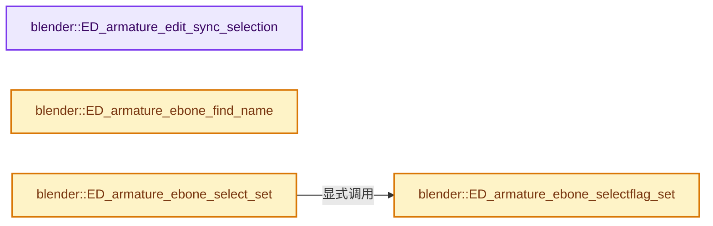
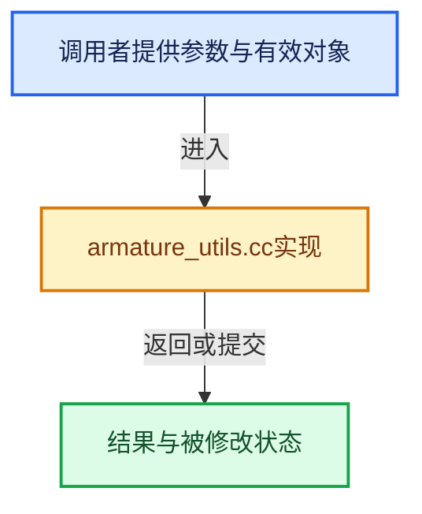

# 实现依赖专题：source/blender/editors/armature/armature_utils.cc

[实现依赖导航](../../../README.md) · [符号索引](../../../../00-课程指南/02-源码与提交索引/符号依赖与实现索引.md)

本专题从正文实际调用进入，集中保存共享实现。函数有稳定锚点，可从调用处直接跳到对应完整函数；递归与互相调用通过回链组织。

## 本文件的实现关系






## 完整成员与函数实现

<a id="f-0314c595a0b2e247"></a>

### `blender::ED_armature_edit_sync_selection`

实现位置：[source/blender/editors/armature/armature_utils.cc](../../../../../../../../source/blender/editors/armature/armature_utils.cc) · L43—L65。

接口参数：

- `ListBaseT<EditBone> *edbo`

**教学注释版**

<!-- annotated:d371993499918f -->

```cpp
void ED_armature_edit_sync_selection(ListBaseT<EditBone> *edbo)
{
  for (EditBone &ebo : *edbo) {
    /* if bone is not selectable, we shouldn't alter this setting... */
    if ((ebo.flag & BONE_UNSELECTABLE) == 0) {
      if ((ebo.flag & BONE_CONNECTED) && (ebo.parent)) {
        if (ebo.parent->flag & BONE_TIPSEL) {
          ebo.flag |= BONE_ROOTSEL;
        }
        else {
          ebo.flag &= ~BONE_ROOTSEL;
        }
      }

      if ((ebo.flag & BONE_TIPSEL) && (ebo.flag & BONE_ROOTSEL)) {
        ebo.flag |= BONE_SELECTED;
      }
      else {
        ebo.flag &= ~BONE_SELECTED;
      }
    }
  }
}
```

<details>
<summary>核对原始源码：source/blender/editors/armature/armature_utils.cc · L43—L65</summary>

<!-- original:d371993499918f:source/blender/editors/armature/armature_utils.cc:43:65 -->

```cpp
void ED_armature_edit_sync_selection(ListBaseT<EditBone> *edbo)
{
  for (EditBone &ebo : *edbo) {
    /* if bone is not selectable, we shouldn't alter this setting... */
    if ((ebo.flag & BONE_UNSELECTABLE) == 0) {
      if ((ebo.flag & BONE_CONNECTED) && (ebo.parent)) {
        if (ebo.parent->flag & BONE_TIPSEL) {
          ebo.flag |= BONE_ROOTSEL;
        }
        else {
          ebo.flag &= ~BONE_ROOTSEL;
        }
      }

      if ((ebo.flag & BONE_TIPSEL) && (ebo.flag & BONE_ROOTSEL)) {
        ebo.flag |= BONE_SELECTED;
      }
      else {
        ebo.flag &= ~BONE_SELECTED;
      }
    }
  }
}
```

</details>

**沿实际写入检查状态**

- `ebo.flag |= BONE_ROOTSEL;`
- `ebo.flag &= ~BONE_ROOTSEL;`
- `ebo.flag |= BONE_SELECTED;`
- `ebo.flag &= ~BONE_SELECTED;`

**继续追踪实现**

本实现没有需要继续展开的显式调用；检查返回表达式、对象转换和调用者前置条件。

<a id="f-851e255f4d857adb"></a>

### `blender::ED_armature_ebone_find_name`

实现位置：[source/blender/editors/armature/armature_utils.cc](../../../../../../../../source/blender/editors/armature/armature_utils.cc) · L250—L253。

接口参数：

- `const ListBaseT<EditBone> *edbo`
- `const char *name`

**教学注释版**

<!-- annotated:a960b3f695260a -->

```cpp
EditBone *ED_armature_ebone_find_name(const ListBaseT<EditBone> *edbo, const char *name)
{
  return static_cast<EditBone *>(BLI_findstring(edbo, name, offsetof(EditBone, name)));
}
```

<details>
<summary>核对原始源码：source/blender/editors/armature/armature_utils.cc · L250—L253</summary>

<!-- original:a960b3f695260a:source/blender/editors/armature/armature_utils.cc:250:253 -->

```cpp
EditBone *ED_armature_ebone_find_name(const ListBaseT<EditBone> *edbo, const char *name)
{
  return static_cast<EditBone *>(BLI_findstring(edbo, name, offsetof(EditBone, name)));
}
```

</details>

**结果出口**

- `return static_cast<EditBone *>(BLI_findstring(edbo, name, offsetof(EditBone, name)));`

**继续追踪实现**

- `BLI_findstring` → [blender::BLI_findstring · L615](../../../01-BLI基础库/intern/listbase.cc.md#f-d913b13b2651348e)。

<a id="f-e61cc0b1864dd166"></a>

### `blender::ED_armature_ebone_selectflag_set`

实现位置：[source/blender/editors/armature/armature_utils.cc](../../../../../../../../source/blender/editors/armature/armature_utils.cc) · L962—L977。

接口参数：

- `EditBone *ebone`
- `eBone_Flag flag`

**教学注释版**

<!-- annotated:c9b0f9a78f4bdb -->

```cpp
void ED_armature_ebone_selectflag_set(EditBone *ebone, eBone_Flag flag)
{
  flag = flag & (BONE_SELECTED | BONE_ROOTSEL | BONE_TIPSEL);

  if (ebone->parent && (ebone->flag & BONE_CONNECTED)) {
    ebone->flag &= ~(BONE_SELECTED | BONE_ROOTSEL | BONE_TIPSEL);
    ebone->parent->flag &= ~BONE_TIPSEL;

    ebone->flag |= flag;
    ebone->parent->flag |= (flag & BONE_ROOTSEL) ? BONE_TIPSEL : eBone_Flag{};
  }
  else {
    ebone->flag &= ~(BONE_SELECTED | BONE_ROOTSEL | BONE_TIPSEL);
    ebone->flag |= flag;
  }
}
```

<details>
<summary>核对原始源码：source/blender/editors/armature/armature_utils.cc · L962—L977</summary>

<!-- original:c9b0f9a78f4bdb:source/blender/editors/armature/armature_utils.cc:962:977 -->

```cpp
void ED_armature_ebone_selectflag_set(EditBone *ebone, eBone_Flag flag)
{
  flag = flag & (BONE_SELECTED | BONE_ROOTSEL | BONE_TIPSEL);

  if (ebone->parent && (ebone->flag & BONE_CONNECTED)) {
    ebone->flag &= ~(BONE_SELECTED | BONE_ROOTSEL | BONE_TIPSEL);
    ebone->parent->flag &= ~BONE_TIPSEL;

    ebone->flag |= flag;
    ebone->parent->flag |= (flag & BONE_ROOTSEL) ? BONE_TIPSEL : eBone_Flag{};
  }
  else {
    ebone->flag &= ~(BONE_SELECTED | BONE_ROOTSEL | BONE_TIPSEL);
    ebone->flag |= flag;
  }
}
```

</details>

**沿实际写入检查状态**

- `flag = flag & (BONE_SELECTED | BONE_ROOTSEL | BONE_TIPSEL);`
- `ebone->flag &= ~(BONE_SELECTED | BONE_ROOTSEL | BONE_TIPSEL);`
- `ebone->parent->flag &= ~BONE_TIPSEL;`
- `ebone->flag |= flag;`
- `ebone->parent->flag |= (flag & BONE_ROOTSEL) ? BONE_TIPSEL : eBone_Flag{};`

**继续追踪实现**

本实现没有需要继续展开的显式调用；检查返回表达式、对象转换和调用者前置条件。

<a id="f-d34a3824af000262"></a>

### `blender::ED_armature_ebone_select_set`

实现位置：[source/blender/editors/armature/armature_utils.cc](../../../../../../../../source/blender/editors/armature/armature_utils.cc) · L991—L1004。

接口参数：

- `EditBone *ebone`
- `bool select`

**教学注释版**

<!-- annotated:bf544721189408 -->

```cpp
void ED_armature_ebone_select_set(EditBone *ebone, bool select)
{
  /* NOTE: this function could be used in more places. */

  eBone_Flag flag;
  if (select) {
    BLI_assert((ebone->flag & BONE_UNSELECTABLE) == 0);
    flag = (BONE_SELECTED | BONE_TIPSEL | BONE_ROOTSEL);
  }
  else {
    flag = eBone_Flag{};
  }
  ED_armature_ebone_selectflag_set(ebone, flag);
}
```

<details>
<summary>核对原始源码：source/blender/editors/armature/armature_utils.cc · L991—L1004</summary>

<!-- original:bf544721189408:source/blender/editors/armature/armature_utils.cc:991:1004 -->

```cpp
void ED_armature_ebone_select_set(EditBone *ebone, bool select)
{
  /* NOTE: this function could be used in more places. */

  eBone_Flag flag;
  if (select) {
    BLI_assert((ebone->flag & BONE_UNSELECTABLE) == 0);
    flag = (BONE_SELECTED | BONE_TIPSEL | BONE_ROOTSEL);
  }
  else {
    flag = eBone_Flag{};
  }
  ED_armature_ebone_selectflag_set(ebone, flag);
}
```

</details>

**沿实际写入检查状态**

- `flag = (BONE_SELECTED | BONE_TIPSEL | BONE_ROOTSEL);`
- `flag = eBone_Flag{};`

**继续追踪实现**

- `BLI_assert` → [BLI_assert · L48](../../../01-BLI基础库/BLI_assert.hh.md#m-57a88495704d)；[BLI_assert · L63](../../../01-BLI基础库/BLI_assert.hh.md#m-d07050020cb5)。宏定义由构建条件选择。
- `ED_armature_ebone_selectflag_set` → [blender::ED_armature_ebone_selectflag_set · L962](armature_utils.cc.md#f-e61cc0b1864dd166)。
