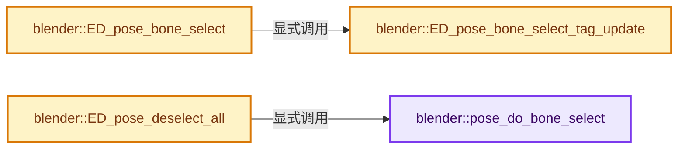
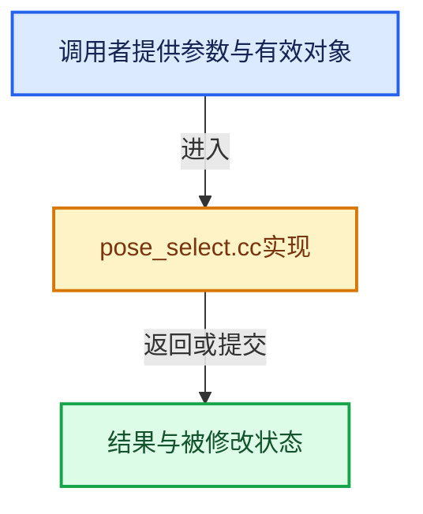

# 实现依赖专题：source/blender/editors/armature/pose_select.cc

[实现依赖导航](../../../README.md) · [符号索引](../../../../00-课程指南/02-源码与提交索引/符号依赖与实现索引.md)

本专题从正文实际调用进入，集中保存共享实现。函数有稳定锚点，可从调用处直接跳到对应完整函数；递归与互相调用通过回链组织。

## 本文件的实现关系






## 完整成员与函数实现

<a id="f-cbdc43e2d0d161b7"></a>

### `blender::pose_do_bone_select`

实现位置：[source/blender/editors/armature/pose_select.cc](../../../../../../../../source/blender/editors/armature/pose_select.cc) · L64—L88。

接口参数：

- `const bke::PChanBone pchanbone`
- `const int select_mode`

**教学注释版**

<!-- annotated:37457ebc38f0fe -->

```cpp
static void pose_do_bone_select(const bke::PChanBone pchanbone, const int select_mode)
{
  bPoseChannel *pchan = pchanbone.pchan;
  const Bone *bone = pchanbone.bone;

  /* select pchan only if selectable, but deselect works always */
  switch (select_mode) {
    case SEL_SELECT:
      if (!(bone->flag & BONE_UNSELECTABLE)) {
        animrig::bone_select(pchan);
      }
      break;
    case SEL_DESELECT:
      animrig::bone_deselect(pchan);
      break;
    case SEL_INVERT:
      if (pchan->flag & POSE_SELECTED) {
        animrig::bone_deselect(pchan);
      }
      else if (!(bone->flag & BONE_UNSELECTABLE)) {
        animrig::bone_select(pchan);
      }
      break;
  }
}
```

<details>
<summary>核对原始源码：source/blender/editors/armature/pose_select.cc · L64—L88</summary>

<!-- original:37457ebc38f0fe:source/blender/editors/armature/pose_select.cc:64:88 -->

```cpp
static void pose_do_bone_select(const bke::PChanBone pchanbone, const int select_mode)
{
  bPoseChannel *pchan = pchanbone.pchan;
  const Bone *bone = pchanbone.bone;

  /* select pchan only if selectable, but deselect works always */
  switch (select_mode) {
    case SEL_SELECT:
      if (!(bone->flag & BONE_UNSELECTABLE)) {
        animrig::bone_select(pchan);
      }
      break;
    case SEL_DESELECT:
      animrig::bone_deselect(pchan);
      break;
    case SEL_INVERT:
      if (pchan->flag & POSE_SELECTED) {
        animrig::bone_deselect(pchan);
      }
      else if (!(bone->flag & BONE_UNSELECTABLE)) {
        animrig::bone_select(pchan);
      }
      break;
  }
}
```

</details>

**继续追踪实现**

- `animrig::bone_select` → [blender::animrig::bone_select · L81](../../animrig/ANIM_armature.hh.md#f-c3dedeb8be9ac022)。
- `animrig::bone_deselect` → [blender::animrig::bone_deselect · L86](../../animrig/ANIM_armature.hh.md#f-7975cc4a6a16e450)。

<a id="f-ffdbc8bf04eaf081"></a>

### `blender::ED_pose_bone_select_tag_update`

实现位置：[source/blender/editors/armature/pose_select.cc](../../../../../../../../source/blender/editors/armature/pose_select.cc) · L277—L290。

接口参数：

- `Object *ob`

**教学注释版**

<!-- annotated:74bdbe41092822 -->

```cpp
void ED_pose_bone_select_tag_update(Object *ob)
{
  BLI_assert(ob->type == OB_ARMATURE);
  bArmature *arm = id_cast<bArmature *>(ob->data);
  WM_main_add_notifier(NC_OBJECT | ND_BONE_SELECT, ob);
  WM_main_add_notifier(NC_GEOM | ND_DATA, ob);

  if (arm->flag & ARM_HAS_VIZ_DEPS) {
    /* mask modifier ('armature' mode), etc. */
    DEG_id_tag_update(&ob->id, ID_RECALC_GEOMETRY);
  }

  DEG_id_tag_update(&arm->id, ID_RECALC_SELECT);
}
```

<details>
<summary>核对原始源码：source/blender/editors/armature/pose_select.cc · L277—L290</summary>

<!-- original:74bdbe41092822:source/blender/editors/armature/pose_select.cc:277:290 -->

```cpp
void ED_pose_bone_select_tag_update(Object *ob)
{
  BLI_assert(ob->type == OB_ARMATURE);
  bArmature *arm = id_cast<bArmature *>(ob->data);
  WM_main_add_notifier(NC_OBJECT | ND_BONE_SELECT, ob);
  WM_main_add_notifier(NC_GEOM | ND_DATA, ob);

  if (arm->flag & ARM_HAS_VIZ_DEPS) {
    /* mask modifier ('armature' mode), etc. */
    DEG_id_tag_update(&ob->id, ID_RECALC_GEOMETRY);
  }

  DEG_id_tag_update(&arm->id, ID_RECALC_SELECT);
}
```

</details>

**继续追踪实现**

- `BLI_assert` → [BLI_assert · L48](../../../01-BLI基础库/BLI_assert.hh.md#m-57a88495704d)；[BLI_assert · L63](../../../01-BLI基础库/BLI_assert.hh.md#m-d07050020cb5)。宏定义由构建条件选择。
- `id_cast<bArmature *>` → [blender::id_cast · L1417](../../makesdna/DNA_ID.h.md#f-6c8ac6412850ac5a)。
- `WM_main_add_notifier` → [blender::WM_main_add_notifier · L403](../../windowmanager/intern/wm_event_system.cc.md#f-29a090eae8ebe51c)。
- `DEG_id_tag_update` → [blender::DEG_id_tag_update · L844](../../../06-Depsgraph依赖图/intern/depsgraph_tag.cc.md#f-62d2949dd168bb81)。

<a id="f-fcdb0a830c2e453b"></a>

### `blender::ED_pose_bone_select`

实现位置：[source/blender/editors/armature/pose_select.cc](../../../../../../../../source/blender/editors/armature/pose_select.cc) · L292—L327。

接口参数：

- `Object *ob`
- `bPoseChannel *pchan`
- `bool select`
- `bool change_active`

**教学注释版**

<!-- annotated:5edd2917a7c2d9 -->

```cpp
void ED_pose_bone_select(Object *ob, bPoseChannel *pchan, bool select, bool change_active)
{
  bArmature *arm;

  /* sanity checks */
  if (ELEM(nullptr, ob, ob->pose, pchan)) {
    return;
  }

  Bone *bone = pchan->bone_get(*ob);
  if (!bone) {
    return;
  }

  arm = id_cast<bArmature *>(ob->data);

  /* can only change selection state if bone can be modified */
  if (animrig::bone_is_selectable(arm, {pchan, bone})) {
    /* change selection state - activate too if selected */
    if (select) {
      animrig::bone_select(pchan);
      if (change_active) {
        arm->act_bone = bone;
      }
    }
    else {
      animrig::bone_deselect(pchan);
      if (change_active) {
        arm->act_bone = nullptr;
      }
    }

    /* TODO: select and activate corresponding vgroup? */
    ED_pose_bone_select_tag_update(ob);
  }
}
```

<details>
<summary>核对原始源码：source/blender/editors/armature/pose_select.cc · L292—L327</summary>

<!-- original:5edd2917a7c2d9:source/blender/editors/armature/pose_select.cc:292:327 -->

```cpp
void ED_pose_bone_select(Object *ob, bPoseChannel *pchan, bool select, bool change_active)
{
  bArmature *arm;

  /* sanity checks */
  if (ELEM(nullptr, ob, ob->pose, pchan)) {
    return;
  }

  Bone *bone = pchan->bone_get(*ob);
  if (!bone) {
    return;
  }

  arm = id_cast<bArmature *>(ob->data);

  /* can only change selection state if bone can be modified */
  if (animrig::bone_is_selectable(arm, {pchan, bone})) {
    /* change selection state - activate too if selected */
    if (select) {
      animrig::bone_select(pchan);
      if (change_active) {
        arm->act_bone = bone;
      }
    }
    else {
      animrig::bone_deselect(pchan);
      if (change_active) {
        arm->act_bone = nullptr;
      }
    }

    /* TODO: select and activate corresponding vgroup? */
    ED_pose_bone_select_tag_update(ob);
  }
}
```

</details>

**沿实际写入检查状态**

- `arm = id_cast<bArmature *>(ob->data);`
- `arm->act_bone = bone;`
- `arm->act_bone = nullptr;`

**继续追踪实现**

- `ELEM` → [ELEM · L88](../../../07-Intern运行时与平台/ghost/intern/GHOST_utildefines.hh.md#m-d28724a15928)；[ELEM · L135](../../../01-BLI基础库/BLI_utildefines.hh.md#m-d6572de7cae0)。宏定义由构建条件选择。
- `pchan->bone_get` → [blender::bPoseChannel::bone_get · L847](../../../02-BKE几何与数据/intern/action.cc.md#f-0eb8bfcf060715cf)；[blender::bPoseChannel::bone_get · L862](../../../02-BKE几何与数据/intern/action.cc.md#f-ccec81f60dc65040)；[blender::bPoseChannel::bone_get · L875](../../../02-BKE几何与数据/intern/action.cc.md#f-b7d34ff46210a1f3)；[blender::bPoseChannel::bone_get · L881](../../../02-BKE几何与数据/intern/action.cc.md#f-0bf83e1e4d68c624)。同名重载需按实参类型选择。
- `id_cast<bArmature *>` → [blender::id_cast · L1417](../../makesdna/DNA_ID.h.md#f-6c8ac6412850ac5a)。
- `animrig::bone_is_selectable` → [blender::animrig::bone_is_selectable · L62](../../animrig/ANIM_armature.hh.md#f-0e443662254c089c)；[blender::animrig::bone_is_selectable · L66](../../animrig/ANIM_armature.hh.md#f-906339b476abc3ca)；[blender::animrig::bone_is_selectable · L71](../../animrig/ANIM_armature.hh.md#f-6687b50da52e7f05)。同名重载需按实参类型选择。
- `animrig::bone_select` → [blender::animrig::bone_select · L81](../../animrig/ANIM_armature.hh.md#f-c3dedeb8be9ac022)。
- `animrig::bone_deselect` → [blender::animrig::bone_deselect · L86](../../animrig/ANIM_armature.hh.md#f-7975cc4a6a16e450)。
- `ED_pose_bone_select_tag_update` → [blender::ED_pose_bone_select_tag_update · L277](pose_select.cc.md#f-ffdbc8bf04eaf081)。

<a id="f-af4c2a539896448f"></a>

### `blender::ED_pose_deselect_all`

实现位置：[source/blender/editors/armature/pose_select.cc](../../../../../../../../source/blender/editors/armature/pose_select.cc) · L514—L552。

接口参数：

- `Object *ob`
- `int select_mode`
- `const bool ignore_visibility`

**教学注释版**

<!-- annotated:1b726617c390a9 -->

```cpp
bool ED_pose_deselect_all(Object *ob, int select_mode, const bool ignore_visibility)
{
  bArmature *arm = id_cast<bArmature *>(ob->data);

  /* we call this from outliner too */
  if (ob->pose == nullptr) {
    return false;
  }

  /* Determine if we're selecting or deselecting */
  if (select_mode == SEL_TOGGLE) {
    select_mode = SEL_SELECT;
    for (bPoseChannel &pchan : ob->pose->chanbase) {
      if (ignore_visibility || animrig::bone_is_visible(arm, {&pchan, pchan.bone_get(*ob)})) {
        if (pchan.flag & POSE_SELECTED) {
          select_mode = SEL_DESELECT;
          break;
        }
      }
    }
  }

  /* Set the flags accordingly */
  bool changed = false;
  for (bPoseChannel &pchan : ob->pose->chanbase) {
    Bone *bone = pchan.bone_get(*ob);
    if (!bone) {
      /* Ignore the pchan if it doesn't have a corresponding bone. */
      continue;
    }
    /* ignore the pchan if it isn't visible or if its selection cannot be changed */
    if (ignore_visibility || animrig::bone_is_visible(arm, {&pchan, bone})) {
      int flag_prev = pchan.flag;
      pose_do_bone_select({&pchan, bone}, select_mode);
      changed = (changed || flag_prev != pchan.flag);
    }
  }
  return changed;
}
```

<details>
<summary>核对原始源码：source/blender/editors/armature/pose_select.cc · L514—L552</summary>

<!-- original:1b726617c390a9:source/blender/editors/armature/pose_select.cc:514:552 -->

```cpp
bool ED_pose_deselect_all(Object *ob, int select_mode, const bool ignore_visibility)
{
  bArmature *arm = id_cast<bArmature *>(ob->data);

  /* we call this from outliner too */
  if (ob->pose == nullptr) {
    return false;
  }

  /* Determine if we're selecting or deselecting */
  if (select_mode == SEL_TOGGLE) {
    select_mode = SEL_SELECT;
    for (bPoseChannel &pchan : ob->pose->chanbase) {
      if (ignore_visibility || animrig::bone_is_visible(arm, {&pchan, pchan.bone_get(*ob)})) {
        if (pchan.flag & POSE_SELECTED) {
          select_mode = SEL_DESELECT;
          break;
        }
      }
    }
  }

  /* Set the flags accordingly */
  bool changed = false;
  for (bPoseChannel &pchan : ob->pose->chanbase) {
    Bone *bone = pchan.bone_get(*ob);
    if (!bone) {
      /* Ignore the pchan if it doesn't have a corresponding bone. */
      continue;
    }
    /* ignore the pchan if it isn't visible or if its selection cannot be changed */
    if (ignore_visibility || animrig::bone_is_visible(arm, {&pchan, bone})) {
      int flag_prev = pchan.flag;
      pose_do_bone_select({&pchan, bone}, select_mode);
      changed = (changed || flag_prev != pchan.flag);
    }
  }
  return changed;
}
```

</details>

**沿实际写入检查状态**

- `select_mode = SEL_SELECT;`
- `select_mode = SEL_DESELECT;`
- `changed = (changed || flag_prev != pchan.flag);`

**结果出口**

- `return false;`
- `return changed;`

**继续追踪实现**

- `id_cast<bArmature *>` → [blender::id_cast · L1417](../../makesdna/DNA_ID.h.md#f-6c8ac6412850ac5a)。
- `animrig::bone_is_visible` → [blender::animrig::bone_is_visible · L25](../../animrig/ANIM_armature.hh.md#f-e926c36821dc8b61)；[blender::animrig::bone_is_visible · L31](../../animrig/ANIM_armature.hh.md#f-5e82ccf415aba741)；[blender::animrig::bone_is_visible · L37](../../animrig/ANIM_armature.hh.md#f-9466cbf3f6488b5f)。同名重载需按实参类型选择。
- `pchan.bone_get` → [调用协议](../../../../00-课程指南/01-路线与规范/模板宏与动态分派协议.md)：接收对象类型依赖auto、返回值或模板实例；不按同名猜测目标。调用位置L527。
- `pose_do_bone_select` → [blender::pose_do_bone_select · L64](pose_select.cc.md#f-cbdc43e2d0d161b7)。
