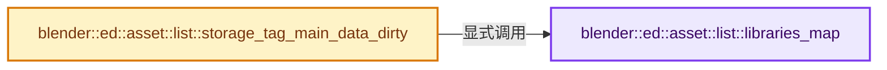
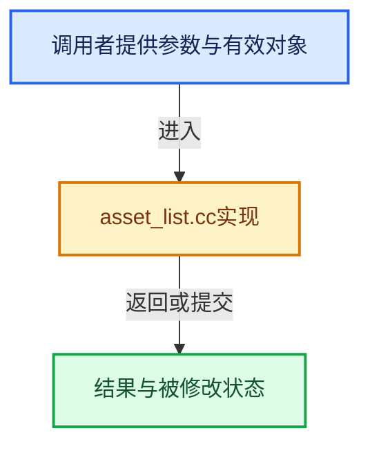

# 实现依赖专题：source/blender/editors/asset/intern/asset_list.cc

[实现依赖导航](../../../../README.md) · [符号索引](../../../../../00-课程指南/02-源码与提交索引/符号依赖与实现索引.md)

本专题从正文实际调用进入，集中保存共享实现。函数有稳定锚点，可从调用处直接跳到对应完整函数；递归与互相调用通过回链组织。

## 本文件的实现关系






## 完整成员与函数实现

<a id="f-0b44917756665fa9"></a>

### `blender::ed::asset::list::libraries_map`

实现位置：[source/blender/editors/asset/intern/asset_list.cc](../../../../../../../../../source/blender/editors/asset/intern/asset_list.cc) · L344—L348。

**教学注释版**

<!-- annotated:f4d76c12b8aa70 -->

```cpp
static AssetListMap &libraries_map()
{
  static GlobalStorage global_storage;
  return global_storage.list_map;
}
```

<details>
<summary>核对原始源码：source/blender/editors/asset/intern/asset_list.cc · L344—L348</summary>

<!-- original:f4d76c12b8aa70:source/blender/editors/asset/intern/asset_list.cc:344:348 -->

```cpp
static AssetListMap &libraries_map()
{
  static GlobalStorage global_storage;
  return global_storage.list_map;
}
```

</details>

**结果出口**

- `return global_storage.list_map;`

**继续追踪实现**

本实现没有需要继续展开的显式调用；检查返回表达式、对象转换和调用者前置条件。

<a id="f-8cf3d650042f0929"></a>

### `blender::ed::asset::list::storage_tag_main_data_dirty`

实现位置：[source/blender/editors/asset/intern/asset_list.cc](../../../../../../../../../source/blender/editors/asset/intern/asset_list.cc) · L355—L360。

**教学注释版**

<!-- annotated:25d5fb98a5ec86 -->

```cpp
void storage_tag_main_data_dirty()
{
  for (AssetList &list : libraries_map().values()) {
    list.tag_main_data_dirty();
  }
}
```

<details>
<summary>核对原始源码：source/blender/editors/asset/intern/asset_list.cc · L355—L360</summary>

<!-- original:25d5fb98a5ec86:source/blender/editors/asset/intern/asset_list.cc:355:360 -->

```cpp
void storage_tag_main_data_dirty()
{
  for (AssetList &list : libraries_map().values()) {
    list.tag_main_data_dirty();
  }
}
```

</details>

**继续追踪实现**

- `libraries_map().values` → [调用协议](../../../../../00-课程指南/01-路线与规范/模板宏与动态分派协议.md)：接收对象类型依赖auto、返回值或模板实例；不按同名猜测目标。调用位置L357。
- `libraries_map` → [blender::ed::asset::list::libraries_map · L344](asset_list.cc.md#f-0b44917756665fa9)。
- `list.tag_main_data_dirty` → [调用协议](../../../../../00-课程指南/01-路线与规范/模板宏与动态分派协议.md)：接收对象类型依赖auto、返回值或模板实例；不按同名猜测目标。调用位置L358。
