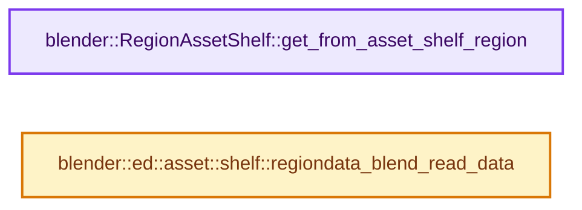
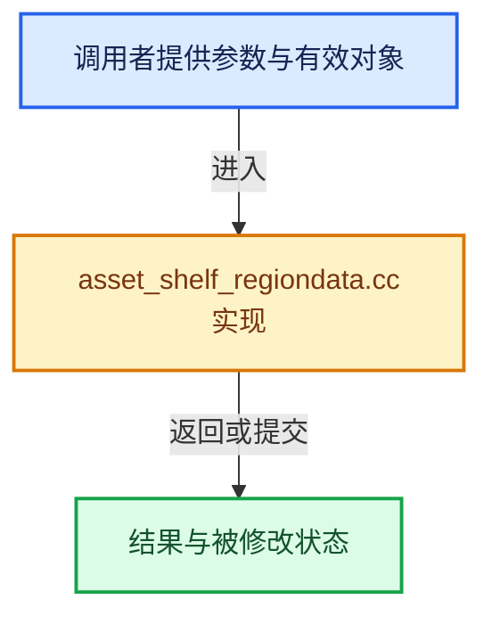

# 实现依赖专题：source/blender/editors/asset/intern/asset_shelf_regiondata.cc

[实现依赖导航](../../../../README.md) · [符号索引](../../../../../00-课程指南/02-源码与提交索引/符号依赖与实现索引.md)

本专题从正文实际调用进入，集中保存共享实现。函数有稳定锚点，可从调用处直接跳到对应完整函数；递归与互相调用通过回链组织。

## 本文件的实现关系






## 完整成员与函数实现

<a id="f-5da569b85db6ebab"></a>

### `blender::RegionAssetShelf::get_from_asset_shelf_region`

实现位置：[source/blender/editors/asset/intern/asset_shelf_regiondata.cc](../../../../../../../../../source/blender/editors/asset/intern/asset_shelf_regiondata.cc) · L20—L28。

接口参数：

- `const ARegion &region`

**教学注释版**

<!-- annotated:294cfc448ddb17 -->

```cpp
RegionAssetShelf *RegionAssetShelf::get_from_asset_shelf_region(const ARegion &region)
{
  if (region.regiontype != RGN_TYPE_ASSET_SHELF) {
    /* Should only be called on main asset shelf region. */
    BLI_assert_unreachable();
    return nullptr;
  }
  return static_cast<RegionAssetShelf *>(region.regiondata);
}
```

<details>
<summary>核对原始源码：source/blender/editors/asset/intern/asset_shelf_regiondata.cc · L20—L28</summary>

<!-- original:294cfc448ddb17:source/blender/editors/asset/intern/asset_shelf_regiondata.cc:20:28 -->

```cpp
RegionAssetShelf *RegionAssetShelf::get_from_asset_shelf_region(const ARegion &region)
{
  if (region.regiontype != RGN_TYPE_ASSET_SHELF) {
    /* Should only be called on main asset shelf region. */
    BLI_assert_unreachable();
    return nullptr;
  }
  return static_cast<RegionAssetShelf *>(region.regiondata);
}
```

</details>

**结果出口**

- `return nullptr;`
- `return static_cast<RegionAssetShelf *>(region.regiondata);`

**继续追踪实现**

- `BLI_assert_unreachable` → [BLI_assert_unreachable · L77](../../../../01-BLI基础库/BLI_assert.hh.md#m-7a2d91a67d8e)。宏定义由构建条件选择。

<a id="f-928fe7944c25cfc1"></a>

### `blender::ed::asset::shelf::regiondata_blend_read_data`

实现位置：[source/blender/editors/asset/intern/asset_shelf_regiondata.cc](../../../../../../../../../source/blender/editors/asset/intern/asset_shelf_regiondata.cc) · L83—L97。

接口参数：

- `BlendDataReader *reader`
- `RegionAssetShelf **shelf_regiondata`

**教学注释版**

<!-- annotated:47fbb6d2159c1e -->

```cpp
void regiondata_blend_read_data(BlendDataReader *reader, RegionAssetShelf **shelf_regiondata)
{
  if (!BLO_read_struct_nonnull(reader, RegionAssetShelf, shelf_regiondata)) {
    return;
  }
  if ((*shelf_regiondata)->active_shelf) {
    BLO_read_struct_nonnull(reader, AssetShelf, &(*shelf_regiondata)->active_shelf);
  }

  BLO_read_struct_list(reader, AssetShelf, &(*shelf_regiondata)->shelves);
  for (AssetShelf &shelf : (*shelf_regiondata)->shelves) {
    shelf.type = nullptr;
    settings_blend_read_data(reader, shelf.settings);
  }
}
```

<details>
<summary>核对原始源码：source/blender/editors/asset/intern/asset_shelf_regiondata.cc · L83—L97</summary>

<!-- original:47fbb6d2159c1e:source/blender/editors/asset/intern/asset_shelf_regiondata.cc:83:97 -->

```cpp
void regiondata_blend_read_data(BlendDataReader *reader, RegionAssetShelf **shelf_regiondata)
{
  if (!BLO_read_struct_nonnull(reader, RegionAssetShelf, shelf_regiondata)) {
    return;
  }
  if ((*shelf_regiondata)->active_shelf) {
    BLO_read_struct_nonnull(reader, AssetShelf, &(*shelf_regiondata)->active_shelf);
  }

  BLO_read_struct_list(reader, AssetShelf, &(*shelf_regiondata)->shelves);
  for (AssetShelf &shelf : (*shelf_regiondata)->shelves) {
    shelf.type = nullptr;
    settings_blend_read_data(reader, shelf.settings);
  }
}
```

</details>

**沿实际写入检查状态**

- `shelf.type = nullptr;`

**继续追踪实现**

- `BLO_read_struct_nonnull` → [BLO_read_struct_nonnull · L487](../../../blenloader/BLO_read_write.hh.md#m-f52dccc66a6c)。宏定义由构建条件选择。
- `BLO_read_struct_list` → [BLO_read_struct_list · L542](../../../blenloader/BLO_read_write.hh.md#m-7f0b2171679f)。宏定义由构建条件选择。
- `settings_blend_read_data` → [blender::ed::asset::shelf::settings_blend_read_data · L86](asset_shelf_settings.cc.md#f-f22c2600ee1dcc5d)。
