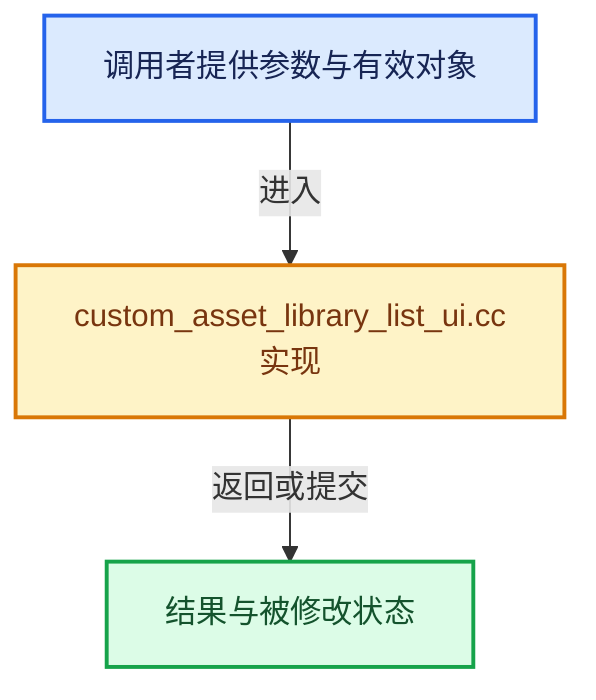

# 实现依赖专题：source/blender/editors/asset/intern/custom_asset_library_list_ui.cc

[实现依赖导航](../../../../README.md) · [符号索引](../../../../../00-课程指南/02-源码与提交索引/符号依赖与实现索引.md)

本专题从正文实际调用进入，集中保存共享实现。函数有稳定锚点，可从调用处直接跳到对应完整函数；递归与互相调用通过回链组织。

## 本文件的实现关系





## 完整成员与函数实现

<a id="f-cdb8ed027f5958c6"></a>

### `blender::AssetLibraryListItemCommon::rename`

实现位置：[source/blender/editors/asset/intern/custom_asset_library_list_ui.cc](../../../../../../../../../source/blender/editors/asset/intern/custom_asset_library_list_ui.cc) · L51—L59。

接口参数：

- `const bContext &C`
- `StringRefNull new_name`

**教学注释版**

<!-- annotated:5b328d3ad1ecbe -->

```cpp
bool AssetLibraryListItemCommon::rename(const bContext &C, StringRefNull new_name)
{
  PointerRNA ptr = RNA_pointer_create_discrete(
      nullptr, RNA_UserAssetLibrary, library.user_library);
  PropertyRNA *prop = RNA_struct_find_property(&ptr, "name");
  RNA_property_string_set(&ptr, prop, new_name.c_str());
  RNA_property_update(&const_cast<bContext &>(C), &ptr, prop);
  return true;
}
```

<details>
<summary>核对原始源码：source/blender/editors/asset/intern/custom_asset_library_list_ui.cc · L51—L59</summary>

<!-- original:5b328d3ad1ecbe:source/blender/editors/asset/intern/custom_asset_library_list_ui.cc:51:59 -->

```cpp
bool AssetLibraryListItemCommon::rename(const bContext &C, StringRefNull new_name)
{
  PointerRNA ptr = RNA_pointer_create_discrete(
      nullptr, RNA_UserAssetLibrary, library.user_library);
  PropertyRNA *prop = RNA_struct_find_property(&ptr, "name");
  RNA_property_string_set(&ptr, prop, new_name.c_str());
  RNA_property_update(&const_cast<bContext &>(C), &ptr, prop);
  return true;
}
```

</details>

**结果出口**

- `return true;`

**继续追踪实现**

- `RNA_pointer_create_discrete` → [blender::RNA_pointer_create_discrete · L181](../../../makesrna/intern/rna_access.cc.md#f-592a276e869c6d94)。
- `RNA_struct_find_property` → [blender::RNA_struct_find_property · L855](../../../makesrna/intern/rna_access.cc.md#f-75b0f3b3cc89dd4c)；[blender::RNA_struct_find_property · L874](../../../makesrna/intern/rna_access.cc.md#f-7fb7ab238d64680f)。同名重载需按实参类型选择。
- `RNA_property_string_set` → [blender::RNA_property_string_set · L4268](../../../makesrna/intern/rna_access.cc.md#f-6942e88786e7aaad)。
- `new_name.c_str` → [blender::StringRefNull::c_str · L544](../../../../../01-基础容器与现代CPP/15-StringRef字符串视图.md#f-4a8bbfe1e6d00757)。
- `RNA_property_update` → [blender::RNA_property_update · L2648](../../../makesrna/intern/rna_access.cc.md#f-516b8fd97db039ff)。
