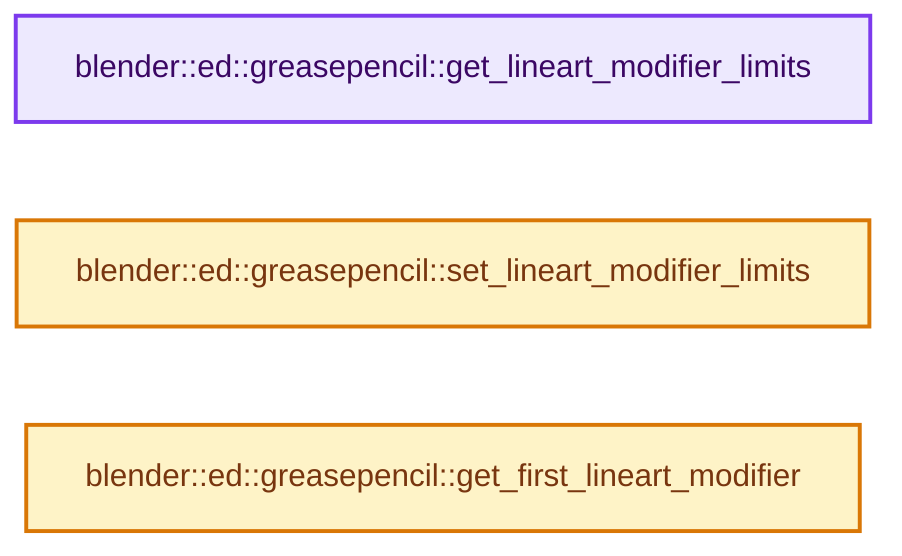
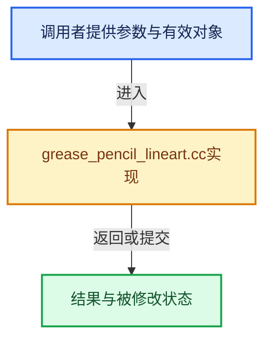

# 实现依赖专题：source/blender/editors/grease_pencil/intern/grease_pencil_lineart.cc

[实现依赖导航](../../../../README.md) · [符号索引](../../../../../00-课程指南/02-源码与提交索引/符号依赖与实现索引.md)

本专题从正文实际调用进入，集中保存共享实现。函数有稳定锚点，可从调用处直接跳到对应完整函数；递归与互相调用通过回链组织。

## 本文件的实现关系






## 完整成员与函数实现

<a id="f-062c3691e6a12c7e"></a>

### `blender::ed::greasepencil::get_lineart_modifier_limits`

实现位置：[source/blender/editors/grease_pencil/intern/grease_pencil_lineart.cc](../../../../../../../../../source/blender/editors/grease_pencil/intern/grease_pencil_lineart.cc) · L43—L60。

接口参数：

- `const Object &ob`
- `ed::greasepencil::LineartLimitInfo &info`

**教学注释版**

<!-- annotated:f1671007d3edca -->

```cpp
void get_lineart_modifier_limits(const Object &ob, ed::greasepencil::LineartLimitInfo &info)
{
  bool is_first = true;
  for (const ModifierData &md : ob.modifiers) {
    if (md.type == eModifierType_GreasePencilLineart) {
      const auto *lmd = reinterpret_cast<const GreasePencilLineartModifierData *>(&md);
      if (is_first || (lmd->flags & LINEART_GPENCIL_USE_CACHE)) {
        // [讲解] std::min<int>：按比较关系选取较小值；截断范围时还需先满足非负和可表示范围，min本身不会证明边界安全。
        info.min_level = std::min<int>(info.min_level, lmd->level_start);
        // [讲解] std::max<int>：按比较关系选取较大值。本讲解中的增长公式同时满足最低请求和几何增长；若保存返回引用，还需注意实参寿命。
        info.max_level = std::max<int>(
            info.max_level, lmd->use_multiple_levels ? lmd->level_end : lmd->level_start);
        info.edge_types |= lmd->edge_types;
        info.shadow_selection = std::max(info.shadow_selection, lmd->shadow_selection);
        info.silhouette_selection = std::max(info.silhouette_selection, lmd->silhouette_selection);
        is_first = false;
      }
    }
  }
}
```

<details>
<summary>核对原始源码：source/blender/editors/grease_pencil/intern/grease_pencil_lineart.cc · L43—L60</summary>

<!-- original:f1671007d3edca:source/blender/editors/grease_pencil/intern/grease_pencil_lineart.cc:43:60 -->

```cpp
void get_lineart_modifier_limits(const Object &ob, ed::greasepencil::LineartLimitInfo &info)
{
  bool is_first = true;
  for (const ModifierData &md : ob.modifiers) {
    if (md.type == eModifierType_GreasePencilLineart) {
      const auto *lmd = reinterpret_cast<const GreasePencilLineartModifierData *>(&md);
      if (is_first || (lmd->flags & LINEART_GPENCIL_USE_CACHE)) {
        info.min_level = std::min<int>(info.min_level, lmd->level_start);
        info.max_level = std::max<int>(
            info.max_level, lmd->use_multiple_levels ? lmd->level_end : lmd->level_start);
        info.edge_types |= lmd->edge_types;
        info.shadow_selection = std::max(info.shadow_selection, lmd->shadow_selection);
        info.silhouette_selection = std::max(info.silhouette_selection, lmd->silhouette_selection);
        is_first = false;
      }
    }
  }
}
```

</details>

**沿实际写入检查状态**

- `info.min_level = std::min<int>(info.min_level, lmd->level_start);`
- `info.max_level = std::max<int>(`
- `info.edge_types |= lmd->edge_types;`
- `info.shadow_selection = std::max(info.shadow_selection, lmd->shadow_selection);`
- `info.silhouette_selection = std::max(info.silhouette_selection, lmd->silhouette_selection);`
- `is_first = false;`

**继续追踪实现**

- `std::min<int>` → [外部契约](https://eel.is/c++draft/alg.min.max)：按比较关系选取较小值；截断范围时还需先满足非负和可表示范围，min本身不会证明边界安全。
- `std::max<int>` → [外部契约](https://eel.is/c++draft/alg.min.max)：按比较关系选取较大值。本讲解中的增长公式同时满足最低请求和几何增长；若保存返回引用，还需注意实参寿命。
- `std::max` → [外部契约](https://eel.is/c++draft/alg.min.max)：按比较关系选取较大值。本讲解中的增长公式同时满足最低请求和几何增长；若保存返回引用，还需注意实参寿命。

<a id="f-9d99bea9dbdcdd95"></a>

### `blender::ed::greasepencil::set_lineart_modifier_limits`

实现位置：[source/blender/editors/grease_pencil/intern/grease_pencil_lineart.cc](../../../../../../../../../source/blender/editors/grease_pencil/intern/grease_pencil_lineart.cc) · L62—L81。

接口参数：

- `GreasePencilLineartModifierData &lmd`
- `const ed::greasepencil::LineartLimitInfo &info`
- `const bool cache_is_ready`

**教学注释版**

<!-- annotated:0461052eb47544 -->

```cpp
void set_lineart_modifier_limits(GreasePencilLineartModifierData &lmd,
                                 const ed::greasepencil::LineartLimitInfo &info,
                                 const bool cache_is_ready)
{
  BLI_assert(lmd.modifier.type == eModifierType_GreasePencilLineart);
  if ((!cache_is_ready) || (lmd.flags & LINEART_GPENCIL_USE_CACHE)) {
    lmd.level_start_override = info.min_level;
    lmd.level_end_override = info.max_level;
    lmd.edge_types_override = info.edge_types;
    lmd.shadow_selection_override = info.shadow_selection;
    lmd.shadow_use_silhouette_override = info.silhouette_selection;
  }
  else {
    lmd.level_start_override = lmd.level_start;
    lmd.level_end_override = lmd.level_end;
    lmd.edge_types_override = lmd.edge_types;
    lmd.shadow_selection_override = lmd.shadow_selection;
    lmd.shadow_use_silhouette_override = lmd.silhouette_selection;
  }
}
```

<details>
<summary>核对原始源码：source/blender/editors/grease_pencil/intern/grease_pencil_lineart.cc · L62—L81</summary>

<!-- original:0461052eb47544:source/blender/editors/grease_pencil/intern/grease_pencil_lineart.cc:62:81 -->

```cpp
void set_lineart_modifier_limits(GreasePencilLineartModifierData &lmd,
                                 const ed::greasepencil::LineartLimitInfo &info,
                                 const bool cache_is_ready)
{
  BLI_assert(lmd.modifier.type == eModifierType_GreasePencilLineart);
  if ((!cache_is_ready) || (lmd.flags & LINEART_GPENCIL_USE_CACHE)) {
    lmd.level_start_override = info.min_level;
    lmd.level_end_override = info.max_level;
    lmd.edge_types_override = info.edge_types;
    lmd.shadow_selection_override = info.shadow_selection;
    lmd.shadow_use_silhouette_override = info.silhouette_selection;
  }
  else {
    lmd.level_start_override = lmd.level_start;
    lmd.level_end_override = lmd.level_end;
    lmd.edge_types_override = lmd.edge_types;
    lmd.shadow_selection_override = lmd.shadow_selection;
    lmd.shadow_use_silhouette_override = lmd.silhouette_selection;
  }
}
```

</details>

**沿实际写入检查状态**

- `lmd.level_start_override = info.min_level;`
- `lmd.level_end_override = info.max_level;`
- `lmd.edge_types_override = info.edge_types;`
- `lmd.shadow_selection_override = info.shadow_selection;`
- `lmd.shadow_use_silhouette_override = info.silhouette_selection;`
- `lmd.level_start_override = lmd.level_start;`
- `lmd.level_end_override = lmd.level_end;`
- `lmd.edge_types_override = lmd.edge_types;`
- `lmd.shadow_selection_override = lmd.shadow_selection;`
- `lmd.shadow_use_silhouette_override = lmd.silhouette_selection;`

**继续追踪实现**

- `BLI_assert` → [BLI_assert · L48](../../../../01-BLI基础库/BLI_assert.hh.md#m-57a88495704d)；[BLI_assert · L63](../../../../01-BLI基础库/BLI_assert.hh.md#m-d07050020cb5)。宏定义由构建条件选择。

<a id="f-e217835d3c032a27"></a>

### `blender::ed::greasepencil::get_first_lineart_modifier`

实现位置：[source/blender/editors/grease_pencil/intern/grease_pencil_lineart.cc](../../../../../../../../../source/blender/editors/grease_pencil/intern/grease_pencil_lineart.cc) · L83—L93。

接口参数：

- `const Object &ob`

**教学注释版**

<!-- annotated:7d19b095a75db7 -->

```cpp
GreasePencilLineartModifierData *get_first_lineart_modifier(const Object &ob)
{
  /* This function always gets the first line art modifier regardless of their visibility, because
   * cached line art configuration are always inside the first line art modifier. */
  for (ModifierData &i_md : ob.modifiers) {
    if (i_md.type == eModifierType_GreasePencilLineart) {
      return reinterpret_cast<GreasePencilLineartModifierData *>(&i_md);
    }
  }
  return nullptr;
}
```

<details>
<summary>核对原始源码：source/blender/editors/grease_pencil/intern/grease_pencil_lineart.cc · L83—L93</summary>

<!-- original:7d19b095a75db7:source/blender/editors/grease_pencil/intern/grease_pencil_lineart.cc:83:93 -->

```cpp
GreasePencilLineartModifierData *get_first_lineart_modifier(const Object &ob)
{
  /* This function always gets the first line art modifier regardless of their visibility, because
   * cached line art configuration are always inside the first line art modifier. */
  for (ModifierData &i_md : ob.modifiers) {
    if (i_md.type == eModifierType_GreasePencilLineart) {
      return reinterpret_cast<GreasePencilLineartModifierData *>(&i_md);
    }
  }
  return nullptr;
}
```

</details>

**结果出口**

- `return reinterpret_cast<GreasePencilLineartModifierData *>(&i_md);`
- `return nullptr;`

**继续追踪实现**

本实现没有需要继续展开的显式调用；检查返回表达式、对象转换和调用者前置条件。
