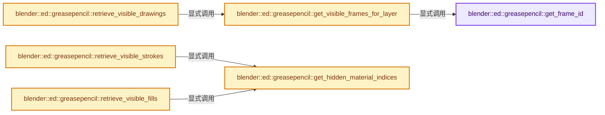

# 实现依赖专题：source/blender/editors/grease_pencil/intern/grease_pencil_utils.cc

[实现依赖导航](../../../../README.md) · [符号索引](../../../../../00-课程指南/02-源码与提交索引/符号依赖与实现索引.md)

本专题从正文实际调用进入，集中保存共享实现。函数有稳定锚点，可从调用处直接跳到对应完整函数；递归与互相调用通过回链组织。

## 本文件的实现关系




## 完整成员与函数实现

<a id="f-504d74feacc008c7"></a>

### `blender::ed::greasepencil::get_frame_id`

实现位置：[source/blender/editors/grease_pencil/intern/grease_pencil_utils.cc](../../../../../../../../../source/blender/editors/grease_pencil/intern/grease_pencil_utils.cc) · L536—L605。

接口参数：

- `const bke::greasepencil::Layer &layer`
- `const GreasePencilFrame &frame`
- `const int frame_number`
- `const int frame_index`
- `const int current_frame`
- `const int current_frame_index`
- `const int last_frame`
- `const int last_frame_index`
- `const bool use_multi_frame_editing`
- `const bool do_onion_skinning`
- `const bool is_before_first`
- `const GreasePencilOnionSkinningSettings onion_settings`

**教学注释版**

<!-- annotated:dbe8fce51e8149 -->

```cpp
static std::optional<int> get_frame_id(const bke::greasepencil::Layer &layer,
                                       const GreasePencilFrame &frame,
                                       const int frame_number,
                                       const int frame_index,
                                       const int current_frame,
                                       const int current_frame_index,
                                       const int last_frame,
                                       const int last_frame_index,
                                       const bool use_multi_frame_editing,
                                       const bool do_onion_skinning,
                                       const bool is_before_first,
                                       const GreasePencilOnionSkinningSettings onion_settings)
{
  if (use_multi_frame_editing) {
    if (frame.is_selected()) {
      if (do_onion_skinning) {
        return (frame_number < current_frame) ? -1 : 1;
      }
      return 0;
    }
    return {};
  }
  if (do_onion_skinning && layer.use_onion_skinning()) {
    /* Keyframe type filter. */
    if (onion_settings.filter != 0 && (onion_settings.filter & (1 << frame.type)) == 0) {
      return {};
    }
    /* Selected mode filter. */
    if (onion_settings.mode == GP_ONION_SKINNING_MODE_SELECTED && !frame.is_selected()) {
      return {};
    }

    int delta = 0;
    if (onion_settings.mode == GP_ONION_SKINNING_MODE_ABSOLUTE) {
      delta = frame_number - current_frame;
    }
    else {
      delta = frame_index - current_frame_index;
    }

    if (is_before_first) {
      delta++;
    }
    if ((onion_settings.flag & GP_ONION_SKINNING_SHOW_LOOP) != 0 &&
        (-delta > onion_settings.num_frames_before || delta > onion_settings.num_frames_after))
    {
      /* We wrap the value using the last frame and 0 as reference. */
      /* FIXME: This might not be good for animations not starting at 0. */
      int shift = 0;
      if (onion_settings.mode == GP_ONION_SKINNING_MODE_ABSOLUTE) {
        shift = last_frame;
      }
      else {
        shift = last_frame_index;
      }
      delta += (delta < 0) ? (shift + 1) : -(shift + 1);
    }
    /* Frame range filter. */
    if (ELEM(onion_settings.mode,
             GP_ONION_SKINNING_MODE_ABSOLUTE,
             GP_ONION_SKINNING_MODE_RELATIVE) &&
        (-delta > onion_settings.num_frames_before || delta > onion_settings.num_frames_after))
    {
      return {};
    }

    return delta;
  }
  return {};
}
```

<details>
<summary>核对原始源码：source/blender/editors/grease_pencil/intern/grease_pencil_utils.cc · L536—L605</summary>

<!-- original:dbe8fce51e8149:source/blender/editors/grease_pencil/intern/grease_pencil_utils.cc:536:605 -->

```cpp
static std::optional<int> get_frame_id(const bke::greasepencil::Layer &layer,
                                       const GreasePencilFrame &frame,
                                       const int frame_number,
                                       const int frame_index,
                                       const int current_frame,
                                       const int current_frame_index,
                                       const int last_frame,
                                       const int last_frame_index,
                                       const bool use_multi_frame_editing,
                                       const bool do_onion_skinning,
                                       const bool is_before_first,
                                       const GreasePencilOnionSkinningSettings onion_settings)
{
  if (use_multi_frame_editing) {
    if (frame.is_selected()) {
      if (do_onion_skinning) {
        return (frame_number < current_frame) ? -1 : 1;
      }
      return 0;
    }
    return {};
  }
  if (do_onion_skinning && layer.use_onion_skinning()) {
    /* Keyframe type filter. */
    if (onion_settings.filter != 0 && (onion_settings.filter & (1 << frame.type)) == 0) {
      return {};
    }
    /* Selected mode filter. */
    if (onion_settings.mode == GP_ONION_SKINNING_MODE_SELECTED && !frame.is_selected()) {
      return {};
    }

    int delta = 0;
    if (onion_settings.mode == GP_ONION_SKINNING_MODE_ABSOLUTE) {
      delta = frame_number - current_frame;
    }
    else {
      delta = frame_index - current_frame_index;
    }

    if (is_before_first) {
      delta++;
    }
    if ((onion_settings.flag & GP_ONION_SKINNING_SHOW_LOOP) != 0 &&
        (-delta > onion_settings.num_frames_before || delta > onion_settings.num_frames_after))
    {
      /* We wrap the value using the last frame and 0 as reference. */
      /* FIXME: This might not be good for animations not starting at 0. */
      int shift = 0;
      if (onion_settings.mode == GP_ONION_SKINNING_MODE_ABSOLUTE) {
        shift = last_frame;
      }
      else {
        shift = last_frame_index;
      }
      delta += (delta < 0) ? (shift + 1) : -(shift + 1);
    }
    /* Frame range filter. */
    if (ELEM(onion_settings.mode,
             GP_ONION_SKINNING_MODE_ABSOLUTE,
             GP_ONION_SKINNING_MODE_RELATIVE) &&
        (-delta > onion_settings.num_frames_before || delta > onion_settings.num_frames_after))
    {
      return {};
    }

    return delta;
  }
  return {};
}
```

</details>

**沿实际写入检查状态**

- `delta = frame_number - current_frame;`
- `delta = frame_index - current_frame_index;`
- `shift = last_frame;`
- `shift = last_frame_index;`
- `delta += (delta < 0) ? (shift + 1) : -(shift + 1);`

**结果出口**

- `return (frame_number < current_frame) ? -1 : 1;`
- `return 0;`
- `return {};`
- `return delta;`

**继续追踪实现**

- `frame.is_selected` → [blender::GreasePencilFrame::is_selected · L1092](../../../../02-BKE几何与数据/BKE_grease_pencil.hh.md#f-a6db8dd8d7a6ec70)。
- `layer.use_onion_skinning` → [blender::bke::greasepencil::TreeNode::use_onion_skinning · L917](../../../../02-BKE几何与数据/BKE_grease_pencil.hh.md#f-f30929cd8a9a0a69)。
- `ELEM` → [ELEM · L88](../../../../07-Intern运行时与平台/ghost/intern/GHOST_utildefines.hh.md#m-d28724a15928)；[ELEM · L135](../../../../01-BLI基础库/BLI_utildefines.hh.md#m-d6572de7cae0)。宏定义由构建条件选择。

<a id="f-445e52e21f5b6d0c"></a>

### `blender::ed::greasepencil::get_visible_frames_for_layer`

实现位置：[source/blender/editors/grease_pencil/intern/grease_pencil_utils.cc](../../../../../../../../../source/blender/editors/grease_pencil/intern/grease_pencil_utils.cc) · L607—L654。

接口参数：

- `const GreasePencil &grease_pencil`
- `const bke::greasepencil::Layer &layer`
- `const int current_frame`
- `const bool use_multi_frame_editing`
- `const bool do_onion_skinning`

**教学注释版**

<!-- annotated:ea235d4a0f0943 -->

```cpp
static Array<std::pair<int, int>> get_visible_frames_for_layer(
    const GreasePencil &grease_pencil,
    const bke::greasepencil::Layer &layer,
    const int current_frame,
    const bool use_multi_frame_editing,
    const bool do_onion_skinning)
{
  GreasePencilOnionSkinningSettings onion_settings = grease_pencil.onion_skinning_settings;
  Vector<std::pair<int, int>> frame_numbers;
  const Span<int> sorted_keys = layer.sorted_keys();
  // [讲解] sorted_keys.is_empty：查询视图长度或生成对应有效索引区间。
  if (sorted_keys.is_empty()) {
    return {};
  }
  // [讲解] std::max：按比较关系选取较大值。本讲解中的增长公式同时满足最低请求和几何增长；若保存返回引用，还需注意实参寿命。
  const int current_frame_index = std::max(layer.sorted_keys_index_at(current_frame), 0);
  // [讲解] sorted_keys.last：按视图边界访问元素。
  const int last_frame = sorted_keys.last();
  // [讲解] sorted_keys.index_range：查询视图长度或生成对应有效索引区间。
  const int last_frame_index = sorted_keys.index_range().last();
  // [讲解] sorted_keys.first：按视图边界访问元素。
  const bool is_before_first = (current_frame < sorted_keys.first());
  const std::optional<int> current_start_frame = layer.start_frame_at(current_frame);
  for (const int frame_i : sorted_keys.index_range()) {
    const int frame_number = sorted_keys[frame_i];
    if (current_start_frame && *current_start_frame == frame_number) {
      continue;
    }
    const GreasePencilFrame &frame = layer.frames().lookup(frame_number);
    const std::optional<int> frame_id = get_frame_id(layer,
                                                     frame,
                                                     frame_number,
                                                     frame_i,
                                                     current_frame,
                                                     current_frame_index,
                                                     last_frame,
                                                     last_frame_index,
                                                     use_multi_frame_editing,
                                                     do_onion_skinning,
                                                     is_before_first,
                                                     onion_settings);
    if (!frame_id.has_value()) {
      /* Drawing on this frame is not visible. */
      continue;
    }

    // [讲解] frame_numbers.append：在尾部建立新元素，必要时先扩大存储。
    frame_numbers.append({frame_number, *frame_id});
  }

  frame_numbers.append({current_frame, 0});

  // [讲解] frame_numbers.as_span：构造对当前有效元素区间的借用视图。
  return frame_numbers.as_span();
}
```

<details>
<summary>核对原始源码：source/blender/editors/grease_pencil/intern/grease_pencil_utils.cc · L607—L654</summary>

<!-- original:ea235d4a0f0943:source/blender/editors/grease_pencil/intern/grease_pencil_utils.cc:607:654 -->

```cpp
static Array<std::pair<int, int>> get_visible_frames_for_layer(
    const GreasePencil &grease_pencil,
    const bke::greasepencil::Layer &layer,
    const int current_frame,
    const bool use_multi_frame_editing,
    const bool do_onion_skinning)
{
  GreasePencilOnionSkinningSettings onion_settings = grease_pencil.onion_skinning_settings;
  Vector<std::pair<int, int>> frame_numbers;
  const Span<int> sorted_keys = layer.sorted_keys();
  if (sorted_keys.is_empty()) {
    return {};
  }
  const int current_frame_index = std::max(layer.sorted_keys_index_at(current_frame), 0);
  const int last_frame = sorted_keys.last();
  const int last_frame_index = sorted_keys.index_range().last();
  const bool is_before_first = (current_frame < sorted_keys.first());
  const std::optional<int> current_start_frame = layer.start_frame_at(current_frame);
  for (const int frame_i : sorted_keys.index_range()) {
    const int frame_number = sorted_keys[frame_i];
    if (current_start_frame && *current_start_frame == frame_number) {
      continue;
    }
    const GreasePencilFrame &frame = layer.frames().lookup(frame_number);
    const std::optional<int> frame_id = get_frame_id(layer,
                                                     frame,
                                                     frame_number,
                                                     frame_i,
                                                     current_frame,
                                                     current_frame_index,
                                                     last_frame,
                                                     last_frame_index,
                                                     use_multi_frame_editing,
                                                     do_onion_skinning,
                                                     is_before_first,
                                                     onion_settings);
    if (!frame_id.has_value()) {
      /* Drawing on this frame is not visible. */
      continue;
    }

    frame_numbers.append({frame_number, *frame_id});
  }

  frame_numbers.append({current_frame, 0});

  return frame_numbers.as_span();
}
```

</details>

**结果出口**

- `return {};`
- `return frame_numbers.as_span();`

**继续追踪实现**

- `layer.sorted_keys` → [blender::bke::greasepencil::Layer::sorted_keys · L1741](../../../../02-BKE几何与数据/intern/grease_pencil.cc.md#f-5e00c8774e32ca6c)。
- `sorted_keys.is_empty` → [blender::Span::is_empty · L264](../../../../../01-基础容器与现代CPP/05-Span只读连续视图.md#f-8cc1d7ba8feb50e6)。
- `std::max` → [外部契约](https://eel.is/c++draft/alg.min.max)：按比较关系选取较大值。本讲解中的增长公式同时满足最低请求和几何增长；若保存返回引用，还需注意实参寿命。
- `layer.sorted_keys_index_at` → [blender::bke::greasepencil::Layer::sorted_keys_index_at · L1796](../../../../02-BKE几何与数据/intern/grease_pencil.cc.md#f-882573ea927b4af0)。
- `sorted_keys.last` → [blender::Span::last · L329](../../../../../01-基础容器与现代CPP/05-Span只读连续视图.md#f-a92146c285596891)。
- `sorted_keys.index_range().last` → [调用协议](../../../../../00-课程指南/01-路线与规范/模板宏与动态分派协议.md)：接收对象类型依赖auto、返回值或模板实例；不按同名猜测目标。调用位置L622。
- `sorted_keys.index_range` → [blender::Span::index_range · L405](../../../../../01-基础容器与现代CPP/05-Span只读连续视图.md#f-caaa9b06e13e53e0)。
- `sorted_keys.first` → [blender::Span::first · L319](../../../../../01-基础容器与现代CPP/05-Span只读连续视图.md#f-d8c9bcc3e9757248)。
- `layer.start_frame_at` → [blender::bke::greasepencil::Layer::start_frame_at · L1786](../../../../02-BKE几何与数据/intern/grease_pencil.cc.md#f-570e107fb286ae92)。
- `layer.frames().lookup` → [调用协议](../../../../../00-课程指南/01-路线与规范/模板宏与动态分派协议.md)：接收对象类型依赖auto、返回值或模板实例；不按同名猜测目标。调用位置L630。
- `layer.frames` → [blender::bke::greasepencil::Layer::frames · L1632](../../../../02-BKE几何与数据/intern/grease_pencil.cc.md#f-b94ffd8cfd88ea17)。
- `get_frame_id` → [blender::ed::greasepencil::get_frame_id · L536](grease_pencil_utils.cc.md#f-504d74feacc008c7)。
- `frame_id.has_value` → [外部契约](https://eel.is/c++draft/)：这个边界按实际表达式及所属类型核对参数、返回值、寿命与失败行为。这里提供接口入口，不声称已解释该第三方版本的内部实现。
- `frame_numbers.append` → [blender::Vector::append · L498](../../../../../01-基础容器与现代CPP/11-Vector插入删除与重排.md#f-5bde268a69e443ec)；[blender::Vector::append · L502](../../../../../01-基础容器与现代CPP/11-Vector插入删除与重排.md#f-591e0b15e6308532)。同名重载需按实参类型选择。
- `frame_numbers.as_span` → [blender::Vector::as_span · L390](../../../../../01-基础容器与现代CPP/10-Vector扩容与增长.md#f-e2eed03cefcdd2ff)。

<a id="f-9a0d684a08cda427"></a>

### `blender::ed::greasepencil::retrieve_visible_drawings`

实现位置：[source/blender/editors/grease_pencil/intern/grease_pencil_utils.cc](../../../../../../../../../source/blender/editors/grease_pencil/intern/grease_pencil_utils.cc) · L890—L917。

接口参数：

- `const Scene &scene`
- `const GreasePencil &grease_pencil`
- `const bool do_onion_skinning`

**教学注释版**

<!-- annotated:55f184222ebad4 -->

```cpp
Vector<DrawingInfo> retrieve_visible_drawings(const Scene &scene,
                                              const GreasePencil &grease_pencil,
                                              const bool do_onion_skinning)
{
  using namespace blender::bke::greasepencil;
  const int current_frame = BKE_scene_ctime_get(&scene);
  const ToolSettings *toolsettings = scene.toolsettings;
  const bool use_multi_frame_editing = (toolsettings->gpencil_flags &
                                        GP_USE_MULTI_FRAME_EDITING) != 0;

  Vector<DrawingInfo> visible_drawings;
  Span<const Layer *> layers = grease_pencil.layers();
  // [讲解] layers.index_range：查询视图长度或生成对应有效索引区间。
  for (const int layer_i : layers.index_range()) {
    const Layer &layer = *layers[layer_i];
    if (!layer.is_visible()) {
      continue;
    }
    const Array<std::pair<int, int>> frames = get_visible_frames_for_layer(
        grease_pencil, layer, current_frame, use_multi_frame_editing, do_onion_skinning);
    for (const auto &[frame_number, onion_id] : frames) {
      if (const Drawing *drawing = grease_pencil.get_drawing_at(layer, frame_number)) {
        // [讲解] visible_drawings.append：在尾部建立新元素，必要时先扩大存储。
        visible_drawings.append({*drawing, layer_i, frame_number, onion_id});
      }
    }
  }

  return visible_drawings;
}
```

<details>
<summary>核对原始源码：source/blender/editors/grease_pencil/intern/grease_pencil_utils.cc · L890—L917</summary>

<!-- original:55f184222ebad4:source/blender/editors/grease_pencil/intern/grease_pencil_utils.cc:890:917 -->

```cpp
Vector<DrawingInfo> retrieve_visible_drawings(const Scene &scene,
                                              const GreasePencil &grease_pencil,
                                              const bool do_onion_skinning)
{
  using namespace blender::bke::greasepencil;
  const int current_frame = BKE_scene_ctime_get(&scene);
  const ToolSettings *toolsettings = scene.toolsettings;
  const bool use_multi_frame_editing = (toolsettings->gpencil_flags &
                                        GP_USE_MULTI_FRAME_EDITING) != 0;

  Vector<DrawingInfo> visible_drawings;
  Span<const Layer *> layers = grease_pencil.layers();
  for (const int layer_i : layers.index_range()) {
    const Layer &layer = *layers[layer_i];
    if (!layer.is_visible()) {
      continue;
    }
    const Array<std::pair<int, int>> frames = get_visible_frames_for_layer(
        grease_pencil, layer, current_frame, use_multi_frame_editing, do_onion_skinning);
    for (const auto &[frame_number, onion_id] : frames) {
      if (const Drawing *drawing = grease_pencil.get_drawing_at(layer, frame_number)) {
        visible_drawings.append({*drawing, layer_i, frame_number, onion_id});
      }
    }
  }

  return visible_drawings;
}
```

</details>

**结果出口**

- `return visible_drawings;`

**继续追踪实现**

- `BKE_scene_ctime_get` → [blender::BKE_scene_ctime_get · L2591](../../../../02-BKE几何与数据/intern/scene.cc.md#f-5e28483f19a62bf5)。
- `grease_pencil.layers` → [blender::GreasePencil::layers · L3983](../../../../02-BKE几何与数据/intern/grease_pencil.cc.md#f-15d64ed11a2babc0)。
- `layers.index_range` → [blender::Span::index_range · L405](../../../../../01-基础容器与现代CPP/05-Span只读连续视图.md#f-caaa9b06e13e53e0)。
- `layer.is_visible` → [调用协议](../../../../../00-课程指南/01-路线与规范/模板宏与动态分派协议.md)：由接收对象具体类型或运行时策略提供实现。调用位置L904。
- `get_visible_frames_for_layer` → [blender::ed::greasepencil::get_visible_frames_for_layer · L607](grease_pencil_utils.cc.md#f-445e52e21f5b6d0c)。
- `grease_pencil.get_drawing_at` → [blender::GreasePencil::get_drawing_at · L3814](../../../../02-BKE几何与数据/intern/grease_pencil.cc.md#f-c38643507419f9ee)；[blender::GreasePencil::get_drawing_at · L3834](../../../../02-BKE几何与数据/intern/grease_pencil.cc.md#f-42398964c13c6abb)。同名重载需按实参类型选择。
- `visible_drawings.append` → [blender::Vector::append · L498](../../../../../01-基础容器与现代CPP/11-Vector插入删除与重排.md#f-5bde268a69e443ec)；[blender::Vector::append · L502](../../../../../01-基础容器与现代CPP/11-Vector插入删除与重排.md#f-591e0b15e6308532)。同名重载需按实参类型选择。

<a id="f-a7924a460b2320b8"></a>

### `blender::ed::greasepencil::get_hidden_material_indices`

实现位置：[source/blender/editors/grease_pencil/intern/grease_pencil_utils.cc](../../../../../../../../../source/blender/editors/grease_pencil/intern/grease_pencil_utils.cc) · L936—L949。

接口参数：

- `Object &object`

**教学注释版**

<!-- annotated:55a52ffcd5ff52 -->

```cpp
static VectorSet<int> get_hidden_material_indices(Object &object)
{
  BLI_assert(object.type == OB_GREASE_PENCIL);
  VectorSet<int> hidden_material_indices;
  for (const int mat_i : IndexRange(object.totcol)) {
    Material *material = BKE_object_material_get(&object, mat_i + 1);
    if (material != nullptr && material->gp_style != nullptr &&
        (material->gp_style->flag & GP_MATERIAL_HIDE) != 0)
    {
      // [讲解] hidden_material_indices.add_new：按哈希与相等关系加入键或键值。
      hidden_material_indices.add_new(mat_i);
    }
  }
  return hidden_material_indices;
}
```

<details>
<summary>核对原始源码：source/blender/editors/grease_pencil/intern/grease_pencil_utils.cc · L936—L949</summary>

<!-- original:55a52ffcd5ff52:source/blender/editors/grease_pencil/intern/grease_pencil_utils.cc:936:949 -->

```cpp
static VectorSet<int> get_hidden_material_indices(Object &object)
{
  BLI_assert(object.type == OB_GREASE_PENCIL);
  VectorSet<int> hidden_material_indices;
  for (const int mat_i : IndexRange(object.totcol)) {
    Material *material = BKE_object_material_get(&object, mat_i + 1);
    if (material != nullptr && material->gp_style != nullptr &&
        (material->gp_style->flag & GP_MATERIAL_HIDE) != 0)
    {
      hidden_material_indices.add_new(mat_i);
    }
  }
  return hidden_material_indices;
}
```

</details>

**结果出口**

- `return hidden_material_indices;`

**继续追踪实现**

- `BLI_assert` → [BLI_assert · L48](../../../../01-BLI基础库/BLI_assert.hh.md#m-57a88495704d)；[BLI_assert · L63](../../../../01-BLI基础库/BLI_assert.hh.md#m-d07050020cb5)。宏定义由构建条件选择。
- `IndexRange` → [blender::IndexRange](../../../../01-BLI基础库/BLI_index_range.hh.md#t-caa3466d6776)；[blender::gpu::shader::parser::IndexRange](../../../gpu/shader_tool/utils.hh.md#t-82d2bd4ea71c)；[blender::IndexRange](../../../makesdna/DNA_node_types.h.md#t-0448cc889d39)。
- `BKE_object_material_get` → [blender::BKE_object_material_get · L759](../../../../02-BKE几何与数据/intern/material.cc.md#f-9e9ad276ccef84b3)。
- `hidden_material_indices.add_new` → [blender::VectorSet::add_new · L336](../../../../../01-基础容器与现代CPP/14-VectorSet稳定索引与去重.md#f-03989f7359a8636d)；[blender::VectorSet::add_new · L340](../../../../../01-基础容器与现代CPP/14-VectorSet稳定索引与去重.md#f-ef9174f041011a6b)。同名重载需按实参类型选择。

<a id="f-97a04ce613cbc6c6"></a>

### `blender::ed::greasepencil::retrieve_visible_strokes`

实现位置：[source/blender/editors/grease_pencil/intern/grease_pencil_utils.cc](../../../../../../../../../source/blender/editors/grease_pencil/intern/grease_pencil_utils.cc) · L1109—L1131。

接口参数：

- `Object &object`
- `const bke::greasepencil::Drawing &drawing`
- `IndexMaskMemory &memory`

**教学注释版**

<!-- annotated:f1133df35412c9 -->

```cpp
IndexMask retrieve_visible_strokes(Object &object,
                                   const bke::greasepencil::Drawing &drawing,
                                   IndexMaskMemory &memory)
{
  /* Get all the hidden material indices. */
  VectorSet<int> hidden_material_indices = get_hidden_material_indices(object);

  // [讲解] hidden_material_indices.is_empty：查询活项数量或键是否存在。
  if (hidden_material_indices.is_empty()) {
    return drawing.strokes().curves_range();
  }

  const bke::CurvesGeometry &curves = drawing.strokes();
  const IndexRange curves_range = drawing.strokes().curves_range();
  const bke::AttributeAccessor attributes = curves.attributes();

  /* Get all the strokes that have their material visible. */
  const VArray<int> materials = *attributes.lookup_or_default<int>(
      "material_index", bke::AttrDomain::Curve, 0);
  return IndexMask::from_predicate(curves_range, memory, [&](const int64_t curve_i) {
    const int material_index = materials[curve_i];
    // [讲解] hidden_material_indices.contains：查询活项数量或键是否存在。
    return !hidden_material_indices.contains(material_index);
  });
}
```

<details>
<summary>核对原始源码：source/blender/editors/grease_pencil/intern/grease_pencil_utils.cc · L1109—L1131</summary>

<!-- original:f1133df35412c9:source/blender/editors/grease_pencil/intern/grease_pencil_utils.cc:1109:1131 -->

```cpp
IndexMask retrieve_visible_strokes(Object &object,
                                   const bke::greasepencil::Drawing &drawing,
                                   IndexMaskMemory &memory)
{
  /* Get all the hidden material indices. */
  VectorSet<int> hidden_material_indices = get_hidden_material_indices(object);

  if (hidden_material_indices.is_empty()) {
    return drawing.strokes().curves_range();
  }

  const bke::CurvesGeometry &curves = drawing.strokes();
  const IndexRange curves_range = drawing.strokes().curves_range();
  const bke::AttributeAccessor attributes = curves.attributes();

  /* Get all the strokes that have their material visible. */
  const VArray<int> materials = *attributes.lookup_or_default<int>(
      "material_index", bke::AttrDomain::Curve, 0);
  return IndexMask::from_predicate(curves_range, memory, [&](const int64_t curve_i) {
    const int material_index = materials[curve_i];
    return !hidden_material_indices.contains(material_index);
  });
}
```

</details>

**结果出口**

- `return drawing.strokes().curves_range();`
- `return IndexMask::from_predicate(curves_range, memory, [&](const int64_t curve_i) {`
- `return !hidden_material_indices.contains(material_index);`

**继续追踪实现**

- `get_hidden_material_indices` → [blender::ed::greasepencil::get_hidden_material_indices · L936](grease_pencil_utils.cc.md#f-a7924a460b2320b8)。
- `hidden_material_indices.is_empty` → [blender::VectorSet::is_empty · L619](../../../../../01-基础容器与现代CPP/14-VectorSet稳定索引与去重.md#f-0d62a24040f63dec)。
- `drawing.strokes().curves_range` → [调用协议](../../../../../00-课程指南/01-路线与规范/模板宏与动态分派协议.md)：接收对象类型依赖auto、返回值或模板实例；不按同名猜测目标。调用位置L1117。
- `drawing.strokes` → [blender::bke::greasepencil::Drawing::strokes · L1007](../../../../02-BKE几何与数据/intern/grease_pencil.cc.md#f-59e6522a8e8ac409)。
- `curves.attributes` → [blender::bke::CurvesGeometry::attributes · L1908](../../../../02-BKE几何与数据/intern/curves_geometry.cc.md#f-8e24fbf758862a22)。
- `attributes.lookup_or_default<int>` → [blender::bke::AttributeAccessor::lookup_or_default · L415](../../../../02-BKE几何与数据/intern/attribute_access.cc.md#f-a0cc3e316f1da4bd)；[blender::bke::AttributeAccessor::lookup_or_default · L643](../../../../../05-几何存储与拓扑映射/08-AttributeAccessor接口.md#f-e3d2ed81ebe0af61)。同名重载需按实参类型选择。
- `IndexMask::from_predicate` → [blender::index_mask::IndexMask::from_predicate · L1073](../../../../../04-虚拟数组与索引选择/12-重构历史与基准练习.md#f-3864daa059098df8)。
- `hidden_material_indices.contains` → [blender::VectorSet::contains · L406](../../../../../01-基础容器与现代CPP/14-VectorSet稳定索引与去重.md#f-c940dd79693ca442)。

<a id="f-9e0ff78f51cf60c0"></a>

### `blender::ed::greasepencil::retrieve_visible_fills`

实现位置：[source/blender/editors/grease_pencil/intern/grease_pencil_utils.cc](../../../../../../../../../source/blender/editors/grease_pencil/intern/grease_pencil_utils.cc) · L1236—L1263。

接口参数：

- `Object &object`
- `const bke::greasepencil::Drawing &drawing`
- `IndexMaskMemory &memory`

**教学注释版**

<!-- annotated:31311e7cef30ec -->

```cpp
IndexMask retrieve_visible_fills(Object &object,
                                 const bke::greasepencil::Drawing &drawing,
                                 IndexMaskMemory &memory)
{
  VectorSet<int> hidden_material_indices = get_hidden_material_indices(object);

  const std::optional<GroupedSpan<int>> fills = drawing.fills();
  if (!fills) {
    return {};
  }

  // [讲解] hidden_material_indices.is_empty：查询活项数量或键是否存在。
  if (hidden_material_indices.is_empty()) {
    return fills->index_range();
  }

  const bke::CurvesGeometry &curves = drawing.strokes();
  const bke::AttributeAccessor attributes = curves.attributes();

  /* Get all the fills that have their first curve's material visible. */
  const VArray<int> materials = *attributes.lookup_or_default<int>(
      "material_index", bke::AttrDomain::Curve, 0);
  return IndexMask::from_predicate(fills->index_range(), memory, [&](const int64_t fill_index) {
    const Span<int> fill = (*fills)[fill_index];
    // [讲解] fill.first：按视图边界访问元素。
    const int curve_i = fill.first();
    const int material_index = materials[curve_i];
    // [讲解] hidden_material_indices.contains：查询活项数量或键是否存在。
    return !hidden_material_indices.contains(material_index);
  });
}
```

<details>
<summary>核对原始源码：source/blender/editors/grease_pencil/intern/grease_pencil_utils.cc · L1236—L1263</summary>

<!-- original:31311e7cef30ec:source/blender/editors/grease_pencil/intern/grease_pencil_utils.cc:1236:1263 -->

```cpp
IndexMask retrieve_visible_fills(Object &object,
                                 const bke::greasepencil::Drawing &drawing,
                                 IndexMaskMemory &memory)
{
  VectorSet<int> hidden_material_indices = get_hidden_material_indices(object);

  const std::optional<GroupedSpan<int>> fills = drawing.fills();
  if (!fills) {
    return {};
  }

  if (hidden_material_indices.is_empty()) {
    return fills->index_range();
  }

  const bke::CurvesGeometry &curves = drawing.strokes();
  const bke::AttributeAccessor attributes = curves.attributes();

  /* Get all the fills that have their first curve's material visible. */
  const VArray<int> materials = *attributes.lookup_or_default<int>(
      "material_index", bke::AttrDomain::Curve, 0);
  return IndexMask::from_predicate(fills->index_range(), memory, [&](const int64_t fill_index) {
    const Span<int> fill = (*fills)[fill_index];
    const int curve_i = fill.first();
    const int material_index = materials[curve_i];
    return !hidden_material_indices.contains(material_index);
  });
}
```

</details>

**结果出口**

- `return {};`
- `return fills->index_range();`
- `return IndexMask::from_predicate(fills->index_range(), memory, [&](const int64_t fill_index) {`
- `return !hidden_material_indices.contains(material_index);`

**继续追踪实现**

- `get_hidden_material_indices` → [blender::ed::greasepencil::get_hidden_material_indices · L936](grease_pencil_utils.cc.md#f-a7924a460b2320b8)。
- `drawing.fills` → [blender::bke::greasepencil::Drawing::fills · L471](../../../../02-BKE几何与数据/intern/grease_pencil.cc.md#f-0c72835da55064f9)。
- `hidden_material_indices.is_empty` → [blender::VectorSet::is_empty · L619](../../../../../01-基础容器与现代CPP/14-VectorSet稳定索引与去重.md#f-0d62a24040f63dec)。
- `fills->index_range` → [外部契约](https://eel.is/c++draft/)：这个边界按实际表达式及所属类型核对参数、返回值、寿命与失败行为。这里提供接口入口，不声称已解释该第三方版本的内部实现。
- `drawing.strokes` → [blender::bke::greasepencil::Drawing::strokes · L1007](../../../../02-BKE几何与数据/intern/grease_pencil.cc.md#f-59e6522a8e8ac409)。
- `curves.attributes` → [blender::bke::CurvesGeometry::attributes · L1908](../../../../02-BKE几何与数据/intern/curves_geometry.cc.md#f-8e24fbf758862a22)。
- `attributes.lookup_or_default<int>` → [blender::bke::AttributeAccessor::lookup_or_default · L415](../../../../02-BKE几何与数据/intern/attribute_access.cc.md#f-a0cc3e316f1da4bd)；[blender::bke::AttributeAccessor::lookup_or_default · L643](../../../../../05-几何存储与拓扑映射/08-AttributeAccessor接口.md#f-e3d2ed81ebe0af61)。同名重载需按实参类型选择。
- `IndexMask::from_predicate` → [blender::index_mask::IndexMask::from_predicate · L1073](../../../../../04-虚拟数组与索引选择/12-重构历史与基准练习.md#f-3864daa059098df8)。
- `fill.first` → [blender::Span::first · L319](../../../../../01-基础容器与现代CPP/05-Span只读连续视图.md#f-d8c9bcc3e9757248)。
- `hidden_material_indices.contains` → [blender::VectorSet::contains · L406](../../../../../01-基础容器与现代CPP/14-VectorSet稳定索引与去重.md#f-c940dd79693ca442)。
