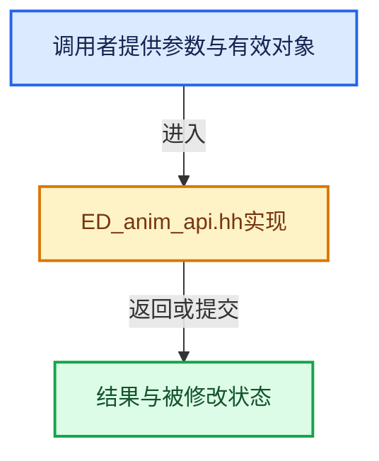

# 实现依赖专题：source/blender/editors/include/ED_anim_api.hh

[实现依赖导航](../../../README.md) · [符号索引](../../../../00-课程指南/02-源码与提交索引/符号依赖与实现索引.md)

本专题从正文实际调用进入，集中保存共享实现。函数有稳定锚点，可从调用处直接跳到对应完整函数；递归与互相调用通过回链组织。

## 本文件的实现关系





## 相关类型布局与成员入口

<a id="t-0af283128251"></a>

### `blender::eAnimCont_Types`

原始声明：[source/blender/editors/include/ED_anim_api.hh](../../../../../../../../source/blender/editors/include/ED_anim_api.hh) · L93—L118。

以下保留类的数据声明与编译条件，成员函数实现通过后面的精确链接阅读。

<!-- annotated:a118829626ab97 -->

```cpp
enum eAnimCont_Types {
  /** Invalid or no data. */
  ANIMCONT_NONE = 0,
  /** Action (#bAction). */
  ANIMCONT_ACTION = 1,
  /** Shape-key (#Key). */
  ANIMCONT_SHAPEKEY = 2,
  /** Grease pencil (screen). */
  ANIMCONT_GPENCIL = 3,
  /** Dope-sheet (#bDopesheet). */
  ANIMCONT_DOPESHEET = 4,
  /** Animation F-Curves (#bDopesheet). */
  ANIMCONT_FCURVES = 5,
  /** Drivers (#bDopesheet). */
  ANIMCONT_DRIVERS = 6,
  /** NLA (#bDopesheet). */
  ANIMCONT_NLA = 7,
  /** Animation channel (#bAnimListElem). */
  ANIMCONT_CHANNEL = 8,
  /** Mask dope-sheet. */
  ANIMCONT_MASK = 9,
  /** "timeline" editor (#bDopeSheet). */
  ANIMCONT_TIMELINE = 10,
  /** Cache file (#bDopeSheet). */
  ANIMCONT_CACHEFILE = 11,
};
```

<details>
<summary>核对原始源码：source/blender/editors/include/ED_anim_api.hh · L93—L118</summary>

<!-- original:a118829626ab97:source/blender/editors/include/ED_anim_api.hh:93:118 -->

```cpp
enum eAnimCont_Types {
  /** Invalid or no data. */
  ANIMCONT_NONE = 0,
  /** Action (#bAction). */
  ANIMCONT_ACTION = 1,
  /** Shape-key (#Key). */
  ANIMCONT_SHAPEKEY = 2,
  /** Grease pencil (screen). */
  ANIMCONT_GPENCIL = 3,
  /** Dope-sheet (#bDopesheet). */
  ANIMCONT_DOPESHEET = 4,
  /** Animation F-Curves (#bDopesheet). */
  ANIMCONT_FCURVES = 5,
  /** Drivers (#bDopesheet). */
  ANIMCONT_DRIVERS = 6,
  /** NLA (#bDopesheet). */
  ANIMCONT_NLA = 7,
  /** Animation channel (#bAnimListElem). */
  ANIMCONT_CHANNEL = 8,
  /** Mask dope-sheet. */
  ANIMCONT_MASK = 9,
  /** "timeline" editor (#bDopeSheet). */
  ANIMCONT_TIMELINE = 10,
  /** Cache file (#bDopeSheet). */
  ANIMCONT_CACHEFILE = 11,
};
```

</details>


<a id="t-97eee1d02e33"></a>

### `blender::eAnimFilter_Flags`

原始声明：[source/blender/editors/include/ED_anim_api.hh](../../../../../../../../source/blender/editors/include/ED_anim_api.hh) · L390—L447。

以下保留类的数据声明与编译条件，成员函数实现通过后面的精确链接阅读。

<!-- annotated:41be3db0929bbb -->

```cpp
enum eAnimFilter_Flags {
  /**
   * Data which channel represents is fits the dope-sheet filters
   * (i.e. scene visibility criteria).
   *
   * XXX: it's hard to think of any examples where this *ISN'T* the case...
   * perhaps becomes implicit?
   */
  ANIMFILTER_DATA_VISIBLE = (1 << 0),
  /** channel is visible within the channel-list hierarchy
   * (i.e. F-Curves within Groups in ActEdit) */
  ANIMFILTER_LIST_VISIBLE = (1 << 1),
  /** channel has specifically been tagged as visible in Graph Editor (* Graph Editor Only) */
  ANIMFILTER_CURVE_VISIBLE = (1 << 2),

  /** include summary channels and "expanders" (for drawing/mouse-selection in channel list) */
  ANIMFILTER_LIST_CHANNELS = (1 << 3),

  /** for its type, channel should be "active" one */
  ANIMFILTER_ACTIVE = (1 << 4),
  /** channel is a child of the active group (* Actions specialty) */
  ANIMFILTER_ACTGROUPED = (1 << 5),

  /** channel must be selected/not-selected, but both must not be set together */
  ANIMFILTER_SEL = (1 << 6),
  ANIMFILTER_UNSEL = (1 << 7),

  /** editability status - must be editable to be included */
  ANIMFILTER_FOREDIT = (1 << 8),
  /** only selected animchannels should be considerable as editable - mainly
   * for Graph Editor's option for keys on select curves only */
  ANIMFILTER_SELEDIT = (1 << 9),

  /**
   * Flags used to enforce certain data types.
   *
   * \note The ones for curves and NLA tracks were redundant and have been removed for now.
   */
  ANIMFILTER_ANIMDATA = (1 << 10),

  /** duplicate entries for animation data attached to multi-user blocks must not occur */
  ANIMFILTER_NODUPLIS = (1 << 11),

  /**
   * Avoid channels that don't have any F-curve data under them.
   *
   * Note that this isn't just direct fcurve channels, but also includes e.g.
   * channel groups with fcurve channels as members.
   */
  ANIMFILTER_FCURVESONLY = (1 << 12),

  /** for checking if we should keep some collapsed channel around (internal use only!) */
  ANIMFILTER_TMP_PEEK = (1 << 30),

  /** Ignore ONLYSEL flag from #bDopeSheet.filterflag (internal use only!) */
  ANIMFILTER_TMP_IGNORE_ONLYSEL = (1u << 31),

};
```

<details>
<summary>核对原始源码：source/blender/editors/include/ED_anim_api.hh · L390—L447</summary>

<!-- original:41be3db0929bbb:source/blender/editors/include/ED_anim_api.hh:390:447 -->

```cpp
enum eAnimFilter_Flags {
  /**
   * Data which channel represents is fits the dope-sheet filters
   * (i.e. scene visibility criteria).
   *
   * XXX: it's hard to think of any examples where this *ISN'T* the case...
   * perhaps becomes implicit?
   */
  ANIMFILTER_DATA_VISIBLE = (1 << 0),
  /** channel is visible within the channel-list hierarchy
   * (i.e. F-Curves within Groups in ActEdit) */
  ANIMFILTER_LIST_VISIBLE = (1 << 1),
  /** channel has specifically been tagged as visible in Graph Editor (* Graph Editor Only) */
  ANIMFILTER_CURVE_VISIBLE = (1 << 2),

  /** include summary channels and "expanders" (for drawing/mouse-selection in channel list) */
  ANIMFILTER_LIST_CHANNELS = (1 << 3),

  /** for its type, channel should be "active" one */
  ANIMFILTER_ACTIVE = (1 << 4),
  /** channel is a child of the active group (* Actions specialty) */
  ANIMFILTER_ACTGROUPED = (1 << 5),

  /** channel must be selected/not-selected, but both must not be set together */
  ANIMFILTER_SEL = (1 << 6),
  ANIMFILTER_UNSEL = (1 << 7),

  /** editability status - must be editable to be included */
  ANIMFILTER_FOREDIT = (1 << 8),
  /** only selected animchannels should be considerable as editable - mainly
   * for Graph Editor's option for keys on select curves only */
  ANIMFILTER_SELEDIT = (1 << 9),

  /**
   * Flags used to enforce certain data types.
   *
   * \note The ones for curves and NLA tracks were redundant and have been removed for now.
   */
  ANIMFILTER_ANIMDATA = (1 << 10),

  /** duplicate entries for animation data attached to multi-user blocks must not occur */
  ANIMFILTER_NODUPLIS = (1 << 11),

  /**
   * Avoid channels that don't have any F-curve data under them.
   *
   * Note that this isn't just direct fcurve channels, but also includes e.g.
   * channel groups with fcurve channels as members.
   */
  ANIMFILTER_FCURVESONLY = (1 << 12),

  /** for checking if we should keep some collapsed channel around (internal use only!) */
  ANIMFILTER_TMP_PEEK = (1 << 30),

  /** Ignore ONLYSEL flag from #bDopeSheet.filterflag (internal use only!) */
  ANIMFILTER_TMP_IGNORE_ONLYSEL = (1u << 31),

};
```

</details>


<a id="m-aa8a5bed9b49"></a>

## 宏 `FILTER_WOR_SCED`

<!-- annotated:dc5cfb7a862260 -->

```cpp
#define FILTER_WOR_SCED(wo) (CHECK_TYPE_INLINE(wo, World *), (wo->flag & WO_DS_EXPAND))
#define FILTER_LS_SCED(linestyle) ((linestyle->flag & LS_DS_EXPAND))
```

<details>
<summary>核对原始源码：source/blender/editors/include/ED_anim_api.hh · L463—L464</summary>

<!-- original:dc5cfb7a862260:source/blender/editors/include/ED_anim_api.hh:463:464 -->

```cpp
#define FILTER_WOR_SCED(wo) (CHECK_TYPE_INLINE(wo, World *), (wo->flag & WO_DS_EXPAND))
#define FILTER_LS_SCED(linestyle) ((linestyle->flag & LS_DS_EXPAND))
```

</details>

宏在预处理阶段展开，参数替换、重复求值和条件编译应直接从该定义检查。与普通函数不同，宏不会自动提供参数类型检查；构建配置选择哪个定义需结合外围条件。

<a id="m-e34264ae8d89"></a>

## 宏 `FILTER_LS_SCED`

<!-- annotated:5424a2c8d07d97 -->

```cpp
#define FILTER_LS_SCED(linestyle) ((linestyle->flag & LS_DS_EXPAND))
/* 'Object' channels */
```

<details>
<summary>核对原始源码：source/blender/editors/include/ED_anim_api.hh · L464—L465</summary>

<!-- original:5424a2c8d07d97:source/blender/editors/include/ED_anim_api.hh:464:465 -->

```cpp
#define FILTER_LS_SCED(linestyle) ((linestyle->flag & LS_DS_EXPAND))
/* 'Object' channels */
```

</details>

宏在预处理阶段展开，参数替换、重复求值和条件编译应直接从该定义检查。与普通函数不同，宏不会自动提供参数类型检查；构建配置选择哪个定义需结合外围条件。

<a id="m-c838c0c9057d"></a>

## 宏 `FILTER_SKE_OBJD`

<!-- annotated:2980ba732a85f4 -->

```cpp
#define FILTER_SKE_OBJD(key) (CHECK_TYPE_INLINE(key, Key *), ((key->flag & KEY_DS_EXPAND)))
#define FILTER_MAT_OBJD(ma) (CHECK_TYPE_INLINE(ma, Material *), ((ma->flag & MA_DS_EXPAND)))
```

<details>
<summary>核对原始源码：source/blender/editors/include/ED_anim_api.hh · L470—L471</summary>

<!-- original:2980ba732a85f4:source/blender/editors/include/ED_anim_api.hh:470:471 -->

```cpp
#define FILTER_SKE_OBJD(key) (CHECK_TYPE_INLINE(key, Key *), ((key->flag & KEY_DS_EXPAND)))
#define FILTER_MAT_OBJD(ma) (CHECK_TYPE_INLINE(ma, Material *), ((ma->flag & MA_DS_EXPAND)))
```

</details>

宏在预处理阶段展开，参数替换、重复求值和条件编译应直接从该定义检查。与普通函数不同，宏不会自动提供参数类型检查；构建配置选择哪个定义需结合外围条件。

<a id="m-a9e70ea92413"></a>

## 宏 `FILTER_MAT_OBJD`

<!-- annotated:b8ff262c628633 -->

```cpp
#define FILTER_MAT_OBJD(ma) (CHECK_TYPE_INLINE(ma, Material *), ((ma->flag & MA_DS_EXPAND)))
#define FILTER_LAM_OBJD(la) (CHECK_TYPE_INLINE(la, Light *), ((la->flag & LA_DS_EXPAND)))
```

<details>
<summary>核对原始源码：source/blender/editors/include/ED_anim_api.hh · L471—L472</summary>

<!-- original:b8ff262c628633:source/blender/editors/include/ED_anim_api.hh:471:472 -->

```cpp
#define FILTER_MAT_OBJD(ma) (CHECK_TYPE_INLINE(ma, Material *), ((ma->flag & MA_DS_EXPAND)))
#define FILTER_LAM_OBJD(la) (CHECK_TYPE_INLINE(la, Light *), ((la->flag & LA_DS_EXPAND)))
```

</details>

宏在预处理阶段展开，参数替换、重复求值和条件编译应直接从该定义检查。与普通函数不同，宏不会自动提供参数类型检查；构建配置选择哪个定义需结合外围条件。

<a id="m-97c4e501d69b"></a>

## 宏 `FILTER_LAM_OBJD`

<!-- annotated:4c5588a71e10bb -->

```cpp
#define FILTER_LAM_OBJD(la) (CHECK_TYPE_INLINE(la, Light *), ((la->flag & LA_DS_EXPAND)))
#define FILTER_CAM_OBJD(ca) (CHECK_TYPE_INLINE(ca, Camera *), ((ca->flag & CAM_DS_EXPAND)))
```

<details>
<summary>核对原始源码：source/blender/editors/include/ED_anim_api.hh · L472—L473</summary>

<!-- original:4c5588a71e10bb:source/blender/editors/include/ED_anim_api.hh:472:473 -->

```cpp
#define FILTER_LAM_OBJD(la) (CHECK_TYPE_INLINE(la, Light *), ((la->flag & LA_DS_EXPAND)))
#define FILTER_CAM_OBJD(ca) (CHECK_TYPE_INLINE(ca, Camera *), ((ca->flag & CAM_DS_EXPAND)))
```

</details>

宏在预处理阶段展开，参数替换、重复求值和条件编译应直接从该定义检查。与普通函数不同，宏不会自动提供参数类型检查；构建配置选择哪个定义需结合外围条件。

<a id="m-d38568f272e8"></a>

## 宏 `FILTER_CAM_OBJD`

<!-- annotated:980d811e3623e8 -->

```cpp
#define FILTER_CAM_OBJD(ca) (CHECK_TYPE_INLINE(ca, Camera *), ((ca->flag & CAM_DS_EXPAND)))
#define FILTER_CACHEFILE_OBJD(cf) \
```

<details>
<summary>核对原始源码：source/blender/editors/include/ED_anim_api.hh · L473—L474</summary>

<!-- original:980d811e3623e8:source/blender/editors/include/ED_anim_api.hh:473:474 -->

```cpp
#define FILTER_CAM_OBJD(ca) (CHECK_TYPE_INLINE(ca, Camera *), ((ca->flag & CAM_DS_EXPAND)))
#define FILTER_CACHEFILE_OBJD(cf) \
```

</details>

宏在预处理阶段展开，参数替换、重复求值和条件编译应直接从该定义检查。与普通函数不同，宏不会自动提供参数类型检查；构建配置选择哪个定义需结合外围条件。

<a id="m-a9f3e5988694"></a>

## 宏 `FILTER_CACHEFILE_OBJD`

<!-- annotated:280224a2c20f31 -->

```cpp
#define FILTER_CACHEFILE_OBJD(cf) \
  (CHECK_TYPE_INLINE(cf, CacheFile *), (((cf)->flag & CACHEFILE_DS_EXPAND)))
#define FILTER_CUR_OBJD(cu) (CHECK_TYPE_INLINE(cu, Curve *), ((cu->flag & CU_DS_EXPAND)))
```

<details>
<summary>核对原始源码：source/blender/editors/include/ED_anim_api.hh · L474—L476</summary>

<!-- original:280224a2c20f31:source/blender/editors/include/ED_anim_api.hh:474:476 -->

```cpp
#define FILTER_CACHEFILE_OBJD(cf) \
  (CHECK_TYPE_INLINE(cf, CacheFile *), (((cf)->flag & CACHEFILE_DS_EXPAND)))
#define FILTER_CUR_OBJD(cu) (CHECK_TYPE_INLINE(cu, Curve *), ((cu->flag & CU_DS_EXPAND)))
```

</details>

宏在预处理阶段展开，参数替换、重复求值和条件编译应直接从该定义检查。与普通函数不同，宏不会自动提供参数类型检查；构建配置选择哪个定义需结合外围条件。

<a id="m-029023ad4cd2"></a>

## 宏 `FILTER_CUR_OBJD`

<!-- annotated:cc27522871150b -->

```cpp
#define FILTER_CUR_OBJD(cu) (CHECK_TYPE_INLINE(cu, Curve *), ((cu->flag & CU_DS_EXPAND)))
#define FILTER_PART_OBJD(part) \
```

<details>
<summary>核对原始源码：source/blender/editors/include/ED_anim_api.hh · L476—L477</summary>

<!-- original:cc27522871150b:source/blender/editors/include/ED_anim_api.hh:476:477 -->

```cpp
#define FILTER_CUR_OBJD(cu) (CHECK_TYPE_INLINE(cu, Curve *), ((cu->flag & CU_DS_EXPAND)))
#define FILTER_PART_OBJD(part) \
```

</details>

宏在预处理阶段展开，参数替换、重复求值和条件编译应直接从该定义检查。与普通函数不同，宏不会自动提供参数类型检查；构建配置选择哪个定义需结合外围条件。

<a id="m-41dd29d4ee75"></a>

## 宏 `FILTER_PART_OBJD`

<!-- annotated:c5d5c69ea4f6db -->

```cpp
#define FILTER_PART_OBJD(part) \
  (CHECK_TYPE_INLINE(part, ParticleSettings *), (((part)->flag & PART_DS_EXPAND)))
#define FILTER_MBALL_OBJD(mb) (CHECK_TYPE_INLINE(mb, MetaBall *), ((mb->flag2 & MB_DS_EXPAND)))
```

<details>
<summary>核对原始源码：source/blender/editors/include/ED_anim_api.hh · L477—L479</summary>

<!-- original:c5d5c69ea4f6db:source/blender/editors/include/ED_anim_api.hh:477:479 -->

```cpp
#define FILTER_PART_OBJD(part) \
  (CHECK_TYPE_INLINE(part, ParticleSettings *), (((part)->flag & PART_DS_EXPAND)))
#define FILTER_MBALL_OBJD(mb) (CHECK_TYPE_INLINE(mb, MetaBall *), ((mb->flag2 & MB_DS_EXPAND)))
```

</details>

宏在预处理阶段展开，参数替换、重复求值和条件编译应直接从该定义检查。与普通函数不同，宏不会自动提供参数类型检查；构建配置选择哪个定义需结合外围条件。

<a id="m-f78e59ac206c"></a>

## 宏 `FILTER_MBALL_OBJD`

<!-- annotated:5357c20b013cb6 -->

```cpp
#define FILTER_MBALL_OBJD(mb) (CHECK_TYPE_INLINE(mb, MetaBall *), ((mb->flag2 & MB_DS_EXPAND)))
#define FILTER_ARM_OBJD(arm) (CHECK_TYPE_INLINE(arm, bArmature *), ((arm->flag & ARM_DS_EXPAND)))
```

<details>
<summary>核对原始源码：source/blender/editors/include/ED_anim_api.hh · L479—L480</summary>

<!-- original:5357c20b013cb6:source/blender/editors/include/ED_anim_api.hh:479:480 -->

```cpp
#define FILTER_MBALL_OBJD(mb) (CHECK_TYPE_INLINE(mb, MetaBall *), ((mb->flag2 & MB_DS_EXPAND)))
#define FILTER_ARM_OBJD(arm) (CHECK_TYPE_INLINE(arm, bArmature *), ((arm->flag & ARM_DS_EXPAND)))
```

</details>

宏在预处理阶段展开，参数替换、重复求值和条件编译应直接从该定义检查。与普通函数不同，宏不会自动提供参数类型检查；构建配置选择哪个定义需结合外围条件。

<a id="m-c76eddcf2f99"></a>

## 宏 `FILTER_ARM_OBJD`

<!-- annotated:429f4781ebc484 -->

```cpp
#define FILTER_ARM_OBJD(arm) (CHECK_TYPE_INLINE(arm, bArmature *), ((arm->flag & ARM_DS_EXPAND)))
#define FILTER_MESH_OBJD(me) (CHECK_TYPE_INLINE(me, Mesh *), ((me->flag & ME_DS_EXPAND)))
```

<details>
<summary>核对原始源码：source/blender/editors/include/ED_anim_api.hh · L480—L481</summary>

<!-- original:429f4781ebc484:source/blender/editors/include/ED_anim_api.hh:480:481 -->

```cpp
#define FILTER_ARM_OBJD(arm) (CHECK_TYPE_INLINE(arm, bArmature *), ((arm->flag & ARM_DS_EXPAND)))
#define FILTER_MESH_OBJD(me) (CHECK_TYPE_INLINE(me, Mesh *), ((me->flag & ME_DS_EXPAND)))
```

</details>

宏在预处理阶段展开，参数替换、重复求值和条件编译应直接从该定义检查。与普通函数不同，宏不会自动提供参数类型检查；构建配置选择哪个定义需结合外围条件。

<a id="m-5d6df7cda258"></a>

## 宏 `FILTER_MESH_OBJD`

<!-- annotated:c100d31582dcee -->

```cpp
#define FILTER_MESH_OBJD(me) (CHECK_TYPE_INLINE(me, Mesh *), ((me->flag & ME_DS_EXPAND)))
#define FILTER_LATTICE_OBJD(lt) (CHECK_TYPE_INLINE(lt, Lattice *), ((lt->flag & LT_DS_EXPAND)))
```

<details>
<summary>核对原始源码：source/blender/editors/include/ED_anim_api.hh · L481—L482</summary>

<!-- original:c100d31582dcee:source/blender/editors/include/ED_anim_api.hh:481:482 -->

```cpp
#define FILTER_MESH_OBJD(me) (CHECK_TYPE_INLINE(me, Mesh *), ((me->flag & ME_DS_EXPAND)))
#define FILTER_LATTICE_OBJD(lt) (CHECK_TYPE_INLINE(lt, Lattice *), ((lt->flag & LT_DS_EXPAND)))
```

</details>

宏在预处理阶段展开，参数替换、重复求值和条件编译应直接从该定义检查。与普通函数不同，宏不会自动提供参数类型检查；构建配置选择哪个定义需结合外围条件。

<a id="m-eaba10c43f82"></a>

## 宏 `FILTER_LATTICE_OBJD`

<!-- annotated:ade576a3607480 -->

```cpp
#define FILTER_LATTICE_OBJD(lt) (CHECK_TYPE_INLINE(lt, Lattice *), ((lt->flag & LT_DS_EXPAND)))
#define FILTER_SPK_OBJD(spk) (CHECK_TYPE_INLINE(spk, Speaker *), ((spk->flag & SPK_DS_EXPAND)))
```

<details>
<summary>核对原始源码：source/blender/editors/include/ED_anim_api.hh · L482—L483</summary>

<!-- original:ade576a3607480:source/blender/editors/include/ED_anim_api.hh:482:483 -->

```cpp
#define FILTER_LATTICE_OBJD(lt) (CHECK_TYPE_INLINE(lt, Lattice *), ((lt->flag & LT_DS_EXPAND)))
#define FILTER_SPK_OBJD(spk) (CHECK_TYPE_INLINE(spk, Speaker *), ((spk->flag & SPK_DS_EXPAND)))
```

</details>

宏在预处理阶段展开，参数替换、重复求值和条件编译应直接从该定义检查。与普通函数不同，宏不会自动提供参数类型检查；构建配置选择哪个定义需结合外围条件。

<a id="m-358aad130efd"></a>

## 宏 `FILTER_SPK_OBJD`

<!-- annotated:4e90defc2cdfc5 -->

```cpp
#define FILTER_SPK_OBJD(spk) (CHECK_TYPE_INLINE(spk, Speaker *), ((spk->flag & SPK_DS_EXPAND)))
#define FILTER_CURVES_OBJD(ha) (CHECK_TYPE_INLINE(ha, Curves *), ((ha->flag & HA_DS_EXPAND)))
```

<details>
<summary>核对原始源码：source/blender/editors/include/ED_anim_api.hh · L483—L484</summary>

<!-- original:4e90defc2cdfc5:source/blender/editors/include/ED_anim_api.hh:483:484 -->

```cpp
#define FILTER_SPK_OBJD(spk) (CHECK_TYPE_INLINE(spk, Speaker *), ((spk->flag & SPK_DS_EXPAND)))
#define FILTER_CURVES_OBJD(ha) (CHECK_TYPE_INLINE(ha, Curves *), ((ha->flag & HA_DS_EXPAND)))
```

</details>

宏在预处理阶段展开，参数替换、重复求值和条件编译应直接从该定义检查。与普通函数不同，宏不会自动提供参数类型检查；构建配置选择哪个定义需结合外围条件。

<a id="m-b078a8ea3ad8"></a>

## 宏 `FILTER_CURVES_OBJD`

<!-- annotated:160f59c9aa6c4f -->

```cpp
#define FILTER_CURVES_OBJD(ha) (CHECK_TYPE_INLINE(ha, Curves *), ((ha->flag & HA_DS_EXPAND)))
#define FILTER_POINTS_OBJD(pt) (CHECK_TYPE_INLINE(pt, PointCloud *), ((pt->flag & PT_DS_EXPAND)))
```

<details>
<summary>核对原始源码：source/blender/editors/include/ED_anim_api.hh · L484—L485</summary>

<!-- original:160f59c9aa6c4f:source/blender/editors/include/ED_anim_api.hh:484:485 -->

```cpp
#define FILTER_CURVES_OBJD(ha) (CHECK_TYPE_INLINE(ha, Curves *), ((ha->flag & HA_DS_EXPAND)))
#define FILTER_POINTS_OBJD(pt) (CHECK_TYPE_INLINE(pt, PointCloud *), ((pt->flag & PT_DS_EXPAND)))
```

</details>

宏在预处理阶段展开，参数替换、重复求值和条件编译应直接从该定义检查。与普通函数不同，宏不会自动提供参数类型检查；构建配置选择哪个定义需结合外围条件。

<a id="m-c05c4e7f1454"></a>

## 宏 `FILTER_POINTS_OBJD`

<!-- annotated:1017ec034fbaef -->

```cpp
#define FILTER_POINTS_OBJD(pt) (CHECK_TYPE_INLINE(pt, PointCloud *), ((pt->flag & PT_DS_EXPAND)))
#define FILTER_VOLUME_OBJD(vo) (CHECK_TYPE_INLINE(vo, Volume *), ((vo->flag & VO_DS_EXPAND)))
```

<details>
<summary>核对原始源码：source/blender/editors/include/ED_anim_api.hh · L485—L486</summary>

<!-- original:1017ec034fbaef:source/blender/editors/include/ED_anim_api.hh:485:486 -->

```cpp
#define FILTER_POINTS_OBJD(pt) (CHECK_TYPE_INLINE(pt, PointCloud *), ((pt->flag & PT_DS_EXPAND)))
#define FILTER_VOLUME_OBJD(vo) (CHECK_TYPE_INLINE(vo, Volume *), ((vo->flag & VO_DS_EXPAND)))
```

</details>

宏在预处理阶段展开，参数替换、重复求值和条件编译应直接从该定义检查。与普通函数不同，宏不会自动提供参数类型检查；构建配置选择哪个定义需结合外围条件。

<a id="m-8e03e7dd45fd"></a>

## 宏 `FILTER_VOLUME_OBJD`

<!-- annotated:3bc082884cf565 -->

```cpp
#define FILTER_VOLUME_OBJD(vo) (CHECK_TYPE_INLINE(vo, Volume *), ((vo->flag & VO_DS_EXPAND)))
#define FILTER_LIGHTPROBE_OBJD(probe) \
```

<details>
<summary>核对原始源码：source/blender/editors/include/ED_anim_api.hh · L486—L487</summary>

<!-- original:3bc082884cf565:source/blender/editors/include/ED_anim_api.hh:486:487 -->

```cpp
#define FILTER_VOLUME_OBJD(vo) (CHECK_TYPE_INLINE(vo, Volume *), ((vo->flag & VO_DS_EXPAND)))
#define FILTER_LIGHTPROBE_OBJD(probe) \
```

</details>

宏在预处理阶段展开，参数替换、重复求值和条件编译应直接从该定义检查。与普通函数不同，宏不会自动提供参数类型检查；构建配置选择哪个定义需结合外围条件。

<a id="m-10f4eebce1bb"></a>

## 宏 `FILTER_LIGHTPROBE_OBJD`

<!-- annotated:4b70ef22428a2c -->

```cpp
#define FILTER_LIGHTPROBE_OBJD(probe) \
  (CHECK_TYPE_INLINE(probe, LightProbe *), ((probe->flag & LIGHTPROBE_DS_EXPAND)))
/* Variable use expanders */
```

<details>
<summary>核对原始源码：source/blender/editors/include/ED_anim_api.hh · L487—L489</summary>

<!-- original:4b70ef22428a2c:source/blender/editors/include/ED_anim_api.hh:487:489 -->

```cpp
#define FILTER_LIGHTPROBE_OBJD(probe) \
  (CHECK_TYPE_INLINE(probe, LightProbe *), ((probe->flag & LIGHTPROBE_DS_EXPAND)))
/* Variable use expanders */
```

</details>

宏在预处理阶段展开，参数替换、重复求值和条件编译应直接从该定义检查。与普通函数不同，宏不会自动提供参数类型检查；构建配置选择哪个定义需结合外围条件。

<a id="m-52c6f9bbc031"></a>

## 宏 `FILTER_NTREE_DATA`

<!-- annotated:2b5646fb86e6c1 -->

```cpp
#define FILTER_NTREE_DATA(ntree) \
  (CHECK_TYPE_INLINE(ntree, bNodeTree *), (((ntree)->flag & NTREE_DS_EXPAND)))
#define FILTER_TEX_DATA(tex) (CHECK_TYPE_INLINE(tex, Tex *), ((tex->flag & TEX_DS_EXPAND)))
```

<details>
<summary>核对原始源码：source/blender/editors/include/ED_anim_api.hh · L490—L492</summary>

<!-- original:2b5646fb86e6c1:source/blender/editors/include/ED_anim_api.hh:490:492 -->

```cpp
#define FILTER_NTREE_DATA(ntree) \
  (CHECK_TYPE_INLINE(ntree, bNodeTree *), (((ntree)->flag & NTREE_DS_EXPAND)))
#define FILTER_TEX_DATA(tex) (CHECK_TYPE_INLINE(tex, Tex *), ((tex->flag & TEX_DS_EXPAND)))
```

</details>

宏在预处理阶段展开，参数替换、重复求值和条件编译应直接从该定义检查。与普通函数不同，宏不会自动提供参数类型检查；构建配置选择哪个定义需结合外围条件。

<a id="m-9e168e8167c4"></a>

## 宏 `FILTER_TEX_DATA`

<!-- annotated:3e6c1331d51d1d -->

```cpp
#define FILTER_TEX_DATA(tex) (CHECK_TYPE_INLINE(tex, Tex *), ((tex->flag & TEX_DS_EXPAND)))

```

<details>
<summary>核对原始源码：source/blender/editors/include/ED_anim_api.hh · L492—L493</summary>

<!-- original:3e6c1331d51d1d:source/blender/editors/include/ED_anim_api.hh:492:493 -->

```cpp
#define FILTER_TEX_DATA(tex) (CHECK_TYPE_INLINE(tex, Tex *), ((tex->flag & TEX_DS_EXPAND)))

```

</details>

宏在预处理阶段展开，参数替换、重复求值和条件编译应直接从该定义检查。与普通函数不同，宏不会自动提供参数类型检查；构建配置选择哪个定义需结合外围条件。

<a id="m-0ea607198346"></a>

## 宏 `EXPANDED_ACTC`

<!-- annotated:10f7a658efcf5b -->

```cpp
#define EXPANDED_ACTC(actc) ((actc->flag & ACT_COLLAPSED) == 0)
/* 'Sub-AnimData' channels */
```

<details>
<summary>核对原始源码：source/blender/editors/include/ED_anim_api.hh · L496—L497</summary>

<!-- original:10f7a658efcf5b:source/blender/editors/include/ED_anim_api.hh:496:497 -->

```cpp
#define EXPANDED_ACTC(actc) ((actc->flag & ACT_COLLAPSED) == 0)
/* 'Sub-AnimData' channels */
```

</details>

宏在预处理阶段展开，参数替换、重复求值和条件编译应直接从该定义检查。与普通函数不同，宏不会自动提供参数类型检查；构建配置选择哪个定义需结合外围条件。

<a id="m-4b23742fc984"></a>

## 宏 `EXPANDED_DRVD`

<!-- annotated:137110ce91708e -->

```cpp
#define EXPANDED_DRVD(adt) ((adt->flag & ADT_DRIVERS_COLLAPSED) == 0)
#define EXPANDED_ADT(adt) ((adt->flag & ADT_UI_EXPANDED) != 0)
```

<details>
<summary>核对原始源码：source/blender/editors/include/ED_anim_api.hh · L498—L499</summary>

<!-- original:137110ce91708e:source/blender/editors/include/ED_anim_api.hh:498:499 -->

```cpp
#define EXPANDED_DRVD(adt) ((adt->flag & ADT_DRIVERS_COLLAPSED) == 0)
#define EXPANDED_ADT(adt) ((adt->flag & ADT_UI_EXPANDED) != 0)
```

</details>

宏在预处理阶段展开，参数替换、重复求值和条件编译应直接从该定义检查。与普通函数不同，宏不会自动提供参数类型检查；构建配置选择哪个定义需结合外围条件。

<a id="m-372409a23696"></a>

## 宏 `EXPANDED_ADT`

<!-- annotated:7757159c080a14 -->

```cpp
#define EXPANDED_ADT(adt) ((adt->flag & ADT_UI_EXPANDED) != 0)

```

<details>
<summary>核对原始源码：source/blender/editors/include/ED_anim_api.hh · L499—L500</summary>

<!-- original:7757159c080a14:source/blender/editors/include/ED_anim_api.hh:499:500 -->

```cpp
#define EXPANDED_ADT(adt) ((adt->flag & ADT_UI_EXPANDED) != 0)

```

</details>

宏在预处理阶段展开，参数替换、重复求值和条件编译应直接从该定义检查。与普通函数不同，宏不会自动提供参数类型检查；构建配置选择哪个定义需结合外围条件。

<a id="m-82b0bd7ac5ba"></a>

## 宏 `EDITABLE_AGRP`

<!-- annotated:bd734de15ed602 -->

```cpp
#define EDITABLE_AGRP(agrp) (((agrp)->flag & AGRP_PROTECTED) == 0)
#define EXPANDED_AGRP(ac, agrp) \
```

<details>
<summary>核对原始源码：source/blender/editors/include/ED_anim_api.hh · L503—L504</summary>

<!-- original:bd734de15ed602:source/blender/editors/include/ED_anim_api.hh:503:504 -->

```cpp
#define EDITABLE_AGRP(agrp) (((agrp)->flag & AGRP_PROTECTED) == 0)
#define EXPANDED_AGRP(ac, agrp) \
```

</details>

宏在预处理阶段展开，参数替换、重复求值和条件编译应直接从该定义检查。与普通函数不同，宏不会自动提供参数类型检查；构建配置选择哪个定义需结合外围条件。

<a id="m-f4c8c0cb2882"></a>

## 宏 `EXPANDED_AGRP`

<!-- annotated:f228f2b1a104ad -->

```cpp
#define EXPANDED_AGRP(ac, agrp) \
  (((!(ac) || ((ac)->spacetype != SPACE_GRAPH)) && ((agrp)->flag & AGRP_EXPANDED)) || \
   (((ac) && ((ac)->spacetype == SPACE_GRAPH)) && ((agrp)->flag & AGRP_EXPANDED_G)))
#define SEL_AGRP(agrp) (((agrp)->flag & AGRP_SELECTED) || ((agrp)->flag & AGRP_ACTIVE))
```

<details>
<summary>核对原始源码：source/blender/editors/include/ED_anim_api.hh · L504—L507</summary>

<!-- original:f228f2b1a104ad:source/blender/editors/include/ED_anim_api.hh:504:507 -->

```cpp
#define EXPANDED_AGRP(ac, agrp) \
  (((!(ac) || ((ac)->spacetype != SPACE_GRAPH)) && ((agrp)->flag & AGRP_EXPANDED)) || \
   (((ac) && ((ac)->spacetype == SPACE_GRAPH)) && ((agrp)->flag & AGRP_EXPANDED_G)))
#define SEL_AGRP(agrp) (((agrp)->flag & AGRP_SELECTED) || ((agrp)->flag & AGRP_ACTIVE))
```

</details>

宏在预处理阶段展开，参数替换、重复求值和条件编译应直接从该定义检查。与普通函数不同，宏不会自动提供参数类型检查；构建配置选择哪个定义需结合外围条件。

<a id="m-433e56443686"></a>

## 宏 `SEL_AGRP`

<!-- annotated:24af43968bffcc -->

```cpp
#define SEL_AGRP(agrp) (((agrp)->flag & AGRP_SELECTED) || ((agrp)->flag & AGRP_ACTIVE))
/** F-Curve Channels. */
```

<details>
<summary>核对原始源码：source/blender/editors/include/ED_anim_api.hh · L507—L508</summary>

<!-- original:24af43968bffcc:source/blender/editors/include/ED_anim_api.hh:507:508 -->

```cpp
#define SEL_AGRP(agrp) (((agrp)->flag & AGRP_SELECTED) || ((agrp)->flag & AGRP_ACTIVE))
/** F-Curve Channels. */
```

</details>

宏在预处理阶段展开，参数替换、重复求值和条件编译应直接从该定义检查。与普通函数不同，宏不会自动提供参数类型检查；构建配置选择哪个定义需结合外围条件。

<a id="m-9535e1548c3c"></a>

## 宏 `EDITABLE_FCU`

<!-- annotated:2680f4b80eb583 -->

```cpp
#define EDITABLE_FCU(fcu) (((fcu)->flag & FCURVE_PROTECTED) == 0)
#define SEL_FCU(fcu) ((fcu)->flag & FCURVE_SELECTED)
```

<details>
<summary>核对原始源码：source/blender/editors/include/ED_anim_api.hh · L509—L510</summary>

<!-- original:2680f4b80eb583:source/blender/editors/include/ED_anim_api.hh:509:510 -->

```cpp
#define EDITABLE_FCU(fcu) (((fcu)->flag & FCURVE_PROTECTED) == 0)
#define SEL_FCU(fcu) ((fcu)->flag & FCURVE_SELECTED)
```

</details>

宏在预处理阶段展开，参数替换、重复求值和条件编译应直接从该定义检查。与普通函数不同，宏不会自动提供参数类型检查；构建配置选择哪个定义需结合外围条件。

<a id="m-0077ade4332b"></a>

## 宏 `SEL_FCU`

<!-- annotated:b84c40bdcc38ed -->

```cpp
#define SEL_FCU(fcu) ((fcu)->flag & FCURVE_SELECTED)

```

<details>
<summary>核对原始源码：source/blender/editors/include/ED_anim_api.hh · L510—L511</summary>

<!-- original:b84c40bdcc38ed:source/blender/editors/include/ED_anim_api.hh:510:511 -->

```cpp
#define SEL_FCU(fcu) ((fcu)->flag & FCURVE_SELECTED)

```

</details>

宏在预处理阶段展开，参数替换、重复求值和条件编译应直接从该定义检查。与普通函数不同，宏不会自动提供参数类型检查；构建配置选择哪个定义需结合外围条件。

<a id="m-d999c07070f1"></a>

## 宏 `EDITABLE_SHAPEKEY`

<!-- annotated:a9311377acbf1f -->

```cpp
#define EDITABLE_SHAPEKEY(kb) (((kb)->flag & KEYBLOCK_LOCKED) == 0)
#define SEL_SHAPEKEY(kb) ((kb)->flag & KEYBLOCK_SEL)
```

<details>
<summary>核对原始源码：source/blender/editors/include/ED_anim_api.hh · L513—L514</summary>

<!-- original:a9311377acbf1f:source/blender/editors/include/ED_anim_api.hh:513:514 -->

```cpp
#define EDITABLE_SHAPEKEY(kb) (((kb)->flag & KEYBLOCK_LOCKED) == 0)
#define SEL_SHAPEKEY(kb) ((kb)->flag & KEYBLOCK_SEL)
```

</details>

宏在预处理阶段展开，参数替换、重复求值和条件编译应直接从该定义检查。与普通函数不同，宏不会自动提供参数类型检查；构建配置选择哪个定义需结合外围条件。

<a id="m-d2a28eac2edc"></a>

## 宏 `SEL_SHAPEKEY`

<!-- annotated:ddf4b278b9c89e -->

```cpp
#define SEL_SHAPEKEY(kb) ((kb)->flag & KEYBLOCK_SEL)

```

<details>
<summary>核对原始源码：source/blender/editors/include/ED_anim_api.hh · L514—L515</summary>

<!-- original:ddf4b278b9c89e:source/blender/editors/include/ED_anim_api.hh:514:515 -->

```cpp
#define SEL_SHAPEKEY(kb) ((kb)->flag & KEYBLOCK_SEL)

```

</details>

宏在预处理阶段展开，参数替换、重复求值和条件编译应直接从该定义检查。与普通函数不同，宏不会自动提供参数类型检查；构建配置选择哪个定义需结合外围条件。

<a id="m-6427c3afb96e"></a>

## 宏 `EXPANDED_GPD`

<!-- annotated:54332950d1f28d -->

```cpp
#define EXPANDED_GPD(gpd) ((gpd)->flag & GP_DATA_EXPAND)
/** Grease Pencil Layer settings. */
```

<details>
<summary>核对原始源码：source/blender/editors/include/ED_anim_api.hh · L518—L519</summary>

<!-- original:54332950d1f28d:source/blender/editors/include/ED_anim_api.hh:518:519 -->

```cpp
#define EXPANDED_GPD(gpd) ((gpd)->flag & GP_DATA_EXPAND)
/** Grease Pencil Layer settings. */
```

</details>

宏在预处理阶段展开，参数替换、重复求值和条件编译应直接从该定义检查。与普通函数不同，宏不会自动提供参数类型检查；构建配置选择哪个定义需结合外围条件。

<a id="m-9f697bf83d61"></a>

## 宏 `EDITABLE_GPL`

<!-- annotated:9390eb6dbfcc01 -->

```cpp
#define EDITABLE_GPL(gpl) (((gpl)->flag & GP_LAYER_LOCKED) == 0)
#define SEL_GPL(gpl) ((gpl)->flag & GP_LAYER_SELECT)
```

<details>
<summary>核对原始源码：source/blender/editors/include/ED_anim_api.hh · L520—L521</summary>

<!-- original:9390eb6dbfcc01:source/blender/editors/include/ED_anim_api.hh:520:521 -->

```cpp
#define EDITABLE_GPL(gpl) (((gpl)->flag & GP_LAYER_LOCKED) == 0)
#define SEL_GPL(gpl) ((gpl)->flag & GP_LAYER_SELECT)
```

</details>

宏在预处理阶段展开，参数替换、重复求值和条件编译应直接从该定义检查。与普通函数不同，宏不会自动提供参数类型检查；构建配置选择哪个定义需结合外围条件。

<a id="m-0cd1927d033f"></a>

## 宏 `SEL_GPL`

<!-- annotated:1e464f52a485b7 -->

```cpp
#define SEL_GPL(gpl) ((gpl)->flag & GP_LAYER_SELECT)

```

<details>
<summary>核对原始源码：source/blender/editors/include/ED_anim_api.hh · L521—L522</summary>

<!-- original:1e464f52a485b7:source/blender/editors/include/ED_anim_api.hh:521:522 -->

```cpp
#define SEL_GPL(gpl) ((gpl)->flag & GP_LAYER_SELECT)

```

</details>

宏在预处理阶段展开，参数替换、重复求值和条件编译应直接从该定义检查。与普通函数不同，宏不会自动提供参数类型检查；构建配置选择哪个定义需结合外围条件。

<a id="m-d7b2abfac3e7"></a>

## 宏 `EDITABLE_MASK`

<!-- annotated:f1d0f54a414a39 -->

```cpp
#define EDITABLE_MASK(masklay) (((masklay)->flag & MASK_LAYERFLAG_LOCKED) == 0)
#define SEL_MASKLAY(masklay) ((masklay)->flag & SELECT)
```

<details>
<summary>核对原始源码：source/blender/editors/include/ED_anim_api.hh · L526—L527</summary>

<!-- original:f1d0f54a414a39:source/blender/editors/include/ED_anim_api.hh:526:527 -->

```cpp
#define EDITABLE_MASK(masklay) (((masklay)->flag & MASK_LAYERFLAG_LOCKED) == 0)
#define SEL_MASKLAY(masklay) ((masklay)->flag & SELECT)
```

</details>

宏在预处理阶段展开，参数替换、重复求值和条件编译应直接从该定义检查。与普通函数不同，宏不会自动提供参数类型检查；构建配置选择哪个定义需结合外围条件。

<a id="m-eab7ce4c7922"></a>

## 宏 `SEL_MASKLAY`

<!-- annotated:b927f002b14216 -->

```cpp
#define SEL_MASKLAY(masklay) ((masklay)->flag & SELECT)

```

<details>
<summary>核对原始源码：source/blender/editors/include/ED_anim_api.hh · L527—L528</summary>

<!-- original:b927f002b14216:source/blender/editors/include/ED_anim_api.hh:527:528 -->

```cpp
#define SEL_MASKLAY(masklay) ((masklay)->flag & SELECT)

```

</details>

宏在预处理阶段展开，参数替换、重复求值和条件编译应直接从该定义检查。与普通函数不同，宏不会自动提供参数类型检查；构建配置选择哪个定义需结合外围条件。

<a id="m-7eac21d7d963"></a>

## 宏 `SEL_NLT`

<!-- annotated:997d9218980f48 -->

```cpp
#define SEL_NLT(nlt) ((nlt)->flag & NLATRACK_SELECTED)
#define EDITABLE_NLT(nlt) (((nlt)->flag & NLATRACK_PROTECTED) == 0)
```

<details>
<summary>核对原始源码：source/blender/editors/include/ED_anim_api.hh · L530—L531</summary>

<!-- original:997d9218980f48:source/blender/editors/include/ED_anim_api.hh:530:531 -->

```cpp
#define SEL_NLT(nlt) ((nlt)->flag & NLATRACK_SELECTED)
#define EDITABLE_NLT(nlt) (((nlt)->flag & NLATRACK_PROTECTED) == 0)
```

</details>

宏在预处理阶段展开，参数替换、重复求值和条件编译应直接从该定义检查。与普通函数不同，宏不会自动提供参数类型检查；构建配置选择哪个定义需结合外围条件。

<a id="m-2a1d16d4a470"></a>

## 宏 `EDITABLE_NLT`

<!-- annotated:98ec219940e368 -->

```cpp
#define EDITABLE_NLT(nlt) (((nlt)->flag & NLATRACK_PROTECTED) == 0)

```

<details>
<summary>核对原始源码：source/blender/editors/include/ED_anim_api.hh · L531—L532</summary>

<!-- original:98ec219940e368:source/blender/editors/include/ED_anim_api.hh:531:532 -->

```cpp
#define EDITABLE_NLT(nlt) (((nlt)->flag & NLATRACK_PROTECTED) == 0)

```

</details>

宏在预处理阶段展开，参数替换、重复求值和条件编译应直接从该定义检查。与普通函数不同，宏不会自动提供参数类型检查；构建配置选择哪个定义需结合外围条件。

<a id="m-cdcd2446a07a"></a>

## 宏 `EXPANDED_MCLIP`

<!-- annotated:72722b0c00ae9b -->

```cpp
#define EXPANDED_MCLIP(clip) ((clip)->flag & MCLIP_DATA_EXPAND)

```

<details>
<summary>核对原始源码：source/blender/editors/include/ED_anim_api.hh · L534—L535</summary>

<!-- original:72722b0c00ae9b:source/blender/editors/include/ED_anim_api.hh:534:535 -->

```cpp
#define EXPANDED_MCLIP(clip) ((clip)->flag & MCLIP_DATA_EXPAND)

```

</details>

宏在预处理阶段展开，参数替换、重复求值和条件编译应直接从该定义检查。与普通函数不同，宏不会自动提供参数类型检查；构建配置选择哪个定义需结合外围条件。

<a id="m-9ea8db53d641"></a>

## 宏 `SEL_ANIMDATA`

<!-- annotated:c7f74b29e3a479 -->

```cpp
#define SEL_ANIMDATA(adt) ((adt)->flag & ADT_UI_SELECTED)

```

<details>
<summary>核对原始源码：source/blender/editors/include/ED_anim_api.hh · L540—L541</summary>

<!-- original:c7f74b29e3a479:source/blender/editors/include/ED_anim_api.hh:540:541 -->

```cpp
#define SEL_ANIMDATA(adt) ((adt)->flag & ADT_UI_SELECTED)

```

</details>

宏在预处理阶段展开，参数替换、重复求值和条件编译应直接从该定义检查。与普通函数不同，宏不会自动提供参数类型检查；构建配置选择哪个定义需结合外围条件。

## 完整成员与函数实现
