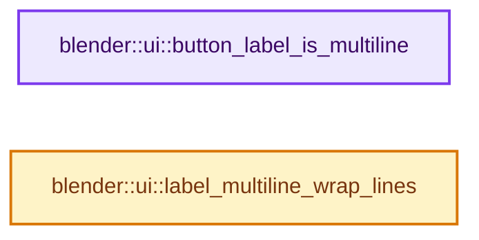

# 实现依赖专题：source/blender/editors/interface/buttons/interface_label.cc

[实现依赖导航](../../../../README.md) · [符号索引](../../../../../00-课程指南/02-源码与提交索引/符号依赖与实现索引.md)

本专题从正文实际调用进入，集中保存共享实现。函数有稳定锚点，可从调用处直接跳到对应完整函数；递归与互相调用通过回链组织。

## 本文件的实现关系




## 完整成员与函数实现

<a id="f-3f3fc16a9e5cfcc2"></a>

### `blender::ui::button_label_is_multiline`

实现位置：[source/blender/editors/interface/buttons/interface_label.cc](../../../../../../../../../source/blender/editors/interface/buttons/interface_label.cc) · L18—L22。

接口参数：

- `const Button *button`

**教学注释版**

<!-- annotated:8baffb5b64098d -->

```cpp
bool button_label_is_multiline(const Button *button)
{
  return button->type == ButtonType::Label &&
         static_cast<const ButtonLabel *>(button)->label_type == ButtonLabelType::Multiline;
}
```

<details>
<summary>核对原始源码：source/blender/editors/interface/buttons/interface_label.cc · L18—L22</summary>

<!-- original:8baffb5b64098d:source/blender/editors/interface/buttons/interface_label.cc:18:22 -->

```cpp
bool button_label_is_multiline(const Button *button)
{
  return button->type == ButtonType::Label &&
         static_cast<const ButtonLabel *>(button)->label_type == ButtonLabelType::Multiline;
}
```

</details>

**结果出口**

- `return button->type == ButtonType::Label &&`

**继续追踪实现**

本实现没有需要继续展开的显式调用；检查返回表达式、对象转换和调用者前置条件。

<a id="f-c6d12aa4929ee384"></a>

### `blender::ui::label_multiline_wrap_lines`

实现位置：[source/blender/editors/interface/buttons/interface_label.cc](../../../../../../../../../source/blender/editors/interface/buttons/interface_label.cc) · L24—L70。

接口参数：

- `ButtonLabel *button`
- `int icon_pad`

**教学注释版**

<!-- annotated:2d666286ebc555 -->

```cpp
void label_multiline_wrap_lines(ButtonLabel *button, int icon_pad)
{
  const float aspect = button->block->aspect;

  // [讲解] std::max<int>：按比较关系选取较大值。本讲解中的增长公式同时满足最低请求和几何增长；若保存返回引用，还需注意实参寿命。
  const int width = std::max<int>(std::ceil(BLI_rctf_size_x(&button->rect)) - icon_pad, 0) /
                    aspect;
  StringRef text = button->str;
  text = text.trim();
  /* Sometimes blocks are updated from old blocks before resolving the layout, so the button could
   * have acquire old button wrap cache. */
  if (button->wrap_cache) {
    TextWrapCache &cache = *button->wrap_cache;
    if (!(cache.aspect == aspect && cache.wrap_width == width && cache.text == text)) {
      button->wrap_cache.reset();
    }
  }
  if (!button->wrap_cache && button->block->oldblock) {
    int i = 0;
    for (std::shared_ptr<TextWrapCache> &cache_ptr : button->block->oldblock->text_wrap_cache) {
      TextWrapCache &cache = *cache_ptr;
      if (cache.aspect == aspect && cache.wrap_width == width && cache.text == text) {
        button->wrap_cache = cache_ptr;
        break;
      }
      i++;
    }
    if (button->wrap_cache) {
      button->block->oldblock->text_wrap_cache.remove(i);
    }
  }
  if (button->wrap_cache) {
    button->block->text_wrap_cache.append(button->wrap_cache);
    return;
  }
  // [讲解] std::make_unique<TextWrapCache>：创建独占拥有的对象，拥有关系可移动，get返回的借用指针不自动延长寿命。
  button->wrap_cache = std::make_unique<TextWrapCache>();
  TextWrapCache &cache = *button->wrap_cache;
  cache.text = text;
  cache.wrap_width = width;
  cache.aspect = aspect;

  button->block->text_wrap_cache.append(button->wrap_cache);
  uiFontStyle fstyle = style_get()->widget;
  fontscale(&fstyle.points, aspect);
  fontstyle_set(&fstyle);
  cache.wrapped_lines = BLF_string_wrap(
      fstyle.uifont_id, cache.text, width, BLFWrapMode::HardLimit);
}
```

<details>
<summary>核对原始源码：source/blender/editors/interface/buttons/interface_label.cc · L24—L70</summary>

<!-- original:2d666286ebc555:source/blender/editors/interface/buttons/interface_label.cc:24:70 -->

```cpp
void label_multiline_wrap_lines(ButtonLabel *button, int icon_pad)
{
  const float aspect = button->block->aspect;

  const int width = std::max<int>(std::ceil(BLI_rctf_size_x(&button->rect)) - icon_pad, 0) /
                    aspect;
  StringRef text = button->str;
  text = text.trim();
  /* Sometimes blocks are updated from old blocks before resolving the layout, so the button could
   * have acquire old button wrap cache. */
  if (button->wrap_cache) {
    TextWrapCache &cache = *button->wrap_cache;
    if (!(cache.aspect == aspect && cache.wrap_width == width && cache.text == text)) {
      button->wrap_cache.reset();
    }
  }
  if (!button->wrap_cache && button->block->oldblock) {
    int i = 0;
    for (std::shared_ptr<TextWrapCache> &cache_ptr : button->block->oldblock->text_wrap_cache) {
      TextWrapCache &cache = *cache_ptr;
      if (cache.aspect == aspect && cache.wrap_width == width && cache.text == text) {
        button->wrap_cache = cache_ptr;
        break;
      }
      i++;
    }
    if (button->wrap_cache) {
      button->block->oldblock->text_wrap_cache.remove(i);
    }
  }
  if (button->wrap_cache) {
    button->block->text_wrap_cache.append(button->wrap_cache);
    return;
  }
  button->wrap_cache = std::make_unique<TextWrapCache>();
  TextWrapCache &cache = *button->wrap_cache;
  cache.text = text;
  cache.wrap_width = width;
  cache.aspect = aspect;

  button->block->text_wrap_cache.append(button->wrap_cache);
  uiFontStyle fstyle = style_get()->widget;
  fontscale(&fstyle.points, aspect);
  fontstyle_set(&fstyle);
  cache.wrapped_lines = BLF_string_wrap(
      fstyle.uifont_id, cache.text, width, BLFWrapMode::HardLimit);
}
```

</details>

**沿实际写入检查状态**

- `text = text.trim();`
- `button->wrap_cache = cache_ptr;`
- `button->wrap_cache = std::make_unique<TextWrapCache>();`
- `cache.text = text;`
- `cache.wrap_width = width;`
- `cache.aspect = aspect;`
- `cache.wrapped_lines = BLF_string_wrap(`

**继续追踪实现**

- `std::max<int>` → [外部契约](https://eel.is/c++draft/alg.min.max)：按比较关系选取较大值。本讲解中的增长公式同时满足最低请求和几何增长；若保存返回引用，还需注意实参寿命。
- `std::ceil` → [外部契约](https://eel.is/c++draft/)：这个边界按实际表达式及所属类型核对参数、返回值、寿命与失败行为。这里提供接口入口，不声称已解释该第三方版本的内部实现。
- `BLI_rctf_size_x` → [blender::BLI_rctf_size_x · L211](../../../../01-BLI基础库/BLI_rect.hh.md#f-017b86a9d189e3ba)。
- `text.trim` → [调用协议](../../../../../00-课程指南/01-路线与规范/模板宏与动态分派协议.md)：由接收对象具体类型或运行时策略提供实现。调用位置L31。
- `button->wrap_cache.reset` → [调用协议](../../../../../00-课程指南/01-路线与规范/模板宏与动态分派协议.md)：接收对象类型依赖auto、返回值或模板实例；不按同名猜测目标。调用位置L37。
- `button->block->oldblock->text_wrap_cache.remove` → [调用协议](../../../../../00-课程指南/01-路线与规范/模板宏与动态分派协议.md)：接收对象类型依赖auto、返回值或模板实例；不按同名猜测目标。调用位置L51。
- `button->block->text_wrap_cache.append` → [调用协议](../../../../../00-课程指南/01-路线与规范/模板宏与动态分派协议.md)：接收对象类型依赖auto、返回值或模板实例；不按同名猜测目标。调用位置L55。
- `std::make_unique<TextWrapCache>` → [外部契约](https://eel.is/c++draft/unique.ptr.create)：创建独占拥有的对象，拥有关系可移动，get返回的借用指针不自动延长寿命。
- `style_get` → [blender::ui::style_get · L412](../interface_style.cc.md#f-aa005d800e55d1e4)。
- `fontscale` → [blender::ui::fontscale · L2307](../interface.cc.md#f-8eaaf210a6e27303)。
- `fontstyle_set` → [blender::ui::fontstyle_set · L608](../interface_style.cc.md#f-7c01423f2db0ca8b)。
- `BLF_string_wrap` → [blender::BLF_string_wrap · L1103](../../../blenfont/intern/blf.cc.md#f-3705d66d552c8999)。
