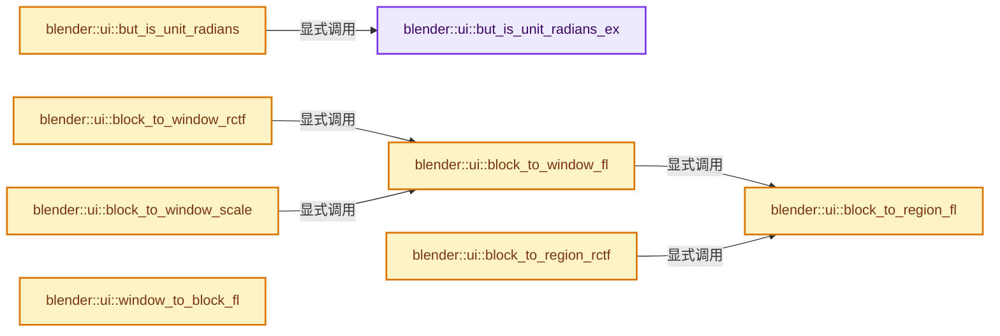
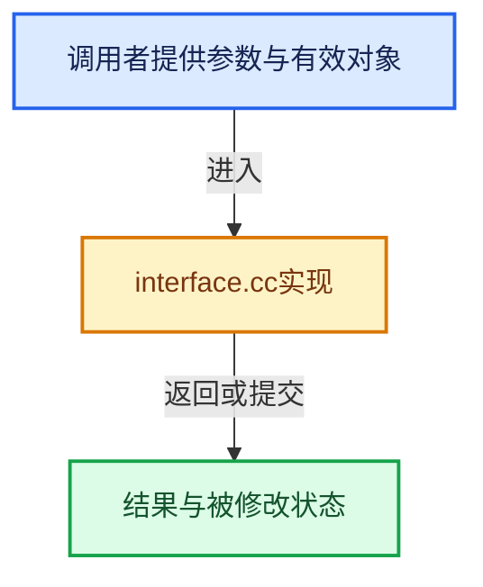

# 实现依赖专题：source/blender/editors/interface/interface.cc

[实现依赖导航](../../../README.md) · [符号索引](../../../../00-课程指南/02-源码与提交索引/符号依赖与实现索引.md)

本专题从正文实际调用进入，集中保存共享实现。函数有稳定锚点，可从调用处直接跳到对应完整函数；递归与互相调用通过回链组织。

## 本文件的实现关系






<a id="m-ff82a0a97198"></a>

## 宏 `UI_GET_BUT_VALUE_INIT`

<!-- annotated:d5d978183e6abb -->

```cpp
#define UI_GET_BUT_VALUE_INIT(_but, _value) \
  if (_value == DBL_MAX) { \
    (_value) = button_value_get(_but); \
  } \
  ((void)0)

```

<details>
<summary>核对原始源码：source/blender/editors/interface/interface.cc · L91—L96</summary>

<!-- original:d5d978183e6abb:source/blender/editors/interface/interface.cc:91:96 -->

```cpp
#define UI_GET_BUT_VALUE_INIT(_but, _value) \
  if (_value == DBL_MAX) { \
    (_value) = button_value_get(_but); \
  } \
  ((void)0)

```

</details>

宏在预处理阶段展开，参数替换、重复求值和条件编译应直接从该定义检查。与普通函数不同，宏不会自动提供参数类型检查；构建配置选择哪个定义需结合外围条件。

## 完整成员与函数实现

<a id="f-8459aba3dd6e4241"></a>

### `blender::ui::but_is_unit_radians_ex`

实现位置：[source/blender/editors/interface/interface.cc](../../../../../../../../source/blender/editors/interface/interface.cc) · L108—L111。

接口参数：

- `const UnitSettings *unit`
- `const int unit_type`

**教学注释版**

<!-- annotated:d578c5bed06f08 -->

```cpp
static bool but_is_unit_radians_ex(const UnitSettings *unit, const int unit_type)
{
  return (unit->system_rotation == USER_UNIT_ROT_RADIANS && unit_type == PROP_UNIT_ROTATION);
}
```

<details>
<summary>核对原始源码：source/blender/editors/interface/interface.cc · L108—L111</summary>

<!-- original:d578c5bed06f08:source/blender/editors/interface/interface.cc:108:111 -->

```cpp
static bool but_is_unit_radians_ex(const UnitSettings *unit, const int unit_type)
{
  return (unit->system_rotation == USER_UNIT_ROT_RADIANS && unit_type == PROP_UNIT_ROTATION);
}
```

</details>

**结果出口**

- `return (unit->system_rotation == USER_UNIT_ROT_RADIANS && unit_type == PROP_UNIT_ROTATION);`

**继续追踪实现**

本实现没有需要继续展开的显式调用；检查返回表达式、对象转换和调用者前置条件。

<a id="f-b874f96742aca6b3"></a>

### `blender::ui::but_is_unit_radians`

实现位置：[source/blender/editors/interface/interface.cc](../../../../../../../../source/blender/editors/interface/interface.cc) · L113—L119。

接口参数：

- `const Button *but`

**教学注释版**

<!-- annotated:dfd7277a2e73de -->

```cpp
static bool but_is_unit_radians(const Button *but)
{
  const UnitSettings *unit = but->block->unit;
  const int unit_type = button_unit_type_get(but);

  return but_is_unit_radians_ex(unit, unit_type);
}
```

<details>
<summary>核对原始源码：source/blender/editors/interface/interface.cc · L113—L119</summary>

<!-- original:dfd7277a2e73de:source/blender/editors/interface/interface.cc:113:119 -->

```cpp
static bool but_is_unit_radians(const Button *but)
{
  const UnitSettings *unit = but->block->unit;
  const int unit_type = button_unit_type_get(but);

  return but_is_unit_radians_ex(unit, unit_type);
}
```

</details>

**结果出口**

- `return but_is_unit_radians_ex(unit, unit_type);`

**继续追踪实现**

- `button_unit_type_get` → [blender::ui::button_unit_type_get · L5974](interface.cc.md#f-1ceca8a57d05f255)。
- `but_is_unit_radians_ex` → [blender::ui::but_is_unit_radians_ex · L108](interface.cc.md#f-8459aba3dd6e4241)。

<a id="f-36b508f6eaa9daa2"></a>

### `blender::ui::block_to_region_fl`

实现位置：[source/blender/editors/interface/interface.cc](../../../../../../../../source/blender/editors/interface/interface.cc) · L125—L142。

接口参数：

- `const ARegion *region`
- `const Block *block`
- `float *x`
- `float *y`

**教学注释版**

<!-- annotated:2286af8605d39f -->

```cpp
void block_to_region_fl(const ARegion *region, const Block *block, float *x, float *y)
{
  const int getsizex = BLI_rcti_size_x(&region->winrct) + 1;
  const int getsizey = BLI_rcti_size_y(&region->winrct) + 1;

  float gx = *x;
  float gy = *y;

  if (block->panel) {
    gx += block->panel->ofsx;
    gy += block->panel->ofsy;
  }

  *x = float(getsizex) *
       (0.5f + 0.5f * (gx * block->winmat[0][0] + gy * block->winmat[1][0] + block->winmat[3][0]));
  *y = float(getsizey) *
       (0.5f + 0.5f * (gx * block->winmat[0][1] + gy * block->winmat[1][1] + block->winmat[3][1]));
}
```

<details>
<summary>核对原始源码：source/blender/editors/interface/interface.cc · L125—L142</summary>

<!-- original:2286af8605d39f:source/blender/editors/interface/interface.cc:125:142 -->

```cpp
void block_to_region_fl(const ARegion *region, const Block *block, float *x, float *y)
{
  const int getsizex = BLI_rcti_size_x(&region->winrct) + 1;
  const int getsizey = BLI_rcti_size_y(&region->winrct) + 1;

  float gx = *x;
  float gy = *y;

  if (block->panel) {
    gx += block->panel->ofsx;
    gy += block->panel->ofsy;
  }

  *x = float(getsizex) *
       (0.5f + 0.5f * (gx * block->winmat[0][0] + gy * block->winmat[1][0] + block->winmat[3][0]));
  *y = float(getsizey) *
       (0.5f + 0.5f * (gx * block->winmat[0][1] + gy * block->winmat[1][1] + block->winmat[3][1]));
}
```

</details>

**沿实际写入检查状态**

- `gx += block->panel->ofsx;`
- `gy += block->panel->ofsy;`

**继续追踪实现**

- `BLI_rcti_size_x` → [blender::BLI_rcti_size_x · L203](../../../01-BLI基础库/BLI_rect.hh.md#f-7a8fb2c54a829be6)。
- `BLI_rcti_size_y` → [blender::BLI_rcti_size_y · L207](../../../01-BLI基础库/BLI_rect.hh.md#f-ac87d6c708d502ad)。

<a id="f-ccf934fed5ff1ad4"></a>

### `blender::ui::block_to_window_fl`

实现位置：[source/blender/editors/interface/interface.cc](../../../../../../../../source/blender/editors/interface/interface.cc) · L144—L149。

接口参数：

- `const ARegion *region`
- `const Block *block`
- `float *x`
- `float *y`

**教学注释版**

<!-- annotated:272dec083c3837 -->

```cpp
void block_to_window_fl(const ARegion *region, const Block *block, float *x, float *y)
{
  block_to_region_fl(region, block, x, y);
  *x += region->winrct.xmin;
  *y += region->winrct.ymin;
}
```

<details>
<summary>核对原始源码：source/blender/editors/interface/interface.cc · L144—L149</summary>

<!-- original:272dec083c3837:source/blender/editors/interface/interface.cc:144:149 -->

```cpp
void block_to_window_fl(const ARegion *region, const Block *block, float *x, float *y)
{
  block_to_region_fl(region, block, x, y);
  *x += region->winrct.xmin;
  *y += region->winrct.ymin;
}
```

</details>

**继续追踪实现**

- `block_to_region_fl` → [blender::ui::block_to_region_fl · L125](interface.cc.md#f-36b508f6eaa9daa2)。

<a id="f-f17abb2cb364a317"></a>

### `blender::ui::block_to_region_rctf`

实现位置：[source/blender/editors/interface/interface.cc](../../../../../../../../source/blender/editors/interface/interface.cc) · L162—L170。

接口参数：

- `const ARegion *region`
- `const Block *block`
- `rctf *rct_dst`
- `const rctf *rct_src`

**教学注释版**

<!-- annotated:c4dbda8085624e -->

```cpp
void block_to_region_rctf(const ARegion *region,
                          const Block *block,
                          rctf *rct_dst,
                          const rctf *rct_src)
{
  *rct_dst = *rct_src;
  block_to_region_fl(region, block, &rct_dst->xmin, &rct_dst->ymin);
  block_to_region_fl(region, block, &rct_dst->xmax, &rct_dst->ymax);
}
```

<details>
<summary>核对原始源码：source/blender/editors/interface/interface.cc · L162—L170</summary>

<!-- original:c4dbda8085624e:source/blender/editors/interface/interface.cc:162:170 -->

```cpp
void block_to_region_rctf(const ARegion *region,
                          const Block *block,
                          rctf *rct_dst,
                          const rctf *rct_src)
{
  *rct_dst = *rct_src;
  block_to_region_fl(region, block, &rct_dst->xmin, &rct_dst->ymin);
  block_to_region_fl(region, block, &rct_dst->xmax, &rct_dst->ymax);
}
```

</details>

**继续追踪实现**

- `block_to_region_fl` → [blender::ui::block_to_region_fl · L125](interface.cc.md#f-36b508f6eaa9daa2)。

<a id="f-9ea1ffd4d684d7e5"></a>

### `blender::ui::block_to_window_rctf`

实现位置：[source/blender/editors/interface/interface.cc](../../../../../../../../source/blender/editors/interface/interface.cc) · L172—L180。

接口参数：

- `const ARegion *region`
- `const Block *block`
- `rctf *rct_dst`
- `const rctf *rct_src`

**教学注释版**

<!-- annotated:da8ae62884efcb -->

```cpp
void block_to_window_rctf(const ARegion *region,
                          const Block *block,
                          rctf *rct_dst,
                          const rctf *rct_src)
{
  *rct_dst = *rct_src;
  block_to_window_fl(region, block, &rct_dst->xmin, &rct_dst->ymin);
  block_to_window_fl(region, block, &rct_dst->xmax, &rct_dst->ymax);
}
```

<details>
<summary>核对原始源码：source/blender/editors/interface/interface.cc · L172—L180</summary>

<!-- original:da8ae62884efcb:source/blender/editors/interface/interface.cc:172:180 -->

```cpp
void block_to_window_rctf(const ARegion *region,
                          const Block *block,
                          rctf *rct_dst,
                          const rctf *rct_src)
{
  *rct_dst = *rct_src;
  block_to_window_fl(region, block, &rct_dst->xmin, &rct_dst->ymin);
  block_to_window_fl(region, block, &rct_dst->xmax, &rct_dst->ymax);
}
```

</details>

**继续追踪实现**

- `block_to_window_fl` → [blender::ui::block_to_window_fl · L144](interface.cc.md#f-ccf934fed5ff1ad4)。

<a id="f-59dbf628cea4df48"></a>

### `blender::ui::block_to_window_scale`

实现位置：[source/blender/editors/interface/interface.cc](../../../../../../../../source/blender/editors/interface/interface.cc) · L182—L191。

接口参数：

- `const ARegion *region`
- `const Block *block`

**教学注释版**

<!-- annotated:f4625d3fadfe7f -->

```cpp
float block_to_window_scale(const ARegion *region, const Block *block)
{
  /* We could have function for this to avoid dummy arg. */
  float min_y = 0, max_y = 1;
  float dummy_x = 0.0f;
  block_to_window_fl(region, block, &dummy_x, &min_y);
  dummy_x = 0.0f;
  block_to_window_fl(region, block, &dummy_x, &max_y);
  return max_y - min_y;
}
```

<details>
<summary>核对原始源码：source/blender/editors/interface/interface.cc · L182—L191</summary>

<!-- original:f4625d3fadfe7f:source/blender/editors/interface/interface.cc:182:191 -->

```cpp
float block_to_window_scale(const ARegion *region, const Block *block)
{
  /* We could have function for this to avoid dummy arg. */
  float min_y = 0, max_y = 1;
  float dummy_x = 0.0f;
  block_to_window_fl(region, block, &dummy_x, &min_y);
  dummy_x = 0.0f;
  block_to_window_fl(region, block, &dummy_x, &max_y);
  return max_y - min_y;
}
```

</details>

**沿实际写入检查状态**

- `dummy_x = 0.0f;`

**结果出口**

- `return max_y - min_y;`

**继续追踪实现**

- `block_to_window_fl` → [blender::ui::block_to_window_fl · L144](interface.cc.md#f-ccf934fed5ff1ad4)。

<a id="f-f9f0f1e8cbd36965"></a>

### `blender::ui::window_to_block_fl`

实现位置：[source/blender/editors/interface/interface.cc](../../../../../../../../source/blender/editors/interface/interface.cc) · L193—L218。

接口参数：

- `const ARegion *region`
- `const Block *block`
- `float *x`
- `float *y`

**教学注释版**

<!-- annotated:3127566a932a2c -->

```cpp
void window_to_block_fl(const ARegion *region, const Block *block, float *x, float *y)
{
  const int getsizex = BLI_rcti_size_x(&region->winrct) + 1;
  const int getsizey = BLI_rcti_size_y(&region->winrct) + 1;
  const int sx = region->winrct.xmin;
  const int sy = region->winrct.ymin;

  const float a = 0.5f * float(getsizex) * block->winmat[0][0];
  const float b = 0.5f * float(getsizex) * block->winmat[1][0];
  const float c = 0.5f * float(getsizex) * (1.0f + block->winmat[3][0]);

  const float d = 0.5f * float(getsizey) * block->winmat[0][1];
  const float e = 0.5f * float(getsizey) * block->winmat[1][1];
  const float f = 0.5f * float(getsizey) * (1.0f + block->winmat[3][1]);

  const float px = *x - sx;
  const float py = *y - sy;

  *y = (a * (py - f) + d * (c - px)) / (a * e - d * b);
  *x = (px - b * (*y) - c) / a;

  if (block->panel) {
    *x -= block->panel->ofsx;
    *y -= block->panel->ofsy;
  }
}
```

<details>
<summary>核对原始源码：source/blender/editors/interface/interface.cc · L193—L218</summary>

<!-- original:3127566a932a2c:source/blender/editors/interface/interface.cc:193:218 -->

```cpp
void window_to_block_fl(const ARegion *region, const Block *block, float *x, float *y)
{
  const int getsizex = BLI_rcti_size_x(&region->winrct) + 1;
  const int getsizey = BLI_rcti_size_y(&region->winrct) + 1;
  const int sx = region->winrct.xmin;
  const int sy = region->winrct.ymin;

  const float a = 0.5f * float(getsizex) * block->winmat[0][0];
  const float b = 0.5f * float(getsizex) * block->winmat[1][0];
  const float c = 0.5f * float(getsizex) * (1.0f + block->winmat[3][0]);

  const float d = 0.5f * float(getsizey) * block->winmat[0][1];
  const float e = 0.5f * float(getsizey) * block->winmat[1][1];
  const float f = 0.5f * float(getsizey) * (1.0f + block->winmat[3][1]);

  const float px = *x - sx;
  const float py = *y - sy;

  *y = (a * (py - f) + d * (c - px)) / (a * e - d * b);
  *x = (px - b * (*y) - c) / a;

  if (block->panel) {
    *x -= block->panel->ofsx;
    *y -= block->panel->ofsy;
  }
}
```

</details>

**继续追踪实现**

- `BLI_rcti_size_x` → [blender::BLI_rcti_size_x · L203](../../../01-BLI基础库/BLI_rect.hh.md#f-7a8fb2c54a829be6)。
- `BLI_rcti_size_y` → [blender::BLI_rcti_size_y · L207](../../../01-BLI基础库/BLI_rect.hh.md#f-ac87d6c708d502ad)。

<a id="f-9e1403f8936ce644"></a>

### `blender::ui::window_to_block`

实现位置：[source/blender/editors/interface/interface.cc](../../../../../../../../source/blender/editors/interface/interface.cc) · L230—L239。

接口参数：

- `const ARegion *region`
- `const Block *block`
- `int *x`
- `int *y`

**教学注释版**

<!-- annotated:fce95f3363f26f -->

```cpp
void window_to_block(const ARegion *region, const Block *block, int *x, int *y)
{
  float fx = *x;
  float fy = *y;

  window_to_block_fl(region, block, &fx, &fy);

  *x = int(lround(fx));
  *y = int(lround(fy));
}
```

<details>
<summary>核对原始源码：source/blender/editors/interface/interface.cc · L230—L239</summary>

<!-- original:fce95f3363f26f:source/blender/editors/interface/interface.cc:230:239 -->

```cpp
void window_to_block(const ARegion *region, const Block *block, int *x, int *y)
{
  float fx = *x;
  float fy = *y;

  window_to_block_fl(region, block, &fx, &fy);

  *x = int(lround(fx));
  *y = int(lround(fy));
}
```

</details>

**继续追踪实现**

- `window_to_block_fl` → [blender::ui::window_to_block_fl · L193](interface.cc.md#f-f9f0f1e8cbd36965)。
- `lround` → [lround · L49](../../../07-Intern运行时与平台/libmv/libmv/numeric/numeric.h.md#f-c5c613b2e026681d)。

<a id="f-910d056ca114e1a9"></a>

### `blender::ui::window_to_region`

实现位置：[source/blender/editors/interface/interface.cc](../../../../../../../../source/blender/editors/interface/interface.cc) · L241—L245。

接口参数：

- `const ARegion *region`
- `int *x`
- `int *y`

**教学注释版**

<!-- annotated:77267fb858f60a -->

```cpp
void window_to_region(const ARegion *region, int *x, int *y)
{
  *x -= region->winrct.xmin;
  *y -= region->winrct.ymin;
}
```

<details>
<summary>核对原始源码：source/blender/editors/interface/interface.cc · L241—L245</summary>

<!-- original:77267fb858f60a:source/blender/editors/interface/interface.cc:241:245 -->

```cpp
void window_to_region(const ARegion *region, int *x, int *y)
{
  *x -= region->winrct.xmin;
  *y -= region->winrct.ymin;
}
```

</details>

**继续追踪实现**

本实现没有需要继续展开的显式调用；检查返回表达式、对象转换和调用者前置条件。

<a id="f-e2b673705e150427"></a>

### `blender::ui::Block::but_index`

实现位置：[source/blender/editors/interface/interface.cc](../../../../../../../../source/blender/editors/interface/interface.cc) · L276—L286。

接口参数：

- `const Button *but`

**教学注释版**

<!-- annotated:25a93d35e8e048 -->

```cpp
int Block::but_index(const Button *but) const
{
  BLI_assert(!this->buttons_ptrs.is_empty() && but);
  auto index = std::distance(
      this->buttons_ptrs.begin(),
      std::ranges::find_if(this->buttons_ptrs, [but](const std::unique_ptr<Button> &test) {
        return test.get() == but;
      }));
  BLI_assert(index != std::distance(this->buttons_ptrs.begin(), this->buttons_ptrs.end()));
  return index;
}
```

<details>
<summary>核对原始源码：source/blender/editors/interface/interface.cc · L276—L286</summary>

<!-- original:25a93d35e8e048:source/blender/editors/interface/interface.cc:276:286 -->

```cpp
int Block::but_index(const Button *but) const
{
  BLI_assert(!this->buttons_ptrs.is_empty() && but);
  auto index = std::distance(
      this->buttons_ptrs.begin(),
      std::ranges::find_if(this->buttons_ptrs, [but](const std::unique_ptr<Button> &test) {
        return test.get() == but;
      }));
  BLI_assert(index != std::distance(this->buttons_ptrs.begin(), this->buttons_ptrs.end()));
  return index;
}
```

</details>

**结果出口**

- `return test.get() == but;`
- `return index;`

**继续追踪实现**

- `BLI_assert` → [BLI_assert · L48](../../../01-BLI基础库/BLI_assert.hh.md#m-57a88495704d)；[BLI_assert · L63](../../../01-BLI基础库/BLI_assert.hh.md#m-d07050020cb5)。宏定义由构建条件选择。
- `this->buttons_ptrs.is_empty` → [调用协议](../../../../00-课程指南/01-路线与规范/模板宏与动态分派协议.md)：接收对象类型依赖auto、返回值或模板实例；不按同名猜测目标。调用位置L278。
- `std::distance` → [外部契约](https://eel.is/c++draft/)：这个边界按实际表达式及所属类型核对参数、返回值、寿命与失败行为。这里提供接口入口，不声称已解释该第三方版本的内部实现。
- `this->buttons_ptrs.begin` → [调用协议](../../../../00-课程指南/01-路线与规范/模板宏与动态分派协议.md)：接收对象类型依赖auto、返回值或模板实例；不按同名猜测目标。调用位置L280。
- `std::ranges::find_if` → [外部契约](https://eel.is/c++draft/)：这个边界按实际表达式及所属类型核对参数、返回值、寿命与失败行为。这里提供接口入口，不声称已解释该第三方版本的内部实现。
- `test.get` → [外部契约](https://eel.is/c++draft/)：这个边界按实际表达式及所属类型核对参数、返回值、寿命与失败行为。这里提供接口入口，不声称已解释该第三方版本的内部实现。
- `this->buttons_ptrs.end` → [调用协议](../../../../00-课程指南/01-路线与规范/模板宏与动态分派协议.md)：接收对象类型依赖auto、返回值或模板实例；不按同名猜测目标。调用位置L284。

<a id="f-6742cf33b31af891"></a>

### `blender::ui::Block::next_but`

实现位置：[source/blender/editors/interface/interface.cc](../../../../../../../../source/blender/editors/interface/interface.cc) · L288—L292。

接口参数：

- `const Button *but`

**教学注释版**

<!-- annotated:a6966d3cfba14c -->

```cpp
Button *Block::next_but(const Button *but) const
{
  const int idx = this->but_index(but) + 1;
  return idx < this->buttons_ptrs.size() ? this->buttons_ptrs[idx].get() : nullptr;
}
```

<details>
<summary>核对原始源码：source/blender/editors/interface/interface.cc · L288—L292</summary>

<!-- original:a6966d3cfba14c:source/blender/editors/interface/interface.cc:288:292 -->

```cpp
Button *Block::next_but(const Button *but) const
{
  const int idx = this->but_index(but) + 1;
  return idx < this->buttons_ptrs.size() ? this->buttons_ptrs[idx].get() : nullptr;
}
```

</details>

**结果出口**

- `return idx < this->buttons_ptrs.size() ? this->buttons_ptrs[idx].get() : nullptr;`

**继续追踪实现**

- `this->but_index` → [blender::ui::Block::but_index · L276](interface.cc.md#f-e2b673705e150427)。
- `this->buttons_ptrs.size` → [调用协议](../../../../00-课程指南/01-路线与规范/模板宏与动态分派协议.md)：接收对象类型依赖auto、返回值或模板实例；不按同名猜测目标。调用位置L291。
- `this->buttons_ptrs[idx].get` → [调用协议](../../../../00-课程指南/01-路线与规范/模板宏与动态分派协议.md)：接收对象类型依赖auto、返回值或模板实例；不按同名猜测目标。调用位置L291。

<a id="f-3d61339d938886c0"></a>

### `blender::ui::Block::remove_but`

实现位置：[source/blender/editors/interface/interface.cc](../../../../../../../../source/blender/editors/interface/interface.cc) · L300—L304。

接口参数：

- `const Button *but`

**教学注释版**

<!-- annotated:909e9949e30128 -->

```cpp
void Block::remove_but(const Button *but)
{
  int64_t target_index = this->but_index(but);
  this->buttons_ptrs.remove(target_index);
}
```

<details>
<summary>核对原始源码：source/blender/editors/interface/interface.cc · L300—L304</summary>

<!-- original:909e9949e30128:source/blender/editors/interface/interface.cc:300:304 -->

```cpp
void Block::remove_but(const Button *but)
{
  int64_t target_index = this->but_index(but);
  this->buttons_ptrs.remove(target_index);
}
```

</details>

**继续追踪实现**

- `this->but_index` → [blender::ui::Block::but_index · L276](interface.cc.md#f-e2b673705e150427)。
- `this->buttons_ptrs.remove` → [调用协议](../../../../00-课程指南/01-路线与规范/模板宏与动态分派协议.md)：接收对象类型依赖auto、返回值或模板实例；不按同名猜测目标。调用位置L303。

<a id="f-22409bfd2de2d7e3"></a>

### `blender::ui::Block::first_but`

实现位置：[source/blender/editors/interface/interface.cc](../../../../../../../../source/blender/editors/interface/interface.cc) · L306—L309。

**教学注释版**

<!-- annotated:19ef571205d2f9 -->

```cpp
Button *Block::first_but() const
{
  return !this->buttons_ptrs.is_empty() ? this->buttons_ptrs.first().get() : nullptr;
}
```

<details>
<summary>核对原始源码：source/blender/editors/interface/interface.cc · L306—L309</summary>

<!-- original:19ef571205d2f9:source/blender/editors/interface/interface.cc:306:309 -->

```cpp
Button *Block::first_but() const
{
  return !this->buttons_ptrs.is_empty() ? this->buttons_ptrs.first().get() : nullptr;
}
```

</details>

**结果出口**

- `return !this->buttons_ptrs.is_empty() ? this->buttons_ptrs.first().get() : nullptr;`

**继续追踪实现**

- `this->buttons_ptrs.is_empty` → [调用协议](../../../../00-课程指南/01-路线与规范/模板宏与动态分派协议.md)：接收对象类型依赖auto、返回值或模板实例；不按同名猜测目标。调用位置L308。
- `this->buttons_ptrs.first().get` → [调用协议](../../../../00-课程指南/01-路线与规范/模板宏与动态分派协议.md)：接收对象类型依赖auto、返回值或模板实例；不按同名猜测目标。调用位置L308。
- `this->buttons_ptrs.first` → [调用协议](../../../../00-课程指南/01-路线与规范/模板宏与动态分派协议.md)：接收对象类型依赖auto、返回值或模板实例；不按同名猜测目标。调用位置L308。

<a id="f-ff9028ecd99e462d"></a>

### `blender::ui::Block::last_but`

实现位置：[source/blender/editors/interface/interface.cc](../../../../../../../../source/blender/editors/interface/interface.cc) · L311—L314。

**教学注释版**

<!-- annotated:abd157f3bb2fdd -->

```cpp
Button *Block::last_but() const
{
  return !this->buttons_ptrs.is_empty() ? this->buttons_ptrs.last().get() : nullptr;
}
```

<details>
<summary>核对原始源码：source/blender/editors/interface/interface.cc · L311—L314</summary>

<!-- original:abd157f3bb2fdd:source/blender/editors/interface/interface.cc:311:314 -->

```cpp
Button *Block::last_but() const
{
  return !this->buttons_ptrs.is_empty() ? this->buttons_ptrs.last().get() : nullptr;
}
```

</details>

**结果出口**

- `return !this->buttons_ptrs.is_empty() ? this->buttons_ptrs.last().get() : nullptr;`

**继续追踪实现**

- `this->buttons_ptrs.is_empty` → [调用协议](../../../../00-课程指南/01-路线与规范/模板宏与动态分派协议.md)：接收对象类型依赖auto、返回值或模板实例；不按同名猜测目标。调用位置L313。
- `this->buttons_ptrs.last().get` → [调用协议](../../../../00-课程指南/01-路线与规范/模板宏与动态分派协议.md)：接收对象类型依赖auto、返回值或模板实例；不按同名猜测目标。调用位置L313。
- `this->buttons_ptrs.last` → [调用协议](../../../../00-课程指南/01-路线与规范/模板宏与动态分派协议.md)：接收对象类型依赖auto、返回值或模板实例；不按同名猜测目标。调用位置L313。

<a id="f-fd4c9554b2e63dcb"></a>

### `blender::ui::update_flexible_spacing`

实现位置：[source/blender/editors/interface/interface.cc](../../../../../../../../source/blender/editors/interface/interface.cc) · L316—L369。

接口参数：

- `const ARegion *region`
- `Block *block`

**教学注释版**

<!-- annotated:a2e115ab82f6b7 -->

```cpp
static void update_flexible_spacing(const ARegion *region, Block *block)
{
  int sepr_flex_len = 0;
  for (const Button &but : block->buttons()) {
    if (but.type == ButtonType::SeprSpacer) {
      sepr_flex_len++;
    }
  }

  if (sepr_flex_len == 0) {
    return;
  }

  rcti rect;
  button_to_pixelrect(&rect, region, block, block->buttons_ptrs.last().get());
  const float buttons_width = std::ceil(float(rect.xmax) + 8.0f * UI_SCALE_FAC);
  const float region_width = float(region->winx);

  if (region_width <= buttons_width) {
    return;
  }

  /* We could get rid of this loop if we agree on a max number of spacer */
  Vector<int, 8> spacers_pos;
  for (const Button &but : block->buttons()) {
    if (but.type == ButtonType::SeprSpacer) {
      button_to_pixelrect(&rect, region, block, &but);
      // [讲解] spacers_pos.append：在尾部建立新元素，必要时先扩大存储。
      spacers_pos.append(rect.xmax + int(8.0f * UI_SCALE_FAC));
    }
  }

  const float view_scale_x = view2d_scale_get_x(&region->v2d);
  const float segment_width = region_width / float(sepr_flex_len);
  float offset = 0, remaining_space = region_width - buttons_width;
  int i = 0;
  for (Button &but : block->buttons()) {
    BLI_rctf_translate(&but.rect, std::floor(offset / view_scale_x), 0.0f);
    if (but.type == ButtonType::SeprSpacer) {
      /* How much the next block overlap with the current segment */
      int overlap = ((i == sepr_flex_len - 1) ? buttons_width - spacers_pos[i] :
                                                (spacers_pos[i + 1] - spacers_pos[i]) / 2);
      const int segment_end = segment_width * (i + 1);
      const int spacer_end = segment_end - overlap;
      const int spacer_sta = spacers_pos[i] + offset;
      if (spacer_end > spacer_sta) {
        const float step = min_ff(remaining_space, spacer_end - spacer_sta);
        remaining_space -= step;
        offset += step;
      }
      i++;
    }
  }
  block_bounds_calc(block);
}
```

<details>
<summary>核对原始源码：source/blender/editors/interface/interface.cc · L316—L369</summary>

<!-- original:a2e115ab82f6b7:source/blender/editors/interface/interface.cc:316:369 -->

```cpp
static void update_flexible_spacing(const ARegion *region, Block *block)
{
  int sepr_flex_len = 0;
  for (const Button &but : block->buttons()) {
    if (but.type == ButtonType::SeprSpacer) {
      sepr_flex_len++;
    }
  }

  if (sepr_flex_len == 0) {
    return;
  }

  rcti rect;
  button_to_pixelrect(&rect, region, block, block->buttons_ptrs.last().get());
  const float buttons_width = std::ceil(float(rect.xmax) + 8.0f * UI_SCALE_FAC);
  const float region_width = float(region->winx);

  if (region_width <= buttons_width) {
    return;
  }

  /* We could get rid of this loop if we agree on a max number of spacer */
  Vector<int, 8> spacers_pos;
  for (const Button &but : block->buttons()) {
    if (but.type == ButtonType::SeprSpacer) {
      button_to_pixelrect(&rect, region, block, &but);
      spacers_pos.append(rect.xmax + int(8.0f * UI_SCALE_FAC));
    }
  }

  const float view_scale_x = view2d_scale_get_x(&region->v2d);
  const float segment_width = region_width / float(sepr_flex_len);
  float offset = 0, remaining_space = region_width - buttons_width;
  int i = 0;
  for (Button &but : block->buttons()) {
    BLI_rctf_translate(&but.rect, std::floor(offset / view_scale_x), 0.0f);
    if (but.type == ButtonType::SeprSpacer) {
      /* How much the next block overlap with the current segment */
      int overlap = ((i == sepr_flex_len - 1) ? buttons_width - spacers_pos[i] :
                                                (spacers_pos[i + 1] - spacers_pos[i]) / 2);
      const int segment_end = segment_width * (i + 1);
      const int spacer_end = segment_end - overlap;
      const int spacer_sta = spacers_pos[i] + offset;
      if (spacer_end > spacer_sta) {
        const float step = min_ff(remaining_space, spacer_end - spacer_sta);
        remaining_space -= step;
        offset += step;
      }
      i++;
    }
  }
  block_bounds_calc(block);
}
```

</details>

**沿实际写入检查状态**

- `remaining_space -= step;`
- `offset += step;`

**继续追踪实现**

- `block->buttons` → [blender::ui::Block::buttons · L836](interface_intern.hh.md#f-5296ad5fd22b5505)。
- `button_to_pixelrect` → [blender::ui::button_to_pixelrect · L2312](interface.cc.md#f-1a9b41f4ea233cc9)。
- `block->buttons_ptrs.last().get` → [调用协议](../../../../00-课程指南/01-路线与规范/模板宏与动态分派协议.md)：接收对象类型依赖auto、返回值或模板实例；不按同名猜测目标。调用位置L330。
- `block->buttons_ptrs.last` → [调用协议](../../../../00-课程指南/01-路线与规范/模板宏与动态分派协议.md)：接收对象类型依赖auto、返回值或模板实例；不按同名猜测目标。调用位置L330。
- `std::ceil` → [外部契约](https://eel.is/c++draft/)：这个边界按实际表达式及所属类型核对参数、返回值、寿命与失败行为。这里提供接口入口，不声称已解释该第三方版本的内部实现。
- `spacers_pos.append` → [blender::Vector::append · L498](../../../../01-基础容器与现代CPP/11-Vector插入删除与重排.md#f-5bde268a69e443ec)；[blender::Vector::append · L502](../../../../01-基础容器与现代CPP/11-Vector插入删除与重排.md#f-591e0b15e6308532)。同名重载需按实参类型选择。
- `view2d_scale_get_x` → [blender::ui::view2d_scale_get_x · L1902](view2d/view2d.cc.md#f-31d7d5c9564ece4c)。
- `BLI_rctf_translate` → [blender::BLI_rctf_translate · L587](../../../01-BLI基础库/intern/rct.cc.md#f-529284313e4063a1)。
- `std::floor` → [外部契约](https://eel.is/c++draft/)：这个边界按实际表达式及所属类型核对参数、返回值、寿命与失败行为。这里提供接口入口，不声称已解释该第三方版本的内部实现。
- `min_ff` → [blender::min_ff · L321](../../../01-BLI基础库/intern/math_base_inline.cc.md#f-5b8d83d6f191be1a)。
- `block_bounds_calc` → [blender::ui::block_bounds_calc · L496](interface.cc.md#f-453aacf691073d49)。

<a id="f-9f1817ba8d74d8b0"></a>

### `blender::ui::update_window_matrix`

实现位置：[source/blender/editors/interface/interface.cc](../../../../../../../../source/blender/editors/interface/interface.cc) · L371—L388。

接口参数：

- `const wmWindow *window`
- `const ARegion *region`
- `Block *block`

**教学注释版**

<!-- annotated:5a81e3a9708a7a -->

```cpp
static void update_window_matrix(const wmWindow *window, const ARegion *region, Block *block)
{
  /* window matrix and aspect */
  if (region && region->runtime->visible) {
    /* Get projection matrix which includes View2D translation and zoom. */
    GPU_matrix_projection_get(block->winmat);
    block->aspect = 2.0f / fabsf(region->winx * block->winmat[0][0]);
  }
  else {
    /* No sub-window created yet, for menus for example, so we use the main
     * window instead, since buttons are created there anyway. */
    const int2 win_size = WM_window_native_pixel_size(window);
    const rcti winrct = {0, win_size[0] - 1, 0, win_size[1] - 1};

    wmGetProjectionMatrix(block->winmat, &winrct);
    block->aspect = 2.0f / fabsf(win_size[0] * block->winmat[0][0]);
  }
}
```

<details>
<summary>核对原始源码：source/blender/editors/interface/interface.cc · L371—L388</summary>

<!-- original:5a81e3a9708a7a:source/blender/editors/interface/interface.cc:371:388 -->

```cpp
static void update_window_matrix(const wmWindow *window, const ARegion *region, Block *block)
{
  /* window matrix and aspect */
  if (region && region->runtime->visible) {
    /* Get projection matrix which includes View2D translation and zoom. */
    GPU_matrix_projection_get(block->winmat);
    block->aspect = 2.0f / fabsf(region->winx * block->winmat[0][0]);
  }
  else {
    /* No sub-window created yet, for menus for example, so we use the main
     * window instead, since buttons are created there anyway. */
    const int2 win_size = WM_window_native_pixel_size(window);
    const rcti winrct = {0, win_size[0] - 1, 0, win_size[1] - 1};

    wmGetProjectionMatrix(block->winmat, &winrct);
    block->aspect = 2.0f / fabsf(win_size[0] * block->winmat[0][0]);
  }
}
```

</details>

**沿实际写入检查状态**

- `block->aspect = 2.0f / fabsf(region->winx * block->winmat[0][0]);`
- `block->aspect = 2.0f / fabsf(win_size[0] * block->winmat[0][0]);`

**继续追踪实现**

- `GPU_matrix_projection_get` → [blender::GPU_matrix_projection_get · L563](../../gpu/intern/gpu_matrix.cc.md#f-0898a9a110e7a668)。
- `fabsf` → [fabsf · L21](../../../07-Intern运行时与平台/cycles/kernel/svm/radial_tiling_shared.h.md#m-02cc4c69cfb3)；[fabsf · L43](../../../07-Intern运行时与平台/cycles/kernel/svm/radial_tiling_shared.h.md#m-04effe61803b)；[fabsf · L74](../../../07-Intern运行时与平台/cycles/kernel/svm/radial_tiling_shared.h.md#m-927dd4eba7dc)；[fabsf · L25](../../../01-BLI基础库/intern/radial_tiling_shared.hh.md#m-8348d6b3d08f)；[fabsf · L47](../../../01-BLI基础库/intern/radial_tiling_shared.hh.md#m-13b7e0b6d84f)；[fabsf · L78](../../../01-BLI基础库/intern/radial_tiling_shared.hh.md#m-326c83464a0d)；[fabsf · L21](../../../07-Intern运行时与平台/cycles/kernel/osl/shaders/node_radial_tiling_shared.h.md#m-7c3ee12fc119)；[fabsf · L43](../../../07-Intern运行时与平台/cycles/kernel/osl/shaders/node_radial_tiling_shared.h.md#m-9112db0e2dd1)；[fabsf · L74](../../../07-Intern运行时与平台/cycles/kernel/osl/shaders/node_radial_tiling_shared.h.md#m-ee4e61908a6f)；[fabsf · L167](../../../07-Intern运行时与平台/cycles/kernel/device/oneapi/compat.h.md#m-b039ee6c1601)；[fabsf · L265](../../../07-Intern运行时与平台/cycles/kernel/device/metal/compat.h.md#m-6b21869e9f3f)。宏定义由构建条件选择。
- `WM_window_native_pixel_size` → [blender::WM_window_native_pixel_size · L3145](../../windowmanager/intern/wm_window.cc.md#f-e23de39fb8f8173b)。
- `wmGetProjectionMatrix` → [blender::wmGetProjectionMatrix · L137](../../windowmanager/intern/wm_subwindow.cc.md#f-f789df2154feaf25)。

<a id="f-86b9c12dbd9066fa"></a>

### `blender::ui::region_winrct_get_no_margin`

实现位置：[source/blender/editors/interface/interface.cc](../../../../../../../../source/blender/editors/interface/interface.cc) · L390—L400。

接口参数：

- `const ARegion *region`
- `rcti *r_rect`

**教学注释版**

<!-- annotated:b510663a2e33e0 -->

```cpp
void region_winrct_get_no_margin(const ARegion *region, rcti *r_rect)
{
  Block *block = region->runtime->uiblocks.first();
  if (block && (block->flag & BLOCK_LOOP) && (block->flag & BLOCK_PIE_MENU) == 0) {
    BLI_rcti_rctf_copy_floor(r_rect, &block->rect);
    BLI_rcti_translate(r_rect, region->winrct.xmin, region->winrct.ymin);
  }
  else {
    *r_rect = region->winrct;
  }
}
```

<details>
<summary>核对原始源码：source/blender/editors/interface/interface.cc · L390—L400</summary>

<!-- original:b510663a2e33e0:source/blender/editors/interface/interface.cc:390:400 -->

```cpp
void region_winrct_get_no_margin(const ARegion *region, rcti *r_rect)
{
  Block *block = region->runtime->uiblocks.first();
  if (block && (block->flag & BLOCK_LOOP) && (block->flag & BLOCK_PIE_MENU) == 0) {
    BLI_rcti_rctf_copy_floor(r_rect, &block->rect);
    BLI_rcti_translate(r_rect, region->winrct.xmin, region->winrct.ymin);
  }
  else {
    *r_rect = region->winrct;
  }
}
```

</details>

**继续追踪实现**

- `region->runtime->uiblocks.first` → [调用协议](../../../../00-课程指南/01-路线与规范/模板宏与动态分派协议.md)：接收对象类型依赖auto、返回值或模板实例；不按同名猜测目标。调用位置L392。
- `BLI_rcti_rctf_copy_floor` → [blender::BLI_rcti_rctf_copy_floor · L1058](../../../01-BLI基础库/intern/rct.cc.md#f-11aef2d434ebcf51)。
- `BLI_rcti_translate` → [blender::BLI_rcti_translate · L580](../../../01-BLI基础库/intern/rct.cc.md#f-31c762127669dc4c)。

<a id="f-ba9ddc18728f1b6a"></a>

### `blender::ui::block_translate`

实现位置：[source/blender/editors/interface/interface.cc](../../../../../../../../source/blender/editors/interface/interface.cc) · L408—L415。

接口参数：

- `Block *block`
- `float x`
- `float y`

**教学注释版**

<!-- annotated:5a4050d1328e73 -->

```cpp
void block_translate(Block *block, float x, float y)
{
  for (Button &but : block->buttons()) {
    BLI_rctf_translate(&but.rect, x, y);
  }

  BLI_rctf_translate(&block->rect, x, y);
}
```

<details>
<summary>核对原始源码：source/blender/editors/interface/interface.cc · L408—L415</summary>

<!-- original:5a4050d1328e73:source/blender/editors/interface/interface.cc:408:415 -->

```cpp
void block_translate(Block *block, float x, float y)
{
  for (Button &but : block->buttons()) {
    BLI_rctf_translate(&but.rect, x, y);
  }

  BLI_rctf_translate(&block->rect, x, y);
}
```

</details>

**继续追踪实现**

- `block->buttons` → [blender::ui::Block::buttons · L836](interface_intern.hh.md#f-5296ad5fd22b5505)。
- `BLI_rctf_translate` → [blender::BLI_rctf_translate · L587](../../../01-BLI基础库/intern/rct.cc.md#f-529284313e4063a1)。

<a id="f-6141eacd71921ee1"></a>

### `blender::ui::but_is_row_alignment_group`

实现位置：[source/blender/editors/interface/interface.cc](../../../../../../../../source/blender/editors/interface/interface.cc) · L417—L421。

接口参数：

- `const Button *left`
- `const Button *right`

**教学注释版**

<!-- annotated:e5d655539d795f -->

```cpp
static bool but_is_row_alignment_group(const Button *left, const Button *right)
{
  const bool is_same_align_group = (left->alignnr && (left->alignnr == right->alignnr));
  return is_same_align_group && (left->rect.xmin < right->rect.xmin);
}
```

<details>
<summary>核对原始源码：source/blender/editors/interface/interface.cc · L417—L421</summary>

<!-- original:e5d655539d795f:source/blender/editors/interface/interface.cc:417:421 -->

```cpp
static bool but_is_row_alignment_group(const Button *left, const Button *right)
{
  const bool is_same_align_group = (left->alignnr && (left->alignnr == right->alignnr));
  return is_same_align_group && (left->rect.xmin < right->rect.xmin);
}
```

</details>

**结果出口**

- `return is_same_align_group && (left->rect.xmin < right->rect.xmin);`

**继续追踪实现**

本实现没有需要继续展开的显式调用；检查返回表达式、对象转换和调用者前置条件。

<a id="f-e8e4703ce3fccb47"></a>

### `blender::ui::block_bounds_calc_text`

实现位置：[source/blender/editors/interface/interface.cc](../../../../../../../../source/blender/editors/interface/interface.cc) · L423—L494。

接口参数：

- `Block *block`
- `float offset`

**教学注释版**

<!-- annotated:7e9308c3ca148e -->

```cpp
static void block_bounds_calc_text(Block *block, float offset)
{
  if (block->buttons_ptrs.is_empty()) {
    return;
  }
  const uiStyle *style = style_get();
  std::unique_ptr<Button> *col_bt;
  int i = 0, j, x1addval = offset;

  fontstyle_set(&style->widget);
  std::unique_ptr<Button> *end = block->buttons_ptrs.end();

  std::unique_ptr<Button> *init_col_bt = block->buttons_ptrs.begin();
  for (std::unique_ptr<Button> *bt = init_col_bt; bt < end; bt++) {
    if (!ELEM((*bt)->type, ButtonType::Sepr, ButtonType::SeprLine, ButtonType::SeprSpacer)) {
      j = BLF_width(style->widget.uifont_id, (*bt)->drawstr.c_str(), (*bt)->drawstr.size());

      // [讲解] std::max：按比较关系选取较大值。本讲解中的增长公式同时满足最低请求和几何增长；若保存返回引用，还需注意实参寿命。
      i = std::max(j, i);
    }

    /* Skip all buttons that are in a horizontal alignment group.
     * We don't want to split them apart (but still check the row's width and apply current
     * offsets). */
    if (bt + 1 < end && but_is_row_alignment_group((*bt).get(), bt[1].get())) {
      int width = 0;
      const int alignnr = (*bt)->alignnr;
      for (col_bt = bt; col_bt < end && (*col_bt)->alignnr == alignnr; col_bt++) {
        width += BLI_rctf_size_x(&(*col_bt)->rect);
        (*col_bt)->rect.xmin += x1addval;
        (*col_bt)->rect.xmax += x1addval;
      }
      i = std::max(width, i);
      /* Give the following code the last button in the alignment group, there might have to be a
       * split immediately after. */
      bt = col_bt != end ? col_bt-- : nullptr;
    }

    if (bt < end && (bt + 1 < end) && (*bt)->rect.xmin < bt[1]->rect.xmin) {
      /* End of this column, and it's not the last one. */
      for (col_bt = init_col_bt; (col_bt - 1) != bt; col_bt++) {
        (*col_bt)->rect.xmin = x1addval;
        (*col_bt)->rect.xmax = x1addval + i + block->bounds;

        button_update((*col_bt).get()); /* clips text again */
      }

      /* And we prepare next column. */
      x1addval += i + block->bounds;
      i = 0;
      init_col_bt = col_bt;
    }
  }

  /* Last column. */
  for (col_bt = init_col_bt; col_bt < end; col_bt++) {
    /* Recognize a horizontally arranged alignment group and skip its items. */
    if ((col_bt + 1 < end) && but_is_row_alignment_group((*col_bt).get(), col_bt[1].get())) {
      const int alignnr = (*col_bt)->alignnr;
      for (; col_bt < end && (*col_bt)->alignnr == alignnr; col_bt++) {
        /* pass */
      }
    }
    if (col_bt == end) {
      break;
    }

    (*col_bt)->rect.xmin = x1addval;
    (*col_bt)->rect.xmax = max_ff(x1addval + i + block->bounds, offset + block->minbounds);

    button_update((*col_bt).get()); /* clips text again */
  }
}
```

<details>
<summary>核对原始源码：source/blender/editors/interface/interface.cc · L423—L494</summary>

<!-- original:7e9308c3ca148e:source/blender/editors/interface/interface.cc:423:494 -->

```cpp
static void block_bounds_calc_text(Block *block, float offset)
{
  if (block->buttons_ptrs.is_empty()) {
    return;
  }
  const uiStyle *style = style_get();
  std::unique_ptr<Button> *col_bt;
  int i = 0, j, x1addval = offset;

  fontstyle_set(&style->widget);
  std::unique_ptr<Button> *end = block->buttons_ptrs.end();

  std::unique_ptr<Button> *init_col_bt = block->buttons_ptrs.begin();
  for (std::unique_ptr<Button> *bt = init_col_bt; bt < end; bt++) {
    if (!ELEM((*bt)->type, ButtonType::Sepr, ButtonType::SeprLine, ButtonType::SeprSpacer)) {
      j = BLF_width(style->widget.uifont_id, (*bt)->drawstr.c_str(), (*bt)->drawstr.size());

      i = std::max(j, i);
    }

    /* Skip all buttons that are in a horizontal alignment group.
     * We don't want to split them apart (but still check the row's width and apply current
     * offsets). */
    if (bt + 1 < end && but_is_row_alignment_group((*bt).get(), bt[1].get())) {
      int width = 0;
      const int alignnr = (*bt)->alignnr;
      for (col_bt = bt; col_bt < end && (*col_bt)->alignnr == alignnr; col_bt++) {
        width += BLI_rctf_size_x(&(*col_bt)->rect);
        (*col_bt)->rect.xmin += x1addval;
        (*col_bt)->rect.xmax += x1addval;
      }
      i = std::max(width, i);
      /* Give the following code the last button in the alignment group, there might have to be a
       * split immediately after. */
      bt = col_bt != end ? col_bt-- : nullptr;
    }

    if (bt < end && (bt + 1 < end) && (*bt)->rect.xmin < bt[1]->rect.xmin) {
      /* End of this column, and it's not the last one. */
      for (col_bt = init_col_bt; (col_bt - 1) != bt; col_bt++) {
        (*col_bt)->rect.xmin = x1addval;
        (*col_bt)->rect.xmax = x1addval + i + block->bounds;

        button_update((*col_bt).get()); /* clips text again */
      }

      /* And we prepare next column. */
      x1addval += i + block->bounds;
      i = 0;
      init_col_bt = col_bt;
    }
  }

  /* Last column. */
  for (col_bt = init_col_bt; col_bt < end; col_bt++) {
    /* Recognize a horizontally arranged alignment group and skip its items. */
    if ((col_bt + 1 < end) && but_is_row_alignment_group((*col_bt).get(), col_bt[1].get())) {
      const int alignnr = (*col_bt)->alignnr;
      for (; col_bt < end && (*col_bt)->alignnr == alignnr; col_bt++) {
        /* pass */
      }
    }
    if (col_bt == end) {
      break;
    }

    (*col_bt)->rect.xmin = x1addval;
    (*col_bt)->rect.xmax = max_ff(x1addval + i + block->bounds, offset + block->minbounds);

    button_update((*col_bt).get()); /* clips text again */
  }
}
```

</details>

**沿实际写入检查状态**

- `j = BLF_width(style->widget.uifont_id, (*bt)->drawstr.c_str(), (*bt)->drawstr.size());`
- `i = std::max(j, i);`
- `width += BLI_rctf_size_x(&(*col_bt)->rect);`
- `i = std::max(width, i);`
- `bt = col_bt != end ? col_bt-- : nullptr;`
- `x1addval += i + block->bounds;`
- `i = 0;`
- `init_col_bt = col_bt;`

**继续追踪实现**

- `block->buttons_ptrs.is_empty` → [调用协议](../../../../00-课程指南/01-路线与规范/模板宏与动态分派协议.md)：接收对象类型依赖auto、返回值或模板实例；不按同名猜测目标。调用位置L425。
- `style_get` → [blender::ui::style_get · L412](interface_style.cc.md#f-aa005d800e55d1e4)。
- `fontstyle_set` → [blender::ui::fontstyle_set · L608](interface_style.cc.md#f-7c01423f2db0ca8b)。
- `block->buttons_ptrs.end` → [调用协议](../../../../00-课程指南/01-路线与规范/模板宏与动态分派协议.md)：接收对象类型依赖auto、返回值或模板实例；不按同名猜测目标。调用位置L433。
- `block->buttons_ptrs.begin` → [调用协议](../../../../00-课程指南/01-路线与规范/模板宏与动态分派协议.md)：接收对象类型依赖auto、返回值或模板实例；不按同名猜测目标。调用位置L435。
- `ELEM` → [ELEM · L88](../../../07-Intern运行时与平台/ghost/intern/GHOST_utildefines.hh.md#m-d28724a15928)；[ELEM · L135](../../../01-BLI基础库/BLI_utildefines.hh.md#m-d6572de7cae0)。宏定义由构建条件选择。
- `BLF_width` → [blender::BLF_width · L835](../../blenfont/intern/blf.cc.md#f-5a3d5b80e418409f)。
- `(*bt)->drawstr.c_str` → [调用协议](../../../../00-课程指南/01-路线与规范/模板宏与动态分派协议.md)：接收对象类型依赖auto、返回值或模板实例；不按同名猜测目标。调用位置L438。
- `(*bt)->drawstr.size` → [调用协议](../../../../00-课程指南/01-路线与规范/模板宏与动态分派协议.md)：接收对象类型依赖auto、返回值或模板实例；不按同名猜测目标。调用位置L438。
- `std::max` → [外部契约](https://eel.is/c++draft/alg.min.max)：按比较关系选取较大值。本讲解中的增长公式同时满足最低请求和几何增长；若保存返回引用，还需注意实参寿命。
- `but_is_row_alignment_group` → [blender::ui::but_is_row_alignment_group · L417](interface.cc.md#f-6141eacd71921ee1)。
- `(*bt).get` → [调用协议](../../../../00-课程指南/01-路线与规范/模板宏与动态分派协议.md)：接收对象类型依赖auto、返回值或模板实例；不按同名猜测目标。调用位置L446。
- `bt[1].get` → [调用协议](../../../../00-课程指南/01-路线与规范/模板宏与动态分派协议.md)：接收对象类型依赖auto、返回值或模板实例；不按同名猜测目标。调用位置L446。
- `BLI_rctf_size_x` → [blender::BLI_rctf_size_x · L211](../../../01-BLI基础库/BLI_rect.hh.md#f-017b86a9d189e3ba)。
- `button_update` → [blender::ui::button_update · L4395](interface.cc.md#f-9d3f997a4952204a)。
- `(*col_bt).get` → [调用协议](../../../../00-课程指南/01-路线与规范/模板宏与动态分派协议.md)：接收对象类型依赖auto、返回值或模板实例；不按同名猜测目标。调用位置L466。
- `col_bt[1].get` → [调用协议](../../../../00-课程指南/01-路线与规范/模板宏与动态分派协议.md)：接收对象类型依赖auto、返回值或模板实例；不按同名猜测目标。调用位置L479。
- `max_ff` → [blender::max_ff · L325](../../../01-BLI基础库/intern/math_base_inline.cc.md#f-05a351a3afd7dc2a)。

<a id="f-453aacf691073d49"></a>

### `blender::ui::block_bounds_calc`

实现位置：[source/blender/editors/interface/interface.cc](../../../../../../../../source/blender/editors/interface/interface.cc) · L496—L530。

接口参数：

- `Block *block`

**教学注释版**

<!-- annotated:c1e7cfd85942bc -->

```cpp
void block_bounds_calc(Block *block)
{
  if (block->buttons_ptrs.is_empty()) {
    if (block->panel) {
      block->rect.xmin = 0.0;
      block->rect.xmax = block->panel->sizex;
      block->rect.ymin = 0.0;
      block->rect.ymax = block->panel->sizey;
    }
  }
  else {

    BLI_rctf_init_minmax(&block->rect);

    for (const Button &bt : block->buttons()) {
      BLI_rctf_union(&block->rect, &bt.rect);
    }

    block->rect.xmin -= block->bounds;
    block->rect.ymin -= block->bounds;
    block->rect.xmax += block->bounds;
    block->rect.ymax += block->bounds;
  }

  block->rect.xmax = block->rect.xmin + max_ff(BLI_rctf_size_x(&block->rect), block->minbounds);

  /* hardcoded exception... but that one is annoying with larger safety */
  Button *bt = block->first_but();
  const int xof = ((bt && STRPREFIX(bt->str.c_str(), "ERROR")) ? 10 : 40) * UI_SCALE_FAC;

  block->safety.xmin = block->rect.xmin - xof;
  block->safety.ymin = block->rect.ymin - xof;
  block->safety.xmax = block->rect.xmax + xof;
  block->safety.ymax = block->rect.ymax + xof;
}
```

<details>
<summary>核对原始源码：source/blender/editors/interface/interface.cc · L496—L530</summary>

<!-- original:c1e7cfd85942bc:source/blender/editors/interface/interface.cc:496:530 -->

```cpp
void block_bounds_calc(Block *block)
{
  if (block->buttons_ptrs.is_empty()) {
    if (block->panel) {
      block->rect.xmin = 0.0;
      block->rect.xmax = block->panel->sizex;
      block->rect.ymin = 0.0;
      block->rect.ymax = block->panel->sizey;
    }
  }
  else {

    BLI_rctf_init_minmax(&block->rect);

    for (const Button &bt : block->buttons()) {
      BLI_rctf_union(&block->rect, &bt.rect);
    }

    block->rect.xmin -= block->bounds;
    block->rect.ymin -= block->bounds;
    block->rect.xmax += block->bounds;
    block->rect.ymax += block->bounds;
  }

  block->rect.xmax = block->rect.xmin + max_ff(BLI_rctf_size_x(&block->rect), block->minbounds);

  /* hardcoded exception... but that one is annoying with larger safety */
  Button *bt = block->first_but();
  const int xof = ((bt && STRPREFIX(bt->str.c_str(), "ERROR")) ? 10 : 40) * UI_SCALE_FAC;

  block->safety.xmin = block->rect.xmin - xof;
  block->safety.ymin = block->rect.ymin - xof;
  block->safety.xmax = block->rect.xmax + xof;
  block->safety.ymax = block->rect.ymax + xof;
}
```

</details>

**沿实际写入检查状态**

- `block->rect.xmin = 0.0;`
- `block->rect.xmax = block->panel->sizex;`
- `block->rect.ymin = 0.0;`
- `block->rect.ymax = block->panel->sizey;`
- `block->rect.xmin -= block->bounds;`
- `block->rect.ymin -= block->bounds;`
- `block->rect.xmax += block->bounds;`
- `block->rect.ymax += block->bounds;`
- `block->rect.xmax = block->rect.xmin + max_ff(BLI_rctf_size_x(&block->rect), block->minbounds);`
- `block->safety.xmin = block->rect.xmin - xof;`
- `block->safety.ymin = block->rect.ymin - xof;`
- `block->safety.xmax = block->rect.xmax + xof;`
- `block->safety.ymax = block->rect.ymax + xof;`

**继续追踪实现**

- `block->buttons_ptrs.is_empty` → [调用协议](../../../../00-课程指南/01-路线与规范/模板宏与动态分派协议.md)：接收对象类型依赖auto、返回值或模板实例；不按同名猜测目标。调用位置L498。
- `BLI_rctf_init_minmax` → [blender::BLI_rctf_init_minmax · L494](../../../01-BLI基础库/intern/rct.cc.md#f-a1101189089d570a)。
- `block->buttons` → [blender::ui::Block::buttons · L836](interface_intern.hh.md#f-5296ad5fd22b5505)。
- `BLI_rctf_union` → [blender::BLI_rctf_union · L374](../../../01-BLI基础库/intern/rct.cc.md#f-902e680b44d2836a)。
- `max_ff` → [blender::max_ff · L325](../../../01-BLI基础库/intern/math_base_inline.cc.md#f-05a351a3afd7dc2a)。
- `BLI_rctf_size_x` → [blender::BLI_rctf_size_x · L211](../../../01-BLI基础库/BLI_rect.hh.md#f-017b86a9d189e3ba)。
- `block->first_but` → [blender::ui::Block::first_but · L306](interface.cc.md#f-22409bfd2de2d7e3)。
- `STRPREFIX` → [STRPREFIX · L117](../../../07-Intern运行时与平台/ghost/intern/GHOST_utildefines.hh.md#m-f15302dd736a)；[STRPREFIX · L456](../../../01-BLI基础库/BLI_utildefines.hh.md#m-afbbeb066fe7)；[STRPREFIX · L18](../../datatoc/datatoc.cc.md#m-cc9a805e5520)。宏定义由构建条件选择。
- `bt->str.c_str` → [调用协议](../../../../00-课程指南/01-路线与规范/模板宏与动态分派协议.md)：接收对象类型依赖auto、返回值或模板实例；不按同名猜测目标。调用位置L524。

<a id="f-ab5ae8525b93a4a9"></a>

### `blender::ui::block_bounds_calc_centered`

实现位置：[source/blender/editors/interface/interface.cc](../../../../../../../../source/blender/editors/interface/interface.cc) · L532—L552。

接口参数：

- `wmWindow *window`
- `Block *block`

**教学注释版**

<!-- annotated:8a4d22ed8c95f5 -->

```cpp
static void block_bounds_calc_centered(wmWindow *window, Block *block)
{
  /* NOTE: this is used for the splash where window bounds event has not been
   * updated by ghost, get the window bounds from ghost directly */

  /* Clamp to the window size. */
  const int2 win_size = WM_window_native_pixel_size(window);

  block_bounds_calc(block);

  const int width = BLI_rctf_size_x(&block->rect);
  const int height = BLI_rctf_size_y(&block->rect);

  const int startx = (win_size[0] * 0.5f) - (width * 0.5f);
  const int starty = (win_size[1] * 0.5f) - (height * 0.5f);

  block_translate(block, startx - block->rect.xmin, starty - block->rect.ymin);

  /* now recompute bounds and safety */
  block_bounds_calc(block);
}
```

<details>
<summary>核对原始源码：source/blender/editors/interface/interface.cc · L532—L552</summary>

<!-- original:8a4d22ed8c95f5:source/blender/editors/interface/interface.cc:532:552 -->

```cpp
static void block_bounds_calc_centered(wmWindow *window, Block *block)
{
  /* NOTE: this is used for the splash where window bounds event has not been
   * updated by ghost, get the window bounds from ghost directly */

  /* Clamp to the window size. */
  const int2 win_size = WM_window_native_pixel_size(window);

  block_bounds_calc(block);

  const int width = BLI_rctf_size_x(&block->rect);
  const int height = BLI_rctf_size_y(&block->rect);

  const int startx = (win_size[0] * 0.5f) - (width * 0.5f);
  const int starty = (win_size[1] * 0.5f) - (height * 0.5f);

  block_translate(block, startx - block->rect.xmin, starty - block->rect.ymin);

  /* now recompute bounds and safety */
  block_bounds_calc(block);
}
```

</details>

**继续追踪实现**

- `WM_window_native_pixel_size` → [blender::WM_window_native_pixel_size · L3145](../../windowmanager/intern/wm_window.cc.md#f-e23de39fb8f8173b)。
- `block_bounds_calc` → [blender::ui::block_bounds_calc · L496](interface.cc.md#f-453aacf691073d49)。
- `BLI_rctf_size_x` → [blender::BLI_rctf_size_x · L211](../../../01-BLI基础库/BLI_rect.hh.md#f-017b86a9d189e3ba)。
- `BLI_rctf_size_y` → [blender::BLI_rctf_size_y · L215](../../../01-BLI基础库/BLI_rect.hh.md#f-6d179bc3c1b71b0e)。
- `block_translate` → [blender::ui::block_translate · L408](interface.cc.md#f-ba9ddc18728f1b6a)。

<a id="f-74541204e01618fd"></a>

### `blender::ui::block_bounds_calc_post_centered`

实现位置：[source/blender/editors/interface/interface.cc](../../../../../../../../source/blender/editors/interface/interface.cc) · L554—L561。

接口参数：

- `Block *block`

**教学注释版**

<!-- annotated:09c59c28232f99 -->

```cpp
static void block_bounds_calc_post_centered(Block *block)
{
  const int2 xy(block->handle->region->winrct.xmin, block->handle->region->winrct.ymin);
  const int margin = int(12.0f * UI_SCALE_FAC);
  block_bounds_calc(block);
  block_translate(block, xy[0] - block->rect.xmin + margin, xy[1] - block->rect.ymin + margin);
  block_bounds_calc(block);
}
```

<details>
<summary>核对原始源码：source/blender/editors/interface/interface.cc · L554—L561</summary>

<!-- original:09c59c28232f99:source/blender/editors/interface/interface.cc:554:561 -->

```cpp
static void block_bounds_calc_post_centered(Block *block)
{
  const int2 xy(block->handle->region->winrct.xmin, block->handle->region->winrct.ymin);
  const int margin = int(12.0f * UI_SCALE_FAC);
  block_bounds_calc(block);
  block_translate(block, xy[0] - block->rect.xmin + margin, xy[1] - block->rect.ymin + margin);
  block_bounds_calc(block);
}
```

</details>

**继续追踪实现**

- `block_bounds_calc` → [blender::ui::block_bounds_calc · L496](interface.cc.md#f-453aacf691073d49)。
- `block_translate` → [blender::ui::block_translate · L408](interface.cc.md#f-ba9ddc18728f1b6a)。

<a id="f-d92a50598d8d5573"></a>

### `blender::ui::block_bounds_calc_centered_pie`

实现位置：[source/blender/editors/interface/interface.cc](../../../../../../../../source/blender/editors/interface/interface.cc) · L563—L574。

接口参数：

- `Block *block`

**教学注释版**

<!-- annotated:2c28b5e8cd6dce -->

```cpp
static void block_bounds_calc_centered_pie(Block *block)
{
  const int xy[2] = {
      int(block->pie_data->pie_center_spawned[0]),
      int(block->pie_data->pie_center_spawned[1]),
  };

  block_translate(block, xy[0], xy[1]);

  /* now recompute bounds and safety */
  block_bounds_calc(block);
}
```

<details>
<summary>核对原始源码：source/blender/editors/interface/interface.cc · L563—L574</summary>

<!-- original:2c28b5e8cd6dce:source/blender/editors/interface/interface.cc:563:574 -->

```cpp
static void block_bounds_calc_centered_pie(Block *block)
{
  const int xy[2] = {
      int(block->pie_data->pie_center_spawned[0]),
      int(block->pie_data->pie_center_spawned[1]),
  };

  block_translate(block, xy[0], xy[1]);

  /* now recompute bounds and safety */
  block_bounds_calc(block);
}
```

</details>

**继续追踪实现**

- `block_translate` → [blender::ui::block_translate · L408](interface.cc.md#f-ba9ddc18728f1b6a)。
- `block_bounds_calc` → [blender::ui::block_bounds_calc · L496](interface.cc.md#f-453aacf691073d49)。

<a id="f-35ce75ee40533e9c"></a>

### `blender::ui::block_bounds_calc_popup`

实现位置：[source/blender/editors/interface/interface.cc](../../../../../../../../source/blender/editors/interface/interface.cc) · L576—L649。

接口参数：

- `wmWindow *window`
- `Block *block`
- `BlockBoundsCalc bounds_calc`
- `const int xy[2]`
- `int r_xy[2]`

**教学注释版**

<!-- annotated:7809efd006ced9 -->

```cpp
static void block_bounds_calc_popup(
    wmWindow *window, Block *block, BlockBoundsCalc bounds_calc, const int xy[2], int r_xy[2])
{
  const int oldbounds = block->bounds;

  /* Place the default button under the cursor. */
  if (bounds_calc == BLOCK_BOUNDS_POPUP_MOUSE) {
    if (const Button *but = block_active_default_button_find(block)) {
      block->bounds_offset[0] = -(but->rect.xmin + 0.8f * BLI_rctf_size_x(&but->rect));
      block->bounds_offset[1] = -BLI_rctf_cent_y(&but->rect);
    }
  }

  /* compute mouse position with user defined offset */
  block_bounds_calc(block);

  /* Clamp to the window size. */
  const int2 win_size = WM_window_native_pixel_size(window);

  int oldwidth = BLI_rctf_size_x(&block->rect);
  int oldheight = BLI_rctf_size_y(&block->rect);

  /* first we ensure wide enough text bounds */
  if (bounds_calc == BLOCK_BOUNDS_POPUP_MENU) {
    if (block->flag & BLOCK_LOOP) {
      block->bounds = 2.5f * UI_UNIT_X;
      block_bounds_calc_text(block, block->rect.xmin);
    }
  }

  /* next we recompute bounds */
  block->bounds = oldbounds;
  block_bounds_calc(block);

  /* and we adjust the position to fit within window */
  const int width = BLI_rctf_size_x(&block->rect);
  const int height = BLI_rctf_size_y(&block->rect);

  /* avoid divide by zero below, caused by calling with no UI, but better not crash */
  // [讲解] std::max：按比较关系选取较大值。本讲解中的增长公式同时满足最低请求和几何增长；若保存返回引用，还需注意实参寿命。
  oldwidth = oldwidth > 0 ? oldwidth : std::max(1, width);
  oldheight = oldheight > 0 ? oldheight : std::max(1, height);

  /* offset block based on mouse position, user offset is scaled
   * along in case we resized the block in block_bounds_calc_text */
  rcti rect;
  const int raw_x = rect.xmin = xy[0] + block->rect.xmin +
                                (block->bounds_offset[0] * width) / oldwidth;
  int raw_y = rect.ymin = xy[1] + block->rect.ymin +
                          (block->bounds_offset[1] * height) / oldheight;
  rect.xmax = rect.xmin + width;
  rect.ymax = rect.ymin + height;

  rcti rect_bounds;
  const int margin = UI_SCREEN_MARGIN;
  rect_bounds.xmin = margin;
  rect_bounds.ymin = margin;
  rect_bounds.xmax = win_size[0] - margin;
  rect_bounds.ymax = win_size[1] - UI_POPUP_MENU_TOP;

  int ofs_dummy[2];
  BLI_rcti_clamp(&rect, &rect_bounds, ofs_dummy);
  block_translate(block, rect.xmin - block->rect.xmin, rect.ymin - block->rect.ymin);

  /* now recompute bounds and safety */
  block_bounds_calc(block);

  /* If given, adjust input coordinates such that they would generate real final popup position.
   * Needed to handle correctly floating panels once they have been dragged around,
   * see #52999. */
  if (r_xy) {
    r_xy[0] = xy[0] + block->rect.xmin - raw_x;
    r_xy[1] = xy[1] + block->rect.ymin - raw_y;
  }
}
```

<details>
<summary>核对原始源码：source/blender/editors/interface/interface.cc · L576—L649</summary>

<!-- original:7809efd006ced9:source/blender/editors/interface/interface.cc:576:649 -->

```cpp
static void block_bounds_calc_popup(
    wmWindow *window, Block *block, BlockBoundsCalc bounds_calc, const int xy[2], int r_xy[2])
{
  const int oldbounds = block->bounds;

  /* Place the default button under the cursor. */
  if (bounds_calc == BLOCK_BOUNDS_POPUP_MOUSE) {
    if (const Button *but = block_active_default_button_find(block)) {
      block->bounds_offset[0] = -(but->rect.xmin + 0.8f * BLI_rctf_size_x(&but->rect));
      block->bounds_offset[1] = -BLI_rctf_cent_y(&but->rect);
    }
  }

  /* compute mouse position with user defined offset */
  block_bounds_calc(block);

  /* Clamp to the window size. */
  const int2 win_size = WM_window_native_pixel_size(window);

  int oldwidth = BLI_rctf_size_x(&block->rect);
  int oldheight = BLI_rctf_size_y(&block->rect);

  /* first we ensure wide enough text bounds */
  if (bounds_calc == BLOCK_BOUNDS_POPUP_MENU) {
    if (block->flag & BLOCK_LOOP) {
      block->bounds = 2.5f * UI_UNIT_X;
      block_bounds_calc_text(block, block->rect.xmin);
    }
  }

  /* next we recompute bounds */
  block->bounds = oldbounds;
  block_bounds_calc(block);

  /* and we adjust the position to fit within window */
  const int width = BLI_rctf_size_x(&block->rect);
  const int height = BLI_rctf_size_y(&block->rect);

  /* avoid divide by zero below, caused by calling with no UI, but better not crash */
  oldwidth = oldwidth > 0 ? oldwidth : std::max(1, width);
  oldheight = oldheight > 0 ? oldheight : std::max(1, height);

  /* offset block based on mouse position, user offset is scaled
   * along in case we resized the block in block_bounds_calc_text */
  rcti rect;
  const int raw_x = rect.xmin = xy[0] + block->rect.xmin +
                                (block->bounds_offset[0] * width) / oldwidth;
  int raw_y = rect.ymin = xy[1] + block->rect.ymin +
                          (block->bounds_offset[1] * height) / oldheight;
  rect.xmax = rect.xmin + width;
  rect.ymax = rect.ymin + height;

  rcti rect_bounds;
  const int margin = UI_SCREEN_MARGIN;
  rect_bounds.xmin = margin;
  rect_bounds.ymin = margin;
  rect_bounds.xmax = win_size[0] - margin;
  rect_bounds.ymax = win_size[1] - UI_POPUP_MENU_TOP;

  int ofs_dummy[2];
  BLI_rcti_clamp(&rect, &rect_bounds, ofs_dummy);
  block_translate(block, rect.xmin - block->rect.xmin, rect.ymin - block->rect.ymin);

  /* now recompute bounds and safety */
  block_bounds_calc(block);

  /* If given, adjust input coordinates such that they would generate real final popup position.
   * Needed to handle correctly floating panels once they have been dragged around,
   * see #52999. */
  if (r_xy) {
    r_xy[0] = xy[0] + block->rect.xmin - raw_x;
    r_xy[1] = xy[1] + block->rect.ymin - raw_y;
  }
}
```

</details>

**沿实际写入检查状态**

- `block->bounds_offset[0] = -(but->rect.xmin + 0.8f * BLI_rctf_size_x(&but->rect));`
- `block->bounds_offset[1] = -BLI_rctf_cent_y(&but->rect);`
- `block->bounds = 2.5f * UI_UNIT_X;`
- `block->bounds = oldbounds;`
- `oldwidth = oldwidth > 0 ? oldwidth : std::max(1, width);`
- `oldheight = oldheight > 0 ? oldheight : std::max(1, height);`
- `rect.xmax = rect.xmin + width;`
- `rect.ymax = rect.ymin + height;`
- `rect_bounds.xmin = margin;`
- `rect_bounds.ymin = margin;`
- `rect_bounds.xmax = win_size[0] - margin;`
- `rect_bounds.ymax = win_size[1] - UI_POPUP_MENU_TOP;`
- `r_xy[0] = xy[0] + block->rect.xmin - raw_x;`
- `r_xy[1] = xy[1] + block->rect.ymin - raw_y;`

**继续追踪实现**

- `block_active_default_button_find` → [blender::ui::block_active_default_button_find · L740](interface_query.cc.md#f-578d740cb170f591)。
- `BLI_rctf_size_x` → [blender::BLI_rctf_size_x · L211](../../../01-BLI基础库/BLI_rect.hh.md#f-017b86a9d189e3ba)。
- `BLI_rctf_cent_y` → [blender::BLI_rctf_cent_y · L198](../../../01-BLI基础库/BLI_rect.hh.md#f-5881beee11bc3403)。
- `block_bounds_calc` → [blender::ui::block_bounds_calc · L496](interface.cc.md#f-453aacf691073d49)。
- `WM_window_native_pixel_size` → [blender::WM_window_native_pixel_size · L3145](../../windowmanager/intern/wm_window.cc.md#f-e23de39fb8f8173b)。
- `BLI_rctf_size_y` → [blender::BLI_rctf_size_y · L215](../../../01-BLI基础库/BLI_rect.hh.md#f-6d179bc3c1b71b0e)。
- `block_bounds_calc_text` → [blender::ui::block_bounds_calc_text · L423](interface.cc.md#f-e8e4703ce3fccb47)。
- `std::max` → [外部契约](https://eel.is/c++draft/alg.min.max)：按比较关系选取较大值。本讲解中的增长公式同时满足最低请求和几何增长；若保存返回引用，还需注意实参寿命。
- `BLI_rcti_clamp` → [blender::BLI_rcti_clamp · L840](../../../01-BLI基础库/intern/rct.cc.md#f-2569be64f9676d28)。
- `block_translate` → [blender::ui::block_translate · L408](interface.cc.md#f-ba9ddc18728f1b6a)。

<a id="f-6d1f62a8336010c7"></a>

### `blender::ui::block_bounds_set_normal`

实现位置：[source/blender/editors/interface/interface.cc](../../../../../../../../source/blender/editors/interface/interface.cc) · L651—L659。

接口参数：

- `Block *block`
- `int addval`

**教学注释版**

<!-- annotated:1bf617706e1a5e -->

```cpp
void block_bounds_set_normal(Block *block, int addval)
{
  if (block == nullptr) {
    return;
  }

  block->bounds = addval;
  block->bounds_type = BLOCK_BOUNDS;
}
```

<details>
<summary>核对原始源码：source/blender/editors/interface/interface.cc · L651—L659</summary>

<!-- original:1bf617706e1a5e:source/blender/editors/interface/interface.cc:651:659 -->

```cpp
void block_bounds_set_normal(Block *block, int addval)
{
  if (block == nullptr) {
    return;
  }

  block->bounds = addval;
  block->bounds_type = BLOCK_BOUNDS;
}
```

</details>

**沿实际写入检查状态**

- `block->bounds = addval;`
- `block->bounds_type = BLOCK_BOUNDS;`

**继续追踪实现**

本实现没有需要继续展开的显式调用；检查返回表达式、对象转换和调用者前置条件。

<a id="f-e84da4129ab8dbc3"></a>

### `blender::ui::but_get_float_precision`

实现位置：[source/blender/editors/interface/interface.cc](../../../../../../../../source/blender/editors/interface/interface.cc) · L714—L724。

接口参数：

- `Button *but`

**教学注释版**

<!-- annotated:8c347822abf1fb -->

```cpp
static float but_get_float_precision(Button *but)
{
  if (but->type == ButtonType::Num) {
    return (static_cast<ButtonNumber *>(but))->precision;
  }
  if (but->type == ButtonType::NumSlider) {
    return (static_cast<ButtonNumberSlider *>(but))->precision;
  }
  BLI_assert_unreachable();
  return 1.0f;
}
```

<details>
<summary>核对原始源码：source/blender/editors/interface/interface.cc · L714—L724</summary>

<!-- original:8c347822abf1fb:source/blender/editors/interface/interface.cc:714:724 -->

```cpp
static float but_get_float_precision(Button *but)
{
  if (but->type == ButtonType::Num) {
    return (static_cast<ButtonNumber *>(but))->precision;
  }
  if (but->type == ButtonType::NumSlider) {
    return (static_cast<ButtonNumberSlider *>(but))->precision;
  }
  BLI_assert_unreachable();
  return 1.0f;
}
```

</details>

**结果出口**

- `return (static_cast<ButtonNumber *>(but))->precision;`
- `return (static_cast<ButtonNumberSlider *>(but))->precision;`
- `return 1.0f;`

**继续追踪实现**

- `BLI_assert_unreachable` → [BLI_assert_unreachable · L77](../../../01-BLI基础库/BLI_assert.hh.md#m-7a2d91a67d8e)。宏定义由构建条件选择。

<a id="f-6e7e9dad4d983574"></a>

### `blender::ui::but_get_float_step_size`

实现位置：[source/blender/editors/interface/interface.cc](../../../../../../../../source/blender/editors/interface/interface.cc) · L726—L736。

接口参数：

- `Button *but`

**教学注释版**

<!-- annotated:406981e32ab3c9 -->

```cpp
static float but_get_float_step_size(Button *but)
{
  if (but->type == ButtonType::Num) {
    return (static_cast<ButtonNumber *>(but))->step_size;
  }
  if (but->type == ButtonType::NumSlider) {
    return (static_cast<ButtonNumberSlider *>(but))->step_size;
  }
  BLI_assert_unreachable();
  return 1.0f;
}
```

<details>
<summary>核对原始源码：source/blender/editors/interface/interface.cc · L726—L736</summary>

<!-- original:406981e32ab3c9:source/blender/editors/interface/interface.cc:726:736 -->

```cpp
static float but_get_float_step_size(Button *but)
{
  if (but->type == ButtonType::Num) {
    return (static_cast<ButtonNumber *>(but))->step_size;
  }
  if (but->type == ButtonType::NumSlider) {
    return (static_cast<ButtonNumberSlider *>(but))->step_size;
  }
  BLI_assert_unreachable();
  return 1.0f;
}
```

</details>

**结果出口**

- `return (static_cast<ButtonNumber *>(but))->step_size;`
- `return (static_cast<ButtonNumberSlider *>(but))->step_size;`
- `return 1.0f;`

**继续追踪实现**

- `BLI_assert_unreachable` → [BLI_assert_unreachable · L77](../../../01-BLI基础库/BLI_assert.hh.md#m-7a2d91a67d8e)。宏定义由构建条件选择。

<a id="f-fdc62652f0c97314"></a>

### `blender::ui::but_hide_fraction`

实现位置：[source/blender/editors/interface/interface.cc](../../../../../../../../source/blender/editors/interface/interface.cc) · L738—L758。

接口参数：

- `Button *but`
- `double value`

**教学注释版**

<!-- annotated:a840fbeefbf68e -->

```cpp
static bool but_hide_fraction(Button *but, double value)
{
  /* Hide the fraction if both the value and the step are exact integers. */
  if (floor(value) == value) {
    const float step = but_get_float_step_size(but) * UI_PRECISION_FLOAT_SCALE;

    if (floorf(step) == step) {
      /* Don't hide if it has any unit except frame count. */
      switch (button_unit_type_get(but)) {
        case PROP_UNIT_NONE:
        case PROP_UNIT_TIME:
          return true;

        default:
          return false;
      }
    }
  }

  return false;
}
```

<details>
<summary>核对原始源码：source/blender/editors/interface/interface.cc · L738—L758</summary>

<!-- original:a840fbeefbf68e:source/blender/editors/interface/interface.cc:738:758 -->

```cpp
static bool but_hide_fraction(Button *but, double value)
{
  /* Hide the fraction if both the value and the step are exact integers. */
  if (floor(value) == value) {
    const float step = but_get_float_step_size(but) * UI_PRECISION_FLOAT_SCALE;

    if (floorf(step) == step) {
      /* Don't hide if it has any unit except frame count. */
      switch (button_unit_type_get(but)) {
        case PROP_UNIT_NONE:
        case PROP_UNIT_TIME:
          return true;

        default:
          return false;
      }
    }
  }

  return false;
}
```

</details>

**结果出口**

- `return true;`
- `return false;`

**继续追踪实现**

- `floor` → [外部契约](https://eel.is/c++draft/)：这个边界按实际表达式及所属类型核对参数、返回值、寿命与失败行为。这里提供接口入口，不声称已解释该第三方版本的内部实现。
- `but_get_float_step_size` → [blender::ui::but_get_float_step_size · L726](interface.cc.md#f-6e7e9dad4d983574)。
- `floorf` → [floorf · L22](../../../07-Intern运行时与平台/cycles/kernel/svm/radial_tiling_shared.h.md#m-fb64dda1b0f0)；[floorf · L44](../../../07-Intern运行时与平台/cycles/kernel/svm/radial_tiling_shared.h.md#m-25e4a157b53d)；[floorf · L75](../../../07-Intern运行时与平台/cycles/kernel/svm/radial_tiling_shared.h.md#m-e128f662cbe8)；[floorf · L26](../../../01-BLI基础库/intern/radial_tiling_shared.hh.md#m-ebadf845d492)；[floorf · L48](../../../01-BLI基础库/intern/radial_tiling_shared.hh.md#m-efe0b148573a)；[floorf · L79](../../../01-BLI基础库/intern/radial_tiling_shared.hh.md#m-9df2f26758e8)；[floorf · L22](../../../07-Intern运行时与平台/cycles/kernel/osl/shaders/node_radial_tiling_shared.h.md#m-6b2e29ad4b19)；[floorf · L44](../../../07-Intern运行时与平台/cycles/kernel/osl/shaders/node_radial_tiling_shared.h.md#m-f90222d9b445)；[floorf · L75](../../../07-Intern运行时与平台/cycles/kernel/osl/shaders/node_radial_tiling_shared.h.md#m-938380992bb5)；[floorf · L172](../../../07-Intern运行时与平台/cycles/kernel/device/oneapi/compat.h.md#m-176475a253a6)；[floorf · L270](../../../07-Intern运行时与平台/cycles/kernel/device/metal/compat.h.md#m-fb37dbc77698)；[floorf · L49](../../gpu/GPU_shader_shared_utils.hh.md#m-e7115fdd7560)；[floorf · L70](../../gpu/GPU_shader_shared_utils.hh.md#m-aee5f6a438e4)。宏定义由构建条件选择。
- `button_unit_type_get` → [blender::ui::button_unit_type_get · L5974](interface.cc.md#f-1ceca8a57d05f255)。

<a id="f-0fef591090e4e435"></a>

### `blender::ui::but_calc_float_precision`

实现位置：[source/blender/editors/interface/interface.cc](../../../../../../../../source/blender/editors/interface/interface.cc) · L760—L782。

接口参数：

- `Button *but`
- `double value`

**教学注释版**

<!-- annotated:cb51f5e1622973 -->

```cpp
static int but_calc_float_precision(Button *but, double value)
{
  if (but_hide_fraction(but, value)) {
    return 0;
  }

  int prec = int(but_get_float_precision(but));

  /* first check for various special cases:
   * * If button is radians, we want additional precision (see #39861).
   * * If prec is not set, we fall back to a simple default */
  if (but_is_unit_radians(but) && prec < 5) {
    prec = 5;
  }
  else if (prec == -1) {
    prec = (but->hardmax < 10.001f) ? 3 : 2;
  }
  else {
    CLAMP(prec, 0, UI_PRECISION_FLOAT_MAX);
  }

  return calc_float_precision(prec, value);
}
```

<details>
<summary>核对原始源码：source/blender/editors/interface/interface.cc · L760—L782</summary>

<!-- original:cb51f5e1622973:source/blender/editors/interface/interface.cc:760:782 -->

```cpp
static int but_calc_float_precision(Button *but, double value)
{
  if (but_hide_fraction(but, value)) {
    return 0;
  }

  int prec = int(but_get_float_precision(but));

  /* first check for various special cases:
   * * If button is radians, we want additional precision (see #39861).
   * * If prec is not set, we fall back to a simple default */
  if (but_is_unit_radians(but) && prec < 5) {
    prec = 5;
  }
  else if (prec == -1) {
    prec = (but->hardmax < 10.001f) ? 3 : 2;
  }
  else {
    CLAMP(prec, 0, UI_PRECISION_FLOAT_MAX);
  }

  return calc_float_precision(prec, value);
}
```

</details>

**沿实际写入检查状态**

- `prec = 5;`
- `prec = (but->hardmax < 10.001f) ? 3 : 2;`

**结果出口**

- `return 0;`
- `return calc_float_precision(prec, value);`

**继续追踪实现**

- `but_hide_fraction` → [blender::ui::but_hide_fraction · L738](interface.cc.md#f-fdc62652f0c97314)。
- `but_get_float_precision` → [blender::ui::but_get_float_precision · L714](interface.cc.md#f-e84da4129ab8dbc3)。
- `but_is_unit_radians` → [blender::ui::but_is_unit_radians · L113](interface.cc.md#f-b874f96742aca6b3)。
- `CLAMP` → [CLAMP · L200](../../../01-BLI基础库/BLI_utildefines.hh.md#m-69703e497120)。宏定义由构建条件选择。
- `calc_float_precision` → [blender::ui::calc_float_precision · L730](interface_utils.cc.md#f-7c925657c47044f8)。

<a id="f-46b18f7c0676762c"></a>

### `blender::ui::button_rna_equals`

实现位置：[source/blender/editors/interface/interface.cc](../../../../../../../../source/blender/editors/interface/interface.cc) · L790—L793。

接口参数：

- `const Button *a`
- `const Button *b`

**教学注释版**

<!-- annotated:dd2fcf5d89efab -->

```cpp
bool button_rna_equals(const Button *a, const Button *b)
{
  return button_rna_equals_ex(a, &b->rnapoin, b->rnaprop, b->rnaindex);
}
```

<details>
<summary>核对原始源码：source/blender/editors/interface/interface.cc · L790—L793</summary>

<!-- original:dd2fcf5d89efab:source/blender/editors/interface/interface.cc:790:793 -->

```cpp
bool button_rna_equals(const Button *a, const Button *b)
{
  return button_rna_equals_ex(a, &b->rnapoin, b->rnaprop, b->rnaindex);
}
```

</details>

**结果出口**

- `return button_rna_equals_ex(a, &b->rnapoin, b->rnaprop, b->rnaindex);`

**继续追踪实现**

- `button_rna_equals_ex` → [blender::ui::button_rna_equals_ex · L795](interface.cc.md#f-f9a4827961167ec1)。

<a id="f-f9a4827961167ec1"></a>

### `blender::ui::button_rna_equals_ex`

实现位置：[source/blender/editors/interface/interface.cc](../../../../../../../../source/blender/editors/interface/interface.cc) · L795—L808。

接口参数：

- `const Button *but`
- `const PointerRNA *ptr`
- `const PropertyRNA *prop`
- `int index`

**教学注释版**

<!-- annotated:5e395054bbbc7c -->

```cpp
bool button_rna_equals_ex(const Button *but,
                          const PointerRNA *ptr,
                          const PropertyRNA *prop,
                          int index)
{
  if (but->rnapoin.data != ptr->data) {
    return false;
  }
  if (but->rnaprop != prop || but->rnaindex != index) {
    return false;
  }

  return true;
}
```

<details>
<summary>核对原始源码：source/blender/editors/interface/interface.cc · L795—L808</summary>

<!-- original:5e395054bbbc7c:source/blender/editors/interface/interface.cc:795:808 -->

```cpp
bool button_rna_equals_ex(const Button *but,
                          const PointerRNA *ptr,
                          const PropertyRNA *prop,
                          int index)
{
  if (but->rnapoin.data != ptr->data) {
    return false;
  }
  if (but->rnaprop != prop || but->rnaindex != index) {
    return false;
  }

  return true;
}
```

</details>

**结果出口**

- `return false;`
- `return true;`

**继续追踪实现**

本实现没有需要继续展开的显式调用；检查返回表达式、对象转换和调用者前置条件。

<a id="f-2874fa5e67ffa66e"></a>

### `blender::ui::but_equals_old`

实现位置：[source/blender/editors/interface/interface.cc](../../../../../../../../source/blender/editors/interface/interface.cc) · L811—L889。

接口参数：

- `const Button *but`
- `const Button *oldbut`

**教学注释版**

<!-- annotated:2f8d36f7e4519f -->

```cpp
static bool but_equals_old(const Button *but, const Button *oldbut)
{
  if (but->type != oldbut->type) {
    return false;
  }

  if (but->identity_cmp_func) {
    /* If the buttons have their own identity comparator callbacks (and they match), use this to
     * determine equality. */
    if (but->identity_cmp_func && (but->type == oldbut->type) &&
        (but->identity_cmp_func == oldbut->identity_cmp_func))
    {
      /* Test if the comparison is symmetrical (if a == b then b == a), may help catch some issues.
       */
      BLI_assert(but->identity_cmp_func(but, oldbut) == but->identity_cmp_func(oldbut, but));

      return but->identity_cmp_func(but, oldbut);
    }
  }

  /* various properties are being compared here, hopefully sufficient
   * to catch all cases, but it is simple to add more checks later */
  if (but->retval != oldbut->retval) {
    return false;
  }
  if (!button_rna_equals(but, oldbut)) {
    return false;
  }
  if (but->func != oldbut->func) {
    return false;
  }
  /* Compares the contained function pointers. Buttons with different apply functions can be
   * considered to do different things, and as such do not equal each other. */
  if (but->apply_func.target<void(bContext &)>() != oldbut->apply_func.target<void(bContext &)>())
  {
    return false;
  }
  if (but->funcN != oldbut->funcN) {
    return false;
  }
  if (!ELEM(oldbut->func_arg1, oldbut, but->func_arg1)) {
    return false;
  }
  if (!ELEM(oldbut->func_arg2, oldbut, but->func_arg2)) {
    return false;
  }
  if (but->block_create_func != oldbut->block_create_func) {
    return false;
  }
  if (!but->funcN &&
      ((but->poin != oldbut->poin && reinterpret_cast<Button *>(oldbut->poin) != oldbut) ||
       (but->pointype != oldbut->pointype)))
  {
    return false;
  }
  if (but->optype != oldbut->optype) {
    return false;
  }
  if (but->dragtype != oldbut->dragtype) {
    return false;
  }

  if (but->type == ButtonType::ViewItem) {
    ButtonViewItem *but_item = static_cast<ButtonViewItem *>(const_cast<Button *>(but));
    ButtonViewItem *oldbut_item = static_cast<ButtonViewItem *>(const_cast<Button *>(oldbut));
    if (!but_item->view_item || !oldbut_item->view_item ||
        !view_item_matches(*but_item->view_item, *oldbut_item->view_item))
    {
      return false;
    }
  }

  if (but->type == ButtonType::Label) {
    return static_cast<const ButtonLabel *>(but)->label_type ==
           static_cast<const ButtonLabel *>(oldbut)->label_type;
  }

  return true;
}
```

<details>
<summary>核对原始源码：source/blender/editors/interface/interface.cc · L811—L889</summary>

<!-- original:2f8d36f7e4519f:source/blender/editors/interface/interface.cc:811:889 -->

```cpp
static bool but_equals_old(const Button *but, const Button *oldbut)
{
  if (but->type != oldbut->type) {
    return false;
  }

  if (but->identity_cmp_func) {
    /* If the buttons have their own identity comparator callbacks (and they match), use this to
     * determine equality. */
    if (but->identity_cmp_func && (but->type == oldbut->type) &&
        (but->identity_cmp_func == oldbut->identity_cmp_func))
    {
      /* Test if the comparison is symmetrical (if a == b then b == a), may help catch some issues.
       */
      BLI_assert(but->identity_cmp_func(but, oldbut) == but->identity_cmp_func(oldbut, but));

      return but->identity_cmp_func(but, oldbut);
    }
  }

  /* various properties are being compared here, hopefully sufficient
   * to catch all cases, but it is simple to add more checks later */
  if (but->retval != oldbut->retval) {
    return false;
  }
  if (!button_rna_equals(but, oldbut)) {
    return false;
  }
  if (but->func != oldbut->func) {
    return false;
  }
  /* Compares the contained function pointers. Buttons with different apply functions can be
   * considered to do different things, and as such do not equal each other. */
  if (but->apply_func.target<void(bContext &)>() != oldbut->apply_func.target<void(bContext &)>())
  {
    return false;
  }
  if (but->funcN != oldbut->funcN) {
    return false;
  }
  if (!ELEM(oldbut->func_arg1, oldbut, but->func_arg1)) {
    return false;
  }
  if (!ELEM(oldbut->func_arg2, oldbut, but->func_arg2)) {
    return false;
  }
  if (but->block_create_func != oldbut->block_create_func) {
    return false;
  }
  if (!but->funcN &&
      ((but->poin != oldbut->poin && reinterpret_cast<Button *>(oldbut->poin) != oldbut) ||
       (but->pointype != oldbut->pointype)))
  {
    return false;
  }
  if (but->optype != oldbut->optype) {
    return false;
  }
  if (but->dragtype != oldbut->dragtype) {
    return false;
  }

  if (but->type == ButtonType::ViewItem) {
    ButtonViewItem *but_item = static_cast<ButtonViewItem *>(const_cast<Button *>(but));
    ButtonViewItem *oldbut_item = static_cast<ButtonViewItem *>(const_cast<Button *>(oldbut));
    if (!but_item->view_item || !oldbut_item->view_item ||
        !view_item_matches(*but_item->view_item, *oldbut_item->view_item))
    {
      return false;
    }
  }

  if (but->type == ButtonType::Label) {
    return static_cast<const ButtonLabel *>(but)->label_type ==
           static_cast<const ButtonLabel *>(oldbut)->label_type;
  }

  return true;
}
```

</details>

**结果出口**

- `return false;`
- `return but->identity_cmp_func(but, oldbut);`
- `return static_cast<const ButtonLabel *>(but)->label_type ==`
- `return true;`

**继续追踪实现**

- `BLI_assert` → [BLI_assert · L48](../../../01-BLI基础库/BLI_assert.hh.md#m-57a88495704d)；[BLI_assert · L63](../../../01-BLI基础库/BLI_assert.hh.md#m-d07050020cb5)。宏定义由构建条件选择。
- `but->identity_cmp_func` → [调用协议](../../../../00-课程指南/01-路线与规范/模板宏与动态分派协议.md)：由接收对象具体类型或运行时策略提供实现。调用位置L825。
- `button_rna_equals` → [blender::ui::button_rna_equals · L790](interface.cc.md#f-46b18f7c0676762c)。
- `but->apply_func.target<void(bContext &)>` → [调用协议](../../../../00-课程指南/01-路线与规范/模板宏与动态分派协议.md)：接收对象类型依赖auto、返回值或模板实例；不按同名猜测目标。调用位置L844。
- `oldbut->apply_func.target<void(bContext &)>` → [调用协议](../../../../00-课程指南/01-路线与规范/模板宏与动态分派协议.md)：接收对象类型依赖auto、返回值或模板实例；不按同名猜测目标。调用位置L844。
- `ELEM` → [ELEM · L88](../../../07-Intern运行时与平台/ghost/intern/GHOST_utildefines.hh.md#m-d28724a15928)；[ELEM · L135](../../../01-BLI基础库/BLI_utildefines.hh.md#m-d6572de7cae0)。宏定义由构建条件选择。
- `view_item_matches` → [blender::ui::view_item_matches · L411](views/abstract_view_item.cc.md#f-0ffde7c53134a8a1)。

<a id="f-8bfdf454c7f68741"></a>

### `blender::ui::but_find_old`

实现位置：[source/blender/editors/interface/interface.cc](../../../../../../../../source/blender/editors/interface/interface.cc) · L891—L901。

接口参数：

- `Block *block_old`
- `const Button *but_new`
- `const Set<const Button *> &ignore_old_buttons`

**教学注释版**

<!-- annotated:7fae7fd306008d -->

```cpp
static Button *but_find_old(Block *block_old,
                            const Button *but_new,
                            const Set<const Button *> &ignore_old_buttons)
{
  for (Button &but : block_old->buttons()) {
    // [讲解] ignore_old_buttons.contains：查询活项数量或键是否存在。
    if (!ignore_old_buttons.contains(&but) && but_equals_old(but_new, &but)) {
      return &but;
    }
  }
  return nullptr;
}
```

<details>
<summary>核对原始源码：source/blender/editors/interface/interface.cc · L891—L901</summary>

<!-- original:7fae7fd306008d:source/blender/editors/interface/interface.cc:891:901 -->

```cpp
static Button *but_find_old(Block *block_old,
                            const Button *but_new,
                            const Set<const Button *> &ignore_old_buttons)
{
  for (Button &but : block_old->buttons()) {
    if (!ignore_old_buttons.contains(&but) && but_equals_old(but_new, &but)) {
      return &but;
    }
  }
  return nullptr;
}
```

</details>

**结果出口**

- `return &but;`
- `return nullptr;`

**继续追踪实现**

- `block_old->buttons` → [blender::ui::Block::buttons · L836](interface_intern.hh.md#f-5296ad5fd22b5505)。
- `ignore_old_buttons.contains` → [blender::Set::contains · L310](../../../../02-哈希表与关联数据结构/08-Set与集合语义.md#f-af7099799494350e)。
- `but_equals_old` → [blender::ui::but_equals_old · L811](interface.cc.md#f-2874fa5e67ffa66e)。

<a id="f-bc24b77a5bda1d31"></a>

### `blender::ui::button_find_old`

实现位置：[source/blender/editors/interface/interface.cc](../../../../../../../../source/blender/editors/interface/interface.cc) · L903—L906。

接口参数：

- `Block *block_old`
- `const Button *but_new`

**教学注释版**

<!-- annotated:d81244d3d6e454 -->

```cpp
Button *button_find_old(Block *block_old, const Button *but_new)
{
  return but_find_old(block_old, but_new, {});
}
```

<details>
<summary>核对原始源码：source/blender/editors/interface/interface.cc · L903—L906</summary>

<!-- original:d81244d3d6e454:source/blender/editors/interface/interface.cc:903:906 -->

```cpp
Button *button_find_old(Block *block_old, const Button *but_new)
{
  return but_find_old(block_old, but_new, {});
}
```

</details>

**结果出口**

- `return but_find_old(block_old, but_new, {});`

**继续追踪实现**

- `but_find_old` → [blender::ui::but_find_old · L891](interface.cc.md#f-8bfdf454c7f68741)。

<a id="f-6f73be0f2906aafe"></a>

### `blender::ui::but_find_old_idx`

实现位置：[source/blender/editors/interface/interface.cc](../../../../../../../../source/blender/editors/interface/interface.cc) · L908—L920。

接口参数：

- `Block *block_old`
- `const Button *but_new`
- `const Set<const Button *> &ignore_old_buttons = {}`

**教学注释版**

<!-- annotated:6d015e85c6a1f6 -->

```cpp
static std::optional<int64_t> but_find_old_idx(Block *block_old,
                                               const Button *but_new,
                                               const Set<const Button *> &ignore_old_buttons = {})
{
  int64_t i = 0;
  for (const Button &but : block_old->buttons()) {
    if (!ignore_old_buttons.contains(&but) && but_equals_old(but_new, &but)) {
      return i;
    }
    i++;
  }
  return std::nullopt;
}
```

<details>
<summary>核对原始源码：source/blender/editors/interface/interface.cc · L908—L920</summary>

<!-- original:6d015e85c6a1f6:source/blender/editors/interface/interface.cc:908:920 -->

```cpp
static std::optional<int64_t> but_find_old_idx(Block *block_old,
                                               const Button *but_new,
                                               const Set<const Button *> &ignore_old_buttons = {})
{
  int64_t i = 0;
  for (const Button &but : block_old->buttons()) {
    if (!ignore_old_buttons.contains(&but) && but_equals_old(but_new, &but)) {
      return i;
    }
    i++;
  }
  return std::nullopt;
}
```

</details>

**结果出口**

- `return i;`
- `return std::nullopt;`

**继续追踪实现**

- `block_old->buttons` → [blender::ui::Block::buttons · L836](interface_intern.hh.md#f-5296ad5fd22b5505)。
- `ignore_old_buttons.contains` → [调用协议](../../../../00-课程指南/01-路线与规范/模板宏与动态分派协议.md)：接收对象类型依赖auto、返回值或模板实例；不按同名猜测目标。调用位置L914。
- `but_equals_old` → [blender::ui::but_equals_old · L811](interface.cc.md#f-2874fa5e67ffa66e)。

<a id="f-bfb6b64a07587d6b"></a>

### `blender::ui::button_find_new`

实现位置：[source/blender/editors/interface/interface.cc](../../../../../../../../source/blender/editors/interface/interface.cc) · L922—L930。

接口参数：

- `Block *block_new`
- `const Button *but_old`

**教学注释版**

<!-- annotated:c477a82b4e4802 -->

```cpp
Button *button_find_new(Block *block_new, const Button *but_old)
{
  for (Button &but : block_new->buttons()) {
    if (but_equals_old(&but, but_old)) {
      return &but;
    }
  }
  return nullptr;
}
```

<details>
<summary>核对原始源码：source/blender/editors/interface/interface.cc · L922—L930</summary>

<!-- original:c477a82b4e4802:source/blender/editors/interface/interface.cc:922:930 -->

```cpp
Button *button_find_new(Block *block_new, const Button *but_old)
{
  for (Button &but : block_new->buttons()) {
    if (but_equals_old(&but, but_old)) {
      return &but;
    }
  }
  return nullptr;
}
```

</details>

**结果出口**

- `return &but;`
- `return nullptr;`

**继续追踪实现**

- `block_new->buttons` → [blender::ui::Block::buttons · L836](interface_intern.hh.md#f-5296ad5fd22b5505)。
- `but_equals_old` → [blender::ui::but_equals_old · L811](interface.cc.md#f-2874fa5e67ffa66e)。

<a id="f-c1a29d0f68d85002"></a>

### `blender::ui::but_extra_icons_equals_old`

实现位置：[source/blender/editors/interface/interface.cc](../../../../../../../../source/blender/editors/interface/interface.cc) · L932—L937。

接口参数：

- `const ButtonExtraOpIcon *new_extra_icon`
- `const ButtonExtraOpIcon *old_extra_icon`

**教学注释版**

<!-- annotated:a8dce475595d15 -->

```cpp
static bool but_extra_icons_equals_old(const ButtonExtraOpIcon *new_extra_icon,
                                       const ButtonExtraOpIcon *old_extra_icon)
{
  return (new_extra_icon->optype_params->optype == old_extra_icon->optype_params->optype) &&
         (new_extra_icon->icon == old_extra_icon->icon);
}
```

<details>
<summary>核对原始源码：source/blender/editors/interface/interface.cc · L932—L937</summary>

<!-- original:a8dce475595d15:source/blender/editors/interface/interface.cc:932:937 -->

```cpp
static bool but_extra_icons_equals_old(const ButtonExtraOpIcon *new_extra_icon,
                                       const ButtonExtraOpIcon *old_extra_icon)
{
  return (new_extra_icon->optype_params->optype == old_extra_icon->optype_params->optype) &&
         (new_extra_icon->icon == old_extra_icon->icon);
}
```

</details>

**结果出口**

- `return (new_extra_icon->optype_params->optype == old_extra_icon->optype_params->optype) &&`

**继续追踪实现**

本实现没有需要继续展开的显式调用；检查返回表达式、对象转换和调用者前置条件。

<a id="f-9e99e058af085610"></a>

### `blender::ui::but_extra_icon_find_old`

实现位置：[source/blender/editors/interface/interface.cc](../../../../../../../../source/blender/editors/interface/interface.cc) · L939—L948。

接口参数：

- `const ButtonExtraOpIcon *new_extra_icon`
- `const Button *old_but`

**教学注释版**

<!-- annotated:52b3deb8b9de07 -->

```cpp
static ButtonExtraOpIcon *but_extra_icon_find_old(const ButtonExtraOpIcon *new_extra_icon,
                                                  const Button *old_but)
{
  for (ButtonExtraOpIcon &op_icon : old_but->extra_op_icons) {
    if (but_extra_icons_equals_old(new_extra_icon, &op_icon)) {
      return &op_icon;
    }
  }
  return nullptr;
}
```

<details>
<summary>核对原始源码：source/blender/editors/interface/interface.cc · L939—L948</summary>

<!-- original:52b3deb8b9de07:source/blender/editors/interface/interface.cc:939:948 -->

```cpp
static ButtonExtraOpIcon *but_extra_icon_find_old(const ButtonExtraOpIcon *new_extra_icon,
                                                  const Button *old_but)
{
  for (ButtonExtraOpIcon &op_icon : old_but->extra_op_icons) {
    if (but_extra_icons_equals_old(new_extra_icon, &op_icon)) {
      return &op_icon;
    }
  }
  return nullptr;
}
```

</details>

**结果出口**

- `return &op_icon;`
- `return nullptr;`

**继续追踪实现**

- `but_extra_icons_equals_old` → [blender::ui::but_extra_icons_equals_old · L932](interface.cc.md#f-c1a29d0f68d85002)。

<a id="f-d1bbf4cf21a7d887"></a>

### `blender::ui::but_extra_icons_update_from_old_but`

实现位置：[source/blender/editors/interface/interface.cc](../../../../../../../../source/blender/editors/interface/interface.cc) · L950—L962。

接口参数：

- `const Button *new_but`
- `const Button *old_but`

**教学注释版**

<!-- annotated:d7948d0d4b573f -->

```cpp
static void but_extra_icons_update_from_old_but(const Button *new_but, const Button *old_but)
{
  /* Specifically for keeping some state info for the active button. */
  BLI_assert(old_but->active || old_but->semi_modal_state);

  for (ButtonExtraOpIcon &new_extra_icon : new_but->extra_op_icons) {
    ButtonExtraOpIcon *old_extra_icon = but_extra_icon_find_old(&new_extra_icon, old_but);
    /* Keep the highlighting state, and let handling update it later. */
    if (old_extra_icon) {
      new_extra_icon.highlighted = old_extra_icon->highlighted;
    }
  }
}
```

<details>
<summary>核对原始源码：source/blender/editors/interface/interface.cc · L950—L962</summary>

<!-- original:d7948d0d4b573f:source/blender/editors/interface/interface.cc:950:962 -->

```cpp
static void but_extra_icons_update_from_old_but(const Button *new_but, const Button *old_but)
{
  /* Specifically for keeping some state info for the active button. */
  BLI_assert(old_but->active || old_but->semi_modal_state);

  for (ButtonExtraOpIcon &new_extra_icon : new_but->extra_op_icons) {
    ButtonExtraOpIcon *old_extra_icon = but_extra_icon_find_old(&new_extra_icon, old_but);
    /* Keep the highlighting state, and let handling update it later. */
    if (old_extra_icon) {
      new_extra_icon.highlighted = old_extra_icon->highlighted;
    }
  }
}
```

</details>

**沿实际写入检查状态**

- `new_extra_icon.highlighted = old_extra_icon->highlighted;`

**继续追踪实现**

- `BLI_assert` → [BLI_assert · L48](../../../01-BLI基础库/BLI_assert.hh.md#m-57a88495704d)；[BLI_assert · L63](../../../01-BLI基础库/BLI_assert.hh.md#m-d07050020cb5)。宏定义由构建条件选择。
- `but_extra_icon_find_old` → [blender::ui::but_extra_icon_find_old · L939](interface.cc.md#f-9e99e058af085610)。

<a id="f-ab9fbb8a2011a08e"></a>

### `blender::ui::but_update_old_active_from_new`

实现位置：[source/blender/editors/interface/interface.cc](../../../../../../../../source/blender/editors/interface/interface.cc) · L974—L1094。

接口参数：

- `Button *oldbut`
- `Button *but`

**教学注释版**

<!-- annotated:34051a15c5a621 -->

```cpp
static void but_update_old_active_from_new(Button *oldbut, Button *but)
{
  BLI_assert(oldbut->active || oldbut->semi_modal_state);

  /* flags from the buttons we want to refresh, may want to add more here... */
  const int64_t flag_copy = BUT_REDALERT | BUT_DISABLED | UI_HAS_ICON | UI_SELECT_DRAW;
  const int drawflag_copy = BUT_HAS_QUICK_TOOLTIP | BUT_NO_TOOLTIP;

  /* still stuff needs to be copied */
  oldbut->rect = but->rect;
  oldbut->context = but->context; /* set by Layout */

  /* drawing */
  oldbut->icon = but->icon;
  oldbut->iconadd = but->iconadd;
  oldbut->alignnr = but->alignnr;

  oldbut->text_direction = but->text_direction;

  /* typically the same pointers, but not on undo/redo */
  /* XXX some menu buttons store button itself in but->poin. Ugly */
  if (oldbut->poin != reinterpret_cast<char *>(oldbut)) {
    std::swap(oldbut->poin, but->poin);
    std::swap(oldbut->func_argN, but->func_argN);
  }

  std::swap(oldbut->apply_func, but->apply_func);

  std::swap(oldbut->pushed_state_func, but->pushed_state_func);

  /* Move tooltip from new to old. */
  std::swap(oldbut->tip_func, but->tip_func);
  std::swap(oldbut->tip_arg, but->tip_arg);
  std::swap(oldbut->tip_custom_func, but->tip_custom_func);
  std::swap(oldbut->tip_arg_free, but->tip_arg_free);
  std::swap(oldbut->tip_quick_func, but->tip_quick_func);

  oldbut->flag = (oldbut->flag & ~flag_copy) | (but->flag & flag_copy);
  oldbut->drawflag = (oldbut->drawflag & ~drawflag_copy) | (but->drawflag & drawflag_copy);

  but_extra_icons_update_from_old_but(but, oldbut);
  std::swap(but->extra_op_icons, oldbut->extra_op_icons);

  std::swap(but->icon_overlay_text, oldbut->icon_overlay_text);

  if (oldbut->type == ButtonType::SearchMenu) {
    ButtonSearch *search_oldbut = static_cast<ButtonSearch *>(oldbut),
                 *search_but = static_cast<ButtonSearch *>(but);

    std::swap(search_oldbut->arg, search_but->arg);
  }
  if (oldbut->type == ButtonType::Label) {
    auto *label_oldbut = static_cast<ButtonLabel *>(oldbut);
    auto *label_but = static_cast<ButtonLabel *>(but);
    std::swap(label_oldbut->wrap_cache, label_but->wrap_cache);
    std::swap(label_oldbut->markdown_cache, label_but->markdown_cache);
    std::swap(label_oldbut->max_lines, label_but->max_lines);
  }

  /* copy hardmin for list rows to prevent 'sticking' highlight to mouse position
   * when scrolling without moving mouse (see #28432) */
  if (ELEM(oldbut->type, ButtonType::Row, ButtonType::ListRow)) {
    oldbut->hardmax = but->hardmax;
  }

  switch (oldbut->type) {
    case ButtonType::Progress: {
      ButtonProgress *progress_oldbut = static_cast<ButtonProgress *>(oldbut);
      ButtonProgress *progress_but = static_cast<ButtonProgress *>(but);
      progress_oldbut->progress_factor = progress_but->progress_factor;
      break;
    }
    case ButtonType::SeprLine: {
      ButtonSeparatorLine *line_oldbut = static_cast<ButtonSeparatorLine *>(oldbut);
      ButtonSeparatorLine *line_but = static_cast<ButtonSeparatorLine *>(but);
      line_oldbut->is_vertical = line_but->is_vertical;
      break;
    }
    case ButtonType::Label: {
      ButtonLabel *label_oldbut = static_cast<ButtonLabel *>(oldbut);
      ButtonLabel *label_but = static_cast<ButtonLabel *>(but);
      label_oldbut->alpha_factor = label_but->alpha_factor;
      break;
    }
    case ButtonType::Scroll: {
      ButtonScrollBar *scroll_oldbut = static_cast<ButtonScrollBar *>(oldbut);
      ButtonScrollBar *scroll_but = static_cast<ButtonScrollBar *>(but);
      scroll_oldbut->visual_height = scroll_but->visual_height;
      break;
    }
    case ButtonType::ViewItem: {
      ButtonViewItem *view_item_oldbut = static_cast<ButtonViewItem *>(oldbut);
      ButtonViewItem *view_item_newbut = static_cast<ButtonViewItem *>(but);
      view_item_swap_button_pointers(*view_item_newbut->view_item, *view_item_oldbut->view_item);
      std::swap(view_item_newbut->view_item, view_item_oldbut->view_item);
      break;
    }
    case ButtonType::Text: {
      ButtonText *text_oldbut = static_cast<ButtonText *>(oldbut);
      ButtonText *text_newbut = static_cast<ButtonText *>(but);
      std::swap(text_oldbut->rename_func, text_newbut->rename_func);
      std::swap(text_oldbut->rename_full_func, text_newbut->rename_full_func);
      break;
    }
    default:
      break;
  }

  /* move/copy string from the new button to the old */
  /* needed for alt+mouse wheel over enums */
  std::swap(but->str, oldbut->str);

  if (but->dragpoin) {
    std::swap(but->dragpoin, oldbut->dragpoin);
  }
  if (but->imb) {
    std::swap(but->imb, oldbut->imb);
  }

  /* NOTE: if layout hasn't been applied yet, it uses old button pointers... */
}
```

<details>
<summary>核对原始源码：source/blender/editors/interface/interface.cc · L974—L1094</summary>

<!-- original:34051a15c5a621:source/blender/editors/interface/interface.cc:974:1094 -->

```cpp
static void but_update_old_active_from_new(Button *oldbut, Button *but)
{
  BLI_assert(oldbut->active || oldbut->semi_modal_state);

  /* flags from the buttons we want to refresh, may want to add more here... */
  const int64_t flag_copy = BUT_REDALERT | BUT_DISABLED | UI_HAS_ICON | UI_SELECT_DRAW;
  const int drawflag_copy = BUT_HAS_QUICK_TOOLTIP | BUT_NO_TOOLTIP;

  /* still stuff needs to be copied */
  oldbut->rect = but->rect;
  oldbut->context = but->context; /* set by Layout */

  /* drawing */
  oldbut->icon = but->icon;
  oldbut->iconadd = but->iconadd;
  oldbut->alignnr = but->alignnr;

  oldbut->text_direction = but->text_direction;

  /* typically the same pointers, but not on undo/redo */
  /* XXX some menu buttons store button itself in but->poin. Ugly */
  if (oldbut->poin != reinterpret_cast<char *>(oldbut)) {
    std::swap(oldbut->poin, but->poin);
    std::swap(oldbut->func_argN, but->func_argN);
  }

  std::swap(oldbut->apply_func, but->apply_func);

  std::swap(oldbut->pushed_state_func, but->pushed_state_func);

  /* Move tooltip from new to old. */
  std::swap(oldbut->tip_func, but->tip_func);
  std::swap(oldbut->tip_arg, but->tip_arg);
  std::swap(oldbut->tip_custom_func, but->tip_custom_func);
  std::swap(oldbut->tip_arg_free, but->tip_arg_free);
  std::swap(oldbut->tip_quick_func, but->tip_quick_func);

  oldbut->flag = (oldbut->flag & ~flag_copy) | (but->flag & flag_copy);
  oldbut->drawflag = (oldbut->drawflag & ~drawflag_copy) | (but->drawflag & drawflag_copy);

  but_extra_icons_update_from_old_but(but, oldbut);
  std::swap(but->extra_op_icons, oldbut->extra_op_icons);

  std::swap(but->icon_overlay_text, oldbut->icon_overlay_text);

  if (oldbut->type == ButtonType::SearchMenu) {
    ButtonSearch *search_oldbut = static_cast<ButtonSearch *>(oldbut),
                 *search_but = static_cast<ButtonSearch *>(but);

    std::swap(search_oldbut->arg, search_but->arg);
  }
  if (oldbut->type == ButtonType::Label) {
    auto *label_oldbut = static_cast<ButtonLabel *>(oldbut);
    auto *label_but = static_cast<ButtonLabel *>(but);
    std::swap(label_oldbut->wrap_cache, label_but->wrap_cache);
    std::swap(label_oldbut->markdown_cache, label_but->markdown_cache);
    std::swap(label_oldbut->max_lines, label_but->max_lines);
  }

  /* copy hardmin for list rows to prevent 'sticking' highlight to mouse position
   * when scrolling without moving mouse (see #28432) */
  if (ELEM(oldbut->type, ButtonType::Row, ButtonType::ListRow)) {
    oldbut->hardmax = but->hardmax;
  }

  switch (oldbut->type) {
    case ButtonType::Progress: {
      ButtonProgress *progress_oldbut = static_cast<ButtonProgress *>(oldbut);
      ButtonProgress *progress_but = static_cast<ButtonProgress *>(but);
      progress_oldbut->progress_factor = progress_but->progress_factor;
      break;
    }
    case ButtonType::SeprLine: {
      ButtonSeparatorLine *line_oldbut = static_cast<ButtonSeparatorLine *>(oldbut);
      ButtonSeparatorLine *line_but = static_cast<ButtonSeparatorLine *>(but);
      line_oldbut->is_vertical = line_but->is_vertical;
      break;
    }
    case ButtonType::Label: {
      ButtonLabel *label_oldbut = static_cast<ButtonLabel *>(oldbut);
      ButtonLabel *label_but = static_cast<ButtonLabel *>(but);
      label_oldbut->alpha_factor = label_but->alpha_factor;
      break;
    }
    case ButtonType::Scroll: {
      ButtonScrollBar *scroll_oldbut = static_cast<ButtonScrollBar *>(oldbut);
      ButtonScrollBar *scroll_but = static_cast<ButtonScrollBar *>(but);
      scroll_oldbut->visual_height = scroll_but->visual_height;
      break;
    }
    case ButtonType::ViewItem: {
      ButtonViewItem *view_item_oldbut = static_cast<ButtonViewItem *>(oldbut);
      ButtonViewItem *view_item_newbut = static_cast<ButtonViewItem *>(but);
      view_item_swap_button_pointers(*view_item_newbut->view_item, *view_item_oldbut->view_item);
      std::swap(view_item_newbut->view_item, view_item_oldbut->view_item);
      break;
    }
    case ButtonType::Text: {
      ButtonText *text_oldbut = static_cast<ButtonText *>(oldbut);
      ButtonText *text_newbut = static_cast<ButtonText *>(but);
      std::swap(text_oldbut->rename_func, text_newbut->rename_func);
      std::swap(text_oldbut->rename_full_func, text_newbut->rename_full_func);
      break;
    }
    default:
      break;
  }

  /* move/copy string from the new button to the old */
  /* needed for alt+mouse wheel over enums */
  std::swap(but->str, oldbut->str);

  if (but->dragpoin) {
    std::swap(but->dragpoin, oldbut->dragpoin);
  }
  if (but->imb) {
    std::swap(but->imb, oldbut->imb);
  }

  /* NOTE: if layout hasn't been applied yet, it uses old button pointers... */
}
```

</details>

**沿实际写入检查状态**

- `oldbut->rect = but->rect;`
- `oldbut->context = but->context; /* set by Layout */`
- `oldbut->icon = but->icon;`
- `oldbut->iconadd = but->iconadd;`
- `oldbut->alignnr = but->alignnr;`
- `oldbut->text_direction = but->text_direction;`
- `oldbut->flag = (oldbut->flag & ~flag_copy) | (but->flag & flag_copy);`
- `oldbut->drawflag = (oldbut->drawflag & ~drawflag_copy) | (but->drawflag & drawflag_copy);`
- `oldbut->hardmax = but->hardmax;`
- `progress_oldbut->progress_factor = progress_but->progress_factor;`
- `line_oldbut->is_vertical = line_but->is_vertical;`
- `label_oldbut->alpha_factor = label_but->alpha_factor;`
- `scroll_oldbut->visual_height = scroll_but->visual_height;`

**继续追踪实现**

- `BLI_assert` → [BLI_assert · L48](../../../01-BLI基础库/BLI_assert.hh.md#m-57a88495704d)；[BLI_assert · L63](../../../01-BLI基础库/BLI_assert.hh.md#m-d07050020cb5)。宏定义由构建条件选择。
- `std::swap` → [外部契约](https://eel.is/c++draft/)：这个边界按实际表达式及所属类型核对参数、返回值、寿命与失败行为。这里提供接口入口，不声称已解释该第三方版本的内部实现。
- `but_extra_icons_update_from_old_but` → [blender::ui::but_extra_icons_update_from_old_but · L950](interface.cc.md#f-d1bbf4cf21a7d887)。
- `ELEM` → [ELEM · L88](../../../07-Intern运行时与平台/ghost/intern/GHOST_utildefines.hh.md#m-d28724a15928)；[ELEM · L135](../../../01-BLI基础库/BLI_utildefines.hh.md#m-d6572de7cae0)。宏定义由构建条件选择。
- `view_item_swap_button_pointers` → [blender::ui::view_item_swap_button_pointers · L416](views/abstract_view_item.cc.md#f-f7e9938896678bc3)。

<a id="f-85600ad789927c53"></a>

### `blender::ui::but_update_from_old_block`

实现位置：[source/blender/editors/interface/interface.cc](../../../../../../../../source/blender/editors/interface/interface.cc) · L1119—L1210。

接口参数：

- `Block *block`
- `Set<const Button *> &matched_old_buttons`
- `std::unique_ptr<Button> *but_uptr`
- `std::optional<int64_t> *but_old_idx`

**教学注释版**

<!-- annotated:62045dd7cf21da -->

```cpp
static bool but_update_from_old_block(Block *block,
                                      Set<const Button *> &matched_old_buttons,
                                      std::unique_ptr<Button> *but_uptr,
                                      std::optional<int64_t> *but_old_idx)
{
  Block *oldblock = block->oldblock;
  Button *but = but_uptr->get();

#if 0
  /* Simple method - search every time. Keep this for easy testing of the "fast path." */
  Button *oldbut = but_find_old(oldblock, but, matched_old_buttons);
  UNUSED_VARS(but_old_p);
#else
  BLI_assert(!but_old_idx->has_value() ||
             oldblock->buttons_ptrs.index_range().contains(**but_old_idx));

  /* As long as old and new buttons are aligned, avoid loop-in-loop (calling #but_find_old). */
  std::unique_ptr<Button> *oldbut_uptr;
  if (but_old_idx->has_value() &&
      /* Ignore previously matched buttons. */
      // [讲解] matched_old_buttons.contains：查询活项数量或键是否存在。
      !matched_old_buttons.contains(oldblock->buttons_ptrs[**but_old_idx].get()) &&
      but_equals_old(but, oldblock->buttons_ptrs[**but_old_idx].get())) [[likely]]
  {
    oldbut_uptr = &oldblock->buttons_ptrs[**but_old_idx];
  }
  else {
    /* Fall back to block search. */
    *but_old_idx = but_find_old_idx(oldblock, but, matched_old_buttons);
    oldbut_uptr = but_old_idx->has_value() ? &oldblock->buttons_ptrs[**but_old_idx] : nullptr;
  }
  /* Increase for next iteration. */
  *but_old_idx = (but_old_idx->has_value() &&
                  (but_old_idx->value() + 1 < oldblock->buttons_ptrs.size())) ?
                     std::optional{but_old_idx->value() + 1} :
                     std::nullopt;
#endif

  bool found_active = false;

  if (!oldbut_uptr) {
    return false;
  }
  Button *oldbut = oldbut_uptr->get();

  BLI_assert(!matched_old_buttons.contains(oldbut));

  if (oldbut->type == ButtonType::TextBox) {
    ButtonTextBox *textbox = static_cast<ButtonTextBox *>(but);
    ButtonTextBox *old_textbox = static_cast<ButtonTextBox *>(oldbut);
    textbox->last_total_lines = old_textbox->last_total_lines;
    /* Steal text wrap cache if the old textbox is not active. */
    if (!(oldbut->active || oldbut->semi_modal_state)) {
      // [讲解] std::move：把表达式转换成可供移动重载选择的值类别；不保证真的移动，不结束源对象寿命，对const值可能选择复制。
      textbox->wrap_cache = std::move(old_textbox->wrap_cache);
      textbox->placeholder_wrap_cache = std::move(old_textbox->placeholder_wrap_cache);
    }
  }

  if (oldbut->active || oldbut->semi_modal_state) {
    /* Move button over from oldblock to new block. */
    oldbut_uptr->swap(*but_uptr);
    BLI_assert(but_uptr->get() == oldbut);
    /* `but` was moved to oldblock, taking oldbut place. */
    BLI_assert(!matched_old_buttons.contains(but));
    // [讲解] matched_old_buttons.add：按哈希与相等关系加入键或键值。
    matched_old_buttons.add(but);

    /* Add the old button to the button groups in the new block. */
    button_group_replace_but_ptr(block, but, oldbut);
    oldbut->block = block;

    but_update_old_active_from_new(oldbut, but);

    if (!block->butstore.is_empty()) {
      butstore_register_update(block, oldbut, but);
    }

    found_active = true;
  }
  else {
    matched_old_buttons.add(oldbut);
    int64_t flag_copy = BUT_DRAG_MULTI;

    /* Stupid special case: The active button may be inside (as in, overlapped on top) a row
     * button which we also want to keep highlighted then. */
    if (ELEM(but->type, ButtonType::ViewItem, ButtonType::ListRow)) {
      flag_copy |= UI_HOVER;
    }

    but->flag = (but->flag & ~flag_copy) | (oldbut->flag & flag_copy);
  }

  return found_active;
}
```

<details>
<summary>核对原始源码：source/blender/editors/interface/interface.cc · L1119—L1210</summary>

<!-- original:62045dd7cf21da:source/blender/editors/interface/interface.cc:1119:1210 -->

```cpp
static bool but_update_from_old_block(Block *block,
                                      Set<const Button *> &matched_old_buttons,
                                      std::unique_ptr<Button> *but_uptr,
                                      std::optional<int64_t> *but_old_idx)
{
  Block *oldblock = block->oldblock;
  Button *but = but_uptr->get();

#if 0
  /* Simple method - search every time. Keep this for easy testing of the "fast path." */
  Button *oldbut = but_find_old(oldblock, but, matched_old_buttons);
  UNUSED_VARS(but_old_p);
#else
  BLI_assert(!but_old_idx->has_value() ||
             oldblock->buttons_ptrs.index_range().contains(**but_old_idx));

  /* As long as old and new buttons are aligned, avoid loop-in-loop (calling #but_find_old). */
  std::unique_ptr<Button> *oldbut_uptr;
  if (but_old_idx->has_value() &&
      /* Ignore previously matched buttons. */
      !matched_old_buttons.contains(oldblock->buttons_ptrs[**but_old_idx].get()) &&
      but_equals_old(but, oldblock->buttons_ptrs[**but_old_idx].get())) [[likely]]
  {
    oldbut_uptr = &oldblock->buttons_ptrs[**but_old_idx];
  }
  else {
    /* Fall back to block search. */
    *but_old_idx = but_find_old_idx(oldblock, but, matched_old_buttons);
    oldbut_uptr = but_old_idx->has_value() ? &oldblock->buttons_ptrs[**but_old_idx] : nullptr;
  }
  /* Increase for next iteration. */
  *but_old_idx = (but_old_idx->has_value() &&
                  (but_old_idx->value() + 1 < oldblock->buttons_ptrs.size())) ?
                     std::optional{but_old_idx->value() + 1} :
                     std::nullopt;
#endif

  bool found_active = false;

  if (!oldbut_uptr) {
    return false;
  }
  Button *oldbut = oldbut_uptr->get();

  BLI_assert(!matched_old_buttons.contains(oldbut));

  if (oldbut->type == ButtonType::TextBox) {
    ButtonTextBox *textbox = static_cast<ButtonTextBox *>(but);
    ButtonTextBox *old_textbox = static_cast<ButtonTextBox *>(oldbut);
    textbox->last_total_lines = old_textbox->last_total_lines;
    /* Steal text wrap cache if the old textbox is not active. */
    if (!(oldbut->active || oldbut->semi_modal_state)) {
      textbox->wrap_cache = std::move(old_textbox->wrap_cache);
      textbox->placeholder_wrap_cache = std::move(old_textbox->placeholder_wrap_cache);
    }
  }

  if (oldbut->active || oldbut->semi_modal_state) {
    /* Move button over from oldblock to new block. */
    oldbut_uptr->swap(*but_uptr);
    BLI_assert(but_uptr->get() == oldbut);
    /* `but` was moved to oldblock, taking oldbut place. */
    BLI_assert(!matched_old_buttons.contains(but));
    matched_old_buttons.add(but);

    /* Add the old button to the button groups in the new block. */
    button_group_replace_but_ptr(block, but, oldbut);
    oldbut->block = block;

    but_update_old_active_from_new(oldbut, but);

    if (!block->butstore.is_empty()) {
      butstore_register_update(block, oldbut, but);
    }

    found_active = true;
  }
  else {
    matched_old_buttons.add(oldbut);
    int64_t flag_copy = BUT_DRAG_MULTI;

    /* Stupid special case: The active button may be inside (as in, overlapped on top) a row
     * button which we also want to keep highlighted then. */
    if (ELEM(but->type, ButtonType::ViewItem, ButtonType::ListRow)) {
      flag_copy |= UI_HOVER;
    }

    but->flag = (but->flag & ~flag_copy) | (oldbut->flag & flag_copy);
  }

  return found_active;
}
```

</details>

**沿实际写入检查状态**

- `oldbut_uptr = &oldblock->buttons_ptrs[**but_old_idx];`
- `oldbut_uptr = but_old_idx->has_value() ? &oldblock->buttons_ptrs[**but_old_idx] : nullptr;`
- `textbox->last_total_lines = old_textbox->last_total_lines;`
- `textbox->wrap_cache = std::move(old_textbox->wrap_cache);`
- `textbox->placeholder_wrap_cache = std::move(old_textbox->placeholder_wrap_cache);`
- `oldbut->block = block;`
- `found_active = true;`
- `flag_copy |= UI_HOVER;`
- `but->flag = (but->flag & ~flag_copy) | (oldbut->flag & flag_copy);`

**结果出口**

- `return false;`
- `return found_active;`

**继续追踪实现**

- `but_uptr->get` → [外部契约](https://eel.is/c++draft/)：这个边界按实际表达式及所属类型核对参数、返回值、寿命与失败行为。这里提供接口入口，不声称已解释该第三方版本的内部实现。
- `but_find_old` → [blender::ui::but_find_old · L891](interface.cc.md#f-8bfdf454c7f68741)。
- `UNUSED_VARS` → [UNUSED_VARS · L522](../../../01-BLI基础库/BLI_utildefines.hh.md#m-013582537634)；[UNUSED_VARS · L41](../../gpu/GPU_shader_shared_utils.hh.md#m-05d9d7a33da0)；[UNUSED_VARS · L62](../../gpu/GPU_shader_shared_utils.hh.md#m-e12c683a4aca)。宏定义由构建条件选择。
- `BLI_assert` → [BLI_assert · L48](../../../01-BLI基础库/BLI_assert.hh.md#m-57a88495704d)；[BLI_assert · L63](../../../01-BLI基础库/BLI_assert.hh.md#m-d07050020cb5)。宏定义由构建条件选择。
- `but_old_idx->has_value` → [外部契约](https://eel.is/c++draft/)：这个边界按实际表达式及所属类型核对参数、返回值、寿命与失败行为。这里提供接口入口，不声称已解释该第三方版本的内部实现。
- `oldblock->buttons_ptrs.index_range().contains` → [调用协议](../../../../00-课程指南/01-路线与规范/模板宏与动态分派协议.md)：接收对象类型依赖auto、返回值或模板实例；不按同名猜测目标。调用位置L1133。
- `oldblock->buttons_ptrs.index_range` → [调用协议](../../../../00-课程指南/01-路线与规范/模板宏与动态分派协议.md)：接收对象类型依赖auto、返回值或模板实例；不按同名猜测目标。调用位置L1133。
- `matched_old_buttons.contains` → [blender::Set::contains · L310](../../../../02-哈希表与关联数据结构/08-Set与集合语义.md#f-af7099799494350e)。
- `oldblock->buttons_ptrs[**but_old_idx].get` → [调用协议](../../../../00-课程指南/01-路线与规范/模板宏与动态分派协议.md)：接收对象类型依赖auto、返回值或模板实例；不按同名猜测目标。调用位置L1139。
- `but_equals_old` → [blender::ui::but_equals_old · L811](interface.cc.md#f-2874fa5e67ffa66e)。
- `but_find_old_idx` → [blender::ui::but_find_old_idx · L908](interface.cc.md#f-6f73be0f2906aafe)。
- `but_old_idx->value` → [外部契约](https://eel.is/c++draft/)：这个边界按实际表达式及所属类型核对参数、返回值、寿命与失败行为。这里提供接口入口，不声称已解释该第三方版本的内部实现。
- `oldblock->buttons_ptrs.size` → [调用协议](../../../../00-课程指南/01-路线与规范/模板宏与动态分派协议.md)：接收对象类型依赖auto、返回值或模板实例；不按同名猜测目标。调用位置L1151。
- `oldbut_uptr->get` → [外部契约](https://eel.is/c++draft/)：这个边界按实际表达式及所属类型核对参数、返回值、寿命与失败行为。这里提供接口入口，不声称已解释该第三方版本的内部实现。
- `std::move` → [外部契约](https://eel.is/c++draft/utility.forward)：把表达式转换成可供移动重载选择的值类别；不保证真的移动，不结束源对象寿命，对const值可能选择复制。
- `oldbut_uptr->swap` → [外部契约](https://eel.is/c++draft/)：这个边界按实际表达式及所属类型核对参数、返回值、寿命与失败行为。这里提供接口入口，不声称已解释该第三方版本的内部实现。
- `matched_old_buttons.add` → [blender::Set::add · L248](../../../../02-哈希表与关联数据结构/08-Set与集合语义.md#f-c7498809c2327fba)；[blender::Set::add · L252](../../../../02-哈希表与关联数据结构/08-Set与集合语义.md#f-e3ac8d1c52c03c2b)。同名重载需按实参类型选择。
- `button_group_replace_but_ptr` → [blender::ui::button_group_replace_but_ptr · L41](interface_button_group.cc.md#f-b95a5fe4c5ef9c91)。
- `but_update_old_active_from_new` → [blender::ui::but_update_old_active_from_new · L974](interface.cc.md#f-ab9fbb8a2011a08e)。
- `block->butstore.is_empty` → [调用协议](../../../../00-课程指南/01-路线与规范/模板宏与动态分派协议.md)：接收对象类型依赖auto、返回值或模板实例；不按同名猜测目标。调用位置L1190。
- `butstore_register_update` → [blender::ui::butstore_register_update · L985](interface_utils.cc.md#f-9fc4ab72bc59853b)。
- `ELEM` → [ELEM · L88](../../../07-Intern运行时与平台/ghost/intern/GHOST_utildefines.hh.md#m-d28724a15928)；[ELEM · L135](../../../01-BLI基础库/BLI_utildefines.hh.md#m-d6572de7cae0)。宏定义由构建条件选择。

<a id="f-9c8d88420c0c4b15"></a>

### `blender::ui::button_active_only_ex`

实现位置：[source/blender/editors/interface/interface.cc](../../../../../../../../source/blender/editors/interface/interface.cc) · L1218—L1258。

接口参数：

- `const bContext *C`
- `ARegion *region`
- `Block *block`
- `Button *but`
- `const bool remove_on_failure`

**教学注释版**

<!-- annotated:4807d8ea623560 -->

```cpp
bool button_active_only_ex(
    const bContext *C, ARegion *region, Block *block, Button *but, const bool remove_on_failure)
{
  bool activate = false, found = false, isactive = false;

  Block *oldblock = block->oldblock;
  if (!oldblock) {
    activate = true;
  }
  else {
    Button *oldbut = button_find_old(oldblock, but);
    if (oldbut) {
      found = true;

      if (oldbut->active) {
        isactive = true;
      }
    }
  }
  if ((activate == true) || (found == false)) {
    /* There might still be another active button. */
    Button *old_active = region_find_active_but(region);
    if (old_active) {
      button_active_free(C, old_active);
    }

    button_activate_event(const_cast<bContext *>(C), region, but);
  }
  else if ((found == true) && (isactive == false)) {
    if (remove_on_failure) {
      if (but->layout) {
        layout_remove_but(but->layout, but);
      }
      but_free(C, but);
      block->remove_but(but);
    }
    return false;
  }

  return true;
}
```

<details>
<summary>核对原始源码：source/blender/editors/interface/interface.cc · L1218—L1258</summary>

<!-- original:4807d8ea623560:source/blender/editors/interface/interface.cc:1218:1258 -->

```cpp
bool button_active_only_ex(
    const bContext *C, ARegion *region, Block *block, Button *but, const bool remove_on_failure)
{
  bool activate = false, found = false, isactive = false;

  Block *oldblock = block->oldblock;
  if (!oldblock) {
    activate = true;
  }
  else {
    Button *oldbut = button_find_old(oldblock, but);
    if (oldbut) {
      found = true;

      if (oldbut->active) {
        isactive = true;
      }
    }
  }
  if ((activate == true) || (found == false)) {
    /* There might still be another active button. */
    Button *old_active = region_find_active_but(region);
    if (old_active) {
      button_active_free(C, old_active);
    }

    button_activate_event(const_cast<bContext *>(C), region, but);
  }
  else if ((found == true) && (isactive == false)) {
    if (remove_on_failure) {
      if (but->layout) {
        layout_remove_but(but->layout, but);
      }
      but_free(C, but);
      block->remove_but(but);
    }
    return false;
  }

  return true;
}
```

</details>

**沿实际写入检查状态**

- `activate = true;`
- `found = true;`
- `isactive = true;`

**结果出口**

- `return false;`
- `return true;`

**继续追踪实现**

- `button_find_old` → [blender::ui::button_find_old · L903](interface.cc.md#f-bc24b77a5bda1d31)。
- `region_find_active_but` → [blender::ui::region_find_active_but · L792](interface_query.cc.md#f-25fead4f8ab86718)。
- `button_active_free` → [button_active_free · L9941](interface_handlers.cc.md#f-91987dc9f90f76f7)。
- `button_activate_event` → [button_activate_event · L10275](interface_handlers.cc.md#f-5e1f3c057c3791b5)。
- `layout_remove_but` → [blender::ui::LayoutInternal::layout_remove_but · L6028](interface_layout.cc.md#f-412c6e8b9df2acc1)；[blender::ui::layout_remove_but · L6044](interface_layout.cc.md#f-981b6983acb5191c)。同名重载需按实参类型选择。
- `but_free` → [blender::ui::but_free · L3845](interface.cc.md#f-ac6537ff073a4b53)。
- `block->remove_but` → [blender::ui::Block::remove_but · L300](interface.cc.md#f-3d61339d938886c0)。

<a id="f-dc2406c8bf8e0f4d"></a>

### `blender::ui::block_active_only_flagged_buttons`

实现位置：[source/blender/editors/interface/interface.cc](../../../../../../../../source/blender/editors/interface/interface.cc) · L1265—L1293。

接口参数：

- `const bContext *C`
- `ARegion *region`
- `Block *block`

**教学注释版**

<!-- annotated:7483ee6e003025 -->

```cpp
bool block_active_only_flagged_buttons(const bContext *C, ARegion *region, Block *block)
{
  /* Running this command before end-block has run, means buttons that open menus
   * won't have those menus correctly positioned, see #83539. */
  BLI_assert(block->endblock);

  bool done = false;
  for (Button &but : block->buttons()) {
    if (but.flag & BUT_ACTIVATE_ON_INIT) {
      but.flag &= ~BUT_ACTIVATE_ON_INIT;
      if (button_is_editable(&but)) {
        if (button_active_only_ex(C, region, block, &but, false)) {
          done = true;
          break;
        }
      }
    }
  }

  if (done) {
    /* Run this in a second pass since it's possible activating the button
     * removes the buttons being looped over. */
    for (Button &but : block->buttons()) {
      but.flag &= ~BUT_ACTIVATE_ON_INIT;
    }
  }

  return done;
}
```

<details>
<summary>核对原始源码：source/blender/editors/interface/interface.cc · L1265—L1293</summary>

<!-- original:7483ee6e003025:source/blender/editors/interface/interface.cc:1265:1293 -->

```cpp
bool block_active_only_flagged_buttons(const bContext *C, ARegion *region, Block *block)
{
  /* Running this command before end-block has run, means buttons that open menus
   * won't have those menus correctly positioned, see #83539. */
  BLI_assert(block->endblock);

  bool done = false;
  for (Button &but : block->buttons()) {
    if (but.flag & BUT_ACTIVATE_ON_INIT) {
      but.flag &= ~BUT_ACTIVATE_ON_INIT;
      if (button_is_editable(&but)) {
        if (button_active_only_ex(C, region, block, &but, false)) {
          done = true;
          break;
        }
      }
    }
  }

  if (done) {
    /* Run this in a second pass since it's possible activating the button
     * removes the buttons being looped over. */
    for (Button &but : block->buttons()) {
      but.flag &= ~BUT_ACTIVATE_ON_INIT;
    }
  }

  return done;
}
```

</details>

**沿实际写入检查状态**

- `but.flag &= ~BUT_ACTIVATE_ON_INIT;`
- `done = true;`

**结果出口**

- `return done;`

**继续追踪实现**

- `BLI_assert` → [BLI_assert · L48](../../../01-BLI基础库/BLI_assert.hh.md#m-57a88495704d)；[BLI_assert · L63](../../../01-BLI基础库/BLI_assert.hh.md#m-d07050020cb5)。宏定义由构建条件选择。
- `block->buttons` → [blender::ui::Block::buttons · L836](interface_intern.hh.md#f-5296ad5fd22b5505)。
- `button_is_editable` → [blender::ui::button_is_editable · L39](interface_query.cc.md#f-bed57efbef266d2c)。
- `button_active_only_ex` → [blender::ui::button_active_only_ex · L1218](interface.cc.md#f-9c8d88420c0c4b15)。

<a id="f-b9353f5b0868268c"></a>

### `blender::ui::button_execute`

实现位置：[source/blender/editors/interface/interface.cc](../../../../../../../../source/blender/editors/interface/interface.cc) · L1295—L1301。

接口参数：

- `const bContext *C`
- `ARegion *region`
- `Button *but`

**教学注释版**

<!-- annotated:d5b7cf81042c59 -->

```cpp
void button_execute(const bContext *C, ARegion *region, Button *but)
{
  void *active_back;
  button_execute_begin(const_cast<bContext *>(C), region, but, &active_back);
  /* Value is applied in begin. No further action required. */
  button_execute_end(const_cast<bContext *>(C), region, but, active_back);
}
```

<details>
<summary>核对原始源码：source/blender/editors/interface/interface.cc · L1295—L1301</summary>

<!-- original:d5b7cf81042c59:source/blender/editors/interface/interface.cc:1295:1301 -->

```cpp
void button_execute(const bContext *C, ARegion *region, Button *but)
{
  void *active_back;
  button_execute_begin(const_cast<bContext *>(C), region, but, &active_back);
  /* Value is applied in begin. No further action required. */
  button_execute_end(const_cast<bContext *>(C), region, but, active_back);
}
```

</details>

**继续追踪实现**

- `button_execute_begin` → [button_execute_begin · L10297](interface_handlers.cc.md#f-685b5e41c3a1287f)。
- `button_execute_end` → [button_execute_end · L10311](interface_handlers.cc.md#f-2f04d1692fd86d08)。

<a id="f-0b69ea7e9aca6be2"></a>

### `blender::ui::but_is_rna_undo`

实现位置：[source/blender/editors/interface/interface.cc](../../../../../../../../source/blender/editors/interface/interface.cc) · L1305—L1319。

接口参数：

- `const Button *but`

**教学注释版**

<!-- annotated:bfedaf2d73b56d -->

```cpp
static bool but_is_rna_undo(const Button *but)
{
  if (but->rnaprop == nullptr) {
    return true;
  }

  /* No owner or type known. Assume we do not undo push as it may be a property from
   * the preferences stored outside datablocks. */
  if (!but->rnapoin.has_owner_id() || !but->rnapoin.has_type()) {
    return false;
  }

  return ID_CHECK_UNDO(but->rnapoin.owner_id) &&
         RNA_property_undo_check(but->rnaprop, but->rnapoin.type);
}
```

<details>
<summary>核对原始源码：source/blender/editors/interface/interface.cc · L1305—L1319</summary>

<!-- original:bfedaf2d73b56d:source/blender/editors/interface/interface.cc:1305:1319 -->

```cpp
static bool but_is_rna_undo(const Button *but)
{
  if (but->rnaprop == nullptr) {
    return true;
  }

  /* No owner or type known. Assume we do not undo push as it may be a property from
   * the preferences stored outside datablocks. */
  if (!but->rnapoin.has_owner_id() || !but->rnapoin.has_type()) {
    return false;
  }

  return ID_CHECK_UNDO(but->rnapoin.owner_id) &&
         RNA_property_undo_check(but->rnaprop, but->rnapoin.type);
}
```

</details>

**结果出口**

- `return true;`
- `return false;`
- `return ID_CHECK_UNDO(but->rnapoin.owner_id) &&`

**继续追踪实现**

- `but->rnapoin.has_owner_id` → [调用协议](../../../../00-课程指南/01-路线与规范/模板宏与动态分派协议.md)：接收对象类型依赖auto、返回值或模板实例；不按同名猜测目标。调用位置L1313。
- `but->rnapoin.has_type` → [调用协议](../../../../00-课程指南/01-路线与规范/模板宏与动态分派协议.md)：接收对象类型依赖auto、返回值或模板实例；不按同名猜测目标。调用位置L1313。
- `ID_CHECK_UNDO` → [ID_CHECK_UNDO · L686](../../makesdna/DNA_ID.h.md#m-1237eb993bd2)。宏定义由构建条件选择。
- `RNA_property_undo_check` → [blender::RNA_property_undo_check · L2327](../../makesrna/intern/rna_access.cc.md#f-f53001bc31194334)。

<a id="f-76faab4f8adb4db2"></a>

### `blender::ui::menu_block_set_keyaccels`

实现位置：[source/blender/editors/interface/interface.cc](../../../../../../../../source/blender/editors/interface/interface.cc) · L1329—L1419。

接口参数：

- `Block *block`

**教学注释版**

<!-- annotated:7583acb47455ce -->

```cpp
static void menu_block_set_keyaccels(Block *block)
{
  uint menu_key_mask = 0;
  int tot_missing = 0;

  /* only do it before bounding */
  if (block->rect.xmin != block->rect.xmax) {
    return;
  }

  for (int pass = 0; pass < 2; pass++) {
    /* 2 Passes: One for first letter only, second for any letter if the first pass fails.
     * Run first pass on all buttons so first word chars always get first priority. */

    for (Button &but : block->buttons()) {
      if (!ELEM(but.type,
                ButtonType::But,
                ButtonType::ButMenu,
                ButtonType::Menu,
                ButtonType::Block,
                ButtonType::Pulldown,
                ButtonType::IconToggle,
                ButtonType::IconToggleN,

                /* For PIE-menus. */
                ButtonType::Row) ||
          (but.flag & UI_HIDDEN))
      {
        continue;
      }

      if (pass == 0 && ELEM(but.type, ButtonType::IconToggle, ButtonType::IconToggleN)) {
        /* Until 4.4, toggles did not get accelerator keys. Ignore them on the first pass to keep
         * the most-used accelerator keys (those on the first letter) the same. In general it seems
         * more desired to give operators priority over toggles. #134492 */
        continue;
      }

      if (but.menu_key != '\0') {
        continue;
      }

      if (but.str.empty()) {
        continue;
      }

      const char *str_pt = but.str.c_str();
      uchar menu_key;
      do {
        menu_key = tolower(*str_pt);
        if ((menu_key >= 'a' && menu_key <= 'z') && !(menu_key_mask & 1 << (menu_key - 'a'))) {
          menu_key_mask |= 1 << (menu_key - 'a');
          break;
        }

        if (pass == 0) {
          /* Skip to next delimiter on first pass (be picky) */
          while (isalpha(*str_pt)) {
            str_pt++;
          }

          if (*str_pt) {
            str_pt++;
          }
        }
        else {
          /* just step over every char second pass and find first usable key */
          str_pt++;
        }
      } while (*str_pt);

      if (*str_pt) {
        but.menu_key = menu_key;
      }
      else {
        /* run second pass */
        tot_missing++;
      }

      /* if all keys have been used just exit, unlikely */
      if (menu_key_mask == (1 << 26) - 1) {
        return;
      }
    }

    /* check if second pass is needed */
    if (!tot_missing) {
      break;
    }
  }
}
```

<details>
<summary>核对原始源码：source/blender/editors/interface/interface.cc · L1329—L1419</summary>

<!-- original:7583acb47455ce:source/blender/editors/interface/interface.cc:1329:1419 -->

```cpp
static void menu_block_set_keyaccels(Block *block)
{
  uint menu_key_mask = 0;
  int tot_missing = 0;

  /* only do it before bounding */
  if (block->rect.xmin != block->rect.xmax) {
    return;
  }

  for (int pass = 0; pass < 2; pass++) {
    /* 2 Passes: One for first letter only, second for any letter if the first pass fails.
     * Run first pass on all buttons so first word chars always get first priority. */

    for (Button &but : block->buttons()) {
      if (!ELEM(but.type,
                ButtonType::But,
                ButtonType::ButMenu,
                ButtonType::Menu,
                ButtonType::Block,
                ButtonType::Pulldown,
                ButtonType::IconToggle,
                ButtonType::IconToggleN,

                /* For PIE-menus. */
                ButtonType::Row) ||
          (but.flag & UI_HIDDEN))
      {
        continue;
      }

      if (pass == 0 && ELEM(but.type, ButtonType::IconToggle, ButtonType::IconToggleN)) {
        /* Until 4.4, toggles did not get accelerator keys. Ignore them on the first pass to keep
         * the most-used accelerator keys (those on the first letter) the same. In general it seems
         * more desired to give operators priority over toggles. #134492 */
        continue;
      }

      if (but.menu_key != '\0') {
        continue;
      }

      if (but.str.empty()) {
        continue;
      }

      const char *str_pt = but.str.c_str();
      uchar menu_key;
      do {
        menu_key = tolower(*str_pt);
        if ((menu_key >= 'a' && menu_key <= 'z') && !(menu_key_mask & 1 << (menu_key - 'a'))) {
          menu_key_mask |= 1 << (menu_key - 'a');
          break;
        }

        if (pass == 0) {
          /* Skip to next delimiter on first pass (be picky) */
          while (isalpha(*str_pt)) {
            str_pt++;
          }

          if (*str_pt) {
            str_pt++;
          }
        }
        else {
          /* just step over every char second pass and find first usable key */
          str_pt++;
        }
      } while (*str_pt);

      if (*str_pt) {
        but.menu_key = menu_key;
      }
      else {
        /* run second pass */
        tot_missing++;
      }

      /* if all keys have been used just exit, unlikely */
      if (menu_key_mask == (1 << 26) - 1) {
        return;
      }
    }

    /* check if second pass is needed */
    if (!tot_missing) {
      break;
    }
  }
}
```

</details>

**沿实际写入检查状态**

- `menu_key = tolower(*str_pt);`
- `menu_key_mask |= 1 << (menu_key - 'a');`
- `but.menu_key = menu_key;`

**继续追踪实现**

- `block->buttons` → [blender::ui::Block::buttons · L836](interface_intern.hh.md#f-5296ad5fd22b5505)。
- `ELEM` → [ELEM · L88](../../../07-Intern运行时与平台/ghost/intern/GHOST_utildefines.hh.md#m-d28724a15928)；[ELEM · L135](../../../01-BLI基础库/BLI_utildefines.hh.md#m-d6572de7cae0)。宏定义由构建条件选择。
- `but.str.empty` → [调用协议](../../../../00-课程指南/01-路线与规范/模板宏与动态分派协议.md)：接收对象类型依赖auto、返回值或模板实例；不按同名猜测目标。调用位置L1371。
- `but.str.c_str` → [调用协议](../../../../00-课程指南/01-路线与规范/模板宏与动态分派协议.md)：接收对象类型依赖auto、返回值或模板实例；不按同名猜测目标。调用位置L1375。
- `tolower` → [调用协议](../../../../00-课程指南/01-路线与规范/模板宏与动态分派协议.md)：函数指针、局部可调用对象或未展开的宏；必须结合调用者环境。调用位置L1378。
- `isalpha` → [调用协议](../../../../00-课程指南/01-路线与规范/模板宏与动态分派协议.md)：函数指针、局部可调用对象或未展开的宏；必须结合调用者环境。调用位置L1386。

<a id="f-f8f2ffc72ca3880b"></a>

### `blender::ui::button_add_shortcut`

实现位置：[source/blender/editors/interface/interface.cc](../../../../../../../../source/blender/editors/interface/interface.cc) · L1421—L1439。

接口参数：

- `Button *but`
- `const char *shortcut_str`
- `const bool do_strip`

**教学注释版**

<!-- annotated:a9a595b0db8521 -->

```cpp
void button_add_shortcut(Button *but, const char *shortcut_str, const bool do_strip)
{
  if (do_strip && (but->flag & BUT_HAS_SEP_CHAR)) {
    const size_t sep_index = but->str.find_first_of(UI_SEP_CHAR);
    if (sep_index != std::string::npos) {
      but->str = but->str.substr(0, sep_index);
    }
    but->flag &= ~BUT_HAS_SEP_CHAR;
  }

  /* without this, just allow stripping of the shortcut */
  if (shortcut_str == nullptr) {
    return;
  }

  but->str = fmt::format("{}" UI_SEP_CHAR_S "{}", but->str, shortcut_str);
  but->flag |= BUT_HAS_SEP_CHAR;
  button_update(but);
}
```

<details>
<summary>核对原始源码：source/blender/editors/interface/interface.cc · L1421—L1439</summary>

<!-- original:a9a595b0db8521:source/blender/editors/interface/interface.cc:1421:1439 -->

```cpp
void button_add_shortcut(Button *but, const char *shortcut_str, const bool do_strip)
{
  if (do_strip && (but->flag & BUT_HAS_SEP_CHAR)) {
    const size_t sep_index = but->str.find_first_of(UI_SEP_CHAR);
    if (sep_index != std::string::npos) {
      but->str = but->str.substr(0, sep_index);
    }
    but->flag &= ~BUT_HAS_SEP_CHAR;
  }

  /* without this, just allow stripping of the shortcut */
  if (shortcut_str == nullptr) {
    return;
  }

  but->str = fmt::format("{}" UI_SEP_CHAR_S "{}", but->str, shortcut_str);
  but->flag |= BUT_HAS_SEP_CHAR;
  button_update(but);
}
```

</details>

**沿实际写入检查状态**

- `but->str = but->str.substr(0, sep_index);`
- `but->flag &= ~BUT_HAS_SEP_CHAR;`
- `but->str = fmt::format("{}" UI_SEP_CHAR_S "{}", but->str, shortcut_str);`
- `but->flag |= BUT_HAS_SEP_CHAR;`

**继续追踪实现**

- `but->str.find_first_of` → [调用协议](../../../../00-课程指南/01-路线与规范/模板宏与动态分派协议.md)：接收对象类型依赖auto、返回值或模板实例；不按同名猜测目标。调用位置L1424。
- `but->str.substr` → [调用协议](../../../../00-课程指南/01-路线与规范/模板宏与动态分派协议.md)：接收对象类型依赖auto、返回值或模板实例；不按同名猜测目标。调用位置L1426。
- `fmt::format` → [外部契约](https://fmt.dev/latest/api/)：按fmt接口的格式字符串与参数类型契约使用，格式化不改变被格式化对象的拥有关系。
- `button_update` → [blender::ui::button_update · L4395](interface.cc.md#f-9d3f997a4952204a)。

<a id="f-2208f4d05551c970"></a>

### `blender::ui::but_event_operator_string_from_operator`

实现位置：[source/blender/editors/interface/interface.cc](../../../../../../../../source/blender/editors/interface/interface.cc) · L1450—L1460。

接口参数：

- `const bContext *C`
- `wmOperatorCallParams *op_call_params`

**教学注释版**

<!-- annotated:8c0608365a3127 -->

```cpp
static std::optional<std::string> but_event_operator_string_from_operator(
    const bContext *C, wmOperatorCallParams *op_call_params)
{
  BLI_assert(op_call_params->optype != nullptr);
  IDProperty *prop = op_call_params->opptr ?
                         static_cast<IDProperty *>(op_call_params->opptr->data) :
                         nullptr;

  return WM_key_event_operator_string(
      C, op_call_params->optype->idname, op_call_params->opcontext, prop, true);
}
```

<details>
<summary>核对原始源码：source/blender/editors/interface/interface.cc · L1450—L1460</summary>

<!-- original:8c0608365a3127:source/blender/editors/interface/interface.cc:1450:1460 -->

```cpp
static std::optional<std::string> but_event_operator_string_from_operator(
    const bContext *C, wmOperatorCallParams *op_call_params)
{
  BLI_assert(op_call_params->optype != nullptr);
  IDProperty *prop = op_call_params->opptr ?
                         static_cast<IDProperty *>(op_call_params->opptr->data) :
                         nullptr;

  return WM_key_event_operator_string(
      C, op_call_params->optype->idname, op_call_params->opcontext, prop, true);
}
```

</details>

**结果出口**

- `return WM_key_event_operator_string(`

**继续追踪实现**

- `BLI_assert` → [BLI_assert · L48](../../../01-BLI基础库/BLI_assert.hh.md#m-57a88495704d)；[BLI_assert · L63](../../../01-BLI基础库/BLI_assert.hh.md#m-d07050020cb5)。宏定义由构建条件选择。
- `WM_key_event_operator_string` → [blender::WM_key_event_operator_string · L1690](../../windowmanager/intern/wm_keymap.cc.md#f-3e66ca4b74a6b730)。

<a id="f-4770d90233e018e3"></a>

### `blender::ui::but_event_operator_string_from_menu`

实现位置：[source/blender/editors/interface/interface.cc](../../../../../../../../source/blender/editors/interface/interface.cc) · L1462—L1477。

接口参数：

- `const bContext *C`
- `Button *but`

**教学注释版**

<!-- annotated:d4ee7179516ed3 -->

```cpp
static std::optional<std::string> but_event_operator_string_from_menu(const bContext *C,
                                                                      Button *but)
{
  MenuType *mt = button_menutype_get(but);
  BLI_assert(mt != nullptr);

  /* Dummy, name is unimportant. */
  IDProperty *prop_menu = bke::idprop::create_group(__func__).release();
  IDP_AddToGroup(prop_menu, IDP_NewStringMaxSize(mt->idname, sizeof(mt->idname), "name"));

  const std::optional<std::string> result = WM_key_event_operator_string(
      C, "WM_OT_call_menu", wm::OpCallContext::InvokeRegionWin, prop_menu, true);

  IDP_FreeProperty(prop_menu);
  return result;
}
```

<details>
<summary>核对原始源码：source/blender/editors/interface/interface.cc · L1462—L1477</summary>

<!-- original:d4ee7179516ed3:source/blender/editors/interface/interface.cc:1462:1477 -->

```cpp
static std::optional<std::string> but_event_operator_string_from_menu(const bContext *C,
                                                                      Button *but)
{
  MenuType *mt = button_menutype_get(but);
  BLI_assert(mt != nullptr);

  /* Dummy, name is unimportant. */
  IDProperty *prop_menu = bke::idprop::create_group(__func__).release();
  IDP_AddToGroup(prop_menu, IDP_NewStringMaxSize(mt->idname, sizeof(mt->idname), "name"));

  const std::optional<std::string> result = WM_key_event_operator_string(
      C, "WM_OT_call_menu", wm::OpCallContext::InvokeRegionWin, prop_menu, true);

  IDP_FreeProperty(prop_menu);
  return result;
}
```

</details>

**结果出口**

- `return result;`

**继续追踪实现**

- `button_menutype_get` → [blender::ui::button_menutype_get · L6261](interface_layout.cc.md#f-3c85ab297edae0d4)。
- `BLI_assert` → [BLI_assert · L48](../../../01-BLI基础库/BLI_assert.hh.md#m-57a88495704d)；[BLI_assert · L63](../../../01-BLI基础库/BLI_assert.hh.md#m-d07050020cb5)。宏定义由构建条件选择。
- `bke::idprop::create_group(__func__).release` → [调用协议](../../../../00-课程指南/01-路线与规范/模板宏与动态分派协议.md)：接收对象类型依赖auto、返回值或模板实例；不按同名猜测目标。调用位置L1469。
- `bke::idprop::create_group` → [blender::bke::idprop::create_group · L155](../../../02-BKE几何与数据/intern/idprop_create.cc.md#f-b1e2d8bfd5654bc2)。
- `IDP_AddToGroup` → [blender::IDP_AddToGroup · L788](../../../02-BKE几何与数据/intern/idprop.cc.md#f-35f2075430483def)。
- `IDP_NewStringMaxSize` → [blender::IDP_NewStringMaxSize · L400](../../../02-BKE几何与数据/intern/idprop.cc.md#f-e0fc07b7dc59bac7)。
- `WM_key_event_operator_string` → [blender::WM_key_event_operator_string · L1690](../../windowmanager/intern/wm_keymap.cc.md#f-3e66ca4b74a6b730)。
- `IDP_FreeProperty` → [blender::IDP_FreeProperty · L1403](../../../02-BKE几何与数据/intern/idprop.cc.md#f-389134a630df1bed)。

<a id="f-1f9f0d0eeee41480"></a>

### `blender::ui::but_event_operator_string_from_panel`

实现位置：[source/blender/editors/interface/interface.cc](../../../../../../../../source/blender/editors/interface/interface.cc) · L1479—L1504。

接口参数：

- `const bContext *C`
- `Button *but`

**教学注释版**

<!-- annotated:6910beb3277a4a -->

```cpp
static std::optional<std::string> but_event_operator_string_from_panel(const bContext *C,
                                                                       Button *but)
{
  /** Nearly exact copy of #but_event_operator_string_from_menu */
  PanelType *pt = button_paneltype_get(but);
  BLI_assert(pt != nullptr);

  /* Dummy, name is unimportant. */
  IDProperty *prop_panel = bke::idprop::create_group(__func__).release();
  IDP_AddToGroup(prop_panel, IDP_NewStringMaxSize(pt->idname, sizeof(pt->idname), "name"));
  IDP_AddToGroup(prop_panel, bke::idprop::create("space_type", pt->space_type).release());
  IDP_AddToGroup(prop_panel, bke::idprop::create("region_type", pt->region_type).release());
  BLI_SCOPED_DEFER([&]() { IDP_FreeProperty(prop_panel); });

  for (int i = 0; i < 2; i++) {
    /* FIXME(@ideasman42): We can't reasonably search all configurations - long term. */
    IDP_ReplaceInGroup(prop_panel, bke::idprop::create("keep_open", i).release());
    std::optional<std::string> result = WM_key_event_operator_string(
        C, "WM_OT_call_panel", wm::OpCallContext::InvokeRegionWin, prop_panel, true);
    if (result) {
      return result;
    }
  }

  return std::nullopt;
}
```

<details>
<summary>核对原始源码：source/blender/editors/interface/interface.cc · L1479—L1504</summary>

<!-- original:6910beb3277a4a:source/blender/editors/interface/interface.cc:1479:1504 -->

```cpp
static std::optional<std::string> but_event_operator_string_from_panel(const bContext *C,
                                                                       Button *but)
{
  /** Nearly exact copy of #but_event_operator_string_from_menu */
  PanelType *pt = button_paneltype_get(but);
  BLI_assert(pt != nullptr);

  /* Dummy, name is unimportant. */
  IDProperty *prop_panel = bke::idprop::create_group(__func__).release();
  IDP_AddToGroup(prop_panel, IDP_NewStringMaxSize(pt->idname, sizeof(pt->idname), "name"));
  IDP_AddToGroup(prop_panel, bke::idprop::create("space_type", pt->space_type).release());
  IDP_AddToGroup(prop_panel, bke::idprop::create("region_type", pt->region_type).release());
  BLI_SCOPED_DEFER([&]() { IDP_FreeProperty(prop_panel); });

  for (int i = 0; i < 2; i++) {
    /* FIXME(@ideasman42): We can't reasonably search all configurations - long term. */
    IDP_ReplaceInGroup(prop_panel, bke::idprop::create("keep_open", i).release());
    std::optional<std::string> result = WM_key_event_operator_string(
        C, "WM_OT_call_panel", wm::OpCallContext::InvokeRegionWin, prop_panel, true);
    if (result) {
      return result;
    }
  }

  return std::nullopt;
}
```

</details>

**结果出口**

- `return result;`
- `return std::nullopt;`

**继续追踪实现**

- `button_paneltype_get` → [blender::ui::button_paneltype_get · L6269](interface_layout.cc.md#f-ac4513f9c219a28b)。
- `BLI_assert` → [BLI_assert · L48](../../../01-BLI基础库/BLI_assert.hh.md#m-57a88495704d)；[BLI_assert · L63](../../../01-BLI基础库/BLI_assert.hh.md#m-d07050020cb5)。宏定义由构建条件选择。
- `bke::idprop::create_group(__func__).release` → [调用协议](../../../../00-课程指南/01-路线与规范/模板宏与动态分派协议.md)：接收对象类型依赖auto、返回值或模板实例；不按同名猜测目标。调用位置L1487。
- `bke::idprop::create_group` → [blender::bke::idprop::create_group · L155](../../../02-BKE几何与数据/intern/idprop_create.cc.md#f-b1e2d8bfd5654bc2)。
- `IDP_AddToGroup` → [blender::IDP_AddToGroup · L788](../../../02-BKE几何与数据/intern/idprop.cc.md#f-35f2075430483def)。
- `IDP_NewStringMaxSize` → [blender::IDP_NewStringMaxSize · L400](../../../02-BKE几何与数据/intern/idprop.cc.md#f-e0fc07b7dc59bac7)。
- `bke::idprop::create("space_type", pt->space_type).release` → [调用协议](../../../../00-课程指南/01-路线与规范/模板宏与动态分派协议.md)：接收对象类型依赖auto、返回值或模板实例；不按同名猜测目标。调用位置L1489。
- `bke::idprop::create` → [blender::bke::idprop::create · L21](../../../02-BKE几何与数据/intern/idprop_create.cc.md#f-9f46f3367aea5850)；[blender::bke::idprop::create · L41](../../../02-BKE几何与数据/intern/idprop_create.cc.md#f-fb8f0fd79ae0a7b2)；[blender::bke::idprop::create · L51](../../../02-BKE几何与数据/intern/idprop_create.cc.md#f-3c724b83c1b70000)；[blender::bke::idprop::create · L61](../../../02-BKE几何与数据/intern/idprop_create.cc.md#f-3e8bfbe29fbc5b06)；[blender::bke::idprop::create · L69](../../../02-BKE几何与数据/intern/idprop_create.cc.md#f-da73ef629d404b53)；[blender::bke::idprop::create · L134](../../../02-BKE几何与数据/intern/idprop_create.cc.md#f-db9e605ad4939d5d)；[blender::bke::idprop::create · L141](../../../02-BKE几何与数据/intern/idprop_create.cc.md#f-1198c99845e5eb1f)；[blender::bke::idprop::create · L148](../../../02-BKE几何与数据/intern/idprop_create.cc.md#f-d9cb1affee65ed50)。同名重载需按实参类型选择。
- `bke::idprop::create("region_type", pt->region_type).release` → [调用协议](../../../../00-课程指南/01-路线与规范/模板宏与动态分派协议.md)：接收对象类型依赖auto、返回值或模板实例；不按同名猜测目标。调用位置L1490。
- `BLI_SCOPED_DEFER` → [BLI_SCOPED_DEFER · L367](../../../01-BLI基础库/BLI_memory_utils.hh.md#m-f6328443021d)。宏定义由构建条件选择。
- `IDP_FreeProperty` → [blender::IDP_FreeProperty · L1403](../../../02-BKE几何与数据/intern/idprop.cc.md#f-389134a630df1bed)。
- `IDP_ReplaceInGroup` → [blender::IDP_ReplaceInGroup · L737](../../../02-BKE几何与数据/intern/idprop.cc.md#f-0dc3c0fc939608e0)。
- `bke::idprop::create("keep_open", i).release` → [调用协议](../../../../00-课程指南/01-路线与规范/模板宏与动态分派协议.md)：接收对象类型依赖auto、返回值或模板实例；不按同名猜测目标。调用位置L1495。
- `WM_key_event_operator_string` → [blender::WM_key_event_operator_string · L1690](../../windowmanager/intern/wm_keymap.cc.md#f-3e66ca4b74a6b730)。

<a id="f-eaf784ab00e2b8ea"></a>

### `blender::ui::but_event_operator_string`

实现位置：[source/blender/editors/interface/interface.cc](../../../../../../../../source/blender/editors/interface/interface.cc) · L1506—L1523。

接口参数：

- `const bContext *C`
- `Button *but`

**教学注释版**

<!-- annotated:0cc799b72c93a2 -->

```cpp
static std::optional<std::string> but_event_operator_string(const bContext *C, Button *but)
{
  if (but->optype != nullptr) {
    wmOperatorCallParams params = {};
    params.optype = but->optype;
    params.opptr = but->opptr;
    params.opcontext = but->opcontext;
    return but_event_operator_string_from_operator(C, &params);
  }
  if (button_menutype_get(but) != nullptr) {
    return but_event_operator_string_from_menu(C, but);
  }
  if (button_paneltype_get(but) != nullptr) {
    return but_event_operator_string_from_panel(C, but);
  }

  return std::nullopt;
}
```

<details>
<summary>核对原始源码：source/blender/editors/interface/interface.cc · L1506—L1523</summary>

<!-- original:0cc799b72c93a2:source/blender/editors/interface/interface.cc:1506:1523 -->

```cpp
static std::optional<std::string> but_event_operator_string(const bContext *C, Button *but)
{
  if (but->optype != nullptr) {
    wmOperatorCallParams params = {};
    params.optype = but->optype;
    params.opptr = but->opptr;
    params.opcontext = but->opcontext;
    return but_event_operator_string_from_operator(C, &params);
  }
  if (button_menutype_get(but) != nullptr) {
    return but_event_operator_string_from_menu(C, but);
  }
  if (button_paneltype_get(but) != nullptr) {
    return but_event_operator_string_from_panel(C, but);
  }

  return std::nullopt;
}
```

</details>

**沿实际写入检查状态**

- `params.optype = but->optype;`
- `params.opptr = but->opptr;`
- `params.opcontext = but->opcontext;`

**结果出口**

- `return but_event_operator_string_from_operator(C, &params);`
- `return but_event_operator_string_from_menu(C, but);`
- `return but_event_operator_string_from_panel(C, but);`
- `return std::nullopt;`

**继续追踪实现**

- `but_event_operator_string_from_operator` → [blender::ui::but_event_operator_string_from_operator · L1450](interface.cc.md#f-2208f4d05551c970)。
- `button_menutype_get` → [blender::ui::button_menutype_get · L6261](interface_layout.cc.md#f-3c85ab297edae0d4)。
- `but_event_operator_string_from_menu` → [blender::ui::but_event_operator_string_from_menu · L1462](interface.cc.md#f-4770d90233e018e3)。
- `button_paneltype_get` → [blender::ui::button_paneltype_get · L6269](interface_layout.cc.md#f-ac4513f9c219a28b)。
- `but_event_operator_string_from_panel` → [blender::ui::but_event_operator_string_from_panel · L1479](interface.cc.md#f-1f9f0d0eeee41480)。

<a id="f-05a77aa986940884"></a>

### `blender::ui::but_event_property_operator_string`

实现位置：[source/blender/editors/interface/interface.cc](../../../../../../../../source/blender/editors/interface/interface.cc) · L1537—L1699。

接口参数：

- `const bContext *C`
- `Button *but`

**教学注释版**

<!-- annotated:e332cf774219c5 -->

```cpp
static std::optional<std::string> but_event_property_operator_string(const bContext *C,
                                                                     Button *but)
{
  /* Context toggle operator names to check. */

  /* NOTE(@ideasman42): This function could use a refactor to generalize button type to operator
   * relationship as well as which operators use properties. */
  const char *ctx_toggle_opnames[] = {
      "WM_OT_context_toggle",
      "WM_OT_context_toggle_enum",
      "WM_OT_context_cycle_int",
      "WM_OT_context_cycle_enum",
      "WM_OT_context_cycle_array",
      "WM_OT_context_menu_enum",
      nullptr,
  };

  const char *ctx_enum_opnames[] = {
      "WM_OT_context_set_enum",
      nullptr,
  };

  const char *ctx_enum_opnames_for_Area_ui_type[] = {
      "SCREEN_OT_space_type_set_or_cycle",
      nullptr,
  };

  const char **opnames = ctx_toggle_opnames;
  int opnames_len = ARRAY_SIZE(ctx_toggle_opnames);

  int prop_enum_value = -1;
  bool prop_enum_value_ok = false;
  bool prop_enum_value_is_int = false;
  const char *prop_enum_value_id = "value";
  PointerRNA *ptr = &but->rnapoin;
  PropertyRNA *prop = but->rnaprop;
  int prop_index = but->rnaindex;
  if ((but->type == ButtonType::ButMenu) && (but->block->handle != nullptr)) {
    Button *but_parent = but->block->handle->popup_create_vars.but;
    if ((but_parent && but_parent->rnaprop) &&
        (RNA_property_type(but_parent->rnaprop) == PROP_ENUM) &&
        ELEM(but_parent->menu_create_func,
             def_but_rna__menu,
             def_but_rna__panel_type,
             def_but_rna__menu_type))
    {
      prop_enum_value = but->retval;
      ptr = &but_parent->rnapoin;
      prop = but_parent->rnaprop;
      prop_enum_value_ok = true;

      opnames = ctx_enum_opnames;
      opnames_len = ARRAY_SIZE(ctx_enum_opnames);
    }
  }
  /* Don't use the button again. */
  but = nullptr;

  if (prop == nullptr) {
    return std::nullopt;
  }

  /* This version is only for finding hotkeys for properties.
   * These are set via a data-path which is appended to the context,
   * manipulated using operators (see #ctx_toggle_opnames). */

  if (ptr->owner_id) {
    ID *id = ptr->owner_id;

    if (GS(id->name) == ID_SCR) {
      if (RNA_struct_is_a(ptr->type, RNA_Area)) {
        /* data should be directly on here... */
        const char *prop_id = RNA_property_identifier(prop);
        /* Hack since keys access 'type', UI shows 'ui_type'. */
        if (STREQ(prop_id, "ui_type")) {
          prop_id = "type";
          prop_enum_value >>= 16;
          prop = RNA_struct_find_property(ptr, prop_id);
          prop_index = -1;

          if (prop_enum_value == -1) {
            /* Get the current value for Editor menu. #100652 */
            prop_enum_value = RNA_property_enum_get(ptr, prop);
            prop_enum_value_ok = (prop_enum_value != -1);
          }

          opnames = ctx_enum_opnames_for_Area_ui_type;
          opnames_len = ARRAY_SIZE(ctx_enum_opnames_for_Area_ui_type);
          prop_enum_value_id = "space_type";
          prop_enum_value_is_int = true;
        }
      }
    }
  }

  /* There may be multiple data-paths to the same properties,
   * support different variations so key bindings are properly detected no matter which are used.
   */
  Vector<std::string, 2> data_path_variations;

  {
    std::optional<std::string> data_path = WM_context_path_resolve_property_full(
        C, ptr, prop, prop_index);

    /* Always iterate once, even if data-path isn't set. */
    // [讲解] data_path_variations.append：在尾部建立新元素，必要时先扩大存储。
    data_path_variations.append(data_path.value_or(""));

    if (data_path.has_value()) {
      StringRef data_path_ref = StringRef(data_path.value());
      if (data_path_ref.startswith("scene.tool_settings.")) {
        data_path_variations.append(data_path_ref.drop_known_prefix("scene."));
      }
    }
  }

  /* We have a data-path! */
  // [讲解] data_path_variations.size：用end_减begin_得到活元素数量。
  for (int data_path_index = 0; data_path_index < data_path_variations.size(); data_path_index++) {
    const StringRefNull data_path = data_path_variations[data_path_index];
    if (!data_path.is_empty() || (prop_enum_value_ok && prop_enum_value_id)) {
      /* Create a property to host the "data_path" property we're sending to the operators. */
      IDProperty *prop_path = bke::idprop::create_group(__func__).release();
      BLI_SCOPED_DEFER([&]() { IDP_FreeProperty(prop_path); });
      if (!data_path.is_empty()) {
        IDP_AddToGroup(prop_path, bke::idprop::create("data_path", data_path).release());
      }
      if (prop_enum_value_ok) {
        const EnumPropertyItem *item;
        bool free;
        RNA_property_enum_items(const_cast<bContext *>(C), ptr, prop, &item, nullptr, &free);
        const int index = RNA_enum_from_value(item, prop_enum_value);
        if (index != -1) {
          IDProperty *prop_value;
          if (prop_enum_value_is_int) {
            const int value = item[index].value;
            prop_value = bke::idprop::create(prop_enum_value_id, value).release();
          }
          else {
            prop_value = bke::idprop::create(prop_enum_value_id, item[index].identifier).release();
          }
          IDP_AddToGroup(prop_path, prop_value);
        }
        else {
          opnames_len = 0; /* Do nothing. */
        }
        if (free) {
          MEM_delete(item);
        }
      }

      /* check each until one works... */

      for (int i = 0; (i < opnames_len) && (opnames[i]); i++) {
        const std::optional<std::string> str = WM_key_event_operator_string(
            C, opnames[i], wm::OpCallContext::InvokeRegionWin, prop_path, false);
        if (str) {
          return str;
        }
      }
    }
  }

  return std::nullopt;
}
```

<details>
<summary>核对原始源码：source/blender/editors/interface/interface.cc · L1537—L1699</summary>

<!-- original:e332cf774219c5:source/blender/editors/interface/interface.cc:1537:1699 -->

```cpp
static std::optional<std::string> but_event_property_operator_string(const bContext *C,
                                                                     Button *but)
{
  /* Context toggle operator names to check. */

  /* NOTE(@ideasman42): This function could use a refactor to generalize button type to operator
   * relationship as well as which operators use properties. */
  const char *ctx_toggle_opnames[] = {
      "WM_OT_context_toggle",
      "WM_OT_context_toggle_enum",
      "WM_OT_context_cycle_int",
      "WM_OT_context_cycle_enum",
      "WM_OT_context_cycle_array",
      "WM_OT_context_menu_enum",
      nullptr,
  };

  const char *ctx_enum_opnames[] = {
      "WM_OT_context_set_enum",
      nullptr,
  };

  const char *ctx_enum_opnames_for_Area_ui_type[] = {
      "SCREEN_OT_space_type_set_or_cycle",
      nullptr,
  };

  const char **opnames = ctx_toggle_opnames;
  int opnames_len = ARRAY_SIZE(ctx_toggle_opnames);

  int prop_enum_value = -1;
  bool prop_enum_value_ok = false;
  bool prop_enum_value_is_int = false;
  const char *prop_enum_value_id = "value";
  PointerRNA *ptr = &but->rnapoin;
  PropertyRNA *prop = but->rnaprop;
  int prop_index = but->rnaindex;
  if ((but->type == ButtonType::ButMenu) && (but->block->handle != nullptr)) {
    Button *but_parent = but->block->handle->popup_create_vars.but;
    if ((but_parent && but_parent->rnaprop) &&
        (RNA_property_type(but_parent->rnaprop) == PROP_ENUM) &&
        ELEM(but_parent->menu_create_func,
             def_but_rna__menu,
             def_but_rna__panel_type,
             def_but_rna__menu_type))
    {
      prop_enum_value = but->retval;
      ptr = &but_parent->rnapoin;
      prop = but_parent->rnaprop;
      prop_enum_value_ok = true;

      opnames = ctx_enum_opnames;
      opnames_len = ARRAY_SIZE(ctx_enum_opnames);
    }
  }
  /* Don't use the button again. */
  but = nullptr;

  if (prop == nullptr) {
    return std::nullopt;
  }

  /* This version is only for finding hotkeys for properties.
   * These are set via a data-path which is appended to the context,
   * manipulated using operators (see #ctx_toggle_opnames). */

  if (ptr->owner_id) {
    ID *id = ptr->owner_id;

    if (GS(id->name) == ID_SCR) {
      if (RNA_struct_is_a(ptr->type, RNA_Area)) {
        /* data should be directly on here... */
        const char *prop_id = RNA_property_identifier(prop);
        /* Hack since keys access 'type', UI shows 'ui_type'. */
        if (STREQ(prop_id, "ui_type")) {
          prop_id = "type";
          prop_enum_value >>= 16;
          prop = RNA_struct_find_property(ptr, prop_id);
          prop_index = -1;

          if (prop_enum_value == -1) {
            /* Get the current value for Editor menu. #100652 */
            prop_enum_value = RNA_property_enum_get(ptr, prop);
            prop_enum_value_ok = (prop_enum_value != -1);
          }

          opnames = ctx_enum_opnames_for_Area_ui_type;
          opnames_len = ARRAY_SIZE(ctx_enum_opnames_for_Area_ui_type);
          prop_enum_value_id = "space_type";
          prop_enum_value_is_int = true;
        }
      }
    }
  }

  /* There may be multiple data-paths to the same properties,
   * support different variations so key bindings are properly detected no matter which are used.
   */
  Vector<std::string, 2> data_path_variations;

  {
    std::optional<std::string> data_path = WM_context_path_resolve_property_full(
        C, ptr, prop, prop_index);

    /* Always iterate once, even if data-path isn't set. */
    data_path_variations.append(data_path.value_or(""));

    if (data_path.has_value()) {
      StringRef data_path_ref = StringRef(data_path.value());
      if (data_path_ref.startswith("scene.tool_settings.")) {
        data_path_variations.append(data_path_ref.drop_known_prefix("scene."));
      }
    }
  }

  /* We have a data-path! */
  for (int data_path_index = 0; data_path_index < data_path_variations.size(); data_path_index++) {
    const StringRefNull data_path = data_path_variations[data_path_index];
    if (!data_path.is_empty() || (prop_enum_value_ok && prop_enum_value_id)) {
      /* Create a property to host the "data_path" property we're sending to the operators. */
      IDProperty *prop_path = bke::idprop::create_group(__func__).release();
      BLI_SCOPED_DEFER([&]() { IDP_FreeProperty(prop_path); });
      if (!data_path.is_empty()) {
        IDP_AddToGroup(prop_path, bke::idprop::create("data_path", data_path).release());
      }
      if (prop_enum_value_ok) {
        const EnumPropertyItem *item;
        bool free;
        RNA_property_enum_items(const_cast<bContext *>(C), ptr, prop, &item, nullptr, &free);
        const int index = RNA_enum_from_value(item, prop_enum_value);
        if (index != -1) {
          IDProperty *prop_value;
          if (prop_enum_value_is_int) {
            const int value = item[index].value;
            prop_value = bke::idprop::create(prop_enum_value_id, value).release();
          }
          else {
            prop_value = bke::idprop::create(prop_enum_value_id, item[index].identifier).release();
          }
          IDP_AddToGroup(prop_path, prop_value);
        }
        else {
          opnames_len = 0; /* Do nothing. */
        }
        if (free) {
          MEM_delete(item);
        }
      }

      /* check each until one works... */

      for (int i = 0; (i < opnames_len) && (opnames[i]); i++) {
        const std::optional<std::string> str = WM_key_event_operator_string(
            C, opnames[i], wm::OpCallContext::InvokeRegionWin, prop_path, false);
        if (str) {
          return str;
        }
      }
    }
  }

  return std::nullopt;
}
```

</details>

**沿实际写入检查状态**

- `prop_enum_value = but->retval;`
- `ptr = &but_parent->rnapoin;`
- `prop = but_parent->rnaprop;`
- `prop_enum_value_ok = true;`
- `opnames = ctx_enum_opnames;`
- `opnames_len = ARRAY_SIZE(ctx_enum_opnames);`
- `but = nullptr;`
- `prop_id = "type";`
- `prop = RNA_struct_find_property(ptr, prop_id);`
- `prop_index = -1;`
- `prop_enum_value = RNA_property_enum_get(ptr, prop);`
- `prop_enum_value_ok = (prop_enum_value != -1);`
- `opnames = ctx_enum_opnames_for_Area_ui_type;`
- `opnames_len = ARRAY_SIZE(ctx_enum_opnames_for_Area_ui_type);`
- `prop_enum_value_id = "space_type";`
- `prop_enum_value_is_int = true;`
- `prop_value = bke::idprop::create(prop_enum_value_id, value).release();`
- `prop_value = bke::idprop::create(prop_enum_value_id, item[index].identifier).release();`
- `opnames_len = 0; /* Do nothing. */`

**结果出口**

- `return std::nullopt;`
- `return str;`

**继续追踪实现**

- `ARRAY_SIZE` → [ARRAY_SIZE · L24](../../makesrna/intern/rna_test.cc.md#m-4f7358f7629e)。宏定义由构建条件选择。
- `RNA_property_type` → [blender::RNA_property_type · L1293](../../makesrna/intern/rna_access.cc.md#f-4465a90d55f022df)。
- `ELEM` → [ELEM · L88](../../../07-Intern运行时与平台/ghost/intern/GHOST_utildefines.hh.md#m-d28724a15928)；[ELEM · L135](../../../01-BLI基础库/BLI_utildefines.hh.md#m-d6572de7cae0)。宏定义由构建条件选择。
- `GS` → [blender::GS · L410](../../makesdna/DNA_ID.h.md#f-c3ff509f79f21b05)。
- `RNA_struct_is_a` → [blender::RNA_struct_is_a · L833](../../makesrna/intern/rna_access.cc.md#f-9eaabe3c6e731ea5)。
- `RNA_property_identifier` → [blender::RNA_property_identifier · L1275](../../makesrna/intern/rna_access.cc.md#f-67de6dc6c76092df)。
- `STREQ` → [STREQ · L112](../../../07-Intern运行时与平台/ghost/intern/GHOST_utildefines.hh.md#m-9549fb6aafd2)；[STREQ · L451](../../../01-BLI基础库/BLI_utildefines.hh.md#m-c7b745bcfad2)；[STREQ · L55](../../../07-Intern运行时与平台/clog/clog.cc.md#m-96e78f386894)。宏定义由构建条件选择。
- `RNA_struct_find_property` → [blender::RNA_struct_find_property · L855](../../makesrna/intern/rna_access.cc.md#f-75b0f3b3cc89dd4c)；[blender::RNA_struct_find_property · L874](../../makesrna/intern/rna_access.cc.md#f-7fb7ab238d64680f)。同名重载需按实参类型选择。
- `RNA_property_enum_get` → [blender::RNA_property_enum_get · L4499](../../makesrna/intern/rna_access.cc.md#f-7921c83822683274)。
- `WM_context_path_resolve_property_full` → [blender::WM_context_path_resolve_property_full · L660](../../windowmanager/intern/wm_operators.cc.md#f-4b003e8cf3e85a40)。
- `data_path_variations.append` → [blender::Vector::append · L498](../../../../01-基础容器与现代CPP/11-Vector插入删除与重排.md#f-5bde268a69e443ec)；[blender::Vector::append · L502](../../../../01-基础容器与现代CPP/11-Vector插入删除与重排.md#f-591e0b15e6308532)。同名重载需按实参类型选择。
- `data_path.value_or` → [调用协议](../../../../00-课程指南/01-路线与规范/模板宏与动态分派协议.md)：由接收对象具体类型或运行时策略提供实现。调用位置L1642。
- `data_path.has_value` → [调用协议](../../../../00-课程指南/01-路线与规范/模板宏与动态分派协议.md)：由接收对象具体类型或运行时策略提供实现。调用位置L1644。
- `StringRef` → [blender::StringRef::StringRef · L555](../../../../01-基础容器与现代CPP/15-StringRef字符串视图.md#f-f6aca324a36faa7e)；[blender::StringRef::StringRef · L560](../../../../01-基础容器与现代CPP/15-StringRef字符串视图.md#f-ab9714781ca51bac)；[blender::StringRef::StringRef · L565](../../../../01-基础容器与现代CPP/15-StringRef字符串视图.md#f-95f0b483bbdd7739)；[blender::StringRef::StringRef · L570](../../../../01-基础容器与现代CPP/15-StringRef字符串视图.md#f-808d05699cb33334)；[blender::StringRef::StringRef · L631](../../../../01-基础容器与现代CPP/15-StringRef字符串视图.md#f-37788e5f3fa3b736)；[blender::StringRef::StringRef · L641](../../../../01-基础容器与现代CPP/15-StringRef字符串视图.md#f-11abd0510fb6b926)；[blender::StringRef::StringRef · L646](../../../../01-基础容器与现代CPP/15-StringRef字符串视图.md#f-8437dbd8a582eefd)；[blender::StringRef::StringRef · L651](../../../../01-基础容器与现代CPP/15-StringRef字符串视图.md#f-70bcb338de0db978)。同名重载需按实参类型选择。
- `data_path.value` → [value · L137](../../../07-Intern运行时与平台/cycles/kernel/osl/shaders/node_noise.h.md#m-944522861922)。宏定义由构建条件选择。
- `data_path_ref.startswith` → [blender::StringRefBase::startswith · L269](../../../../01-基础容器与现代CPP/15-StringRef字符串视图.md#f-78237ccfe249bfa5)。
- `data_path_ref.drop_known_prefix` → [blender::StringRef::drop_known_prefix · L590](../../../../01-基础容器与现代CPP/15-StringRef字符串视图.md#f-4800aaabdc73488d)。
- `data_path_variations.size` → [blender::Vector::size · L780](../../../../01-基础容器与现代CPP/11-Vector插入删除与重排.md#f-714773731767349c)。
- `data_path.is_empty` → [调用协议](../../../../00-课程指南/01-路线与规范/模板宏与动态分派协议.md)：由接收对象具体类型或运行时策略提供实现。调用位置L1655。
- `bke::idprop::create_group(__func__).release` → [调用协议](../../../../00-课程指南/01-路线与规范/模板宏与动态分派协议.md)：接收对象类型依赖auto、返回值或模板实例；不按同名猜测目标。调用位置L1657。
- `bke::idprop::create_group` → [blender::bke::idprop::create_group · L155](../../../02-BKE几何与数据/intern/idprop_create.cc.md#f-b1e2d8bfd5654bc2)。
- `BLI_SCOPED_DEFER` → [BLI_SCOPED_DEFER · L367](../../../01-BLI基础库/BLI_memory_utils.hh.md#m-f6328443021d)。宏定义由构建条件选择。
- `IDP_FreeProperty` → [blender::IDP_FreeProperty · L1403](../../../02-BKE几何与数据/intern/idprop.cc.md#f-389134a630df1bed)。
- `IDP_AddToGroup` → [blender::IDP_AddToGroup · L788](../../../02-BKE几何与数据/intern/idprop.cc.md#f-35f2075430483def)。
- `bke::idprop::create("data_path", data_path).release` → [调用协议](../../../../00-课程指南/01-路线与规范/模板宏与动态分派协议.md)：接收对象类型依赖auto、返回值或模板实例；不按同名猜测目标。调用位置L1660。
- `bke::idprop::create` → [blender::bke::idprop::create · L21](../../../02-BKE几何与数据/intern/idprop_create.cc.md#f-9f46f3367aea5850)；[blender::bke::idprop::create · L41](../../../02-BKE几何与数据/intern/idprop_create.cc.md#f-fb8f0fd79ae0a7b2)；[blender::bke::idprop::create · L51](../../../02-BKE几何与数据/intern/idprop_create.cc.md#f-3c724b83c1b70000)；[blender::bke::idprop::create · L61](../../../02-BKE几何与数据/intern/idprop_create.cc.md#f-3e8bfbe29fbc5b06)；[blender::bke::idprop::create · L69](../../../02-BKE几何与数据/intern/idprop_create.cc.md#f-da73ef629d404b53)；[blender::bke::idprop::create · L134](../../../02-BKE几何与数据/intern/idprop_create.cc.md#f-db9e605ad4939d5d)；[blender::bke::idprop::create · L141](../../../02-BKE几何与数据/intern/idprop_create.cc.md#f-1198c99845e5eb1f)；[blender::bke::idprop::create · L148](../../../02-BKE几何与数据/intern/idprop_create.cc.md#f-d9cb1affee65ed50)。同名重载需按实参类型选择。
- `RNA_property_enum_items` → [blender::RNA_property_enum_items · L1862](../../makesrna/intern/rna_access.cc.md#f-603265e35e63249d)。
- `RNA_enum_from_value` → [blender::RNA_enum_from_value · L2141](../../makesrna/intern/rna_access.cc.md#f-7a65b9442cd3b3e0)。
- `bke::idprop::create(prop_enum_value_id, value).release` → [调用协议](../../../../00-课程指南/01-路线与规范/模板宏与动态分派协议.md)：接收对象类型依赖auto、返回值或模板实例；不按同名猜测目标。调用位置L1671。
- `bke::idprop::create(prop_enum_value_id, item[index].identifier).release` → [调用协议](../../../../00-课程指南/01-路线与规范/模板宏与动态分派协议.md)：接收对象类型依赖auto、返回值或模板实例；不按同名猜测目标。调用位置L1674。
- `MEM_delete` → [MEM_delete · L400](../../../07-Intern运行时与平台/guardedalloc/MEM_guardedalloc.h.md#f-9049ffdd1682887c)。
- `WM_key_event_operator_string` → [blender::WM_key_event_operator_string · L1690](../../windowmanager/intern/wm_keymap.cc.md#f-3e66ca4b74a6b730)。

<a id="f-107d101bc6a69a17"></a>

### `blender::ui::but_pie_direction_string`

实现位置：[source/blender/editors/interface/interface.cc](../../../../../../../../source/blender/editors/interface/interface.cc) · L1745—L1749。

接口参数：

- `const Button *but`

**教学注释版**

<!-- annotated:79bae3d3e2a423 -->

```cpp
static std::string but_pie_direction_string(const Button *but)
{
  BLI_assert(but->pie_dir < ARRAY_SIZE(radial_dir_to_numpad));
  return fmt::to_string(int(radial_dir_to_numpad[but->pie_dir]));
}
```

<details>
<summary>核对原始源码：source/blender/editors/interface/interface.cc · L1745—L1749</summary>

<!-- original:79bae3d3e2a423:source/blender/editors/interface/interface.cc:1745:1749 -->

```cpp
static std::string but_pie_direction_string(const Button *but)
{
  BLI_assert(but->pie_dir < ARRAY_SIZE(radial_dir_to_numpad));
  return fmt::to_string(int(radial_dir_to_numpad[but->pie_dir]));
}
```

</details>

**结果出口**

- `return fmt::to_string(int(radial_dir_to_numpad[but->pie_dir]));`

**继续追踪实现**

- `BLI_assert` → [BLI_assert · L48](../../../01-BLI基础库/BLI_assert.hh.md#m-57a88495704d)；[BLI_assert · L63](../../../01-BLI基础库/BLI_assert.hh.md#m-d07050020cb5)。宏定义由构建条件选择。
- `ARRAY_SIZE` → [ARRAY_SIZE · L24](../../makesrna/intern/rna_test.cc.md#m-4f7358f7629e)。宏定义由构建条件选择。
- `fmt::to_string` → [外部契约](https://fmt.dev/latest/api/)：按fmt接口的格式字符串与参数类型契约使用，格式化不改变被格式化对象的拥有关系。

<a id="f-133c21ad9c4bfe39"></a>

### `blender::ui::menu_block_set_keymaps`

实现位置：[source/blender/editors/interface/interface.cc](../../../../../../../../source/blender/editors/interface/interface.cc) · L1757—L1803。

接口参数：

- `const bContext *C`
- `Block *block`

**教学注释版**

<!-- annotated:de7bd3511e4973 -->

```cpp
static void menu_block_set_keymaps(const bContext *C, Block *block)
{
  BLI_assert(block->flag & (BLOCK_LOOP | BLOCK_SHOW_SHORTCUT_ALWAYS));

  /* only do it before bounding */
  if (block->rect.xmin != block->rect.xmax) {
    return;
  }
  if (block->name == "splash") {
    return;
  }

  if (block->flag & BLOCK_PIE_MENU) {
    for (Button &but : block->buttons()) {
      if (but.pie_dir != UI_RADIAL_NONE) {
        const std::string str = but_pie_direction_string(&but);
        button_add_shortcut(&but, str.c_str(), false);
      }
    }
  }
  else {
    for (Button &but : block->buttons()) {
      if (block->flag & BLOCK_SHOW_SHORTCUT_ALWAYS) {
        /* Skip icon-only buttons (as used in the toolbar). */
        if (but.drawstr[0] == '\0') {
          continue;
        }
        if (((block->flag & BLOCK_POPOVER) == 0) && but_is_tool(&but)) {
          /* For non-popovers, shown in shortcut only
           * (has special shortcut handling code). */
          continue;
        }
      }
      else if (but.emboss != EmbossType::Pulldown) {
        continue;
      }

      if (const std::optional<std::string> str = but_event_operator_string(C, &but)) {
        button_add_shortcut(&but, str->c_str(), false);
      }
      else if (const std::optional<std::string> str = but_event_property_operator_string(C, &but))
      {
        button_add_shortcut(&but, str->c_str(), false);
      }
    }
  }
}
```

<details>
<summary>核对原始源码：source/blender/editors/interface/interface.cc · L1757—L1803</summary>

<!-- original:de7bd3511e4973:source/blender/editors/interface/interface.cc:1757:1803 -->

```cpp
static void menu_block_set_keymaps(const bContext *C, Block *block)
{
  BLI_assert(block->flag & (BLOCK_LOOP | BLOCK_SHOW_SHORTCUT_ALWAYS));

  /* only do it before bounding */
  if (block->rect.xmin != block->rect.xmax) {
    return;
  }
  if (block->name == "splash") {
    return;
  }

  if (block->flag & BLOCK_PIE_MENU) {
    for (Button &but : block->buttons()) {
      if (but.pie_dir != UI_RADIAL_NONE) {
        const std::string str = but_pie_direction_string(&but);
        button_add_shortcut(&but, str.c_str(), false);
      }
    }
  }
  else {
    for (Button &but : block->buttons()) {
      if (block->flag & BLOCK_SHOW_SHORTCUT_ALWAYS) {
        /* Skip icon-only buttons (as used in the toolbar). */
        if (but.drawstr[0] == '\0') {
          continue;
        }
        if (((block->flag & BLOCK_POPOVER) == 0) && but_is_tool(&but)) {
          /* For non-popovers, shown in shortcut only
           * (has special shortcut handling code). */
          continue;
        }
      }
      else if (but.emboss != EmbossType::Pulldown) {
        continue;
      }

      if (const std::optional<std::string> str = but_event_operator_string(C, &but)) {
        button_add_shortcut(&but, str->c_str(), false);
      }
      else if (const std::optional<std::string> str = but_event_property_operator_string(C, &but))
      {
        button_add_shortcut(&but, str->c_str(), false);
      }
    }
  }
}
```

</details>

**继续追踪实现**

- `BLI_assert` → [BLI_assert · L48](../../../01-BLI基础库/BLI_assert.hh.md#m-57a88495704d)；[BLI_assert · L63](../../../01-BLI基础库/BLI_assert.hh.md#m-d07050020cb5)。宏定义由构建条件选择。
- `block->buttons` → [blender::ui::Block::buttons · L836](interface_intern.hh.md#f-5296ad5fd22b5505)。
- `but_pie_direction_string` → [blender::ui::but_pie_direction_string · L1745](interface.cc.md#f-107d101bc6a69a17)。
- `button_add_shortcut` → [blender::ui::button_add_shortcut · L1421](interface.cc.md#f-f8f2ffc72ca3880b)。
- `str.c_str` → [外部契约](https://eel.is/c++draft/)：这个边界按实际表达式及所属类型核对参数、返回值、寿命与失败行为。这里提供接口入口，不声称已解释该第三方版本的内部实现。
- `but_is_tool` → [blender::ui::but_is_tool · L152](interface_query.cc.md#f-a11ae7632e99a82c)。
- `but_event_operator_string` → [blender::ui::but_event_operator_string · L1506](interface.cc.md#f-eaf784ab00e2b8ea)。
- `str->c_str` → [外部契约](https://eel.is/c++draft/)：这个边界按实际表达式及所属类型核对参数、返回值、寿命与失败行为。这里提供接口入口，不声称已解释该第三方版本的内部实现。
- `but_event_property_operator_string` → [blender::ui::but_event_property_operator_string · L1537](interface.cc.md#f-05a77aa986940884)。

<a id="f-c33720399c57830e"></a>

### `blender::ui::button_override_flag`

实现位置：[source/blender/editors/interface/interface.cc](../../../../../../../../source/blender/editors/interface/interface.cc) · L1811—L1822。

接口参数：

- `Main *bmain`
- `Button *but`

**教学注释版**

<!-- annotated:d6dd656d228413 -->

```cpp
void button_override_flag(Main *bmain, Button *but)
{
  const eRNAOverrideStatus override_status = RNA_property_override_library_status(
      bmain, &but->rnapoin, but->rnaprop, but->rnaindex);

  if (flag_is_set(override_status, eRNAOverrideStatus::LibOverridden)) {
    but->flag |= BUT_OVERRIDDEN;
  }
  else {
    but->flag &= ~BUT_OVERRIDDEN;
  }
}
```

<details>
<summary>核对原始源码：source/blender/editors/interface/interface.cc · L1811—L1822</summary>

<!-- original:d6dd656d228413:source/blender/editors/interface/interface.cc:1811:1822 -->

```cpp
void button_override_flag(Main *bmain, Button *but)
{
  const eRNAOverrideStatus override_status = RNA_property_override_library_status(
      bmain, &but->rnapoin, but->rnaprop, but->rnaindex);

  if (flag_is_set(override_status, eRNAOverrideStatus::LibOverridden)) {
    but->flag |= BUT_OVERRIDDEN;
  }
  else {
    but->flag &= ~BUT_OVERRIDDEN;
  }
}
```

</details>

**沿实际写入检查状态**

- `but->flag |= BUT_OVERRIDDEN;`
- `but->flag &= ~BUT_OVERRIDDEN;`

**继续追踪实现**

- `RNA_property_override_library_status` → [blender::RNA_property_override_library_status · L1777](../../makesrna/intern/rna_access_compare_override.cc.md#f-3c5a26a6eca53203)。
- `flag_is_set` → [调用协议](../../../../00-课程指南/01-路线与规范/模板宏与动态分派协议.md)：函数指针、局部可调用对象或未展开的宏；必须结合调用者环境。调用位置L1816。

<a id="f-710ac34b2d554a09"></a>

### `blender::ui::but_extra_operator_icon_add_ptr`

实现位置：[source/blender/editors/interface/interface.cc](../../../../../../../../source/blender/editors/interface/interface.cc) · L1845—L1864。

接口参数：

- `Button *but`
- `wmOperatorType *optype`
- `wm::OpCallContext opcontext`
- `int icon`

**教学注释版**

<!-- annotated:4f7d94cfed11e2 -->

```cpp
static PointerRNA *but_extra_operator_icon_add_ptr(Button *but,
                                                   wmOperatorType *optype,
                                                   wm::OpCallContext opcontext,
                                                   int icon)
{
  auto *extra_op_icon = MEM_new_zeroed<ButtonExtraOpIcon>(__func__);

  extra_op_icon->icon = icon;
  extra_op_icon->optype_params = MEM_new_zeroed<wmOperatorCallParams>(__func__);
  extra_op_icon->optype_params->optype = optype;
  extra_op_icon->optype_params->opptr = MEM_new<PointerRNA>(
      __func__, WM_operator_properties_create_ptr(extra_op_icon->optype_params->optype));
  extra_op_icon->optype_params->opcontext = opcontext;
  extra_op_icon->highlighted = false;
  extra_op_icon->disabled = false;

  BLI_addtail(&but->extra_op_icons, extra_op_icon);

  return extra_op_icon->optype_params->opptr;
}
```

<details>
<summary>核对原始源码：source/blender/editors/interface/interface.cc · L1845—L1864</summary>

<!-- original:4f7d94cfed11e2:source/blender/editors/interface/interface.cc:1845:1864 -->

```cpp
static PointerRNA *but_extra_operator_icon_add_ptr(Button *but,
                                                   wmOperatorType *optype,
                                                   wm::OpCallContext opcontext,
                                                   int icon)
{
  auto *extra_op_icon = MEM_new_zeroed<ButtonExtraOpIcon>(__func__);

  extra_op_icon->icon = icon;
  extra_op_icon->optype_params = MEM_new_zeroed<wmOperatorCallParams>(__func__);
  extra_op_icon->optype_params->optype = optype;
  extra_op_icon->optype_params->opptr = MEM_new<PointerRNA>(
      __func__, WM_operator_properties_create_ptr(extra_op_icon->optype_params->optype));
  extra_op_icon->optype_params->opcontext = opcontext;
  extra_op_icon->highlighted = false;
  extra_op_icon->disabled = false;

  BLI_addtail(&but->extra_op_icons, extra_op_icon);

  return extra_op_icon->optype_params->opptr;
}
```

</details>

**沿实际写入检查状态**

- `extra_op_icon->icon = icon;`
- `extra_op_icon->optype_params = MEM_new_zeroed<wmOperatorCallParams>(__func__);`
- `extra_op_icon->optype_params->optype = optype;`
- `extra_op_icon->optype_params->opptr = MEM_new<PointerRNA>(`
- `extra_op_icon->optype_params->opcontext = opcontext;`
- `extra_op_icon->highlighted = false;`
- `extra_op_icon->disabled = false;`

**结果出口**

- `return extra_op_icon->optype_params->opptr;`

**继续追踪实现**

- `MEM_new_zeroed<ButtonExtraOpIcon>` → [MEM_new_zeroed · L550](../../../07-Intern运行时与平台/guardedalloc/MEM_guardedalloc.h.md#f-eeb1e2a7f57dd231)；[MEM_new_zeroed · L114](../../../07-Intern运行时与平台/guardedalloc/intern/mallocn.cc.md#f-e04cf01c64c8b180)。同名重载需按实参类型选择。
- `MEM_new_zeroed<wmOperatorCallParams>` → [MEM_new_zeroed · L550](../../../07-Intern运行时与平台/guardedalloc/MEM_guardedalloc.h.md#f-eeb1e2a7f57dd231)；[MEM_new_zeroed · L114](../../../07-Intern运行时与平台/guardedalloc/intern/mallocn.cc.md#f-e04cf01c64c8b180)。同名重载需按实参类型选择。
- `MEM_new<PointerRNA>` → [MEM_new · L351](../../../07-Intern运行时与平台/guardedalloc/MEM_guardedalloc.h.md#f-115f9b6784f89912)。
- `WM_operator_properties_create_ptr` → [blender::WM_operator_properties_create_ptr · L748](../../windowmanager/intern/wm_operators.cc.md#f-6314bcba0ea304a8)。
- `BLI_addtail` → [blender::BLI_addtail · L118](../../../01-BLI基础库/intern/listbase.cc.md#f-4fb027713fa3115b)。

<a id="f-a6be177b0837fbe4"></a>

### `blender::ui::but_extra_operator_icon_free`

实现位置：[source/blender/editors/interface/interface.cc](../../../../../../../../source/blender/editors/interface/interface.cc) · L1866—L1872。

接口参数：

- `ButtonExtraOpIcon *extra_icon`

**教学注释版**

<!-- annotated:9f64b7f53b0dd6 -->

```cpp
static void but_extra_operator_icon_free(ButtonExtraOpIcon *extra_icon)
{
  WM_operator_properties_free(extra_icon->optype_params->opptr);
  MEM_delete(extra_icon->optype_params->opptr);
  MEM_delete(extra_icon->optype_params);
  MEM_delete(extra_icon);
}
```

<details>
<summary>核对原始源码：source/blender/editors/interface/interface.cc · L1866—L1872</summary>

<!-- original:9f64b7f53b0dd6:source/blender/editors/interface/interface.cc:1866:1872 -->

```cpp
static void but_extra_operator_icon_free(ButtonExtraOpIcon *extra_icon)
{
  WM_operator_properties_free(extra_icon->optype_params->opptr);
  MEM_delete(extra_icon->optype_params->opptr);
  MEM_delete(extra_icon->optype_params);
  MEM_delete(extra_icon);
}
```

</details>

**继续追踪实现**

- `WM_operator_properties_free` → [blender::WM_operator_properties_free · L868](../../windowmanager/intern/wm_operators.cc.md#f-b0519201115d9aa0)。
- `MEM_delete` → [MEM_delete · L400](../../../07-Intern运行时与平台/guardedalloc/MEM_guardedalloc.h.md#f-9049ffdd1682887c)。

<a id="f-251f704a39f2ac47"></a>

### `blender::ui::button_extra_operator_icons_free`

实现位置：[source/blender/editors/interface/interface.cc](../../../../../../../../source/blender/editors/interface/interface.cc) · L1874—L1880。

接口参数：

- `Button *but`

**教学注释版**

<!-- annotated:52a31a29ee02e8 -->

```cpp
void button_extra_operator_icons_free(Button *but)
{
  for (ButtonExtraOpIcon &op_icon : but->extra_op_icons.items_mutable()) {
    but_extra_operator_icon_free(&op_icon);
  }
  but->extra_op_icons.clear_no_delete();
}
```

<details>
<summary>核对原始源码：source/blender/editors/interface/interface.cc · L1874—L1880</summary>

<!-- original:52a31a29ee02e8:source/blender/editors/interface/interface.cc:1874:1880 -->

```cpp
void button_extra_operator_icons_free(Button *but)
{
  for (ButtonExtraOpIcon &op_icon : but->extra_op_icons.items_mutable()) {
    but_extra_operator_icon_free(&op_icon);
  }
  but->extra_op_icons.clear_no_delete();
}
```

</details>

**继续追踪实现**

- `but->extra_op_icons.items_mutable` → [调用协议](../../../../00-课程指南/01-路线与规范/模板宏与动态分派协议.md)：接收对象类型依赖auto、返回值或模板实例；不按同名猜测目标。调用位置L1876。
- `but_extra_operator_icon_free` → [blender::ui::but_extra_operator_icon_free · L1866](interface.cc.md#f-a6be177b0837fbe4)。
- `but->extra_op_icons.clear_no_delete` → [调用协议](../../../../00-课程指南/01-路线与规范/模板宏与动态分派协议.md)：接收对象类型依赖auto、返回值或模板实例；不按同名猜测目标。调用位置L1879。

<a id="f-dc593e58612d290e"></a>

### `blender::ui::but_icon_extra_is_visible_text_clear`

实现位置：[source/blender/editors/interface/interface.cc](../../../../../../../../source/blender/editors/interface/interface.cc) · L1906—L1910。

接口参数：

- `const Button *but`

**教学注释版**

<!-- annotated:dff987e8502b0a -->

```cpp
static bool but_icon_extra_is_visible_text_clear(const Button *but)
{
  BLI_assert(but->type == ButtonType::Text);
  return ((but->flag & BUT_VALUE_CLEAR) && but->drawstr[0]);
}
```

<details>
<summary>核对原始源码：source/blender/editors/interface/interface.cc · L1906—L1910</summary>

<!-- original:dff987e8502b0a:source/blender/editors/interface/interface.cc:1906:1910 -->

```cpp
static bool but_icon_extra_is_visible_text_clear(const Button *but)
{
  BLI_assert(but->type == ButtonType::Text);
  return ((but->flag & BUT_VALUE_CLEAR) && but->drawstr[0]);
}
```

</details>

**结果出口**

- `return ((but->flag & BUT_VALUE_CLEAR) && but->drawstr[0]);`

**继续追踪实现**

- `BLI_assert` → [BLI_assert · L48](../../../01-BLI基础库/BLI_assert.hh.md#m-57a88495704d)；[BLI_assert · L63](../../../01-BLI基础库/BLI_assert.hh.md#m-d07050020cb5)。宏定义由构建条件选择。

<a id="f-780dce3404106fb0"></a>

### `blender::ui::but_icon_extra_is_visible_search_unlink`

实现位置：[source/blender/editors/interface/interface.cc](../../../../../../../../source/blender/editors/interface/interface.cc) · L1912—L1916。

接口参数：

- `const Button *but`

**教学注释版**

<!-- annotated:68046d295aa96f -->

```cpp
static bool but_icon_extra_is_visible_search_unlink(const Button *but)
{
  BLI_assert(ELEM(but->type, ButtonType::SearchMenu));
  return ((but->editstr == nullptr) && (but->drawstr[0] != '\0') && (but->flag & BUT_VALUE_CLEAR));
}
```

<details>
<summary>核对原始源码：source/blender/editors/interface/interface.cc · L1912—L1916</summary>

<!-- original:68046d295aa96f:source/blender/editors/interface/interface.cc:1912:1916 -->

```cpp
static bool but_icon_extra_is_visible_search_unlink(const Button *but)
{
  BLI_assert(ELEM(but->type, ButtonType::SearchMenu));
  return ((but->editstr == nullptr) && (but->drawstr[0] != '\0') && (but->flag & BUT_VALUE_CLEAR));
}
```

</details>

**结果出口**

- `return ((but->editstr == nullptr) && (but->drawstr[0] != '\0') && (but->flag & BUT_VALUE_CLEAR));`

**继续追踪实现**

- `BLI_assert` → [BLI_assert · L48](../../../01-BLI基础库/BLI_assert.hh.md#m-57a88495704d)；[BLI_assert · L63](../../../01-BLI基础库/BLI_assert.hh.md#m-d07050020cb5)。宏定义由构建条件选择。
- `ELEM` → [ELEM · L88](../../../07-Intern运行时与平台/ghost/intern/GHOST_utildefines.hh.md#m-d28724a15928)；[ELEM · L135](../../../01-BLI基础库/BLI_utildefines.hh.md#m-d6572de7cae0)。宏定义由构建条件选择。

<a id="f-a72770964bfa2167"></a>

### `blender::ui::but_icon_extra_is_visible_search_eyedropper`

实现位置：[source/blender/editors/interface/interface.cc](../../../../../../../../source/blender/editors/interface/interface.cc) · L1918—L1930。

接口参数：

- `Button *but`

**教学注释版**

<!-- annotated:64751abe247c3f -->

```cpp
static bool but_icon_extra_is_visible_search_eyedropper(Button *but)
{
  BLI_assert(but->type == ButtonType::SearchMenu && (but->flag & BUT_VALUE_CLEAR));

  if (but->rnaprop == nullptr) {
    return false;
  }

  StructRNA *type = RNA_property_pointer_type(&but->rnapoin, but->rnaprop);
  const short idcode = RNA_type_to_ID_code(type);

  return ((but->editstr == nullptr) && (idcode == ID_OB || OB_DATA_SUPPORT_ID(idcode)));
}
```

<details>
<summary>核对原始源码：source/blender/editors/interface/interface.cc · L1918—L1930</summary>

<!-- original:64751abe247c3f:source/blender/editors/interface/interface.cc:1918:1930 -->

```cpp
static bool but_icon_extra_is_visible_search_eyedropper(Button *but)
{
  BLI_assert(but->type == ButtonType::SearchMenu && (but->flag & BUT_VALUE_CLEAR));

  if (but->rnaprop == nullptr) {
    return false;
  }

  StructRNA *type = RNA_property_pointer_type(&but->rnapoin, but->rnaprop);
  const short idcode = RNA_type_to_ID_code(type);

  return ((but->editstr == nullptr) && (idcode == ID_OB || OB_DATA_SUPPORT_ID(idcode)));
}
```

</details>

**结果出口**

- `return false;`
- `return ((but->editstr == nullptr) && (idcode == ID_OB || OB_DATA_SUPPORT_ID(idcode)));`

**继续追踪实现**

- `BLI_assert` → [BLI_assert · L48](../../../01-BLI基础库/BLI_assert.hh.md#m-57a88495704d)；[BLI_assert · L63](../../../01-BLI基础库/BLI_assert.hh.md#m-d07050020cb5)。宏定义由构建条件选择。
- `RNA_property_pointer_type` → [blender::RNA_property_pointer_type · L1711](../../makesrna/intern/rna_access.cc.md#f-f3071b5e5c0730f5)。
- `RNA_type_to_ID_code` → [blender::RNA_type_to_ID_code · L410](../../makesrna/intern/rna_ID.cc.md#f-877a517130c94602)。
- `OB_DATA_SUPPORT_ID` → [OB_DATA_SUPPORT_ID · L757](../../makesdna/DNA_object_types.h.md#m-6e26060bd356)。宏定义由构建条件选择。

<a id="f-f99ff49190928274"></a>

### `blender::ui::but_icon_extra_is_visible_bone_eyedropper`

实现位置：[source/blender/editors/interface/interface.cc](../../../../../../../../source/blender/editors/interface/interface.cc) · L1932—L1950。

接口参数：

- `Button *but`

**教学注释版**

<!-- annotated:6749d075b2fc91 -->

```cpp
static bool but_icon_extra_is_visible_bone_eyedropper(Button *but)
{
  if (but->type != ButtonType::SearchMenu || !(but->flag & BUT_VALUE_CLEAR)) {
    return false;
  }
  if (but->editstr != nullptr) {
    return false;
  }
  if (!ELEM(RNA_property_type(but->rnaprop), PROP_STRING, PROP_POINTER)) {
    return false;
  }
  ButtonSearch *search_but = static_cast<ButtonSearch *>(but);
  if (!search_but->rnasearchprop) {
    return false;
  }
  const StructRNA *type = RNA_property_pointer_type(&search_but->rnasearchpoin,
                                                    search_but->rnasearchprop);
  return type == RNA_Bone || type == RNA_EditBone || type == RNA_PoseBone;
}
```

<details>
<summary>核对原始源码：source/blender/editors/interface/interface.cc · L1932—L1950</summary>

<!-- original:6749d075b2fc91:source/blender/editors/interface/interface.cc:1932:1950 -->

```cpp
static bool but_icon_extra_is_visible_bone_eyedropper(Button *but)
{
  if (but->type != ButtonType::SearchMenu || !(but->flag & BUT_VALUE_CLEAR)) {
    return false;
  }
  if (but->editstr != nullptr) {
    return false;
  }
  if (!ELEM(RNA_property_type(but->rnaprop), PROP_STRING, PROP_POINTER)) {
    return false;
  }
  ButtonSearch *search_but = static_cast<ButtonSearch *>(but);
  if (!search_but->rnasearchprop) {
    return false;
  }
  const StructRNA *type = RNA_property_pointer_type(&search_but->rnasearchpoin,
                                                    search_but->rnasearchprop);
  return type == RNA_Bone || type == RNA_EditBone || type == RNA_PoseBone;
}
```

</details>

**结果出口**

- `return false;`
- `return type == RNA_Bone || type == RNA_EditBone || type == RNA_PoseBone;`

**继续追踪实现**

- `ELEM` → [ELEM · L88](../../../07-Intern运行时与平台/ghost/intern/GHOST_utildefines.hh.md#m-d28724a15928)；[ELEM · L135](../../../01-BLI基础库/BLI_utildefines.hh.md#m-d6572de7cae0)。宏定义由构建条件选择。
- `RNA_property_type` → [blender::RNA_property_type · L1293](../../makesrna/intern/rna_access.cc.md#f-4465a90d55f022df)。
- `RNA_property_pointer_type` → [blender::RNA_property_pointer_type · L1711](../../makesrna/intern/rna_access.cc.md#f-f3071b5e5c0730f5)。

<a id="f-0e6035fd8cb0f209"></a>

### `blender::ui::but_icon_extra_get`

实现位置：[source/blender/editors/interface/interface.cc](../../../../../../../../source/blender/editors/interface/interface.cc) · L1952—L1979。

接口参数：

- `Button *but`

**教学注释版**

<!-- annotated:1e36eb8fa2d8bf -->

```cpp
static PredefinedExtraOpIconType but_icon_extra_get(Button *but)
{
  switch (but->type) {
    case ButtonType::Text:
      if (but_icon_extra_is_visible_text_clear(but)) {
        return PREDEFINED_EXTRA_OP_ICON_CLEAR;
      }
      break;
    case ButtonType::SearchMenu:
      if ((but->flag & BUT_VALUE_CLEAR) == 0) {
        /* pass */
      }
      else if (but_icon_extra_is_visible_search_unlink(but)) {
        return PREDEFINED_EXTRA_OP_ICON_CLEAR;
      }
      else if (but_icon_extra_is_visible_search_eyedropper(but)) {
        return PREDEFINED_EXTRA_OP_ICON_EYEDROPPER;
      }
      else if (but_icon_extra_is_visible_bone_eyedropper(but)) {
        return PREDEFINED_EXTRA_OP_ICON_BONE_EYEDROPPER;
      }
      break;
    default:
      break;
  }

  return PREDEFINED_EXTRA_OP_ICON_NONE;
}
```

<details>
<summary>核对原始源码：source/blender/editors/interface/interface.cc · L1952—L1979</summary>

<!-- original:1e36eb8fa2d8bf:source/blender/editors/interface/interface.cc:1952:1979 -->

```cpp
static PredefinedExtraOpIconType but_icon_extra_get(Button *but)
{
  switch (but->type) {
    case ButtonType::Text:
      if (but_icon_extra_is_visible_text_clear(but)) {
        return PREDEFINED_EXTRA_OP_ICON_CLEAR;
      }
      break;
    case ButtonType::SearchMenu:
      if ((but->flag & BUT_VALUE_CLEAR) == 0) {
        /* pass */
      }
      else if (but_icon_extra_is_visible_search_unlink(but)) {
        return PREDEFINED_EXTRA_OP_ICON_CLEAR;
      }
      else if (but_icon_extra_is_visible_search_eyedropper(but)) {
        return PREDEFINED_EXTRA_OP_ICON_EYEDROPPER;
      }
      else if (but_icon_extra_is_visible_bone_eyedropper(but)) {
        return PREDEFINED_EXTRA_OP_ICON_BONE_EYEDROPPER;
      }
      break;
    default:
      break;
  }

  return PREDEFINED_EXTRA_OP_ICON_NONE;
}
```

</details>

**结果出口**

- `return PREDEFINED_EXTRA_OP_ICON_CLEAR;`
- `return PREDEFINED_EXTRA_OP_ICON_EYEDROPPER;`
- `return PREDEFINED_EXTRA_OP_ICON_BONE_EYEDROPPER;`
- `return PREDEFINED_EXTRA_OP_ICON_NONE;`

**继续追踪实现**

- `but_icon_extra_is_visible_text_clear` → [blender::ui::but_icon_extra_is_visible_text_clear · L1906](interface.cc.md#f-dc593e58612d290e)。
- `but_icon_extra_is_visible_search_unlink` → [blender::ui::but_icon_extra_is_visible_search_unlink · L1912](interface.cc.md#f-780dce3404106fb0)。
- `but_icon_extra_is_visible_search_eyedropper` → [blender::ui::but_icon_extra_is_visible_search_eyedropper · L1918](interface.cc.md#f-a72770964bfa2167)。
- `but_icon_extra_is_visible_bone_eyedropper` → [blender::ui::but_icon_extra_is_visible_bone_eyedropper · L1932](interface.cc.md#f-f99ff49190928274)。

<a id="f-6ae18a1e65781a4e"></a>

### `blender::ui::but_predefined_extra_operator_icons_add`

实现位置：[source/blender/editors/interface/interface.cc](../../../../../../../../source/blender/editors/interface/interface.cc) · L1986—L2042。

接口参数：

- `Button *but`

**教学注释版**

<!-- annotated:2692c0fb5193d8 -->

```cpp
static void but_predefined_extra_operator_icons_add(Button *but)
{
  const PredefinedExtraOpIconType extra_icon = but_icon_extra_get(but);
  wmOperatorType *optype = nullptr;
  BIFIconID icon = ICON_NONE;

  switch (extra_icon) {
    case PREDEFINED_EXTRA_OP_ICON_EYEDROPPER: {
      static wmOperatorType *id_eyedropper_ot = nullptr;
      if (!id_eyedropper_ot) {
        id_eyedropper_ot = WM_operatortype_find("UI_OT_eyedropper_id", false);
      }
      BLI_assert(id_eyedropper_ot);

      optype = id_eyedropper_ot;
      icon = ICON_EYEDROPPER;

      break;
    }
    case PREDEFINED_EXTRA_OP_ICON_BONE_EYEDROPPER: {
      static wmOperatorType *id_eyedropper_ot = nullptr;
      if (!id_eyedropper_ot) {
        id_eyedropper_ot = WM_operatortype_find("UI_OT_eyedropper_bone", false);
      }
      BLI_assert(id_eyedropper_ot);

      optype = id_eyedropper_ot;
      icon = ICON_EYEDROPPER;
      break;
    }
    case PREDEFINED_EXTRA_OP_ICON_CLEAR: {
      static wmOperatorType *clear_ot = nullptr;
      if (!clear_ot) {
        clear_ot = WM_operatortype_find("UI_OT_button_string_clear", false);
      }
      BLI_assert(clear_ot);

      optype = clear_ot;
      icon = ICON_PANEL_CLOSE;

      break;
    }
    default:
      break;
  }

  if (optype) {
    for (ButtonExtraOpIcon &op_icon : but->extra_op_icons) {
      if ((op_icon.optype_params->optype == optype) && (op_icon.icon == icon)) {
        /* Don't add the same operator icon twice (happens if button is kept alive while active).
         */
        return;
      }
    }
    but_extra_operator_icon_add_ptr(but, optype, wm::OpCallContext::InvokeDefault, icon);
  }
}
```

<details>
<summary>核对原始源码：source/blender/editors/interface/interface.cc · L1986—L2042</summary>

<!-- original:2692c0fb5193d8:source/blender/editors/interface/interface.cc:1986:2042 -->

```cpp
static void but_predefined_extra_operator_icons_add(Button *but)
{
  const PredefinedExtraOpIconType extra_icon = but_icon_extra_get(but);
  wmOperatorType *optype = nullptr;
  BIFIconID icon = ICON_NONE;

  switch (extra_icon) {
    case PREDEFINED_EXTRA_OP_ICON_EYEDROPPER: {
      static wmOperatorType *id_eyedropper_ot = nullptr;
      if (!id_eyedropper_ot) {
        id_eyedropper_ot = WM_operatortype_find("UI_OT_eyedropper_id", false);
      }
      BLI_assert(id_eyedropper_ot);

      optype = id_eyedropper_ot;
      icon = ICON_EYEDROPPER;

      break;
    }
    case PREDEFINED_EXTRA_OP_ICON_BONE_EYEDROPPER: {
      static wmOperatorType *id_eyedropper_ot = nullptr;
      if (!id_eyedropper_ot) {
        id_eyedropper_ot = WM_operatortype_find("UI_OT_eyedropper_bone", false);
      }
      BLI_assert(id_eyedropper_ot);

      optype = id_eyedropper_ot;
      icon = ICON_EYEDROPPER;
      break;
    }
    case PREDEFINED_EXTRA_OP_ICON_CLEAR: {
      static wmOperatorType *clear_ot = nullptr;
      if (!clear_ot) {
        clear_ot = WM_operatortype_find("UI_OT_button_string_clear", false);
      }
      BLI_assert(clear_ot);

      optype = clear_ot;
      icon = ICON_PANEL_CLOSE;

      break;
    }
    default:
      break;
  }

  if (optype) {
    for (ButtonExtraOpIcon &op_icon : but->extra_op_icons) {
      if ((op_icon.optype_params->optype == optype) && (op_icon.icon == icon)) {
        /* Don't add the same operator icon twice (happens if button is kept alive while active).
         */
        return;
      }
    }
    but_extra_operator_icon_add_ptr(but, optype, wm::OpCallContext::InvokeDefault, icon);
  }
}
```

</details>

**沿实际写入检查状态**

- `id_eyedropper_ot = WM_operatortype_find("UI_OT_eyedropper_id", false);`
- `optype = id_eyedropper_ot;`
- `icon = ICON_EYEDROPPER;`
- `id_eyedropper_ot = WM_operatortype_find("UI_OT_eyedropper_bone", false);`
- `clear_ot = WM_operatortype_find("UI_OT_button_string_clear", false);`
- `optype = clear_ot;`
- `icon = ICON_PANEL_CLOSE;`

**继续追踪实现**

- `but_icon_extra_get` → [blender::ui::but_icon_extra_get · L1952](interface.cc.md#f-0e6035fd8cb0f209)。
- `WM_operatortype_find` → [blender::WM_operatortype_find · L78](../../windowmanager/intern/wm_operator_type.cc.md#f-9fc2574dfd3703ee)。
- `BLI_assert` → [BLI_assert · L48](../../../01-BLI基础库/BLI_assert.hh.md#m-57a88495704d)；[BLI_assert · L63](../../../01-BLI基础库/BLI_assert.hh.md#m-d07050020cb5)。宏定义由构建条件选择。
- `but_extra_operator_icon_add_ptr` → [blender::ui::but_extra_operator_icon_add_ptr · L1845](interface.cc.md#f-710ac34b2d554a09)。

<a id="f-9fef6b5a16a1e7c0"></a>

### `blender::ui::block_update_from_old`

实现位置：[source/blender/editors/interface/interface.cc](../../../../../../../../source/blender/editors/interface/interface.cc) · L2050—L2085。

接口参数：

- `const bContext *C`
- `Block *block`

**教学注释版**

<!-- annotated:0aaa1a261ae20e -->

```cpp
void block_update_from_old(const bContext *C, Block *block)
{
  if (!block->oldblock) {
    return;
  }

  if (block->oldblock->butstore.is_empty() == false) {
    butstore_update(block);
  }

  std::optional<int64_t> but_old_idx = block->oldblock->buttons_ptrs.is_empty() ? std::nullopt :
                                                                                  std::optional{0};
  Set<const Button *> matched_old_buttons;
  // [讲解] matched_old_buttons.reserve：重新组织槽位或准备容量。
  matched_old_buttons.reserve(block->oldblock->buttons_ptrs.size());
  for (std::unique_ptr<Button> &but : block->buttons_ptrs) {
    if (but_update_from_old_block(block, matched_old_buttons, &but, &but_old_idx)) {
      button_update(but.get());

      /* redraw dynamic tooltip if we have one open */
      if (but->tip_func) {
        button_tooltip_refresh(const_cast<bContext *>(C), but.get());
      }
    }
  }
  for (Button &but : block->oldblock->buttons()) {
    but_free(C, &but);
  }
  block->oldblock->buttons_ptrs.clear_and_shrink();

  block->auto_open = block->oldblock->auto_open;
  block->auto_open_last = block->oldblock->auto_open_last;
  block->tooltipdisabled = block->oldblock->tooltipdisabled;
  BLI_movelisttolist(&block->color_pickers.list, &block->oldblock->color_pickers.list);

  block->oldblock = nullptr;
}
```

<details>
<summary>核对原始源码：source/blender/editors/interface/interface.cc · L2050—L2085</summary>

<!-- original:0aaa1a261ae20e:source/blender/editors/interface/interface.cc:2050:2085 -->

```cpp
void block_update_from_old(const bContext *C, Block *block)
{
  if (!block->oldblock) {
    return;
  }

  if (block->oldblock->butstore.is_empty() == false) {
    butstore_update(block);
  }

  std::optional<int64_t> but_old_idx = block->oldblock->buttons_ptrs.is_empty() ? std::nullopt :
                                                                                  std::optional{0};
  Set<const Button *> matched_old_buttons;
  matched_old_buttons.reserve(block->oldblock->buttons_ptrs.size());
  for (std::unique_ptr<Button> &but : block->buttons_ptrs) {
    if (but_update_from_old_block(block, matched_old_buttons, &but, &but_old_idx)) {
      button_update(but.get());

      /* redraw dynamic tooltip if we have one open */
      if (but->tip_func) {
        button_tooltip_refresh(const_cast<bContext *>(C), but.get());
      }
    }
  }
  for (Button &but : block->oldblock->buttons()) {
    but_free(C, &but);
  }
  block->oldblock->buttons_ptrs.clear_and_shrink();

  block->auto_open = block->oldblock->auto_open;
  block->auto_open_last = block->oldblock->auto_open_last;
  block->tooltipdisabled = block->oldblock->tooltipdisabled;
  BLI_movelisttolist(&block->color_pickers.list, &block->oldblock->color_pickers.list);

  block->oldblock = nullptr;
}
```

</details>

**沿实际写入检查状态**

- `block->auto_open = block->oldblock->auto_open;`
- `block->auto_open_last = block->oldblock->auto_open_last;`
- `block->tooltipdisabled = block->oldblock->tooltipdisabled;`
- `block->oldblock = nullptr;`

**继续追踪实现**

- `block->oldblock->butstore.is_empty` → [调用协议](../../../../00-课程指南/01-路线与规范/模板宏与动态分派协议.md)：接收对象类型依赖auto、返回值或模板实例；不按同名猜测目标。调用位置L2056。
- `butstore_update` → [blender::ui::butstore_update · L1011](interface_utils.cc.md#f-cd70b7798f324571)。
- `block->oldblock->buttons_ptrs.is_empty` → [调用协议](../../../../00-课程指南/01-路线与规范/模板宏与动态分派协议.md)：接收对象类型依赖auto、返回值或模板实例；不按同名猜测目标。调用位置L2060。
- `matched_old_buttons.reserve` → [blender::Set::reserve · L656](../../../../02-哈希表与关联数据结构/08-Set与集合语义.md#f-95bdc8ebdf9331d4)。
- `block->oldblock->buttons_ptrs.size` → [调用协议](../../../../00-课程指南/01-路线与规范/模板宏与动态分派协议.md)：接收对象类型依赖auto、返回值或模板实例；不按同名猜测目标。调用位置L2063。
- `but_update_from_old_block` → [blender::ui::but_update_from_old_block · L1119](interface.cc.md#f-85600ad789927c53)。
- `button_update` → [blender::ui::button_update · L4395](interface.cc.md#f-9d3f997a4952204a)。
- `but.get` → [调用协议](../../../../00-课程指南/01-路线与规范/模板宏与动态分派协议.md)：接收对象类型依赖auto、返回值或模板实例；不按同名猜测目标。调用位置L2066。
- `button_tooltip_refresh` → [button_tooltip_refresh · L9362](interface_handlers.cc.md#f-ec48e58f180ee579)。
- `block->oldblock->buttons` → [调用协议](../../../../00-课程指南/01-路线与规范/模板宏与动态分派协议.md)：接收对象类型依赖auto、返回值或模板实例；不按同名猜测目标。调用位置L2074。
- `but_free` → [blender::ui::but_free · L3845](interface.cc.md#f-ac6537ff073a4b53)。
- `block->oldblock->buttons_ptrs.clear_and_shrink` → [调用协议](../../../../00-课程指南/01-路线与规范/模板宏与动态分派协议.md)：接收对象类型依赖auto、返回值或模板实例；不按同名猜测目标。调用位置L2077。
- `BLI_movelisttolist` → [blender::BLI_movelisttolist · L32](../../../01-BLI基础库/intern/listbase.cc.md#f-c7a706073038a4be)。

<a id="f-47b93920f81bdea6"></a>

### `blender::ui::button_validate`

实现位置：[source/blender/editors/interface/interface.cc](../../../../../../../../source/blender/editors/interface/interface.cc) · L2091—L2102。

接口参数：

- `const Button *but`

**教学注释版**

<!-- annotated:06267c0301e4ed -->

```cpp
static void button_validate(const Button *but)
{
  /* Number buttons must have a click-step,
   * assert instead of correcting the value to ensure the caller knows what they're doing. */
  if (but->type == ButtonType::Num) {
    ButtonNumber *number_but = static_cast<ButtonNumber *>(const_cast<Button *>(but));

    if (ELEM(but->pointype, ButPointerType::Char, ButPointerType::Short, ButPointerType::Int)) {
      BLI_assert(int(number_but->step_size) > 0);
    }
  }
}
```

<details>
<summary>核对原始源码：source/blender/editors/interface/interface.cc · L2091—L2102</summary>

<!-- original:06267c0301e4ed:source/blender/editors/interface/interface.cc:2091:2102 -->

```cpp
static void button_validate(const Button *but)
{
  /* Number buttons must have a click-step,
   * assert instead of correcting the value to ensure the caller knows what they're doing. */
  if (but->type == ButtonType::Num) {
    ButtonNumber *number_but = static_cast<ButtonNumber *>(const_cast<Button *>(but));

    if (ELEM(but->pointype, ButPointerType::Char, ButPointerType::Short, ButPointerType::Int)) {
      BLI_assert(int(number_but->step_size) > 0);
    }
  }
}
```

</details>

**继续追踪实现**

- `ELEM` → [ELEM · L88](../../../07-Intern运行时与平台/ghost/intern/GHOST_utildefines.hh.md#m-d28724a15928)；[ELEM · L135](../../../01-BLI基础库/BLI_utildefines.hh.md#m-d6572de7cae0)。宏定义由构建条件选择。
- `BLI_assert` → [BLI_assert · L48](../../../01-BLI基础库/BLI_assert.hh.md#m-57a88495704d)；[BLI_assert · L63](../../../01-BLI基础库/BLI_assert.hh.md#m-d07050020cb5)。宏定义由构建条件选择。

<a id="f-96776f0012f2a840"></a>

### `blender::ui::button_context_poll_operator_ex`

实现位置：[source/blender/editors/interface/interface.cc](../../../../../../../../source/blender/editors/interface/interface.cc) · L2105—L2139。

接口参数：

- `bContext *C`
- `const Button *but`
- `const wmOperatorCallParams *optype_params`

**教学注释版**

<!-- annotated:dd510ce102a2af -->

```cpp
bool button_context_poll_operator_ex(bContext *C,
                                     const Button *but,
                                     const wmOperatorCallParams *optype_params)
{
  bool result;
  int64_t old_but_flag = 0;

  const bContextStore *previous_ctx = CTX_store_get(C);
  if (but) {
    old_but_flag = but->flag;

    /* Temporarily make this button override the active one, in case the poll acts on the active
     * button. */
    const_cast<Button *>(but)->flag |= BUT_ACTIVE_OVERRIDE;

    if (but->context) {
      CTX_store_set(C, but->context);
    }
  }

  result = WM_operator_poll_context(C, optype_params->optype, optype_params->opcontext);

  if (but) {
    BLI_assert_msg((but->flag & ~BUT_ACTIVE_OVERRIDE) == (old_but_flag & ~BUT_ACTIVE_OVERRIDE),
                   "Operator polls shouldn't change button flags");

    const_cast<Button *>(but)->flag = old_but_flag;

    if (but->context) {
      CTX_store_set(C, previous_ctx);
    }
  }

  return result;
}
```

<details>
<summary>核对原始源码：source/blender/editors/interface/interface.cc · L2105—L2139</summary>

<!-- original:dd510ce102a2af:source/blender/editors/interface/interface.cc:2105:2139 -->

```cpp
bool button_context_poll_operator_ex(bContext *C,
                                     const Button *but,
                                     const wmOperatorCallParams *optype_params)
{
  bool result;
  int64_t old_but_flag = 0;

  const bContextStore *previous_ctx = CTX_store_get(C);
  if (but) {
    old_but_flag = but->flag;

    /* Temporarily make this button override the active one, in case the poll acts on the active
     * button. */
    const_cast<Button *>(but)->flag |= BUT_ACTIVE_OVERRIDE;

    if (but->context) {
      CTX_store_set(C, but->context);
    }
  }

  result = WM_operator_poll_context(C, optype_params->optype, optype_params->opcontext);

  if (but) {
    BLI_assert_msg((but->flag & ~BUT_ACTIVE_OVERRIDE) == (old_but_flag & ~BUT_ACTIVE_OVERRIDE),
                   "Operator polls shouldn't change button flags");

    const_cast<Button *>(but)->flag = old_but_flag;

    if (but->context) {
      CTX_store_set(C, previous_ctx);
    }
  }

  return result;
}
```

</details>

**沿实际写入检查状态**

- `old_but_flag = but->flag;`
- `result = WM_operator_poll_context(C, optype_params->optype, optype_params->opcontext);`

**结果出口**

- `return result;`

**继续追踪实现**

- `CTX_store_get` → [blender::CTX_store_get · L198](../../../02-BKE几何与数据/intern/context.cc.md#f-72120481647ce215)。
- `CTX_store_set` → [blender::CTX_store_set · L203](../../../02-BKE几何与数据/intern/context.cc.md#f-7afda6dfa8323e15)。
- `WM_operator_poll_context` → [blender::WM_operator_poll_context · L1154](../../windowmanager/intern/wm_event_system.cc.md#f-b6406edffb0baceb)。
- `BLI_assert_msg` → [BLI_assert_msg · L55](../../../01-BLI基础库/BLI_assert.hh.md#m-695eed20dceb)；[BLI_assert_msg · L64](../../../01-BLI基础库/BLI_assert.hh.md#m-7de5563de4db)。宏定义由构建条件选择。

<a id="f-ebcd27b64a743a53"></a>

### `blender::ui::button_context_poll_operator`

实现位置：[source/blender/editors/interface/interface.cc](../../../../../../../../source/blender/editors/interface/interface.cc) · L2141—L2148。

接口参数：

- `bContext *C`
- `wmOperatorType *ot`
- `const Button *but`

**教学注释版**

<!-- annotated:a29412426aafba -->

```cpp
bool button_context_poll_operator(bContext *C, wmOperatorType *ot, const Button *but)
{
  const wm::OpCallContext opcontext = but ? but->opcontext : wm::OpCallContext::InvokeDefault;
  wmOperatorCallParams params = {};
  params.optype = ot;
  params.opcontext = opcontext;
  return button_context_poll_operator_ex(C, but, &params);
}
```

<details>
<summary>核对原始源码：source/blender/editors/interface/interface.cc · L2141—L2148</summary>

<!-- original:a29412426aafba:source/blender/editors/interface/interface.cc:2141:2148 -->

```cpp
bool button_context_poll_operator(bContext *C, wmOperatorType *ot, const Button *but)
{
  const wm::OpCallContext opcontext = but ? but->opcontext : wm::OpCallContext::InvokeDefault;
  wmOperatorCallParams params = {};
  params.optype = ot;
  params.opcontext = opcontext;
  return button_context_poll_operator_ex(C, but, &params);
}
```

</details>

**沿实际写入检查状态**

- `params.optype = ot;`
- `params.opcontext = opcontext;`

**结果出口**

- `return button_context_poll_operator_ex(C, but, &params);`

**继续追踪实现**

- `button_context_poll_operator_ex` → [blender::ui::button_context_poll_operator_ex · L2105](interface.cc.md#f-96776f0012f2a840)。

<a id="f-8b9e5da6cdd7c232"></a>

### `blender::ui::block_post_layout_callbacks_exec`

实现位置：[source/blender/editors/interface/interface.cc](../../../../../../../../source/blender/editors/interface/interface.cc) · L2150—L2161。

接口参数：

- `const bContext *C`
- `ARegion *region`
- `Block *block`

**教学注释版**

<!-- annotated:ee18af78f3de9f -->

```cpp
void block_post_layout_callbacks_exec(const bContext *C, ARegion *region, Block *block)
{
  BLI_assert(block->active);
  for (const std::function<void(const bContext &C, ui::Block &block)> &callback :
       region->runtime->post_block_layout_fns)
  {
    if (!block_is_search_only(block)) {
      callback(*C, *block);
    }
  }
  block->post_block_layout_fns_pending = false;
}
```

<details>
<summary>核对原始源码：source/blender/editors/interface/interface.cc · L2150—L2161</summary>

<!-- original:ee18af78f3de9f:source/blender/editors/interface/interface.cc:2150:2161 -->

```cpp
void block_post_layout_callbacks_exec(const bContext *C, ARegion *region, Block *block)
{
  BLI_assert(block->active);
  for (const std::function<void(const bContext &C, ui::Block &block)> &callback :
       region->runtime->post_block_layout_fns)
  {
    if (!block_is_search_only(block)) {
      callback(*C, *block);
    }
  }
  block->post_block_layout_fns_pending = false;
}
```

</details>

**沿实际写入检查状态**

- `block->post_block_layout_fns_pending = false;`

**继续追踪实现**

- `BLI_assert` → [BLI_assert · L48](../../../01-BLI基础库/BLI_assert.hh.md#m-57a88495704d)；[BLI_assert · L63](../../../01-BLI基础库/BLI_assert.hh.md#m-d07050020cb5)。宏定义由构建条件选择。
- `block_is_search_only` → [blender::ui::block_is_search_only · L4142](interface.cc.md#f-e7ef663c1c2a313b)。
- `callback` → [调用协议](../../../../00-课程指南/01-路线与规范/模板宏与动态分派协议.md)：函数指针、局部可调用对象或未展开的宏；必须结合调用者环境。调用位置L2157。

<a id="f-dd848a8e968401d4"></a>

### `blender::ui::block_end_ex`

实现位置：[source/blender/editors/interface/interface.cc](../../../../../../../../source/blender/editors/interface/interface.cc) · L2163—L2283。

接口参数：

- `const bContext *C`
- `Main *bmain`
- `wmWindow *window`
- `Scene *scene`
- `ARegion *region`
- `Depsgraph *depsgraph`
- `Block *block`
- `const int xy[2]`
- `int r_xy[2]`
- `bool postpone_callbacks`

**教学注释版**

<!-- annotated:623b08c2663dfc -->

```cpp
void block_end_ex(const bContext *C,
                  Main *bmain,
                  wmWindow *window,
                  Scene *scene,
                  ARegion *region,
                  Depsgraph *depsgraph,
                  Block *block,
                  const int xy[2],
                  int r_xy[2],
                  bool postpone_callbacks)
{
  BLI_assert(block->active);

  /* Extend button data. This needs to be done before the block updating. */
  for (Button &but : block->buttons()) {
    but_predefined_extra_operator_icons_add(&but);
  }

  block_update_from_old(C, block);

  /* inherit flags from 'old' buttons that was drawn here previous, based
   * on matching buttons, we need this to make button event handling non
   * blocking, while still allowing buttons to be remade each redraw as it
   * is expected by blender code */
  for (Button &but : block->buttons()) {
    /* temp? Proper check for graying out */
    if (but.optype) {
      wmOperatorType *ot = but.optype;

      if (ot == nullptr || !button_context_poll_operator(const_cast<bContext *>(C), ot, &but)) {
        but.flag |= BUT_DISABLED;
      }
    }

    for (ButtonExtraOpIcon &op_icon : but.extra_op_icons) {
      if (!button_context_poll_operator_ex(const_cast<bContext *>(C), &but, op_icon.optype_params))
      {
        op_icon.disabled = true;
      }
    }

    const AnimationEvalContext anim_eval_context = BKE_animsys_eval_context_construct(
        depsgraph, (scene) ? BKE_scene_frame_get(scene) : 0.0f);
    button_anim_flag(&but, &anim_eval_context);
    button_override_flag(bmain, &but);
    if (button_is_decorator(&but)) {
      button_anim_decorate_update_from_flag(static_cast<ButtonDecorator *>(&but));
    }

#ifndef NDEBUG
    button_validate(&but);
#endif
  }

  /* handle pending stuff */
  if (block->layouts.first_) {
    block_layout_resolve(block);
  }
  block_align_calc(block, region);
  if ((block->flag & BLOCK_LOOP) && (block->flag & BLOCK_NUMSELECT) &&
      (block->flag & BLOCK_NO_ACCELERATOR_KEYS) == 0)
  {
    menu_block_set_keyaccels(block); /* could use a different flag to check */
  }

  if (block->flag & (BLOCK_LOOP | BLOCK_SHOW_SHORTCUT_ALWAYS)) {
    menu_block_set_keymaps(C, block);
  }

  /* after keymaps! */
  switch (block->bounds_type) {
    case BLOCK_BOUNDS_NONE:
      break;
    case BLOCK_BOUNDS:
      block_bounds_calc(block);
      break;
    case BLOCK_BOUNDS_TEXT:
      block_bounds_calc_text(block, 0.0f);
      break;
    case BLOCK_BOUNDS_POPUP_CENTER:
      if (block->handle->grab_xy_prev[0] == 0 && block->handle->grab_xy_prev[1] == 0) {
        block_bounds_calc_centered(window, block);
      }
      else {
        block_bounds_calc_post_centered(block);
      }
      break;
    case BLOCK_BOUNDS_PIE_CENTER:
      block_bounds_calc_centered_pie(block);
      break;

      /* fallback */
    case BLOCK_BOUNDS_POPUP_MOUSE:
    case BLOCK_BOUNDS_POPUP_MENU:
      block_bounds_calc_popup(window, block, block->bounds_type, xy, r_xy);
      break;
  }

  /* Update bounds of all views in this block. If this block is a panel, this will be done later in
   * #panels_end(), because buttons are offset there. */
  if (!block->panel) {
    block_views_end(region, block);
  }

  if (block->rect.xmin == 0.0f && block->rect.xmax == 0.0f) {
    block_bounds_set_normal(block, 0);
  }
  if (block->flag & BUT_ALIGN) {
    block_align_end(block);
  }

  update_flexible_spacing(region, block);

  block->endblock = true;
  if (!postpone_callbacks) {
    block_post_layout_callbacks_exec(C, region, block);
  }
  else {
    block->post_block_layout_fns_pending = true;
  }
}
```

<details>
<summary>核对原始源码：source/blender/editors/interface/interface.cc · L2163—L2283</summary>

<!-- original:623b08c2663dfc:source/blender/editors/interface/interface.cc:2163:2283 -->

```cpp
void block_end_ex(const bContext *C,
                  Main *bmain,
                  wmWindow *window,
                  Scene *scene,
                  ARegion *region,
                  Depsgraph *depsgraph,
                  Block *block,
                  const int xy[2],
                  int r_xy[2],
                  bool postpone_callbacks)
{
  BLI_assert(block->active);

  /* Extend button data. This needs to be done before the block updating. */
  for (Button &but : block->buttons()) {
    but_predefined_extra_operator_icons_add(&but);
  }

  block_update_from_old(C, block);

  /* inherit flags from 'old' buttons that was drawn here previous, based
   * on matching buttons, we need this to make button event handling non
   * blocking, while still allowing buttons to be remade each redraw as it
   * is expected by blender code */
  for (Button &but : block->buttons()) {
    /* temp? Proper check for graying out */
    if (but.optype) {
      wmOperatorType *ot = but.optype;

      if (ot == nullptr || !button_context_poll_operator(const_cast<bContext *>(C), ot, &but)) {
        but.flag |= BUT_DISABLED;
      }
    }

    for (ButtonExtraOpIcon &op_icon : but.extra_op_icons) {
      if (!button_context_poll_operator_ex(const_cast<bContext *>(C), &but, op_icon.optype_params))
      {
        op_icon.disabled = true;
      }
    }

    const AnimationEvalContext anim_eval_context = BKE_animsys_eval_context_construct(
        depsgraph, (scene) ? BKE_scene_frame_get(scene) : 0.0f);
    button_anim_flag(&but, &anim_eval_context);
    button_override_flag(bmain, &but);
    if (button_is_decorator(&but)) {
      button_anim_decorate_update_from_flag(static_cast<ButtonDecorator *>(&but));
    }

#ifndef NDEBUG
    button_validate(&but);
#endif
  }

  /* handle pending stuff */
  if (block->layouts.first_) {
    block_layout_resolve(block);
  }
  block_align_calc(block, region);
  if ((block->flag & BLOCK_LOOP) && (block->flag & BLOCK_NUMSELECT) &&
      (block->flag & BLOCK_NO_ACCELERATOR_KEYS) == 0)
  {
    menu_block_set_keyaccels(block); /* could use a different flag to check */
  }

  if (block->flag & (BLOCK_LOOP | BLOCK_SHOW_SHORTCUT_ALWAYS)) {
    menu_block_set_keymaps(C, block);
  }

  /* after keymaps! */
  switch (block->bounds_type) {
    case BLOCK_BOUNDS_NONE:
      break;
    case BLOCK_BOUNDS:
      block_bounds_calc(block);
      break;
    case BLOCK_BOUNDS_TEXT:
      block_bounds_calc_text(block, 0.0f);
      break;
    case BLOCK_BOUNDS_POPUP_CENTER:
      if (block->handle->grab_xy_prev[0] == 0 && block->handle->grab_xy_prev[1] == 0) {
        block_bounds_calc_centered(window, block);
      }
      else {
        block_bounds_calc_post_centered(block);
      }
      break;
    case BLOCK_BOUNDS_PIE_CENTER:
      block_bounds_calc_centered_pie(block);
      break;

      /* fallback */
    case BLOCK_BOUNDS_POPUP_MOUSE:
    case BLOCK_BOUNDS_POPUP_MENU:
      block_bounds_calc_popup(window, block, block->bounds_type, xy, r_xy);
      break;
  }

  /* Update bounds of all views in this block. If this block is a panel, this will be done later in
   * #panels_end(), because buttons are offset there. */
  if (!block->panel) {
    block_views_end(region, block);
  }

  if (block->rect.xmin == 0.0f && block->rect.xmax == 0.0f) {
    block_bounds_set_normal(block, 0);
  }
  if (block->flag & BUT_ALIGN) {
    block_align_end(block);
  }

  update_flexible_spacing(region, block);

  block->endblock = true;
  if (!postpone_callbacks) {
    block_post_layout_callbacks_exec(C, region, block);
  }
  else {
    block->post_block_layout_fns_pending = true;
  }
}
```

</details>

**沿实际写入检查状态**

- `but.flag |= BUT_DISABLED;`
- `op_icon.disabled = true;`
- `block->endblock = true;`
- `block->post_block_layout_fns_pending = true;`

**继续追踪实现**

- `BLI_assert` → [BLI_assert · L48](../../../01-BLI基础库/BLI_assert.hh.md#m-57a88495704d)；[BLI_assert · L63](../../../01-BLI基础库/BLI_assert.hh.md#m-d07050020cb5)。宏定义由构建条件选择。
- `block->buttons` → [blender::ui::Block::buttons · L836](interface_intern.hh.md#f-5296ad5fd22b5505)。
- `but_predefined_extra_operator_icons_add` → [blender::ui::but_predefined_extra_operator_icons_add · L1986](interface.cc.md#f-6ae18a1e65781a4e)。
- `block_update_from_old` → [blender::ui::block_update_from_old · L2050](interface.cc.md#f-9fef6b5a16a1e7c0)。
- `button_context_poll_operator` → [blender::ui::button_context_poll_operator · L2141](interface.cc.md#f-ebcd27b64a743a53)。
- `button_context_poll_operator_ex` → [blender::ui::button_context_poll_operator_ex · L2105](interface.cc.md#f-96776f0012f2a840)。
- `BKE_animsys_eval_context_construct` → [blender::BKE_animsys_eval_context_construct · L602](../../../02-BKE几何与数据/intern/anim_sys.cc.md#f-af44793c19c0ddcc)。
- `BKE_scene_frame_get` → [blender::BKE_scene_frame_get · L2605](../../../02-BKE几何与数据/intern/scene.cc.md#f-f5a9b57ad7195b79)。
- `button_anim_flag` → [blender::ui::button_anim_flag · L62](interface_anim.cc.md#f-ecf7f08536fcc3df)。
- `button_override_flag` → [blender::ui::button_override_flag · L1811](interface.cc.md#f-c33720399c57830e)。
- `button_is_decorator` → [button_is_decorator · L895](../include/UI_interface_c.hh.md#m-4958d35ca4c1)。宏定义由构建条件选择。
- `button_anim_decorate_update_from_flag` → [blender::ui::button_anim_decorate_update_from_flag · L152](interface_anim.cc.md#f-5f9950372b30535e)。
- `button_validate` → [blender::ui::button_validate · L2091](interface.cc.md#f-47b93920f81bdea6)。
- `block_layout_resolve` → [blender::ui::block_layout_resolve · L6089](interface_layout.cc.md#f-0f097d72534295c2)。
- `block_align_calc` → [blender::ui::block_align_calc · L357](interface_align.cc.md#f-49bcadf55c4ebcfc)。
- `menu_block_set_keyaccels` → [blender::ui::menu_block_set_keyaccels · L1329](interface.cc.md#f-76faab4f8adb4db2)。
- `menu_block_set_keymaps` → [blender::ui::menu_block_set_keymaps · L1757](interface.cc.md#f-133c21ad9c4bfe39)。
- `block_bounds_calc` → [blender::ui::block_bounds_calc · L496](interface.cc.md#f-453aacf691073d49)。
- `block_bounds_calc_text` → [blender::ui::block_bounds_calc_text · L423](interface.cc.md#f-e8e4703ce3fccb47)。
- `block_bounds_calc_centered` → [blender::ui::block_bounds_calc_centered · L532](interface.cc.md#f-ab5ae8525b93a4a9)。
- `block_bounds_calc_post_centered` → [blender::ui::block_bounds_calc_post_centered · L554](interface.cc.md#f-74541204e01618fd)。
- `block_bounds_calc_centered_pie` → [blender::ui::block_bounds_calc_centered_pie · L563](interface.cc.md#f-d92a50598d8d5573)。
- `block_bounds_calc_popup` → [blender::ui::block_bounds_calc_popup · L576](interface.cc.md#f-35ce75ee40533e9c)。
- `block_views_end` → [blender::ui::block_views_end · L167](views/interface_view.cc.md#f-0e9c1bb18baf8823)。
- `block_bounds_set_normal` → [blender::ui::block_bounds_set_normal · L651](interface.cc.md#f-6d1f62a8336010c7)。
- `block_align_end` → [blender::ui::block_align_end · L4418](interface.cc.md#f-ab4aaa082c421d07)。
- `update_flexible_spacing` → [blender::ui::update_flexible_spacing · L316](interface.cc.md#f-fd4c9554b2e63dcb)。
- `block_post_layout_callbacks_exec` → [blender::ui::block_post_layout_callbacks_exec · L2150](interface.cc.md#f-8b9e5da6cdd7c232)。

<a id="f-f2656401d2ee8ffb"></a>

### `blender::ui::block_end`

实现位置：[source/blender/editors/interface/interface.cc](../../../../../../../../source/blender/editors/interface/interface.cc) · L2285—L2299。

接口参数：

- `const bContext *C`
- `Block *block`
- `bool postpone_callbacks`

**教学注释版**

<!-- annotated:acb7694e53413c -->

```cpp
void block_end(const bContext *C, Block *block, bool postpone_callbacks)
{
  wmWindow *window = CTX_wm_window(C);

  block_end_ex(C,
               CTX_data_main(C),
               window,
               CTX_data_scene(C),
               CTX_wm_region(C),
               CTX_data_depsgraph_pointer(C),
               block,
               window->runtime->eventstate->xy,
               nullptr,
               postpone_callbacks);
}
```

<details>
<summary>核对原始源码：source/blender/editors/interface/interface.cc · L2285—L2299</summary>

<!-- original:acb7694e53413c:source/blender/editors/interface/interface.cc:2285:2299 -->

```cpp
void block_end(const bContext *C, Block *block, bool postpone_callbacks)
{
  wmWindow *window = CTX_wm_window(C);

  block_end_ex(C,
               CTX_data_main(C),
               window,
               CTX_data_scene(C),
               CTX_wm_region(C),
               CTX_data_depsgraph_pointer(C),
               block,
               window->runtime->eventstate->xy,
               nullptr,
               postpone_callbacks);
}
```

</details>

**继续追踪实现**

- `CTX_wm_window` → [blender::CTX_wm_window · L938](../../../02-BKE几何与数据/intern/context.cc.md#f-a1996003b2409854)。
- `block_end_ex` → [blender::ui::block_end_ex · L2163](interface.cc.md#f-dd848a8e968401d4)。
- `CTX_data_main` → [blender::CTX_data_main · L1313](../../../02-BKE几何与数据/intern/context.cc.md#f-6d4ba24a62a80b94)。
- `CTX_data_scene` → [blender::CTX_data_scene · L1329](../../../02-BKE几何与数据/intern/context.cc.md#f-6a2fb518a7aa2eee)。
- `CTX_wm_region` → [blender::CTX_wm_region · L965](../../../02-BKE几何与数据/intern/context.cc.md#f-6cc0a26bc4539ae0)。
- `CTX_data_depsgraph_pointer` → [blender::CTX_data_depsgraph_pointer · L1746](../../../02-BKE几何与数据/intern/context.cc.md#f-461ab8150c5d4d18)。

<a id="f-8eaaf210a6e27303"></a>

### `blender::ui::fontscale`

实现位置：[source/blender/editors/interface/interface.cc](../../../../../../../../source/blender/editors/interface/interface.cc) · L2307—L2310。

接口参数：

- `float *points`
- `float aspect`

**教学注释版**

<!-- annotated:9572049b9400f8 -->

```cpp
void fontscale(float *points, float aspect)
{
  *points /= aspect;
}
```

<details>
<summary>核对原始源码：source/blender/editors/interface/interface.cc · L2307—L2310</summary>

<!-- original:9572049b9400f8:source/blender/editors/interface/interface.cc:2307:2310 -->

```cpp
void fontscale(float *points, float aspect)
{
  *points /= aspect;
}
```

</details>

**继续追踪实现**

本实现没有需要继续展开的显式调用；检查返回表达式、对象转换和调用者前置条件。

<a id="f-1a9b41f4ea233cc9"></a>

### `blender::ui::button_to_pixelrect`

实现位置：[source/blender/editors/interface/interface.cc](../../../../../../../../source/blender/editors/interface/interface.cc) · L2312—L2315。

接口参数：

- `rcti *rect`
- `const ARegion *region`
- `const Block *block`
- `const Button *but`

**教学注释版**

<!-- annotated:492b4a8676e58a -->

```cpp
void button_to_pixelrect(rcti *rect, const ARegion *region, const Block *block, const Button *but)
{
  *rect = rect_to_pixelrect(region, block, (but) ? &but->rect : &block->rect);
}
```

<details>
<summary>核对原始源码：source/blender/editors/interface/interface.cc · L2312—L2315</summary>

<!-- original:492b4a8676e58a:source/blender/editors/interface/interface.cc:2312:2315 -->

```cpp
void button_to_pixelrect(rcti *rect, const ARegion *region, const Block *block, const Button *but)
{
  *rect = rect_to_pixelrect(region, block, (but) ? &but->rect : &block->rect);
}
```

</details>

**继续追踪实现**

- `rect_to_pixelrect` → [blender::ui::rect_to_pixelrect · L2317](interface.cc.md#f-0f9a1681f484e82a)。

<a id="f-0f9a1681f484e82a"></a>

### `blender::ui::rect_to_pixelrect`

实现位置：[source/blender/editors/interface/interface.cc](../../../../../../../../source/blender/editors/interface/interface.cc) · L2317—L2325。

接口参数：

- `const ARegion *region`
- `const Block *block`
- `const rctf *src_rect`

**教学注释版**

<!-- annotated:f708196b82c157 -->

```cpp
rcti rect_to_pixelrect(const ARegion *region, const Block *block, const rctf *src_rect)
{
  rctf rectf;
  block_to_window_rctf(region, block, &rectf, src_rect);
  rcti recti;
  BLI_rcti_rctf_copy_round(&recti, &rectf);
  BLI_rcti_translate(&recti, -region->winrct.xmin, -region->winrct.ymin);
  return recti;
}
```

<details>
<summary>核对原始源码：source/blender/editors/interface/interface.cc · L2317—L2325</summary>

<!-- original:f708196b82c157:source/blender/editors/interface/interface.cc:2317:2325 -->

```cpp
rcti rect_to_pixelrect(const ARegion *region, const Block *block, const rctf *src_rect)
{
  rctf rectf;
  block_to_window_rctf(region, block, &rectf, src_rect);
  rcti recti;
  BLI_rcti_rctf_copy_round(&recti, &rectf);
  BLI_rcti_translate(&recti, -region->winrct.xmin, -region->winrct.ymin);
  return recti;
}
```

</details>

**结果出口**

- `return recti;`

**继续追踪实现**

- `block_to_window_rctf` → [blender::ui::block_to_window_rctf · L172](interface.cc.md#f-9ea1ffd4d684d7e5)。
- `BLI_rcti_rctf_copy_round` → [blender::BLI_rcti_rctf_copy_round · L1066](../../../01-BLI基础库/intern/rct.cc.md#f-b85ff4b9908e17dd)。
- `BLI_rcti_translate` → [blender::BLI_rcti_translate · L580](../../../01-BLI基础库/intern/rct.cc.md#f-31c762127669dc4c)。

<a id="f-d9c8f6a704b70b6c"></a>

### `blender::ui::button_is_pushed_ex`

实现位置：[source/blender/editors/interface/interface.cc](../../../../../../../../source/blender/editors/interface/interface.cc) · L2492—L2588。

接口参数：

- `Button *but`
- `double *value`

**教学注释版**

<!-- annotated:5a10fab22eae1a -->

```cpp
int button_is_pushed_ex(Button *but, double *value)
{
  int is_push = 0;
  if (but->pushed_state_func) {
    return but->pushed_state_func(*but);
  }

  if (but->bit) {
    const bool state = !ELEM(
        but->type, ButtonType::ToggleN, ButtonType::IconToggleN, ButtonType::CheckboxN);
    int lvalue;
    UI_GET_BUT_VALUE_INIT(but, *value);
    lvalue = int(*value);
    if (UI_BITBUT_TEST(lvalue, (but->bitnr))) {
      is_push = state;
    }
    else {
      is_push = !state;
    }
  }
  else {
    switch (but->type) {
      case ButtonType::But:
      case ButtonType::HotkeyEvent:
      case ButtonType::KeyEvent:
      case ButtonType::Color:
      case ButtonType::Decorator:
        is_push = -1;
        break;
      case ButtonType::ButToggle:
      case ButtonType::Toggle:
      case ButtonType::IconToggle:
      case ButtonType::Checkbox:
        UI_GET_BUT_VALUE_INIT(but, *value);
        if (*value != double(but->hardmin)) {
          is_push = true;
        }
        break;
      case ButtonType::IconToggleN:
      case ButtonType::ToggleN:
      case ButtonType::CheckboxN:
        UI_GET_BUT_VALUE_INIT(but, *value);
        if (*value == 0.0) {
          is_push = true;
        }
        break;
      case ButtonType::Row:
      case ButtonType::ListRow:
      case ButtonType::Tab:
        if ((but->type == ButtonType::Tab) && but->rnaprop && but->custom_data) {
          /* Button.custom_data points to data this tab represents (e.g. workspace).
           * Button.rnapoin/prop store an active value (e.g. active workspace). */
          if (RNA_property_type(but->rnaprop) == PROP_POINTER) {
            const PointerRNA active_ptr = RNA_property_pointer_get(&but->rnapoin, but->rnaprop);
            if (active_ptr.data == but->custom_data) {
              is_push = true;
            }
          }
          break;
        }
        else if (but->optype) {
          break;
        }

        UI_GET_BUT_VALUE_INIT(but, *value);
        /* support for rna enum buts */
        if (but->rnaprop && (RNA_property_flag(but->rnaprop) & PROP_ENUM_FLAG)) {
          if (int(*value) & int(but->hardmax)) {
            is_push = true;
          }
        }
        else {
          if (*value == double(but->hardmax)) {
            is_push = true;
          }
        }
        break;
      case ButtonType::ViewItem: {
        const auto *view_item_but = static_cast<const ButtonViewItem *>(but);

        is_push = -1;
        if (view_item_but->view_item) {
          is_push = view_item_but->view_item->is_active();
        }
        break;
      }
      default:
        is_push = -1;
        break;
    }
  }

  if ((but->drawflag & BUT_CHECKBOX_INVERT) && (is_push != -1)) {
    is_push = !bool(is_push);
  }
  return is_push;
}
```

<details>
<summary>核对原始源码：source/blender/editors/interface/interface.cc · L2492—L2588</summary>

<!-- original:5a10fab22eae1a:source/blender/editors/interface/interface.cc:2492:2588 -->

```cpp
int button_is_pushed_ex(Button *but, double *value)
{
  int is_push = 0;
  if (but->pushed_state_func) {
    return but->pushed_state_func(*but);
  }

  if (but->bit) {
    const bool state = !ELEM(
        but->type, ButtonType::ToggleN, ButtonType::IconToggleN, ButtonType::CheckboxN);
    int lvalue;
    UI_GET_BUT_VALUE_INIT(but, *value);
    lvalue = int(*value);
    if (UI_BITBUT_TEST(lvalue, (but->bitnr))) {
      is_push = state;
    }
    else {
      is_push = !state;
    }
  }
  else {
    switch (but->type) {
      case ButtonType::But:
      case ButtonType::HotkeyEvent:
      case ButtonType::KeyEvent:
      case ButtonType::Color:
      case ButtonType::Decorator:
        is_push = -1;
        break;
      case ButtonType::ButToggle:
      case ButtonType::Toggle:
      case ButtonType::IconToggle:
      case ButtonType::Checkbox:
        UI_GET_BUT_VALUE_INIT(but, *value);
        if (*value != double(but->hardmin)) {
          is_push = true;
        }
        break;
      case ButtonType::IconToggleN:
      case ButtonType::ToggleN:
      case ButtonType::CheckboxN:
        UI_GET_BUT_VALUE_INIT(but, *value);
        if (*value == 0.0) {
          is_push = true;
        }
        break;
      case ButtonType::Row:
      case ButtonType::ListRow:
      case ButtonType::Tab:
        if ((but->type == ButtonType::Tab) && but->rnaprop && but->custom_data) {
          /* Button.custom_data points to data this tab represents (e.g. workspace).
           * Button.rnapoin/prop store an active value (e.g. active workspace). */
          if (RNA_property_type(but->rnaprop) == PROP_POINTER) {
            const PointerRNA active_ptr = RNA_property_pointer_get(&but->rnapoin, but->rnaprop);
            if (active_ptr.data == but->custom_data) {
              is_push = true;
            }
          }
          break;
        }
        else if (but->optype) {
          break;
        }

        UI_GET_BUT_VALUE_INIT(but, *value);
        /* support for rna enum buts */
        if (but->rnaprop && (RNA_property_flag(but->rnaprop) & PROP_ENUM_FLAG)) {
          if (int(*value) & int(but->hardmax)) {
            is_push = true;
          }
        }
        else {
          if (*value == double(but->hardmax)) {
            is_push = true;
          }
        }
        break;
      case ButtonType::ViewItem: {
        const auto *view_item_but = static_cast<const ButtonViewItem *>(but);

        is_push = -1;
        if (view_item_but->view_item) {
          is_push = view_item_but->view_item->is_active();
        }
        break;
      }
      default:
        is_push = -1;
        break;
    }
  }

  if ((but->drawflag & BUT_CHECKBOX_INVERT) && (is_push != -1)) {
    is_push = !bool(is_push);
  }
  return is_push;
}
```

</details>

**沿实际写入检查状态**

- `lvalue = int(*value);`
- `is_push = state;`
- `is_push = !state;`
- `is_push = -1;`
- `is_push = true;`
- `is_push = view_item_but->view_item->is_active();`
- `is_push = !bool(is_push);`

**结果出口**

- `return but->pushed_state_func(*but);`
- `return is_push;`

**继续追踪实现**

- `but->pushed_state_func` → [调用协议](../../../../00-课程指南/01-路线与规范/模板宏与动态分派协议.md)：由接收对象具体类型或运行时策略提供实现。调用位置L2496。
- `ELEM` → [ELEM · L88](../../../07-Intern运行时与平台/ghost/intern/GHOST_utildefines.hh.md#m-d28724a15928)；[ELEM · L135](../../../01-BLI基础库/BLI_utildefines.hh.md#m-d6572de7cae0)。宏定义由构建条件选择。
- `UI_GET_BUT_VALUE_INIT` → [UI_GET_BUT_VALUE_INIT · L91](interface.cc.md#m-ff82a0a97198)。宏定义由构建条件选择。
- `UI_BITBUT_TEST` → [UI_BITBUT_TEST · L159](interface_intern.hh.md#m-c9787b14ee7b)。宏定义由构建条件选择。
- `RNA_property_type` → [blender::RNA_property_type · L1293](../../makesrna/intern/rna_access.cc.md#f-4465a90d55f022df)。
- `RNA_property_pointer_get` → [blender::RNA_property_pointer_get · L4660](../../makesrna/intern/rna_access.cc.md#f-bca774eb7a868daa)。
- `RNA_property_flag` → [blender::RNA_property_flag · L1342](../../makesrna/intern/rna_access.cc.md#f-c36ad8058f3a533e)。
- `view_item_but->view_item->is_active` → [调用协议](../../../../00-课程指南/01-路线与规范/模板宏与动态分派协议.md)：接收对象类型依赖auto、返回值或模板实例；不按同名猜测目标。调用位置L2574。

<a id="f-77630931f865a2ff"></a>

### `blender::ui::button_is_pushed`

实现位置：[source/blender/editors/interface/interface.cc](../../../../../../../../source/blender/editors/interface/interface.cc) · L2589—L2593。

接口参数：

- `Button *but`

**教学注释版**

<!-- annotated:e1ecc95d817f02 -->

```cpp
int button_is_pushed(Button *but)
{
  double value = BUT_VALUE_UNSET;
  return button_is_pushed_ex(but, &value);
}
```

<details>
<summary>核对原始源码：source/blender/editors/interface/interface.cc · L2589—L2593</summary>

<!-- original:e1ecc95d817f02:source/blender/editors/interface/interface.cc:2589:2593 -->

```cpp
int button_is_pushed(Button *but)
{
  double value = BUT_VALUE_UNSET;
  return button_is_pushed_ex(but, &value);
}
```

</details>

**结果出口**

- `return button_is_pushed_ex(but, &value);`

**继续追踪实现**

- `button_is_pushed_ex` → [blender::ui::button_is_pushed_ex · L2492](interface.cc.md#f-d9c8f6a704b70b6c)。

<a id="f-88a40b5c8a48536c"></a>

### `blender::ui::but_update_select_flag`

实现位置：[source/blender/editors/interface/interface.cc](../../../../../../../../source/blender/editors/interface/interface.cc) · L2595—L2605。

接口参数：

- `Button *but`
- `double *value`

**教学注释版**

<!-- annotated:98484b4d7fe65f -->

```cpp
static void but_update_select_flag(Button *but, double *value)
{
  switch (button_is_pushed_ex(but, value)) {
    case true:
      but->flag |= UI_SELECT;
      break;
    case false:
      but->flag &= ~UI_SELECT;
      break;
  }
}
```

<details>
<summary>核对原始源码：source/blender/editors/interface/interface.cc · L2595—L2605</summary>

<!-- original:98484b4d7fe65f:source/blender/editors/interface/interface.cc:2595:2605 -->

```cpp
static void but_update_select_flag(Button *but, double *value)
{
  switch (button_is_pushed_ex(but, value)) {
    case true:
      but->flag |= UI_SELECT;
      break;
    case false:
      but->flag &= ~UI_SELECT;
      break;
  }
}
```

</details>

**沿实际写入检查状态**

- `but->flag |= UI_SELECT;`
- `but->flag &= ~UI_SELECT;`

**继续追踪实现**

- `button_is_pushed_ex` → [blender::ui::button_is_pushed_ex · L2492](interface.cc.md#f-d9c8f6a704b70b6c)。

<a id="f-0c50935ca3f51ca3"></a>

### `blender::ui::button_v3_get`

实现位置：[source/blender/editors/interface/interface.cc](../../../../../../../../source/blender/editors/interface/interface.cc) · L2636—L2672。

接口参数：

- `Button *but`
- `float vec[3]`

**教学注释版**

<!-- annotated:2e0a92ae28302c -->

```cpp
void button_v3_get(Button *but, float vec[3])
{
  if (but->editvec) {
    copy_v3_v3(vec, but->editvec);
  }

  if (but->rnaprop) {
    PropertyRNA *prop = but->rnaprop;

    zero_v3(vec);

    if (RNA_property_type(prop) == PROP_FLOAT) {
      BLI_assert(RNA_property_array_length(&but->rnapoin, prop) > 0);
      RNA_property_float_get_array_at_most(&but->rnapoin, prop, vec, 3);
    }
  }
  else if (but->pointype == ButPointerType::Char) {
    const char *cp = but->poin;
    vec[0] = float(cp[0]) / 255.0f;
    vec[1] = float(cp[1]) / 255.0f;
    vec[2] = float(cp[2]) / 255.0f;
  }
  else if (but->pointype == ButPointerType::Float) {
    const float *fp = reinterpret_cast<float *>(but->poin);
    copy_v3_v3(vec, fp);
  }
  else {
    if (but->editvec == nullptr) {
      CLOG_WARN(&LOG, "%s: cannot get color, should never happen", __func__);
      zero_v3(vec);
    }
  }

  if (but->type == ButtonType::Unitvec) {
    normalize_v3(vec);
  }
}
```

<details>
<summary>核对原始源码：source/blender/editors/interface/interface.cc · L2636—L2672</summary>

<!-- original:2e0a92ae28302c:source/blender/editors/interface/interface.cc:2636:2672 -->

```cpp
void button_v3_get(Button *but, float vec[3])
{
  if (but->editvec) {
    copy_v3_v3(vec, but->editvec);
  }

  if (but->rnaprop) {
    PropertyRNA *prop = but->rnaprop;

    zero_v3(vec);

    if (RNA_property_type(prop) == PROP_FLOAT) {
      BLI_assert(RNA_property_array_length(&but->rnapoin, prop) > 0);
      RNA_property_float_get_array_at_most(&but->rnapoin, prop, vec, 3);
    }
  }
  else if (but->pointype == ButPointerType::Char) {
    const char *cp = but->poin;
    vec[0] = float(cp[0]) / 255.0f;
    vec[1] = float(cp[1]) / 255.0f;
    vec[2] = float(cp[2]) / 255.0f;
  }
  else if (but->pointype == ButPointerType::Float) {
    const float *fp = reinterpret_cast<float *>(but->poin);
    copy_v3_v3(vec, fp);
  }
  else {
    if (but->editvec == nullptr) {
      CLOG_WARN(&LOG, "%s: cannot get color, should never happen", __func__);
      zero_v3(vec);
    }
  }

  if (but->type == ButtonType::Unitvec) {
    normalize_v3(vec);
  }
}
```

</details>

**沿实际写入检查状态**

- `vec[0] = float(cp[0]) / 255.0f;`
- `vec[1] = float(cp[1]) / 255.0f;`
- `vec[2] = float(cp[2]) / 255.0f;`

**继续追踪实现**

- `copy_v3_v3` → [调用协议](../../../../00-课程指南/01-路线与规范/模板宏与动态分派协议.md)：函数指针、局部可调用对象或未展开的宏；必须结合调用者环境。调用位置L2639。
- `zero_v3` → [blender::zero_v3 · L26](../../../01-BLI基础库/intern/math_vector_inline.cc.md#f-13235b08fdecb098)。
- `RNA_property_type` → [blender::RNA_property_type · L1293](../../makesrna/intern/rna_access.cc.md#f-4465a90d55f022df)。
- `BLI_assert` → [BLI_assert · L48](../../../01-BLI基础库/BLI_assert.hh.md#m-57a88495704d)；[BLI_assert · L63](../../../01-BLI基础库/BLI_assert.hh.md#m-d07050020cb5)。宏定义由构建条件选择。
- `RNA_property_array_length` → [blender::RNA_property_array_length · L1371](../../makesrna/intern/rna_access.cc.md#f-2258ce063a075147)。
- `RNA_property_float_get_array_at_most` → [blender::RNA_property_float_get_array_at_most · L3840](../../makesrna/intern/rna_access.cc.md#f-eb475202f9190efe)。
- `CLOG_WARN` → [CLOG_WARN · L189](../../../07-Intern运行时与平台/clog/CLG_log.h.md#m-9da21a06cdbe)。宏定义由构建条件选择。
- `normalize_v3` → [blender::normalize_v3 · L933](../../../01-BLI基础库/intern/math_vector_inline.cc.md#f-5f3257e657ef732c)。

<a id="f-2c8ef0b7ab624e48"></a>

### `blender::ui::button_v3_set`

实现位置：[source/blender/editors/interface/interface.cc](../../../../../../../../source/blender/editors/interface/interface.cc) · L2674—L2698。

接口参数：

- `Button *but`
- `const float vec[3]`

**教学注释版**

<!-- annotated:35747651e4d02e -->

```cpp
void button_v3_set(Button *but, const float vec[3])
{
  if (but->editvec) {
    copy_v3_v3(but->editvec, vec);
  }

  if (but->rnaprop) {
    PropertyRNA *prop = but->rnaprop;

    if (RNA_property_type(prop) == PROP_FLOAT) {
      BLI_assert(RNA_property_array_length(&but->rnapoin, prop) > 0);
      RNA_property_float_set_array_at_most(&but->rnapoin, prop, vec, 3);
    }
  }
  else if (but->pointype == ButPointerType::Char) {
    char *cp = but->poin;
    cp[0] = char(lround(vec[0] * 255.0f));
    cp[1] = char(lround(vec[1] * 255.0f));
    cp[2] = char(lround(vec[2] * 255.0f));
  }
  else if (but->pointype == ButPointerType::Float) {
    float *fp = reinterpret_cast<float *>(but->poin);
    copy_v3_v3(fp, vec);
  }
}
```

<details>
<summary>核对原始源码：source/blender/editors/interface/interface.cc · L2674—L2698</summary>

<!-- original:35747651e4d02e:source/blender/editors/interface/interface.cc:2674:2698 -->

```cpp
void button_v3_set(Button *but, const float vec[3])
{
  if (but->editvec) {
    copy_v3_v3(but->editvec, vec);
  }

  if (but->rnaprop) {
    PropertyRNA *prop = but->rnaprop;

    if (RNA_property_type(prop) == PROP_FLOAT) {
      BLI_assert(RNA_property_array_length(&but->rnapoin, prop) > 0);
      RNA_property_float_set_array_at_most(&but->rnapoin, prop, vec, 3);
    }
  }
  else if (but->pointype == ButPointerType::Char) {
    char *cp = but->poin;
    cp[0] = char(lround(vec[0] * 255.0f));
    cp[1] = char(lround(vec[1] * 255.0f));
    cp[2] = char(lround(vec[2] * 255.0f));
  }
  else if (but->pointype == ButPointerType::Float) {
    float *fp = reinterpret_cast<float *>(but->poin);
    copy_v3_v3(fp, vec);
  }
}
```

</details>

**沿实际写入检查状态**

- `cp[0] = char(lround(vec[0] * 255.0f));`
- `cp[1] = char(lround(vec[1] * 255.0f));`
- `cp[2] = char(lround(vec[2] * 255.0f));`

**继续追踪实现**

- `copy_v3_v3` → [调用协议](../../../../00-课程指南/01-路线与规范/模板宏与动态分派协议.md)：函数指针、局部可调用对象或未展开的宏；必须结合调用者环境。调用位置L2677。
- `RNA_property_type` → [blender::RNA_property_type · L1293](../../makesrna/intern/rna_access.cc.md#f-4465a90d55f022df)。
- `BLI_assert` → [BLI_assert · L48](../../../01-BLI基础库/BLI_assert.hh.md#m-57a88495704d)；[BLI_assert · L63](../../../01-BLI基础库/BLI_assert.hh.md#m-d07050020cb5)。宏定义由构建条件选择。
- `RNA_property_array_length` → [blender::RNA_property_array_length · L1371](../../makesrna/intern/rna_access.cc.md#f-2258ce063a075147)。
- `RNA_property_float_set_array_at_most` → [blender::RNA_property_float_set_array_at_most · L3997](../../makesrna/intern/rna_access.cc.md#f-59d47e1bf9f5f804)。
- `lround` → [lround · L49](../../../07-Intern运行时与平台/libmv/libmv/numeric/numeric.h.md#f-c5c613b2e026681d)。

<a id="f-36b1ba4dfc1710a7"></a>

### `blender::ui::button_v4_get`

实现位置：[source/blender/editors/interface/interface.cc](../../../../../../../../source/blender/editors/interface/interface.cc) · L2700—L2733。

接口参数：

- `Button *but`
- `float vec[4]`

**教学注释版**

<!-- annotated:fa39c424dff1af -->

```cpp
void button_v4_get(Button *but, float vec[4])
{
  if (but->editvec) {
    copy_v4_v4(vec, but->editvec);
  }

  if (but->rnaprop) {
    PropertyRNA *prop = but->rnaprop;

    zero_v4(vec);

    if (RNA_property_type(prop) == PROP_FLOAT) {
      BLI_assert(RNA_property_array_length(&but->rnapoin, prop) > 0);
      RNA_property_float_get_array_at_most(&but->rnapoin, prop, vec, 4);
    }
  }
  else if (but->pointype == ButPointerType::Char) {
    const char *cp = but->poin;
    vec[0] = float(cp[0]) / 255.0f;
    vec[1] = float(cp[1]) / 255.0f;
    vec[2] = float(cp[2]) / 255.0f;
    vec[3] = float(cp[3]) / 255.0f;
  }
  else if (but->pointype == ButPointerType::Float) {
    const float *fp = reinterpret_cast<float *>(but->poin);
    copy_v4_v4(vec, fp);
  }
  else {
    if (but->editvec == nullptr) {
      CLOG_WARN(&LOG, "%s: can't get color, should never happen", __func__);
      zero_v4(vec);
    }
  }
}
```

<details>
<summary>核对原始源码：source/blender/editors/interface/interface.cc · L2700—L2733</summary>

<!-- original:fa39c424dff1af:source/blender/editors/interface/interface.cc:2700:2733 -->

```cpp
void button_v4_get(Button *but, float vec[4])
{
  if (but->editvec) {
    copy_v4_v4(vec, but->editvec);
  }

  if (but->rnaprop) {
    PropertyRNA *prop = but->rnaprop;

    zero_v4(vec);

    if (RNA_property_type(prop) == PROP_FLOAT) {
      BLI_assert(RNA_property_array_length(&but->rnapoin, prop) > 0);
      RNA_property_float_get_array_at_most(&but->rnapoin, prop, vec, 4);
    }
  }
  else if (but->pointype == ButPointerType::Char) {
    const char *cp = but->poin;
    vec[0] = float(cp[0]) / 255.0f;
    vec[1] = float(cp[1]) / 255.0f;
    vec[2] = float(cp[2]) / 255.0f;
    vec[3] = float(cp[3]) / 255.0f;
  }
  else if (but->pointype == ButPointerType::Float) {
    const float *fp = reinterpret_cast<float *>(but->poin);
    copy_v4_v4(vec, fp);
  }
  else {
    if (but->editvec == nullptr) {
      CLOG_WARN(&LOG, "%s: can't get color, should never happen", __func__);
      zero_v4(vec);
    }
  }
}
```

</details>

**沿实际写入检查状态**

- `vec[0] = float(cp[0]) / 255.0f;`
- `vec[1] = float(cp[1]) / 255.0f;`
- `vec[2] = float(cp[2]) / 255.0f;`
- `vec[3] = float(cp[3]) / 255.0f;`

**继续追踪实现**

- `copy_v4_v4` → [调用协议](../../../../00-课程指南/01-路线与规范/模板宏与动态分派协议.md)：函数指针、局部可调用对象或未展开的宏；必须结合调用者环境。调用位置L2703。
- `zero_v4` → [blender::zero_v4 · L33](../../../01-BLI基础库/intern/math_vector_inline.cc.md#f-ebb683697baa0431)。
- `RNA_property_type` → [blender::RNA_property_type · L1293](../../makesrna/intern/rna_access.cc.md#f-4465a90d55f022df)。
- `BLI_assert` → [BLI_assert · L48](../../../01-BLI基础库/BLI_assert.hh.md#m-57a88495704d)；[BLI_assert · L63](../../../01-BLI基础库/BLI_assert.hh.md#m-d07050020cb5)。宏定义由构建条件选择。
- `RNA_property_array_length` → [blender::RNA_property_array_length · L1371](../../makesrna/intern/rna_access.cc.md#f-2258ce063a075147)。
- `RNA_property_float_get_array_at_most` → [blender::RNA_property_float_get_array_at_most · L3840](../../makesrna/intern/rna_access.cc.md#f-eb475202f9190efe)。
- `CLOG_WARN` → [CLOG_WARN · L189](../../../07-Intern运行时与平台/clog/CLG_log.h.md#m-9da21a06cdbe)。宏定义由构建条件选择。

<a id="f-1d87cd1ebc5d7dd2"></a>

### `blender::ui::button_is_float`

实现位置：[source/blender/editors/interface/interface.cc](../../../../../../../../source/blender/editors/interface/interface.cc) · L2762—L2773。

接口参数：

- `const Button *but`

**教学注释版**

<!-- annotated:bb063bb354a226 -->

```cpp
bool button_is_float(const Button *but)
{
  if (but->pointype == ButPointerType::Float && but->poin) {
    return true;
  }

  if (but->rnaprop && RNA_property_type(but->rnaprop) == PROP_FLOAT) {
    return true;
  }

  return false;
}
```

<details>
<summary>核对原始源码：source/blender/editors/interface/interface.cc · L2762—L2773</summary>

<!-- original:bb063bb354a226:source/blender/editors/interface/interface.cc:2762:2773 -->

```cpp
bool button_is_float(const Button *but)
{
  if (but->pointype == ButPointerType::Float && but->poin) {
    return true;
  }

  if (but->rnaprop && RNA_property_type(but->rnaprop) == PROP_FLOAT) {
    return true;
  }

  return false;
}
```

</details>

**结果出口**

- `return true;`
- `return false;`

**继续追踪实现**

- `RNA_property_type` → [blender::RNA_property_type · L1293](../../makesrna/intern/rna_access.cc.md#f-4465a90d55f022df)。

<a id="f-7b53a894e52aefae"></a>

### `blender::ui::button_scale_type`

实现位置：[source/blender/editors/interface/interface.cc](../../../../../../../../source/blender/editors/interface/interface.cc) · L2775—L2781。

接口参数：

- `const Button *but`

**教学注释版**

<!-- annotated:a42cd4f00b2967 -->

```cpp
PropertyScaleType button_scale_type(const Button *but)
{
  if (but->rnaprop) {
    return RNA_property_ui_scale(but->rnaprop);
  }
  return PROP_SCALE_LINEAR;
}
```

<details>
<summary>核对原始源码：source/blender/editors/interface/interface.cc · L2775—L2781</summary>

<!-- original:a42cd4f00b2967:source/blender/editors/interface/interface.cc:2775:2781 -->

```cpp
PropertyScaleType button_scale_type(const Button *but)
{
  if (but->rnaprop) {
    return RNA_property_ui_scale(but->rnaprop);
  }
  return PROP_SCALE_LINEAR;
}
```

</details>

**结果出口**

- `return RNA_property_ui_scale(but->rnaprop);`
- `return PROP_SCALE_LINEAR;`

**继续追踪实现**

- `RNA_property_ui_scale` → [blender::RNA_property_ui_scale · L1324](../../makesrna/intern/rna_access.cc.md#f-71213c4ab3a580a1)。

<a id="f-685cd25bc74a109c"></a>

### `blender::ui::button_is_bool`

实现位置：[source/blender/editors/interface/interface.cc](../../../../../../../../source/blender/editors/interface/interface.cc) · L2783—L2809。

接口参数：

- `const Button *but`

**教学注释版**

<!-- annotated:72636dba102e50 -->

```cpp
bool button_is_bool(const Button *but)
{
  if (ELEM(but->type,
           ButtonType::Toggle,
           ButtonType::ToggleN,
           ButtonType::IconToggle,
           ButtonType::IconToggleN,
           ButtonType::Checkbox,
           ButtonType::CheckboxN,
           ButtonType::ButToggle,
           ButtonType::Tab))
  {
    return true;
  }

  if (but->rnaprop && RNA_property_type(but->rnaprop) == PROP_BOOLEAN) {
    return true;
  }

  if ((but->rnaprop && RNA_property_type(but->rnaprop) == PROP_ENUM) &&
      (but->type == ButtonType::Row))
  {
    return true;
  }

  return false;
}
```

<details>
<summary>核对原始源码：source/blender/editors/interface/interface.cc · L2783—L2809</summary>

<!-- original:72636dba102e50:source/blender/editors/interface/interface.cc:2783:2809 -->

```cpp
bool button_is_bool(const Button *but)
{
  if (ELEM(but->type,
           ButtonType::Toggle,
           ButtonType::ToggleN,
           ButtonType::IconToggle,
           ButtonType::IconToggleN,
           ButtonType::Checkbox,
           ButtonType::CheckboxN,
           ButtonType::ButToggle,
           ButtonType::Tab))
  {
    return true;
  }

  if (but->rnaprop && RNA_property_type(but->rnaprop) == PROP_BOOLEAN) {
    return true;
  }

  if ((but->rnaprop && RNA_property_type(but->rnaprop) == PROP_ENUM) &&
      (but->type == ButtonType::Row))
  {
    return true;
  }

  return false;
}
```

</details>

**结果出口**

- `return true;`
- `return false;`

**继续追踪实现**

- `ELEM` → [ELEM · L88](../../../07-Intern运行时与平台/ghost/intern/GHOST_utildefines.hh.md#m-d28724a15928)；[ELEM · L135](../../../01-BLI基础库/BLI_utildefines.hh.md#m-d6572de7cae0)。宏定义由构建条件选择。
- `RNA_property_type` → [blender::RNA_property_type · L1293](../../makesrna/intern/rna_access.cc.md#f-4465a90d55f022df)。

<a id="f-88416d18005e7e05"></a>

### `blender::ui::button_is_unit`

实现位置：[source/blender/editors/interface/interface.cc](../../../../../../../../source/blender/editors/interface/interface.cc) · L2811—L2839。

接口参数：

- `const Button *but`

**教学注释版**

<!-- annotated:3af3504251d168 -->

```cpp
bool button_is_unit(const Button *but)
{
  const UnitSettings *unit = but->block->unit;
  const int unit_type = button_unit_type_get(but);

  if (unit_type == PROP_UNIT_NONE) {
    return false;
  }

#if 1 /* removed so angle buttons get correct snapping */
  if (but_is_unit_radians_ex(unit, unit_type)) {
    return false;
  }
#endif

  /* for now disable time unit conversion */
  if (unit_type == PROP_UNIT_TIME) {
    return false;
  }

  if (unit->system == USER_UNIT_NONE) {
    /* These types have units irrespective of scene units. */
    if (!ELEM(unit_type, PROP_UNIT_ROTATION, PROP_UNIT_TIME_ABSOLUTE)) {
      return false;
    }
  }

  return true;
}
```

<details>
<summary>核对原始源码：source/blender/editors/interface/interface.cc · L2811—L2839</summary>

<!-- original:3af3504251d168:source/blender/editors/interface/interface.cc:2811:2839 -->

```cpp
bool button_is_unit(const Button *but)
{
  const UnitSettings *unit = but->block->unit;
  const int unit_type = button_unit_type_get(but);

  if (unit_type == PROP_UNIT_NONE) {
    return false;
  }

#if 1 /* removed so angle buttons get correct snapping */
  if (but_is_unit_radians_ex(unit, unit_type)) {
    return false;
  }
#endif

  /* for now disable time unit conversion */
  if (unit_type == PROP_UNIT_TIME) {
    return false;
  }

  if (unit->system == USER_UNIT_NONE) {
    /* These types have units irrespective of scene units. */
    if (!ELEM(unit_type, PROP_UNIT_ROTATION, PROP_UNIT_TIME_ABSOLUTE)) {
      return false;
    }
  }

  return true;
}
```

</details>

**结果出口**

- `return false;`
- `return true;`

**继续追踪实现**

- `button_unit_type_get` → [blender::ui::button_unit_type_get · L5974](interface.cc.md#f-1ceca8a57d05f255)。
- `but_is_unit_radians_ex` → [blender::ui::but_is_unit_radians_ex · L108](interface.cc.md#f-8459aba3dd6e4241)。
- `ELEM` → [ELEM · L88](../../../07-Intern运行时与平台/ghost/intern/GHOST_utildefines.hh.md#m-d28724a15928)；[ELEM · L135](../../../01-BLI基础库/BLI_utildefines.hh.md#m-d6572de7cae0)。宏定义由构建条件选择。

<a id="f-0703c789b54fd2a7"></a>

### `blender::ui::button_is_compatible`

实现位置：[source/blender/editors/interface/interface.cc](../../../../../../../../source/blender/editors/interface/interface.cc) · L2841—L2860。

接口参数：

- `const Button *but_a`
- `const Button *but_b`

**教学注释版**

<!-- annotated:3319e13b2af602 -->

```cpp
bool button_is_compatible(const Button *but_a, const Button *but_b)
{
  if (but_a->type != but_b->type) {
    return false;
  }
  if (but_a->pointype != but_b->pointype) {
    return false;
  }

  if (but_a->rnaprop) {
    if (RNA_property_type(but_a->rnaprop) != RNA_property_type(but_b->rnaprop)) {
      return false;
    }
    if (RNA_property_subtype(but_a->rnaprop) != RNA_property_subtype(but_b->rnaprop)) {
      return false;
    }
  }

  return true;
}
```

<details>
<summary>核对原始源码：source/blender/editors/interface/interface.cc · L2841—L2860</summary>

<!-- original:3319e13b2af602:source/blender/editors/interface/interface.cc:2841:2860 -->

```cpp
bool button_is_compatible(const Button *but_a, const Button *but_b)
{
  if (but_a->type != but_b->type) {
    return false;
  }
  if (but_a->pointype != but_b->pointype) {
    return false;
  }

  if (but_a->rnaprop) {
    if (RNA_property_type(but_a->rnaprop) != RNA_property_type(but_b->rnaprop)) {
      return false;
    }
    if (RNA_property_subtype(but_a->rnaprop) != RNA_property_subtype(but_b->rnaprop)) {
      return false;
    }
  }

  return true;
}
```

</details>

**结果出口**

- `return false;`
- `return true;`

**继续追踪实现**

- `RNA_property_type` → [blender::RNA_property_type · L1293](../../makesrna/intern/rna_access.cc.md#f-4465a90d55f022df)。
- `RNA_property_subtype` → [blender::RNA_property_subtype · L1298](../../makesrna/intern/rna_access.cc.md#f-993b1583bfe2d18a)。

<a id="f-610213838c291937"></a>

### `blender::ui::button_supports_cycling`

实现位置：[source/blender/editors/interface/interface.cc](../../../../../../../../source/blender/editors/interface/interface.cc) · L2871—L2882。

接口参数：

- `const Button *but`

**教学注释版**

<!-- annotated:12366e4a801c73 -->

```cpp
bool button_supports_cycling(const Button *but)
{
  return (ELEM(but->type,
               ButtonType::Row,
               ButtonType::Num,
               ButtonType::NumSlider,
               ButtonType::ListBox) ||
          (but->type == ButtonType::Menu && button_menu_step_poll(but)) ||
          (but->type == ButtonType::Color &&
           (static_cast<ButtonColor *>(const_cast<Button *>(but)))->is_pallete_color) ||
          (but->menu_step_func != nullptr));
}
```

<details>
<summary>核对原始源码：source/blender/editors/interface/interface.cc · L2871—L2882</summary>

<!-- original:12366e4a801c73:source/blender/editors/interface/interface.cc:2871:2882 -->

```cpp
bool button_supports_cycling(const Button *but)
{
  return (ELEM(but->type,
               ButtonType::Row,
               ButtonType::Num,
               ButtonType::NumSlider,
               ButtonType::ListBox) ||
          (but->type == ButtonType::Menu && button_menu_step_poll(but)) ||
          (but->type == ButtonType::Color &&
           (static_cast<ButtonColor *>(const_cast<Button *>(but)))->is_pallete_color) ||
          (but->menu_step_func != nullptr));
}
```

</details>

**结果出口**

- `return (ELEM(but->type,`

**继续追踪实现**

- `ELEM` → [ELEM · L88](../../../07-Intern运行时与平台/ghost/intern/GHOST_utildefines.hh.md#m-d28724a15928)；[ELEM · L135](../../../01-BLI基础库/BLI_utildefines.hh.md#m-d6572de7cae0)。宏定义由构建条件选择。
- `button_menu_step_poll` → [blender::ui::button_menu_step_poll · L52](regions/interface_region_menu_popup.cc.md#f-b27988555872e2af)。

<a id="f-5863ab42b46401c6"></a>

### `blender::ui::button_value_get`

实现位置：[source/blender/editors/interface/interface.cc](../../../../../../../../source/blender/editors/interface/interface.cc) · L2884—L2947。

接口参数：

- `Button *but`

**教学注释版**

<!-- annotated:dc48e83301fa87 -->

```cpp
double button_value_get(Button *but)
{
  double value = 0.0;

  if (but->editval) {
    return *(but->editval);
  }
  if (but->poin == nullptr && !but->rnapoin) {
    return 0.0;
  }

  if (but->rnaprop) {
    PropertyRNA *prop = but->rnaprop;

    BLI_assert(but->rnaindex != -1);

    switch (RNA_property_type(prop)) {
      case PROP_BOOLEAN:
        if (RNA_property_array_check(prop)) {
          value = double(RNA_property_boolean_get_index(&but->rnapoin, prop, but->rnaindex));
        }
        else {
          value = double(RNA_property_boolean_get(&but->rnapoin, prop));
        }
        break;
      case PROP_INT:
        if (RNA_property_array_check(prop)) {
          value = RNA_property_int_get_index(&but->rnapoin, prop, but->rnaindex);
        }
        else {
          value = RNA_property_int_get(&but->rnapoin, prop);
        }
        break;
      case PROP_FLOAT:
        if (RNA_property_array_check(prop)) {
          value = RNA_property_float_get_index(&but->rnapoin, prop, but->rnaindex);
        }
        else {
          value = RNA_property_float_get(&but->rnapoin, prop);
        }
        break;
      case PROP_ENUM:
        value = RNA_property_enum_get(&but->rnapoin, prop);
        break;
      default:
        value = 0.0;
        break;
    }
  }
  else if (but->pointype == ButPointerType::Char) {
    value = *static_cast<char *>(but->poin);
  }
  else if (but->pointype == ButPointerType::Short) {
    value = *reinterpret_cast<short *>(but->poin);
  }
  else if (but->pointype == ButPointerType::Int) {
    value = *reinterpret_cast<int *>(but->poin);
  }
  else if (but->pointype == ButPointerType::Float) {
    value = *reinterpret_cast<float *>(but->poin);
  }

  return value;
}
```

<details>
<summary>核对原始源码：source/blender/editors/interface/interface.cc · L2884—L2947</summary>

<!-- original:dc48e83301fa87:source/blender/editors/interface/interface.cc:2884:2947 -->

```cpp
double button_value_get(Button *but)
{
  double value = 0.0;

  if (but->editval) {
    return *(but->editval);
  }
  if (but->poin == nullptr && !but->rnapoin) {
    return 0.0;
  }

  if (but->rnaprop) {
    PropertyRNA *prop = but->rnaprop;

    BLI_assert(but->rnaindex != -1);

    switch (RNA_property_type(prop)) {
      case PROP_BOOLEAN:
        if (RNA_property_array_check(prop)) {
          value = double(RNA_property_boolean_get_index(&but->rnapoin, prop, but->rnaindex));
        }
        else {
          value = double(RNA_property_boolean_get(&but->rnapoin, prop));
        }
        break;
      case PROP_INT:
        if (RNA_property_array_check(prop)) {
          value = RNA_property_int_get_index(&but->rnapoin, prop, but->rnaindex);
        }
        else {
          value = RNA_property_int_get(&but->rnapoin, prop);
        }
        break;
      case PROP_FLOAT:
        if (RNA_property_array_check(prop)) {
          value = RNA_property_float_get_index(&but->rnapoin, prop, but->rnaindex);
        }
        else {
          value = RNA_property_float_get(&but->rnapoin, prop);
        }
        break;
      case PROP_ENUM:
        value = RNA_property_enum_get(&but->rnapoin, prop);
        break;
      default:
        value = 0.0;
        break;
    }
  }
  else if (but->pointype == ButPointerType::Char) {
    value = *static_cast<char *>(but->poin);
  }
  else if (but->pointype == ButPointerType::Short) {
    value = *reinterpret_cast<short *>(but->poin);
  }
  else if (but->pointype == ButPointerType::Int) {
    value = *reinterpret_cast<int *>(but->poin);
  }
  else if (but->pointype == ButPointerType::Float) {
    value = *reinterpret_cast<float *>(but->poin);
  }

  return value;
}
```

</details>

**沿实际写入检查状态**

- `value = double(RNA_property_boolean_get_index(&but->rnapoin, prop, but->rnaindex));`
- `value = double(RNA_property_boolean_get(&but->rnapoin, prop));`
- `value = RNA_property_int_get_index(&but->rnapoin, prop, but->rnaindex);`
- `value = RNA_property_int_get(&but->rnapoin, prop);`
- `value = RNA_property_float_get_index(&but->rnapoin, prop, but->rnaindex);`
- `value = RNA_property_float_get(&but->rnapoin, prop);`
- `value = RNA_property_enum_get(&but->rnapoin, prop);`
- `value = 0.0;`
- `value = *static_cast<char *>(but->poin);`
- `value = *reinterpret_cast<short *>(but->poin);`
- `value = *reinterpret_cast<int *>(but->poin);`
- `value = *reinterpret_cast<float *>(but->poin);`

**结果出口**

- `return *(but->editval);`
- `return 0.0;`
- `return value;`

**继续追踪实现**

- `BLI_assert` → [BLI_assert · L48](../../../01-BLI基础库/BLI_assert.hh.md#m-57a88495704d)；[BLI_assert · L63](../../../01-BLI基础库/BLI_assert.hh.md#m-d07050020cb5)。宏定义由构建条件选择。
- `RNA_property_type` → [blender::RNA_property_type · L1293](../../makesrna/intern/rna_access.cc.md#f-4465a90d55f022df)。
- `RNA_property_array_check` → [blender::RNA_property_array_check · L1376](../../makesrna/intern/rna_access.cc.md#f-efbdada33e42c28c)。
- `RNA_property_boolean_get_index` → [blender::RNA_property_boolean_get_index · L2887](../../makesrna/intern/rna_access.cc.md#f-e8d48870c3e2ceac)。
- `RNA_property_boolean_get` → [blender::RNA_property_boolean_get · L2682](../../makesrna/intern/rna_access.cc.md#f-16ebc777a7f8eb66)。
- `RNA_property_int_get_index` → [blender::RNA_property_int_get_index · L3404](../../makesrna/intern/rna_access.cc.md#f-0f7616199232ca55)。
- `RNA_property_int_get` → [blender::RNA_property_int_get · L3198](../../makesrna/intern/rna_access.cc.md#f-09c89e28122fa344)。
- `RNA_property_float_get_index` → [blender::RNA_property_float_get_index · L3894](../../makesrna/intern/rna_access.cc.md#f-be851c32bd58e17b)。
- `RNA_property_float_get` → [blender::RNA_property_float_get · L3656](../../makesrna/intern/rna_access.cc.md#f-715b911efa49b6ab)。
- `RNA_property_enum_get` → [blender::RNA_property_enum_get · L4499](../../makesrna/intern/rna_access.cc.md#f-7921c83822683274)。

<a id="f-71f896775719023d"></a>

### `blender::ui::button_value_set`

实现位置：[source/blender/editors/interface/interface.cc](../../../../../../../../source/blender/editors/interface/interface.cc) · L2949—L3043。

接口参数：

- `Button *but`
- `double value`

**教学注释版**

<!-- annotated:069cfb9ff86304 -->

```cpp
void button_value_set(Button *but, double value)
{
  /* Value is a HSV value: convert to RGB. */
  if (but->rnaprop) {
    PropertyRNA *prop = but->rnaprop;

    if (RNA_property_editable(&but->rnapoin, prop)) {
      switch (RNA_property_type(prop)) {
        case PROP_BOOLEAN:
          if (RNA_property_array_check(prop)) {
            RNA_property_boolean_set_index(&but->rnapoin, prop, but->rnaindex, value);
          }
          else {
            RNA_property_boolean_set(&but->rnapoin, prop, value);
          }
          break;
        case PROP_INT:
          if (RNA_property_array_check(prop)) {
            RNA_property_int_set_index(&but->rnapoin, prop, but->rnaindex, int(value));
          }
          else {
            RNA_property_int_set(&but->rnapoin, prop, int(value));
          }
          break;
        case PROP_FLOAT:
          if (RNA_property_array_check(prop)) {
            RNA_property_float_set_index(&but->rnapoin, prop, but->rnaindex, value);
          }
          else {
            RNA_property_float_set(&but->rnapoin, prop, value);
          }
          break;
        case PROP_ENUM:
          if (RNA_property_flag(prop) & PROP_ENUM_FLAG) {
            int ivalue = int(value);
            /* toggle for enum/flag buttons */
            ivalue ^= RNA_property_enum_get(&but->rnapoin, prop);
            RNA_property_enum_set(&but->rnapoin, prop, ivalue);
          }
          else {
            RNA_property_enum_set(&but->rnapoin, prop, value);
          }
          break;
        default:
          break;
      }
    }

    /* we can't be sure what RNA set functions actually do,
     * so leave this unset */
    value = BUT_VALUE_UNSET;
  }
  else if (!bool(but->pointype)) {
    /* pass */
  }
  else {
    /* first do rounding */
    if (but->pointype == ButPointerType::Char) {
      value = round_db_to_uchar_clamp(value);
    }
    else if (but->pointype == ButPointerType::Short) {
      value = round_db_to_short_clamp(value);
    }
    else if (but->pointype == ButPointerType::Int) {
      value = round_db_to_int_clamp(value);
    }
    else if (but->pointype == ButPointerType::Float) {
      float fval = float(value);
      if (fval >= -0.00001f && fval <= 0.00001f) {
        /* prevent negative zero */
        fval = 0.0f;
      }
      value = fval;
    }

    /* then set value with possible edit override */
    if (but->editval) {
      value = *but->editval = value;
    }
    else if (but->pointype == ButPointerType::Char) {
      value = *(static_cast<char *>(but->poin)) = char(value);
    }
    else if (but->pointype == ButPointerType::Short) {
      value = *(reinterpret_cast<short *>(but->poin)) = short(value);
    }
    else if (but->pointype == ButPointerType::Int) {
      value = *(reinterpret_cast<int *>(but->poin)) = int(value);
    }
    else if (but->pointype == ButPointerType::Float) {
      value = *(reinterpret_cast<float *>(but->poin)) = float(value);
    }
  }

  but_update_select_flag(but, &value);
}
```

<details>
<summary>核对原始源码：source/blender/editors/interface/interface.cc · L2949—L3043</summary>

<!-- original:069cfb9ff86304:source/blender/editors/interface/interface.cc:2949:3043 -->

```cpp
void button_value_set(Button *but, double value)
{
  /* Value is a HSV value: convert to RGB. */
  if (but->rnaprop) {
    PropertyRNA *prop = but->rnaprop;

    if (RNA_property_editable(&but->rnapoin, prop)) {
      switch (RNA_property_type(prop)) {
        case PROP_BOOLEAN:
          if (RNA_property_array_check(prop)) {
            RNA_property_boolean_set_index(&but->rnapoin, prop, but->rnaindex, value);
          }
          else {
            RNA_property_boolean_set(&but->rnapoin, prop, value);
          }
          break;
        case PROP_INT:
          if (RNA_property_array_check(prop)) {
            RNA_property_int_set_index(&but->rnapoin, prop, but->rnaindex, int(value));
          }
          else {
            RNA_property_int_set(&but->rnapoin, prop, int(value));
          }
          break;
        case PROP_FLOAT:
          if (RNA_property_array_check(prop)) {
            RNA_property_float_set_index(&but->rnapoin, prop, but->rnaindex, value);
          }
          else {
            RNA_property_float_set(&but->rnapoin, prop, value);
          }
          break;
        case PROP_ENUM:
          if (RNA_property_flag(prop) & PROP_ENUM_FLAG) {
            int ivalue = int(value);
            /* toggle for enum/flag buttons */
            ivalue ^= RNA_property_enum_get(&but->rnapoin, prop);
            RNA_property_enum_set(&but->rnapoin, prop, ivalue);
          }
          else {
            RNA_property_enum_set(&but->rnapoin, prop, value);
          }
          break;
        default:
          break;
      }
    }

    /* we can't be sure what RNA set functions actually do,
     * so leave this unset */
    value = BUT_VALUE_UNSET;
  }
  else if (!bool(but->pointype)) {
    /* pass */
  }
  else {
    /* first do rounding */
    if (but->pointype == ButPointerType::Char) {
      value = round_db_to_uchar_clamp(value);
    }
    else if (but->pointype == ButPointerType::Short) {
      value = round_db_to_short_clamp(value);
    }
    else if (but->pointype == ButPointerType::Int) {
      value = round_db_to_int_clamp(value);
    }
    else if (but->pointype == ButPointerType::Float) {
      float fval = float(value);
      if (fval >= -0.00001f && fval <= 0.00001f) {
        /* prevent negative zero */
        fval = 0.0f;
      }
      value = fval;
    }

    /* then set value with possible edit override */
    if (but->editval) {
      value = *but->editval = value;
    }
    else if (but->pointype == ButPointerType::Char) {
      value = *(static_cast<char *>(but->poin)) = char(value);
    }
    else if (but->pointype == ButPointerType::Short) {
      value = *(reinterpret_cast<short *>(but->poin)) = short(value);
    }
    else if (but->pointype == ButPointerType::Int) {
      value = *(reinterpret_cast<int *>(but->poin)) = int(value);
    }
    else if (but->pointype == ButPointerType::Float) {
      value = *(reinterpret_cast<float *>(but->poin)) = float(value);
    }
  }

  but_update_select_flag(but, &value);
}
```

</details>

**沿实际写入检查状态**

- `value = BUT_VALUE_UNSET;`
- `value = round_db_to_uchar_clamp(value);`
- `value = round_db_to_short_clamp(value);`
- `value = round_db_to_int_clamp(value);`
- `fval = 0.0f;`
- `value = fval;`
- `value = *but->editval = value;`
- `value = *(static_cast<char *>(but->poin)) = char(value);`
- `value = *(reinterpret_cast<short *>(but->poin)) = short(value);`
- `value = *(reinterpret_cast<int *>(but->poin)) = int(value);`
- `value = *(reinterpret_cast<float *>(but->poin)) = float(value);`

**继续追踪实现**

- `RNA_property_editable` → [blender::RNA_property_editable · L2412](../../makesrna/intern/rna_access.cc.md#f-7aae4bf0f130d924)。
- `RNA_property_type` → [blender::RNA_property_type · L1293](../../makesrna/intern/rna_access.cc.md#f-4465a90d55f022df)。
- `RNA_property_array_check` → [blender::RNA_property_array_check · L1376](../../makesrna/intern/rna_access.cc.md#f-efbdada33e42c28c)。
- `RNA_property_boolean_set_index` → [blender::RNA_property_boolean_set_index · L3035](../../makesrna/intern/rna_access.cc.md#f-989d2bdfc8b70995)。
- `RNA_property_boolean_set` → [blender::RNA_property_boolean_set · L2702](../../makesrna/intern/rna_access.cc.md#f-cedecdc71f9b74f3)。
- `RNA_property_int_set_index` → [blender::RNA_property_int_set_index · L3514](../../makesrna/intern/rna_access.cc.md#f-725a754cf7481b1f)。
- `RNA_property_int_set` → [blender::RNA_property_int_set · L3218](../../makesrna/intern/rna_access.cc.md#f-56cfd6d117befeec)。
- `RNA_property_float_set_index` → [blender::RNA_property_float_set_index · L4015](../../makesrna/intern/rna_access.cc.md#f-10aea6161fe56513)。
- `RNA_property_float_set` → [blender::RNA_property_float_set · L3676](../../makesrna/intern/rna_access.cc.md#f-ce4c60d317da9180)。
- `RNA_property_flag` → [blender::RNA_property_flag · L1342](../../makesrna/intern/rna_access.cc.md#f-c36ad8058f3a533e)。
- `RNA_property_enum_get` → [blender::RNA_property_enum_get · L4499](../../makesrna/intern/rna_access.cc.md#f-7921c83822683274)。
- `RNA_property_enum_set` → [blender::RNA_property_enum_set · L4519](../../makesrna/intern/rna_access.cc.md#f-2b121636a1ef1c59)。
- `round_db_to_uchar_clamp` → [blender::round_db_to_uchar_clamp · L205](../../../01-BLI基础库/intern/math_base_inline.cc.md#f-783d78d7cac1d3f4)。
- `round_db_to_short_clamp` → [调用协议](../../../../00-课程指南/01-路线与规范/模板宏与动态分派协议.md)：函数指针、局部可调用对象或未展开的宏；必须结合调用者环境。调用位置L3010。
- `round_db_to_int_clamp` → [blender::round_db_to_int_clamp · L208](../../../01-BLI基础库/intern/math_base_inline.cc.md#f-7c17e5c51bacc08a)。
- `but_update_select_flag` → [blender::ui::but_update_select_flag · L2595](interface.cc.md#f-88a40b5c8a48536c)。

<a id="f-1a6f16540c5bd5ff"></a>

### `blender::ui::button_string_get_maxncpy`

实现位置：[source/blender/editors/interface/interface.cc](../../../../../../../../source/blender/editors/interface/interface.cc) · L3045—L3051。

接口参数：

- `Button *but`

**教学注释版**

<!-- annotated:7a4258878a14bb -->

```cpp
int button_string_get_maxncpy(Button *but)
{
  if (ELEM(but->type, ButtonType::Text, ButtonType::TextBox, ButtonType::SearchMenu)) {
    return but->hardmax;
  }
  return UI_MAX_DRAW_STR;
}
```

<details>
<summary>核对原始源码：source/blender/editors/interface/interface.cc · L3045—L3051</summary>

<!-- original:7a4258878a14bb:source/blender/editors/interface/interface.cc:3045:3051 -->

```cpp
int button_string_get_maxncpy(Button *but)
{
  if (ELEM(but->type, ButtonType::Text, ButtonType::TextBox, ButtonType::SearchMenu)) {
    return but->hardmax;
  }
  return UI_MAX_DRAW_STR;
}
```

</details>

**结果出口**

- `return but->hardmax;`
- `return UI_MAX_DRAW_STR;`

**继续追踪实现**

- `ELEM` → [ELEM · L88](../../../07-Intern运行时与平台/ghost/intern/GHOST_utildefines.hh.md#m-d28724a15928)；[ELEM · L135](../../../01-BLI基础库/BLI_utildefines.hh.md#m-d6572de7cae0)。宏定义由构建条件选择。

<a id="f-f7c915c3008f9f01"></a>

### `blender::ui::get_but_scale_unit`

实现位置：[source/blender/editors/interface/interface.cc](../../../../../../../../source/blender/editors/interface/interface.cc) · L3069—L3080。

接口参数：

- `Button *but`
- `double value`

**教学注释版**

<!-- annotated:d10c8f8d94dadf -->

```cpp
static double get_but_scale_unit(Button *but, double value)
{
  const UnitSettings *unit = but->block->unit;
  const int unit_type = button_unit_type_get(but);

  /* Time unit is a bit special, not handled by #BKE_unit_value_scale() for now. */
  if (unit_type == PROP_UNIT_TIME) { /* WARNING: using evil_C :| */
    Scene *scene = CTX_data_scene(static_cast<const bContext *>(but->block->evil_C));
    return FRA2TIME(value);
  }
  return BKE_unit_value_scale(*unit, RNA_SUBTYPE_UNIT_VALUE(unit_type), value);
}
```

<details>
<summary>核对原始源码：source/blender/editors/interface/interface.cc · L3069—L3080</summary>

<!-- original:d10c8f8d94dadf:source/blender/editors/interface/interface.cc:3069:3080 -->

```cpp
static double get_but_scale_unit(Button *but, double value)
{
  const UnitSettings *unit = but->block->unit;
  const int unit_type = button_unit_type_get(but);

  /* Time unit is a bit special, not handled by #BKE_unit_value_scale() for now. */
  if (unit_type == PROP_UNIT_TIME) { /* WARNING: using evil_C :| */
    Scene *scene = CTX_data_scene(static_cast<const bContext *>(but->block->evil_C));
    return FRA2TIME(value);
  }
  return BKE_unit_value_scale(*unit, RNA_SUBTYPE_UNIT_VALUE(unit_type), value);
}
```

</details>

**结果出口**

- `return FRA2TIME(value);`
- `return BKE_unit_value_scale(*unit, RNA_SUBTYPE_UNIT_VALUE(unit_type), value);`

**继续追踪实现**

- `button_unit_type_get` → [blender::ui::button_unit_type_get · L5974](interface.cc.md#f-1ceca8a57d05f255)。
- `CTX_data_scene` → [blender::CTX_data_scene · L1329](../../../02-BKE几何与数据/intern/context.cc.md#f-6a2fb518a7aa2eee)。
- `FRA2TIME` → [FRA2TIME · L3076](../../makesdna/DNA_scene_types.h.md#m-99e421a8451b)。宏定义由构建条件选择。
- `BKE_unit_value_scale` → [blender::BKE_unit_value_scale · L1963](../../../02-BKE几何与数据/intern/unit.cc.md#f-34b02f8fa2a9867e)。
- `RNA_SUBTYPE_UNIT_VALUE` → [RNA_SUBTYPE_UNIT_VALUE · L268](../../makesrna/RNA_types.hh.md#m-3bd609e7d4c8)。宏定义由构建条件选择。

<a id="f-6f25a52c2cd984e7"></a>

### `blender::ui::button_convert_to_unit_alt_name`

实现位置：[source/blender/editors/interface/interface.cc](../../../../../../../../source/blender/editors/interface/interface.cc) · L3082—L3098。

接口参数：

- `Button *but`
- `char *str`
- `size_t str_maxncpy`

**教学注释版**

<!-- annotated:77ff19ab1713d1 -->

```cpp
void button_convert_to_unit_alt_name(Button *but, char *str, size_t str_maxncpy)
{
  if (!button_is_unit(but)) {
    return;
  }

  const UnitSettings *unit = but->block->unit;
  const int unit_type = button_unit_type_get(but);
  char *orig_str;

  orig_str = BLI_strdup(str);

  BKE_unit_name_to_alt(
      str, str_maxncpy, orig_str, unit->system, RNA_SUBTYPE_UNIT_VALUE(unit_type));

  MEM_delete(orig_str);
}
```

<details>
<summary>核对原始源码：source/blender/editors/interface/interface.cc · L3082—L3098</summary>

<!-- original:77ff19ab1713d1:source/blender/editors/interface/interface.cc:3082:3098 -->

```cpp
void button_convert_to_unit_alt_name(Button *but, char *str, size_t str_maxncpy)
{
  if (!button_is_unit(but)) {
    return;
  }

  const UnitSettings *unit = but->block->unit;
  const int unit_type = button_unit_type_get(but);
  char *orig_str;

  orig_str = BLI_strdup(str);

  BKE_unit_name_to_alt(
      str, str_maxncpy, orig_str, unit->system, RNA_SUBTYPE_UNIT_VALUE(unit_type));

  MEM_delete(orig_str);
}
```

</details>

**沿实际写入检查状态**

- `orig_str = BLI_strdup(str);`

**继续追踪实现**

- `button_is_unit` → [blender::ui::button_is_unit · L2811](interface.cc.md#f-88416d18005e7e05)。
- `button_unit_type_get` → [blender::ui::button_unit_type_get · L5974](interface.cc.md#f-1ceca8a57d05f255)。
- `BLI_strdup` → [blender::BLI_strdup · L43](../../../01-BLI基础库/intern/string.cc.md#f-7e6d5c696c20c0e1)。
- `BKE_unit_name_to_alt` → [blender::BKE_unit_name_to_alt · L2504](../../../02-BKE几何与数据/intern/unit.cc.md#f-ce06c0a447a900fc)。
- `RNA_SUBTYPE_UNIT_VALUE` → [RNA_SUBTYPE_UNIT_VALUE · L268](../../makesrna/RNA_types.hh.md#m-3bd609e7d4c8)。宏定义由构建条件选择。
- `MEM_delete` → [MEM_delete · L400](../../../07-Intern运行时与平台/guardedalloc/MEM_guardedalloc.h.md#f-9049ffdd1682887c)。

<a id="f-12e466743d9477e3"></a>

### `blender::ui::get_but_string_unit`

实现位置：[source/blender/editors/interface/interface.cc](../../../../../../../../source/blender/editors/interface/interface.cc) · L3103—L3140。

接口参数：

- `Button *but`
- `char *str`
- `int str_maxncpy`
- `double value`
- `bool pad`
- `int float_precision`
- `bool do_suffix`

**教学注释版**

<!-- annotated:d8b6d42b146849 -->

```cpp
static void get_but_string_unit(Button *but,
                                char *str,
                                int str_maxncpy,
                                double value,
                                bool pad,
                                int float_precision,
                                bool do_suffix)
{
  const UnitSettings *unit = but->block->unit;
  const int unit_type = RNA_SUBTYPE_UNIT_VALUE(button_unit_type_get(but));
  int precision;

  BLI_assert(unit->scale_length > 0.0f);

  /* Use precision override? */
  if (float_precision == -1) {
    /* Sanity checks */
    precision = int(but_get_float_precision(but));
    if (precision > UI_PRECISION_FLOAT_MAX) {
      precision = UI_PRECISION_FLOAT_MAX;
    }
    else if (precision == -1) {
      precision = 2;
    }
  }
  else {
    precision = float_precision;
  }

  BKE_unit_value_as_string(str,
                           str_maxncpy,
                           get_but_scale_unit(but, value),
                           precision,
                           unit_type,
                           *unit,
                           pad,
                           do_suffix);
}
```

<details>
<summary>核对原始源码：source/blender/editors/interface/interface.cc · L3103—L3140</summary>

<!-- original:d8b6d42b146849:source/blender/editors/interface/interface.cc:3103:3140 -->

```cpp
static void get_but_string_unit(Button *but,
                                char *str,
                                int str_maxncpy,
                                double value,
                                bool pad,
                                int float_precision,
                                bool do_suffix)
{
  const UnitSettings *unit = but->block->unit;
  const int unit_type = RNA_SUBTYPE_UNIT_VALUE(button_unit_type_get(but));
  int precision;

  BLI_assert(unit->scale_length > 0.0f);

  /* Use precision override? */
  if (float_precision == -1) {
    /* Sanity checks */
    precision = int(but_get_float_precision(but));
    if (precision > UI_PRECISION_FLOAT_MAX) {
      precision = UI_PRECISION_FLOAT_MAX;
    }
    else if (precision == -1) {
      precision = 2;
    }
  }
  else {
    precision = float_precision;
  }

  BKE_unit_value_as_string(str,
                           str_maxncpy,
                           get_but_scale_unit(but, value),
                           precision,
                           unit_type,
                           *unit,
                           pad,
                           do_suffix);
}
```

</details>

**沿实际写入检查状态**

- `precision = int(but_get_float_precision(but));`
- `precision = UI_PRECISION_FLOAT_MAX;`
- `precision = 2;`
- `precision = float_precision;`

**继续追踪实现**

- `RNA_SUBTYPE_UNIT_VALUE` → [RNA_SUBTYPE_UNIT_VALUE · L268](../../makesrna/RNA_types.hh.md#m-3bd609e7d4c8)。宏定义由构建条件选择。
- `button_unit_type_get` → [blender::ui::button_unit_type_get · L5974](interface.cc.md#f-1ceca8a57d05f255)。
- `BLI_assert` → [BLI_assert · L48](../../../01-BLI基础库/BLI_assert.hh.md#m-57a88495704d)；[BLI_assert · L63](../../../01-BLI基础库/BLI_assert.hh.md#m-d07050020cb5)。宏定义由构建条件选择。
- `but_get_float_precision` → [blender::ui::but_get_float_precision · L714](interface.cc.md#f-e84da4129ab8dbc3)。
- `BKE_unit_value_as_string` → [blender::BKE_unit_value_as_string · L1929](../../../02-BKE几何与数据/intern/unit.cc.md#f-49f95088d0b90bf3)。
- `get_but_scale_unit` → [blender::ui::get_but_scale_unit · L3069](interface.cc.md#f-f7c915c3008f9f01)。

<a id="f-e90cc2d774b2e585"></a>

### `blender::ui::get_but_step_unit`

实现位置：[source/blender/editors/interface/interface.cc](../../../../../../../../source/blender/editors/interface/interface.cc) · L3142—L3176。

接口参数：

- `Button *but`
- `float step_default`

**教学注释版**

<!-- annotated:6001e96d6f7607 -->

```cpp
static float get_but_step_unit(Button *but, float step_default)
{
  const int unit_type = RNA_SUBTYPE_UNIT_VALUE(button_unit_type_get(but));
  const double step_orig = double(step_default) * double(UI_PRECISION_FLOAT_SCALE);
  /* Scaling up 'step_orig ' here is a bit arbitrary,
   * its just giving better scales from user POV */
  const double scale_step = get_but_scale_unit(but, step_orig * 10);
  const double step = BKE_unit_closest_scalar(scale_step, but->block->unit->system, unit_type);

  /* -1 is an error value */
  if (step == -1.0f) {
    return step_default;
  }

  const double scale_unit = get_but_scale_unit(but, 1.0);
  const double step_unit = BKE_unit_closest_scalar(
      scale_unit, but->block->unit->system, unit_type);
  double step_final;

  BLI_assert(step > 0.0);

  step_final = (step / scale_unit) / double(UI_PRECISION_FLOAT_SCALE);

  if (step == step_unit) {
    /* Logic here is to scale by the original 'step_orig'
     * only when the unit step matches the scaled step.
     *
     * This is needed for units that don't have a wide range of scales (degrees for eg.).
     * Without this we can't select between a single degree, or a 10th of a degree.
     */
    step_final *= step_orig;
  }

  return float(step_final);
}
```

<details>
<summary>核对原始源码：source/blender/editors/interface/interface.cc · L3142—L3176</summary>

<!-- original:6001e96d6f7607:source/blender/editors/interface/interface.cc:3142:3176 -->

```cpp
static float get_but_step_unit(Button *but, float step_default)
{
  const int unit_type = RNA_SUBTYPE_UNIT_VALUE(button_unit_type_get(but));
  const double step_orig = double(step_default) * double(UI_PRECISION_FLOAT_SCALE);
  /* Scaling up 'step_orig ' here is a bit arbitrary,
   * its just giving better scales from user POV */
  const double scale_step = get_but_scale_unit(but, step_orig * 10);
  const double step = BKE_unit_closest_scalar(scale_step, but->block->unit->system, unit_type);

  /* -1 is an error value */
  if (step == -1.0f) {
    return step_default;
  }

  const double scale_unit = get_but_scale_unit(but, 1.0);
  const double step_unit = BKE_unit_closest_scalar(
      scale_unit, but->block->unit->system, unit_type);
  double step_final;

  BLI_assert(step > 0.0);

  step_final = (step / scale_unit) / double(UI_PRECISION_FLOAT_SCALE);

  if (step == step_unit) {
    /* Logic here is to scale by the original 'step_orig'
     * only when the unit step matches the scaled step.
     *
     * This is needed for units that don't have a wide range of scales (degrees for eg.).
     * Without this we can't select between a single degree, or a 10th of a degree.
     */
    step_final *= step_orig;
  }

  return float(step_final);
}
```

</details>

**沿实际写入检查状态**

- `step_final = (step / scale_unit) / double(UI_PRECISION_FLOAT_SCALE);`
- `step_final *= step_orig;`

**结果出口**

- `return step_default;`
- `return float(step_final);`

**继续追踪实现**

- `RNA_SUBTYPE_UNIT_VALUE` → [RNA_SUBTYPE_UNIT_VALUE · L268](../../makesrna/RNA_types.hh.md#m-3bd609e7d4c8)。宏定义由构建条件选择。
- `button_unit_type_get` → [blender::ui::button_unit_type_get · L5974](interface.cc.md#f-1ceca8a57d05f255)。
- `get_but_scale_unit` → [blender::ui::get_but_scale_unit · L3069](interface.cc.md#f-f7c915c3008f9f01)。
- `BKE_unit_closest_scalar` → [blender::BKE_unit_closest_scalar · L2545](../../../02-BKE几何与数据/intern/unit.cc.md#f-c1e57701df265485)。
- `BLI_assert` → [BLI_assert · L48](../../../01-BLI基础库/BLI_assert.hh.md#m-57a88495704d)；[BLI_assert · L63](../../../01-BLI基础库/BLI_assert.hh.md#m-d07050020cb5)。宏定义由构建条件选择。

<a id="f-b29e02cd88b09383"></a>

### `blender::ui::textbox_string_get`

实现位置：[source/blender/editors/interface/interface.cc](../../../../../../../../source/blender/editors/interface/interface.cc) · L3178—L3183。

接口参数：

- `ButtonTextBox *textbox`

**教学注释版**

<!-- annotated:0d6b41fe768782 -->

```cpp
static std::string textbox_string_get(ButtonTextBox *textbox)
{
  BLI_assert(textbox->rnaprop);
  BLI_assert((RNA_property_type(textbox->rnaprop) == PROP_STRING));
  return RNA_property_string_get(&textbox->rnapoin, textbox->rnaprop);
}
```

<details>
<summary>核对原始源码：source/blender/editors/interface/interface.cc · L3178—L3183</summary>

<!-- original:0d6b41fe768782:source/blender/editors/interface/interface.cc:3178:3183 -->

```cpp
static std::string textbox_string_get(ButtonTextBox *textbox)
{
  BLI_assert(textbox->rnaprop);
  BLI_assert((RNA_property_type(textbox->rnaprop) == PROP_STRING));
  return RNA_property_string_get(&textbox->rnapoin, textbox->rnaprop);
}
```

</details>

**结果出口**

- `return RNA_property_string_get(&textbox->rnapoin, textbox->rnaprop);`

**继续追踪实现**

- `BLI_assert` → [BLI_assert · L48](../../../01-BLI基础库/BLI_assert.hh.md#m-57a88495704d)；[BLI_assert · L63](../../../01-BLI基础库/BLI_assert.hh.md#m-d07050020cb5)。宏定义由构建条件选择。
- `RNA_property_type` → [blender::RNA_property_type · L1293](../../makesrna/intern/rna_access.cc.md#f-4465a90d55f022df)。
- `RNA_property_string_get` → [blender::RNA_property_string_get · L4192](../../makesrna/intern/rna_access.cc.md#f-0072eaedbd1115b6)；[blender::RNA_property_string_get · L4213](../../makesrna/intern/rna_access.cc.md#f-3a3ddf8f06c35121)。同名重载需按实参类型选择。

<a id="f-9b628760d936ddae"></a>

### `blender::ui::button_edit_string_include_unit_suffix`

实现位置：[source/blender/editors/interface/interface.cc](../../../../../../../../source/blender/editors/interface/interface.cc) · L3188—L3205。

接口参数：

- `const Button *button`

**教学注释版**

<!-- annotated:edba257dc084c4 -->

```cpp
static bool button_edit_string_include_unit_suffix(const Button *button)
{
  const int unit_type = RNA_SUBTYPE_UNIT_VALUE(button_unit_type_get(button));
  if (BKE_unit_is_adaptive(*button->block->unit, unit_type)) {
    /* Include the unit in the edit string when the unit is adaptive. */
    return true;
  }
  PropertySubType subtype = PROP_NONE;
  if (button->rnaprop) {
    subtype = RNA_property_subtype(button->rnaprop);
  }
  if (subtype == PROP_TIME_ABSOLUTE) {
    /* Include the unit in the edit string when the property uses absolute time (independent of the
     * scene settings). */
    return true;
  }
  return false;
}
```

<details>
<summary>核对原始源码：source/blender/editors/interface/interface.cc · L3188—L3205</summary>

<!-- original:edba257dc084c4:source/blender/editors/interface/interface.cc:3188:3205 -->

```cpp
static bool button_edit_string_include_unit_suffix(const Button *button)
{
  const int unit_type = RNA_SUBTYPE_UNIT_VALUE(button_unit_type_get(button));
  if (BKE_unit_is_adaptive(*button->block->unit, unit_type)) {
    /* Include the unit in the edit string when the unit is adaptive. */
    return true;
  }
  PropertySubType subtype = PROP_NONE;
  if (button->rnaprop) {
    subtype = RNA_property_subtype(button->rnaprop);
  }
  if (subtype == PROP_TIME_ABSOLUTE) {
    /* Include the unit in the edit string when the property uses absolute time (independent of the
     * scene settings). */
    return true;
  }
  return false;
}
```

</details>

**沿实际写入检查状态**

- `subtype = RNA_property_subtype(button->rnaprop);`

**结果出口**

- `return true;`
- `return false;`

**继续追踪实现**

- `RNA_SUBTYPE_UNIT_VALUE` → [RNA_SUBTYPE_UNIT_VALUE · L268](../../makesrna/RNA_types.hh.md#m-3bd609e7d4c8)。宏定义由构建条件选择。
- `button_unit_type_get` → [blender::ui::button_unit_type_get · L5974](interface.cc.md#f-1ceca8a57d05f255)。
- `BKE_unit_is_adaptive` → [blender::BKE_unit_is_adaptive · L2652](../../../02-BKE几何与数据/intern/unit.cc.md#f-9d431656d731c02a)。
- `RNA_property_subtype` → [blender::RNA_property_subtype · L1298](../../makesrna/intern/rna_access.cc.md#f-993b1583bfe2d18a)。

<a id="f-0ee79f58c22e76bb"></a>

### `blender::ui::button_string_get_ex`

实现位置：[source/blender/editors/interface/interface.cc](../../../../../../../../source/blender/editors/interface/interface.cc) · L3207—L3348。

接口参数：

- `Button *but`
- `char *str`
- `const size_t str_maxncpy`
- `const int float_precision`
- `const bool use_exp_float`
- `bool *r_use_exp_float`

**教学注释版**

<!-- annotated:e27d54980f3fe5 -->

```cpp
void button_string_get_ex(Button *but,
                          char *str,
                          const size_t str_maxncpy,
                          const int float_precision,
                          const bool use_exp_float,
                          bool *r_use_exp_float)
{
  if (r_use_exp_float) {
    *r_use_exp_float = false;
  }

  if (but->rnaprop && ELEM(but->type, ButtonType::Text, ButtonType::SearchMenu, ButtonType::Tab)) {
    const PropertyType type = RNA_property_type(but->rnaprop);

    int buf_len;
    const char *buf = nullptr;
    if ((but->type == ButtonType::Tab) && (but->custom_data)) {
      StructRNA *ptr_type = RNA_property_pointer_type(&but->rnapoin, but->rnaprop);

      /* Button.custom_data points to data this tab represents (e.g. workspace).
       * Button.rnapoin/prop store an active value (e.g. active workspace). */
      PointerRNA ptr = RNA_pointer_create_discrete(
          but->rnapoin.owner_id, ptr_type, but->custom_data);
      buf = RNA_struct_name_get_alloc(&ptr, str, str_maxncpy, &buf_len);
    }
    else if (type == PROP_STRING) {
      /* RNA string */
      buf = RNA_property_string_get_alloc(&but->rnapoin, but->rnaprop, str, str_maxncpy, &buf_len);
    }
    else if (type == PROP_ENUM) {
      /* RNA enum */
      const int value = RNA_property_enum_get(&but->rnapoin, but->rnaprop);
      if (RNA_property_enum_name(static_cast<bContext *>(but->block->evil_C),
                                 &but->rnapoin,
                                 but->rnaprop,
                                 value,
                                 &buf))
      {
        BLI_strncpy(str, buf, str_maxncpy);
        buf = str;
      }
    }
    else if (type == PROP_POINTER) {
      /* RNA pointer */
      PointerRNA ptr = RNA_property_pointer_get(&but->rnapoin, but->rnaprop);
      buf = RNA_struct_name_get_alloc(&ptr, str, str_maxncpy, &buf_len);
    }
    else {
      BLI_assert(0);
    }

    if (buf == nullptr) {
      str[0] = '\0';
    }
    else if (buf != str) {
      BLI_assert(str_maxncpy <= buf_len + 1);
      /* string was too long, we have to truncate */
      if (but_is_utf8(but)) {
        BLI_strncpy_utf8(str, buf, str_maxncpy);
      }
      else {
        BLI_strncpy(str, buf, str_maxncpy);
      }
      MEM_delete(buf);
    }
  }
  else if (but->rnaprop && but->type == ButtonType::TextBox) {
    BLI_assert(RNA_property_type(but->rnaprop) == PROP_STRING);
    std::string buf = RNA_property_string_get(&but->rnapoin, but->rnaprop);
    BLI_strncpy_utf8(str, buf.data(), str_maxncpy);
  }
  else if (ELEM(but->type, ButtonType::Text, ButtonType::SearchMenu)) {
    /* string */
    if (but_is_utf8(but)) {
      BLI_strncpy_utf8(str, but->poin, str_maxncpy);
    }
    else {
      BLI_strncpy(str, but->poin, str_maxncpy);
    }
    return;
  }
  else if (button_anim_expression_get(but, str, str_maxncpy)) {
    /* driver expression */
  }
  else {
    /* number editing */
    const double value = button_value_get(but);

    PropertySubType subtype = PROP_NONE;
    if (but->rnaprop) {
      subtype = RNA_property_subtype(but->rnaprop);
    }

    if (button_is_float(but)) {
      int prec = float_precision;

      if (float_precision == -1) {
        prec = but_calc_float_precision(but, value);
      }
      else if (!use_exp_float && but_hide_fraction(but, value)) {
        prec = 0;
      }

      if (button_is_unit(but)) {
        const bool include_unit_suffix = button_edit_string_include_unit_suffix(but);
        get_but_string_unit(but, str, str_maxncpy, value, false, prec, include_unit_suffix);
      }
      else if (subtype == PROP_FACTOR) {
        if (U.factor_display_type == USER_FACTOR_AS_FACTOR) {
          BLI_snprintf_utf8(str, str_maxncpy, "%.*f", prec, value);
        }
        else {
          // [讲解] std::max：按比较关系选取较大值。本讲解中的增长公式同时满足最低请求和几何增长；若保存返回引用，还需注意实参寿命。
          BLI_snprintf_utf8(str, str_maxncpy, "%.*f", std::max(0, prec - 2), value * 100);
        }
      }
      else {
        const int int_digits_num = integer_digits_f(value);
        if (use_exp_float) {
          if (int_digits_num < -6 || int_digits_num > 12) {
            BLI_snprintf_utf8(str, str_maxncpy, "%.*g", prec, value);
            if (r_use_exp_float) {
              *r_use_exp_float = true;
            }
          }
          else {
            prec -= int_digits_num;
            CLAMP(prec, 0, UI_PRECISION_FLOAT_MAX);
            BLI_snprintf_utf8(str, str_maxncpy, "%.*f", prec, value);
          }
        }
        else {
          prec -= int_digits_num;
          CLAMP(prec, 0, UI_PRECISION_FLOAT_MAX);
          BLI_snprintf_utf8(str, str_maxncpy, "%.*f", prec, value);
        }
      }
    }
    else {
      BLI_snprintf_utf8(str, str_maxncpy, "%d", int(value));
    }
  }
}
```

<details>
<summary>核对原始源码：source/blender/editors/interface/interface.cc · L3207—L3348</summary>

<!-- original:e27d54980f3fe5:source/blender/editors/interface/interface.cc:3207:3348 -->

```cpp
void button_string_get_ex(Button *but,
                          char *str,
                          const size_t str_maxncpy,
                          const int float_precision,
                          const bool use_exp_float,
                          bool *r_use_exp_float)
{
  if (r_use_exp_float) {
    *r_use_exp_float = false;
  }

  if (but->rnaprop && ELEM(but->type, ButtonType::Text, ButtonType::SearchMenu, ButtonType::Tab)) {
    const PropertyType type = RNA_property_type(but->rnaprop);

    int buf_len;
    const char *buf = nullptr;
    if ((but->type == ButtonType::Tab) && (but->custom_data)) {
      StructRNA *ptr_type = RNA_property_pointer_type(&but->rnapoin, but->rnaprop);

      /* Button.custom_data points to data this tab represents (e.g. workspace).
       * Button.rnapoin/prop store an active value (e.g. active workspace). */
      PointerRNA ptr = RNA_pointer_create_discrete(
          but->rnapoin.owner_id, ptr_type, but->custom_data);
      buf = RNA_struct_name_get_alloc(&ptr, str, str_maxncpy, &buf_len);
    }
    else if (type == PROP_STRING) {
      /* RNA string */
      buf = RNA_property_string_get_alloc(&but->rnapoin, but->rnaprop, str, str_maxncpy, &buf_len);
    }
    else if (type == PROP_ENUM) {
      /* RNA enum */
      const int value = RNA_property_enum_get(&but->rnapoin, but->rnaprop);
      if (RNA_property_enum_name(static_cast<bContext *>(but->block->evil_C),
                                 &but->rnapoin,
                                 but->rnaprop,
                                 value,
                                 &buf))
      {
        BLI_strncpy(str, buf, str_maxncpy);
        buf = str;
      }
    }
    else if (type == PROP_POINTER) {
      /* RNA pointer */
      PointerRNA ptr = RNA_property_pointer_get(&but->rnapoin, but->rnaprop);
      buf = RNA_struct_name_get_alloc(&ptr, str, str_maxncpy, &buf_len);
    }
    else {
      BLI_assert(0);
    }

    if (buf == nullptr) {
      str[0] = '\0';
    }
    else if (buf != str) {
      BLI_assert(str_maxncpy <= buf_len + 1);
      /* string was too long, we have to truncate */
      if (but_is_utf8(but)) {
        BLI_strncpy_utf8(str, buf, str_maxncpy);
      }
      else {
        BLI_strncpy(str, buf, str_maxncpy);
      }
      MEM_delete(buf);
    }
  }
  else if (but->rnaprop && but->type == ButtonType::TextBox) {
    BLI_assert(RNA_property_type(but->rnaprop) == PROP_STRING);
    std::string buf = RNA_property_string_get(&but->rnapoin, but->rnaprop);
    BLI_strncpy_utf8(str, buf.data(), str_maxncpy);
  }
  else if (ELEM(but->type, ButtonType::Text, ButtonType::SearchMenu)) {
    /* string */
    if (but_is_utf8(but)) {
      BLI_strncpy_utf8(str, but->poin, str_maxncpy);
    }
    else {
      BLI_strncpy(str, but->poin, str_maxncpy);
    }
    return;
  }
  else if (button_anim_expression_get(but, str, str_maxncpy)) {
    /* driver expression */
  }
  else {
    /* number editing */
    const double value = button_value_get(but);

    PropertySubType subtype = PROP_NONE;
    if (but->rnaprop) {
      subtype = RNA_property_subtype(but->rnaprop);
    }

    if (button_is_float(but)) {
      int prec = float_precision;

      if (float_precision == -1) {
        prec = but_calc_float_precision(but, value);
      }
      else if (!use_exp_float && but_hide_fraction(but, value)) {
        prec = 0;
      }

      if (button_is_unit(but)) {
        const bool include_unit_suffix = button_edit_string_include_unit_suffix(but);
        get_but_string_unit(but, str, str_maxncpy, value, false, prec, include_unit_suffix);
      }
      else if (subtype == PROP_FACTOR) {
        if (U.factor_display_type == USER_FACTOR_AS_FACTOR) {
          BLI_snprintf_utf8(str, str_maxncpy, "%.*f", prec, value);
        }
        else {
          BLI_snprintf_utf8(str, str_maxncpy, "%.*f", std::max(0, prec - 2), value * 100);
        }
      }
      else {
        const int int_digits_num = integer_digits_f(value);
        if (use_exp_float) {
          if (int_digits_num < -6 || int_digits_num > 12) {
            BLI_snprintf_utf8(str, str_maxncpy, "%.*g", prec, value);
            if (r_use_exp_float) {
              *r_use_exp_float = true;
            }
          }
          else {
            prec -= int_digits_num;
            CLAMP(prec, 0, UI_PRECISION_FLOAT_MAX);
            BLI_snprintf_utf8(str, str_maxncpy, "%.*f", prec, value);
          }
        }
        else {
          prec -= int_digits_num;
          CLAMP(prec, 0, UI_PRECISION_FLOAT_MAX);
          BLI_snprintf_utf8(str, str_maxncpy, "%.*f", prec, value);
        }
      }
    }
    else {
      BLI_snprintf_utf8(str, str_maxncpy, "%d", int(value));
    }
  }
}
```

</details>

**沿实际写入检查状态**

- `buf = RNA_struct_name_get_alloc(&ptr, str, str_maxncpy, &buf_len);`
- `buf = RNA_property_string_get_alloc(&but->rnapoin, but->rnaprop, str, str_maxncpy, &buf_len);`
- `buf = str;`
- `str[0] = '\0';`
- `subtype = RNA_property_subtype(but->rnaprop);`
- `prec = but_calc_float_precision(but, value);`
- `prec = 0;`
- `prec -= int_digits_num;`

**继续追踪实现**

- `ELEM` → [ELEM · L88](../../../07-Intern运行时与平台/ghost/intern/GHOST_utildefines.hh.md#m-d28724a15928)；[ELEM · L135](../../../01-BLI基础库/BLI_utildefines.hh.md#m-d6572de7cae0)。宏定义由构建条件选择。
- `RNA_property_type` → [blender::RNA_property_type · L1293](../../makesrna/intern/rna_access.cc.md#f-4465a90d55f022df)。
- `RNA_property_pointer_type` → [blender::RNA_property_pointer_type · L1711](../../makesrna/intern/rna_access.cc.md#f-f3071b5e5c0730f5)。
- `RNA_pointer_create_discrete` → [blender::RNA_pointer_create_discrete · L181](../../makesrna/intern/rna_access.cc.md#f-592a276e869c6d94)。
- `RNA_struct_name_get_alloc` → [blender::RNA_struct_name_get_alloc · L1176](../../makesrna/intern/rna_access.cc.md#f-7762519fe64a2347)。
- `RNA_property_string_get_alloc` → [blender::RNA_property_string_get_alloc · L4220](../../makesrna/intern/rna_access.cc.md#f-7aaf908f724ade76)。
- `RNA_property_enum_get` → [blender::RNA_property_enum_get · L4499](../../makesrna/intern/rna_access.cc.md#f-7921c83822683274)。
- `RNA_property_enum_name` → [blender::RNA_property_enum_name · L2182](../../makesrna/intern/rna_access.cc.md#f-d50cfffdf8417c19)。
- `BLI_strncpy` → [blender::BLI_strncpy · L70](../../../01-BLI基础库/intern/string.cc.md#f-6324147b0d116da1)。
- `RNA_property_pointer_get` → [blender::RNA_property_pointer_get · L4660](../../makesrna/intern/rna_access.cc.md#f-bca774eb7a868daa)。
- `BLI_assert` → [BLI_assert · L48](../../../01-BLI基础库/BLI_assert.hh.md#m-57a88495704d)；[BLI_assert · L63](../../../01-BLI基础库/BLI_assert.hh.md#m-d07050020cb5)。宏定义由构建条件选择。
- `but_is_utf8` → [blender::ui::but_is_utf8 · L131](interface_query.cc.md#f-8c08f5fa20f1887a)。
- `BLI_strncpy_utf8` → [blender::BLI_strncpy_utf8 · L404](../../../01-BLI基础库/intern/string_utf8.cc.md#f-ff7c5f28742085a0)。
- `MEM_delete` → [MEM_delete · L400](../../../07-Intern运行时与平台/guardedalloc/MEM_guardedalloc.h.md#f-9049ffdd1682887c)。
- `RNA_property_string_get` → [blender::RNA_property_string_get · L4192](../../makesrna/intern/rna_access.cc.md#f-0072eaedbd1115b6)；[blender::RNA_property_string_get · L4213](../../makesrna/intern/rna_access.cc.md#f-3a3ddf8f06c35121)。同名重载需按实参类型选择。
- `buf.data` → [外部契约](https://eel.is/c++draft/)：这个边界按实际表达式及所属类型核对参数、返回值、寿命与失败行为。这里提供接口入口，不声称已解释该第三方版本的内部实现。
- `button_anim_expression_get` → [blender::ui::button_anim_expression_get · L204](interface_anim.cc.md#f-320a8a2c7728ffa4)。
- `button_value_get` → [blender::ui::button_value_get · L2884](interface.cc.md#f-5863ab42b46401c6)。
- `RNA_property_subtype` → [blender::RNA_property_subtype · L1298](../../makesrna/intern/rna_access.cc.md#f-993b1583bfe2d18a)。
- `button_is_float` → [blender::ui::button_is_float · L2762](interface.cc.md#f-1d87cd1ebc5d7dd2)。
- `but_calc_float_precision` → [blender::ui::but_calc_float_precision · L760](interface.cc.md#f-0fef591090e4e435)。
- `but_hide_fraction` → [blender::ui::but_hide_fraction · L738](interface.cc.md#f-fdc62652f0c97314)。
- `button_is_unit` → [blender::ui::button_is_unit · L2811](interface.cc.md#f-88416d18005e7e05)。
- `button_edit_string_include_unit_suffix` → [blender::ui::button_edit_string_include_unit_suffix · L3188](interface.cc.md#f-9b628760d936ddae)。
- `get_but_string_unit` → [blender::ui::get_but_string_unit · L3103](interface.cc.md#f-12e466743d9477e3)。
- `BLI_snprintf_utf8` → [blender::BLI_snprintf_utf8 · L597](../../../01-BLI基础库/intern/string_utf8.cc.md#f-47c5b052ec665ff6)。
- `std::max` → [外部契约](https://eel.is/c++draft/alg.min.max)：按比较关系选取较大值。本讲解中的增长公式同时满足最低请求和几何增长；若保存返回引用，还需注意实参寿命。
- `integer_digits_f` → [blender::integer_digits_f · L563](../../../01-BLI基础库/intern/math_base_inline.cc.md#f-7db5b214f512c4ba)。
- `CLAMP` → [CLAMP · L200](../../../01-BLI基础库/BLI_utildefines.hh.md#m-69703e497120)。宏定义由构建条件选择。

<a id="f-7e232229781a08ad"></a>

### `blender::ui::button_string_get`

实现位置：[source/blender/editors/interface/interface.cc](../../../../../../../../source/blender/editors/interface/interface.cc) · L3349—L3352。

接口参数：

- `Button *but`
- `char *str`
- `const size_t str_maxncpy`

**教学注释版**

<!-- annotated:7d360c6f79a7d3 -->

```cpp
void button_string_get(Button *but, char *str, const size_t str_maxncpy)
{
  button_string_get_ex(but, str, str_maxncpy, -1, false, nullptr);
}
```

<details>
<summary>核对原始源码：source/blender/editors/interface/interface.cc · L3349—L3352</summary>

<!-- original:7d360c6f79a7d3:source/blender/editors/interface/interface.cc:3349:3352 -->

```cpp
void button_string_get(Button *but, char *str, const size_t str_maxncpy)
{
  button_string_get_ex(but, str, str_maxncpy, -1, false, nullptr);
}
```

</details>

**继续追踪实现**

- `button_string_get_ex` → [blender::ui::button_string_get_ex · L3207](interface.cc.md#f-0ee79f58c22e76bb)。

<a id="f-3f258e024049a51d"></a>

### `blender::ui::button_string_get_dynamic`

实现位置：[source/blender/editors/interface/interface.cc](../../../../../../../../source/blender/editors/interface/interface.cc) · L3354—L3410。

接口参数：

- `Button *but`
- `int *r_str_size`

**教学注释版**

<!-- annotated:6ac3c462130125 -->

```cpp
char *button_string_get_dynamic(Button *but, int *r_str_size)
{
  char *str = nullptr;
  *r_str_size = 1;

  if (but->rnaprop && ELEM(but->type, ButtonType::Text, ButtonType::SearchMenu)) {
    const PropertyType type = RNA_property_type(but->rnaprop);

    if (type == PROP_STRING) {
      /* RNA string */
      str = RNA_property_string_get_alloc(&but->rnapoin, but->rnaprop, nullptr, 0, r_str_size);
      (*r_str_size) += 1;
    }
    else if (type == PROP_ENUM) {
      /* RNA enum */
      const int value = RNA_property_enum_get(&but->rnapoin, but->rnaprop);
      const char *value_id;
      if (!RNA_property_enum_name(static_cast<bContext *>(but->block->evil_C),
                                  &but->rnapoin,
                                  but->rnaprop,
                                  value,
                                  &value_id))
      {
        value_id = "";
      }

      *r_str_size = strlen(value_id) + 1;
      str = BLI_strdupn(value_id, *r_str_size);
    }
    else if (type == PROP_POINTER) {
      /* RNA pointer */
      PointerRNA ptr = RNA_property_pointer_get(&but->rnapoin, but->rnaprop);
      str = RNA_struct_name_get_alloc(&ptr, nullptr, 0, r_str_size);
      (*r_str_size) += 1;
    }
    else {
      BLI_assert(0);
    }
  }
  else if (but->rnaprop && but->type == ButtonType::TextBox) {
    BLI_assert(RNA_property_type(but->rnaprop) == PROP_STRING);
    str = RNA_property_string_get_alloc(&but->rnapoin, but->rnaprop, nullptr, 0, r_str_size);
    *r_str_size += 1;
  }
  else {
    BLI_assert(0);
  }

  if (str == nullptr) [[unlikely]] {
    /* should never happen, paranoid check */
    *r_str_size = 1;
    str = BLI_strdup("");
    BLI_assert(0);
  }

  return str;
}
```

<details>
<summary>核对原始源码：source/blender/editors/interface/interface.cc · L3354—L3410</summary>

<!-- original:6ac3c462130125:source/blender/editors/interface/interface.cc:3354:3410 -->

```cpp
char *button_string_get_dynamic(Button *but, int *r_str_size)
{
  char *str = nullptr;
  *r_str_size = 1;

  if (but->rnaprop && ELEM(but->type, ButtonType::Text, ButtonType::SearchMenu)) {
    const PropertyType type = RNA_property_type(but->rnaprop);

    if (type == PROP_STRING) {
      /* RNA string */
      str = RNA_property_string_get_alloc(&but->rnapoin, but->rnaprop, nullptr, 0, r_str_size);
      (*r_str_size) += 1;
    }
    else if (type == PROP_ENUM) {
      /* RNA enum */
      const int value = RNA_property_enum_get(&but->rnapoin, but->rnaprop);
      const char *value_id;
      if (!RNA_property_enum_name(static_cast<bContext *>(but->block->evil_C),
                                  &but->rnapoin,
                                  but->rnaprop,
                                  value,
                                  &value_id))
      {
        value_id = "";
      }

      *r_str_size = strlen(value_id) + 1;
      str = BLI_strdupn(value_id, *r_str_size);
    }
    else if (type == PROP_POINTER) {
      /* RNA pointer */
      PointerRNA ptr = RNA_property_pointer_get(&but->rnapoin, but->rnaprop);
      str = RNA_struct_name_get_alloc(&ptr, nullptr, 0, r_str_size);
      (*r_str_size) += 1;
    }
    else {
      BLI_assert(0);
    }
  }
  else if (but->rnaprop && but->type == ButtonType::TextBox) {
    BLI_assert(RNA_property_type(but->rnaprop) == PROP_STRING);
    str = RNA_property_string_get_alloc(&but->rnapoin, but->rnaprop, nullptr, 0, r_str_size);
    *r_str_size += 1;
  }
  else {
    BLI_assert(0);
  }

  if (str == nullptr) [[unlikely]] {
    /* should never happen, paranoid check */
    *r_str_size = 1;
    str = BLI_strdup("");
    BLI_assert(0);
  }

  return str;
}
```

</details>

**沿实际写入检查状态**

- `str = RNA_property_string_get_alloc(&but->rnapoin, but->rnaprop, nullptr, 0, r_str_size);`
- `value_id = "";`
- `str = BLI_strdupn(value_id, *r_str_size);`
- `str = RNA_struct_name_get_alloc(&ptr, nullptr, 0, r_str_size);`
- `str = BLI_strdup("");`

**结果出口**

- `return str;`

**继续追踪实现**

- `ELEM` → [ELEM · L88](../../../07-Intern运行时与平台/ghost/intern/GHOST_utildefines.hh.md#m-d28724a15928)；[ELEM · L135](../../../01-BLI基础库/BLI_utildefines.hh.md#m-d6572de7cae0)。宏定义由构建条件选择。
- `RNA_property_type` → [blender::RNA_property_type · L1293](../../makesrna/intern/rna_access.cc.md#f-4465a90d55f022df)。
- `RNA_property_string_get_alloc` → [blender::RNA_property_string_get_alloc · L4220](../../makesrna/intern/rna_access.cc.md#f-7aaf908f724ade76)。
- `RNA_property_enum_get` → [blender::RNA_property_enum_get · L4499](../../makesrna/intern/rna_access.cc.md#f-7921c83822683274)。
- `RNA_property_enum_name` → [blender::RNA_property_enum_name · L2182](../../makesrna/intern/rna_access.cc.md#f-d50cfffdf8417c19)。
- `strlen` → [外部契约](https://eel.is/c++draft/)：这个边界按实际表达式及所属类型核对参数、返回值、寿命与失败行为。这里提供接口入口，不声称已解释该第三方版本的内部实现。
- `BLI_strdupn` → [blender::BLI_strdupn · L32](../../../01-BLI基础库/intern/string.cc.md#f-65dc033cf6e67cff)。
- `RNA_property_pointer_get` → [blender::RNA_property_pointer_get · L4660](../../makesrna/intern/rna_access.cc.md#f-bca774eb7a868daa)。
- `RNA_struct_name_get_alloc` → [blender::RNA_struct_name_get_alloc · L1176](../../makesrna/intern/rna_access.cc.md#f-7762519fe64a2347)。
- `BLI_assert` → [BLI_assert · L48](../../../01-BLI基础库/BLI_assert.hh.md#m-57a88495704d)；[BLI_assert · L63](../../../01-BLI基础库/BLI_assert.hh.md#m-d07050020cb5)。宏定义由构建条件选择。
- `BLI_strdup` → [blender::BLI_strdup · L43](../../../01-BLI基础库/intern/string.cc.md#f-7e6d5c696c20c0e1)。

<a id="f-5800fe6f5408bef5"></a>

### `blender::ui::number_from_string_units`

实现位置：[source/blender/editors/interface/interface.cc](../../../../../../../../source/blender/editors/interface/interface.cc) · L3418—L3429。

接口参数：

- `bContext *C`
- `const char *str`
- `const int unit_type`
- `const UnitSettings *unit`
- `double *r_value`

**教学注释版**

<!-- annotated:a6a3dac58269c4 -->

```cpp
static bool number_from_string_units(
    bContext *C, const char *str, const int unit_type, const UnitSettings *unit, double *r_value)
{
  char *error = nullptr;
  const bool ok = user_string_to_number(C, str, *unit, unit_type, r_value, nullptr, true, &error);
  if (error) {
    ReportList *reports = CTX_wm_reports(C);
    BKE_reportf(reports, RPT_ERROR, "%s: %s", UI_NUMBER_EVAL_ERROR_PREFIX, error);
    MEM_delete(error);
  }
  return ok;
}
```

<details>
<summary>核对原始源码：source/blender/editors/interface/interface.cc · L3418—L3429</summary>

<!-- original:a6a3dac58269c4:source/blender/editors/interface/interface.cc:3418:3429 -->

```cpp
static bool number_from_string_units(
    bContext *C, const char *str, const int unit_type, const UnitSettings *unit, double *r_value)
{
  char *error = nullptr;
  const bool ok = user_string_to_number(C, str, *unit, unit_type, r_value, nullptr, true, &error);
  if (error) {
    ReportList *reports = CTX_wm_reports(C);
    BKE_reportf(reports, RPT_ERROR, "%s: %s", UI_NUMBER_EVAL_ERROR_PREFIX, error);
    MEM_delete(error);
  }
  return ok;
}
```

</details>

**结果出口**

- `return ok;`

**继续追踪实现**

- `user_string_to_number` → [blender::user_string_to_number · L284](../util/numinput.cc.md#f-eb074a556ea2273a)。
- `CTX_wm_reports` → [blender::CTX_wm_reports · L991](../../../02-BKE几何与数据/intern/context.cc.md#f-ada8e83c6b09fb3a)。
- `BKE_reportf` → [blender::BKE_reportf · L191](../../../02-BKE几何与数据/intern/report.cc.md#f-e776fc632ffb42b3)。
- `MEM_delete` → [MEM_delete · L400](../../../07-Intern运行时与平台/guardedalloc/MEM_guardedalloc.h.md#f-9049ffdd1682887c)。

<a id="f-c3a896b23bea7c08"></a>

### `blender::ui::number_from_string_units_with_but`

实现位置：[source/blender/editors/interface/interface.cc](../../../../../../../../source/blender/editors/interface/interface.cc) · L3431—L3439。

接口参数：

- `bContext *C`
- `const char *str`
- `const Button *but`
- `double *r_value`

**教学注释版**

<!-- annotated:79d5fb061a25c5 -->

```cpp
static bool number_from_string_units_with_but(bContext *C,
                                              const char *str,
                                              const Button *but,
                                              double *r_value)
{
  const int unit_type = RNA_SUBTYPE_UNIT_VALUE(button_unit_type_get(but));
  const UnitSettings *unit = but->block->unit;
  return number_from_string_units(C, str, unit_type, unit, r_value);
}
```

<details>
<summary>核对原始源码：source/blender/editors/interface/interface.cc · L3431—L3439</summary>

<!-- original:79d5fb061a25c5:source/blender/editors/interface/interface.cc:3431:3439 -->

```cpp
static bool number_from_string_units_with_but(bContext *C,
                                              const char *str,
                                              const Button *but,
                                              double *r_value)
{
  const int unit_type = RNA_SUBTYPE_UNIT_VALUE(button_unit_type_get(but));
  const UnitSettings *unit = but->block->unit;
  return number_from_string_units(C, str, unit_type, unit, r_value);
}
```

</details>

**结果出口**

- `return number_from_string_units(C, str, unit_type, unit, r_value);`

**继续追踪实现**

- `RNA_SUBTYPE_UNIT_VALUE` → [RNA_SUBTYPE_UNIT_VALUE · L268](../../makesrna/RNA_types.hh.md#m-3bd609e7d4c8)。宏定义由构建条件选择。
- `button_unit_type_get` → [blender::ui::button_unit_type_get · L5974](interface.cc.md#f-1ceca8a57d05f255)。
- `number_from_string_units` → [blender::ui::number_from_string_units · L3418](interface.cc.md#f-5800fe6f5408bef5)。

<a id="f-5e4eb3f5c83945d2"></a>

### `blender::ui::number_from_string`

实现位置：[source/blender/editors/interface/interface.cc](../../../../../../../../source/blender/editors/interface/interface.cc) · L3441—L3455。

接口参数：

- `bContext *C`
- `const char *str`
- `double *r_value`

**教学注释版**

<!-- annotated:740bef9075f994 -->

```cpp
static bool number_from_string(bContext *C, const char *str, double *r_value)
{
  bool ok;
#ifdef WITH_PYTHON
  BPy_RunErrInfo err_info = {};
  err_info.reports = CTX_wm_reports(C);
  err_info.report_prefix = UI_NUMBER_EVAL_ERROR_PREFIX;
  ok = BPY_run_string_as_number(C, nullptr, str, &err_info, r_value);
#else
  UNUSED_VARS(C);
  *r_value = atof(str);
  ok = true;
#endif
  return ok;
}
```

<details>
<summary>核对原始源码：source/blender/editors/interface/interface.cc · L3441—L3455</summary>

<!-- original:740bef9075f994:source/blender/editors/interface/interface.cc:3441:3455 -->

```cpp
static bool number_from_string(bContext *C, const char *str, double *r_value)
{
  bool ok;
#ifdef WITH_PYTHON
  BPy_RunErrInfo err_info = {};
  err_info.reports = CTX_wm_reports(C);
  err_info.report_prefix = UI_NUMBER_EVAL_ERROR_PREFIX;
  ok = BPY_run_string_as_number(C, nullptr, str, &err_info, r_value);
#else
  UNUSED_VARS(C);
  *r_value = atof(str);
  ok = true;
#endif
  return ok;
}
```

</details>

**沿实际写入检查状态**

- `err_info.reports = CTX_wm_reports(C);`
- `err_info.report_prefix = UI_NUMBER_EVAL_ERROR_PREFIX;`
- `ok = BPY_run_string_as_number(C, nullptr, str, &err_info, r_value);`
- `ok = true;`

**结果出口**

- `return ok;`

**继续追踪实现**

- `CTX_wm_reports` → [blender::CTX_wm_reports · L991](../../../02-BKE几何与数据/intern/context.cc.md#f-ada8e83c6b09fb3a)。
- `BPY_run_string_as_number` → [blender::BPY_run_string_as_number · L533](../../python/intern/bpy_interface_run.cc.md#f-18aaf6ea1496ba0b)。
- `UNUSED_VARS` → [UNUSED_VARS · L522](../../../01-BLI基础库/BLI_utildefines.hh.md#m-013582537634)；[UNUSED_VARS · L41](../../gpu/GPU_shader_shared_utils.hh.md#m-05d9d7a33da0)；[UNUSED_VARS · L62](../../gpu/GPU_shader_shared_utils.hh.md#m-e12c683a4aca)。宏定义由构建条件选择。
- `atof` → [调用协议](../../../../00-课程指南/01-路线与规范/模板宏与动态分派协议.md)：函数指针、局部可调用对象或未展开的宏；必须结合调用者环境。调用位置L3451。

<a id="f-507186d6b57003ca"></a>

### `blender::ui::number_from_string_factor`

实现位置：[source/blender/editors/interface/interface.cc](../../../../../../../../source/blender/editors/interface/interface.cc) · L3457—L3474。

接口参数：

- `bContext *C`
- `const char *str`
- `double *r_value`

**教学注释版**

<!-- annotated:a8785c33fff83f -->

```cpp
static bool number_from_string_factor(bContext *C, const char *str, double *r_value)
{
  const int len = strlen(str);
  if (BLI_strn_endswith(str, "%", len)) {
    char *str_new = BLI_strdupn(str, len - 1);
    const bool success = number_from_string(C, str_new, r_value);
    MEM_delete(str_new);
    *r_value /= 100.0;
    return success;
  }
  if (!number_from_string(C, str, r_value)) {
    return false;
  }
  if (U.factor_display_type == USER_FACTOR_AS_PERCENTAGE) {
    *r_value /= 100.0;
  }
  return true;
}
```

<details>
<summary>核对原始源码：source/blender/editors/interface/interface.cc · L3457—L3474</summary>

<!-- original:a8785c33fff83f:source/blender/editors/interface/interface.cc:3457:3474 -->

```cpp
static bool number_from_string_factor(bContext *C, const char *str, double *r_value)
{
  const int len = strlen(str);
  if (BLI_strn_endswith(str, "%", len)) {
    char *str_new = BLI_strdupn(str, len - 1);
    const bool success = number_from_string(C, str_new, r_value);
    MEM_delete(str_new);
    *r_value /= 100.0;
    return success;
  }
  if (!number_from_string(C, str, r_value)) {
    return false;
  }
  if (U.factor_display_type == USER_FACTOR_AS_PERCENTAGE) {
    *r_value /= 100.0;
  }
  return true;
}
```

</details>

**结果出口**

- `return success;`
- `return false;`
- `return true;`

**继续追踪实现**

- `strlen` → [外部契约](https://eel.is/c++draft/)：这个边界按实际表达式及所属类型核对参数、返回值、寿命与失败行为。这里提供接口入口，不声称已解释该第三方版本的内部实现。
- `BLI_strn_endswith` → [blender::BLI_strn_endswith · L891](../../../01-BLI基础库/intern/string.cc.md#f-d7b46cc5bfbeaad4)。
- `BLI_strdupn` → [blender::BLI_strdupn · L32](../../../01-BLI基础库/intern/string.cc.md#f-65dc033cf6e67cff)。
- `number_from_string` → [blender::ui::number_from_string · L3441](interface.cc.md#f-5e4eb3f5c83945d2)。
- `MEM_delete` → [MEM_delete · L400](../../../07-Intern运行时与平台/guardedalloc/MEM_guardedalloc.h.md#f-9049ffdd1682887c)。

<a id="f-8fe4c9dd874930e9"></a>

### `blender::ui::number_from_string_percentage`

实现位置：[source/blender/editors/interface/interface.cc](../../../../../../../../source/blender/editors/interface/interface.cc) · L3476—L3486。

接口参数：

- `bContext *C`
- `const char *str`
- `double *r_value`

**教学注释版**

<!-- annotated:c3b7d2d6af8093 -->

```cpp
static bool number_from_string_percentage(bContext *C, const char *str, double *r_value)
{
  const int len = strlen(str);
  if (BLI_strn_endswith(str, "%", len)) {
    char *str_new = BLI_strdupn(str, len - 1);
    const bool success = number_from_string(C, str_new, r_value);
    MEM_delete(str_new);
    return success;
  }
  return number_from_string(C, str, r_value);
}
```

<details>
<summary>核对原始源码：source/blender/editors/interface/interface.cc · L3476—L3486</summary>

<!-- original:c3b7d2d6af8093:source/blender/editors/interface/interface.cc:3476:3486 -->

```cpp
static bool number_from_string_percentage(bContext *C, const char *str, double *r_value)
{
  const int len = strlen(str);
  if (BLI_strn_endswith(str, "%", len)) {
    char *str_new = BLI_strdupn(str, len - 1);
    const bool success = number_from_string(C, str_new, r_value);
    MEM_delete(str_new);
    return success;
  }
  return number_from_string(C, str, r_value);
}
```

</details>

**结果出口**

- `return success;`
- `return number_from_string(C, str, r_value);`

**继续追踪实现**

- `strlen` → [外部契约](https://eel.is/c++draft/)：这个边界按实际表达式及所属类型核对参数、返回值、寿命与失败行为。这里提供接口入口，不声称已解释该第三方版本的内部实现。
- `BLI_strn_endswith` → [blender::BLI_strn_endswith · L891](../../../01-BLI基础库/intern/string.cc.md#f-d7b46cc5bfbeaad4)。
- `BLI_strdupn` → [blender::BLI_strdupn · L32](../../../01-BLI基础库/intern/string.cc.md#f-65dc033cf6e67cff)。
- `number_from_string` → [blender::ui::number_from_string · L3441](interface.cc.md#f-5e4eb3f5c83945d2)。
- `MEM_delete` → [MEM_delete · L400](../../../07-Intern运行时与平台/guardedalloc/MEM_guardedalloc.h.md#f-9049ffdd1682887c)。

<a id="f-c1016125d12b90a8"></a>

### `blender::ui::button_string_eval_number`

实现位置：[source/blender/editors/interface/interface.cc](../../../../../../../../source/blender/editors/interface/interface.cc) · L3488—L3513。

接口参数：

- `bContext *C`
- `const Button *but`
- `const char *str`
- `double *r_value`

**教学注释版**

<!-- annotated:e454316f9baba5 -->

```cpp
bool button_string_eval_number(bContext *C, const Button *but, const char *str, double *r_value)
{
  if (str[0] == '\0') {
    *r_value = 0.0;
    return true;
  }

  PropertySubType subtype = PROP_NONE;
  if (but->rnaprop) {
    subtype = RNA_property_subtype(but->rnaprop);
  }

  if (button_is_float(but)) {
    if (button_is_unit(but)) {
      return number_from_string_units_with_but(C, str, but, r_value);
    }
    if (subtype == PROP_FACTOR) {
      return number_from_string_factor(C, str, r_value);
    }
    if (subtype == PROP_PERCENTAGE) {
      return number_from_string_percentage(C, str, r_value);
    }
    return number_from_string(C, str, r_value);
  }
  return number_from_string(C, str, r_value);
}
```

<details>
<summary>核对原始源码：source/blender/editors/interface/interface.cc · L3488—L3513</summary>

<!-- original:e454316f9baba5:source/blender/editors/interface/interface.cc:3488:3513 -->

```cpp
bool button_string_eval_number(bContext *C, const Button *but, const char *str, double *r_value)
{
  if (str[0] == '\0') {
    *r_value = 0.0;
    return true;
  }

  PropertySubType subtype = PROP_NONE;
  if (but->rnaprop) {
    subtype = RNA_property_subtype(but->rnaprop);
  }

  if (button_is_float(but)) {
    if (button_is_unit(but)) {
      return number_from_string_units_with_but(C, str, but, r_value);
    }
    if (subtype == PROP_FACTOR) {
      return number_from_string_factor(C, str, r_value);
    }
    if (subtype == PROP_PERCENTAGE) {
      return number_from_string_percentage(C, str, r_value);
    }
    return number_from_string(C, str, r_value);
  }
  return number_from_string(C, str, r_value);
}
```

</details>

**沿实际写入检查状态**

- `subtype = RNA_property_subtype(but->rnaprop);`

**结果出口**

- `return true;`
- `return number_from_string_units_with_but(C, str, but, r_value);`
- `return number_from_string_factor(C, str, r_value);`
- `return number_from_string_percentage(C, str, r_value);`
- `return number_from_string(C, str, r_value);`

**继续追踪实现**

- `RNA_property_subtype` → [blender::RNA_property_subtype · L1298](../../makesrna/intern/rna_access.cc.md#f-993b1583bfe2d18a)。
- `button_is_float` → [blender::ui::button_is_float · L2762](interface.cc.md#f-1d87cd1ebc5d7dd2)。
- `button_is_unit` → [blender::ui::button_is_unit · L2811](interface.cc.md#f-88416d18005e7e05)。
- `number_from_string_units_with_but` → [blender::ui::number_from_string_units_with_but · L3431](interface.cc.md#f-c3a896b23bea7c08)。
- `number_from_string_factor` → [blender::ui::number_from_string_factor · L3457](interface.cc.md#f-507186d6b57003ca)。
- `number_from_string_percentage` → [blender::ui::number_from_string_percentage · L3476](interface.cc.md#f-8fe4c9dd874930e9)。
- `number_from_string` → [blender::ui::number_from_string · L3441](interface.cc.md#f-5e4eb3f5c83945d2)。

<a id="f-b6f449c274e8cee6"></a>

### `blender::ui::button_string_set`

实现位置：[source/blender/editors/interface/interface.cc](../../../../../../../../source/blender/editors/interface/interface.cc) · L3515—L3661。

接口参数：

- `bContext *C`
- `Button *but`
- `const char *str`

**教学注释版**

<!-- annotated:047213daba4f6b -->

```cpp
bool button_string_set(bContext *C, Button *but, const char *str)
{
  if (but->rnaprop && but->rnapoin &&
      ELEM(but->type, ButtonType::Text, ButtonType::TextBox, ButtonType::SearchMenu))
  {
    if (RNA_property_editable(&but->rnapoin, but->rnaprop)) {
      const PropertyType type = RNA_property_type(but->rnaprop);

      if (type == PROP_STRING) {
        /* RNA string, only set it if full rename callback is not defined, otherwise just store the
         * user-defined new name to call the callback later. */
        ButtonText *text_button = but->type == ButtonType::Text ? static_cast<ButtonText *>(but) :
                                                                  nullptr;
        if (text_button && text_button->rename_full_func) {
          text_button->rename_full_new = str;
        }
        else {
          RNA_property_string_set(&but->rnapoin, but->rnaprop, str);
        }
        return true;
      }

      if (type == PROP_POINTER) {
        if (str[0] == '\0') {
          RNA_property_pointer_set(&but->rnapoin, but->rnaprop, {}, nullptr);
          return true;
        }

        ButtonSearch *search_but = (but->type == ButtonType::SearchMenu) ?
                                       static_cast<ButtonSearch *>(but) :
                                       nullptr;
        /* RNA pointer */
        PointerRNA rptr;

        /* This is kind of hackish, in theory think we could only ever use the second member of
         * this if/else, since #searchbox_apply() is supposed to always set that pointer when
         * we are storing pointers... But keeping str search first for now,
         * to try to break as little as possible existing code. All this is band-aids anyway.
         * Fact remains, using `editstr` as main 'reference' over whole search button thingy
         * is utterly weak and should be redesigned IMHO, but that's not a simple task. */
        if (search_but && search_but->rnasearchprop &&
            RNA_property_collection_lookup_string(
                &search_but->rnasearchpoin, search_but->rnasearchprop, str, &rptr))
        {
          RNA_property_pointer_set(&but->rnapoin, but->rnaprop, rptr, nullptr);
        }
        else if (search_but && search_but->item_active != nullptr) {
          rptr = RNA_pointer_create_discrete(
              nullptr,
              RNA_property_pointer_type(&but->rnapoin, but->rnaprop),
              search_but->item_active);
          RNA_property_pointer_set(&but->rnapoin, but->rnaprop, rptr, nullptr);
        }

        return true;
      }

      if (type == PROP_ENUM) {
        int value;
        if (RNA_property_enum_value(static_cast<bContext *>(but->block->evil_C),
                                    &but->rnapoin,
                                    but->rnaprop,
                                    str,
                                    &value))
        {
          RNA_property_enum_set(&but->rnapoin, but->rnaprop, value);
          return true;
        }
        return false;
      }
      BLI_assert(0);
    }
  }
  else if (but->type == ButtonType::Tab) {
    if (but->rnaprop && but->custom_data) {
      StructRNA *ptr_type = RNA_property_pointer_type(&but->rnapoin, but->rnaprop);
      PropertyRNA *prop;

      /* Button.custom_data points to data this tab represents (e.g. workspace).
       * Button.rnapoin/prop store an active value (e.g. active workspace). */
      PointerRNA ptr = RNA_pointer_create_discrete(
          but->rnapoin.owner_id, ptr_type, but->custom_data);
      prop = RNA_struct_name_property(ptr_type);
      if (RNA_property_editable(&ptr, prop)) {
        RNA_property_string_set(&ptr, prop, str);
      }
    }
  }
  else if (but->type == ButtonType::Text) {
    /* string */
    if (!but->poin) {
      str = "";
    }
    else if (but_is_utf8(but)) {
      BLI_strncpy_utf8(but->poin, str, but->hardmax);
    }
    else {
      BLI_strncpy(but->poin, str, but->hardmax);
    }

    return true;
  }
  else if (but->type == ButtonType::SearchMenu) {
    /* string */
    if (but_is_utf8(but)) {
      BLI_strncpy_utf8(but->poin, str, but->hardmax);
    }
    else {
      BLI_strncpy(but->poin, str, but->hardmax);
    }
    return true;
  }
  else if (button_anim_expression_set(but, str)) {
    /* driver expression */
    return true;
  }
  else if (str[0] == '#') {
    /* Shortcut to create new driver expression (versus immediate Python-execution). */
    return button_anim_expression_create(but, str + 1);
  }
  else {
    /* number editing */
    double value;

    if (button_string_eval_number(C, but, str, &value) == false) {
      WM_report_banner_show(CTX_wm_manager(C), CTX_wm_window(C));
      return false;
    }

    if (!button_is_float(but)) {
      value = floor(value + 0.5);
    }

    /* not that we use hard limits here */
    if (value < double(but->hardmin)) {
      value = but->hardmin;
    }
    if (value > double(but->hardmax)) {
      value = but->hardmax;
    }

    button_value_set(but, value);
    return true;
  }

  return false;
}
```

<details>
<summary>核对原始源码：source/blender/editors/interface/interface.cc · L3515—L3661</summary>

<!-- original:047213daba4f6b:source/blender/editors/interface/interface.cc:3515:3661 -->

```cpp
bool button_string_set(bContext *C, Button *but, const char *str)
{
  if (but->rnaprop && but->rnapoin &&
      ELEM(but->type, ButtonType::Text, ButtonType::TextBox, ButtonType::SearchMenu))
  {
    if (RNA_property_editable(&but->rnapoin, but->rnaprop)) {
      const PropertyType type = RNA_property_type(but->rnaprop);

      if (type == PROP_STRING) {
        /* RNA string, only set it if full rename callback is not defined, otherwise just store the
         * user-defined new name to call the callback later. */
        ButtonText *text_button = but->type == ButtonType::Text ? static_cast<ButtonText *>(but) :
                                                                  nullptr;
        if (text_button && text_button->rename_full_func) {
          text_button->rename_full_new = str;
        }
        else {
          RNA_property_string_set(&but->rnapoin, but->rnaprop, str);
        }
        return true;
      }

      if (type == PROP_POINTER) {
        if (str[0] == '\0') {
          RNA_property_pointer_set(&but->rnapoin, but->rnaprop, {}, nullptr);
          return true;
        }

        ButtonSearch *search_but = (but->type == ButtonType::SearchMenu) ?
                                       static_cast<ButtonSearch *>(but) :
                                       nullptr;
        /* RNA pointer */
        PointerRNA rptr;

        /* This is kind of hackish, in theory think we could only ever use the second member of
         * this if/else, since #searchbox_apply() is supposed to always set that pointer when
         * we are storing pointers... But keeping str search first for now,
         * to try to break as little as possible existing code. All this is band-aids anyway.
         * Fact remains, using `editstr` as main 'reference' over whole search button thingy
         * is utterly weak and should be redesigned IMHO, but that's not a simple task. */
        if (search_but && search_but->rnasearchprop &&
            RNA_property_collection_lookup_string(
                &search_but->rnasearchpoin, search_but->rnasearchprop, str, &rptr))
        {
          RNA_property_pointer_set(&but->rnapoin, but->rnaprop, rptr, nullptr);
        }
        else if (search_but && search_but->item_active != nullptr) {
          rptr = RNA_pointer_create_discrete(
              nullptr,
              RNA_property_pointer_type(&but->rnapoin, but->rnaprop),
              search_but->item_active);
          RNA_property_pointer_set(&but->rnapoin, but->rnaprop, rptr, nullptr);
        }

        return true;
      }

      if (type == PROP_ENUM) {
        int value;
        if (RNA_property_enum_value(static_cast<bContext *>(but->block->evil_C),
                                    &but->rnapoin,
                                    but->rnaprop,
                                    str,
                                    &value))
        {
          RNA_property_enum_set(&but->rnapoin, but->rnaprop, value);
          return true;
        }
        return false;
      }
      BLI_assert(0);
    }
  }
  else if (but->type == ButtonType::Tab) {
    if (but->rnaprop && but->custom_data) {
      StructRNA *ptr_type = RNA_property_pointer_type(&but->rnapoin, but->rnaprop);
      PropertyRNA *prop;

      /* Button.custom_data points to data this tab represents (e.g. workspace).
       * Button.rnapoin/prop store an active value (e.g. active workspace). */
      PointerRNA ptr = RNA_pointer_create_discrete(
          but->rnapoin.owner_id, ptr_type, but->custom_data);
      prop = RNA_struct_name_property(ptr_type);
      if (RNA_property_editable(&ptr, prop)) {
        RNA_property_string_set(&ptr, prop, str);
      }
    }
  }
  else if (but->type == ButtonType::Text) {
    /* string */
    if (!but->poin) {
      str = "";
    }
    else if (but_is_utf8(but)) {
      BLI_strncpy_utf8(but->poin, str, but->hardmax);
    }
    else {
      BLI_strncpy(but->poin, str, but->hardmax);
    }

    return true;
  }
  else if (but->type == ButtonType::SearchMenu) {
    /* string */
    if (but_is_utf8(but)) {
      BLI_strncpy_utf8(but->poin, str, but->hardmax);
    }
    else {
      BLI_strncpy(but->poin, str, but->hardmax);
    }
    return true;
  }
  else if (button_anim_expression_set(but, str)) {
    /* driver expression */
    return true;
  }
  else if (str[0] == '#') {
    /* Shortcut to create new driver expression (versus immediate Python-execution). */
    return button_anim_expression_create(but, str + 1);
  }
  else {
    /* number editing */
    double value;

    if (button_string_eval_number(C, but, str, &value) == false) {
      WM_report_banner_show(CTX_wm_manager(C), CTX_wm_window(C));
      return false;
    }

    if (!button_is_float(but)) {
      value = floor(value + 0.5);
    }

    /* not that we use hard limits here */
    if (value < double(but->hardmin)) {
      value = but->hardmin;
    }
    if (value > double(but->hardmax)) {
      value = but->hardmax;
    }

    button_value_set(but, value);
    return true;
  }

  return false;
}
```

</details>

**沿实际写入检查状态**

- `text_button->rename_full_new = str;`
- `rptr = RNA_pointer_create_discrete(`
- `prop = RNA_struct_name_property(ptr_type);`
- `str = "";`
- `value = floor(value + 0.5);`
- `value = but->hardmin;`
- `value = but->hardmax;`

**结果出口**

- `return true;`
- `return false;`
- `return button_anim_expression_create(but, str + 1);`

**继续追踪实现**

- `ELEM` → [ELEM · L88](../../../07-Intern运行时与平台/ghost/intern/GHOST_utildefines.hh.md#m-d28724a15928)；[ELEM · L135](../../../01-BLI基础库/BLI_utildefines.hh.md#m-d6572de7cae0)。宏定义由构建条件选择。
- `RNA_property_editable` → [blender::RNA_property_editable · L2412](../../makesrna/intern/rna_access.cc.md#f-7aae4bf0f130d924)。
- `RNA_property_type` → [blender::RNA_property_type · L1293](../../makesrna/intern/rna_access.cc.md#f-4465a90d55f022df)。
- `RNA_property_string_set` → [blender::RNA_property_string_set · L4268](../../makesrna/intern/rna_access.cc.md#f-6942e88786e7aaad)。
- `RNA_property_pointer_set` → [blender::RNA_property_pointer_set · L4670](../../makesrna/intern/rna_access.cc.md#f-95df1517c6bc88ce)。
- `RNA_property_collection_lookup_string` → [blender::RNA_property_collection_lookup_string · L5415](../../makesrna/intern/rna_access.cc.md#f-8fe2ed5dfd0cabc6)。
- `RNA_pointer_create_discrete` → [blender::RNA_pointer_create_discrete · L181](../../makesrna/intern/rna_access.cc.md#f-592a276e869c6d94)。
- `RNA_property_pointer_type` → [blender::RNA_property_pointer_type · L1711](../../makesrna/intern/rna_access.cc.md#f-f3071b5e5c0730f5)。
- `RNA_property_enum_value` → [blender::RNA_property_enum_value · L2016](../../makesrna/intern/rna_access.cc.md#f-e247e58714cd3aac)。
- `RNA_property_enum_set` → [blender::RNA_property_enum_set · L4519](../../makesrna/intern/rna_access.cc.md#f-2b121636a1ef1c59)。
- `BLI_assert` → [BLI_assert · L48](../../../01-BLI基础库/BLI_assert.hh.md#m-57a88495704d)；[BLI_assert · L63](../../../01-BLI基础库/BLI_assert.hh.md#m-d07050020cb5)。宏定义由构建条件选择。
- `RNA_struct_name_property` → [blender::RNA_struct_name_property · L749](../../makesrna/intern/rna_access.cc.md#f-cd7e56afece96a5a)。
- `but_is_utf8` → [blender::ui::but_is_utf8 · L131](interface_query.cc.md#f-8c08f5fa20f1887a)。
- `BLI_strncpy_utf8` → [blender::BLI_strncpy_utf8 · L404](../../../01-BLI基础库/intern/string_utf8.cc.md#f-ff7c5f28742085a0)。
- `BLI_strncpy` → [blender::BLI_strncpy · L70](../../../01-BLI基础库/intern/string.cc.md#f-6324147b0d116da1)。
- `button_anim_expression_set` → [blender::ui::button_anim_expression_set · L226](interface_anim.cc.md#f-e78d6805a503aa3f)。
- `button_anim_expression_create` → [blender::ui::button_anim_expression_create · L261](interface_anim.cc.md#f-8a79628ec90f362b)。
- `button_string_eval_number` → [blender::ui::button_string_eval_number · L3488](interface.cc.md#f-c1016125d12b90a8)。
- `WM_report_banner_show` → [blender::WM_report_banner_show · L1003](../../windowmanager/intern/wm_event_system.cc.md#f-a9c784d86512c6e0)。
- `CTX_wm_manager` → [blender::CTX_wm_manager · L928](../../../02-BKE几何与数据/intern/context.cc.md#f-158f36db7379fbe8)。
- `CTX_wm_window` → [blender::CTX_wm_window · L938](../../../02-BKE几何与数据/intern/context.cc.md#f-a1996003b2409854)。
- `button_is_float` → [blender::ui::button_is_float · L2762](interface.cc.md#f-1d87cd1ebc5d7dd2)。
- `floor` → [外部契约](https://eel.is/c++draft/)：这个边界按实际表达式及所属类型核对参数、返回值、寿命与失败行为。这里提供接口入口，不声称已解释该第三方版本的内部实现。
- `button_value_set` → [blender::ui::button_value_set · L2949](interface.cc.md#f-71f896775719023d)。

<a id="f-37495e8ffc62d002"></a>

### `blender::ui::soft_range_round_up`

实现位置：[source/blender/editors/interface/interface.cc](../../../../../../../../source/blender/editors/interface/interface.cc) · L3663—L3676。

接口参数：

- `double value`
- `double max`

**教学注释版**

<!-- annotated:fbb42b1f4f4f72 -->

```cpp
static double soft_range_round_up(double value, double max)
{
  /* round up to .., 0.1, 0.2, 0.5, 1, 2, 5, 10, 20, 50, ..
   * checking for 0.0 prevents floating point exceptions */
  const double newmax = (value != 0.0) ? pow(10.0, ceil(log(value) / M_LN10)) : 0.0;

  if (newmax * 0.2 >= max && newmax * 0.2 >= value) {
    return newmax * 0.2;
  }
  if (newmax * 0.5 >= max && newmax * 0.5 >= value) {
    return newmax * 0.5;
  }
  return newmax;
}
```

<details>
<summary>核对原始源码：source/blender/editors/interface/interface.cc · L3663—L3676</summary>

<!-- original:fbb42b1f4f4f72:source/blender/editors/interface/interface.cc:3663:3676 -->

```cpp
static double soft_range_round_up(double value, double max)
{
  /* round up to .., 0.1, 0.2, 0.5, 1, 2, 5, 10, 20, 50, ..
   * checking for 0.0 prevents floating point exceptions */
  const double newmax = (value != 0.0) ? pow(10.0, ceil(log(value) / M_LN10)) : 0.0;

  if (newmax * 0.2 >= max && newmax * 0.2 >= value) {
    return newmax * 0.2;
  }
  if (newmax * 0.5 >= max && newmax * 0.5 >= value) {
    return newmax * 0.5;
  }
  return newmax;
}
```

</details>

**结果出口**

- `return newmax * 0.2;`
- `return newmax * 0.5;`
- `return newmax;`

**继续追踪实现**

- `pow` → [外部契约](https://eel.is/c++draft/)：这个边界按实际表达式及所属类型核对参数、返回值、寿命与失败行为。这里提供接口入口，不声称已解释该第三方版本的内部实现。
- `ceil` → [外部契约](https://eel.is/c++draft/)：这个边界按实际表达式及所属类型核对参数、返回值、寿命与失败行为。这里提供接口入口，不声称已解释该第三方版本的内部实现。
- `log` → [log · L113](../../gpu/shaders/compat/gpu_shader_cxx_builtin.hh.md#m-b6b82c5e925e)。宏定义由构建条件选择。

<a id="f-d52ca387f53c7d82"></a>

### `blender::ui::soft_range_round_down`

实现位置：[source/blender/editors/interface/interface.cc](../../../../../../../../source/blender/editors/interface/interface.cc) · L3678—L3691。

接口参数：

- `double value`
- `double max`

**教学注释版**

<!-- annotated:6c0415743971a2 -->

```cpp
static double soft_range_round_down(double value, double max)
{
  /* round down to .., 0.1, 0.2, 0.5, 1, 2, 5, 10, 20, 50, ..
   * checking for 0.0 prevents floating point exceptions */
  const double newmax = (value != 0.0) ? pow(10.0, floor(log(value) / M_LN10)) : 0.0;

  if (newmax * 5.0 <= max && newmax * 5.0 <= value) {
    return newmax * 5.0;
  }
  if (newmax * 2.0 <= max && newmax * 2.0 <= value) {
    return newmax * 2.0;
  }
  return newmax;
}
```

<details>
<summary>核对原始源码：source/blender/editors/interface/interface.cc · L3678—L3691</summary>

<!-- original:6c0415743971a2:source/blender/editors/interface/interface.cc:3678:3691 -->

```cpp
static double soft_range_round_down(double value, double max)
{
  /* round down to .., 0.1, 0.2, 0.5, 1, 2, 5, 10, 20, 50, ..
   * checking for 0.0 prevents floating point exceptions */
  const double newmax = (value != 0.0) ? pow(10.0, floor(log(value) / M_LN10)) : 0.0;

  if (newmax * 5.0 <= max && newmax * 5.0 <= value) {
    return newmax * 5.0;
  }
  if (newmax * 2.0 <= max && newmax * 2.0 <= value) {
    return newmax * 2.0;
  }
  return newmax;
}
```

</details>

**结果出口**

- `return newmax * 5.0;`
- `return newmax * 2.0;`
- `return newmax;`

**继续追踪实现**

- `pow` → [外部契约](https://eel.is/c++draft/)：这个边界按实际表达式及所属类型核对参数、返回值、寿命与失败行为。这里提供接口入口，不声称已解释该第三方版本的内部实现。
- `floor` → [外部契约](https://eel.is/c++draft/)：这个边界按实际表达式及所属类型核对参数、返回值、寿命与失败行为。这里提供接口入口，不声称已解释该第三方版本的内部实现。
- `log` → [log · L113](../../gpu/shaders/compat/gpu_shader_cxx_builtin.hh.md#m-b6b82c5e925e)。宏定义由构建条件选择。

<a id="f-5d4005d261c1373c"></a>

### `blender::ui::button_range_set_soft`

实现位置：[source/blender/editors/interface/interface.cc](../../../../../../../../source/blender/editors/interface/interface.cc) · L3715—L3813。

接口参数：

- `Button *but`

**教学注释版**

<!-- annotated:a9b45e823c27b0 -->

```cpp
void button_range_set_soft(Button *but)
{
  /* This could be split up into functions which handle arrays and not. */

  /* Ideally we would not limit this, but practically it's more than
   * enough. Worst case is very long vectors won't use a smart soft-range,
   * which isn't so bad. */

  if (but->rnaprop) {
    const PropertyType type = RNA_property_type(but->rnaprop);
    const PropertySubType subtype = RNA_property_subtype(but->rnaprop);
    double softmin, softmax;
    // double step, precision; /* UNUSED. */
    double value_min;
    double value_max;

    /* clamp button range to something reasonable in case
     * we get -inf/inf from RNA properties */
    if (type == PROP_INT) {
      const bool is_array = RNA_property_array_check(but->rnaprop);
      int imin, imax, istep;

      RNA_property_int_ui_range(&but->rnapoin, but->rnaprop, &imin, &imax, &istep);
      // [讲解] std::max：按比较关系选取较大值。本讲解中的增长公式同时满足最低请求和几何增长；若保存返回引用，还需注意实参寿命。
      softmin = std::max(imin, INT_MIN);
      // [讲解] std::min：按比较关系选取较小值；截断范围时还需先满足非负和可表示范围，min本身不会证明边界安全。
      softmax = std::min(imax, INT_MAX);
      // step = istep;  /* UNUSED */
      // precision = 1; /* UNUSED */

      if (is_array) {
        int value_range[2];
        RNA_property_int_get_array_range(&but->rnapoin, but->rnaprop, value_range);
        value_min = double(value_range[0]);
        value_max = double(value_range[1]);
      }
      else {
        value_min = value_max = button_value_get(but);
      }
    }
    else if (type == PROP_FLOAT) {
      const bool is_array = RNA_property_array_check(but->rnaprop);
      float fmin, fmax, fstep, fprecision;

      RNA_property_float_ui_range(&but->rnapoin, but->rnaprop, &fmin, &fmax, &fstep, &fprecision);
      softmin = (fmin == -FLT_MAX) ? float(-1e4) : fmin;
      softmax = (fmax == FLT_MAX) ? float(1e4) : fmax;
      // step = fstep;           /* UNUSED */
      // precision = fprecision; /* UNUSED */

      /* Use shared min/max for array values, except for color alpha. */
      if (is_array && !(subtype == PROP_COLOR && but->rnaindex == 3)) {
        float value_range[2];
        RNA_property_float_get_array_range(&but->rnapoin, but->rnaprop, value_range);
        value_min = double(value_range[0]);
        value_max = double(value_range[1]);
      }
      else {
        value_min = value_max = button_value_get(but);
      }
    }
    else {
      return;
    }

    /* if the value goes out of the soft/max range, adapt the range */
    if (value_min + 1e-10 < softmin) {
      if (value_min < 0.0) {
        softmin = -soft_range_round_up(-value_min, -softmin);
      }
      else {
        softmin = soft_range_round_down(value_min, softmin);
      }

      softmin = std::max(softmin, double(but->hardmin));
    }
    if (value_max - 1e-10 > softmax) {
      if (value_max < 0.0) {
        softmax = -soft_range_round_down(-value_max, -softmax);
      }
      else {
        softmax = soft_range_round_up(value_max, softmax);
      }

      if (softmax > double(but->hardmax)) {
        softmax = but->hardmax;
      }
    }

    but->softmin = softmin;
    but->softmax = softmax;
  }
  else if (but->poin && bool(but->pointype & BUT_POIN_TYPES)) {
    float value = button_value_get(but);
    if (isfinite(value)) {
      CLAMP(value, but->hardmin, but->hardmax);
      but->softmin = min_ff(but->softmin, value);
      but->softmax = max_ff(but->softmax, value);
    }
  }
}
```

<details>
<summary>核对原始源码：source/blender/editors/interface/interface.cc · L3715—L3813</summary>

<!-- original:a9b45e823c27b0:source/blender/editors/interface/interface.cc:3715:3813 -->

```cpp
void button_range_set_soft(Button *but)
{
  /* This could be split up into functions which handle arrays and not. */

  /* Ideally we would not limit this, but practically it's more than
   * enough. Worst case is very long vectors won't use a smart soft-range,
   * which isn't so bad. */

  if (but->rnaprop) {
    const PropertyType type = RNA_property_type(but->rnaprop);
    const PropertySubType subtype = RNA_property_subtype(but->rnaprop);
    double softmin, softmax;
    // double step, precision; /* UNUSED. */
    double value_min;
    double value_max;

    /* clamp button range to something reasonable in case
     * we get -inf/inf from RNA properties */
    if (type == PROP_INT) {
      const bool is_array = RNA_property_array_check(but->rnaprop);
      int imin, imax, istep;

      RNA_property_int_ui_range(&but->rnapoin, but->rnaprop, &imin, &imax, &istep);
      softmin = std::max(imin, INT_MIN);
      softmax = std::min(imax, INT_MAX);
      // step = istep;  /* UNUSED */
      // precision = 1; /* UNUSED */

      if (is_array) {
        int value_range[2];
        RNA_property_int_get_array_range(&but->rnapoin, but->rnaprop, value_range);
        value_min = double(value_range[0]);
        value_max = double(value_range[1]);
      }
      else {
        value_min = value_max = button_value_get(but);
      }
    }
    else if (type == PROP_FLOAT) {
      const bool is_array = RNA_property_array_check(but->rnaprop);
      float fmin, fmax, fstep, fprecision;

      RNA_property_float_ui_range(&but->rnapoin, but->rnaprop, &fmin, &fmax, &fstep, &fprecision);
      softmin = (fmin == -FLT_MAX) ? float(-1e4) : fmin;
      softmax = (fmax == FLT_MAX) ? float(1e4) : fmax;
      // step = fstep;           /* UNUSED */
      // precision = fprecision; /* UNUSED */

      /* Use shared min/max for array values, except for color alpha. */
      if (is_array && !(subtype == PROP_COLOR && but->rnaindex == 3)) {
        float value_range[2];
        RNA_property_float_get_array_range(&but->rnapoin, but->rnaprop, value_range);
        value_min = double(value_range[0]);
        value_max = double(value_range[1]);
      }
      else {
        value_min = value_max = button_value_get(but);
      }
    }
    else {
      return;
    }

    /* if the value goes out of the soft/max range, adapt the range */
    if (value_min + 1e-10 < softmin) {
      if (value_min < 0.0) {
        softmin = -soft_range_round_up(-value_min, -softmin);
      }
      else {
        softmin = soft_range_round_down(value_min, softmin);
      }

      softmin = std::max(softmin, double(but->hardmin));
    }
    if (value_max - 1e-10 > softmax) {
      if (value_max < 0.0) {
        softmax = -soft_range_round_down(-value_max, -softmax);
      }
      else {
        softmax = soft_range_round_up(value_max, softmax);
      }

      if (softmax > double(but->hardmax)) {
        softmax = but->hardmax;
      }
    }

    but->softmin = softmin;
    but->softmax = softmax;
  }
  else if (but->poin && bool(but->pointype & BUT_POIN_TYPES)) {
    float value = button_value_get(but);
    if (isfinite(value)) {
      CLAMP(value, but->hardmin, but->hardmax);
      but->softmin = min_ff(but->softmin, value);
      but->softmax = max_ff(but->softmax, value);
    }
  }
}
```

</details>

**沿实际写入检查状态**

- `softmin = std::max(imin, INT_MIN);`
- `softmax = std::min(imax, INT_MAX);`
- `value_min = double(value_range[0]);`
- `value_max = double(value_range[1]);`
- `value_min = value_max = button_value_get(but);`
- `softmin = (fmin == -FLT_MAX) ? float(-1e4) : fmin;`
- `softmax = (fmax == FLT_MAX) ? float(1e4) : fmax;`
- `softmin = -soft_range_round_up(-value_min, -softmin);`
- `softmin = soft_range_round_down(value_min, softmin);`
- `softmin = std::max(softmin, double(but->hardmin));`
- `softmax = -soft_range_round_down(-value_max, -softmax);`
- `softmax = soft_range_round_up(value_max, softmax);`
- `softmax = but->hardmax;`
- `but->softmin = softmin;`
- `but->softmax = softmax;`
- `but->softmin = min_ff(but->softmin, value);`
- `but->softmax = max_ff(but->softmax, value);`

**继续追踪实现**

- `RNA_property_type` → [blender::RNA_property_type · L1293](../../makesrna/intern/rna_access.cc.md#f-4465a90d55f022df)。
- `RNA_property_subtype` → [blender::RNA_property_subtype · L1298](../../makesrna/intern/rna_access.cc.md#f-993b1583bfe2d18a)。
- `RNA_property_array_check` → [blender::RNA_property_array_check · L1376](../../makesrna/intern/rna_access.cc.md#f-efbdada33e42c28c)。
- `RNA_property_int_ui_range` → [blender::RNA_property_int_ui_range · L1527](../../makesrna/intern/rna_access.cc.md#f-aab0e226d2d9bea2)。
- `std::max` → [外部契约](https://eel.is/c++draft/alg.min.max)：按比较关系选取较大值。本讲解中的增长公式同时满足最低请求和几何增长；若保存返回引用，还需注意实参寿命。
- `std::min` → [外部契约](https://eel.is/c++draft/alg.min.max)：按比较关系选取较小值；截断范围时还需先满足非负和可表示范围，min本身不会证明边界安全。
- `RNA_property_int_get_array_range` → [blender::RNA_property_int_get_array_range · L3367](../../makesrna/intern/rna_access.cc.md#f-7d36468f0cbf12c7)。
- `button_value_get` → [blender::ui::button_value_get · L2884](interface.cc.md#f-5863ab42b46401c6)。
- `RNA_property_float_ui_range` → [blender::RNA_property_float_ui_range · L1611](../../makesrna/intern/rna_access.cc.md#f-58a5841a5de7fbb7)。
- `RNA_property_float_get_array_range` → [blender::RNA_property_float_get_array_range · L3857](../../makesrna/intern/rna_access.cc.md#f-95b659479466c367)。
- `soft_range_round_up` → [blender::ui::soft_range_round_up · L3663](interface.cc.md#f-37495e8ffc62d002)。
- `soft_range_round_down` → [blender::ui::soft_range_round_down · L3678](interface.cc.md#f-d52ca387f53c7d82)。
- `isfinite` → [isfinite · L125](../../../07-Intern运行时与平台/cycles/util/math_base.h.md#m-ec002db2e0ff)。宏定义由构建条件选择。
- `CLAMP` → [CLAMP · L200](../../../01-BLI基础库/BLI_utildefines.hh.md#m-69703e497120)。宏定义由构建条件选择。
- `min_ff` → [blender::min_ff · L321](../../../01-BLI基础库/intern/math_base_inline.cc.md#f-5b8d83d6f191be1a)。
- `max_ff` → [blender::max_ff · L325](../../../01-BLI基础库/intern/math_base_inline.cc.md#f-05a351a3afd7dc2a)。

<a id="f-c7631e1cd89818ac"></a>

### `blender::ui::but_free_type_specific`

实现位置：[source/blender/editors/interface/interface.cc](../../../../../../../../source/blender/editors/interface/interface.cc) · L3826—L3838。

接口参数：

- `Button *but`

**教学注释版**

<!-- annotated:2ea472008ab0fc -->

```cpp
static void but_free_type_specific(Button *but)
{
  switch (but->type) {
    case ButtonType::SearchMenu: {
      ButtonSearch *search_but = static_cast<ButtonSearch *>(but);
      MEM_SAFE_DELETE(search_but->item_active_str);

      break;
    }
    default:
      break;
  }
}
```

<details>
<summary>核对原始源码：source/blender/editors/interface/interface.cc · L3826—L3838</summary>

<!-- original:2ea472008ab0fc:source/blender/editors/interface/interface.cc:3826:3838 -->

```cpp
static void but_free_type_specific(Button *but)
{
  switch (but->type) {
    case ButtonType::SearchMenu: {
      ButtonSearch *search_but = static_cast<ButtonSearch *>(but);
      MEM_SAFE_DELETE(search_but->item_active_str);

      break;
    }
    default:
      break;
  }
}
```

</details>

**继续追踪实现**

- `MEM_SAFE_DELETE` → [MEM_SAFE_DELETE · L436](../../../07-Intern运行时与平台/guardedalloc/MEM_guardedalloc.h.md#m-eadb3bc5b902)。宏定义由构建条件选择。

<a id="f-ac6537ff073a4b53"></a>

### `blender::ui::but_free`

实现位置：[source/blender/editors/interface/interface.cc](../../../../../../../../source/blender/editors/interface/interface.cc) · L3845—L3900。

接口参数：

- `const bContext *C`
- `Button *but`

**教学注释版**

<!-- annotated:7d7b30a5e9c85b -->

```cpp
static void but_free(const bContext *C, Button *but)
{
  if (but->opptr) {
    WM_operator_properties_free(but->opptr);
    MEM_delete(but->opptr);
  }

  if (but->func_argN) {
    but->func_argN_free_fn(but->func_argN);
  }

  if (but->tip_arg_free) {
    but->tip_arg_free(but->tip_arg);
  }

  if (but->hold_argN) {
    // [讲解] MEM_delete_void：以原始存储释放约定调用当前后端。
    MEM_delete_void(but->hold_argN);
  }

  if (but->placeholder) {
    MEM_delete(but->placeholder);
  }

  but_free_type_specific(but);

  if (but->semi_modal_state && but->semi_modal_state != but->active) {
    if (C) {
      /* XXX without this we're stuck in modal state with text edit cursor after closing popup.
       * Should exit active buttons as part of popup closing. */
      button_semi_modal_state_free(C, but);
    }
    else {
      but_handle_data_free(&but->semi_modal_state);
    }
  }
  if (but->active) {
    /* XXX solve later, buttons should be free-able without context ideally,
     * however they may have open tooltips or popup windows, which need to
     * be closed using a context pointer */
    if (C) {
      button_active_free(C, but);
    }
    else {
      but_handle_data_free(&but->active);
    }
  }

  if ((but->type == ButtonType::Image) && but->poin) {
    IMB_freeImBuf(reinterpret_cast<ImBuf *>(but->poin));
  }

  button_drag_free(but);
  button_extra_operator_icons_free(but);

  BLI_assert(butstore_is_registered(but->block, but) == false);
}
```

<details>
<summary>核对原始源码：source/blender/editors/interface/interface.cc · L3845—L3900</summary>

<!-- original:7d7b30a5e9c85b:source/blender/editors/interface/interface.cc:3845:3900 -->

```cpp
static void but_free(const bContext *C, Button *but)
{
  if (but->opptr) {
    WM_operator_properties_free(but->opptr);
    MEM_delete(but->opptr);
  }

  if (but->func_argN) {
    but->func_argN_free_fn(but->func_argN);
  }

  if (but->tip_arg_free) {
    but->tip_arg_free(but->tip_arg);
  }

  if (but->hold_argN) {
    MEM_delete_void(but->hold_argN);
  }

  if (but->placeholder) {
    MEM_delete(but->placeholder);
  }

  but_free_type_specific(but);

  if (but->semi_modal_state && but->semi_modal_state != but->active) {
    if (C) {
      /* XXX without this we're stuck in modal state with text edit cursor after closing popup.
       * Should exit active buttons as part of popup closing. */
      button_semi_modal_state_free(C, but);
    }
    else {
      but_handle_data_free(&but->semi_modal_state);
    }
  }
  if (but->active) {
    /* XXX solve later, buttons should be free-able without context ideally,
     * however they may have open tooltips or popup windows, which need to
     * be closed using a context pointer */
    if (C) {
      button_active_free(C, but);
    }
    else {
      but_handle_data_free(&but->active);
    }
  }

  if ((but->type == ButtonType::Image) && but->poin) {
    IMB_freeImBuf(reinterpret_cast<ImBuf *>(but->poin));
  }

  button_drag_free(but);
  button_extra_operator_icons_free(but);

  BLI_assert(butstore_is_registered(but->block, but) == false);
}
```

</details>

**继续追踪实现**

- `WM_operator_properties_free` → [blender::WM_operator_properties_free · L868](../../windowmanager/intern/wm_operators.cc.md#f-b0519201115d9aa0)。
- `MEM_delete` → [MEM_delete · L400](../../../07-Intern运行时与平台/guardedalloc/MEM_guardedalloc.h.md#f-9049ffdd1682887c)。
- `but->func_argN_free_fn` → [调用协议](../../../../00-课程指南/01-路线与规范/模板宏与动态分派协议.md)：由接收对象具体类型或运行时策略提供实现。调用位置L3853。
- `but->tip_arg_free` → [调用协议](../../../../00-课程指南/01-路线与规范/模板宏与动态分派协议.md)：由接收对象具体类型或运行时策略提供实现。调用位置L3857。
- `MEM_delete_void` → [MEM_delete_void · L647](../../../07-Intern运行时与平台/guardedalloc/MEM_guardedalloc.h.md#f-642896c7c62ff8b9)；[MEM_delete_void · L109](../../../07-Intern运行时与平台/guardedalloc/intern/mallocn.cc.md#f-9a07b26421f2bee6)。同名重载需按实参类型选择。
- `but_free_type_specific` → [blender::ui::but_free_type_specific · L3826](interface.cc.md#f-c7631e1cd89818ac)。
- `button_semi_modal_state_free` → [button_semi_modal_state_free · L9953](interface_handlers.cc.md#f-1a4fab5e457bd2ef)。
- `but_handle_data_free` → [but_handle_data_free · L608](interface_handlers.cc.md#f-c82740f78c7e95ce)。
- `button_active_free` → [button_active_free · L9941](interface_handlers.cc.md#f-91987dc9f90f76f7)。
- `IMB_freeImBuf` → [blender::IMB_freeImBuf · L144](../../imbuf/intern/allocimbuf.cc.md#f-c830f56ede6f345b)。
- `button_drag_free` → [blender::ui::button_drag_free · L92](interface_drag.cc.md#f-33ced7532fc15880)。
- `button_extra_operator_icons_free` → [blender::ui::button_extra_operator_icons_free · L1874](interface.cc.md#f-251f704a39f2ac47)。
- `BLI_assert` → [BLI_assert · L48](../../../01-BLI基础库/BLI_assert.hh.md#m-57a88495704d)；[BLI_assert · L63](../../../01-BLI基础库/BLI_assert.hh.md#m-d07050020cb5)。宏定义由构建条件选择。
- `butstore_is_registered` → [blender::ui::butstore_is_registered · L951](interface_utils.cc.md#f-ea7491496cbcfc67)。

<a id="f-8fb212d8cbc39609"></a>

### `blender::ui::block_free_active_operator`

实现位置：[source/blender/editors/interface/interface.cc](../../../../../../../../source/blender/editors/interface/interface.cc) · L3902—L3913。

接口参数：

- `Block *block`

**教学注释版**

<!-- annotated:1a1aebbed89237 -->

```cpp
static void block_free_active_operator(Block *block)
{
  if (block->ui_operator_free) {
    /* This assumes the operator instance owns the pointer. This is not
     * true for all operators by default, but it can be copied when needed. */
    MEM_delete(block->ui_operator->ptr);
    MEM_delete(block->ui_operator);
  }

  block->ui_operator_free = false;
  block->ui_operator = nullptr;
}
```

<details>
<summary>核对原始源码：source/blender/editors/interface/interface.cc · L3902—L3913</summary>

<!-- original:1a1aebbed89237:source/blender/editors/interface/interface.cc:3902:3913 -->

```cpp
static void block_free_active_operator(Block *block)
{
  if (block->ui_operator_free) {
    /* This assumes the operator instance owns the pointer. This is not
     * true for all operators by default, but it can be copied when needed. */
    MEM_delete(block->ui_operator->ptr);
    MEM_delete(block->ui_operator);
  }

  block->ui_operator_free = false;
  block->ui_operator = nullptr;
}
```

</details>

**沿实际写入检查状态**

- `block->ui_operator_free = false;`
- `block->ui_operator = nullptr;`

**继续追踪实现**

- `MEM_delete` → [MEM_delete · L400](../../../07-Intern运行时与平台/guardedalloc/MEM_guardedalloc.h.md#f-9049ffdd1682887c)。

<a id="f-adbdf6ddd05b8dbe"></a>

### `blender::ui::block_free`

实现位置：[source/blender/editors/interface/interface.cc](../../../../../../../../source/blender/editors/interface/interface.cc) · L3925—L3953。

接口参数：

- `const bContext *C`
- `Block *block`

**教学注释版**

<!-- annotated:6be7f9c1d92d3a -->

```cpp
void block_free(const bContext *C, Block *block)
{
  BLI_assert(!block->post_block_layout_fns_pending);

  butstore_clear(block);

  for (Button &but : block->buttons()) {
    but_free(C, &but);
  }
  block->buttons_ptrs.clear();

  if (block->unit) {
    MEM_delete(block->unit);
  }

  if (block->func_argN) {
    block->func_argN_free_fn(block->func_argN);
  }

  block_free_active_operator(block);

  block->saferct.free_no_destruct();
  block->color_pickers.list.free_no_destruct();
  block->dynamic_listeners.free_no_destruct();

  block_free_views(block);

  MEM_delete(block);
}
```

<details>
<summary>核对原始源码：source/blender/editors/interface/interface.cc · L3925—L3953</summary>

<!-- original:6be7f9c1d92d3a:source/blender/editors/interface/interface.cc:3925:3953 -->

```cpp
void block_free(const bContext *C, Block *block)
{
  BLI_assert(!block->post_block_layout_fns_pending);

  butstore_clear(block);

  for (Button &but : block->buttons()) {
    but_free(C, &but);
  }
  block->buttons_ptrs.clear();

  if (block->unit) {
    MEM_delete(block->unit);
  }

  if (block->func_argN) {
    block->func_argN_free_fn(block->func_argN);
  }

  block_free_active_operator(block);

  block->saferct.free_no_destruct();
  block->color_pickers.list.free_no_destruct();
  block->dynamic_listeners.free_no_destruct();

  block_free_views(block);

  MEM_delete(block);
}
```

</details>

**继续追踪实现**

- `BLI_assert` → [BLI_assert · L48](../../../01-BLI基础库/BLI_assert.hh.md#m-57a88495704d)；[BLI_assert · L63](../../../01-BLI基础库/BLI_assert.hh.md#m-d07050020cb5)。宏定义由构建条件选择。
- `butstore_clear` → [blender::ui::butstore_clear · L1001](interface_utils.cc.md#f-f386d322f6820e01)。
- `block->buttons` → [blender::ui::Block::buttons · L836](interface_intern.hh.md#f-5296ad5fd22b5505)。
- `but_free` → [blender::ui::but_free · L3845](interface.cc.md#f-ac6537ff073a4b53)。
- `block->buttons_ptrs.clear` → [调用协议](../../../../00-课程指南/01-路线与规范/模板宏与动态分派协议.md)：接收对象类型依赖auto、返回值或模板实例；不按同名猜测目标。调用位置L3934。
- `MEM_delete` → [MEM_delete · L400](../../../07-Intern运行时与平台/guardedalloc/MEM_guardedalloc.h.md#f-9049ffdd1682887c)。
- `block->func_argN_free_fn` → [调用协议](../../../../00-课程指南/01-路线与规范/模板宏与动态分派协议.md)：由接收对象具体类型或运行时策略提供实现。调用位置L3941。
- `block_free_active_operator` → [blender::ui::block_free_active_operator · L3902](interface.cc.md#f-8fb212d8cbc39609)。
- `block->saferct.free_no_destruct` → [调用协议](../../../../00-课程指南/01-路线与规范/模板宏与动态分派协议.md)：接收对象类型依赖auto、返回值或模板实例；不按同名猜测目标。调用位置L3946。
- `block->color_pickers.list.free_no_destruct` → [调用协议](../../../../00-课程指南/01-路线与规范/模板宏与动态分派协议.md)：接收对象类型依赖auto、返回值或模板实例；不按同名猜测目标。调用位置L3947。
- `block->dynamic_listeners.free_no_destruct` → [调用协议](../../../../00-课程指南/01-路线与规范/模板宏与动态分派协议.md)：接收对象类型依赖auto、返回值或模板实例；不按同名猜测目标。调用位置L3948。
- `block_free_views` → [blender::ui::block_free_views · L81](views/interface_view.cc.md#f-f57163e477905ab1)。

<a id="f-c3768abb9cabaa34"></a>

### `blender::ui::blocklist_update_view_for_buttons`

实现位置：[source/blender/editors/interface/interface.cc](../../../../../../../../source/blender/editors/interface/interface.cc) · L3985—L3992。

接口参数：

- `const bContext *C`
- `const ListBaseT<Block> *lb`

**教学注释版**

<!-- annotated:84af3710bc1aed -->

```cpp
void blocklist_update_view_for_buttons(const bContext *C, const ListBaseT<Block> *lb)
{
  for (Block &block : *lb) {
    if (block.active) {
      button_update_view_for_active(C, &block);
    }
  }
}
```

<details>
<summary>核对原始源码：source/blender/editors/interface/interface.cc · L3985—L3992</summary>

<!-- original:84af3710bc1aed:source/blender/editors/interface/interface.cc:3985:3992 -->

```cpp
void blocklist_update_view_for_buttons(const bContext *C, const ListBaseT<Block> *lb)
{
  for (Block &block : *lb) {
    if (block.active) {
      button_update_view_for_active(C, &block);
    }
  }
}
```

</details>

**继续追踪实现**

- `button_update_view_for_active` → [button_update_view_for_active · L10206](interface_handlers.cc.md#f-4b5ac62a019d2954)。

<a id="f-18f49b806de94e5a"></a>

### `blender::ui::blocklist_free`

实现位置：[source/blender/editors/interface/interface.cc](../../../../../../../../source/blender/editors/interface/interface.cc) · L4003—L4010。

接口参数：

- `const bContext *C`
- `ARegion *region`

**教学注释版**

<!-- annotated:fa21253102ae7c -->

```cpp
void blocklist_free(const bContext *C, ARegion *region)
{
  ListBaseT<Block> *lb = &region->runtime->uiblocks;
  while (Block *block = static_cast<Block *>(BLI_pophead(lb))) {
    block_free(C, block);
  }
  region->runtime->block_name_map.clear();
}
```

<details>
<summary>核对原始源码：source/blender/editors/interface/interface.cc · L4003—L4010</summary>

<!-- original:fa21253102ae7c:source/blender/editors/interface/interface.cc:4003:4010 -->

```cpp
void blocklist_free(const bContext *C, ARegion *region)
{
  ListBaseT<Block> *lb = &region->runtime->uiblocks;
  while (Block *block = static_cast<Block *>(BLI_pophead(lb))) {
    block_free(C, block);
  }
  region->runtime->block_name_map.clear();
}
```

</details>

**继续追踪实现**

- `BLI_pophead` → [blender::BLI_pophead · L259](../../../01-BLI基础库/intern/listbase.cc.md#f-c1491382e532f81c)。
- `block_free` → [blender::ui::block_free · L3925](interface.cc.md#f-adbdf6ddd05b8dbe)。
- `region->runtime->block_name_map.clear` → [调用协议](../../../../00-课程指南/01-路线与规范/模板宏与动态分派协议.md)：接收对象类型依赖auto、返回值或模板实例；不按同名猜测目标。调用位置L4009。

<a id="f-4c2c666f7355ebed"></a>

### `blender::ui::blocklist_free_inactive`

实现位置：[source/blender/editors/interface/interface.cc](../../../../../../../../source/blender/editors/interface/interface.cc) · L4012—L4030。

接口参数：

- `const bContext *C`
- `ARegion *region`

**教学注释版**

<!-- annotated:dc6106bf429bbc -->

```cpp
void blocklist_free_inactive(const bContext *C, ARegion *region)
{
  ListBaseT<Block> *lb = &region->runtime->uiblocks;

  for (Block &block : lb->items_mutable()) {
    if (!block.handle) {
      if (block.active) {
        block.active = false;
      }
      else {
        if (region->runtime->block_name_map.lookup_default(block.name, nullptr) == &block) {
          region->runtime->block_name_map.remove_as(block.name);
        }
        BLI_remlink(lb, &block);
        block_free(C, &block);
      }
    }
  }
}
```

<details>
<summary>核对原始源码：source/blender/editors/interface/interface.cc · L4012—L4030</summary>

<!-- original:dc6106bf429bbc:source/blender/editors/interface/interface.cc:4012:4030 -->

```cpp
void blocklist_free_inactive(const bContext *C, ARegion *region)
{
  ListBaseT<Block> *lb = &region->runtime->uiblocks;

  for (Block &block : lb->items_mutable()) {
    if (!block.handle) {
      if (block.active) {
        block.active = false;
      }
      else {
        if (region->runtime->block_name_map.lookup_default(block.name, nullptr) == &block) {
          region->runtime->block_name_map.remove_as(block.name);
        }
        BLI_remlink(lb, &block);
        block_free(C, &block);
      }
    }
  }
}
```

</details>

**沿实际写入检查状态**

- `block.active = false;`

**继续追踪实现**

- `lb->items_mutable` → [blender::ListBaseT::items_mutable · L163](../../makesdna/DNA_listBase.h.md#f-cc603252f543d4ad)。
- `region->runtime->block_name_map.lookup_default` → [调用协议](../../../../00-课程指南/01-路线与规范/模板宏与动态分派协议.md)：接收对象类型依赖auto、返回值或模板实例；不按同名猜测目标。调用位置L4022。
- `region->runtime->block_name_map.remove_as` → [调用协议](../../../../00-课程指南/01-路线与规范/模板宏与动态分派协议.md)：接收对象类型依赖auto、返回值或模板实例；不按同名猜测目标。调用位置L4023。
- `BLI_remlink` → [blender::BLI_remlink · L138](../../../01-BLI基础库/intern/listbase.cc.md#f-120d80f281ca4cb7)。
- `block_free` → [blender::ui::block_free · L3925](interface.cc.md#f-adbdf6ddd05b8dbe)。

<a id="f-35b031ad640c550b"></a>

### `blender::ui::block_region_set`

实现位置：[source/blender/editors/interface/interface.cc](../../../../../../../../source/blender/editors/interface/interface.cc) · L4038—L4060。

接口参数：

- `Block *block`
- `ARegion *region`

**教学注释版**

<!-- annotated:e5ad7cd2f05816 -->

```cpp
void block_region_set(Block *block, ARegion *region)
{
  ListBaseT<Block> *lb = &region->runtime->uiblocks;
  Block *oldblock = nullptr;

  /* each listbase only has one block with this name, free block
   * if is already there so it can be rebuilt from scratch */
  if (lb) {
    oldblock = region->runtime->block_name_map.lookup_default(block->name, nullptr);

    if (oldblock) {
      oldblock->active = false;
      oldblock->panel = nullptr;
      oldblock->handle = nullptr;
    }

    /* at the beginning of the list! for dynamical menus/blocks */
    BLI_addhead(lb, block);
    region->runtime->block_name_map.add_overwrite_as(block->name, block);
  }

  block->oldblock = oldblock;
}
```

<details>
<summary>核对原始源码：source/blender/editors/interface/interface.cc · L4038—L4060</summary>

<!-- original:e5ad7cd2f05816:source/blender/editors/interface/interface.cc:4038:4060 -->

```cpp
void block_region_set(Block *block, ARegion *region)
{
  ListBaseT<Block> *lb = &region->runtime->uiblocks;
  Block *oldblock = nullptr;

  /* each listbase only has one block with this name, free block
   * if is already there so it can be rebuilt from scratch */
  if (lb) {
    oldblock = region->runtime->block_name_map.lookup_default(block->name, nullptr);

    if (oldblock) {
      oldblock->active = false;
      oldblock->panel = nullptr;
      oldblock->handle = nullptr;
    }

    /* at the beginning of the list! for dynamical menus/blocks */
    BLI_addhead(lb, block);
    region->runtime->block_name_map.add_overwrite_as(block->name, block);
  }

  block->oldblock = oldblock;
}
```

</details>

**沿实际写入检查状态**

- `oldblock = region->runtime->block_name_map.lookup_default(block->name, nullptr);`
- `oldblock->active = false;`
- `oldblock->panel = nullptr;`
- `oldblock->handle = nullptr;`
- `block->oldblock = oldblock;`

**继续追踪实现**

- `region->runtime->block_name_map.lookup_default` → [调用协议](../../../../00-课程指南/01-路线与规范/模板宏与动态分派协议.md)：接收对象类型依赖auto、返回值或模板实例；不按同名猜测目标。调用位置L4046。
- `BLI_addhead` → [blender::BLI_addhead · L98](../../../01-BLI基础库/intern/listbase.cc.md#f-fed3ad483fcdfeb9)。
- `region->runtime->block_name_map.add_overwrite_as` → [调用协议](../../../../00-课程指南/01-路线与规范/模板宏与动态分派协议.md)：接收对象类型依赖auto、返回值或模板实例；不按同名猜测目标。调用位置L4056。

<a id="f-efa18c1a5a853e25"></a>

### `blender::ui::block_begin`

实现位置：[source/blender/editors/interface/interface.cc](../../../../../../../../source/blender/editors/interface/interface.cc) · L4062—L4112。

接口参数：

- `const bContext *C`
- `Scene *scene`
- `wmWindow *window`
- `ARegion *region`
- `std::string name`
- `EmbossType emboss`

**教学注释版**

<!-- annotated:d420a1e921751c -->

```cpp
Block *block_begin(const bContext *C,
                   Scene *scene,
                   wmWindow *window,
                   ARegion *region,
                   std::string name,
                   EmbossType emboss)
{
  Block *block = MEM_new<Block>(__func__);
  block->active = true;
  block->emboss = emboss;
  block->evil_C = (void *)C; /* XXX */

  if (scene) {
    /* store display device name, don't lookup for transformations yet
     * block could be used for non-color displays where looking up for transformation
     * would slow down redraw, so only lookup for actual transform when it's indeed
     * needed
     */
    STRNCPY_UTF8(block->display_device, scene->display_settings.display_device);

    /* Copy to avoid crash when scene gets deleted with UI still open. */
    UnitSettings *unit = MEM_new<UnitSettings>(__func__);
    // [讲解] memcpy：复制字节，源与目标不应重叠。类型生命周期、对齐和可复制表示须由调用者证明，不是任意对象的复制构造。
    memcpy(unit, &scene->unit, sizeof(scene->unit));
    block->unit = unit;
  }
  else {
    STRNCPY_UTF8(block->display_device, IMB_colormanagement_display_get_default_name());
  }

  // [讲解] std::move：把表达式转换成可供移动重载选择的值类别；不保证真的移动，不结束源对象寿命，对const值可能选择复制。
  block->name = std::move(name);

  if (region) {
    block_region_set(block, region);
  }

  /* Prevent reallocations on redraw, most of the time blocks layout will be the same. */
  if (block->oldblock) {
    block->buttons_ptrs.reserve(block->oldblock->buttons_ptrs.size());
  }

  /* Set window matrix and aspect for region and OpenGL state. */
  update_window_matrix(window, region, block);

  /* Tag as popup menu if not created within a region. */
  if (!(region && region->runtime->visible)) {
    block->auto_open = true;
    block->flag |= BLOCK_LOOP;
  }

  return block;
}
```

<details>
<summary>核对原始源码：source/blender/editors/interface/interface.cc · L4062—L4112</summary>

<!-- original:d420a1e921751c:source/blender/editors/interface/interface.cc:4062:4112 -->

```cpp
Block *block_begin(const bContext *C,
                   Scene *scene,
                   wmWindow *window,
                   ARegion *region,
                   std::string name,
                   EmbossType emboss)
{
  Block *block = MEM_new<Block>(__func__);
  block->active = true;
  block->emboss = emboss;
  block->evil_C = (void *)C; /* XXX */

  if (scene) {
    /* store display device name, don't lookup for transformations yet
     * block could be used for non-color displays where looking up for transformation
     * would slow down redraw, so only lookup for actual transform when it's indeed
     * needed
     */
    STRNCPY_UTF8(block->display_device, scene->display_settings.display_device);

    /* Copy to avoid crash when scene gets deleted with UI still open. */
    UnitSettings *unit = MEM_new<UnitSettings>(__func__);
    memcpy(unit, &scene->unit, sizeof(scene->unit));
    block->unit = unit;
  }
  else {
    STRNCPY_UTF8(block->display_device, IMB_colormanagement_display_get_default_name());
  }

  block->name = std::move(name);

  if (region) {
    block_region_set(block, region);
  }

  /* Prevent reallocations on redraw, most of the time blocks layout will be the same. */
  if (block->oldblock) {
    block->buttons_ptrs.reserve(block->oldblock->buttons_ptrs.size());
  }

  /* Set window matrix and aspect for region and OpenGL state. */
  update_window_matrix(window, region, block);

  /* Tag as popup menu if not created within a region. */
  if (!(region && region->runtime->visible)) {
    block->auto_open = true;
    block->flag |= BLOCK_LOOP;
  }

  return block;
}
```

</details>

**沿实际写入检查状态**

- `block->active = true;`
- `block->emboss = emboss;`
- `block->evil_C = (void *)C; /* XXX */`
- `block->unit = unit;`
- `block->name = std::move(name);`
- `block->auto_open = true;`
- `block->flag |= BLOCK_LOOP;`

**结果出口**

- `return block;`

**继续追踪实现**

- `MEM_new<Block>` → [MEM_new · L351](../../../07-Intern运行时与平台/guardedalloc/MEM_guardedalloc.h.md#f-115f9b6784f89912)。
- `STRNCPY_UTF8` → [STRNCPY_UTF8 · L335](../../../01-BLI基础库/BLI_string_utf8.hh.md#m-222967f0ab6a)。宏定义由构建条件选择。
- `MEM_new<UnitSettings>` → [MEM_new · L351](../../../07-Intern运行时与平台/guardedalloc/MEM_guardedalloc.h.md#f-115f9b6784f89912)。
- `memcpy` → [外部契约](https://eel.is/c++draft/cstring.syn)：复制字节，源与目标不应重叠。类型生命周期、对齐和可复制表示须由调用者证明，不是任意对象的复制构造。
- `IMB_colormanagement_display_get_default_name` → [blender::IMB_colormanagement_display_get_default_name · L2927](../../imbuf/intern/colormanagement.cc.md#f-981c7eab59b6280b)。
- `std::move` → [外部契约](https://eel.is/c++draft/utility.forward)：把表达式转换成可供移动重载选择的值类别；不保证真的移动，不结束源对象寿命，对const值可能选择复制。
- `block_region_set` → [blender::ui::block_region_set · L4038](interface.cc.md#f-35b031ad640c550b)。
- `block->buttons_ptrs.reserve` → [调用协议](../../../../00-课程指南/01-路线与规范/模板宏与动态分派协议.md)：接收对象类型依赖auto、返回值或模板实例；不按同名猜测目标。调用位置L4099。
- `block->oldblock->buttons_ptrs.size` → [调用协议](../../../../00-课程指南/01-路线与规范/模板宏与动态分派协议.md)：接收对象类型依赖auto、返回值或模板实例；不按同名猜测目标。调用位置L4099。
- `update_window_matrix` → [blender::ui::update_window_matrix · L371](interface.cc.md#f-9f1817ba8d74d8b0)。

<a id="f-c453ff44be2282cb"></a>

### `blender::ui::block_begin`

实现位置：[source/blender/editors/interface/interface.cc](../../../../../../../../source/blender/editors/interface/interface.cc) · L4114—L4117。

接口参数：

- `const bContext *C`
- `ARegion *region`
- `std::string name`
- `EmbossType emboss`

**教学注释版**

<!-- annotated:93862dc252ebb2 -->

```cpp
Block *block_begin(const bContext *C, ARegion *region, std::string name, EmbossType emboss)
{
  // [讲解] std::move：把表达式转换成可供移动重载选择的值类别；不保证真的移动，不结束源对象寿命，对const值可能选择复制。
  return block_begin(C, CTX_data_scene(C), CTX_wm_window(C), region, std::move(name), emboss);
}
```

<details>
<summary>核对原始源码：source/blender/editors/interface/interface.cc · L4114—L4117</summary>

<!-- original:93862dc252ebb2:source/blender/editors/interface/interface.cc:4114:4117 -->

```cpp
Block *block_begin(const bContext *C, ARegion *region, std::string name, EmbossType emboss)
{
  return block_begin(C, CTX_data_scene(C), CTX_wm_window(C), region, std::move(name), emboss);
}
```

</details>

**结果出口**

- `return block_begin(C, CTX_data_scene(C), CTX_wm_window(C), region, std::move(name), emboss);`

**继续追踪实现**

- `block_begin` → [blender::ui::block_begin · L4062](interface.cc.md#f-efa18c1a5a853e25)；[blender::ui::block_begin · L4114](interface.cc.md#f-c453ff44be2282cb)。同名重载需按实参类型选择。
- `CTX_data_scene` → [blender::CTX_data_scene · L1329](../../../02-BKE几何与数据/intern/context.cc.md#f-6a2fb518a7aa2eee)。
- `CTX_wm_window` → [blender::CTX_wm_window · L938](../../../02-BKE几何与数据/intern/context.cc.md#f-a1996003b2409854)。
- `std::move` → [外部契约](https://eel.is/c++draft/utility.forward)：把表达式转换成可供移动重载选择的值类别；不保证真的移动，不结束源对象寿命，对const值可能选择复制。

<a id="f-2b77d02a537cded2"></a>

### `blender::ui::block_add_dynamic_listener`

实现位置：[source/blender/editors/interface/interface.cc](../../../../../../../../source/blender/editors/interface/interface.cc) · L4119—L4125。

接口参数：

- `Block *block`
- `void (*listener_func)(const wmRegionListenerParams *params)`
- `const wmRegionListenerParams *params`

**教学注释版**

<!-- annotated:e69ead432f63ab -->

```cpp
void block_add_dynamic_listener(Block *block,
                                void (*listener_func)(const wmRegionListenerParams *params))
{
  BlockDynamicListener *listener = MEM_new_uninitialized<BlockDynamicListener>(__func__);
  listener->listener_func = listener_func;
  BLI_addtail(&block->dynamic_listeners, listener);
}
```

<details>
<summary>核对原始源码：source/blender/editors/interface/interface.cc · L4119—L4125</summary>

<!-- original:e69ead432f63ab:source/blender/editors/interface/interface.cc:4119:4125 -->

```cpp
void block_add_dynamic_listener(Block *block,
                                void (*listener_func)(const wmRegionListenerParams *params))
{
  BlockDynamicListener *listener = MEM_new_uninitialized<BlockDynamicListener>(__func__);
  listener->listener_func = listener_func;
  BLI_addtail(&block->dynamic_listeners, listener);
}
```

</details>

**沿实际写入检查状态**

- `listener->listener_func = listener_func;`

**继续追踪实现**

- `MEM_new_uninitialized<BlockDynamicListener>` → [MEM_new_uninitialized · L590](../../../07-Intern运行时与平台/guardedalloc/MEM_guardedalloc.h.md#f-c773b2e5b8fe70e4)；[MEM_new_uninitialized · L124](../../../07-Intern运行时与平台/guardedalloc/intern/mallocn.cc.md#f-28a7e00a1e67f699)。同名重载需按实参类型选择。
- `BLI_addtail` → [blender::BLI_addtail · L118](../../../01-BLI基础库/intern/listbase.cc.md#f-4fb027713fa3115b)。

<a id="f-b054c11eb8c152cd"></a>

### `blender::ui::block_emboss_get`

实现位置：[source/blender/editors/interface/interface.cc](../../../../../../../../source/blender/editors/interface/interface.cc) · L4127—L4130。

接口参数：

- `Block *block`

**教学注释版**

<!-- annotated:f2d858c9ac479c -->

```cpp
EmbossType block_emboss_get(Block *block)
{
  return block->emboss;
}
```

<details>
<summary>核对原始源码：source/blender/editors/interface/interface.cc · L4127—L4130</summary>

<!-- original:f2d858c9ac479c:source/blender/editors/interface/interface.cc:4127:4130 -->

```cpp
EmbossType block_emboss_get(Block *block)
{
  return block->emboss;
}
```

</details>

**结果出口**

- `return block->emboss;`

**继续追踪实现**

本实现没有需要继续展开的显式调用；检查返回表达式、对象转换和调用者前置条件。

<a id="f-37049d7ac81b081d"></a>

### `blender::ui::block_emboss_set`

实现位置：[source/blender/editors/interface/interface.cc](../../../../../../../../source/blender/editors/interface/interface.cc) · L4132—L4135。

接口参数：

- `Block *block`
- `EmbossType emboss`

**教学注释版**

<!-- annotated:c4d0506a6b7cce -->

```cpp
void block_emboss_set(Block *block, EmbossType emboss)
{
  block->emboss = emboss;
}
```

<details>
<summary>核对原始源码：source/blender/editors/interface/interface.cc · L4132—L4135</summary>

<!-- original:c4d0506a6b7cce:source/blender/editors/interface/interface.cc:4132:4135 -->

```cpp
void block_emboss_set(Block *block, EmbossType emboss)
{
  block->emboss = emboss;
}
```

</details>

**沿实际写入检查状态**

- `block->emboss = emboss;`

**继续追踪实现**

本实现没有需要继续展开的显式调用；检查返回表达式、对象转换和调用者前置条件。

<a id="f-b402bcc916dfd3fa"></a>

### `blender::ui::block_theme_style_set`

实现位置：[source/blender/editors/interface/interface.cc](../../../../../../../../source/blender/editors/interface/interface.cc) · L4137—L4140。

接口参数：

- `Block *block`
- `char theme_style`

**教学注释版**

<!-- annotated:7a9b6a47abdc92 -->

```cpp
void block_theme_style_set(Block *block, char theme_style)
{
  block->theme_style = theme_style;
}
```

<details>
<summary>核对原始源码：source/blender/editors/interface/interface.cc · L4137—L4140</summary>

<!-- original:7a9b6a47abdc92:source/blender/editors/interface/interface.cc:4137:4140 -->

```cpp
void block_theme_style_set(Block *block, char theme_style)
{
  block->theme_style = theme_style;
}
```

</details>

**沿实际写入检查状态**

- `block->theme_style = theme_style;`

**继续追踪实现**

本实现没有需要继续展开的显式调用；检查返回表达式、对象转换和调用者前置条件。

<a id="f-e7ef663c1c2a313b"></a>

### `blender::ui::block_is_search_only`

实现位置：[source/blender/editors/interface/interface.cc](../../../../../../../../source/blender/editors/interface/interface.cc) · L4142—L4145。

接口参数：

- `const Block *block`

**教学注释版**

<!-- annotated:253ae173c5c29d -->

```cpp
bool block_is_search_only(const Block *block)
{
  return block->flag & BLOCK_SEARCH_ONLY;
}
```

<details>
<summary>核对原始源码：source/blender/editors/interface/interface.cc · L4142—L4145</summary>

<!-- original:253ae173c5c29d:source/blender/editors/interface/interface.cc:4142:4145 -->

```cpp
bool block_is_search_only(const Block *block)
{
  return block->flag & BLOCK_SEARCH_ONLY;
}
```

</details>

**结果出口**

- `return block->flag & BLOCK_SEARCH_ONLY;`

**继续追踪实现**

本实现没有需要继续展开的显式调用；检查返回表达式、对象转换和调用者前置条件。

<a id="f-5b40e9bc537812a8"></a>

### `blender::ui::block_set_search_only`

实现位置：[source/blender/editors/interface/interface.cc](../../../../../../../../source/blender/editors/interface/interface.cc) · L4147—L4150。

接口参数：

- `Block *block`
- `bool search_only`

**教学注释版**

<!-- annotated:16e768d5d1122f -->

```cpp
void block_set_search_only(Block *block, bool search_only)
{
  SET_FLAG_FROM_TEST(block->flag, search_only, BLOCK_SEARCH_ONLY);
}
```

<details>
<summary>核对原始源码：source/blender/editors/interface/interface.cc · L4147—L4150</summary>

<!-- original:16e768d5d1122f:source/blender/editors/interface/interface.cc:4147:4150 -->

```cpp
void block_set_search_only(Block *block, bool search_only)
{
  SET_FLAG_FROM_TEST(block->flag, search_only, BLOCK_SEARCH_ONLY);
}
```

</details>

**继续追踪实现**

- `SET_FLAG_FROM_TEST` → [SET_FLAG_FROM_TEST · L557](../../../01-BLI基础库/BLI_utildefines.hh.md#m-8e0dc83e01a8)。宏定义由构建条件选择。

<a id="f-cd931f0d8cf97f3d"></a>

### `blender::ui::but_build_drawstr_float`

实现位置：[source/blender/editors/interface/interface.cc](../../../../../../../../source/blender/editors/interface/interface.cc) · L4158—L4201。

接口参数：

- `Button *but`
- `double value`

**教学注释版**

<!-- annotated:c229360df2e409 -->

```cpp
static void but_build_drawstr_float(Button *but, double value)
{
  PropertySubType subtype = PROP_NONE;
  if (but->rnaprop) {
    subtype = RNA_property_subtype(but->rnaprop);
  }

  /* Change negative zero to regular zero, without altering anything else. */
  value += +0.0f;

  if (value >= double(UI_FLOAT_VALUE_DISPLAY_MAX)) {
    but->drawstr = but->str + "inf";
  }
  else if (value <= double(UI_FLOAT_VALUE_DISPLAY_MIN)) {
    but->drawstr = but->str + "-inf";
  }
  else if (subtype == PROP_PERCENTAGE) {
    const int prec = but_calc_float_precision(but, value);
    but->drawstr = fmt::format("{}{:.{}f}%", but->str, value, prec);
  }
  else if (ELEM(subtype, PROP_PIXEL, PROP_PIXEL_DIAMETER)) {
    const int prec = but_calc_float_precision(but, value);
    but->drawstr = fmt::format("{}{:.{}f} px", but->str, value, prec);
  }
  else if (subtype == PROP_FACTOR) {
    const int precision = but_calc_float_precision(but, value);

    if (U.factor_display_type == USER_FACTOR_AS_FACTOR) {
      but->drawstr = fmt::format("{}{:.{}f}", but->str, value, precision);
    }
    else {
      // [讲解] std::max：按比较关系选取较大值。本讲解中的增长公式同时满足最低请求和几何增长；若保存返回引用，还需注意实参寿命。
      but->drawstr = fmt::format("{}{:.{}f}", but->str, value * 100, std::max(0, precision - 2));
    }
  }
  else if (button_is_unit(but)) {
    char new_str[UI_MAX_DRAW_STR];
    get_but_string_unit(but, new_str, sizeof(new_str), value, true, -1, true);
    but->drawstr = but->str + new_str;
  }
  else {
    const int prec = but_calc_float_precision(but, value);
    but->drawstr = fmt::format("{}{:.{}f}", but->str, value, prec);
  }
}
```

<details>
<summary>核对原始源码：source/blender/editors/interface/interface.cc · L4158—L4201</summary>

<!-- original:c229360df2e409:source/blender/editors/interface/interface.cc:4158:4201 -->

```cpp
static void but_build_drawstr_float(Button *but, double value)
{
  PropertySubType subtype = PROP_NONE;
  if (but->rnaprop) {
    subtype = RNA_property_subtype(but->rnaprop);
  }

  /* Change negative zero to regular zero, without altering anything else. */
  value += +0.0f;

  if (value >= double(UI_FLOAT_VALUE_DISPLAY_MAX)) {
    but->drawstr = but->str + "inf";
  }
  else if (value <= double(UI_FLOAT_VALUE_DISPLAY_MIN)) {
    but->drawstr = but->str + "-inf";
  }
  else if (subtype == PROP_PERCENTAGE) {
    const int prec = but_calc_float_precision(but, value);
    but->drawstr = fmt::format("{}{:.{}f}%", but->str, value, prec);
  }
  else if (ELEM(subtype, PROP_PIXEL, PROP_PIXEL_DIAMETER)) {
    const int prec = but_calc_float_precision(but, value);
    but->drawstr = fmt::format("{}{:.{}f} px", but->str, value, prec);
  }
  else if (subtype == PROP_FACTOR) {
    const int precision = but_calc_float_precision(but, value);

    if (U.factor_display_type == USER_FACTOR_AS_FACTOR) {
      but->drawstr = fmt::format("{}{:.{}f}", but->str, value, precision);
    }
    else {
      but->drawstr = fmt::format("{}{:.{}f}", but->str, value * 100, std::max(0, precision - 2));
    }
  }
  else if (button_is_unit(but)) {
    char new_str[UI_MAX_DRAW_STR];
    get_but_string_unit(but, new_str, sizeof(new_str), value, true, -1, true);
    but->drawstr = but->str + new_str;
  }
  else {
    const int prec = but_calc_float_precision(but, value);
    but->drawstr = fmt::format("{}{:.{}f}", but->str, value, prec);
  }
}
```

</details>

**沿实际写入检查状态**

- `subtype = RNA_property_subtype(but->rnaprop);`
- `value += +0.0f;`
- `but->drawstr = but->str + "inf";`
- `but->drawstr = but->str + "-inf";`
- `but->drawstr = fmt::format("{}{:.{}f}%", but->str, value, prec);`
- `but->drawstr = fmt::format("{}{:.{}f} px", but->str, value, prec);`
- `but->drawstr = fmt::format("{}{:.{}f}", but->str, value, precision);`
- `but->drawstr = fmt::format("{}{:.{}f}", but->str, value * 100, std::max(0, precision - 2));`
- `but->drawstr = but->str + new_str;`
- `but->drawstr = fmt::format("{}{:.{}f}", but->str, value, prec);`

**继续追踪实现**

- `RNA_property_subtype` → [blender::RNA_property_subtype · L1298](../../makesrna/intern/rna_access.cc.md#f-993b1583bfe2d18a)。
- `but_calc_float_precision` → [blender::ui::but_calc_float_precision · L760](interface.cc.md#f-0fef591090e4e435)。
- `fmt::format` → [外部契约](https://fmt.dev/latest/api/)：按fmt接口的格式字符串与参数类型契约使用，格式化不改变被格式化对象的拥有关系。
- `ELEM` → [ELEM · L88](../../../07-Intern运行时与平台/ghost/intern/GHOST_utildefines.hh.md#m-d28724a15928)；[ELEM · L135](../../../01-BLI基础库/BLI_utildefines.hh.md#m-d6572de7cae0)。宏定义由构建条件选择。
- `std::max` → [外部契约](https://eel.is/c++draft/alg.min.max)：按比较关系选取较大值。本讲解中的增长公式同时满足最低请求和几何增长；若保存返回引用，还需注意实参寿命。
- `button_is_unit` → [blender::ui::button_is_unit · L2811](interface.cc.md#f-88416d18005e7e05)。
- `get_but_string_unit` → [blender::ui::get_but_string_unit · L3103](interface.cc.md#f-12e466743d9477e3)。

<a id="f-e013f2ea89eca157"></a>

### `blender::ui::but_build_drawstr_int`

实现位置：[source/blender/editors/interface/interface.cc](../../../../../../../../source/blender/editors/interface/interface.cc) · L4203—L4218。

接口参数：

- `Button *but`
- `int value`

**教学注释版**

<!-- annotated:fbd8bcad8bf221 -->

```cpp
static void but_build_drawstr_int(Button *but, int value)
{
  PropertySubType subtype = PROP_NONE;
  if (but->rnaprop) {
    subtype = RNA_property_subtype(but->rnaprop);
  }

  but->drawstr = but->str + std::to_string(value);

  if (subtype == PROP_PERCENTAGE) {
    but->drawstr += "%";
  }
  else if (ELEM(subtype, PROP_PIXEL, PROP_PIXEL_DIAMETER)) {
    but->drawstr += " px";
  }
}
```

<details>
<summary>核对原始源码：source/blender/editors/interface/interface.cc · L4203—L4218</summary>

<!-- original:fbd8bcad8bf221:source/blender/editors/interface/interface.cc:4203:4218 -->

```cpp
static void but_build_drawstr_int(Button *but, int value)
{
  PropertySubType subtype = PROP_NONE;
  if (but->rnaprop) {
    subtype = RNA_property_subtype(but->rnaprop);
  }

  but->drawstr = but->str + std::to_string(value);

  if (subtype == PROP_PERCENTAGE) {
    but->drawstr += "%";
  }
  else if (ELEM(subtype, PROP_PIXEL, PROP_PIXEL_DIAMETER)) {
    but->drawstr += " px";
  }
}
```

</details>

**沿实际写入检查状态**

- `subtype = RNA_property_subtype(but->rnaprop);`
- `but->drawstr = but->str + std::to_string(value);`
- `but->drawstr += "%";`
- `but->drawstr += " px";`

**继续追踪实现**

- `RNA_property_subtype` → [blender::RNA_property_subtype · L1298](../../makesrna/intern/rna_access.cc.md#f-993b1583bfe2d18a)。
- `std::to_string` → [外部契约](https://eel.is/c++draft/)：这个边界按实际表达式及所属类型核对参数、返回值、寿命与失败行为。这里提供接口入口，不声称已解释该第三方版本的内部实现。
- `ELEM` → [ELEM · L88](../../../07-Intern运行时与平台/ghost/intern/GHOST_utildefines.hh.md#m-d28724a15928)；[ELEM · L135](../../../01-BLI基础库/BLI_utildefines.hh.md#m-d6572de7cae0)。宏定义由构建条件选择。

<a id="f-b6829099459a240a"></a>

### `blender::ui::but_update_ex`

实现位置：[source/blender/editors/interface/interface.cc](../../../../../../../../source/blender/editors/interface/interface.cc) · L4225—L4393。

接口参数：

- `Button *but`
- `const bool validate`

**教学注释版**

<!-- annotated:a8367a13ea6739 -->

```cpp
static void but_update_ex(Button *but, const bool validate)
{
  /* if something changed in the button */
  double value = BUT_VALUE_UNSET;

  but_update_select_flag(but, &value);

  /* only update soft range while not editing */
  if (!button_is_editing(but)) {
    if ((but->rnaprop != nullptr) || (but->poin && bool(but->pointype & BUT_POIN_TYPES))) {
      button_range_set_soft(but);
    }
  }

  /* test for min and max, icon sliders, etc */
  switch (but->type) {
    case ButtonType::Num:
    case ButtonType::Scroll:
    case ButtonType::NumSlider:
      if (validate) {
        UI_GET_BUT_VALUE_INIT(but, value);
        if (value < double(but->hardmin)) {
          button_value_set(but, but->hardmin);
        }
        else if (value > double(but->hardmax)) {
          button_value_set(but, but->hardmax);
        }

        /* max must never be smaller than min! Both being equal is allowed though */
        BLI_assert(but->softmin <= but->softmax && but->hardmin <= but->hardmax);
      }
      break;

    case ButtonType::IconToggle:
    case ButtonType::IconToggleN:
      if ((but->rnaprop == nullptr) || (RNA_property_flag(but->rnaprop) & PROP_ICONS_CONSECUTIVE))
      {
        if (but->rnaprop && RNA_property_flag(but->rnaprop) & PROP_ICONS_REVERSE) {
          but->drawflag |= BUT_ICON_REVERSE;
        }

        but->iconadd = (but->flag & UI_SELECT) ? 1 : 0;
      }
      break;

      /* quiet warnings for unhandled types */
    default:
      break;
  }

  switch (but->type) {
    case ButtonType::Menu:
      if (BLI_rctf_size_x(&but->rect) >= (UI_UNIT_X * 2)) {
        /* only needed for menus in popup blocks that don't recreate buttons on redraw */
        if (but->block->flag & BLOCK_LOOP) {
          if (but->rnaprop && (RNA_property_type(but->rnaprop) == PROP_ENUM)) {
            const int value_enum = RNA_property_enum_get(&but->rnapoin, but->rnaprop);

            EnumPropertyItem item;
            if (RNA_property_enum_item_from_value_gettexted(
                    static_cast<bContext *>(but->block->evil_C),
                    &but->rnapoin,
                    but->rnaprop,
                    value_enum,
                    &item))
            {
              but->str = item.name;
              but->icon = item.icon;
            }
          }
        }
        but->drawstr = but->str;
      }
      break;

    case ButtonType::Num:
    case ButtonType::NumSlider:
      if (but->editstr) {
        break;
      }
      UI_GET_BUT_VALUE_INIT(but, value);
      if (button_is_float(but)) {
        but_build_drawstr_float(but, value);
      }
      else {
        but_build_drawstr_int(but, int(value));
      }
      break;

    case ButtonType::Label:
      if (button_is_float(but)) {
        UI_GET_BUT_VALUE_INIT(but, value);
        const int prec = but_calc_float_precision(but, value);
        but->drawstr = fmt::format("{}{:.{}f}", but->str, value, prec);
      }
      else {
        but->drawstr = but->str;
      }

      break;

    case ButtonType::TextBox:
      if (!but->editstr) {
        but->drawstr = textbox_string_get(static_cast<ButtonTextBox *>(but));
      }
      break;
    case ButtonType::Text:
    case ButtonType::SearchMenu:
      if (!but->editstr) {
        char str[UI_MAX_DRAW_STR];
        button_string_get(but, str, UI_MAX_DRAW_STR);
        const bool translate_value = but->type == ButtonType::Text &&
                                     static_cast<ButtonText *>(but)->use_label_style;
        but->drawstr = fmt::format("{}{}", but->str, translate_value ? IFACE_(str) : str);
      }
      break;

    case ButtonType::KeyEvent: {
      const char *str;
      if (but->flag & UI_SELECT) {
        str = IFACE_("Press a key");
      }
      else {
        UI_GET_BUT_VALUE_INIT(but, value);
        str = WM_key_event_string(short(value), false);
      }
      but->drawstr = fmt::format("{}{}", but->str, str);
      break;
    }
    case ButtonType::HotkeyEvent:
      if (but->flag & UI_SELECT) {
        const ButtonHotkeyEvent *hotkey_but = static_cast<ButtonHotkeyEvent *>(but);

        if (hotkey_but->modifier_key) {
          /* Rely on #KM_NOTHING being zero for `type`, `val` ... etc. */
          wmKeyMapItem kmi_dummy = {nullptr};
          kmi_dummy.shift = (hotkey_but->modifier_key & KM_SHIFT) ? KM_MOD_HELD : KM_NOTHING;
          kmi_dummy.ctrl = (hotkey_but->modifier_key & KM_CTRL) ? KM_MOD_HELD : KM_NOTHING;
          kmi_dummy.alt = (hotkey_but->modifier_key & KM_ALT) ? KM_MOD_HELD : KM_NOTHING;
          kmi_dummy.oskey = (hotkey_but->modifier_key & KM_OSKEY) ? KM_MOD_HELD : KM_NOTHING;
          kmi_dummy.hyper = (hotkey_but->modifier_key & KM_HYPER) ? KM_MOD_HELD : KM_NOTHING;

          but->drawstr = WM_keymap_item_to_string(&kmi_dummy, true).value_or("");
        }
        else {
          but->drawstr = IFACE_("Press a key");
        }
      }
      else {
        but->drawstr = but->str;
      }

      break;

    case ButtonType::HsvCube:
    case ButtonType::HsvCircle:
      break;
    default:
      but->drawstr = but->str;
      break;
  }

  /* if we are doing text editing, this will override the drawstr */
  if (but->editstr) {
    but->drawstr.clear();
  }

  /* text clipping moved to widget drawing code itself */
}
```

<details>
<summary>核对原始源码：source/blender/editors/interface/interface.cc · L4225—L4393</summary>

<!-- original:a8367a13ea6739:source/blender/editors/interface/interface.cc:4225:4393 -->

```cpp
static void but_update_ex(Button *but, const bool validate)
{
  /* if something changed in the button */
  double value = BUT_VALUE_UNSET;

  but_update_select_flag(but, &value);

  /* only update soft range while not editing */
  if (!button_is_editing(but)) {
    if ((but->rnaprop != nullptr) || (but->poin && bool(but->pointype & BUT_POIN_TYPES))) {
      button_range_set_soft(but);
    }
  }

  /* test for min and max, icon sliders, etc */
  switch (but->type) {
    case ButtonType::Num:
    case ButtonType::Scroll:
    case ButtonType::NumSlider:
      if (validate) {
        UI_GET_BUT_VALUE_INIT(but, value);
        if (value < double(but->hardmin)) {
          button_value_set(but, but->hardmin);
        }
        else if (value > double(but->hardmax)) {
          button_value_set(but, but->hardmax);
        }

        /* max must never be smaller than min! Both being equal is allowed though */
        BLI_assert(but->softmin <= but->softmax && but->hardmin <= but->hardmax);
      }
      break;

    case ButtonType::IconToggle:
    case ButtonType::IconToggleN:
      if ((but->rnaprop == nullptr) || (RNA_property_flag(but->rnaprop) & PROP_ICONS_CONSECUTIVE))
      {
        if (but->rnaprop && RNA_property_flag(but->rnaprop) & PROP_ICONS_REVERSE) {
          but->drawflag |= BUT_ICON_REVERSE;
        }

        but->iconadd = (but->flag & UI_SELECT) ? 1 : 0;
      }
      break;

      /* quiet warnings for unhandled types */
    default:
      break;
  }

  switch (but->type) {
    case ButtonType::Menu:
      if (BLI_rctf_size_x(&but->rect) >= (UI_UNIT_X * 2)) {
        /* only needed for menus in popup blocks that don't recreate buttons on redraw */
        if (but->block->flag & BLOCK_LOOP) {
          if (but->rnaprop && (RNA_property_type(but->rnaprop) == PROP_ENUM)) {
            const int value_enum = RNA_property_enum_get(&but->rnapoin, but->rnaprop);

            EnumPropertyItem item;
            if (RNA_property_enum_item_from_value_gettexted(
                    static_cast<bContext *>(but->block->evil_C),
                    &but->rnapoin,
                    but->rnaprop,
                    value_enum,
                    &item))
            {
              but->str = item.name;
              but->icon = item.icon;
            }
          }
        }
        but->drawstr = but->str;
      }
      break;

    case ButtonType::Num:
    case ButtonType::NumSlider:
      if (but->editstr) {
        break;
      }
      UI_GET_BUT_VALUE_INIT(but, value);
      if (button_is_float(but)) {
        but_build_drawstr_float(but, value);
      }
      else {
        but_build_drawstr_int(but, int(value));
      }
      break;

    case ButtonType::Label:
      if (button_is_float(but)) {
        UI_GET_BUT_VALUE_INIT(but, value);
        const int prec = but_calc_float_precision(but, value);
        but->drawstr = fmt::format("{}{:.{}f}", but->str, value, prec);
      }
      else {
        but->drawstr = but->str;
      }

      break;

    case ButtonType::TextBox:
      if (!but->editstr) {
        but->drawstr = textbox_string_get(static_cast<ButtonTextBox *>(but));
      }
      break;
    case ButtonType::Text:
    case ButtonType::SearchMenu:
      if (!but->editstr) {
        char str[UI_MAX_DRAW_STR];
        button_string_get(but, str, UI_MAX_DRAW_STR);
        const bool translate_value = but->type == ButtonType::Text &&
                                     static_cast<ButtonText *>(but)->use_label_style;
        but->drawstr = fmt::format("{}{}", but->str, translate_value ? IFACE_(str) : str);
      }
      break;

    case ButtonType::KeyEvent: {
      const char *str;
      if (but->flag & UI_SELECT) {
        str = IFACE_("Press a key");
      }
      else {
        UI_GET_BUT_VALUE_INIT(but, value);
        str = WM_key_event_string(short(value), false);
      }
      but->drawstr = fmt::format("{}{}", but->str, str);
      break;
    }
    case ButtonType::HotkeyEvent:
      if (but->flag & UI_SELECT) {
        const ButtonHotkeyEvent *hotkey_but = static_cast<ButtonHotkeyEvent *>(but);

        if (hotkey_but->modifier_key) {
          /* Rely on #KM_NOTHING being zero for `type`, `val` ... etc. */
          wmKeyMapItem kmi_dummy = {nullptr};
          kmi_dummy.shift = (hotkey_but->modifier_key & KM_SHIFT) ? KM_MOD_HELD : KM_NOTHING;
          kmi_dummy.ctrl = (hotkey_but->modifier_key & KM_CTRL) ? KM_MOD_HELD : KM_NOTHING;
          kmi_dummy.alt = (hotkey_but->modifier_key & KM_ALT) ? KM_MOD_HELD : KM_NOTHING;
          kmi_dummy.oskey = (hotkey_but->modifier_key & KM_OSKEY) ? KM_MOD_HELD : KM_NOTHING;
          kmi_dummy.hyper = (hotkey_but->modifier_key & KM_HYPER) ? KM_MOD_HELD : KM_NOTHING;

          but->drawstr = WM_keymap_item_to_string(&kmi_dummy, true).value_or("");
        }
        else {
          but->drawstr = IFACE_("Press a key");
        }
      }
      else {
        but->drawstr = but->str;
      }

      break;

    case ButtonType::HsvCube:
    case ButtonType::HsvCircle:
      break;
    default:
      but->drawstr = but->str;
      break;
  }

  /* if we are doing text editing, this will override the drawstr */
  if (but->editstr) {
    but->drawstr.clear();
  }

  /* text clipping moved to widget drawing code itself */
}
```

</details>

**沿实际写入检查状态**

- `but->drawflag |= BUT_ICON_REVERSE;`
- `but->iconadd = (but->flag & UI_SELECT) ? 1 : 0;`
- `but->str = item.name;`
- `but->icon = item.icon;`
- `but->drawstr = but->str;`
- `but->drawstr = fmt::format("{}{:.{}f}", but->str, value, prec);`
- `but->drawstr = textbox_string_get(static_cast<ButtonTextBox *>(but));`
- `but->drawstr = fmt::format("{}{}", but->str, translate_value ? IFACE_(str) : str);`
- `str = IFACE_("Press a key");`
- `str = WM_key_event_string(short(value), false);`
- `but->drawstr = fmt::format("{}{}", but->str, str);`
- `kmi_dummy.shift = (hotkey_but->modifier_key & KM_SHIFT) ? KM_MOD_HELD : KM_NOTHING;`
- `kmi_dummy.ctrl = (hotkey_but->modifier_key & KM_CTRL) ? KM_MOD_HELD : KM_NOTHING;`
- `kmi_dummy.alt = (hotkey_but->modifier_key & KM_ALT) ? KM_MOD_HELD : KM_NOTHING;`
- `kmi_dummy.oskey = (hotkey_but->modifier_key & KM_OSKEY) ? KM_MOD_HELD : KM_NOTHING;`
- `kmi_dummy.hyper = (hotkey_but->modifier_key & KM_HYPER) ? KM_MOD_HELD : KM_NOTHING;`
- `but->drawstr = WM_keymap_item_to_string(&kmi_dummy, true).value_or("");`
- `but->drawstr = IFACE_("Press a key");`

**继续追踪实现**

- `but_update_select_flag` → [blender::ui::but_update_select_flag · L2595](interface.cc.md#f-88a40b5c8a48536c)。
- `button_is_editing` → [button_is_editing · L620](interface_handlers.cc.md#f-cf29a43214f5312e)。
- `button_range_set_soft` → [blender::ui::button_range_set_soft · L3715](interface.cc.md#f-5d4005d261c1373c)。
- `UI_GET_BUT_VALUE_INIT` → [UI_GET_BUT_VALUE_INIT · L91](interface.cc.md#m-ff82a0a97198)。宏定义由构建条件选择。
- `button_value_set` → [blender::ui::button_value_set · L2949](interface.cc.md#f-71f896775719023d)。
- `BLI_assert` → [BLI_assert · L48](../../../01-BLI基础库/BLI_assert.hh.md#m-57a88495704d)；[BLI_assert · L63](../../../01-BLI基础库/BLI_assert.hh.md#m-d07050020cb5)。宏定义由构建条件选择。
- `RNA_property_flag` → [blender::RNA_property_flag · L1342](../../makesrna/intern/rna_access.cc.md#f-c36ad8058f3a533e)。
- `BLI_rctf_size_x` → [blender::BLI_rctf_size_x · L211](../../../01-BLI基础库/BLI_rect.hh.md#f-017b86a9d189e3ba)。
- `RNA_property_type` → [blender::RNA_property_type · L1293](../../makesrna/intern/rna_access.cc.md#f-4465a90d55f022df)。
- `RNA_property_enum_get` → [blender::RNA_property_enum_get · L4499](../../makesrna/intern/rna_access.cc.md#f-7921c83822683274)。
- `RNA_property_enum_item_from_value_gettexted` → [blender::RNA_property_enum_item_from_value_gettexted · L2245](../../makesrna/intern/rna_access.cc.md#f-2dd9ddde1dbc5b2f)。
- `button_is_float` → [blender::ui::button_is_float · L2762](interface.cc.md#f-1d87cd1ebc5d7dd2)。
- `but_build_drawstr_float` → [blender::ui::but_build_drawstr_float · L4158](interface.cc.md#f-cd931f0d8cf97f3d)。
- `but_build_drawstr_int` → [blender::ui::but_build_drawstr_int · L4203](interface.cc.md#f-e013f2ea89eca157)。
- `but_calc_float_precision` → [blender::ui::but_calc_float_precision · L760](interface.cc.md#f-0fef591090e4e435)。
- `fmt::format` → [外部契约](https://fmt.dev/latest/api/)：按fmt接口的格式字符串与参数类型契约使用，格式化不改变被格式化对象的拥有关系。
- `textbox_string_get` → [blender::ui::textbox_string_get · L3178](interface.cc.md#f-b29e02cd88b09383)。
- `button_string_get` → [blender::ui::button_string_get · L3349](interface.cc.md#f-7e232229781a08ad)。
- `IFACE_` → [IFACE_ · L49](../../blentranslation/BLT_translation.hh.md#m-378ed115fdc8)。宏定义由构建条件选择。
- `WM_key_event_string` → [blender::WM_key_event_string · L1135](../../windowmanager/intern/wm_keymap.cc.md#f-5ead108fbe91b735)。
- `WM_keymap_item_to_string(&kmi_dummy, true).value_or` → [调用协议](../../../../00-课程指南/01-路线与规范/模板宏与动态分派协议.md)：接收对象类型依赖auto、返回值或模板实例；不按同名猜测目标。调用位置L4367。
- `WM_keymap_item_to_string` → [blender::WM_keymap_item_to_string · L1295](../../windowmanager/intern/wm_keymap.cc.md#f-122bd8ddec50eb5d)。
- `but->drawstr.clear` → [调用协议](../../../../00-课程指南/01-路线与规范/模板宏与动态分派协议.md)：接收对象类型依赖auto、返回值或模板实例；不按同名猜测目标。调用位置L4389。

<a id="f-9d3f997a4952204a"></a>

### `blender::ui::button_update`

实现位置：[source/blender/editors/interface/interface.cc](../../../../../../../../source/blender/editors/interface/interface.cc) · L4395—L4398。

接口参数：

- `Button *but`

**教学注释版**

<!-- annotated:e75ba1fc7beff8 -->

```cpp
void button_update(Button *but)
{
  but_update_ex(but, false);
}
```

<details>
<summary>核对原始源码：source/blender/editors/interface/interface.cc · L4395—L4398</summary>

<!-- original:e75ba1fc7beff8:source/blender/editors/interface/interface.cc:4395:4398 -->

```cpp
void button_update(Button *but)
{
  but_update_ex(but, false);
}
```

</details>

**继续追踪实现**

- `but_update_ex` → [blender::ui::but_update_ex · L4225](interface.cc.md#f-b6829099459a240a)。

<a id="f-e6ab7609d7dcc3eb"></a>

### `blender::ui::button_update_edited`

实现位置：[source/blender/editors/interface/interface.cc](../../../../../../../../source/blender/editors/interface/interface.cc) · L4400—L4403。

接口参数：

- `Button *but`

**教学注释版**

<!-- annotated:ff45fc389c2102 -->

```cpp
void button_update_edited(Button *but)
{
  but_update_ex(but, true);
}
```

<details>
<summary>核对原始源码：source/blender/editors/interface/interface.cc · L4400—L4403</summary>

<!-- original:ff45fc389c2102:source/blender/editors/interface/interface.cc:4400:4403 -->

```cpp
void button_update_edited(Button *but)
{
  but_update_ex(but, true);
}
```

</details>

**继续追踪实现**

- `but_update_ex` → [blender::ui::but_update_ex · L4225](interface.cc.md#f-b6829099459a240a)。

<a id="f-1af735228e85a30f"></a>

### `blender::ui::block_align_begin`

实现位置：[source/blender/editors/interface/interface.cc](../../../../../../../../source/blender/editors/interface/interface.cc) · L4405—L4416。

接口参数：

- `Block *block`

**教学注释版**

<!-- annotated:422f161c1a9b75 -->

```cpp
void block_align_begin(Block *block)
{
  /* if other align was active, end it */
  if (block->flag & BUT_ALIGN) {
    block_align_end(block);
  }

  block->flag |= BUT_ALIGN_DOWN;
  block->alignnr++;

  /* Buttons declared after this call will get this `alignnr`. */ /* XXX flag? */
}
```

<details>
<summary>核对原始源码：source/blender/editors/interface/interface.cc · L4405—L4416</summary>

<!-- original:422f161c1a9b75:source/blender/editors/interface/interface.cc:4405:4416 -->

```cpp
void block_align_begin(Block *block)
{
  /* if other align was active, end it */
  if (block->flag & BUT_ALIGN) {
    block_align_end(block);
  }

  block->flag |= BUT_ALIGN_DOWN;
  block->alignnr++;

  /* Buttons declared after this call will get this `alignnr`. */ /* XXX flag? */
}
```

</details>

**沿实际写入检查状态**

- `block->flag |= BUT_ALIGN_DOWN;`

**继续追踪实现**

- `block_align_end` → [blender::ui::block_align_end · L4418](interface.cc.md#f-ab4aaa082c421d07)。

<a id="f-ab4aaa082c421d07"></a>

### `blender::ui::block_align_end`

实现位置：[source/blender/editors/interface/interface.cc](../../../../../../../../source/blender/editors/interface/interface.cc) · L4418—L4421。

接口参数：

- `Block *block`

**教学注释版**

<!-- annotated:622985da8979b6 -->

```cpp
void block_align_end(Block *block)
{
  block->flag &= ~BUT_ALIGN; /* all 4 flags */
}
```

<details>
<summary>核对原始源码：source/blender/editors/interface/interface.cc · L4418—L4421</summary>

<!-- original:622985da8979b6:source/blender/editors/interface/interface.cc:4418:4421 -->

```cpp
void block_align_end(Block *block)
{
  block->flag &= ~BUT_ALIGN; /* all 4 flags */
}
```

</details>

**沿实际写入检查状态**

- `block->flag &= ~BUT_ALIGN; /* all 4 flags */`

**继续追踪实现**

本实现没有需要继续展开的显式调用；检查返回表达式、对象转换和调用者前置条件。

<a id="f-846d1a08bf1b669d"></a>

### `blender::ui::but_new`

实现位置：[source/blender/editors/interface/interface.cc](../../../../../../../../source/blender/editors/interface/interface.cc) · L4444—L4522。

接口参数：

- `const ButtonType type`

**教学注释版**

<!-- annotated:84f5362bd853f1 -->

```cpp
static std::unique_ptr<Button> but_new(const ButtonType type)
{
  std::unique_ptr<Button> but{};

  switch (type) {
    case ButtonType::TextBox:
      // [讲解] std::make_unique<ButtonTextBox>：创建独占拥有的对象，拥有关系可移动，get返回的借用指针不自动延长寿命。
      but = std::make_unique<ButtonTextBox>();
      break;
    case ButtonType::Text:
      but = std::make_unique<ButtonText>();
      break;
    case ButtonType::Num:
      but = std::make_unique<ButtonNumber>();
      break;
    case ButtonType::NumSlider:
      but = std::make_unique<ButtonNumberSlider>();
      break;
    case ButtonType::Color:
      but = std::make_unique<ButtonColor>();
      break;
    case ButtonType::Decorator:
      but = std::make_unique<ButtonDecorator>();
      break;
    case ButtonType::Tab:
      but = std::make_unique<ButtonTab>();
      break;
    case ButtonType::SearchMenu:
      but = std::make_unique<ButtonSearch>();
      break;
    case ButtonType::Progress:
      but = std::make_unique<ButtonProgress>();
      break;
    case ButtonType::SeprLine:
      but = std::make_unique<ButtonSeparatorLine>();
      break;
    case ButtonType::HsvCube:
      but = std::make_unique<ButtonHSVCube>();
      break;
    case ButtonType::ColorBand:
      but = std::make_unique<ButtonColorBand>();
      break;
    case ButtonType::Curve:
      but = std::make_unique<ButtonCurveMapping>();
      break;
    case ButtonType::CurveProfile:
      but = std::make_unique<ButtonCurveProfile>();
      break;
    case ButtonType::HotkeyEvent:
      but = std::make_unique<ButtonHotkeyEvent>();
      break;
    case ButtonType::ViewItem:
      but = std::make_unique<ButtonViewItem>();
      break;
    case ButtonType::Label:
      but = std::make_unique<ButtonLabel>();
      break;
    case ButtonType::Scroll:
      but = std::make_unique<ButtonScrollBar>();
      break;
    case ButtonType::Menu:
      ATTR_FALLTHROUGH;
    case ButtonType::Block:
      ATTR_FALLTHROUGH;
    case ButtonType::Pulldown:
      ATTR_FALLTHROUGH;
    case ButtonType::Popover:
      but = std::make_unique<ButtonMenu>();
      break;
    case ButtonType::But:
      but = std::make_unique<ButtonPush>();
      break;
    default:
      but = std::make_unique<Button>();
      break;
  }

  but->type = type;
  return but;
}
```

<details>
<summary>核对原始源码：source/blender/editors/interface/interface.cc · L4444—L4522</summary>

<!-- original:84f5362bd853f1:source/blender/editors/interface/interface.cc:4444:4522 -->

```cpp
static std::unique_ptr<Button> but_new(const ButtonType type)
{
  std::unique_ptr<Button> but{};

  switch (type) {
    case ButtonType::TextBox:
      but = std::make_unique<ButtonTextBox>();
      break;
    case ButtonType::Text:
      but = std::make_unique<ButtonText>();
      break;
    case ButtonType::Num:
      but = std::make_unique<ButtonNumber>();
      break;
    case ButtonType::NumSlider:
      but = std::make_unique<ButtonNumberSlider>();
      break;
    case ButtonType::Color:
      but = std::make_unique<ButtonColor>();
      break;
    case ButtonType::Decorator:
      but = std::make_unique<ButtonDecorator>();
      break;
    case ButtonType::Tab:
      but = std::make_unique<ButtonTab>();
      break;
    case ButtonType::SearchMenu:
      but = std::make_unique<ButtonSearch>();
      break;
    case ButtonType::Progress:
      but = std::make_unique<ButtonProgress>();
      break;
    case ButtonType::SeprLine:
      but = std::make_unique<ButtonSeparatorLine>();
      break;
    case ButtonType::HsvCube:
      but = std::make_unique<ButtonHSVCube>();
      break;
    case ButtonType::ColorBand:
      but = std::make_unique<ButtonColorBand>();
      break;
    case ButtonType::Curve:
      but = std::make_unique<ButtonCurveMapping>();
      break;
    case ButtonType::CurveProfile:
      but = std::make_unique<ButtonCurveProfile>();
      break;
    case ButtonType::HotkeyEvent:
      but = std::make_unique<ButtonHotkeyEvent>();
      break;
    case ButtonType::ViewItem:
      but = std::make_unique<ButtonViewItem>();
      break;
    case ButtonType::Label:
      but = std::make_unique<ButtonLabel>();
      break;
    case ButtonType::Scroll:
      but = std::make_unique<ButtonScrollBar>();
      break;
    case ButtonType::Menu:
      ATTR_FALLTHROUGH;
    case ButtonType::Block:
      ATTR_FALLTHROUGH;
    case ButtonType::Pulldown:
      ATTR_FALLTHROUGH;
    case ButtonType::Popover:
      but = std::make_unique<ButtonMenu>();
      break;
    case ButtonType::But:
      but = std::make_unique<ButtonPush>();
      break;
    default:
      but = std::make_unique<Button>();
      break;
  }

  but->type = type;
  return but;
}
```

</details>

**沿实际写入检查状态**

- `but = std::make_unique<ButtonTextBox>();`
- `but = std::make_unique<ButtonText>();`
- `but = std::make_unique<ButtonNumber>();`
- `but = std::make_unique<ButtonNumberSlider>();`
- `but = std::make_unique<ButtonColor>();`
- `but = std::make_unique<ButtonDecorator>();`
- `but = std::make_unique<ButtonTab>();`
- `but = std::make_unique<ButtonSearch>();`
- `but = std::make_unique<ButtonProgress>();`
- `but = std::make_unique<ButtonSeparatorLine>();`
- `but = std::make_unique<ButtonHSVCube>();`
- `but = std::make_unique<ButtonColorBand>();`
- `but = std::make_unique<ButtonCurveMapping>();`
- `but = std::make_unique<ButtonCurveProfile>();`
- `but = std::make_unique<ButtonHotkeyEvent>();`
- `but = std::make_unique<ButtonViewItem>();`
- `but = std::make_unique<ButtonLabel>();`
- `but = std::make_unique<ButtonScrollBar>();`
- `but = std::make_unique<ButtonMenu>();`
- `but = std::make_unique<ButtonPush>();`
- `but = std::make_unique<Button>();`
- `but->type = type;`

**结果出口**

- `return but;`

**继续追踪实现**

- `std::make_unique<ButtonTextBox>` → [外部契约](https://eel.is/c++draft/unique.ptr.create)：创建独占拥有的对象，拥有关系可移动，get返回的借用指针不自动延长寿命。
- `std::make_unique<ButtonText>` → [外部契约](https://eel.is/c++draft/unique.ptr.create)：创建独占拥有的对象，拥有关系可移动，get返回的借用指针不自动延长寿命。
- `std::make_unique<ButtonNumber>` → [外部契约](https://eel.is/c++draft/unique.ptr.create)：创建独占拥有的对象，拥有关系可移动，get返回的借用指针不自动延长寿命。
- `std::make_unique<ButtonNumberSlider>` → [外部契约](https://eel.is/c++draft/unique.ptr.create)：创建独占拥有的对象，拥有关系可移动，get返回的借用指针不自动延长寿命。
- `std::make_unique<ButtonColor>` → [外部契约](https://eel.is/c++draft/unique.ptr.create)：创建独占拥有的对象，拥有关系可移动，get返回的借用指针不自动延长寿命。
- `std::make_unique<ButtonDecorator>` → [外部契约](https://eel.is/c++draft/unique.ptr.create)：创建独占拥有的对象，拥有关系可移动，get返回的借用指针不自动延长寿命。
- `std::make_unique<ButtonTab>` → [外部契约](https://eel.is/c++draft/unique.ptr.create)：创建独占拥有的对象，拥有关系可移动，get返回的借用指针不自动延长寿命。
- `std::make_unique<ButtonSearch>` → [外部契约](https://eel.is/c++draft/unique.ptr.create)：创建独占拥有的对象，拥有关系可移动，get返回的借用指针不自动延长寿命。
- `std::make_unique<ButtonProgress>` → [外部契约](https://eel.is/c++draft/unique.ptr.create)：创建独占拥有的对象，拥有关系可移动，get返回的借用指针不自动延长寿命。
- `std::make_unique<ButtonSeparatorLine>` → [外部契约](https://eel.is/c++draft/unique.ptr.create)：创建独占拥有的对象，拥有关系可移动，get返回的借用指针不自动延长寿命。
- `std::make_unique<ButtonHSVCube>` → [外部契约](https://eel.is/c++draft/unique.ptr.create)：创建独占拥有的对象，拥有关系可移动，get返回的借用指针不自动延长寿命。
- `std::make_unique<ButtonColorBand>` → [外部契约](https://eel.is/c++draft/unique.ptr.create)：创建独占拥有的对象，拥有关系可移动，get返回的借用指针不自动延长寿命。
- `std::make_unique<ButtonCurveMapping>` → [外部契约](https://eel.is/c++draft/unique.ptr.create)：创建独占拥有的对象，拥有关系可移动，get返回的借用指针不自动延长寿命。
- `std::make_unique<ButtonCurveProfile>` → [外部契约](https://eel.is/c++draft/unique.ptr.create)：创建独占拥有的对象，拥有关系可移动，get返回的借用指针不自动延长寿命。
- `std::make_unique<ButtonHotkeyEvent>` → [外部契约](https://eel.is/c++draft/unique.ptr.create)：创建独占拥有的对象，拥有关系可移动，get返回的借用指针不自动延长寿命。
- `std::make_unique<ButtonViewItem>` → [外部契约](https://eel.is/c++draft/unique.ptr.create)：创建独占拥有的对象，拥有关系可移动，get返回的借用指针不自动延长寿命。
- `std::make_unique<ButtonLabel>` → [外部契约](https://eel.is/c++draft/unique.ptr.create)：创建独占拥有的对象，拥有关系可移动，get返回的借用指针不自动延长寿命。
- `std::make_unique<ButtonScrollBar>` → [外部契约](https://eel.is/c++draft/unique.ptr.create)：创建独占拥有的对象，拥有关系可移动，get返回的借用指针不自动延长寿命。
- `std::make_unique<ButtonMenu>` → [外部契约](https://eel.is/c++draft/unique.ptr.create)：创建独占拥有的对象，拥有关系可移动，get返回的借用指针不自动延长寿命。
- `std::make_unique<ButtonPush>` → [外部契约](https://eel.is/c++draft/unique.ptr.create)：创建独占拥有的对象，拥有关系可移动，get返回的借用指针不自动延长寿命。
- `std::make_unique<Button>` → [外部契约](https://eel.is/c++draft/unique.ptr.create)：创建独占拥有的对象，拥有关系可移动，get返回的借用指针不自动延长寿命。

<a id="f-09e6bcaf46250882"></a>

### `blender::ui::def_but`

实现位置：[source/blender/editors/interface/interface.cc](../../../../../../../../source/blender/editors/interface/interface.cc) · L4528—L4675。

接口参数：

- `Block *block`
- `ButtonTypeWithPointerType but_and_ptr_type`
- `const StringRef str`
- `int x`
- `int y`
- `short width`
- `short height`
- `void *poin`
- `float min`
- `float max`
- `const std::optional<StringRef> tip`

**教学注释版**

<!-- annotated:bf99b6ca03fdf0 -->

```cpp
static Button *def_but(Block *block,
                       ButtonTypeWithPointerType but_and_ptr_type,
                       const StringRef str,
                       int x,
                       int y,
                       short width,
                       short height,
                       void *poin,
                       float min,
                       float max,
                       const std::optional<StringRef> tip)
{
  /* Allow negative separators. */
  BLI_assert((width >= 0 && height >= 0) || (but_and_ptr_type.but_type == ButtonType::Sepr));

  if (bool(but_and_ptr_type.pointer_type & BUT_POIN_TYPES)) {
    /* A pointer is required. */
    if (poin == nullptr) {
      BLI_assert(0);
      return nullptr;
    }
  }

  block->buttons_ptrs.append(but_new(but_and_ptr_type.but_type));
  Button *but = block->buttons_ptrs.last().get();

  but->pointype = but_and_ptr_type.pointer_type & BUT_POIN_TYPES;
  but->bit = flag_is_set(but_and_ptr_type.pointer_type, ButPointerType::Bit);
  but->bitnr = but_and_ptr_type.bit_index;

  but->retval = 0;

  but->str = str;

  but->rect.xmin = x;
  but->rect.ymin = y;
  but->rect.xmax = but->rect.xmin + width;
  but->rect.ymax = but->rect.ymin + height;

  but->poin = static_cast<char *>(poin);
  but->hardmin = but->softmin = min;
  but->hardmax = but->softmax = max;
  but->tip = tip.value_or("");

  but->disabled_info = block->lockstr;
  but->emboss = block->emboss;

  but->block = block; /* pointer back, used for front-buffer status, and picker. */

  if ((block->flag & BUT_ALIGN) && button_can_align(but)) {
    but->alignnr = block->alignnr;
  }

  but->func = block->func;
  but->func_arg1 = block->func_arg1;
  but->func_arg2 = block->func_arg2;

  but->funcN = block->funcN;
  if (block->func_argN) {
    but->func_argN = block->func_argN_copy_fn(block->func_argN);
    but->func_argN_free_fn = block->func_argN_free_fn;
    but->func_argN_copy_fn = block->func_argN_copy_fn;
  }

  but->pos = -1; /* cursor invisible */

  if (ELEM(but->type, ButtonType::Num, ButtonType::NumSlider)) { /* add a space to name */
    if (!but->str.empty() && but->str.size() < UI_MAX_NAME_STR - 2) {
      if (but->str[but->str.size() - 1] != ' ') {
        but->str += ' ';
      }
    }
  }

  if (block->flag & BLOCK_PIE_MENU) {
    but->drawflag |= BUT_TEXT_LEFT;
    if (!but->str.empty()) {
      but->drawflag |= BUT_ICON_LEFT;
    }
  }
  else if (((block->flag & BLOCK_LOOP) && !block_is_popover(block) &&
            !(block->flag & BLOCK_QUICK_SETUP)) ||
           ELEM(but->type,
                ButtonType::Menu,
                ButtonType::Text,
                ButtonType::TextBox,
                ButtonType::Label,
                ButtonType::Block,
                ButtonType::ButMenu,
                ButtonType::SearchMenu,
                ButtonType::Popover))
  {
    but->drawflag |= (BUT_TEXT_LEFT | BUT_ICON_LEFT);
  }
#ifdef USE_NUMBUTS_LR_ALIGN
  else if (ELEM(but->type, ButtonType::Num, ButtonType::NumSlider)) {
    if (!but->str.empty()) {
      but->drawflag |= BUT_TEXT_LEFT;
    }
  }
#endif

  but->drawflag |= (block->flag & BUT_ALIGN);

  if (block->lock == true) {
    but->flag |= BUT_DISABLED;
  }

  /* Keep track of `UI_interface_c.hh`. */
  if (ELEM(but->type,
           ButtonType::Block,
           ButtonType::But,
           ButtonType::Decorator,
           ButtonType::Label,
           ButtonType::Pulldown,
           ButtonType::Roundbox,
           ButtonType::ListBox,
           ButtonType::ButMenu,
           ButtonType::Scroll,
           ButtonType::Grip,
           ButtonType::Sepr,
           ButtonType::SeprLine,
           ButtonType::SeprSpacer) ||
      (but->type >= ButtonType::SearchMenu))
  {
    /* pass */
  }
  else {
    but->flag |= BUT_UNDO;
  }

  if (ELEM(but->type, ButtonType::Color)) {
    but->dragflag |= BUT_DRAG_FULL_BUT;
  }

  if (block->curlayout) {
    layout_add_but(block->curlayout, but);
  }

#ifdef WITH_PYTHON
  /* If the `UI_OT_editsource` is running, extract the source info from the button. */
  if (editsource_enable_check()) {
    editsource_active_but_test(but);
  }
#endif

  return but;
}
```

<details>
<summary>核对原始源码：source/blender/editors/interface/interface.cc · L4528—L4675</summary>

<!-- original:bf99b6ca03fdf0:source/blender/editors/interface/interface.cc:4528:4675 -->

```cpp
static Button *def_but(Block *block,
                       ButtonTypeWithPointerType but_and_ptr_type,
                       const StringRef str,
                       int x,
                       int y,
                       short width,
                       short height,
                       void *poin,
                       float min,
                       float max,
                       const std::optional<StringRef> tip)
{
  /* Allow negative separators. */
  BLI_assert((width >= 0 && height >= 0) || (but_and_ptr_type.but_type == ButtonType::Sepr));

  if (bool(but_and_ptr_type.pointer_type & BUT_POIN_TYPES)) {
    /* A pointer is required. */
    if (poin == nullptr) {
      BLI_assert(0);
      return nullptr;
    }
  }

  block->buttons_ptrs.append(but_new(but_and_ptr_type.but_type));
  Button *but = block->buttons_ptrs.last().get();

  but->pointype = but_and_ptr_type.pointer_type & BUT_POIN_TYPES;
  but->bit = flag_is_set(but_and_ptr_type.pointer_type, ButPointerType::Bit);
  but->bitnr = but_and_ptr_type.bit_index;

  but->retval = 0;

  but->str = str;

  but->rect.xmin = x;
  but->rect.ymin = y;
  but->rect.xmax = but->rect.xmin + width;
  but->rect.ymax = but->rect.ymin + height;

  but->poin = static_cast<char *>(poin);
  but->hardmin = but->softmin = min;
  but->hardmax = but->softmax = max;
  but->tip = tip.value_or("");

  but->disabled_info = block->lockstr;
  but->emboss = block->emboss;

  but->block = block; /* pointer back, used for front-buffer status, and picker. */

  if ((block->flag & BUT_ALIGN) && button_can_align(but)) {
    but->alignnr = block->alignnr;
  }

  but->func = block->func;
  but->func_arg1 = block->func_arg1;
  but->func_arg2 = block->func_arg2;

  but->funcN = block->funcN;
  if (block->func_argN) {
    but->func_argN = block->func_argN_copy_fn(block->func_argN);
    but->func_argN_free_fn = block->func_argN_free_fn;
    but->func_argN_copy_fn = block->func_argN_copy_fn;
  }

  but->pos = -1; /* cursor invisible */

  if (ELEM(but->type, ButtonType::Num, ButtonType::NumSlider)) { /* add a space to name */
    if (!but->str.empty() && but->str.size() < UI_MAX_NAME_STR - 2) {
      if (but->str[but->str.size() - 1] != ' ') {
        but->str += ' ';
      }
    }
  }

  if (block->flag & BLOCK_PIE_MENU) {
    but->drawflag |= BUT_TEXT_LEFT;
    if (!but->str.empty()) {
      but->drawflag |= BUT_ICON_LEFT;
    }
  }
  else if (((block->flag & BLOCK_LOOP) && !block_is_popover(block) &&
            !(block->flag & BLOCK_QUICK_SETUP)) ||
           ELEM(but->type,
                ButtonType::Menu,
                ButtonType::Text,
                ButtonType::TextBox,
                ButtonType::Label,
                ButtonType::Block,
                ButtonType::ButMenu,
                ButtonType::SearchMenu,
                ButtonType::Popover))
  {
    but->drawflag |= (BUT_TEXT_LEFT | BUT_ICON_LEFT);
  }
#ifdef USE_NUMBUTS_LR_ALIGN
  else if (ELEM(but->type, ButtonType::Num, ButtonType::NumSlider)) {
    if (!but->str.empty()) {
      but->drawflag |= BUT_TEXT_LEFT;
    }
  }
#endif

  but->drawflag |= (block->flag & BUT_ALIGN);

  if (block->lock == true) {
    but->flag |= BUT_DISABLED;
  }

  /* Keep track of `UI_interface_c.hh`. */
  if (ELEM(but->type,
           ButtonType::Block,
           ButtonType::But,
           ButtonType::Decorator,
           ButtonType::Label,
           ButtonType::Pulldown,
           ButtonType::Roundbox,
           ButtonType::ListBox,
           ButtonType::ButMenu,
           ButtonType::Scroll,
           ButtonType::Grip,
           ButtonType::Sepr,
           ButtonType::SeprLine,
           ButtonType::SeprSpacer) ||
      (but->type >= ButtonType::SearchMenu))
  {
    /* pass */
  }
  else {
    but->flag |= BUT_UNDO;
  }

  if (ELEM(but->type, ButtonType::Color)) {
    but->dragflag |= BUT_DRAG_FULL_BUT;
  }

  if (block->curlayout) {
    layout_add_but(block->curlayout, but);
  }

#ifdef WITH_PYTHON
  /* If the `UI_OT_editsource` is running, extract the source info from the button. */
  if (editsource_enable_check()) {
    editsource_active_but_test(but);
  }
#endif

  return but;
}
```

</details>

**沿实际写入检查状态**

- `but->pointype = but_and_ptr_type.pointer_type & BUT_POIN_TYPES;`
- `but->bit = flag_is_set(but_and_ptr_type.pointer_type, ButPointerType::Bit);`
- `but->bitnr = but_and_ptr_type.bit_index;`
- `but->retval = 0;`
- `but->str = str;`
- `but->rect.xmin = x;`
- `but->rect.ymin = y;`
- `but->rect.xmax = but->rect.xmin + width;`
- `but->rect.ymax = but->rect.ymin + height;`
- `but->poin = static_cast<char *>(poin);`
- `but->hardmin = but->softmin = min;`
- `but->hardmax = but->softmax = max;`
- `but->tip = tip.value_or("");`
- `but->disabled_info = block->lockstr;`
- `but->emboss = block->emboss;`
- `but->block = block; /* pointer back, used for front-buffer status, and picker. */`
- `but->alignnr = block->alignnr;`
- `but->func = block->func;`
- `but->func_arg1 = block->func_arg1;`
- `but->func_arg2 = block->func_arg2;`
- `but->funcN = block->funcN;`
- `but->func_argN = block->func_argN_copy_fn(block->func_argN);`
- `but->func_argN_free_fn = block->func_argN_free_fn;`
- `but->func_argN_copy_fn = block->func_argN_copy_fn;`
- `but->pos = -1; /* cursor invisible */`
- `but->str += ' ';`
- `but->drawflag |= BUT_TEXT_LEFT;`
- `but->drawflag |= BUT_ICON_LEFT;`
- `but->drawflag |= (BUT_TEXT_LEFT | BUT_ICON_LEFT);`
- `but->drawflag |= (block->flag & BUT_ALIGN);`
- `but->flag |= BUT_DISABLED;`
- `but->flag |= BUT_UNDO;`
- `but->dragflag |= BUT_DRAG_FULL_BUT;`

**结果出口**

- `return nullptr;`
- `return but;`

**继续追踪实现**

- `BLI_assert` → [BLI_assert · L48](../../../01-BLI基础库/BLI_assert.hh.md#m-57a88495704d)；[BLI_assert · L63](../../../01-BLI基础库/BLI_assert.hh.md#m-d07050020cb5)。宏定义由构建条件选择。
- `block->buttons_ptrs.append` → [调用协议](../../../../00-课程指南/01-路线与规范/模板宏与动态分派协议.md)：接收对象类型依赖auto、返回值或模板实例；不按同名猜测目标。调用位置L4551。
- `but_new` → [blender::ui::but_new · L4444](interface.cc.md#f-846d1a08bf1b669d)。
- `block->buttons_ptrs.last().get` → [调用协议](../../../../00-课程指南/01-路线与规范/模板宏与动态分派协议.md)：接收对象类型依赖auto、返回值或模板实例；不按同名猜测目标。调用位置L4552。
- `block->buttons_ptrs.last` → [调用协议](../../../../00-课程指南/01-路线与规范/模板宏与动态分派协议.md)：接收对象类型依赖auto、返回值或模板实例；不按同名猜测目标。调用位置L4552。
- `flag_is_set` → [调用协议](../../../../00-课程指南/01-路线与规范/模板宏与动态分派协议.md)：函数指针、局部可调用对象或未展开的宏；必须结合调用者环境。调用位置L4555。
- `tip.value_or` → [外部契约](https://eel.is/c++draft/)：这个边界按实际表达式及所属类型核对参数、返回值、寿命与失败行为。这里提供接口入口，不声称已解释该第三方版本的内部实现。
- `button_can_align` → [blender::ui::button_can_align · L96](interface_align.cc.md#f-fc0d39beacc76643)。
- `block->func_argN_copy_fn` → [调用协议](../../../../00-课程指南/01-路线与规范/模板宏与动态分派协议.md)：由接收对象具体类型或运行时策略提供实现。调用位置L4587。
- `ELEM` → [ELEM · L88](../../../07-Intern运行时与平台/ghost/intern/GHOST_utildefines.hh.md#m-d28724a15928)；[ELEM · L135](../../../01-BLI基础库/BLI_utildefines.hh.md#m-d6572de7cae0)。宏定义由构建条件选择。
- `but->str.empty` → [调用协议](../../../../00-课程指南/01-路线与规范/模板宏与动态分派协议.md)：接收对象类型依赖auto、返回值或模板实例；不按同名猜测目标。调用位置L4595。
- `but->str.size` → [调用协议](../../../../00-课程指南/01-路线与规范/模板宏与动态分派协议.md)：接收对象类型依赖auto、返回值或模板实例；不按同名猜测目标。调用位置L4595。
- `block_is_popover` → [blender::ui::block_is_popover · L683](interface_query.cc.md#f-b675e6fe4cd5814d)。
- `layout_add_but` → [blender::ui::LayoutInternal::layout_add_but · L5964](interface_layout.cc.md#f-4744f037ab7bf19d)；[blender::ui::layout_add_but · L5997](interface_layout.cc.md#f-580ee12a1fb04ce6)。同名重载需按实参类型选择。
- `editsource_enable_check` → [blender::ui::editsource_enable_check · L2119](interface_ops.cc.md#f-5e0c69037b817d98)。
- `editsource_active_but_test` → [blender::ui::editsource_active_but_test · L2155](interface_ops.cc.md#f-687852134d90a344)。

<a id="f-dc01ee6418e199c5"></a>

### `blender::ui::def_but_icon`

实现位置：[source/blender/editors/interface/interface.cc](../../../../../../../../source/blender/editors/interface/interface.cc) · L4677—L4689。

接口参数：

- `Button *but`
- `const int icon`
- `const int64_t flag`

**教学注释版**

<!-- annotated:58719cdaa9720d -->

```cpp
void def_but_icon(Button *but, const int icon, const int64_t flag)
{
  if (icon) {
    icon_ensure_deferred(
        static_cast<const bContext *>(but->block->evil_C), icon, (flag & BUT_ICON_PREVIEW) != 0);
  }
  but->icon = icon;
  but->flag |= flag;

  if (!but->str.empty()) {
    but->drawflag |= BUT_ICON_LEFT;
  }
}
```

<details>
<summary>核对原始源码：source/blender/editors/interface/interface.cc · L4677—L4689</summary>

<!-- original:58719cdaa9720d:source/blender/editors/interface/interface.cc:4677:4689 -->

```cpp
void def_but_icon(Button *but, const int icon, const int64_t flag)
{
  if (icon) {
    icon_ensure_deferred(
        static_cast<const bContext *>(but->block->evil_C), icon, (flag & BUT_ICON_PREVIEW) != 0);
  }
  but->icon = icon;
  but->flag |= flag;

  if (!but->str.empty()) {
    but->drawflag |= BUT_ICON_LEFT;
  }
}
```

</details>

**沿实际写入检查状态**

- `but->icon = icon;`
- `but->flag |= flag;`
- `but->drawflag |= BUT_ICON_LEFT;`

**继续追踪实现**

- `icon_ensure_deferred` → [blender::ui::icon_ensure_deferred · L1218](interface_icons.cc.md#f-08147b225e1a8e06)。
- `but->str.empty` → [调用协议](../../../../00-课程指南/01-路线与规范/模板宏与动态分派协议.md)：接收对象类型依赖auto、返回值或模板实例；不按同名猜测目标。调用位置L4686。

<a id="f-b4d8dd97655d716d"></a>

### `blender::ui::def_but_icon_clear`

实现位置：[source/blender/editors/interface/interface.cc](../../../../../../../../source/blender/editors/interface/interface.cc) · L4691—L4696。

接口参数：

- `Button *but`

**教学注释版**

<!-- annotated:46d41f57138b45 -->

```cpp
void def_but_icon_clear(Button *but)
{
  but->icon = ICON_NONE;
  but->flag &= ~UI_HAS_ICON;
  but->drawflag &= ~BUT_ICON_LEFT;
}
```

<details>
<summary>核对原始源码：source/blender/editors/interface/interface.cc · L4691—L4696</summary>

<!-- original:46d41f57138b45:source/blender/editors/interface/interface.cc:4691:4696 -->

```cpp
void def_but_icon_clear(Button *but)
{
  but->icon = ICON_NONE;
  but->flag &= ~UI_HAS_ICON;
  but->drawflag &= ~BUT_ICON_LEFT;
}
```

</details>

**沿实际写入检查状态**

- `but->icon = ICON_NONE;`
- `but->flag &= ~UI_HAS_ICON;`
- `but->drawflag &= ~BUT_ICON_LEFT;`

**继续追踪实现**

本实现没有需要继续展开的显式调用；检查返回表达式、对象转换和调用者前置条件。

<a id="f-ac7ffd7fd663dc4c"></a>

### `blender::ui::button_menu_draw_as_popover`

实现位置：[source/blender/editors/interface/interface.cc](../../../../../../../../source/blender/editors/interface/interface.cc) · L4974—L4977。

接口参数：

- `const Button *but`

**教学注释版**

<!-- annotated:7e568b3682bbba -->

```cpp
bool button_menu_draw_as_popover(const Button *but)
{
  return (but->menu_create_func == def_but_rna__panel_type);
}
```

<details>
<summary>核对原始源码：source/blender/editors/interface/interface.cc · L4974—L4977</summary>

<!-- original:7e568b3682bbba:source/blender/editors/interface/interface.cc:4974:4977 -->

```cpp
bool button_menu_draw_as_popover(const Button *but)
{
  return (but->menu_create_func == def_but_rna__panel_type);
}
```

</details>

**结果出口**

- `return (but->menu_create_func == def_but_rna__panel_type);`

**继续追踪实现**

本实现没有需要继续展开的显式调用；检查返回表达式、对象转换和调用者前置条件。

<a id="f-fd2276134ab1b89e"></a>

### `blender::ui::but_submenu_enable`

实现位置：[source/blender/editors/interface/interface.cc](../../../../../../../../source/blender/editors/interface/interface.cc) · L5012—L5016。

接口参数：

- `Block *block`
- `Button *but`

**教学注释版**

<!-- annotated:2370ed380f36ab -->

```cpp
static void but_submenu_enable(Block *block, Button *but)
{
  but->flag |= BUT_ICON_SUBMENU;
  block->content_hints |= BLOCK_CONTAINS_SUBMENU_BUT;
}
```

<details>
<summary>核对原始源码：source/blender/editors/interface/interface.cc · L5012—L5016</summary>

<!-- original:2370ed380f36ab:source/blender/editors/interface/interface.cc:5012:5016 -->

```cpp
static void but_submenu_enable(Block *block, Button *but)
{
  but->flag |= BUT_ICON_SUBMENU;
  block->content_hints |= BLOCK_CONTAINS_SUBMENU_BUT;
}
```

</details>

**沿实际写入检查状态**

- `but->flag |= BUT_ICON_SUBMENU;`
- `block->content_hints |= BLOCK_CONTAINS_SUBMENU_BUT;`

**继续追踪实现**

本实现没有需要继续展开的显式调用；检查返回表达式、对象转换和调用者前置条件。

<a id="f-a1aad3a2dcaeba20"></a>

### `blender::ui::def_but_rna`

实现位置：[source/blender/editors/interface/interface.cc](../../../../../../../../source/blender/editors/interface/interface.cc) · L5026—L5216。

接口参数：

- `Block *block`
- `ButtonType type`
- `std::optional<StringRef> str`
- `int x`
- `int y`
- `short width`
- `short height`
- `PointerRNA *ptr`
- `PropertyRNA *prop`
- `int index`
- `float min`
- `float max`
- `std::optional<StringRef> tip`

**教学注释版**

<!-- annotated:43742581c90f57 -->

```cpp
static Button *def_but_rna(Block *block,
                           ButtonType type,
                           std::optional<StringRef> str,
                           int x,
                           int y,
                           short width,
                           short height,
                           PointerRNA *ptr,
                           PropertyRNA *prop,
                           int index,
                           float min,
                           float max,
                           std::optional<StringRef> tip)
{
  const PropertyType proptype = RNA_property_type(prop);
  int icon = 0;
  MenuCreateFunc func = nullptr;

  if (ELEM(type, ButtonType::Color, ButtonType::HsvCircle, ButtonType::HsvCube)) {
    BLI_assert(index == -1);
  }

  /* use rna values if parameters are not specified */
  if ((proptype == PROP_ENUM) &&
      ELEM(type, ButtonType::Menu, ButtonType::Row, ButtonType::ListRow))
  {
    bool free;
    const EnumPropertyItem *item;
    RNA_property_enum_items(
        static_cast<bContext *>(block->evil_C), ptr, prop, &item, nullptr, &free);

    int value;
    /* ButtonType::Menu is handled a little differently here */
    if (type == ButtonType::Menu) {
      value = RNA_property_enum_get(ptr, prop);
    }
    else {
      value = int(max);
    }

    const int i = RNA_enum_from_value(item, value);
    if (i != -1) {

      if (!str) {
        str = item[i].name;
#ifdef WITH_INTERNATIONAL
        str = CTX_IFACE_(RNA_property_translation_context(prop), *str);
#endif
      }

      icon = item[i].icon;
    }
    else {
      if (!str) {
        if (type == ButtonType::Menu) {
          str = "";
        }
        else {
          str = RNA_property_ui_name(prop);
        }
      }
    }

    if (type == ButtonType::Menu) {
      func = def_but_rna__menu;
    }

    if (free) {
      MEM_delete(item);
    }
  }
  else {
    if (!str) {
      str = RNA_property_ui_name(prop);
    }
    icon = RNA_property_ui_icon(prop);
  }

  if (!tip && proptype != PROP_ENUM) {
    tip = RNA_property_ui_description(prop, ptr);
  }

  float step = -1.0f;
  float precision = -1.0f;
  if (proptype == PROP_INT) {
    int hardmin, hardmax, softmin, softmax, int_step;

    RNA_property_int_range(ptr, prop, &hardmin, &hardmax);
    RNA_property_int_ui_range(ptr, prop, &softmin, &softmax, &int_step);

    if (!ELEM(type, ButtonType::Row, ButtonType::ListRow) && min == max) {
      min = hardmin;
      max = hardmax;
    }
    step = int_step;
    precision = 0;
  }
  else if (proptype == PROP_FLOAT) {
    float hardmin, hardmax, softmin, softmax;

    RNA_property_float_range(ptr, prop, &hardmin, &hardmax);
    RNA_property_float_ui_range(ptr, prop, &softmin, &softmax, &step, &precision);

    if (!ELEM(type, ButtonType::Row, ButtonType::ListRow) && min == max) {
      min = hardmin;
      max = hardmax;
    }
  }
  else if (proptype == PROP_STRING) {
    min = 0;
    max = RNA_property_string_maxlength(prop);
    /* NOTE: 'max' may be zero (code for dynamically resized array). */
  }

  /* now create button */
  Button *but = def_but(block, type, *str, x, y, width, height, nullptr, min, max, tip);

  if (but->type == ButtonType::Num) {
    /* Set default values, can be overridden later. */
    button_number_step_size_set(but, step);
    button_number_precision_set(but, precision);
  }
  else if (but->type == ButtonType::NumSlider) {
    /* Set default values, can be overridden later. */
    button_number_slider_step_size_set(but, step);
    button_number_slider_precision_set(but, precision);
  }

  but->rnapoin = *ptr;
  but->rnaprop = prop;

  if (RNA_property_array_check(but->rnaprop)) {
    but->rnaindex = index;
  }
  else {
    but->rnaindex = 0;
  }

  if (icon) {
    def_but_icon(but, icon, UI_HAS_ICON);
  }

  if (type == ButtonType::Menu) {
    if (but->emboss == EmbossType::Pulldown) {
      but_submenu_enable(block, but);
    }
  }
  else if (type == ButtonType::SearchMenu) {
    if (proptype == PROP_POINTER) {
      /* Search buttons normally don't get undo, see: #54580. */
      but->flag |= BUT_UNDO;
    }
  }

  const char *info;
  if (but->rnapoin && !RNA_property_editable_info(&but->rnapoin, prop, &info)) {
    button_disable(but, info);
  }

  if (proptype == PROP_POINTER) {
    /* If the button shows an ID, automatically set it as focused in context so operators can
     * access it. */
    const PointerRNA pptr = RNA_property_pointer_get(ptr, prop);
    if (pptr && RNA_struct_is_ID(pptr.type)) {
      but->context = CTX_store_add(block->contexts, "id", &pptr);
    }
  }

  if (but->flag & BUT_UNDO && (but_is_rna_undo(but) == false)) {
    but->flag &= ~BUT_UNDO;
  }

  /* If this button uses units, calculate the step from this */
  if ((proptype == PROP_FLOAT) && button_is_unit(but)) {
    if (type == ButtonType::Num) {
      ButtonNumber *number_but = static_cast<ButtonNumber *>(but);
      number_but->step_size = get_but_step_unit(but, number_but->step_size);
    }
    if (type == ButtonType::NumSlider) {
      ButtonNumberSlider *number_but = static_cast<ButtonNumberSlider *>(but);
      number_but->step_size = get_but_step_unit(but, number_but->step_size);
    }
  }

  if (func) {
    but->menu_create_func = func;
    but->poin = reinterpret_cast<char *>(but);
  }

  return but;
}
```

<details>
<summary>核对原始源码：source/blender/editors/interface/interface.cc · L5026—L5216</summary>

<!-- original:43742581c90f57:source/blender/editors/interface/interface.cc:5026:5216 -->

```cpp
static Button *def_but_rna(Block *block,
                           ButtonType type,
                           std::optional<StringRef> str,
                           int x,
                           int y,
                           short width,
                           short height,
                           PointerRNA *ptr,
                           PropertyRNA *prop,
                           int index,
                           float min,
                           float max,
                           std::optional<StringRef> tip)
{
  const PropertyType proptype = RNA_property_type(prop);
  int icon = 0;
  MenuCreateFunc func = nullptr;

  if (ELEM(type, ButtonType::Color, ButtonType::HsvCircle, ButtonType::HsvCube)) {
    BLI_assert(index == -1);
  }

  /* use rna values if parameters are not specified */
  if ((proptype == PROP_ENUM) &&
      ELEM(type, ButtonType::Menu, ButtonType::Row, ButtonType::ListRow))
  {
    bool free;
    const EnumPropertyItem *item;
    RNA_property_enum_items(
        static_cast<bContext *>(block->evil_C), ptr, prop, &item, nullptr, &free);

    int value;
    /* ButtonType::Menu is handled a little differently here */
    if (type == ButtonType::Menu) {
      value = RNA_property_enum_get(ptr, prop);
    }
    else {
      value = int(max);
    }

    const int i = RNA_enum_from_value(item, value);
    if (i != -1) {

      if (!str) {
        str = item[i].name;
#ifdef WITH_INTERNATIONAL
        str = CTX_IFACE_(RNA_property_translation_context(prop), *str);
#endif
      }

      icon = item[i].icon;
    }
    else {
      if (!str) {
        if (type == ButtonType::Menu) {
          str = "";
        }
        else {
          str = RNA_property_ui_name(prop);
        }
      }
    }

    if (type == ButtonType::Menu) {
      func = def_but_rna__menu;
    }

    if (free) {
      MEM_delete(item);
    }
  }
  else {
    if (!str) {
      str = RNA_property_ui_name(prop);
    }
    icon = RNA_property_ui_icon(prop);
  }

  if (!tip && proptype != PROP_ENUM) {
    tip = RNA_property_ui_description(prop, ptr);
  }

  float step = -1.0f;
  float precision = -1.0f;
  if (proptype == PROP_INT) {
    int hardmin, hardmax, softmin, softmax, int_step;

    RNA_property_int_range(ptr, prop, &hardmin, &hardmax);
    RNA_property_int_ui_range(ptr, prop, &softmin, &softmax, &int_step);

    if (!ELEM(type, ButtonType::Row, ButtonType::ListRow) && min == max) {
      min = hardmin;
      max = hardmax;
    }
    step = int_step;
    precision = 0;
  }
  else if (proptype == PROP_FLOAT) {
    float hardmin, hardmax, softmin, softmax;

    RNA_property_float_range(ptr, prop, &hardmin, &hardmax);
    RNA_property_float_ui_range(ptr, prop, &softmin, &softmax, &step, &precision);

    if (!ELEM(type, ButtonType::Row, ButtonType::ListRow) && min == max) {
      min = hardmin;
      max = hardmax;
    }
  }
  else if (proptype == PROP_STRING) {
    min = 0;
    max = RNA_property_string_maxlength(prop);
    /* NOTE: 'max' may be zero (code for dynamically resized array). */
  }

  /* now create button */
  Button *but = def_but(block, type, *str, x, y, width, height, nullptr, min, max, tip);

  if (but->type == ButtonType::Num) {
    /* Set default values, can be overridden later. */
    button_number_step_size_set(but, step);
    button_number_precision_set(but, precision);
  }
  else if (but->type == ButtonType::NumSlider) {
    /* Set default values, can be overridden later. */
    button_number_slider_step_size_set(but, step);
    button_number_slider_precision_set(but, precision);
  }

  but->rnapoin = *ptr;
  but->rnaprop = prop;

  if (RNA_property_array_check(but->rnaprop)) {
    but->rnaindex = index;
  }
  else {
    but->rnaindex = 0;
  }

  if (icon) {
    def_but_icon(but, icon, UI_HAS_ICON);
  }

  if (type == ButtonType::Menu) {
    if (but->emboss == EmbossType::Pulldown) {
      but_submenu_enable(block, but);
    }
  }
  else if (type == ButtonType::SearchMenu) {
    if (proptype == PROP_POINTER) {
      /* Search buttons normally don't get undo, see: #54580. */
      but->flag |= BUT_UNDO;
    }
  }

  const char *info;
  if (but->rnapoin && !RNA_property_editable_info(&but->rnapoin, prop, &info)) {
    button_disable(but, info);
  }

  if (proptype == PROP_POINTER) {
    /* If the button shows an ID, automatically set it as focused in context so operators can
     * access it. */
    const PointerRNA pptr = RNA_property_pointer_get(ptr, prop);
    if (pptr && RNA_struct_is_ID(pptr.type)) {
      but->context = CTX_store_add(block->contexts, "id", &pptr);
    }
  }

  if (but->flag & BUT_UNDO && (but_is_rna_undo(but) == false)) {
    but->flag &= ~BUT_UNDO;
  }

  /* If this button uses units, calculate the step from this */
  if ((proptype == PROP_FLOAT) && button_is_unit(but)) {
    if (type == ButtonType::Num) {
      ButtonNumber *number_but = static_cast<ButtonNumber *>(but);
      number_but->step_size = get_but_step_unit(but, number_but->step_size);
    }
    if (type == ButtonType::NumSlider) {
      ButtonNumberSlider *number_but = static_cast<ButtonNumberSlider *>(but);
      number_but->step_size = get_but_step_unit(but, number_but->step_size);
    }
  }

  if (func) {
    but->menu_create_func = func;
    but->poin = reinterpret_cast<char *>(but);
  }

  return but;
}
```

</details>

**沿实际写入检查状态**

- `value = RNA_property_enum_get(ptr, prop);`
- `value = int(max);`
- `str = item[i].name;`
- `str = CTX_IFACE_(RNA_property_translation_context(prop), *str);`
- `icon = item[i].icon;`
- `str = "";`
- `str = RNA_property_ui_name(prop);`
- `func = def_but_rna__menu;`
- `icon = RNA_property_ui_icon(prop);`
- `tip = RNA_property_ui_description(prop, ptr);`
- `min = hardmin;`
- `max = hardmax;`
- `step = int_step;`
- `precision = 0;`
- `min = 0;`
- `max = RNA_property_string_maxlength(prop);`
- `but->rnapoin = *ptr;`
- `but->rnaprop = prop;`
- `but->rnaindex = index;`
- `but->rnaindex = 0;`
- `but->flag |= BUT_UNDO;`
- `but->context = CTX_store_add(block->contexts, "id", &pptr);`
- `but->flag &= ~BUT_UNDO;`
- `number_but->step_size = get_but_step_unit(but, number_but->step_size);`
- `but->menu_create_func = func;`
- `but->poin = reinterpret_cast<char *>(but);`

**结果出口**

- `return but;`

**继续追踪实现**

- `RNA_property_type` → [blender::RNA_property_type · L1293](../../makesrna/intern/rna_access.cc.md#f-4465a90d55f022df)。
- `ELEM` → [ELEM · L88](../../../07-Intern运行时与平台/ghost/intern/GHOST_utildefines.hh.md#m-d28724a15928)；[ELEM · L135](../../../01-BLI基础库/BLI_utildefines.hh.md#m-d6572de7cae0)。宏定义由构建条件选择。
- `BLI_assert` → [BLI_assert · L48](../../../01-BLI基础库/BLI_assert.hh.md#m-57a88495704d)；[BLI_assert · L63](../../../01-BLI基础库/BLI_assert.hh.md#m-d07050020cb5)。宏定义由构建条件选择。
- `RNA_property_enum_items` → [blender::RNA_property_enum_items · L1862](../../makesrna/intern/rna_access.cc.md#f-603265e35e63249d)。
- `RNA_property_enum_get` → [blender::RNA_property_enum_get · L4499](../../makesrna/intern/rna_access.cc.md#f-7921c83822683274)。
- `RNA_enum_from_value` → [blender::RNA_enum_from_value · L2141](../../makesrna/intern/rna_access.cc.md#f-7a65b9442cd3b3e0)。
- `CTX_IFACE_` → [CTX_IFACE_ · L53](../../blentranslation/BLT_translation.hh.md#m-8d5c11953dfa)。宏定义由构建条件选择。
- `RNA_property_translation_context` → [blender::RNA_property_translation_context · L2317](../../makesrna/intern/rna_access.cc.md#f-931803432a2f7ecf)。
- `RNA_property_ui_name` → [blender::RNA_property_ui_name · L2277](../../makesrna/intern/rna_access.cc.md#f-4df37aada7402bd8)。
- `MEM_delete` → [MEM_delete · L400](../../../07-Intern运行时与平台/guardedalloc/MEM_guardedalloc.h.md#f-9049ffdd1682887c)。
- `RNA_property_ui_icon` → [blender::RNA_property_ui_icon · L2322](../../makesrna/intern/rna_access.cc.md#f-d01e413b0d6b74f5)。
- `RNA_property_ui_description` → [blender::RNA_property_ui_description · L2297](../../makesrna/intern/rna_access.cc.md#f-34e214352ed4893d)。
- `RNA_property_int_range` → [blender::RNA_property_int_range · L1490](../../makesrna/intern/rna_access.cc.md#f-facf33062e9751c4)。
- `RNA_property_int_ui_range` → [blender::RNA_property_int_ui_range · L1527](../../makesrna/intern/rna_access.cc.md#f-aab0e226d2d9bea2)。
- `RNA_property_float_range` → [blender::RNA_property_float_range · L1574](../../makesrna/intern/rna_access.cc.md#f-97b5ad9eecc6a4d0)。
- `RNA_property_float_ui_range` → [blender::RNA_property_float_ui_range · L1611](../../makesrna/intern/rna_access.cc.md#f-58a5841a5de7fbb7)。
- `RNA_property_string_maxlength` → [blender::RNA_property_string_maxlength · L1699](../../makesrna/intern/rna_access.cc.md#f-896d073f3701cdd6)。
- `def_but` → [blender::ui::def_but · L4528](interface.cc.md#f-09e6bcaf46250882)。
- `button_number_step_size_set` → [blender::ui::button_number_step_size_set · L6555](interface.cc.md#f-e0a773e7a9377f27)。
- `button_number_precision_set` → [blender::ui::button_number_precision_set · L6564](interface.cc.md#f-103e3e0bc9af1e7d)。
- `button_number_slider_step_size_set` → [blender::ui::button_number_slider_step_size_set · L6574](interface.cc.md#f-f7995331447d5a11)。
- `button_number_slider_precision_set` → [blender::ui::button_number_slider_precision_set · L6583](interface.cc.md#f-f4f6638cd868f390)。
- `RNA_property_array_check` → [blender::RNA_property_array_check · L1376](../../makesrna/intern/rna_access.cc.md#f-efbdada33e42c28c)。
- `def_but_icon` → [blender::ui::def_but_icon · L4677](interface.cc.md#f-dc01ee6418e199c5)。
- `but_submenu_enable` → [blender::ui::but_submenu_enable · L5012](interface.cc.md#f-fd2276134ab1b89e)。
- `RNA_property_editable_info` → [blender::RNA_property_editable_info · L2417](../../makesrna/intern/rna_access.cc.md#f-21c5ff9e09a0d67b)。
- `button_disable` → [blender::ui::button_disable · L5837](interface.cc.md#f-577083e9ef387895)。
- `RNA_property_pointer_get` → [blender::RNA_property_pointer_get · L4660](../../makesrna/intern/rna_access.cc.md#f-bca774eb7a868daa)。
- `RNA_struct_is_ID` → [blender::RNA_struct_is_ID · L793](../../makesrna/intern/rna_access.cc.md#f-d146fa9a7698b857)。
- `CTX_store_add` → [blender::CTX_store_add · L161](../../../02-BKE几何与数据/intern/context.cc.md#f-6cf9114bf60eeaa4)；[blender::CTX_store_add · L170](../../../02-BKE几何与数据/intern/context.cc.md#f-822b1dbffea067cc)；[blender::CTX_store_add · L179](../../../02-BKE几何与数据/intern/context.cc.md#f-73e7c790d35aa775)。同名重载需按实参类型选择。
- `but_is_rna_undo` → [blender::ui::but_is_rna_undo · L1305](interface.cc.md#f-0b69ea7e9aca6be2)。
- `button_is_unit` → [blender::ui::button_is_unit · L2811](interface.cc.md#f-88416d18005e7e05)。
- `get_but_step_unit` → [blender::ui::get_but_step_unit · L3142](interface.cc.md#f-e90cc2d774b2e585)。

<a id="f-a2bd5457d6c52c99"></a>

### `blender::ui::def_but_operator_ptr`

实现位置：[source/blender/editors/interface/interface.cc](../../../../../../../../source/blender/editors/interface/interface.cc) · L5247—L5275。

接口参数：

- `Block *block`
- `ButtonType type`
- `wmOperatorType *ot`
- `wm::OpCallContext opcontext`
- `const StringRef str`
- `int x`
- `int y`
- `short width`
- `short height`
- `std::optional<StringRef> tip`

**教学注释版**

<!-- annotated:6ef91696e0ed55 -->

```cpp
static Button *def_but_operator_ptr(Block *block,
                                    ButtonType type,
                                    wmOperatorType *ot,
                                    wm::OpCallContext opcontext,
                                    const StringRef str,
                                    int x,
                                    int y,
                                    short width,
                                    short height,
                                    std::optional<StringRef> tip)
{
  if ((!tip || tip->is_empty()) && ot && ot->srna && !ot->get_description) {
    tip = RNA_struct_ui_description(ot->srna);
  }

  Button *but = def_but(block, type, str, x, y, width, height, nullptr, 0, 0, tip);
  button_operator_set(but, ot, opcontext);

  /* Enable quick tooltip label if this is a tool button without a label. */
  if (str.is_empty() && !block_is_popover(block) && but_is_tool(but)) {
    button_drawflag_enable(but, BUT_HAS_QUICK_TOOLTIP);
  }

  if (!ot) {
    button_disable(but, "");
  }

  return but;
}
```

<details>
<summary>核对原始源码：source/blender/editors/interface/interface.cc · L5247—L5275</summary>

<!-- original:6ef91696e0ed55:source/blender/editors/interface/interface.cc:5247:5275 -->

```cpp
static Button *def_but_operator_ptr(Block *block,
                                    ButtonType type,
                                    wmOperatorType *ot,
                                    wm::OpCallContext opcontext,
                                    const StringRef str,
                                    int x,
                                    int y,
                                    short width,
                                    short height,
                                    std::optional<StringRef> tip)
{
  if ((!tip || tip->is_empty()) && ot && ot->srna && !ot->get_description) {
    tip = RNA_struct_ui_description(ot->srna);
  }

  Button *but = def_but(block, type, str, x, y, width, height, nullptr, 0, 0, tip);
  button_operator_set(but, ot, opcontext);

  /* Enable quick tooltip label if this is a tool button without a label. */
  if (str.is_empty() && !block_is_popover(block) && but_is_tool(but)) {
    button_drawflag_enable(but, BUT_HAS_QUICK_TOOLTIP);
  }

  if (!ot) {
    button_disable(but, "");
  }

  return but;
}
```

</details>

**沿实际写入检查状态**

- `tip = RNA_struct_ui_description(ot->srna);`

**结果出口**

- `return but;`

**继续追踪实现**

- `tip->is_empty` → [外部契约](https://eel.is/c++draft/)：这个边界按实际表达式及所属类型核对参数、返回值、寿命与失败行为。这里提供接口入口，不声称已解释该第三方版本的内部实现。
- `RNA_struct_ui_description` → [blender::RNA_struct_ui_description · L734](../../makesrna/intern/rna_access.cc.md#f-d8fd1f46ba90aff7)。
- `def_but` → [blender::ui::def_but · L4528](interface.cc.md#f-09e6bcaf46250882)。
- `button_operator_set` → [blender::ui::button_operator_set · L5745](interface.cc.md#f-85eb01c76a20f1d6)。
- `str.is_empty` → [调用协议](../../../../00-课程指南/01-路线与规范/模板宏与动态分派协议.md)：由接收对象具体类型或运行时策略提供实现。调用位置L5266。
- `block_is_popover` → [blender::ui::block_is_popover · L683](interface_query.cc.md#f-b675e6fe4cd5814d)。
- `but_is_tool` → [blender::ui::but_is_tool · L152](interface_query.cc.md#f-a11ae7632e99a82c)。
- `button_drawflag_enable` → [blender::ui::button_drawflag_enable · L5817](interface.cc.md#f-dc6200bcea0b4d2a)。
- `button_disable` → [blender::ui::button_disable · L5837](interface.cc.md#f-577083e9ef387895)。

<a id="f-48c75396a251b6a7"></a>

### `blender::ui::uiDefBut`

实现位置：[source/blender/editors/interface/interface.cc](../../../../../../../../source/blender/editors/interface/interface.cc) · L5283—L5300。

接口参数：

- `Block *block`
- `ButtonTypeWithPointerType but_and_ptr_type`
- `const StringRef str`
- `int x`
- `int y`
- `short width`
- `short height`
- `void *poin`
- `float min`
- `float max`
- `const std::optional<StringRef> tip`

**教学注释版**

<!-- annotated:7784f1f29d4ab5 -->

```cpp
Button *uiDefBut(Block *block,
                 ButtonTypeWithPointerType but_and_ptr_type,
                 const StringRef str,
                 int x,
                 int y,
                 short width,
                 short height,
                 void *poin,
                 float min,
                 float max,
                 const std::optional<StringRef> tip)
{
  Button *but = def_but(block, but_and_ptr_type, str, x, y, width, height, poin, min, max, tip);

  button_update(but);

  return but;
}
```

<details>
<summary>核对原始源码：source/blender/editors/interface/interface.cc · L5283—L5300</summary>

<!-- original:7784f1f29d4ab5:source/blender/editors/interface/interface.cc:5283:5300 -->

```cpp
Button *uiDefBut(Block *block,
                 ButtonTypeWithPointerType but_and_ptr_type,
                 const StringRef str,
                 int x,
                 int y,
                 short width,
                 short height,
                 void *poin,
                 float min,
                 float max,
                 const std::optional<StringRef> tip)
{
  Button *but = def_but(block, but_and_ptr_type, str, x, y, width, height, poin, min, max, tip);

  button_update(but);

  return but;
}
```

</details>

**结果出口**

- `return but;`

**继续追踪实现**

- `def_but` → [blender::ui::def_but · L4528](interface.cc.md#f-09e6bcaf46250882)。
- `button_update` → [blender::ui::button_update · L4395](interface.cc.md#f-9d3f997a4952204a)。

<a id="f-34cc9bd42e53f7b3"></a>

### `blender::ui::preview_tile_size_x`

实现位置：[source/blender/editors/interface/interface.cc](../../../../../../../../source/blender/editors/interface/interface.cc) · L5435—L5439。

接口参数：

- `const int size_px`

**教学注释版**

<!-- annotated:30d03e8d195783 -->

```cpp
int preview_tile_size_x(const int size_px)
{
  const float pad = PREVIEW_TILE_PAD;
  return round_fl_to_int((size_px / 20.0f) * UI_UNIT_X + 2.0f * pad);
}
```

<details>
<summary>核对原始源码：source/blender/editors/interface/interface.cc · L5435—L5439</summary>

<!-- original:30d03e8d195783:source/blender/editors/interface/interface.cc:5435:5439 -->

```cpp
int preview_tile_size_x(const int size_px)
{
  const float pad = PREVIEW_TILE_PAD;
  return round_fl_to_int((size_px / 20.0f) * UI_UNIT_X + 2.0f * pad);
}
```

</details>

**结果出口**

- `return round_fl_to_int((size_px / 20.0f) * UI_UNIT_X + 2.0f * pad);`

**继续追踪实现**

- `round_fl_to_int` → [blender::round_fl_to_int · L193](../../../01-BLI基础库/intern/math_base_inline.cc.md#f-ce88de51b67ea3e6)。

<a id="f-0ae1c27fcc7959fd"></a>

### `blender::ui::but_update_and_icon_set`

实现位置：[source/blender/editors/interface/interface.cc](../../../../../../../../source/blender/editors/interface/interface.cc) · L5464—L5471。

接口参数：

- `Button *but`
- `int icon`

**教学注释版**

<!-- annotated:597423d60dd6f4 -->

```cpp
static void but_update_and_icon_set(Button *but, int icon)
{
  if (icon) {
    def_but_icon(but, icon, UI_HAS_ICON);
  }

  button_update(but);
}
```

<details>
<summary>核对原始源码：source/blender/editors/interface/interface.cc · L5464—L5471</summary>

<!-- original:597423d60dd6f4:source/blender/editors/interface/interface.cc:5464:5471 -->

```cpp
static void but_update_and_icon_set(Button *but, int icon)
{
  if (icon) {
    def_but_icon(but, icon, UI_HAS_ICON);
  }

  button_update(but);
}
```

</details>

**继续追踪实现**

- `def_but_icon` → [blender::ui::def_but_icon · L4677](interface.cc.md#f-dc01ee6418e199c5)。
- `button_update` → [blender::ui::button_update · L4395](interface.cc.md#f-9d3f997a4952204a)。

<a id="f-e09a311da8c0451e"></a>

### `blender::ui::uiDefButR_prop`

实现位置：[source/blender/editors/interface/interface.cc](../../../../../../../../source/blender/editors/interface/interface.cc) · L5492—L5510。

接口参数：

- `Block *block`
- `ButtonType type`
- `const std::optional<StringRef> str`
- `int x`
- `int y`
- `short width`
- `short height`
- `PointerRNA *ptr`
- `PropertyRNA *prop`
- `int index`
- `float min`
- `float max`
- `const std::optional<StringRef> tip`

**教学注释版**

<!-- annotated:75f3db6f652454 -->

```cpp
Button *uiDefButR_prop(Block *block,
                       ButtonType type,
                       const std::optional<StringRef> str,
                       int x,
                       int y,
                       short width,
                       short height,
                       PointerRNA *ptr,
                       PropertyRNA *prop,
                       int index,
                       float min,
                       float max,
                       const std::optional<StringRef> tip)
{
  Button *but = def_but_rna(
      block, type, str, x, y, width, height, ptr, prop, index, min, max, tip);
  button_update(but);
  return but;
}
```

<details>
<summary>核对原始源码：source/blender/editors/interface/interface.cc · L5492—L5510</summary>

<!-- original:75f3db6f652454:source/blender/editors/interface/interface.cc:5492:5510 -->

```cpp
Button *uiDefButR_prop(Block *block,
                       ButtonType type,
                       const std::optional<StringRef> str,
                       int x,
                       int y,
                       short width,
                       short height,
                       PointerRNA *ptr,
                       PropertyRNA *prop,
                       int index,
                       float min,
                       float max,
                       const std::optional<StringRef> tip)
{
  Button *but = def_but_rna(
      block, type, str, x, y, width, height, ptr, prop, index, min, max, tip);
  button_update(but);
  return but;
}
```

</details>

**结果出口**

- `return but;`

**继续追踪实现**

- `def_but_rna` → [blender::ui::def_but_rna · L5026](interface.cc.md#f-a1aad3a2dcaeba20)。
- `button_update` → [blender::ui::button_update · L4395](interface.cc.md#f-9d3f997a4952204a)。

<a id="f-e11efeb7450102c8"></a>

### `blender::ui::uiDefButO_ptr`

实现位置：[source/blender/editors/interface/interface.cc](../../../../../../../../source/blender/editors/interface/interface.cc) · L5512—L5526。

接口参数：

- `Block *block`
- `ButtonType type`
- `wmOperatorType *ot`
- `wm::OpCallContext opcontext`
- `const StringRef str`
- `int x`
- `int y`
- `short width`
- `short height`
- `const std::optional<StringRef> tip`

**教学注释版**

<!-- annotated:6c29a268b5c6aa -->

```cpp
Button *uiDefButO_ptr(Block *block,
                      ButtonType type,
                      wmOperatorType *ot,
                      wm::OpCallContext opcontext,
                      const StringRef str,
                      int x,
                      int y,
                      short width,
                      short height,
                      const std::optional<StringRef> tip)
{
  Button *but = def_but_operator_ptr(block, type, ot, opcontext, str, x, y, width, height, tip);
  button_update(but);
  return but;
}
```

<details>
<summary>核对原始源码：source/blender/editors/interface/interface.cc · L5512—L5526</summary>

<!-- original:6c29a268b5c6aa:source/blender/editors/interface/interface.cc:5512:5526 -->

```cpp
Button *uiDefButO_ptr(Block *block,
                      ButtonType type,
                      wmOperatorType *ot,
                      wm::OpCallContext opcontext,
                      const StringRef str,
                      int x,
                      int y,
                      short width,
                      short height,
                      const std::optional<StringRef> tip)
{
  Button *but = def_but_operator_ptr(block, type, ot, opcontext, str, x, y, width, height, tip);
  button_update(but);
  return but;
}
```

</details>

**结果出口**

- `return but;`

**继续追踪实现**

- `def_but_operator_ptr` → [blender::ui::def_but_operator_ptr · L5247](interface.cc.md#f-a2bd5457d6c52c99)。
- `button_update` → [blender::ui::button_update · L4395](interface.cc.md#f-9d3f997a4952204a)。

<a id="f-e6df2a452ca14d24"></a>

### `blender::ui::uiDefIconBut`

实现位置：[source/blender/editors/interface/interface.cc](../../../../../../../../source/blender/editors/interface/interface.cc) · L5545—L5560。

接口参数：

- `Block *block`
- `ButtonTypeWithPointerType but_and_ptr_type`
- `int icon`
- `int x`
- `int y`
- `short width`
- `short height`
- `void *poin`
- `float min`
- `float max`
- `const std::optional<StringRef> tip`

**教学注释版**

<!-- annotated:22fdf4025fb470 -->

```cpp
Button *uiDefIconBut(Block *block,
                     ButtonTypeWithPointerType but_and_ptr_type,
                     int icon,
                     int x,
                     int y,
                     short width,
                     short height,
                     void *poin,
                     float min,
                     float max,
                     const std::optional<StringRef> tip)
{
  Button *but = def_but(block, but_and_ptr_type, "", x, y, width, height, poin, min, max, tip);
  but_update_and_icon_set(but, icon);
  return but;
}
```

<details>
<summary>核对原始源码：source/blender/editors/interface/interface.cc · L5545—L5560</summary>

<!-- original:22fdf4025fb470:source/blender/editors/interface/interface.cc:5545:5560 -->

```cpp
Button *uiDefIconBut(Block *block,
                     ButtonTypeWithPointerType but_and_ptr_type,
                     int icon,
                     int x,
                     int y,
                     short width,
                     short height,
                     void *poin,
                     float min,
                     float max,
                     const std::optional<StringRef> tip)
{
  Button *but = def_but(block, but_and_ptr_type, "", x, y, width, height, poin, min, max, tip);
  but_update_and_icon_set(but, icon);
  return but;
}
```

</details>

**结果出口**

- `return but;`

**继续追踪实现**

- `def_but` → [blender::ui::def_but · L4528](interface.cc.md#f-09e6bcaf46250882)。
- `but_update_and_icon_set` → [blender::ui::but_update_and_icon_set · L5464](interface.cc.md#f-0ae1c27fcc7959fd)。

<a id="f-2ac2ed3558af99a7"></a>

### `blender::ui::uiDefIconButR_prop`

实现位置：[source/blender/editors/interface/interface.cc](../../../../../../../../source/blender/editors/interface/interface.cc) · L5604—L5621。

接口参数：

- `Block *block`
- `ButtonType type`
- `int icon`
- `int x`
- `int y`
- `short width`
- `short height`
- `PointerRNA *ptr`
- `PropertyRNA *prop`
- `int index`
- `float min`
- `float max`
- `const std::optional<StringRef> tip`

**教学注释版**

<!-- annotated:e8007d29d3f399 -->

```cpp
Button *uiDefIconButR_prop(Block *block,
                           ButtonType type,
                           int icon,
                           int x,
                           int y,
                           short width,
                           short height,
                           PointerRNA *ptr,
                           PropertyRNA *prop,
                           int index,
                           float min,
                           float max,
                           const std::optional<StringRef> tip)
{
  Button *but = def_but_rna(block, type, "", x, y, width, height, ptr, prop, index, min, max, tip);
  but_update_and_icon_set(but, icon);
  return but;
}
```

<details>
<summary>核对原始源码：source/blender/editors/interface/interface.cc · L5604—L5621</summary>

<!-- original:e8007d29d3f399:source/blender/editors/interface/interface.cc:5604:5621 -->

```cpp
Button *uiDefIconButR_prop(Block *block,
                           ButtonType type,
                           int icon,
                           int x,
                           int y,
                           short width,
                           short height,
                           PointerRNA *ptr,
                           PropertyRNA *prop,
                           int index,
                           float min,
                           float max,
                           const std::optional<StringRef> tip)
{
  Button *but = def_but_rna(block, type, "", x, y, width, height, ptr, prop, index, min, max, tip);
  but_update_and_icon_set(but, icon);
  return but;
}
```

</details>

**结果出口**

- `return but;`

**继续追踪实现**

- `def_but_rna` → [blender::ui::def_but_rna · L5026](interface.cc.md#f-a1aad3a2dcaeba20)。
- `but_update_and_icon_set` → [blender::ui::but_update_and_icon_set · L5464](interface.cc.md#f-0ae1c27fcc7959fd)。

<a id="f-2ce3fab8d913c88d"></a>

### `blender::ui::uiDefIconButO_ptr`

实现位置：[source/blender/editors/interface/interface.cc](../../../../../../../../source/blender/editors/interface/interface.cc) · L5623—L5637。

接口参数：

- `Block *block`
- `ButtonType type`
- `wmOperatorType *ot`
- `wm::OpCallContext opcontext`
- `int icon`
- `int x`
- `int y`
- `short width`
- `short height`
- `const std::optional<StringRef> tip`

**教学注释版**

<!-- annotated:b34404bdb3809a -->

```cpp
Button *uiDefIconButO_ptr(Block *block,
                          ButtonType type,
                          wmOperatorType *ot,
                          wm::OpCallContext opcontext,
                          int icon,
                          int x,
                          int y,
                          short width,
                          short height,
                          const std::optional<StringRef> tip)
{
  Button *but = def_but_operator_ptr(block, type, ot, opcontext, "", x, y, width, height, tip);
  but_update_and_icon_set(but, icon);
  return but;
}
```

<details>
<summary>核对原始源码：source/blender/editors/interface/interface.cc · L5623—L5637</summary>

<!-- original:b34404bdb3809a:source/blender/editors/interface/interface.cc:5623:5637 -->

```cpp
Button *uiDefIconButO_ptr(Block *block,
                          ButtonType type,
                          wmOperatorType *ot,
                          wm::OpCallContext opcontext,
                          int icon,
                          int x,
                          int y,
                          short width,
                          short height,
                          const std::optional<StringRef> tip)
{
  Button *but = def_but_operator_ptr(block, type, ot, opcontext, "", x, y, width, height, tip);
  but_update_and_icon_set(but, icon);
  return but;
}
```

</details>

**结果出口**

- `return but;`

**继续追踪实现**

- `def_but_operator_ptr` → [blender::ui::def_but_operator_ptr · L5247](interface.cc.md#f-a2bd5457d6c52c99)。
- `but_update_and_icon_set` → [blender::ui::but_update_and_icon_set · L5464](interface.cc.md#f-0ae1c27fcc7959fd)。

<a id="f-9ca495b48869c5d1"></a>

### `blender::ui::uiDefIconButO`

实现位置：[source/blender/editors/interface/interface.cc](../../../../../../../../source/blender/editors/interface/interface.cc) · L5638—L5651。

接口参数：

- `Block *block`
- `ButtonType type`
- `const StringRefNull opname`
- `wm::OpCallContext opcontext`
- `int icon`
- `int x`
- `int y`
- `short width`
- `short height`
- `const std::optional<StringRef> tip`

**教学注释版**

<!-- annotated:5f437dd84c53d7 -->

```cpp
Button *uiDefIconButO(Block *block,
                      ButtonType type,
                      const StringRefNull opname,
                      wm::OpCallContext opcontext,
                      int icon,
                      int x,
                      int y,
                      short width,
                      short height,
                      const std::optional<StringRef> tip)
{
  wmOperatorType *ot = WM_operatortype_find(opname.c_str(), false);
  return uiDefIconButO_ptr(block, type, ot, opcontext, icon, x, y, width, height, tip);
}
```

<details>
<summary>核对原始源码：source/blender/editors/interface/interface.cc · L5638—L5651</summary>

<!-- original:5f437dd84c53d7:source/blender/editors/interface/interface.cc:5638:5651 -->

```cpp
Button *uiDefIconButO(Block *block,
                      ButtonType type,
                      const StringRefNull opname,
                      wm::OpCallContext opcontext,
                      int icon,
                      int x,
                      int y,
                      short width,
                      short height,
                      const std::optional<StringRef> tip)
{
  wmOperatorType *ot = WM_operatortype_find(opname.c_str(), false);
  return uiDefIconButO_ptr(block, type, ot, opcontext, icon, x, y, width, height, tip);
}
```

</details>

**结果出口**

- `return uiDefIconButO_ptr(block, type, ot, opcontext, icon, x, y, width, height, tip);`

**继续追踪实现**

- `WM_operatortype_find` → [blender::WM_operatortype_find · L78](../../windowmanager/intern/wm_operator_type.cc.md#f-9fc2574dfd3703ee)。
- `opname.c_str` → [blender::StringRefNull::c_str · L544](../../../../01-基础容器与现代CPP/15-StringRef字符串视图.md#f-4a8bbfe1e6d00757)。
- `uiDefIconButO_ptr` → [blender::ui::uiDefIconButO_ptr · L5623](interface.cc.md#f-2ce3fab8d913c88d)。

<a id="f-2268a296cec9df41"></a>

### `blender::ui::uiDefIconTextBut`

实现位置：[source/blender/editors/interface/interface.cc](../../../../../../../../source/blender/editors/interface/interface.cc) · L5653—L5668。

接口参数：

- `Block *block`
- `ButtonTypeWithPointerType but_and_ptr_type`
- `int icon`
- `const StringRef str`
- `int x`
- `int y`
- `short width`
- `short height`
- `void *poin`
- `const std::optional<StringRef> tip`

**教学注释版**

<!-- annotated:282378e4f9b8b7 -->

```cpp
Button *uiDefIconTextBut(Block *block,
                         ButtonTypeWithPointerType but_and_ptr_type,
                         int icon,
                         const StringRef str,
                         int x,
                         int y,
                         short width,
                         short height,
                         void *poin,
                         const std::optional<StringRef> tip)
{
  Button *but = def_but(block, but_and_ptr_type, str, x, y, width, height, poin, 0.0f, 0.0f, tip);
  but_update_and_icon_set(but, icon);
  but->drawflag |= BUT_ICON_LEFT;
  return but;
}
```

<details>
<summary>核对原始源码：source/blender/editors/interface/interface.cc · L5653—L5668</summary>

<!-- original:282378e4f9b8b7:source/blender/editors/interface/interface.cc:5653:5668 -->

```cpp
Button *uiDefIconTextBut(Block *block,
                         ButtonTypeWithPointerType but_and_ptr_type,
                         int icon,
                         const StringRef str,
                         int x,
                         int y,
                         short width,
                         short height,
                         void *poin,
                         const std::optional<StringRef> tip)
{
  Button *but = def_but(block, but_and_ptr_type, str, x, y, width, height, poin, 0.0f, 0.0f, tip);
  but_update_and_icon_set(but, icon);
  but->drawflag |= BUT_ICON_LEFT;
  return but;
}
```

</details>

**沿实际写入检查状态**

- `but->drawflag |= BUT_ICON_LEFT;`

**结果出口**

- `return but;`

**继续追踪实现**

- `def_but` → [blender::ui::def_but · L4528](interface.cc.md#f-09e6bcaf46250882)。
- `but_update_and_icon_set` → [blender::ui::but_update_and_icon_set · L5464](interface.cc.md#f-0ae1c27fcc7959fd)。

<a id="f-01978aebd6c2ff48"></a>

### `blender::ui::uiDefIconTextButR_prop`

实现位置：[source/blender/editors/interface/interface.cc](../../../../../../../../source/blender/editors/interface/interface.cc) · L5688—L5708。

接口参数：

- `Block *block`
- `ButtonType type`
- `int icon`
- `const std::optional<StringRef> str`
- `int x`
- `int y`
- `short width`
- `short height`
- `PointerRNA *ptr`
- `PropertyRNA *prop`
- `int index`
- `float min`
- `float max`
- `const std::optional<StringRef> tip`

**教学注释版**

<!-- annotated:157e3c752a6116 -->

```cpp
Button *uiDefIconTextButR_prop(Block *block,
                               ButtonType type,
                               int icon,
                               const std::optional<StringRef> str,
                               int x,
                               int y,
                               short width,
                               short height,
                               PointerRNA *ptr,
                               PropertyRNA *prop,
                               int index,
                               float min,
                               float max,
                               const std::optional<StringRef> tip)
{
  Button *but = def_but_rna(
      block, type, str, x, y, width, height, ptr, prop, index, min, max, tip);
  but_update_and_icon_set(but, icon);
  but->drawflag |= BUT_ICON_LEFT;
  return but;
}
```

<details>
<summary>核对原始源码：source/blender/editors/interface/interface.cc · L5688—L5708</summary>

<!-- original:157e3c752a6116:source/blender/editors/interface/interface.cc:5688:5708 -->

```cpp
Button *uiDefIconTextButR_prop(Block *block,
                               ButtonType type,
                               int icon,
                               const std::optional<StringRef> str,
                               int x,
                               int y,
                               short width,
                               short height,
                               PointerRNA *ptr,
                               PropertyRNA *prop,
                               int index,
                               float min,
                               float max,
                               const std::optional<StringRef> tip)
{
  Button *but = def_but_rna(
      block, type, str, x, y, width, height, ptr, prop, index, min, max, tip);
  but_update_and_icon_set(but, icon);
  but->drawflag |= BUT_ICON_LEFT;
  return but;
}
```

</details>

**沿实际写入检查状态**

- `but->drawflag |= BUT_ICON_LEFT;`

**结果出口**

- `return but;`

**继续追踪实现**

- `def_but_rna` → [blender::ui::def_but_rna · L5026](interface.cc.md#f-a1aad3a2dcaeba20)。
- `but_update_and_icon_set` → [blender::ui::but_update_and_icon_set · L5464](interface.cc.md#f-0ae1c27fcc7959fd)。

<a id="f-9ef249611eec2e04"></a>

### `blender::ui::uiDefIconTextButO_ptr`

实现位置：[source/blender/editors/interface/interface.cc](../../../../../../../../source/blender/editors/interface/interface.cc) · L5709—L5725。

接口参数：

- `Block *block`
- `ButtonType type`
- `wmOperatorType *ot`
- `wm::OpCallContext opcontext`
- `int icon`
- `const StringRef str`
- `int x`
- `int y`
- `short width`
- `short height`
- `const std::optional<StringRef> tip`

**教学注释版**

<!-- annotated:0c0499de777e7e -->

```cpp
Button *uiDefIconTextButO_ptr(Block *block,
                              ButtonType type,
                              wmOperatorType *ot,
                              wm::OpCallContext opcontext,
                              int icon,
                              const StringRef str,
                              int x,
                              int y,
                              short width,
                              short height,
                              const std::optional<StringRef> tip)
{
  Button *but = def_but_operator_ptr(block, type, ot, opcontext, str, x, y, width, height, tip);
  but_update_and_icon_set(but, icon);
  but->drawflag |= BUT_ICON_LEFT;
  return but;
}
```

<details>
<summary>核对原始源码：source/blender/editors/interface/interface.cc · L5709—L5725</summary>

<!-- original:0c0499de777e7e:source/blender/editors/interface/interface.cc:5709:5725 -->

```cpp
Button *uiDefIconTextButO_ptr(Block *block,
                              ButtonType type,
                              wmOperatorType *ot,
                              wm::OpCallContext opcontext,
                              int icon,
                              const StringRef str,
                              int x,
                              int y,
                              short width,
                              short height,
                              const std::optional<StringRef> tip)
{
  Button *but = def_but_operator_ptr(block, type, ot, opcontext, str, x, y, width, height, tip);
  but_update_and_icon_set(but, icon);
  but->drawflag |= BUT_ICON_LEFT;
  return but;
}
```

</details>

**沿实际写入检查状态**

- `but->drawflag |= BUT_ICON_LEFT;`

**结果出口**

- `return but;`

**继续追踪实现**

- `def_but_operator_ptr` → [blender::ui::def_but_operator_ptr · L5247](interface.cc.md#f-a2bd5457d6c52c99)。
- `but_update_and_icon_set` → [blender::ui::but_update_and_icon_set · L5464](interface.cc.md#f-0ae1c27fcc7959fd)。

<a id="f-85eb01c76a20f1d6"></a>

### `blender::ui::button_operator_set`

实现位置：[source/blender/editors/interface/interface.cc](../../../../../../../../source/blender/editors/interface/interface.cc) · L5745—L5761。

接口参数：

- `Button *but`
- `wmOperatorType *optype`
- `wm::OpCallContext opcontext`
- `const PointerRNA *opptr`

**教学注释版**

<!-- annotated:c1a844a54b1079 -->

```cpp
void button_operator_set(Button *but,
                         wmOperatorType *optype,
                         wm::OpCallContext opcontext,
                         const PointerRNA *opptr)
{
  but->optype = optype;
  but->opcontext = opcontext;
  but->flag &= ~BUT_UNDO; /* no need for but_is_rna_undo(), we never need undo here */

  if (but->opptr) {
    MEM_delete(but->opptr);
    but->opptr = nullptr;
  }
  if (opptr) {
    but->opptr = MEM_new<PointerRNA>(__func__, *opptr);
  }
}
```

<details>
<summary>核对原始源码：source/blender/editors/interface/interface.cc · L5745—L5761</summary>

<!-- original:c1a844a54b1079:source/blender/editors/interface/interface.cc:5745:5761 -->

```cpp
void button_operator_set(Button *but,
                         wmOperatorType *optype,
                         wm::OpCallContext opcontext,
                         const PointerRNA *opptr)
{
  but->optype = optype;
  but->opcontext = opcontext;
  but->flag &= ~BUT_UNDO; /* no need for but_is_rna_undo(), we never need undo here */

  if (but->opptr) {
    MEM_delete(but->opptr);
    but->opptr = nullptr;
  }
  if (opptr) {
    but->opptr = MEM_new<PointerRNA>(__func__, *opptr);
  }
}
```

</details>

**沿实际写入检查状态**

- `but->optype = optype;`
- `but->opcontext = opcontext;`
- `but->flag &= ~BUT_UNDO; /* no need for but_is_rna_undo(), we never need undo here */`
- `but->opptr = nullptr;`
- `but->opptr = MEM_new<PointerRNA>(__func__, *opptr);`

**继续追踪实现**

- `MEM_delete` → [MEM_delete · L400](../../../07-Intern运行时与平台/guardedalloc/MEM_guardedalloc.h.md#f-9049ffdd1682887c)。
- `MEM_new<PointerRNA>` → [MEM_new · L351](../../../07-Intern运行时与平台/guardedalloc/MEM_guardedalloc.h.md#f-115f9b6784f89912)。

<a id="f-e945ef4ec180337a"></a>

### `blender::ui::block_flag_enable`

实现位置：[source/blender/editors/interface/interface.cc](../../../../../../../../source/blender/editors/interface/interface.cc) · L5792—L5795。

接口参数：

- `Block *block`
- `int flag`

**教学注释版**

<!-- annotated:0a07c9839c8faa -->

```cpp
void block_flag_enable(Block *block, int flag)
{
  block->flag |= flag;
}
```

<details>
<summary>核对原始源码：source/blender/editors/interface/interface.cc · L5792—L5795</summary>

<!-- original:0a07c9839c8faa:source/blender/editors/interface/interface.cc:5792:5795 -->

```cpp
void block_flag_enable(Block *block, int flag)
{
  block->flag |= flag;
}
```

</details>

**沿实际写入检查状态**

- `block->flag |= flag;`

**继续追踪实现**

本实现没有需要继续展开的显式调用；检查返回表达式、对象转换和调用者前置条件。

<a id="f-7f2df8d591668f1b"></a>

### `blender::ui::block_flag_disable`

实现位置：[source/blender/editors/interface/interface.cc](../../../../../../../../source/blender/editors/interface/interface.cc) · L5797—L5800。

接口参数：

- `Block *block`
- `int flag`

**教学注释版**

<!-- annotated:97ba52623f04a6 -->

```cpp
void block_flag_disable(Block *block, int flag)
{
  block->flag &= ~flag;
}
```

<details>
<summary>核对原始源码：source/blender/editors/interface/interface.cc · L5797—L5800</summary>

<!-- original:97ba52623f04a6:source/blender/editors/interface/interface.cc:5797:5800 -->

```cpp
void block_flag_disable(Block *block, int flag)
{
  block->flag &= ~flag;
}
```

</details>

**沿实际写入检查状态**

- `block->flag &= ~flag;`

**继续追踪实现**

本实现没有需要继续展开的显式调用；检查返回表达式、对象转换和调用者前置条件。

<a id="f-2a1753fbff9a356d"></a>

### `blender::ui::button_flag_enable`

实现位置：[source/blender/editors/interface/interface.cc](../../../../../../../../source/blender/editors/interface/interface.cc) · L5802—L5805。

接口参数：

- `Button *but`
- `int64_t flag`

**教学注释版**

<!-- annotated:a1a9df49370ad1 -->

```cpp
void button_flag_enable(Button *but, int64_t flag)
{
  but->flag |= flag;
}
```

<details>
<summary>核对原始源码：source/blender/editors/interface/interface.cc · L5802—L5805</summary>

<!-- original:a1a9df49370ad1:source/blender/editors/interface/interface.cc:5802:5805 -->

```cpp
void button_flag_enable(Button *but, int64_t flag)
{
  but->flag |= flag;
}
```

</details>

**沿实际写入检查状态**

- `but->flag |= flag;`

**继续追踪实现**

本实现没有需要继续展开的显式调用；检查返回表达式、对象转换和调用者前置条件。

<a id="f-2440d8de92825c4b"></a>

### `blender::ui::button_flag_disable`

实现位置：[source/blender/editors/interface/interface.cc](../../../../../../../../source/blender/editors/interface/interface.cc) · L5807—L5810。

接口参数：

- `Button *but`
- `int64_t flag`

**教学注释版**

<!-- annotated:d5978d63e15f26 -->

```cpp
void button_flag_disable(Button *but, int64_t flag)
{
  but->flag &= ~flag;
}
```

<details>
<summary>核对原始源码：source/blender/editors/interface/interface.cc · L5807—L5810</summary>

<!-- original:d5978d63e15f26:source/blender/editors/interface/interface.cc:5807:5810 -->

```cpp
void button_flag_disable(Button *but, int64_t flag)
{
  but->flag &= ~flag;
}
```

</details>

**沿实际写入检查状态**

- `but->flag &= ~flag;`

**继续追踪实现**

本实现没有需要继续展开的显式调用；检查返回表达式、对象转换和调用者前置条件。

<a id="f-dc6200bcea0b4d2a"></a>

### `blender::ui::button_drawflag_enable`

实现位置：[source/blender/editors/interface/interface.cc](../../../../../../../../source/blender/editors/interface/interface.cc) · L5817—L5820。

接口参数：

- `Button *but`
- `int flag`

**教学注释版**

<!-- annotated:3d3483bc23e4e6 -->

```cpp
void button_drawflag_enable(Button *but, int flag)
{
  but->drawflag |= flag;
}
```

<details>
<summary>核对原始源码：source/blender/editors/interface/interface.cc · L5817—L5820</summary>

<!-- original:3d3483bc23e4e6:source/blender/editors/interface/interface.cc:5817:5820 -->

```cpp
void button_drawflag_enable(Button *but, int flag)
{
  but->drawflag |= flag;
}
```

</details>

**沿实际写入检查状态**

- `but->drawflag |= flag;`

**继续追踪实现**

本实现没有需要继续展开的显式调用；检查返回表达式、对象转换和调用者前置条件。

<a id="f-c0419756685f5064"></a>

### `blender::ui::button_drawflag_disable`

实现位置：[source/blender/editors/interface/interface.cc](../../../../../../../../source/blender/editors/interface/interface.cc) · L5822—L5825。

接口参数：

- `Button *but`
- `int flag`

**教学注释版**

<!-- annotated:6c170dc114704e -->

```cpp
void button_drawflag_disable(Button *but, int flag)
{
  but->drawflag &= ~flag;
}
```

<details>
<summary>核对原始源码：source/blender/editors/interface/interface.cc · L5822—L5825</summary>

<!-- original:6c170dc114704e:source/blender/editors/interface/interface.cc:5822:5825 -->

```cpp
void button_drawflag_disable(Button *but, int flag)
{
  but->drawflag &= ~flag;
}
```

</details>

**沿实际写入检查状态**

- `but->drawflag &= ~flag;`

**继续追踪实现**

本实现没有需要继续展开的显式调用；检查返回表达式、对象转换和调用者前置条件。

<a id="f-577083e9ef387895"></a>

### `blender::ui::button_disable`

实现位置：[source/blender/editors/interface/interface.cc](../../../../../../../../source/blender/editors/interface/interface.cc) · L5837—L5847。

接口参数：

- `Button *but`
- `const char *disabled_hint`

**教学注释版**

<!-- annotated:f144a61a616274 -->

```cpp
void button_disable(Button *but, const char *disabled_hint)
{
  button_flag_enable(but, BUT_DISABLED);

  /* Only one disabled hint at a time currently. Don't override the previous one here. */
  if (but->disabled_info && but->disabled_info[0]) {
    return;
  }

  but->disabled_info = disabled_hint;
}
```

<details>
<summary>核对原始源码：source/blender/editors/interface/interface.cc · L5837—L5847</summary>

<!-- original:f144a61a616274:source/blender/editors/interface/interface.cc:5837:5847 -->

```cpp
void button_disable(Button *but, const char *disabled_hint)
{
  button_flag_enable(but, BUT_DISABLED);

  /* Only one disabled hint at a time currently. Don't override the previous one here. */
  if (but->disabled_info && but->disabled_info[0]) {
    return;
  }

  but->disabled_info = disabled_hint;
}
```

</details>

**沿实际写入检查状态**

- `but->disabled_info = disabled_hint;`

**继续追踪实现**

- `button_flag_enable` → [blender::ui::button_flag_enable · L5802](interface.cc.md#f-2a1753fbff9a356d)。

<a id="f-2c17bc3164da07dc"></a>

### `blender::ui::button_placeholder_set`

实现位置：[source/blender/editors/interface/interface.cc](../../../../../../../../source/blender/editors/interface/interface.cc) · L5864—L5873。

接口参数：

- `Button *but`
- `const StringRef placeholder_text`

**教学注释版**

<!-- annotated:a8c24bbc2a7cf4 -->

```cpp
void button_placeholder_set(Button *but, const StringRef placeholder_text)
{
  MEM_SAFE_DELETE(but->placeholder);
  if (placeholder_text.is_empty()) {
    but->placeholder = nullptr;
  }
  else {
    but->placeholder = BLI_strdupn(placeholder_text.data(), placeholder_text.size());
  }
}
```

<details>
<summary>核对原始源码：source/blender/editors/interface/interface.cc · L5864—L5873</summary>

<!-- original:a8c24bbc2a7cf4:source/blender/editors/interface/interface.cc:5864:5873 -->

```cpp
void button_placeholder_set(Button *but, const StringRef placeholder_text)
{
  MEM_SAFE_DELETE(but->placeholder);
  if (placeholder_text.is_empty()) {
    but->placeholder = nullptr;
  }
  else {
    but->placeholder = BLI_strdupn(placeholder_text.data(), placeholder_text.size());
  }
}
```

</details>

**沿实际写入检查状态**

- `but->placeholder = nullptr;`
- `but->placeholder = BLI_strdupn(placeholder_text.data(), placeholder_text.size());`

**继续追踪实现**

- `MEM_SAFE_DELETE` → [MEM_SAFE_DELETE · L436](../../../07-Intern运行时与平台/guardedalloc/MEM_guardedalloc.h.md#m-eadb3bc5b902)。宏定义由构建条件选择。
- `placeholder_text.is_empty` → [调用协议](../../../../00-课程指南/01-路线与规范/模板宏与动态分派协议.md)：由接收对象具体类型或运行时策略提供实现。调用位置L5867。
- `BLI_strdupn` → [blender::BLI_strdupn · L32](../../../01-BLI基础库/intern/string.cc.md#f-65dc033cf6e67cff)。
- `placeholder_text.data` → [调用协议](../../../../00-课程指南/01-路线与规范/模板宏与动态分派协议.md)：由接收对象具体类型或运行时策略提供实现。调用位置L5871。
- `placeholder_text.size` → [blender::ui::Item::size · L480](interface_layout.cc.md#f-8a41e6d2d9e32851)；[blender::ui::Layout::size · L494](interface_layout.cc.md#f-81377b9c1286eb5d)。同名重载需按实参类型选择。

<a id="f-c3fdf5ad3a3abeea"></a>

### `blender::ui::button_type_set_menu_from_pulldown`

实现位置：[source/blender/editors/interface/interface.cc](../../../../../../../../source/blender/editors/interface/interface.cc) · L5899—L5905。

接口参数：

- `Button *but`

**教学注释版**

<!-- annotated:c2876a0ac28eb5 -->

```cpp
void button_type_set_menu_from_pulldown(Button *but)
{
  BLI_assert(but->type == ButtonType::Pulldown);
  but->type = ButtonType::Menu;
  button_drawflag_disable(but, BUT_TEXT_RIGHT);
  button_drawflag_enable(but, BUT_TEXT_LEFT);
}
```

<details>
<summary>核对原始源码：source/blender/editors/interface/interface.cc · L5899—L5905</summary>

<!-- original:c2876a0ac28eb5:source/blender/editors/interface/interface.cc:5899:5905 -->

```cpp
void button_type_set_menu_from_pulldown(Button *but)
{
  BLI_assert(but->type == ButtonType::Pulldown);
  but->type = ButtonType::Menu;
  button_drawflag_disable(but, BUT_TEXT_RIGHT);
  button_drawflag_enable(but, BUT_TEXT_LEFT);
}
```

</details>

**沿实际写入检查状态**

- `but->type = ButtonType::Menu;`

**继续追踪实现**

- `BLI_assert` → [BLI_assert · L48](../../../01-BLI基础库/BLI_assert.hh.md#m-57a88495704d)；[BLI_assert · L63](../../../01-BLI基础库/BLI_assert.hh.md#m-d07050020cb5)。宏定义由构建条件选择。
- `button_drawflag_disable` → [blender::ui::button_drawflag_disable · L5822](interface.cc.md#f-c0419756685f5064)。
- `button_drawflag_enable` → [blender::ui::button_drawflag_enable · L5817](interface.cc.md#f-dc6200bcea0b4d2a)。

<a id="f-eb9dfc3bb7da3301"></a>

### `blender::ui::button_operator_ptr_ensure`

实现位置：[source/blender/editors/interface/interface.cc](../../../../../../../../source/blender/editors/interface/interface.cc) · L5912—L5919。

接口参数：

- `Button *but`

**教学注释版**

<!-- annotated:af46e6154fc57c -->

```cpp
PointerRNA *button_operator_ptr_ensure(Button *but)
{
  if (but->optype && !but->opptr) {
    but->opptr = MEM_new<PointerRNA>(__func__, WM_operator_properties_create_ptr(but->optype));
  }

  return but->opptr;
}
```

<details>
<summary>核对原始源码：source/blender/editors/interface/interface.cc · L5912—L5919</summary>

<!-- original:af46e6154fc57c:source/blender/editors/interface/interface.cc:5912:5919 -->

```cpp
PointerRNA *button_operator_ptr_ensure(Button *but)
{
  if (but->optype && !but->opptr) {
    but->opptr = MEM_new<PointerRNA>(__func__, WM_operator_properties_create_ptr(but->optype));
  }

  return but->opptr;
}
```

</details>

**沿实际写入检查状态**

- `but->opptr = MEM_new<PointerRNA>(__func__, WM_operator_properties_create_ptr(but->optype));`

**结果出口**

- `return but->opptr;`

**继续追踪实现**

- `MEM_new<PointerRNA>` → [MEM_new · L351](../../../07-Intern运行时与平台/guardedalloc/MEM_guardedalloc.h.md#f-115f9b6784f89912)。
- `WM_operator_properties_create_ptr` → [blender::WM_operator_properties_create_ptr · L748](../../windowmanager/intern/wm_operators.cc.md#f-6314bcba0ea304a8)。

<a id="f-83385f661db1f2c1"></a>

### `blender::ui::button_context_string_get`

实现位置：[source/blender/editors/interface/interface.cc](../../../../../../../../source/blender/editors/interface/interface.cc) · L5948—L5954。

接口参数：

- `const Button *but`
- `const StringRef name`

**教学注释版**

<!-- annotated:1f5588563b7c96 -->

```cpp
std::optional<StringRefNull> button_context_string_get(const Button *but, const StringRef name)
{
  if (!but->context) {
    return {};
  }
  return CTX_store_string_lookup(but->context, name);
}
```

<details>
<summary>核对原始源码：source/blender/editors/interface/interface.cc · L5948—L5954</summary>

<!-- original:1f5588563b7c96:source/blender/editors/interface/interface.cc:5948:5954 -->

```cpp
std::optional<StringRefNull> button_context_string_get(const Button *but, const StringRef name)
{
  if (!but->context) {
    return {};
  }
  return CTX_store_string_lookup(but->context, name);
}
```

</details>

**结果出口**

- `return {};`
- `return CTX_store_string_lookup(but->context, name);`

**继续追踪实现**

- `CTX_store_string_lookup` → [blender::CTX_store_string_lookup · L234](../../../02-BKE几何与数据/intern/context.cc.md#f-f9254d35967301f5)。

<a id="f-d79fe28c514d46b8"></a>

### `blender::ui::button_unit_type_set`

实现位置：[source/blender/editors/interface/interface.cc](../../../../../../../../source/blender/editors/interface/interface.cc) · L5969—L5972。

接口参数：

- `Button *but`
- `const int unit_type`

**教学注释版**

<!-- annotated:ce7040e16bb9a2 -->

```cpp
void button_unit_type_set(Button *but, const int unit_type)
{
  but->unit_type = uchar(RNA_SUBTYPE_UNIT_VALUE(unit_type));
}
```

<details>
<summary>核对原始源码：source/blender/editors/interface/interface.cc · L5969—L5972</summary>

<!-- original:ce7040e16bb9a2:source/blender/editors/interface/interface.cc:5969:5972 -->

```cpp
void button_unit_type_set(Button *but, const int unit_type)
{
  but->unit_type = uchar(RNA_SUBTYPE_UNIT_VALUE(unit_type));
}
```

</details>

**沿实际写入检查状态**

- `but->unit_type = uchar(RNA_SUBTYPE_UNIT_VALUE(unit_type));`

**继续追踪实现**

- `uchar` → [调用协议](../../../../00-课程指南/01-路线与规范/模板宏与动态分派协议.md)：函数指针、局部可调用对象或未展开的宏；必须结合调用者环境。调用位置L5971。
- `RNA_SUBTYPE_UNIT_VALUE` → [RNA_SUBTYPE_UNIT_VALUE · L268](../../makesrna/RNA_types.hh.md#m-3bd609e7d4c8)。宏定义由构建条件选择。

<a id="f-1ceca8a57d05f255"></a>

### `blender::ui::button_unit_type_get`

实现位置：[source/blender/editors/interface/interface.cc](../../../../../../../../source/blender/editors/interface/interface.cc) · L5974—L5986。

接口参数：

- `const Button *but`

**教学注释版**

<!-- annotated:a5e2d135b88908 -->

```cpp
int button_unit_type_get(const Button *but)
{
  const int ownUnit = int(but->unit_type);

  /* own unit define always takes precedence over RNA provided, allowing for overriding
   * default value provided in RNA in a few special cases (i.e. Active Keyframe in Graph Edit)
   */
  /* XXX: this doesn't allow clearing unit completely, though the same could be said for icons */
  if ((ownUnit != 0) || (but->rnaprop == nullptr)) {
    return ownUnit << 16;
  }
  return RNA_SUBTYPE_UNIT(RNA_property_subtype(but->rnaprop));
}
```

<details>
<summary>核对原始源码：source/blender/editors/interface/interface.cc · L5974—L5986</summary>

<!-- original:a5e2d135b88908:source/blender/editors/interface/interface.cc:5974:5986 -->

```cpp
int button_unit_type_get(const Button *but)
{
  const int ownUnit = int(but->unit_type);

  /* own unit define always takes precedence over RNA provided, allowing for overriding
   * default value provided in RNA in a few special cases (i.e. Active Keyframe in Graph Edit)
   */
  /* XXX: this doesn't allow clearing unit completely, though the same could be said for icons */
  if ((ownUnit != 0) || (but->rnaprop == nullptr)) {
    return ownUnit << 16;
  }
  return RNA_SUBTYPE_UNIT(RNA_property_subtype(but->rnaprop));
}
```

</details>

**结果出口**

- `return ownUnit << 16;`
- `return RNA_SUBTYPE_UNIT(RNA_property_subtype(but->rnaprop));`

**继续追踪实现**

- `RNA_SUBTYPE_UNIT` → [RNA_SUBTYPE_UNIT · L266](../../makesrna/RNA_types.hh.md#m-0642c47c628a)。宏定义由构建条件选择。
- `RNA_property_subtype` → [blender::RNA_property_subtype · L1298](../../makesrna/intern/rna_access.cc.md#f-993b1583bfe2d18a)。

<a id="f-0185e67cc94123a9"></a>

### `blender::ui::text_button_func_rename_full_set`

实现位置：[source/blender/editors/interface/interface.cc](../../../../../../../../source/blender/editors/interface/interface.cc) · L6048—L6054。

接口参数：

- `Button *but`
- `std::function<void(StringRefNull new_name)> rename_full_fun`
- `StringRefNull new_name`

**教学注释版**

<!-- annotated:67f2a723fca1ad -->

```cpp
void text_button_func_rename_full_set(Button *but,
                                      std::function<void(StringRefNull new_name)> rename_full_fun)
{
  BLI_assert(but->type == ButtonType::Text);
  auto *text_button = static_cast<ButtonText *>(but);
  // [讲解] std::move：把表达式转换成可供移动重载选择的值类别；不保证真的移动，不结束源对象寿命，对const值可能选择复制。
  text_button->rename_full_func = std::move(rename_full_fun);
}
```

<details>
<summary>核对原始源码：source/blender/editors/interface/interface.cc · L6048—L6054</summary>

<!-- original:67f2a723fca1ad:source/blender/editors/interface/interface.cc:6048:6054 -->

```cpp
void text_button_func_rename_full_set(Button *but,
                                      std::function<void(StringRefNull new_name)> rename_full_fun)
{
  BLI_assert(but->type == ButtonType::Text);
  auto *text_button = static_cast<ButtonText *>(but);
  text_button->rename_full_func = std::move(rename_full_fun);
}
```

</details>

**沿实际写入检查状态**

- `text_button->rename_full_func = std::move(rename_full_fun);`

**继续追踪实现**

- `BLI_assert` → [BLI_assert · L48](../../../01-BLI基础库/BLI_assert.hh.md#m-57a88495704d)；[BLI_assert · L63](../../../01-BLI基础库/BLI_assert.hh.md#m-d07050020cb5)。宏定义由构建条件选择。
- `std::move` → [外部契约](https://eel.is/c++draft/utility.forward)：把表达式转换成可供移动重载选择的值类别；不保证真的移动，不结束源对象寿命，对const值可能选择复制。

<a id="f-039463272dc41126"></a>

### `blender::ui::button_func_set`

实现位置：[source/blender/editors/interface/interface.cc](../../../../../../../../source/blender/editors/interface/interface.cc) · L6062—L6067。

接口参数：

- `Button *but`
- `ButtonHandleFunc func`
- `void *arg1`
- `void *arg2`

**教学注释版**

<!-- annotated:30d41200292c64 -->

```cpp
void button_func_set(Button *but, ButtonHandleFunc func, void *arg1, void *arg2)
{
  but->func = func;
  but->func_arg1 = arg1;
  but->func_arg2 = arg2;
}
```

<details>
<summary>核对原始源码：source/blender/editors/interface/interface.cc · L6062—L6067</summary>

<!-- original:30d41200292c64:source/blender/editors/interface/interface.cc:6062:6067 -->

```cpp
void button_func_set(Button *but, ButtonHandleFunc func, void *arg1, void *arg2)
{
  but->func = func;
  but->func_arg1 = arg1;
  but->func_arg2 = arg2;
}
```

</details>

**沿实际写入检查状态**

- `but->func = func;`
- `but->func_arg1 = arg1;`
- `but->func_arg2 = arg2;`

**继续追踪实现**

本实现没有需要继续展开的显式调用；检查返回表达式、对象转换和调用者前置条件。

<a id="f-24dfcf96036eb701"></a>

### `blender::ui::button_func_set`

实现位置：[source/blender/editors/interface/interface.cc](../../../../../../../../source/blender/editors/interface/interface.cc) · L6069—L6072。

接口参数：

- `Button *but`
- `std::function<void(bContext &)> func`
- `bContext &`

**教学注释版**

<!-- annotated:68aec7d9435ab0 -->

```cpp
void button_func_set(Button *but, std::function<void(bContext &)> func)
{
  // [讲解] std::move：把表达式转换成可供移动重载选择的值类别；不保证真的移动，不结束源对象寿命，对const值可能选择复制。
  but->apply_func = std::move(func);
}
```

<details>
<summary>核对原始源码：source/blender/editors/interface/interface.cc · L6069—L6072</summary>

<!-- original:68aec7d9435ab0:source/blender/editors/interface/interface.cc:6069:6072 -->

```cpp
void button_func_set(Button *but, std::function<void(bContext &)> func)
{
  but->apply_func = std::move(func);
}
```

</details>

**沿实际写入检查状态**

- `but->apply_func = std::move(func);`

**继续追踪实现**

- `std::move` → [外部契约](https://eel.is/c++draft/utility.forward)：把表达式转换成可供移动重载选择的值类别；不保证真的移动，不结束源对象寿命，对const值可能选择复制。

<a id="f-74dfa5464a470e68"></a>

### `blender::ui::button_funcN_set`

实现位置：[source/blender/editors/interface/interface.cc](../../../../../../../../source/blender/editors/interface/interface.cc) · L6074—L6090。

接口参数：

- `Button *but`
- `ButtonHandleNFunc funcN`
- `void *argN`
- `void *arg2`
- `ButtonArgNFree func_argN_free_fn`
- `ButtonArgNCopy func_argN_copy_fn`

**教学注释版**

<!-- annotated:09cd7480d73c39 -->

```cpp
void button_funcN_set(Button *but,
                      ButtonHandleNFunc funcN,
                      void *argN,
                      void *arg2,
                      ButtonArgNFree func_argN_free_fn,
                      ButtonArgNCopy func_argN_copy_fn)
{
  if (but->func_argN) {
    but->func_argN_free_fn(but->func_argN);
  }

  but->funcN = funcN;
  but->func_argN = argN;
  but->func_argN_free_fn = func_argN_free_fn;
  but->func_argN_copy_fn = func_argN_copy_fn;
  but->func_arg2 = arg2;
}
```

<details>
<summary>核对原始源码：source/blender/editors/interface/interface.cc · L6074—L6090</summary>

<!-- original:09cd7480d73c39:source/blender/editors/interface/interface.cc:6074:6090 -->

```cpp
void button_funcN_set(Button *but,
                      ButtonHandleNFunc funcN,
                      void *argN,
                      void *arg2,
                      ButtonArgNFree func_argN_free_fn,
                      ButtonArgNCopy func_argN_copy_fn)
{
  if (but->func_argN) {
    but->func_argN_free_fn(but->func_argN);
  }

  but->funcN = funcN;
  but->func_argN = argN;
  but->func_argN_free_fn = func_argN_free_fn;
  but->func_argN_copy_fn = func_argN_copy_fn;
  but->func_arg2 = arg2;
}
```

</details>

**沿实际写入检查状态**

- `but->funcN = funcN;`
- `but->func_argN = argN;`
- `but->func_argN_free_fn = func_argN_free_fn;`
- `but->func_argN_copy_fn = func_argN_copy_fn;`
- `but->func_arg2 = arg2;`

**继续追踪实现**

- `but->func_argN_free_fn` → [调用协议](../../../../00-课程指南/01-路线与规范/模板宏与动态分派协议.md)：由接收对象具体类型或运行时策略提供实现。调用位置L6082。

<a id="f-eea8b7956f6b9360"></a>

### `blender::ui::button_func_tooltip_set`

实现位置：[source/blender/editors/interface/interface.cc](../../../../../../../../source/blender/editors/interface/interface.cc) · L6114—L6122。

接口参数：

- `Button *but`
- `ButtonToolTipFunc func`
- `void *arg`
- `FreeArgFunc free_arg`

**教学注释版**

<!-- annotated:87d652ddd26d7b -->

```cpp
void button_func_tooltip_set(Button *but, ButtonToolTipFunc func, void *arg, FreeArgFunc free_arg)
{
  but->tip_func = func;
  if (but->tip_arg_free) {
    but->tip_arg_free(but->tip_arg);
  }
  but->tip_arg = arg;
  but->tip_arg_free = free_arg;
}
```

<details>
<summary>核对原始源码：source/blender/editors/interface/interface.cc · L6114—L6122</summary>

<!-- original:87d652ddd26d7b:source/blender/editors/interface/interface.cc:6114:6122 -->

```cpp
void button_func_tooltip_set(Button *but, ButtonToolTipFunc func, void *arg, FreeArgFunc free_arg)
{
  but->tip_func = func;
  if (but->tip_arg_free) {
    but->tip_arg_free(but->tip_arg);
  }
  but->tip_arg = arg;
  but->tip_arg_free = free_arg;
}
```

</details>

**沿实际写入检查状态**

- `but->tip_func = func;`
- `but->tip_arg = arg;`
- `but->tip_arg_free = free_arg;`

**继续追踪实现**

- `but->tip_arg_free` → [调用协议](../../../../00-课程指南/01-路线与规范/模板宏与动态分派协议.md)：由接收对象具体类型或运行时策略提供实现。调用位置L6118。

<a id="f-ecc5e49b824bbbe8"></a>

### `blender::ui::button_func_tooltip_custom_set`

实现位置：[source/blender/editors/interface/interface.cc](../../../../../../../../source/blender/editors/interface/interface.cc) · L6124—L6135。

接口参数：

- `Button *but`
- `ButtonToolTipCustomFunc func`
- `void *arg`
- `FreeArgFunc free_arg`

**教学注释版**

<!-- annotated:2c1e592a32adb6 -->

```cpp
void button_func_tooltip_custom_set(Button *but,
                                    ButtonToolTipCustomFunc func,
                                    void *arg,
                                    FreeArgFunc free_arg)
{
  but->tip_custom_func = func;
  if (but->tip_arg_free) {
    but->tip_arg_free(but->tip_arg);
  }
  but->tip_arg = arg;
  but->tip_arg_free = free_arg;
}
```

<details>
<summary>核对原始源码：source/blender/editors/interface/interface.cc · L6124—L6135</summary>

<!-- original:2c1e592a32adb6:source/blender/editors/interface/interface.cc:6124:6135 -->

```cpp
void button_func_tooltip_custom_set(Button *but,
                                    ButtonToolTipCustomFunc func,
                                    void *arg,
                                    FreeArgFunc free_arg)
{
  but->tip_custom_func = func;
  if (but->tip_arg_free) {
    but->tip_arg_free(but->tip_arg);
  }
  but->tip_arg = arg;
  but->tip_arg_free = free_arg;
}
```

</details>

**沿实际写入检查状态**

- `but->tip_custom_func = func;`
- `but->tip_arg = arg;`
- `but->tip_arg_free = free_arg;`

**继续追踪实现**

- `but->tip_arg_free` → [调用协议](../../../../00-课程指南/01-路线与规范/模板宏与动态分派协议.md)：由接收对象具体类型或运行时策略提供实现。调用位置L6131。

<a id="f-90779686d4c09dac"></a>

### `blender::ui::uiDefBlockBut`

实现位置：[source/blender/editors/interface/interface.cc](../../../../../../../../source/blender/editors/interface/interface.cc) · L6149—L6163。

接口参数：

- `Block *block`
- `BlockCreateFunc func`
- `void *arg`
- `const StringRef str`
- `int x`
- `int y`
- `short width`
- `short height`
- `const std::optional<StringRef> tip`

**教学注释版**

<!-- annotated:b9d20071635ad3 -->

```cpp
Button *uiDefBlockBut(Block *block,
                      BlockCreateFunc func,
                      void *arg,
                      const StringRef str,
                      int x,
                      int y,
                      short width,
                      short height,
                      const std::optional<StringRef> tip)
{
  Button *but = def_but(block, ButtonType::Block, str, x, y, width, height, arg, 0.0, 0.0, tip);
  but->block_create_func = func;
  button_update(but);
  return but;
}
```

<details>
<summary>核对原始源码：source/blender/editors/interface/interface.cc · L6149—L6163</summary>

<!-- original:b9d20071635ad3:source/blender/editors/interface/interface.cc:6149:6163 -->

```cpp
Button *uiDefBlockBut(Block *block,
                      BlockCreateFunc func,
                      void *arg,
                      const StringRef str,
                      int x,
                      int y,
                      short width,
                      short height,
                      const std::optional<StringRef> tip)
{
  Button *but = def_but(block, ButtonType::Block, str, x, y, width, height, arg, 0.0, 0.0, tip);
  but->block_create_func = func;
  button_update(but);
  return but;
}
```

</details>

**沿实际写入检查状态**

- `but->block_create_func = func;`

**结果出口**

- `return but;`

**继续追踪实现**

- `def_but` → [blender::ui::def_but · L4528](interface.cc.md#f-09e6bcaf46250882)。
- `button_update` → [blender::ui::button_update · L4395](interface.cc.md#f-9d3f997a4952204a)。

<a id="f-069b335211e6c69c"></a>

### `blender::ui::uiDefMenuBut`

实现位置：[source/blender/editors/interface/interface.cc](../../../../../../../../source/blender/editors/interface/interface.cc) · L6190—L6204。

接口参数：

- `Block *block`
- `MenuCreateFunc func`
- `void *arg`
- `const StringRef str`
- `int x`
- `int y`
- `short width`
- `short height`
- `const std::optional<StringRef> tip`

**教学注释版**

<!-- annotated:04af48c02463be -->

```cpp
Button *uiDefMenuBut(Block *block,
                     MenuCreateFunc func,
                     void *arg,
                     const StringRef str,
                     int x,
                     int y,
                     short width,
                     short height,
                     const std::optional<StringRef> tip)
{
  Button *but = def_but(block, ButtonType::Pulldown, str, x, y, width, height, arg, 0.0, 0.0, tip);
  but->menu_create_func = func;
  button_update(but);
  return but;
}
```

<details>
<summary>核对原始源码：source/blender/editors/interface/interface.cc · L6190—L6204</summary>

<!-- original:04af48c02463be:source/blender/editors/interface/interface.cc:6190:6204 -->

```cpp
Button *uiDefMenuBut(Block *block,
                     MenuCreateFunc func,
                     void *arg,
                     const StringRef str,
                     int x,
                     int y,
                     short width,
                     short height,
                     const std::optional<StringRef> tip)
{
  Button *but = def_but(block, ButtonType::Pulldown, str, x, y, width, height, arg, 0.0, 0.0, tip);
  but->menu_create_func = func;
  button_update(but);
  return but;
}
```

</details>

**沿实际写入检查状态**

- `but->menu_create_func = func;`

**结果出口**

- `return but;`

**继续追踪实现**

- `def_but` → [blender::ui::def_but · L4528](interface.cc.md#f-09e6bcaf46250882)。
- `button_update` → [blender::ui::button_update · L4395](interface.cc.md#f-9d3f997a4952204a)。

<a id="f-1ede9231282763f0"></a>

### `blender::ui::uiDefIconTextMenuBut`

实现位置：[source/blender/editors/interface/interface.cc](../../../../../../../../source/blender/editors/interface/interface.cc) · L6206—L6228。

接口参数：

- `Block *block`
- `MenuCreateFunc func`
- `void *arg`
- `int icon`
- `const StringRef str`
- `int x`
- `int y`
- `short width`
- `short height`
- `const std::optional<StringRef> tip`

**教学注释版**

<!-- annotated:15e3893f32fd26 -->

```cpp
Button *uiDefIconTextMenuBut(Block *block,
                             MenuCreateFunc func,
                             void *arg,
                             int icon,
                             const StringRef str,
                             int x,
                             int y,
                             short width,
                             short height,
                             const std::optional<StringRef> tip)
{
  Button *but = def_but(block, ButtonType::Pulldown, str, x, y, width, height, arg, 0.0, 0.0, tip);

  def_but_icon(but, icon, UI_HAS_ICON);

  but->drawflag |= BUT_ICON_LEFT;
  but_submenu_enable(block, but);

  but->menu_create_func = func;
  button_update(but);

  return but;
}
```

<details>
<summary>核对原始源码：source/blender/editors/interface/interface.cc · L6206—L6228</summary>

<!-- original:15e3893f32fd26:source/blender/editors/interface/interface.cc:6206:6228 -->

```cpp
Button *uiDefIconTextMenuBut(Block *block,
                             MenuCreateFunc func,
                             void *arg,
                             int icon,
                             const StringRef str,
                             int x,
                             int y,
                             short width,
                             short height,
                             const std::optional<StringRef> tip)
{
  Button *but = def_but(block, ButtonType::Pulldown, str, x, y, width, height, arg, 0.0, 0.0, tip);

  def_but_icon(but, icon, UI_HAS_ICON);

  but->drawflag |= BUT_ICON_LEFT;
  but_submenu_enable(block, but);

  but->menu_create_func = func;
  button_update(but);

  return but;
}
```

</details>

**沿实际写入检查状态**

- `but->drawflag |= BUT_ICON_LEFT;`
- `but->menu_create_func = func;`

**结果出口**

- `return but;`

**继续追踪实现**

- `def_but` → [blender::ui::def_but · L4528](interface.cc.md#f-09e6bcaf46250882)。
- `def_but_icon` → [blender::ui::def_but_icon · L4677](interface.cc.md#f-dc01ee6418e199c5)。
- `but_submenu_enable` → [blender::ui::but_submenu_enable · L5012](interface.cc.md#f-fd2276134ab1b89e)。
- `button_update` → [blender::ui::button_update · L4395](interface.cc.md#f-9d3f997a4952204a)。

<a id="f-17e5d2daf13c3fd0"></a>

### `blender::ui::uiDefIconMenuBut`

实现位置：[source/blender/editors/interface/interface.cc](../../../../../../../../source/blender/editors/interface/interface.cc) · L6230—L6249。

接口参数：

- `Block *block`
- `MenuCreateFunc func`
- `void *arg`
- `int icon`
- `int x`
- `int y`
- `short width`
- `short height`
- `const std::optional<StringRef> tip`

**教学注释版**

<!-- annotated:f62dff8e96249e -->

```cpp
Button *uiDefIconMenuBut(Block *block,
                         MenuCreateFunc func,
                         void *arg,
                         int icon,
                         int x,
                         int y,
                         short width,
                         short height,
                         const std::optional<StringRef> tip)
{
  Button *but = def_but(block, ButtonType::Pulldown, "", x, y, width, height, arg, 0.0, 0.0, tip);

  def_but_icon(but, icon, UI_HAS_ICON);
  but->drawflag &= ~BUT_ICON_LEFT;

  but->menu_create_func = func;
  button_update(but);

  return but;
}
```

<details>
<summary>核对原始源码：source/blender/editors/interface/interface.cc · L6230—L6249</summary>

<!-- original:f62dff8e96249e:source/blender/editors/interface/interface.cc:6230:6249 -->

```cpp
Button *uiDefIconMenuBut(Block *block,
                         MenuCreateFunc func,
                         void *arg,
                         int icon,
                         int x,
                         int y,
                         short width,
                         short height,
                         const std::optional<StringRef> tip)
{
  Button *but = def_but(block, ButtonType::Pulldown, "", x, y, width, height, arg, 0.0, 0.0, tip);

  def_but_icon(but, icon, UI_HAS_ICON);
  but->drawflag &= ~BUT_ICON_LEFT;

  but->menu_create_func = func;
  button_update(but);

  return but;
}
```

</details>

**沿实际写入检查状态**

- `but->drawflag &= ~BUT_ICON_LEFT;`
- `but->menu_create_func = func;`

**结果出口**

- `return but;`

**继续追踪实现**

- `def_but` → [blender::ui::def_but · L4528](interface.cc.md#f-09e6bcaf46250882)。
- `def_but_icon` → [blender::ui::def_but_icon · L4677](interface.cc.md#f-dc01ee6418e199c5)。
- `button_update` → [blender::ui::button_update · L4395](interface.cc.md#f-9d3f997a4952204a)。

<a id="f-e6f5f9bee2a24290"></a>

### `blender::ui::button_func_search_set`

实现位置：[source/blender/editors/interface/interface.cc](../../../../../../../../source/blender/editors/interface/interface.cc) · L6301—L6368。

接口参数：

- `Button *but`
- `ButtonSearchCreateFn search_create_fn`
- `ButtonSearchUpdateFn search_update_fn`
- `void *arg`
- `const bool free_arg`
- `FreeArgFunc search_arg_free_fn`
- `ButtonHandleFunc search_exec_fn`
- `void *active`

**教学注释版**

<!-- annotated:375fc4e471cf14 -->

```cpp
void button_func_search_set(Button *but,
                            ButtonSearchCreateFn search_create_fn,
                            ButtonSearchUpdateFn search_update_fn,
                            void *arg,
                            const bool free_arg,
                            FreeArgFunc search_arg_free_fn,
                            ButtonHandleFunc search_exec_fn,
                            void *active)
{
  ButtonSearch *search_but = static_cast<ButtonSearch *>(but);

  BLI_assert(but->type == ButtonType::SearchMenu);

  /* needed since callers don't have access to internal functions
   * (as an alternative we could expose it) */
  if (search_create_fn == nullptr) {
    search_create_fn = searchbox_create_generic;
  }

  search_but->popup_create_fn = search_create_fn;
  search_but->items_update_fn = search_update_fn;
  search_but->item_active = active;

  if (free_arg && !search_arg_free_fn) {
    search_arg_free_fn = MEM_delete_void;
  }
  search_but->arg = std::shared_ptr<void>(
      arg,
      search_arg_free_fn ?
          search_arg_free_fn :
          [](void *) { /* Pointer does not need freeing, do nothing in the deleter callback. */ });

  if (search_exec_fn) {
#ifndef NDEBUG
    if (but->func) {
      /* watch this, can be cause of much confusion, see: #47691 */
      printf("%s: warning, overwriting button callback with search function callback!\n",
             __func__);
    }
#endif
    /* Handling will pass the active item as arg2 later, so keep it nullptr here. */
    if (free_arg) {
      /* XXX This is only done so `but_equals_old()` can recognize this button over redraws,
       * otherwise interaction breaks entirely. Unlike #button_funcN_set(), #button_func_set() sets
       * arg1, which takes part in the comparison, so the pointer needs to be stable over redraws.
       * #button_funcN_set() doesn't set it, but takes ownership of the memory and frees it later.
       * So give it a duplicate of the memory. */
      button_funcN_set(but,
                       search_exec_fn,
                       MEM_dupalloc_void(search_but->arg.get()),
                       nullptr,
                       MEM_delete_void,
                       MEM_dupalloc_void);
    }
    else {
      button_func_set(but, search_exec_fn, search_but->arg.get(), nullptr);
    }
  }

  /* search buttons show red-alert if item doesn't exist, not for menus. Don't do this for
   * buttons where any result is valid anyway, since any string will be valid anyway. */
  if (0 == (but->block->flag & BLOCK_LOOP) && !search_but->results_are_suggestions) {
    /* skip empty buttons, not all buttons need input, we only show invalid */
    if (!but->drawstr.empty()) {
      button_search_refresh(search_but);
    }
  }
}
```

<details>
<summary>核对原始源码：source/blender/editors/interface/interface.cc · L6301—L6368</summary>

<!-- original:375fc4e471cf14:source/blender/editors/interface/interface.cc:6301:6368 -->

```cpp
void button_func_search_set(Button *but,
                            ButtonSearchCreateFn search_create_fn,
                            ButtonSearchUpdateFn search_update_fn,
                            void *arg,
                            const bool free_arg,
                            FreeArgFunc search_arg_free_fn,
                            ButtonHandleFunc search_exec_fn,
                            void *active)
{
  ButtonSearch *search_but = static_cast<ButtonSearch *>(but);

  BLI_assert(but->type == ButtonType::SearchMenu);

  /* needed since callers don't have access to internal functions
   * (as an alternative we could expose it) */
  if (search_create_fn == nullptr) {
    search_create_fn = searchbox_create_generic;
  }

  search_but->popup_create_fn = search_create_fn;
  search_but->items_update_fn = search_update_fn;
  search_but->item_active = active;

  if (free_arg && !search_arg_free_fn) {
    search_arg_free_fn = MEM_delete_void;
  }
  search_but->arg = std::shared_ptr<void>(
      arg,
      search_arg_free_fn ?
          search_arg_free_fn :
          [](void *) { /* Pointer does not need freeing, do nothing in the deleter callback. */ });

  if (search_exec_fn) {
#ifndef NDEBUG
    if (but->func) {
      /* watch this, can be cause of much confusion, see: #47691 */
      printf("%s: warning, overwriting button callback with search function callback!\n",
             __func__);
    }
#endif
    /* Handling will pass the active item as arg2 later, so keep it nullptr here. */
    if (free_arg) {
      /* XXX This is only done so `but_equals_old()` can recognize this button over redraws,
       * otherwise interaction breaks entirely. Unlike #button_funcN_set(), #button_func_set() sets
       * arg1, which takes part in the comparison, so the pointer needs to be stable over redraws.
       * #button_funcN_set() doesn't set it, but takes ownership of the memory and frees it later.
       * So give it a duplicate of the memory. */
      button_funcN_set(but,
                       search_exec_fn,
                       MEM_dupalloc_void(search_but->arg.get()),
                       nullptr,
                       MEM_delete_void,
                       MEM_dupalloc_void);
    }
    else {
      button_func_set(but, search_exec_fn, search_but->arg.get(), nullptr);
    }
  }

  /* search buttons show red-alert if item doesn't exist, not for menus. Don't do this for
   * buttons where any result is valid anyway, since any string will be valid anyway. */
  if (0 == (but->block->flag & BLOCK_LOOP) && !search_but->results_are_suggestions) {
    /* skip empty buttons, not all buttons need input, we only show invalid */
    if (!but->drawstr.empty()) {
      button_search_refresh(search_but);
    }
  }
}
```

</details>

**沿实际写入检查状态**

- `search_create_fn = searchbox_create_generic;`
- `search_but->popup_create_fn = search_create_fn;`
- `search_but->items_update_fn = search_update_fn;`
- `search_but->item_active = active;`
- `search_arg_free_fn = MEM_delete_void;`
- `search_but->arg = std::shared_ptr<void>(`

**继续追踪实现**

- `BLI_assert` → [BLI_assert · L48](../../../01-BLI基础库/BLI_assert.hh.md#m-57a88495704d)；[BLI_assert · L63](../../../01-BLI基础库/BLI_assert.hh.md#m-d07050020cb5)。宏定义由构建条件选择。
- `std::shared_ptr<void>` → [外部契约](https://eel.is/c++draft/)：这个边界按实际表达式及所属类型核对参数、返回值、寿命与失败行为。这里提供接口入口，不声称已解释该第三方版本的内部实现。
- `printf` → [外部契约](https://eel.is/c++draft/)：这个边界按实际表达式及所属类型核对参数、返回值、寿命与失败行为。这里提供接口入口，不声称已解释该第三方版本的内部实现。
- `button_funcN_set` → [blender::ui::button_funcN_set · L6074](interface.cc.md#f-74dfa5464a470e68)。
- `MEM_dupalloc_void` → [MEM_dupalloc_void · L139](../../../07-Intern运行时与平台/guardedalloc/intern/mallocn.cc.md#f-7a16d9233cb67bd0)。
- `search_but->arg.get` → [调用协议](../../../../00-课程指南/01-路线与规范/模板宏与动态分派协议.md)：接收对象类型依赖auto、返回值或模板实例；不按同名猜测目标。调用位置L6350。
- `button_func_set` → [blender::ui::button_func_set · L6062](interface.cc.md#f-039463272dc41126)；[blender::ui::button_func_set · L6069](interface.cc.md#f-24dfcf96036eb701)。同名重载需按实参类型选择。
- `but->drawstr.empty` → [调用协议](../../../../00-课程指南/01-路线与规范/模板宏与动态分派协议.md)：接收对象类型依赖auto、返回值或模板实例；不按同名猜测目标。调用位置L6364。
- `button_search_refresh` → [blender::ui::button_search_refresh · L1220](regions/interface_region_search.cc.md#f-e5baa09b48137e78)。

<a id="f-ec9342df5a12bd99"></a>

### `blender::ui::button_func_search_set_results_are_suggestions`

实现位置：[source/blender/editors/interface/interface.cc](../../../../../../../../source/blender/editors/interface/interface.cc) · L6401—L6407。

接口参数：

- `Button *but`
- `const bool value`

**教学注释版**

<!-- annotated:1f6b1011cb0494 -->

```cpp
void button_func_search_set_results_are_suggestions(Button *but, const bool value)
{
  ButtonSearch *but_search = static_cast<ButtonSearch *>(but);
  BLI_assert(but->type == ButtonType::SearchMenu);

  but_search->results_are_suggestions = value;
}
```

<details>
<summary>核对原始源码：source/blender/editors/interface/interface.cc · L6401—L6407</summary>

<!-- original:1f6b1011cb0494:source/blender/editors/interface/interface.cc:6401:6407 -->

```cpp
void button_func_search_set_results_are_suggestions(Button *but, const bool value)
{
  ButtonSearch *but_search = static_cast<ButtonSearch *>(but);
  BLI_assert(but->type == ButtonType::SearchMenu);

  but_search->results_are_suggestions = value;
}
```

</details>

**沿实际写入检查状态**

- `but_search->results_are_suggestions = value;`

**继续追踪实现**

- `BLI_assert` → [BLI_assert · L48](../../../01-BLI基础库/BLI_assert.hh.md#m-57a88495704d)；[BLI_assert · L63](../../../01-BLI基础库/BLI_assert.hh.md#m-d07050020cb5)。宏定义由构建条件选择。

<a id="f-e0a773e7a9377f27"></a>

### `blender::ui::button_number_step_size_set`

实现位置：[source/blender/editors/interface/interface.cc](../../../../../../../../source/blender/editors/interface/interface.cc) · L6555—L6562。

接口参数：

- `Button *but`
- `float step_size`

**教学注释版**

<!-- annotated:9095aaddcb56ce -->

```cpp
void button_number_step_size_set(Button *but, float step_size)
{
  ButtonNumber *but_number = static_cast<ButtonNumber *>(but);
  BLI_assert(but->type == ButtonType::Num);

  but_number->step_size = step_size;
  BLI_assert(step_size > 0);
}
```

<details>
<summary>核对原始源码：source/blender/editors/interface/interface.cc · L6555—L6562</summary>

<!-- original:9095aaddcb56ce:source/blender/editors/interface/interface.cc:6555:6562 -->

```cpp
void button_number_step_size_set(Button *but, float step_size)
{
  ButtonNumber *but_number = static_cast<ButtonNumber *>(but);
  BLI_assert(but->type == ButtonType::Num);

  but_number->step_size = step_size;
  BLI_assert(step_size > 0);
}
```

</details>

**沿实际写入检查状态**

- `but_number->step_size = step_size;`

**继续追踪实现**

- `BLI_assert` → [BLI_assert · L48](../../../01-BLI基础库/BLI_assert.hh.md#m-57a88495704d)；[BLI_assert · L63](../../../01-BLI基础库/BLI_assert.hh.md#m-d07050020cb5)。宏定义由构建条件选择。

<a id="f-103e3e0bc9af1e7d"></a>

### `blender::ui::button_number_precision_set`

实现位置：[source/blender/editors/interface/interface.cc](../../../../../../../../source/blender/editors/interface/interface.cc) · L6564—L6572。

接口参数：

- `Button *but`
- `float precision`

**教学注释版**

<!-- annotated:375659ced1f734 -->

```cpp
void button_number_precision_set(Button *but, float precision)
{
  ButtonNumber *but_number = static_cast<ButtonNumber *>(but);
  BLI_assert(but->type == ButtonType::Num);

  but_number->precision = precision;
  /* -1 is a valid value, UI code figures out an appropriate precision then. */
  BLI_assert(precision > -2);
}
```

<details>
<summary>核对原始源码：source/blender/editors/interface/interface.cc · L6564—L6572</summary>

<!-- original:375659ced1f734:source/blender/editors/interface/interface.cc:6564:6572 -->

```cpp
void button_number_precision_set(Button *but, float precision)
{
  ButtonNumber *but_number = static_cast<ButtonNumber *>(but);
  BLI_assert(but->type == ButtonType::Num);

  but_number->precision = precision;
  /* -1 is a valid value, UI code figures out an appropriate precision then. */
  BLI_assert(precision > -2);
}
```

</details>

**沿实际写入检查状态**

- `but_number->precision = precision;`

**继续追踪实现**

- `BLI_assert` → [BLI_assert · L48](../../../01-BLI基础库/BLI_assert.hh.md#m-57a88495704d)；[BLI_assert · L63](../../../01-BLI基础库/BLI_assert.hh.md#m-d07050020cb5)。宏定义由构建条件选择。

<a id="f-f7995331447d5a11"></a>

### `blender::ui::button_number_slider_step_size_set`

实现位置：[source/blender/editors/interface/interface.cc](../../../../../../../../source/blender/editors/interface/interface.cc) · L6574—L6581。

接口参数：

- `Button *but`
- `float step_size`

**教学注释版**

<!-- annotated:ddb8447063ecce -->

```cpp
void button_number_slider_step_size_set(Button *but, float step_size)
{
  ButtonNumberSlider *but_number = static_cast<ButtonNumberSlider *>(but);
  BLI_assert(but->type == ButtonType::NumSlider);

  but_number->step_size = step_size;
  BLI_assert(step_size > 0);
}
```

<details>
<summary>核对原始源码：source/blender/editors/interface/interface.cc · L6574—L6581</summary>

<!-- original:ddb8447063ecce:source/blender/editors/interface/interface.cc:6574:6581 -->

```cpp
void button_number_slider_step_size_set(Button *but, float step_size)
{
  ButtonNumberSlider *but_number = static_cast<ButtonNumberSlider *>(but);
  BLI_assert(but->type == ButtonType::NumSlider);

  but_number->step_size = step_size;
  BLI_assert(step_size > 0);
}
```

</details>

**沿实际写入检查状态**

- `but_number->step_size = step_size;`

**继续追踪实现**

- `BLI_assert` → [BLI_assert · L48](../../../01-BLI基础库/BLI_assert.hh.md#m-57a88495704d)；[BLI_assert · L63](../../../01-BLI基础库/BLI_assert.hh.md#m-d07050020cb5)。宏定义由构建条件选择。

<a id="f-f4f6638cd868f390"></a>

### `blender::ui::button_number_slider_precision_set`

实现位置：[source/blender/editors/interface/interface.cc](../../../../../../../../source/blender/editors/interface/interface.cc) · L6583—L6591。

接口参数：

- `Button *but`
- `float precision`

**教学注释版**

<!-- annotated:d61bc1794876e3 -->

```cpp
void button_number_slider_precision_set(Button *but, float precision)
{
  ButtonNumberSlider *but_number = static_cast<ButtonNumberSlider *>(but);
  BLI_assert(but->type == ButtonType::NumSlider);

  but_number->precision = precision;
  /* -1 is a valid value, UI code figures out an appropriate precision then. */
  BLI_assert(precision > -2);
}
```

<details>
<summary>核对原始源码：source/blender/editors/interface/interface.cc · L6583—L6591</summary>

<!-- original:d61bc1794876e3:source/blender/editors/interface/interface.cc:6583:6591 -->

```cpp
void button_number_slider_precision_set(Button *but, float precision)
{
  ButtonNumberSlider *but_number = static_cast<ButtonNumberSlider *>(but);
  BLI_assert(but->type == ButtonType::NumSlider);

  but_number->precision = precision;
  /* -1 is a valid value, UI code figures out an appropriate precision then. */
  BLI_assert(precision > -2);
}
```

</details>

**沿实际写入检查状态**

- `but_number->precision = precision;`

**继续追踪实现**

- `BLI_assert` → [BLI_assert · L48](../../../01-BLI基础库/BLI_assert.hh.md#m-57a88495704d)；[BLI_assert · L63](../../../01-BLI基础库/BLI_assert.hh.md#m-d07050020cb5)。宏定义由构建条件选择。

<a id="f-d211baae06d4ca34"></a>

### `blender::ui::button_string_get_label`

实现位置：[source/blender/editors/interface/interface.cc](../../../../../../../../source/blender/editors/interface/interface.cc) · L6722—L6736。

接口参数：

- `Button &but`

**教学注释版**

<!-- annotated:8082306fef1bad -->

```cpp
std::string button_string_get_label(Button &but)
{
  if (!but.str.empty()) {
    size_t str_len = but.str.size();
    if (but.flag & BUT_HAS_SEP_CHAR) {
      const size_t sep_index = but.str.find_first_of(UI_SEP_CHAR);
      if (sep_index != std::string::npos) {
        str_len = sep_index;
      }
    }
    return but.str.substr(0, str_len);
  }

  return button_string_get_rna_label(but);
}
```

<details>
<summary>核对原始源码：source/blender/editors/interface/interface.cc · L6722—L6736</summary>

<!-- original:8082306fef1bad:source/blender/editors/interface/interface.cc:6722:6736 -->

```cpp
std::string button_string_get_label(Button &but)
{
  if (!but.str.empty()) {
    size_t str_len = but.str.size();
    if (but.flag & BUT_HAS_SEP_CHAR) {
      const size_t sep_index = but.str.find_first_of(UI_SEP_CHAR);
      if (sep_index != std::string::npos) {
        str_len = sep_index;
      }
    }
    return but.str.substr(0, str_len);
  }

  return button_string_get_rna_label(but);
}
```

</details>

**沿实际写入检查状态**

- `str_len = sep_index;`

**结果出口**

- `return but.str.substr(0, str_len);`
- `return button_string_get_rna_label(but);`

**继续追踪实现**

- `but.str.empty` → [调用协议](../../../../00-课程指南/01-路线与规范/模板宏与动态分派协议.md)：接收对象类型依赖auto、返回值或模板实例；不按同名猜测目标。调用位置L6724。
- `but.str.size` → [调用协议](../../../../00-课程指南/01-路线与规范/模板宏与动态分派协议.md)：接收对象类型依赖auto、返回值或模板实例；不按同名猜测目标。调用位置L6725。
- `but.str.find_first_of` → [调用协议](../../../../00-课程指南/01-路线与规范/模板宏与动态分派协议.md)：接收对象类型依赖auto、返回值或模板实例；不按同名猜测目标。调用位置L6727。
- `but.str.substr` → [调用协议](../../../../00-课程指南/01-路线与规范/模板宏与动态分派协议.md)：接收对象类型依赖auto、返回值或模板实例；不按同名猜测目标。调用位置L6732。
- `button_string_get_rna_label` → [blender::ui::button_string_get_rna_label · L6759](interface.cc.md#f-2db3a4a62136bd6d)。

<a id="f-920e27538e7024ce"></a>

### `blender::ui::button_context_menu_title_from_button`

实现位置：[source/blender/editors/interface/interface.cc](../../../../../../../../source/blender/editors/interface/interface.cc) · L6738—L6749。

接口参数：

- `Button &but`

**教学注释版**

<!-- annotated:60215bd95bcbde -->

```cpp
std::string button_context_menu_title_from_button(Button &but)
{
  if (but.type == ButtonType::ViewItem) {
    const auto &view_item_but = static_cast<const ButtonViewItem &>(but);
    if (view_item_but.view_item == nullptr) {
      return "";
    }
    const AbstractView &tree_view = view_item_but.view_item->get_view();
    return IFACE_(tree_view.get_context_menu_title());
  }
  return button_string_get_label(but);
}
```

<details>
<summary>核对原始源码：source/blender/editors/interface/interface.cc · L6738—L6749</summary>

<!-- original:60215bd95bcbde:source/blender/editors/interface/interface.cc:6738:6749 -->

```cpp
std::string button_context_menu_title_from_button(Button &but)
{
  if (but.type == ButtonType::ViewItem) {
    const auto &view_item_but = static_cast<const ButtonViewItem &>(but);
    if (view_item_but.view_item == nullptr) {
      return "";
    }
    const AbstractView &tree_view = view_item_but.view_item->get_view();
    return IFACE_(tree_view.get_context_menu_title());
  }
  return button_string_get_label(but);
}
```

</details>

**结果出口**

- `return "";`
- `return IFACE_(tree_view.get_context_menu_title());`
- `return button_string_get_label(but);`

**继续追踪实现**

- `view_item_but.view_item->get_view` → [调用协议](../../../../00-课程指南/01-路线与规范/模板宏与动态分派协议.md)：接收对象类型依赖auto、返回值或模板实例；不按同名猜测目标。调用位置L6745。
- `IFACE_` → [IFACE_ · L49](../../blentranslation/BLT_translation.hh.md#m-378ed115fdc8)。宏定义由构建条件选择。
- `tree_view.get_context_menu_title` → [blender::ui::AbstractView::get_context_menu_title · L232](views/abstract_view.cc.md#f-523ebb5ec43ebf25)。
- `button_string_get_label` → [blender::ui::button_string_get_label · L6722](interface.cc.md#f-d211baae06d4ca34)。

<a id="f-2db3a4a62136bd6d"></a>

### `blender::ui::button_string_get_rna_label`

实现位置：[source/blender/editors/interface/interface.cc](../../../../../../../../source/blender/editors/interface/interface.cc) · L6759—L6782。

接口参数：

- `Button &but`

**教学注释版**

<!-- annotated:461b4414e2073b -->

```cpp
std::string button_string_get_rna_label(Button &but)
{
  if (but.rnaprop) {
    return RNA_property_ui_name(but.rnaprop, &but.rnapoin);
  }
  if (but.optype) {
    PointerRNA *opptr = button_operator_ptr_ensure(&but);
    return WM_operatortype_name(but.optype, opptr);
  }
  if (ELEM(but.type, ButtonType::Menu, ButtonType::Pulldown, ButtonType::Popover)) {
    if (MenuType *mt = button_menutype_get(&but)) {
      return CTX_TIP_(mt->translation_context, mt->label);
    }

    if (wmOperatorType *ot = button_operatortype_get_from_enum_menu(&but, nullptr)) {
      return WM_operatortype_name(ot, nullptr);
    }

    if (PanelType *pt = button_paneltype_get(&but)) {
      return CTX_TIP_(pt->translation_context, pt->label);
    }
  }
  return {};
}
```

<details>
<summary>核对原始源码：source/blender/editors/interface/interface.cc · L6759—L6782</summary>

<!-- original:461b4414e2073b:source/blender/editors/interface/interface.cc:6759:6782 -->

```cpp
std::string button_string_get_rna_label(Button &but)
{
  if (but.rnaprop) {
    return RNA_property_ui_name(but.rnaprop, &but.rnapoin);
  }
  if (but.optype) {
    PointerRNA *opptr = button_operator_ptr_ensure(&but);
    return WM_operatortype_name(but.optype, opptr);
  }
  if (ELEM(but.type, ButtonType::Menu, ButtonType::Pulldown, ButtonType::Popover)) {
    if (MenuType *mt = button_menutype_get(&but)) {
      return CTX_TIP_(mt->translation_context, mt->label);
    }

    if (wmOperatorType *ot = button_operatortype_get_from_enum_menu(&but, nullptr)) {
      return WM_operatortype_name(ot, nullptr);
    }

    if (PanelType *pt = button_paneltype_get(&but)) {
      return CTX_TIP_(pt->translation_context, pt->label);
    }
  }
  return {};
}
```

</details>

**结果出口**

- `return RNA_property_ui_name(but.rnaprop, &but.rnapoin);`
- `return WM_operatortype_name(but.optype, opptr);`
- `return CTX_TIP_(mt->translation_context, mt->label);`
- `return WM_operatortype_name(ot, nullptr);`
- `return CTX_TIP_(pt->translation_context, pt->label);`
- `return {};`

**继续追踪实现**

- `RNA_property_ui_name` → [blender::RNA_property_ui_name · L2277](../../makesrna/intern/rna_access.cc.md#f-4df37aada7402bd8)。
- `button_operator_ptr_ensure` → [blender::ui::button_operator_ptr_ensure · L5912](interface.cc.md#f-eb9dfc3bb7da3301)。
- `WM_operatortype_name` → [blender::WM_operatortype_name · L598](../../windowmanager/intern/wm_operator_type.cc.md#f-19c9f19400462ee9)。
- `ELEM` → [ELEM · L88](../../../07-Intern运行时与平台/ghost/intern/GHOST_utildefines.hh.md#m-d28724a15928)；[ELEM · L135](../../../01-BLI基础库/BLI_utildefines.hh.md#m-d6572de7cae0)。宏定义由构建条件选择。
- `button_menutype_get` → [blender::ui::button_menutype_get · L6261](interface_layout.cc.md#f-3c85ab297edae0d4)。
- `CTX_TIP_` → [CTX_TIP_ · L54](../../blentranslation/BLT_translation.hh.md#m-deae308eba53)。宏定义由构建条件选择。
- `button_operatortype_get_from_enum_menu` → [blender::ui::button_operatortype_get_from_enum_menu · L6244](interface_layout.cc.md#f-010c97387f2c437e)。
- `button_paneltype_get` → [blender::ui::button_paneltype_get · L6269](interface_layout.cc.md#f-ac4513f9c219a28b)。

<a id="f-c1039761a3362b80"></a>

### `blender::ui::button_text_padding`

实现位置：[source/blender/editors/interface/interface.cc](../../../../../../../../source/blender/editors/interface/interface.cc) · L6929—L6932。

接口参数：

- `const Button *button`

**教学注释版**

<!-- annotated:c5511a0361249d -->

```cpp
int button_text_padding(const Button *button)
{
  return round_fl_to_int((UI_TEXT_MARGIN_X * U.widget_unit) / button->block->aspect);
}
```

<details>
<summary>核对原始源码：source/blender/editors/interface/interface.cc · L6929—L6932</summary>

<!-- original:c5511a0361249d:source/blender/editors/interface/interface.cc:6929:6932 -->

```cpp
int button_text_padding(const Button *button)
{
  return round_fl_to_int((UI_TEXT_MARGIN_X * U.widget_unit) / button->block->aspect);
}
```

</details>

**结果出口**

- `return round_fl_to_int((UI_TEXT_MARGIN_X * U.widget_unit) / button->block->aspect);`

**继续追踪实现**

- `round_fl_to_int` → [blender::round_fl_to_int · L193](../../../01-BLI基础库/intern/math_base_inline.cc.md#f-ce88de51b67ea3e6)。

<a id="f-cf04be0f7f7115e8"></a>

### `blender::ui::button_get_link`

实现位置：[source/blender/editors/interface/interface.cc](../../../../../../../../source/blender/editors/interface/interface.cc) · L6934—L6964。

接口参数：

- `const Button *button`
- `bContext *C`

**教学注释版**

<!-- annotated:66865a398048e5 -->

```cpp
std::string button_get_link(const Button *button, bContext *C)
{
  BLI_assert(button_opens_link(button));
  if (STREQ(button->optype->idname, "WM_OT_url_open")) {
    return RNA_string_get(button->opptr, "url");
  }
#ifdef WITH_PYTHON
  const char *expr_imports[] = {"bpy", nullptr};
  char expr[256];

  PropertyRNA *prop = RNA_struct_find_property(button->opptr, "type");

  const int active_item = RNA_property_enum_get(button->opptr, prop);
  EnumPropertyItem item;
  const bool found = RNA_property_enum_item_from_value(C, button->opptr, prop, active_item, &item);
  if (!found) {
    return "";
  }
  SNPRINTF_UTF8(
      expr, "bpy.types.WM_OT_url_open_preset.lookup_url_from_type('%s')", item.identifier);
  char *expr_result = nullptr;
  std::string link;
  if (BPY_run_string_as_string(C, expr_imports, expr, nullptr, &expr_result)) {
    link = expr_result;
    MEM_delete(expr_result);
  }
  return link;
#else
  return "";
#endif
}
```

<details>
<summary>核对原始源码：source/blender/editors/interface/interface.cc · L6934—L6964</summary>

<!-- original:66865a398048e5:source/blender/editors/interface/interface.cc:6934:6964 -->

```cpp
std::string button_get_link(const Button *button, bContext *C)
{
  BLI_assert(button_opens_link(button));
  if (STREQ(button->optype->idname, "WM_OT_url_open")) {
    return RNA_string_get(button->opptr, "url");
  }
#ifdef WITH_PYTHON
  const char *expr_imports[] = {"bpy", nullptr};
  char expr[256];

  PropertyRNA *prop = RNA_struct_find_property(button->opptr, "type");

  const int active_item = RNA_property_enum_get(button->opptr, prop);
  EnumPropertyItem item;
  const bool found = RNA_property_enum_item_from_value(C, button->opptr, prop, active_item, &item);
  if (!found) {
    return "";
  }
  SNPRINTF_UTF8(
      expr, "bpy.types.WM_OT_url_open_preset.lookup_url_from_type('%s')", item.identifier);
  char *expr_result = nullptr;
  std::string link;
  if (BPY_run_string_as_string(C, expr_imports, expr, nullptr, &expr_result)) {
    link = expr_result;
    MEM_delete(expr_result);
  }
  return link;
#else
  return "";
#endif
}
```

</details>

**沿实际写入检查状态**

- `link = expr_result;`

**结果出口**

- `return RNA_string_get(button->opptr, "url");`
- `return "";`
- `return link;`

**继续追踪实现**

- `BLI_assert` → [BLI_assert · L48](../../../01-BLI基础库/BLI_assert.hh.md#m-57a88495704d)；[BLI_assert · L63](../../../01-BLI基础库/BLI_assert.hh.md#m-d07050020cb5)。宏定义由构建条件选择。
- `button_opens_link` → [blender::ui::button_opens_link · L914](interface_query.cc.md#f-71b21796151a3f46)。
- `STREQ` → [STREQ · L112](../../../07-Intern运行时与平台/ghost/intern/GHOST_utildefines.hh.md#m-9549fb6aafd2)；[STREQ · L451](../../../01-BLI基础库/BLI_utildefines.hh.md#m-c7b745bcfad2)；[STREQ · L55](../../../07-Intern运行时与平台/clog/clog.cc.md#m-96e78f386894)。宏定义由构建条件选择。
- `RNA_string_get` → [blender::RNA_string_get · L6979](../../makesrna/intern/rna_access.cc.md#f-57b87978a2dee00c)；[blender::RNA_string_get · L6989](../../makesrna/intern/rna_access.cc.md#f-538049004840f914)。同名重载需按实参类型选择。
- `RNA_struct_find_property` → [blender::RNA_struct_find_property · L855](../../makesrna/intern/rna_access.cc.md#f-75b0f3b3cc89dd4c)；[blender::RNA_struct_find_property · L874](../../makesrna/intern/rna_access.cc.md#f-7fb7ab238d64680f)。同名重载需按实参类型选择。
- `RNA_property_enum_get` → [blender::RNA_property_enum_get · L4499](../../makesrna/intern/rna_access.cc.md#f-7921c83822683274)。
- `RNA_property_enum_item_from_value` → [blender::RNA_property_enum_item_from_value · L2217](../../makesrna/intern/rna_access.cc.md#f-228adc3c7bd379aa)。
- `SNPRINTF_UTF8` → [SNPRINTF_UTF8 · L340](../../../01-BLI基础库/BLI_string_utf8.hh.md#m-5e57d7a30c64)。宏定义由构建条件选择。
- `BPY_run_string_as_string` → [blender::BPY_run_string_as_string · L582](../../python/intern/bpy_interface_run.cc.md#f-c265cbc2f618f621)。
- `MEM_delete` → [MEM_delete · L400](../../../07-Intern运行时与平台/guardedalloc/MEM_guardedalloc.h.md#f-9049ffdd1682887c)。
