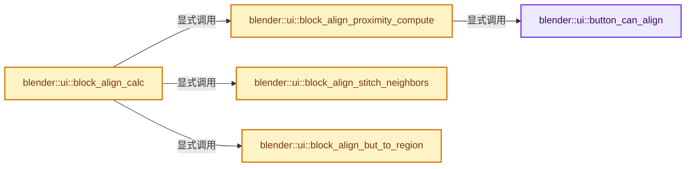
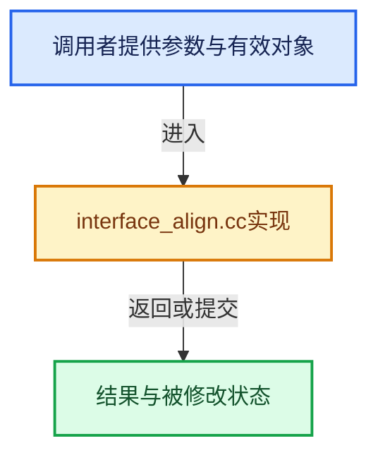

# 实现依赖专题：source/blender/editors/interface/interface_align.cc

[实现依赖导航](../../../README.md) · [符号索引](../../../../00-课程指南/02-源码与提交索引/符号依赖与实现索引.md)

本专题从正文实际调用进入，集中保存共享实现。函数有稳定锚点，可从调用处直接跳到对应完整函数；递归与互相调用通过回链组织。

## 本文件的实现关系






<a id="m-e4b6428f5b8e"></a>

## 宏 `SIDE1`

<!-- annotated:70f176c481f02a -->

```cpp
#define SIDE1(_s) (((_s) + 1) % TOTSIDES)
#define OPPOSITE(_s) (((_s) + 2) % TOTSIDES)
```

<details>
<summary>核对原始源码：source/blender/editors/interface/interface_align.cc · L83—L84</summary>

<!-- original:70f176c481f02a:source/blender/editors/interface/interface_align.cc:83:84 -->

```cpp
#define SIDE1(_s) (((_s) + 1) % TOTSIDES)
#define OPPOSITE(_s) (((_s) + 2) % TOTSIDES)
```

</details>

宏在预处理阶段展开，参数替换、重复求值和条件编译应直接从该定义检查。与普通函数不同，宏不会自动提供参数类型检查；构建配置选择哪个定义需结合外围条件。

<a id="m-e29fa418711b"></a>

## 宏 `OPPOSITE`

<!-- annotated:71171ed136f563 -->

```cpp
#define OPPOSITE(_s) (((_s) + 2) % TOTSIDES)
#define SIDE2(_s) (((_s) + 3) % TOTSIDES)
```

<details>
<summary>核对原始源码：source/blender/editors/interface/interface_align.cc · L84—L85</summary>

<!-- original:71171ed136f563:source/blender/editors/interface/interface_align.cc:84:85 -->

```cpp
#define OPPOSITE(_s) (((_s) + 2) % TOTSIDES)
#define SIDE2(_s) (((_s) + 3) % TOTSIDES)
```

</details>

宏在预处理阶段展开，参数替换、重复求值和条件编译应直接从该定义检查。与普通函数不同，宏不会自动提供参数类型检查；构建配置选择哪个定义需结合外围条件。

<a id="m-0578b1909a62"></a>

## 宏 `SIDE2`

<!-- annotated:0b799ef360bc93 -->

```cpp
#define SIDE2(_s) (((_s) + 3) % TOTSIDES)

```

<details>
<summary>核对原始源码：source/blender/editors/interface/interface_align.cc · L85—L86</summary>

<!-- original:0b799ef360bc93:source/blender/editors/interface/interface_align.cc:85:86 -->

```cpp
#define SIDE2(_s) (((_s) + 3) % TOTSIDES)

```

</details>

宏在预处理阶段展开，参数替换、重复求值和条件编译应直接从该定义检查。与普通函数不同，宏不会自动提供参数类型检查；构建配置选择哪个定义需结合外围条件。

<a id="m-c5d38336fc3d"></a>

## 宏 `IS_COLUMN`

<!-- annotated:2e204138e2dedb -->

```cpp
#define IS_COLUMN(_s) ((_s) % 2)

```

<details>
<summary>核对原始源码：source/blender/editors/interface/interface_align.cc · L88—L89</summary>

<!-- original:2e204138e2dedb:source/blender/editors/interface/interface_align.cc:88:89 -->

```cpp
#define IS_COLUMN(_s) ((_s) % 2)

```

</details>

宏在预处理阶段展开，参数替换、重复求值和条件编译应直接从该定义检查。与普通函数不同，宏不会自动提供参数类型检查；构建配置选择哪个定义需结合外围条件。

<a id="m-b01c11a5f86b"></a>

## 宏 `STITCH`

<!-- annotated:e7fab9c408370e -->

```cpp
#define STITCH(_s) (1 << (_s))

```

<details>
<summary>核对原始源码：source/blender/editors/interface/interface_align.cc · L91—L92</summary>

<!-- original:e7fab9c408370e:source/blender/editors/interface/interface_align.cc:91:92 -->

```cpp
#define STITCH(_s) (1 << (_s))

```

</details>

宏在预处理阶段展开，参数替换、重复求值和条件编译应直接从该定义检查。与普通函数不同，宏不会自动提供参数类型检查；构建配置选择哪个定义需结合外围条件。

## 完整成员与函数实现

<a id="f-fc0d39beacc76643"></a>

### `blender::ui::button_can_align`

实现位置：[source/blender/editors/interface/interface_align.cc](../../../../../../../../source/blender/editors/interface/interface_align.cc) · L96—L107。

接口参数：

- `const Button *but`

**教学注释版**

<!-- annotated:779b46c2e72eba -->

```cpp
bool button_can_align(const Button *but)
{
  const bool btype_can_align = !ELEM(but->type,
                                     ButtonType::Label,
                                     ButtonType::Checkbox,
                                     ButtonType::CheckboxN,
                                     ButtonType::Tab,
                                     ButtonType::Sepr,
                                     ButtonType::SeprLine,
                                     ButtonType::SeprSpacer);
  return (btype_can_align && !BLI_rctf_is_empty(&but->rect));
}
```

<details>
<summary>核对原始源码：source/blender/editors/interface/interface_align.cc · L96—L107</summary>

<!-- original:779b46c2e72eba:source/blender/editors/interface/interface_align.cc:96:107 -->

```cpp
bool button_can_align(const Button *but)
{
  const bool btype_can_align = !ELEM(but->type,
                                     ButtonType::Label,
                                     ButtonType::Checkbox,
                                     ButtonType::CheckboxN,
                                     ButtonType::Tab,
                                     ButtonType::Sepr,
                                     ButtonType::SeprLine,
                                     ButtonType::SeprSpacer);
  return (btype_can_align && !BLI_rctf_is_empty(&but->rect));
}
```

</details>

**结果出口**

- `return (btype_can_align && !BLI_rctf_is_empty(&but->rect));`

**继续追踪实现**

- `ELEM` → [ELEM · L88](../../../07-Intern运行时与平台/ghost/intern/GHOST_utildefines.hh.md#m-d28724a15928)；[ELEM · L135](../../../01-BLI基础库/BLI_utildefines.hh.md#m-d6572de7cae0)。宏定义由构建条件选择。
- `BLI_rctf_is_empty` → [blender::BLI_rctf_is_empty · L34](../../../01-BLI基础库/intern/rct.cc.md#f-06ec53bf739a52ad)。

<a id="f-57c8105bcf753225"></a>

### `blender::ui::block_align_proximity_compute`

实现位置：[source/blender/editors/interface/interface_align.cc](../../../../../../../../source/blender/editors/interface/interface_align.cc) · L116—L227。

接口参数：

- `ButAlign *butal`
- `ButAlign *butal_other`

**教学注释版**

<!-- annotated:9021a09bdac189 -->

```cpp
static void block_align_proximity_compute(ButAlign *butal, ButAlign *butal_other)
{
  /* That's the biggest gap between two borders to consider them 'alignable'. */
  const float max_delta = MAX_DELTA;
  float delta, delta_side_opp;
  int side, side_opp;

  const bool butal_can_align = button_can_align(butal->but);
  const bool butal_other_can_align = button_can_align(butal_other->but);

  const bool buts_share[2] = {
      /* Sharing same line? */
      !((*butal->borders[DOWN] >= *butal_other->borders[TOP]) ||
        (*butal->borders[TOP] <= *butal_other->borders[DOWN])),
      /* Sharing same column? */
      !((*butal->borders[LEFT] >= *butal_other->borders[RIGHT]) ||
        (*butal->borders[RIGHT] <= *butal_other->borders[LEFT])),
  };

  /* Early out in case buttons share no column or line, or if none can align... */
  if (!(buts_share[0] || buts_share[1]) || !(butal_can_align || butal_other_can_align)) {
    return;
  }

  for (side = 0; side < RIGHT; side++) {
    /* We are only interested in buttons which share a same line
     * (LEFT/RIGHT sides) or column (TOP/DOWN sides). */
    if (buts_share[IS_COLUMN(side)]) {
      side_opp = OPPOSITE(side);

      /* We check both opposite sides at once, because with very small buttons,
       * delta could be below max_delta for the wrong side
       * (that is, in horizontal case, the total width of two buttons can be below max_delta).
       * We rely on exact zero value here as an 'already processed' flag,
       * so ensure we never actually set a zero value at this stage.
       * FLT_MIN is zero-enough for UI position computing. ;) */
      delta = max_ff(fabsf(*butal->borders[side] - *butal_other->borders[side_opp]), FLT_MIN);
      delta_side_opp = max_ff(fabsf(*butal->borders[side_opp] - *butal_other->borders[side]),
                              FLT_MIN);
      if (delta_side_opp < delta) {
        std::swap(side, side_opp);
        delta = delta_side_opp;
      }

      if (delta < max_delta) {
        /* We are only interested in neighbors that are
         * at least as close as already found ones. */
        if (delta <= butal->dists[side]) {
          {
            /* We found an as close or closer neighbor.
             * If both buttons are alignable, we set them as each other neighbors.
             * Else, we have an unalignable one, we need to reset the others matching
             * neighbor to nullptr if its 'proximity distance'
             * is really lower with current one.
             *
             * NOTE: We cannot only execute that piece of code in case we found a
             *       **closer** neighbor, due to the limited way we represent neighbors
             *       (buttons only know **one** neighbor on each side, when they can
             *       actually have several ones), it would prevent some buttons to be
             *       properly 'neighborly-initialized'. */
            if (butal_can_align && butal_other_can_align) {
              butal->neighbors[side] = butal_other;
              butal_other->neighbors[side_opp] = butal;
            }
            else if (butal_can_align && (delta < butal->dists[side])) {
              butal->neighbors[side] = nullptr;
            }
            else if (butal_other_can_align && (delta < butal_other->dists[side_opp])) {
              butal_other->neighbors[side_opp] = nullptr;
            }
            butal->dists[side] = butal_other->dists[side_opp] = delta;
          }

          if (butal_can_align && butal_other_can_align) {
            const int side_s1 = SIDE1(side);
            const int side_s2 = SIDE2(side);

            const int stitch = STITCH(side);
            const int stitch_opp = STITCH(side_opp);

            if (butal->neighbors[side] == nullptr) {
              butal->neighbors[side] = butal_other;
            }
            if (butal_other->neighbors[side_opp] == nullptr) {
              butal_other->neighbors[side_opp] = butal;
            }

            /* We have a pair of neighbors, we have to check whether we
             *   can stitch their matching corners.
             *   E.g. if butal_other is on the left of butal (that is, side == LEFT),
             *        if both TOP (side_s1) coordinates of buttons are close enough,
             *        we can stitch their upper matching corners,
             *        and same for DOWN (side_s2) side. */
            delta = fabsf(*butal->borders[side_s1] - *butal_other->borders[side_s1]);
            if (delta < max_delta) {
              butal->flags[side_s1] |= stitch;
              butal_other->flags[side_s1] |= stitch_opp;
            }
            delta = fabsf(*butal->borders[side_s2] - *butal_other->borders[side_s2]);
            if (delta < max_delta) {
              butal->flags[side_s2] |= stitch;
              butal_other->flags[side_s2] |= stitch_opp;
            }
          }
        }
        /* We assume two buttons can only share one side at most - for until
         * we have spherical UI. */
        return;
      }
    }
  }
}
```

<details>
<summary>核对原始源码：source/blender/editors/interface/interface_align.cc · L116—L227</summary>

<!-- original:9021a09bdac189:source/blender/editors/interface/interface_align.cc:116:227 -->

```cpp
static void block_align_proximity_compute(ButAlign *butal, ButAlign *butal_other)
{
  /* That's the biggest gap between two borders to consider them 'alignable'. */
  const float max_delta = MAX_DELTA;
  float delta, delta_side_opp;
  int side, side_opp;

  const bool butal_can_align = button_can_align(butal->but);
  const bool butal_other_can_align = button_can_align(butal_other->but);

  const bool buts_share[2] = {
      /* Sharing same line? */
      !((*butal->borders[DOWN] >= *butal_other->borders[TOP]) ||
        (*butal->borders[TOP] <= *butal_other->borders[DOWN])),
      /* Sharing same column? */
      !((*butal->borders[LEFT] >= *butal_other->borders[RIGHT]) ||
        (*butal->borders[RIGHT] <= *butal_other->borders[LEFT])),
  };

  /* Early out in case buttons share no column or line, or if none can align... */
  if (!(buts_share[0] || buts_share[1]) || !(butal_can_align || butal_other_can_align)) {
    return;
  }

  for (side = 0; side < RIGHT; side++) {
    /* We are only interested in buttons which share a same line
     * (LEFT/RIGHT sides) or column (TOP/DOWN sides). */
    if (buts_share[IS_COLUMN(side)]) {
      side_opp = OPPOSITE(side);

      /* We check both opposite sides at once, because with very small buttons,
       * delta could be below max_delta for the wrong side
       * (that is, in horizontal case, the total width of two buttons can be below max_delta).
       * We rely on exact zero value here as an 'already processed' flag,
       * so ensure we never actually set a zero value at this stage.
       * FLT_MIN is zero-enough for UI position computing. ;) */
      delta = max_ff(fabsf(*butal->borders[side] - *butal_other->borders[side_opp]), FLT_MIN);
      delta_side_opp = max_ff(fabsf(*butal->borders[side_opp] - *butal_other->borders[side]),
                              FLT_MIN);
      if (delta_side_opp < delta) {
        std::swap(side, side_opp);
        delta = delta_side_opp;
      }

      if (delta < max_delta) {
        /* We are only interested in neighbors that are
         * at least as close as already found ones. */
        if (delta <= butal->dists[side]) {
          {
            /* We found an as close or closer neighbor.
             * If both buttons are alignable, we set them as each other neighbors.
             * Else, we have an unalignable one, we need to reset the others matching
             * neighbor to nullptr if its 'proximity distance'
             * is really lower with current one.
             *
             * NOTE: We cannot only execute that piece of code in case we found a
             *       **closer** neighbor, due to the limited way we represent neighbors
             *       (buttons only know **one** neighbor on each side, when they can
             *       actually have several ones), it would prevent some buttons to be
             *       properly 'neighborly-initialized'. */
            if (butal_can_align && butal_other_can_align) {
              butal->neighbors[side] = butal_other;
              butal_other->neighbors[side_opp] = butal;
            }
            else if (butal_can_align && (delta < butal->dists[side])) {
              butal->neighbors[side] = nullptr;
            }
            else if (butal_other_can_align && (delta < butal_other->dists[side_opp])) {
              butal_other->neighbors[side_opp] = nullptr;
            }
            butal->dists[side] = butal_other->dists[side_opp] = delta;
          }

          if (butal_can_align && butal_other_can_align) {
            const int side_s1 = SIDE1(side);
            const int side_s2 = SIDE2(side);

            const int stitch = STITCH(side);
            const int stitch_opp = STITCH(side_opp);

            if (butal->neighbors[side] == nullptr) {
              butal->neighbors[side] = butal_other;
            }
            if (butal_other->neighbors[side_opp] == nullptr) {
              butal_other->neighbors[side_opp] = butal;
            }

            /* We have a pair of neighbors, we have to check whether we
             *   can stitch their matching corners.
             *   E.g. if butal_other is on the left of butal (that is, side == LEFT),
             *        if both TOP (side_s1) coordinates of buttons are close enough,
             *        we can stitch their upper matching corners,
             *        and same for DOWN (side_s2) side. */
            delta = fabsf(*butal->borders[side_s1] - *butal_other->borders[side_s1]);
            if (delta < max_delta) {
              butal->flags[side_s1] |= stitch;
              butal_other->flags[side_s1] |= stitch_opp;
            }
            delta = fabsf(*butal->borders[side_s2] - *butal_other->borders[side_s2]);
            if (delta < max_delta) {
              butal->flags[side_s2] |= stitch;
              butal_other->flags[side_s2] |= stitch_opp;
            }
          }
        }
        /* We assume two buttons can only share one side at most - for until
         * we have spherical UI. */
        return;
      }
    }
  }
}
```

</details>

**沿实际写入检查状态**

- `side_opp = OPPOSITE(side);`
- `delta = max_ff(fabsf(*butal->borders[side] - *butal_other->borders[side_opp]), FLT_MIN);`
- `delta_side_opp = max_ff(fabsf(*butal->borders[side_opp] - *butal_other->borders[side]),`
- `delta = delta_side_opp;`
- `butal->neighbors[side] = butal_other;`
- `butal_other->neighbors[side_opp] = butal;`
- `butal->neighbors[side] = nullptr;`
- `butal_other->neighbors[side_opp] = nullptr;`
- `butal->dists[side] = butal_other->dists[side_opp] = delta;`
- `delta = fabsf(*butal->borders[side_s1] - *butal_other->borders[side_s1]);`
- `butal->flags[side_s1] |= stitch;`
- `butal_other->flags[side_s1] |= stitch_opp;`
- `delta = fabsf(*butal->borders[side_s2] - *butal_other->borders[side_s2]);`
- `butal->flags[side_s2] |= stitch;`
- `butal_other->flags[side_s2] |= stitch_opp;`

**继续追踪实现**

- `button_can_align` → [blender::ui::button_can_align · L96](interface_align.cc.md#f-fc0d39beacc76643)。
- `IS_COLUMN` → [IS_COLUMN · L88](interface_align.cc.md#m-c5d38336fc3d)。宏定义由构建条件选择。
- `OPPOSITE` → [OPPOSITE · L84](interface_align.cc.md#m-e29fa418711b)。宏定义由构建条件选择。
- `max_ff` → [blender::max_ff · L325](../../../01-BLI基础库/intern/math_base_inline.cc.md#f-05a351a3afd7dc2a)。
- `fabsf` → [fabsf · L21](../../../07-Intern运行时与平台/cycles/kernel/svm/radial_tiling_shared.h.md#m-02cc4c69cfb3)；[fabsf · L43](../../../07-Intern运行时与平台/cycles/kernel/svm/radial_tiling_shared.h.md#m-04effe61803b)；[fabsf · L74](../../../07-Intern运行时与平台/cycles/kernel/svm/radial_tiling_shared.h.md#m-927dd4eba7dc)；[fabsf · L25](../../../01-BLI基础库/intern/radial_tiling_shared.hh.md#m-8348d6b3d08f)；[fabsf · L47](../../../01-BLI基础库/intern/radial_tiling_shared.hh.md#m-13b7e0b6d84f)；[fabsf · L78](../../../01-BLI基础库/intern/radial_tiling_shared.hh.md#m-326c83464a0d)；[fabsf · L21](../../../07-Intern运行时与平台/cycles/kernel/osl/shaders/node_radial_tiling_shared.h.md#m-7c3ee12fc119)；[fabsf · L43](../../../07-Intern运行时与平台/cycles/kernel/osl/shaders/node_radial_tiling_shared.h.md#m-9112db0e2dd1)；[fabsf · L74](../../../07-Intern运行时与平台/cycles/kernel/osl/shaders/node_radial_tiling_shared.h.md#m-ee4e61908a6f)；[fabsf · L167](../../../07-Intern运行时与平台/cycles/kernel/device/oneapi/compat.h.md#m-b039ee6c1601)；[fabsf · L265](../../../07-Intern运行时与平台/cycles/kernel/device/metal/compat.h.md#m-6b21869e9f3f)。宏定义由构建条件选择。
- `std::swap` → [外部契约](https://eel.is/c++draft/)：这个边界按实际表达式及所属类型核对参数、返回值、寿命与失败行为。这里提供接口入口，不声称已解释该第三方版本的内部实现。
- `SIDE1` → [SIDE1 · L83](interface_align.cc.md#m-e4b6428f5b8e)。宏定义由构建条件选择。
- `SIDE2` → [SIDE2 · L85](interface_align.cc.md#m-0578b1909a62)。宏定义由构建条件选择。
- `STITCH` → [STITCH · L91](interface_align.cc.md#m-b01c11a5f86b)。宏定义由构建条件选择。

<a id="f-489da88821b2f034"></a>

### `blender::ui::block_align_stitch_neighbors`

实现位置：[source/blender/editors/interface/interface_align.cc](../../../../../../../../source/blender/editors/interface/interface_align.cc) · L250—L295。

接口参数：

- `ButAlign *butal`
- `const int side`
- `const int side_opp`
- `const int side_s1`
- `const int side_s2`
- `const int align`
- `const int align_opp`
- `const float co`

**教学注释版**

<!-- annotated:bb889fd4a21af1 -->

```cpp
static void block_align_stitch_neighbors(ButAlign *butal,
                                         const int side,
                                         const int side_opp,
                                         const int side_s1,
                                         const int side_s2,
                                         const int align,
                                         const int align_opp,
                                         const float co)
{
  ButAlign *butal_neighbor;

  const int stitch_s1 = STITCH(side_s1);
  const int stitch_s2 = STITCH(side_s2);

  /* We have to check stitching flags on both sides of the stitching,
   * since we only clear one of them flags to break any future loop on same 'columns/side' case.
   * Also, if butal is spanning over several rows or columns of neighbors,
   * it may have both of its stitching flags
   * set, but would not be the case of its immediate neighbor! */
  while ((butal->flags[side] & stitch_s1) && (butal = butal->neighbors[side_s1]) &&
         (butal->flags[side] & stitch_s2))
  {
    butal_neighbor = butal->neighbors[side];

    /* If we actually do have a neighbor, we directly set its values accordingly,
     * and clear its matching 'dist' to prevent it being set again later... */
    if (butal_neighbor) {
      butal->but->drawflag |= align;
      butal_neighbor->but->drawflag |= align_opp;
      *butal_neighbor->borders[side_opp] = co;
      butal_neighbor->dists[side_opp] = 0.0f;
    }
    /* See definition of BUT_ALIGN_STITCH_LEFT/TOP for reason of this... */
    else if (side == LEFT) {
      butal->but->drawflag |= BUT_ALIGN_STITCH_LEFT;
    }
    else if (side == TOP) {
      butal->but->drawflag |= BUT_ALIGN_STITCH_TOP;
    }
    *butal->borders[side] = co;
    butal->dists[side] = 0.0f;
    /* Clearing one of the 'flags pair' here is enough to prevent this loop running on
     * the same column, side and direction again. */
    butal->flags[side] &= ~stitch_s2;
  }
}
```

<details>
<summary>核对原始源码：source/blender/editors/interface/interface_align.cc · L250—L295</summary>

<!-- original:bb889fd4a21af1:source/blender/editors/interface/interface_align.cc:250:295 -->

```cpp
static void block_align_stitch_neighbors(ButAlign *butal,
                                         const int side,
                                         const int side_opp,
                                         const int side_s1,
                                         const int side_s2,
                                         const int align,
                                         const int align_opp,
                                         const float co)
{
  ButAlign *butal_neighbor;

  const int stitch_s1 = STITCH(side_s1);
  const int stitch_s2 = STITCH(side_s2);

  /* We have to check stitching flags on both sides of the stitching,
   * since we only clear one of them flags to break any future loop on same 'columns/side' case.
   * Also, if butal is spanning over several rows or columns of neighbors,
   * it may have both of its stitching flags
   * set, but would not be the case of its immediate neighbor! */
  while ((butal->flags[side] & stitch_s1) && (butal = butal->neighbors[side_s1]) &&
         (butal->flags[side] & stitch_s2))
  {
    butal_neighbor = butal->neighbors[side];

    /* If we actually do have a neighbor, we directly set its values accordingly,
     * and clear its matching 'dist' to prevent it being set again later... */
    if (butal_neighbor) {
      butal->but->drawflag |= align;
      butal_neighbor->but->drawflag |= align_opp;
      *butal_neighbor->borders[side_opp] = co;
      butal_neighbor->dists[side_opp] = 0.0f;
    }
    /* See definition of BUT_ALIGN_STITCH_LEFT/TOP for reason of this... */
    else if (side == LEFT) {
      butal->but->drawflag |= BUT_ALIGN_STITCH_LEFT;
    }
    else if (side == TOP) {
      butal->but->drawflag |= BUT_ALIGN_STITCH_TOP;
    }
    *butal->borders[side] = co;
    butal->dists[side] = 0.0f;
    /* Clearing one of the 'flags pair' here is enough to prevent this loop running on
     * the same column, side and direction again. */
    butal->flags[side] &= ~stitch_s2;
  }
}
```

</details>

**沿实际写入检查状态**

- `butal_neighbor = butal->neighbors[side];`
- `butal->but->drawflag |= align;`
- `butal_neighbor->but->drawflag |= align_opp;`
- `butal_neighbor->dists[side_opp] = 0.0f;`
- `butal->but->drawflag |= BUT_ALIGN_STITCH_LEFT;`
- `butal->but->drawflag |= BUT_ALIGN_STITCH_TOP;`
- `butal->dists[side] = 0.0f;`
- `butal->flags[side] &= ~stitch_s2;`

**继续追踪实现**

- `STITCH` → [STITCH · L91](interface_align.cc.md#m-b01c11a5f86b)。宏定义由构建条件选择。

<a id="f-63f71341ab5e2b35"></a>

### `blender::ui::block_align_but_to_region`

实现位置：[source/blender/editors/interface/interface_align.cc](../../../../../../../../source/blender/editors/interface/interface_align.cc) · L325—L355。

接口参数：

- `Button *but`
- `const ARegion *region`

**教学注释版**

<!-- annotated:0b0c0e4f3e38de -->

```cpp
static void block_align_but_to_region(Button *but, const ARegion *region)
{
  rctf *rect = &but->rect;
  const float but_width = BLI_rctf_size_x(rect);
  const float but_height = BLI_rctf_size_y(rect);
  const float outline_px = U.pixelsize; /* This may have to be made more variable. */

  switch (but->drawflag & BUT_ALIGN) {
    case BUT_ALIGN_TOP:
      rect->ymax = region->winy + outline_px;
      rect->ymin = but->rect.ymax - but_height;
      break;
    case BUT_ALIGN_DOWN:
      rect->ymin = -outline_px;
      rect->ymax = rect->ymin + but_height;
      break;
    case BUT_ALIGN_LEFT:
      rect->xmin = -outline_px;
      rect->xmax = rect->xmin + but_width;
      break;
    case BUT_ALIGN_RIGHT:
      rect->xmax = region->winx + outline_px;
      rect->xmin = rect->xmax - but_width;
      break;
    default:
      /* Tabs may be shown in unaligned regions too, they just appear as regular buttons then. */
      rect->ymin += UI_SCALE_FAC;
      rect->ymax += UI_SCALE_FAC;
      break;
  }
}
```

<details>
<summary>核对原始源码：source/blender/editors/interface/interface_align.cc · L325—L355</summary>

<!-- original:0b0c0e4f3e38de:source/blender/editors/interface/interface_align.cc:325:355 -->

```cpp
static void block_align_but_to_region(Button *but, const ARegion *region)
{
  rctf *rect = &but->rect;
  const float but_width = BLI_rctf_size_x(rect);
  const float but_height = BLI_rctf_size_y(rect);
  const float outline_px = U.pixelsize; /* This may have to be made more variable. */

  switch (but->drawflag & BUT_ALIGN) {
    case BUT_ALIGN_TOP:
      rect->ymax = region->winy + outline_px;
      rect->ymin = but->rect.ymax - but_height;
      break;
    case BUT_ALIGN_DOWN:
      rect->ymin = -outline_px;
      rect->ymax = rect->ymin + but_height;
      break;
    case BUT_ALIGN_LEFT:
      rect->xmin = -outline_px;
      rect->xmax = rect->xmin + but_width;
      break;
    case BUT_ALIGN_RIGHT:
      rect->xmax = region->winx + outline_px;
      rect->xmin = rect->xmax - but_width;
      break;
    default:
      /* Tabs may be shown in unaligned regions too, they just appear as regular buttons then. */
      rect->ymin += UI_SCALE_FAC;
      rect->ymax += UI_SCALE_FAC;
      break;
  }
}
```

</details>

**沿实际写入检查状态**

- `rect->ymax = region->winy + outline_px;`
- `rect->ymin = but->rect.ymax - but_height;`
- `rect->ymin = -outline_px;`
- `rect->ymax = rect->ymin + but_height;`
- `rect->xmin = -outline_px;`
- `rect->xmax = rect->xmin + but_width;`
- `rect->xmax = region->winx + outline_px;`
- `rect->xmin = rect->xmax - but_width;`
- `rect->ymin += UI_SCALE_FAC;`
- `rect->ymax += UI_SCALE_FAC;`

**继续追踪实现**

- `BLI_rctf_size_x` → [blender::BLI_rctf_size_x · L211](../../../01-BLI基础库/BLI_rect.hh.md#f-017b86a9d189e3ba)。
- `BLI_rctf_size_y` → [blender::BLI_rctf_size_y · L215](../../../01-BLI基础库/BLI_rect.hh.md#f-6d179bc3c1b71b0e)。

<a id="f-49bcadf55c4ebcfc"></a>

### `blender::ui::block_align_calc`

实现位置：[source/blender/editors/interface/interface_align.cc](../../../../../../../../source/blender/editors/interface/interface_align.cc) · L357—L479。

接口参数：

- `Block *block`
- `const ARegion *region`

**教学注释版**

<!-- annotated:a0f1049443a8c8 -->

```cpp
void block_align_calc(Block *block, const ARegion *region)
{

  const int sides_to_ui_but_align_flags[4] = SIDE_TO_BUT_ALIGN;

  Vector<ButAlign, 256> butal_array(block->buttons_ptrs.size());

  int n = 0;
  /* First loop: Initialize ButAlign data for each button and clear their align flag.
   * Tabs get some special treatment here, they get aligned to region border. */
  for (Button &but : block->buttons()) {
    /* special case: tabs need to be aligned to a region border, drawflag tells which one */
    if (but.type == ButtonType::Tab) {
      block_align_but_to_region(&but, region);
    }
    else {
      /* Clear old align flags. */
      but.drawflag &= ~BUT_ALIGN_ALL;
    }

    if (but.alignnr == 0) {
      continue;
    }
    ButAlign &butal = butal_array[n++];
    butal = {};
    butal.but = &but;
    butal.borders[LEFT] = &but.rect.xmin;
    butal.borders[RIGHT] = &but.rect.xmax;
    butal.borders[DOWN] = &but.rect.ymin;
    butal.borders[TOP] = &but.rect.ymax;
    butal.dists = float4{FLT_MAX};
  }
  // [讲解] butal_array.resize：把有效元素数调整为new_size。增长路径构造新元素，缩小路径销毁尾部对象，最后才提交新的end_。
  butal_array.resize(n);

  // [讲解] butal_array.size：用end_减begin_得到活元素数量。
  if (butal_array.size() < 2) {
    /* No need to go further if we have nothing to align... */
    return;
  }

  /* This will give us ButAlign items regrouped by align group, vertical and horizontal location.
   * Note that, given how buttons are defined in UI code,
   * butal_array shall already be "nearly sorted"... */
  std::ranges::sort(butal_array, block_align_butal_cmp);

  /* Second loop: for each pair of buttons in the same align group,
   * we compute their potential proximity. Note that each pair is checked only once, and that we
   * break early in case we know all remaining pairs will always be too far away. */
  for (const int i : butal_array.index_range()) {
    ButAlign &butal = butal_array[i];
    const short alignnr = butal.but->alignnr;

    // [讲解] butal_array.as_mutable_span：构造对当前有效元素区间的借用视图。
    for (ButAlign &butal_other : butal_array.as_mutable_span().drop_front(i + 1)) {
      const float max_delta = MAX_DELTA;

      /* Since they are sorted, buttons after current butal can only be of same or higher
       * group, and once they are not of same group, we know we can break this sub-loop and
       * start checking with next butal. */
      if (butal_other.but->alignnr != alignnr) {
        break;
      }

      /* Since they are sorted vertically first, buttons after current butal can only be at
       * same or lower height, and once they are lower than a given threshold, we know we can
       * break this sub-loop and start checking with next butal. */
      if ((*butal.borders[DOWN] - *butal_other.borders[TOP]) > max_delta) {
        break;
      }

      block_align_proximity_compute(&butal, &butal_other);
    }
  }

  /* Third loop: we have all our 'aligned' buttons as a 'map' in butal_array. We need to:
   *     - update their relevant coordinates to stitch them.
   *     - assign them valid flags.
   */
  for (ButAlign &butal : butal_array) {

    for (int side = 0; side < TOTSIDES; side++) {
      ButAlign *butal_other = butal.neighbors[side];

      if (butal_other) {
        const int side_opp = OPPOSITE(side);
        const int side_s1 = SIDE1(side);
        const int side_s2 = SIDE2(side);

        const int align = sides_to_ui_but_align_flags[side];
        const int align_opp = sides_to_ui_but_align_flags[side_opp];

        float co;

        butal.but->drawflag |= align;
        butal_other->but->drawflag |= align_opp;
        if (!IS_EQF(butal.dists[side], 0.0f)) {
          float *delta = &butal.dists[side];

          if (*butal.borders[side] < *butal_other->borders[side_opp]) {
            *delta *= 0.5f;
          }
          else {
            *delta *= -0.5f;
          }
          co = (*butal.borders[side] += *delta);

          if (!IS_EQF(butal_other->dists[side_opp], 0.0f)) {
            BLI_assert(butal_other->dists[side_opp] * 0.5f == fabsf(*delta));
            *butal_other->borders[side_opp] = co;
            butal_other->dists[side_opp] = 0.0f;
          }
          *delta = 0.0f;
        }
        else {
          co = *butal.borders[side];
        }

        block_align_stitch_neighbors(
            &butal, side, side_opp, side_s1, side_s2, align, align_opp, co);
        block_align_stitch_neighbors(
            &butal, side, side_opp, side_s2, side_s1, align, align_opp, co);
      }
    }
  }
}
```

<details>
<summary>核对原始源码：source/blender/editors/interface/interface_align.cc · L357—L479</summary>

<!-- original:a0f1049443a8c8:source/blender/editors/interface/interface_align.cc:357:479 -->

```cpp
void block_align_calc(Block *block, const ARegion *region)
{

  const int sides_to_ui_but_align_flags[4] = SIDE_TO_BUT_ALIGN;

  Vector<ButAlign, 256> butal_array(block->buttons_ptrs.size());

  int n = 0;
  /* First loop: Initialize ButAlign data for each button and clear their align flag.
   * Tabs get some special treatment here, they get aligned to region border. */
  for (Button &but : block->buttons()) {
    /* special case: tabs need to be aligned to a region border, drawflag tells which one */
    if (but.type == ButtonType::Tab) {
      block_align_but_to_region(&but, region);
    }
    else {
      /* Clear old align flags. */
      but.drawflag &= ~BUT_ALIGN_ALL;
    }

    if (but.alignnr == 0) {
      continue;
    }
    ButAlign &butal = butal_array[n++];
    butal = {};
    butal.but = &but;
    butal.borders[LEFT] = &but.rect.xmin;
    butal.borders[RIGHT] = &but.rect.xmax;
    butal.borders[DOWN] = &but.rect.ymin;
    butal.borders[TOP] = &but.rect.ymax;
    butal.dists = float4{FLT_MAX};
  }
  butal_array.resize(n);

  if (butal_array.size() < 2) {
    /* No need to go further if we have nothing to align... */
    return;
  }

  /* This will give us ButAlign items regrouped by align group, vertical and horizontal location.
   * Note that, given how buttons are defined in UI code,
   * butal_array shall already be "nearly sorted"... */
  std::ranges::sort(butal_array, block_align_butal_cmp);

  /* Second loop: for each pair of buttons in the same align group,
   * we compute their potential proximity. Note that each pair is checked only once, and that we
   * break early in case we know all remaining pairs will always be too far away. */
  for (const int i : butal_array.index_range()) {
    ButAlign &butal = butal_array[i];
    const short alignnr = butal.but->alignnr;

    for (ButAlign &butal_other : butal_array.as_mutable_span().drop_front(i + 1)) {
      const float max_delta = MAX_DELTA;

      /* Since they are sorted, buttons after current butal can only be of same or higher
       * group, and once they are not of same group, we know we can break this sub-loop and
       * start checking with next butal. */
      if (butal_other.but->alignnr != alignnr) {
        break;
      }

      /* Since they are sorted vertically first, buttons after current butal can only be at
       * same or lower height, and once they are lower than a given threshold, we know we can
       * break this sub-loop and start checking with next butal. */
      if ((*butal.borders[DOWN] - *butal_other.borders[TOP]) > max_delta) {
        break;
      }

      block_align_proximity_compute(&butal, &butal_other);
    }
  }

  /* Third loop: we have all our 'aligned' buttons as a 'map' in butal_array. We need to:
   *     - update their relevant coordinates to stitch them.
   *     - assign them valid flags.
   */
  for (ButAlign &butal : butal_array) {

    for (int side = 0; side < TOTSIDES; side++) {
      ButAlign *butal_other = butal.neighbors[side];

      if (butal_other) {
        const int side_opp = OPPOSITE(side);
        const int side_s1 = SIDE1(side);
        const int side_s2 = SIDE2(side);

        const int align = sides_to_ui_but_align_flags[side];
        const int align_opp = sides_to_ui_but_align_flags[side_opp];

        float co;

        butal.but->drawflag |= align;
        butal_other->but->drawflag |= align_opp;
        if (!IS_EQF(butal.dists[side], 0.0f)) {
          float *delta = &butal.dists[side];

          if (*butal.borders[side] < *butal_other->borders[side_opp]) {
            *delta *= 0.5f;
          }
          else {
            *delta *= -0.5f;
          }
          co = (*butal.borders[side] += *delta);

          if (!IS_EQF(butal_other->dists[side_opp], 0.0f)) {
            BLI_assert(butal_other->dists[side_opp] * 0.5f == fabsf(*delta));
            *butal_other->borders[side_opp] = co;
            butal_other->dists[side_opp] = 0.0f;
          }
          *delta = 0.0f;
        }
        else {
          co = *butal.borders[side];
        }

        block_align_stitch_neighbors(
            &butal, side, side_opp, side_s1, side_s2, align, align_opp, co);
        block_align_stitch_neighbors(
            &butal, side, side_opp, side_s2, side_s1, align, align_opp, co);
      }
    }
  }
}
```

</details>

**沿实际写入检查状态**

- `but.drawflag &= ~BUT_ALIGN_ALL;`
- `butal = {};`
- `butal.but = &but;`
- `butal.borders[LEFT] = &but.rect.xmin;`
- `butal.borders[RIGHT] = &but.rect.xmax;`
- `butal.borders[DOWN] = &but.rect.ymin;`
- `butal.borders[TOP] = &but.rect.ymax;`
- `butal.dists = float4{FLT_MAX};`
- `butal.but->drawflag |= align;`
- `butal_other->but->drawflag |= align_opp;`
- `co = (*butal.borders[side] += *delta);`
- `butal_other->dists[side_opp] = 0.0f;`
- `co = *butal.borders[side];`

**继续追踪实现**

- `block->buttons_ptrs.size` → [调用协议](../../../../00-课程指南/01-路线与规范/模板宏与动态分派协议.md)：接收对象类型依赖auto、返回值或模板实例；不按同名猜测目标。调用位置L362。
- `block->buttons` → [blender::ui::Block::buttons · L836](interface_intern.hh.md#f-5296ad5fd22b5505)。
- `block_align_but_to_region` → [blender::ui::block_align_but_to_region · L325](interface_align.cc.md#f-63f71341ab5e2b35)。
- `butal_array.resize` → [blender::Vector::resize · L418](../../../../01-基础容器与现代CPP/10-Vector扩容与增长.md#f-059312cabb8abe3a)；[blender::Vector::resize · L439](../../../../01-基础容器与现代CPP/10-Vector扩容与增长.md#f-ab8f94924ebe2d12)。同名重载需按实参类型选择。
- `butal_array.size` → [blender::Vector::size · L780](../../../../01-基础容器与现代CPP/11-Vector插入删除与重排.md#f-714773731767349c)。
- `std::ranges::sort` → [外部契约](https://eel.is/c++draft/)：这个边界按实际表达式及所属类型核对参数、返回值、寿命与失败行为。这里提供接口入口，不声称已解释该第三方版本的内部实现。
- `butal_array.index_range` → [blender::Vector::index_range · L1026](../../../../01-基础容器与现代CPP/12-Vector异常安全与边界.md#f-ac29cf36ef185ab9)。
- `butal_array.as_mutable_span().drop_front` → [调用协议](../../../../00-课程指南/01-路线与规范/模板宏与动态分派协议.md)：接收对象类型依赖auto、返回值或模板实例；不按同名猜测目标。调用位置L408。
- `butal_array.as_mutable_span` → [blender::Vector::as_mutable_span · L395](../../../../01-基础容器与现代CPP/10-Vector扩容与增长.md#f-98b7994c0b2e3bae)。
- `block_align_proximity_compute` → [blender::ui::block_align_proximity_compute · L116](interface_align.cc.md#f-57c8105bcf753225)。
- `OPPOSITE` → [OPPOSITE · L84](interface_align.cc.md#m-e29fa418711b)。宏定义由构建条件选择。
- `SIDE1` → [SIDE1 · L83](interface_align.cc.md#m-e4b6428f5b8e)。宏定义由构建条件选择。
- `SIDE2` → [SIDE2 · L85](interface_align.cc.md#m-0578b1909a62)。宏定义由构建条件选择。
- `IS_EQF` → [IS_EQF · L150](../../../01-BLI基础库/BLI_utildefines.hh.md#m-cbb89356c077)。宏定义由构建条件选择。
- `BLI_assert` → [BLI_assert · L48](../../../01-BLI基础库/BLI_assert.hh.md#m-57a88495704d)；[BLI_assert · L63](../../../01-BLI基础库/BLI_assert.hh.md#m-d07050020cb5)。宏定义由构建条件选择。
- `fabsf` → [fabsf · L21](../../../07-Intern运行时与平台/cycles/kernel/svm/radial_tiling_shared.h.md#m-02cc4c69cfb3)；[fabsf · L43](../../../07-Intern运行时与平台/cycles/kernel/svm/radial_tiling_shared.h.md#m-04effe61803b)；[fabsf · L74](../../../07-Intern运行时与平台/cycles/kernel/svm/radial_tiling_shared.h.md#m-927dd4eba7dc)；[fabsf · L25](../../../01-BLI基础库/intern/radial_tiling_shared.hh.md#m-8348d6b3d08f)；[fabsf · L47](../../../01-BLI基础库/intern/radial_tiling_shared.hh.md#m-13b7e0b6d84f)；[fabsf · L78](../../../01-BLI基础库/intern/radial_tiling_shared.hh.md#m-326c83464a0d)；[fabsf · L21](../../../07-Intern运行时与平台/cycles/kernel/osl/shaders/node_radial_tiling_shared.h.md#m-7c3ee12fc119)；[fabsf · L43](../../../07-Intern运行时与平台/cycles/kernel/osl/shaders/node_radial_tiling_shared.h.md#m-9112db0e2dd1)；[fabsf · L74](../../../07-Intern运行时与平台/cycles/kernel/osl/shaders/node_radial_tiling_shared.h.md#m-ee4e61908a6f)；[fabsf · L167](../../../07-Intern运行时与平台/cycles/kernel/device/oneapi/compat.h.md#m-b039ee6c1601)；[fabsf · L265](../../../07-Intern运行时与平台/cycles/kernel/device/metal/compat.h.md#m-6b21869e9f3f)。宏定义由构建条件选择。
- `block_align_stitch_neighbors` → [blender::ui::block_align_stitch_neighbors · L250](interface_align.cc.md#f-489da88821b2f034)。
