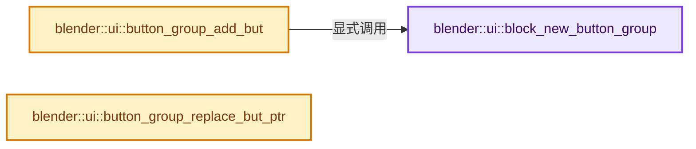
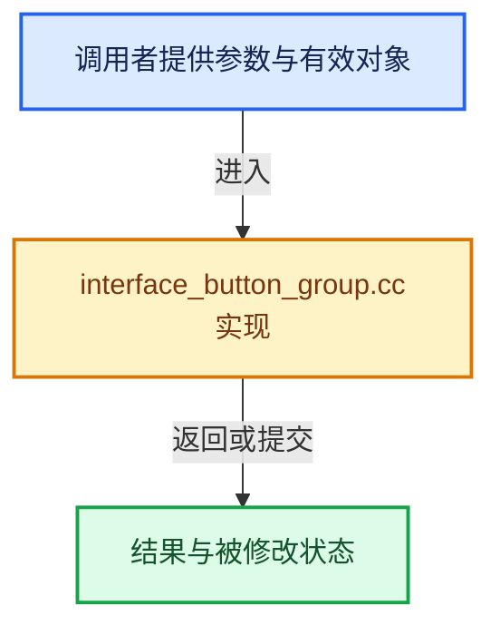

# 实现依赖专题：source/blender/editors/interface/interface_button_group.cc

[实现依赖导航](../../../README.md) · [符号索引](../../../../00-课程指南/02-源码与提交索引/符号依赖与实现索引.md)

本专题从正文实际调用进入，集中保存共享实现。函数有稳定锚点，可从调用处直接跳到对应完整函数；递归与互相调用通过回链组织。

## 本文件的实现关系






## 完整成员与函数实现

<a id="f-0a3e429bf75daa78"></a>

### `blender::ui::block_new_button_group`

实现位置：[source/blender/editors/interface/interface_button_group.cc](../../../../../../../../source/blender/editors/interface/interface_button_group.cc) · L17—L29。

接口参数：

- `Block *block`
- `ButtonGroupFlag flag`

**教学注释版**

<!-- annotated:ce4c1419bb082b -->

```cpp
void block_new_button_group(Block *block, ButtonGroupFlag flag)
{
  /* Don't create a new group if there is a "lock" on new groups. */
  if (!block->button_groups.is_empty()) {
    ButtonGroup &last_group = block->button_groups.last();
    if (last_group.flag & UI_BUTTON_GROUP_LOCK) {
      return;
    }
  }

  block->button_groups.append({});
  block->button_groups.last().flag = flag;
}
```

<details>
<summary>核对原始源码：source/blender/editors/interface/interface_button_group.cc · L17—L29</summary>

<!-- original:ce4c1419bb082b:source/blender/editors/interface/interface_button_group.cc:17:29 -->

```cpp
void block_new_button_group(Block *block, ButtonGroupFlag flag)
{
  /* Don't create a new group if there is a "lock" on new groups. */
  if (!block->button_groups.is_empty()) {
    ButtonGroup &last_group = block->button_groups.last();
    if (last_group.flag & UI_BUTTON_GROUP_LOCK) {
      return;
    }
  }

  block->button_groups.append({});
  block->button_groups.last().flag = flag;
}
```

</details>

**继续追踪实现**

- `block->button_groups.is_empty` → [调用协议](../../../../00-课程指南/01-路线与规范/模板宏与动态分派协议.md)：接收对象类型依赖auto、返回值或模板实例；不按同名猜测目标。调用位置L20。
- `block->button_groups.last` → [调用协议](../../../../00-课程指南/01-路线与规范/模板宏与动态分派协议.md)：接收对象类型依赖auto、返回值或模板实例；不按同名猜测目标。调用位置L21。
- `block->button_groups.append` → [调用协议](../../../../00-课程指南/01-路线与规范/模板宏与动态分派协议.md)：接收对象类型依赖auto、返回值或模板实例；不按同名猜测目标。调用位置L27。

<a id="f-3cbfb45268de9cca"></a>

### `blender::ui::button_group_add_but`

实现位置：[source/blender/editors/interface/interface_button_group.cc](../../../../../../../../source/blender/editors/interface/interface_button_group.cc) · L31—L39。

接口参数：

- `Block *block`
- `Button *but`

**教学注释版**

<!-- annotated:466e8144fe0d38 -->

```cpp
void button_group_add_but(Block *block, Button *but)
{
  if (block->button_groups.is_empty()) {
    block_new_button_group(block, ButtonGroupFlag(0));
  }

  ButtonGroup &current_group = block->button_groups.last();
  current_group.buttons.append(but);
}
```

<details>
<summary>核对原始源码：source/blender/editors/interface/interface_button_group.cc · L31—L39</summary>

<!-- original:466e8144fe0d38:source/blender/editors/interface/interface_button_group.cc:31:39 -->

```cpp
void button_group_add_but(Block *block, Button *but)
{
  if (block->button_groups.is_empty()) {
    block_new_button_group(block, ButtonGroupFlag(0));
  }

  ButtonGroup &current_group = block->button_groups.last();
  current_group.buttons.append(but);
}
```

</details>

**继续追踪实现**

- `block->button_groups.is_empty` → [调用协议](../../../../00-课程指南/01-路线与规范/模板宏与动态分派协议.md)：接收对象类型依赖auto、返回值或模板实例；不按同名猜测目标。调用位置L33。
- `block_new_button_group` → [blender::ui::block_new_button_group · L17](interface_button_group.cc.md#f-0a3e429bf75daa78)。
- `ButtonGroupFlag` → [blender::ui::ButtonGroupFlag](interface_intern.hh.md#t-e64b8c99d342)。
- `block->button_groups.last` → [调用协议](../../../../00-课程指南/01-路线与规范/模板宏与动态分派协议.md)：接收对象类型依赖auto、返回值或模板实例；不按同名猜测目标。调用位置L37。
- `current_group.buttons.append` → [调用协议](../../../../00-课程指南/01-路线与规范/模板宏与动态分派协议.md)：接收对象类型依赖auto、返回值或模板实例；不按同名猜测目标。调用位置L38。

<a id="f-b95a5fe4c5ef9c91"></a>

### `blender::ui::button_group_replace_but_ptr`

实现位置：[source/blender/editors/interface/interface_button_group.cc](../../../../../../../../source/blender/editors/interface/interface_button_group.cc) · L41—L50。

接口参数：

- `Block *block`
- `const Button *old_but_ptr`
- `Button *new_but`

**教学注释版**

<!-- annotated:8d67f05826fbcf -->

```cpp
void button_group_replace_but_ptr(Block *block, const Button *old_but_ptr, Button *new_but)
{
  for (ButtonGroup &group : block->button_groups) {
    std::replace_if(
        group.buttons.begin(),
        group.buttons.end(),
        [&](const Button *ptr) { return ptr == old_but_ptr; },
        new_but);
  }
}
```

<details>
<summary>核对原始源码：source/blender/editors/interface/interface_button_group.cc · L41—L50</summary>

<!-- original:8d67f05826fbcf:source/blender/editors/interface/interface_button_group.cc:41:50 -->

```cpp
void button_group_replace_but_ptr(Block *block, const Button *old_but_ptr, Button *new_but)
{
  for (ButtonGroup &group : block->button_groups) {
    std::replace_if(
        group.buttons.begin(),
        group.buttons.end(),
        [&](const Button *ptr) { return ptr == old_but_ptr; },
        new_but);
  }
}
```

</details>

**继续追踪实现**

- `std::replace_if` → [外部契约](https://eel.is/c++draft/)：这个边界按实际表达式及所属类型核对参数、返回值、寿命与失败行为。这里提供接口入口，不声称已解释该第三方版本的内部实现。
- `group.buttons.begin` → [调用协议](../../../../00-课程指南/01-路线与规范/模板宏与动态分派协议.md)：接收对象类型依赖auto、返回值或模板实例；不按同名猜测目标。调用位置L45。
- `group.buttons.end` → [调用协议](../../../../00-课程指南/01-路线与规范/模板宏与动态分派协议.md)：接收对象类型依赖auto、返回值或模板实例；不按同名猜测目标。调用位置L46。
