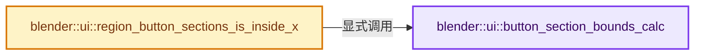
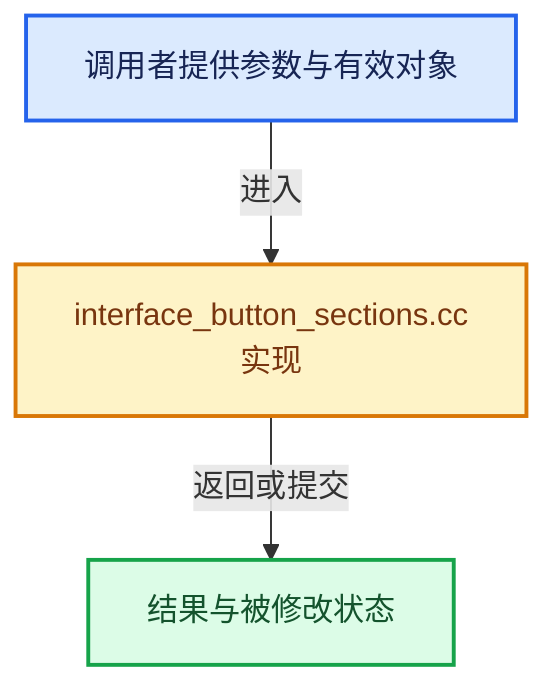

# 实现依赖专题：source/blender/editors/interface/interface_button_sections.cc

[实现依赖导航](../../../README.md) · [符号索引](../../../../00-课程指南/02-源码与提交索引/符号依赖与实现索引.md)

本专题从正文实际调用进入，集中保存共享实现。函数有稳定锚点，可从调用处直接跳到对应完整函数；递归与互相调用通过回链组织。

## 本文件的实现关系






## 完整成员与函数实现

<a id="f-f0b87c5ac0a09c16"></a>

### `blender::ui::button_section_bounds_calc`

实现位置：[source/blender/editors/interface/interface_button_sections.cc](../../../../../../../../source/blender/editors/interface/interface_button_sections.cc) · L38—L122。

接口参数：

- `const ARegion *region`
- `const bool add_padding`

**教学注释版**

<!-- annotated:d7508890bcd7b4 -->

```cpp
static Vector<rcti> button_section_bounds_calc(const ARegion *region, const bool add_padding)
{
  Vector<rcti> section_bounds;

  const auto finish_section_fn = [&](const rcti cur_section_bounds) {
    if (!section_bounds.is_empty() &&
        // [讲解] section_bounds.last：访问有效范围首端或末端元素。
        std::abs(section_bounds.last().xmax - cur_section_bounds.xmin) <
            UI_BUTTON_SECTION_MERGE_DISTANCE)
    {
      section_bounds.last().xmax = cur_section_bounds.xmax;
    }
    else {
      // [讲解] section_bounds.append：在尾部建立新元素，必要时先扩大存储。
      section_bounds.append(cur_section_bounds);
    }

    rcti &last_bounds = section_bounds.last();
    /* Extend to region edge if close enough. */
    if (last_bounds.xmin <= UI_BUTTON_SECTION_MERGE_DISTANCE) {
      last_bounds.xmin = 0;
    }
    if (last_bounds.xmax >= (region->winx - UI_BUTTON_SECTION_MERGE_DISTANCE)) {
      last_bounds.xmax = region->winx;
    }
  };

  {
    bool has_section_content = false;
    rcti cur_section_bounds;
    BLI_rcti_init_minmax(&cur_section_bounds);

    /* A bit annoying, but this function is called for both drawing and event handling. When
     * drawing, we need to exclude inactive blocks since they mess with the result. However, this
     * active state is only useful during drawing and must be ignored for handling (at which point
     * #Block::active is false for all blocks). */
    const bool is_drawing = region->runtime->do_draw & RGN_DRAWING;
    for (Block &block : region->runtime->uiblocks) {
      if (is_drawing && !block.active) {
        continue;
      }

      for (const Button &but : block.buttons()) {
        if (but.type == ButtonType::SeprSpacer) {
          /* Start a new section. */
          if (has_section_content) {
            finish_section_fn(cur_section_bounds);

            /* Reset for next section. */
            BLI_rcti_init_minmax(&cur_section_bounds);
            has_section_content = false;
          }
          continue;
        }

        rcti but_pixelrect;
        button_to_pixelrect(&but_pixelrect, region, &block, &but);
        BLI_rcti_do_minmax_rcti(&cur_section_bounds, &but_pixelrect);
        has_section_content = true;
      }
    }

    /* Finish last section in case the last button is not a spacer. */
    if (has_section_content) {
      finish_section_fn(cur_section_bounds);
    }
  }

  if (add_padding) {
    const uiStyle *style = style_get_dpi();
    const int pad_x = style->buttonspacex;
    /* Making this based on the header size since this feature is typically used in headers, and
     * this way we are more likely to pad the bounds all the way to the region edge. */
    const int pad_y = ceil((HEADER_PADDING_Y * UI_SCALE_FAC) / 2.0f);

    for (rcti &bounds : section_bounds) {
      BLI_rcti_pad(&bounds, pad_x, pad_y);
      /* Clamp, important for the rounded-corners to draw correct. */
      CLAMP_MIN(bounds.xmin, 0);
      CLAMP_MAX(bounds.xmax, region->winx);
      CLAMP_MIN(bounds.ymin, 0);
      CLAMP_MAX(bounds.ymax, region->winy);
    }
  }

  return section_bounds;
}
```

<details>
<summary>核对原始源码：source/blender/editors/interface/interface_button_sections.cc · L38—L122</summary>

<!-- original:d7508890bcd7b4:source/blender/editors/interface/interface_button_sections.cc:38:122 -->

```cpp
static Vector<rcti> button_section_bounds_calc(const ARegion *region, const bool add_padding)
{
  Vector<rcti> section_bounds;

  const auto finish_section_fn = [&](const rcti cur_section_bounds) {
    if (!section_bounds.is_empty() &&
        std::abs(section_bounds.last().xmax - cur_section_bounds.xmin) <
            UI_BUTTON_SECTION_MERGE_DISTANCE)
    {
      section_bounds.last().xmax = cur_section_bounds.xmax;
    }
    else {
      section_bounds.append(cur_section_bounds);
    }

    rcti &last_bounds = section_bounds.last();
    /* Extend to region edge if close enough. */
    if (last_bounds.xmin <= UI_BUTTON_SECTION_MERGE_DISTANCE) {
      last_bounds.xmin = 0;
    }
    if (last_bounds.xmax >= (region->winx - UI_BUTTON_SECTION_MERGE_DISTANCE)) {
      last_bounds.xmax = region->winx;
    }
  };

  {
    bool has_section_content = false;
    rcti cur_section_bounds;
    BLI_rcti_init_minmax(&cur_section_bounds);

    /* A bit annoying, but this function is called for both drawing and event handling. When
     * drawing, we need to exclude inactive blocks since they mess with the result. However, this
     * active state is only useful during drawing and must be ignored for handling (at which point
     * #Block::active is false for all blocks). */
    const bool is_drawing = region->runtime->do_draw & RGN_DRAWING;
    for (Block &block : region->runtime->uiblocks) {
      if (is_drawing && !block.active) {
        continue;
      }

      for (const Button &but : block.buttons()) {
        if (but.type == ButtonType::SeprSpacer) {
          /* Start a new section. */
          if (has_section_content) {
            finish_section_fn(cur_section_bounds);

            /* Reset for next section. */
            BLI_rcti_init_minmax(&cur_section_bounds);
            has_section_content = false;
          }
          continue;
        }

        rcti but_pixelrect;
        button_to_pixelrect(&but_pixelrect, region, &block, &but);
        BLI_rcti_do_minmax_rcti(&cur_section_bounds, &but_pixelrect);
        has_section_content = true;
      }
    }

    /* Finish last section in case the last button is not a spacer. */
    if (has_section_content) {
      finish_section_fn(cur_section_bounds);
    }
  }

  if (add_padding) {
    const uiStyle *style = style_get_dpi();
    const int pad_x = style->buttonspacex;
    /* Making this based on the header size since this feature is typically used in headers, and
     * this way we are more likely to pad the bounds all the way to the region edge. */
    const int pad_y = ceil((HEADER_PADDING_Y * UI_SCALE_FAC) / 2.0f);

    for (rcti &bounds : section_bounds) {
      BLI_rcti_pad(&bounds, pad_x, pad_y);
      /* Clamp, important for the rounded-corners to draw correct. */
      CLAMP_MIN(bounds.xmin, 0);
      CLAMP_MAX(bounds.xmax, region->winx);
      CLAMP_MIN(bounds.ymin, 0);
      CLAMP_MAX(bounds.ymax, region->winy);
    }
  }

  return section_bounds;
}
```

</details>

**沿实际写入检查状态**

- `last_bounds.xmin = 0;`
- `last_bounds.xmax = region->winx;`
- `has_section_content = false;`
- `has_section_content = true;`

**结果出口**

- `return section_bounds;`

**继续追踪实现**

- `section_bounds.is_empty` → [blender::Vector::is_empty · L792](../../../../01-基础容器与现代CPP/11-Vector插入删除与重排.md#f-937bbd9cb80bdcc8)。
- `std::abs` → [外部契约](https://eel.is/c++draft/)：这个边界按实际表达式及所属类型核对参数、返回值、寿命与失败行为。这里提供接口入口，不声称已解释该第三方版本的内部实现。
- `section_bounds.last` → [blender::Vector::last · L749](../../../../01-基础容器与现代CPP/11-Vector插入删除与重排.md#f-d32e1fd895e766b4)；[blender::Vector::last · L755](../../../../01-基础容器与现代CPP/11-Vector插入删除与重排.md#f-66b262993c080d9d)。同名重载需按实参类型选择。
- `section_bounds.append` → [blender::Vector::append · L498](../../../../01-基础容器与现代CPP/11-Vector插入删除与重排.md#f-5bde268a69e443ec)；[blender::Vector::append · L502](../../../../01-基础容器与现代CPP/11-Vector插入删除与重排.md#f-591e0b15e6308532)。同名重载需按实参类型选择。
- `BLI_rcti_init_minmax` → [blender::BLI_rcti_init_minmax · L488](../../../01-BLI基础库/intern/rct.cc.md#f-081cdb72e525536c)。
- `block.buttons` → [调用协议](../../../../00-课程指南/01-路线与规范/模板宏与动态分派协议.md)：接收对象类型依赖auto、返回值或模板实例；不按同名猜测目标。调用位置L78。
- `finish_section_fn` → [调用协议](../../../../00-课程指南/01-路线与规范/模板宏与动态分派协议.md)：局部可调用对象，须结合其初始化与捕获环境。调用位置L82。
- `button_to_pixelrect` → [blender::ui::button_to_pixelrect · L2312](interface.cc.md#f-1a9b41f4ea233cc9)。
- `BLI_rcti_do_minmax_rcti` → [blender::BLI_rcti_do_minmax_rcti · L516](../../../01-BLI基础库/intern/rct.cc.md#f-5925ec804e8ca708)。
- `style_get_dpi` → [blender::ui::style_get_dpi · L424](interface_style.cc.md#f-37e0cedd2705020a)。
- `ceil` → [外部契约](https://eel.is/c++draft/)：这个边界按实际表达式及所属类型核对参数、返回值、寿命与失败行为。这里提供接口入口，不声称已解释该第三方版本的内部实现。
- `BLI_rcti_pad` → [blender::BLI_rcti_pad · L643](../../../01-BLI基础库/intern/rct.cc.md#f-8873ddffaa047a5a)。
- `CLAMP_MIN` → [CLAMP_MIN · L219](../../../01-BLI基础库/BLI_utildefines.hh.md#m-fd63318fbafb)。宏定义由构建条件选择。
- `CLAMP_MAX` → [CLAMP_MAX · L211](../../../01-BLI基础库/BLI_utildefines.hh.md#m-ff513c0bdcc5)。宏定义由构建条件选择。

<a id="f-720ad8e64f5d573b"></a>

### `blender::ui::region_button_sections_is_inside_x`

实现位置：[source/blender/editors/interface/interface_button_sections.cc](../../../../../../../../source/blender/editors/interface/interface_button_sections.cc) · L243—L253。

接口参数：

- `const ARegion *region`
- `const int mval_x`

**教学注释版**

<!-- annotated:6b2325ad2b3803 -->

```cpp
bool region_button_sections_is_inside_x(const ARegion *region, const int mval_x)
{
  const Vector<rcti> section_bounds = button_section_bounds_calc(region, true);

  for (const rcti &bounds : section_bounds) {
    if (BLI_rcti_isect_x(&bounds, mval_x)) {
      return true;
    }
  }
  return false;
}
```

<details>
<summary>核对原始源码：source/blender/editors/interface/interface_button_sections.cc · L243—L253</summary>

<!-- original:6b2325ad2b3803:source/blender/editors/interface/interface_button_sections.cc:243:253 -->

```cpp
bool region_button_sections_is_inside_x(const ARegion *region, const int mval_x)
{
  const Vector<rcti> section_bounds = button_section_bounds_calc(region, true);

  for (const rcti &bounds : section_bounds) {
    if (BLI_rcti_isect_x(&bounds, mval_x)) {
      return true;
    }
  }
  return false;
}
```

</details>

**结果出口**

- `return true;`
- `return false;`

**继续追踪实现**

- `button_section_bounds_calc` → [blender::ui::button_section_bounds_calc · L38](interface_button_sections.cc.md#f-f0b87c5ac0a09c16)。
- `BLI_rcti_isect_x` → [blender::BLI_rcti_isect_x · L39](../../../01-BLI基础库/intern/rct.cc.md#f-d5dd2154649e0916)。
