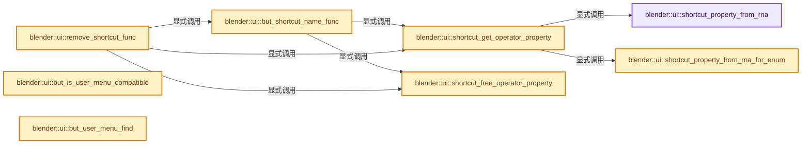
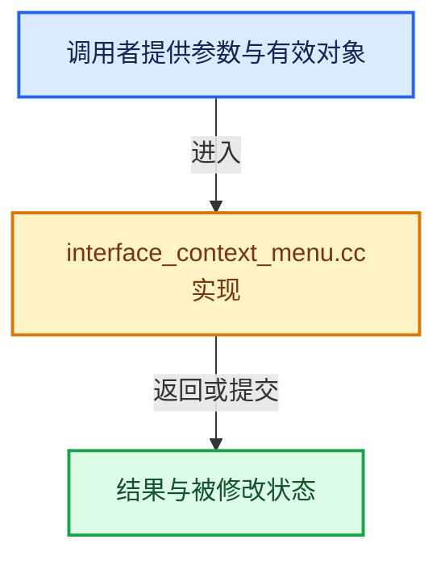

# 实现依赖专题：source/blender/editors/interface/interface_context_menu.cc

[实现依赖导航](../../../README.md) · [符号索引](../../../../00-课程指南/02-源码与提交索引/符号依赖与实现索引.md)

本专题从正文实际调用进入，集中保存共享实现。函数有稳定锚点，可从调用处直接跳到对应完整函数；递归与互相调用通过回链组织。

## 本文件的实现关系






## 完整成员与函数实现

<a id="f-fe5ea86b5cb17381"></a>

### `blender::ui::shortcut_property_from_rna`

实现位置：[source/blender/editors/interface/interface_context_menu.cc](../../../../../../../../source/blender/editors/interface/interface_context_menu.cc) · L64—L80。

接口参数：

- `bContext *C`
- `Button *but`

**教学注释版**

<!-- annotated:8b728e845296b8 -->

```cpp
static IDProperty *shortcut_property_from_rna(bContext *C, Button *but)
{
  /* Compute data path from context to property. */

  /* If this returns null, we won't be able to bind shortcuts to these RNA properties.
   * Support can be added at #wm_context_member_from_ptr. */
  std::optional<std::string> final_data_path = WM_context_path_resolve_property_full(
      C, &but->rnapoin, but->rnaprop, but->rnaindex);
  if (!final_data_path.has_value()) {
    return nullptr;
  }

  /* Create ID property of data path, to pass to the operator. */
  IDProperty *prop = bke::idprop::create_group(__func__).release();
  IDP_AddToGroup(prop, bke::idprop::create("data_path", final_data_path.value()).release());
  return prop;
}
```

<details>
<summary>核对原始源码：source/blender/editors/interface/interface_context_menu.cc · L64—L80</summary>

<!-- original:8b728e845296b8:source/blender/editors/interface/interface_context_menu.cc:64:80 -->

```cpp
static IDProperty *shortcut_property_from_rna(bContext *C, Button *but)
{
  /* Compute data path from context to property. */

  /* If this returns null, we won't be able to bind shortcuts to these RNA properties.
   * Support can be added at #wm_context_member_from_ptr. */
  std::optional<std::string> final_data_path = WM_context_path_resolve_property_full(
      C, &but->rnapoin, but->rnaprop, but->rnaindex);
  if (!final_data_path.has_value()) {
    return nullptr;
  }

  /* Create ID property of data path, to pass to the operator. */
  IDProperty *prop = bke::idprop::create_group(__func__).release();
  IDP_AddToGroup(prop, bke::idprop::create("data_path", final_data_path.value()).release());
  return prop;
}
```

</details>

**结果出口**

- `return nullptr;`
- `return prop;`

**继续追踪实现**

- `WM_context_path_resolve_property_full` → [blender::WM_context_path_resolve_property_full · L660](../../windowmanager/intern/wm_operators.cc.md#f-4b003e8cf3e85a40)。
- `final_data_path.has_value` → [外部契约](https://eel.is/c++draft/)：这个边界按实际表达式及所属类型核对参数、返回值、寿命与失败行为。这里提供接口入口，不声称已解释该第三方版本的内部实现。
- `bke::idprop::create_group(__func__).release` → [调用协议](../../../../00-课程指南/01-路线与规范/模板宏与动态分派协议.md)：接收对象类型依赖auto、返回值或模板实例；不按同名猜测目标。调用位置L77。
- `bke::idprop::create_group` → [blender::bke::idprop::create_group · L155](../../../02-BKE几何与数据/intern/idprop_create.cc.md#f-b1e2d8bfd5654bc2)。
- `IDP_AddToGroup` → [blender::IDP_AddToGroup · L788](../../../02-BKE几何与数据/intern/idprop.cc.md#f-35f2075430483def)。
- `bke::idprop::create("data_path", final_data_path.value()).release` → [调用协议](../../../../00-课程指南/01-路线与规范/模板宏与动态分派协议.md)：接收对象类型依赖auto、返回值或模板实例；不按同名猜测目标。调用位置L78。
- `bke::idprop::create` → [blender::bke::idprop::create · L21](../../../02-BKE几何与数据/intern/idprop_create.cc.md#f-9f46f3367aea5850)；[blender::bke::idprop::create · L41](../../../02-BKE几何与数据/intern/idprop_create.cc.md#f-fb8f0fd79ae0a7b2)；[blender::bke::idprop::create · L51](../../../02-BKE几何与数据/intern/idprop_create.cc.md#f-3c724b83c1b70000)；[blender::bke::idprop::create · L61](../../../02-BKE几何与数据/intern/idprop_create.cc.md#f-3e8bfbe29fbc5b06)；[blender::bke::idprop::create · L69](../../../02-BKE几何与数据/intern/idprop_create.cc.md#f-da73ef629d404b53)；[blender::bke::idprop::create · L134](../../../02-BKE几何与数据/intern/idprop_create.cc.md#f-db9e605ad4939d5d)；[blender::bke::idprop::create · L141](../../../02-BKE几何与数据/intern/idprop_create.cc.md#f-1198c99845e5eb1f)；[blender::bke::idprop::create · L148](../../../02-BKE几何与数据/intern/idprop_create.cc.md#f-d9cb1affee65ed50)。同名重载需按实参类型选择。
- `final_data_path.value` → [外部契约](https://eel.is/c++draft/)：这个边界按实际表达式及所属类型核对参数、返回值、寿命与失败行为。这里提供接口入口，不声称已解释该第三方版本的内部实现。

<a id="f-b145b07315620e3d"></a>

### `blender::ui::shortcut_property_from_rna_for_enum`

实现位置：[source/blender/editors/interface/interface_context_menu.cc](../../../../../../../../source/blender/editors/interface/interface_context_menu.cc) · L82—L110。

接口参数：

- `bContext *C`
- `Button *but_parent`
- `Button *but`

**教学注释版**

<!-- annotated:08a2be3765edfd -->

```cpp
static IDProperty *shortcut_property_from_rna_for_enum(bContext *C,
                                                       Button *but_parent,
                                                       Button *but)
{
  /* This is basically same as #shortcut_property_from_rna but with "value" in IDProperty in group.
   * It's required for creating keyitem for enum values. */

  /* If this returns null, we won't be able to bind shortcuts to these RNA properties.
   * Support can be added at #wm_context_member_from_ptr. */
  std::optional<std::string> final_data_path = WM_context_path_resolve_property_full(
      C, &but_parent->rnapoin, but_parent->rnaprop, but_parent->rnaindex);
  if (!final_data_path.has_value()) {
    return nullptr;
  }

  const char *identifier = nullptr;
  RNA_property_enum_identifier(
      C, &but_parent->rnapoin, but_parent->rnaprop, but->retval, &identifier);

  if (identifier == nullptr) {
    /* Return early when valid identifier is not found for the button representing enum value. */
    return nullptr;
  }
  /* Create ID property of data path and value, to pass to the operator. */
  IDProperty *prop = bke::idprop::create_group(__func__).release();
  IDP_AddToGroup(prop, bke::idprop::create("data_path", final_data_path.value()).release());
  IDP_AddToGroup(prop, bke::idprop::create("value", identifier).release());
  return prop;
}
```

<details>
<summary>核对原始源码：source/blender/editors/interface/interface_context_menu.cc · L82—L110</summary>

<!-- original:08a2be3765edfd:source/blender/editors/interface/interface_context_menu.cc:82:110 -->

```cpp
static IDProperty *shortcut_property_from_rna_for_enum(bContext *C,
                                                       Button *but_parent,
                                                       Button *but)
{
  /* This is basically same as #shortcut_property_from_rna but with "value" in IDProperty in group.
   * It's required for creating keyitem for enum values. */

  /* If this returns null, we won't be able to bind shortcuts to these RNA properties.
   * Support can be added at #wm_context_member_from_ptr. */
  std::optional<std::string> final_data_path = WM_context_path_resolve_property_full(
      C, &but_parent->rnapoin, but_parent->rnaprop, but_parent->rnaindex);
  if (!final_data_path.has_value()) {
    return nullptr;
  }

  const char *identifier = nullptr;
  RNA_property_enum_identifier(
      C, &but_parent->rnapoin, but_parent->rnaprop, but->retval, &identifier);

  if (identifier == nullptr) {
    /* Return early when valid identifier is not found for the button representing enum value. */
    return nullptr;
  }
  /* Create ID property of data path and value, to pass to the operator. */
  IDProperty *prop = bke::idprop::create_group(__func__).release();
  IDP_AddToGroup(prop, bke::idprop::create("data_path", final_data_path.value()).release());
  IDP_AddToGroup(prop, bke::idprop::create("value", identifier).release());
  return prop;
}
```

</details>

**结果出口**

- `return nullptr;`
- `return prop;`

**继续追踪实现**

- `WM_context_path_resolve_property_full` → [blender::WM_context_path_resolve_property_full · L660](../../windowmanager/intern/wm_operators.cc.md#f-4b003e8cf3e85a40)。
- `final_data_path.has_value` → [外部契约](https://eel.is/c++draft/)：这个边界按实际表达式及所属类型核对参数、返回值、寿命与失败行为。这里提供接口入口，不声称已解释该第三方版本的内部实现。
- `RNA_property_enum_identifier` → [blender::RNA_property_enum_identifier · L2164](../../makesrna/intern/rna_access.cc.md#f-435325cf40672ead)。
- `bke::idprop::create_group(__func__).release` → [调用协议](../../../../00-课程指南/01-路线与规范/模板宏与动态分派协议.md)：接收对象类型依赖auto、返回值或模板实例；不按同名猜测目标。调用位置L106。
- `bke::idprop::create_group` → [blender::bke::idprop::create_group · L155](../../../02-BKE几何与数据/intern/idprop_create.cc.md#f-b1e2d8bfd5654bc2)。
- `IDP_AddToGroup` → [blender::IDP_AddToGroup · L788](../../../02-BKE几何与数据/intern/idprop.cc.md#f-35f2075430483def)。
- `bke::idprop::create("data_path", final_data_path.value()).release` → [调用协议](../../../../00-课程指南/01-路线与规范/模板宏与动态分派协议.md)：接收对象类型依赖auto、返回值或模板实例；不按同名猜测目标。调用位置L107。
- `bke::idprop::create` → [blender::bke::idprop::create · L21](../../../02-BKE几何与数据/intern/idprop_create.cc.md#f-9f46f3367aea5850)；[blender::bke::idprop::create · L41](../../../02-BKE几何与数据/intern/idprop_create.cc.md#f-fb8f0fd79ae0a7b2)；[blender::bke::idprop::create · L51](../../../02-BKE几何与数据/intern/idprop_create.cc.md#f-3c724b83c1b70000)；[blender::bke::idprop::create · L61](../../../02-BKE几何与数据/intern/idprop_create.cc.md#f-3e8bfbe29fbc5b06)；[blender::bke::idprop::create · L69](../../../02-BKE几何与数据/intern/idprop_create.cc.md#f-da73ef629d404b53)；[blender::bke::idprop::create · L134](../../../02-BKE几何与数据/intern/idprop_create.cc.md#f-db9e605ad4939d5d)；[blender::bke::idprop::create · L141](../../../02-BKE几何与数据/intern/idprop_create.cc.md#f-1198c99845e5eb1f)；[blender::bke::idprop::create · L148](../../../02-BKE几何与数据/intern/idprop_create.cc.md#f-d9cb1affee65ed50)。同名重载需按实参类型选择。
- `final_data_path.value` → [外部契约](https://eel.is/c++draft/)：这个边界按实际表达式及所属类型核对参数、返回值、寿命与失败行为。这里提供接口入口，不声称已解释该第三方版本的内部实现。
- `bke::idprop::create("value", identifier).release` → [调用协议](../../../../00-课程指南/01-路线与规范/模板宏与动态分派协议.md)：接收对象类型依赖auto、返回值或模板实例；不按同名猜测目标。调用位置L108。

<a id="f-dbde5f6b19a1c183"></a>

### `blender::ui::shortcut_get_operator_property`

实现位置：[source/blender/editors/interface/interface_context_menu.cc](../../../../../../../../source/blender/editors/interface/interface_context_menu.cc) · L112—L184。

接口参数：

- `bContext *C`
- `Button *but`
- `IDProperty **r_prop`

**教学注释版**

<!-- annotated:2a424e62463396 -->

```cpp
static const char *shortcut_get_operator_property(bContext *C, Button *but, IDProperty **r_prop)
{
  if (but->optype) {
    /* Operator */
    *r_prop = (but->opptr && *but->opptr) ?
                  IDP_CopyProperty(static_cast<IDProperty *>(but->opptr->data)) :
                  nullptr;
    return but->optype->idname;
  }

  if (but->rnaprop) {
    const PropertyType rnaprop_type = RNA_property_type(but->rnaprop);

    if (rnaprop_type == PROP_BOOLEAN) {
      /* Boolean */
      *r_prop = shortcut_property_from_rna(C, but);
      if (*r_prop == nullptr) {
        return nullptr;
      }
      return "WM_OT_context_toggle";
    }
    if (rnaprop_type == PROP_ENUM) {
      /* `is_enum_menu` is true for expanded enum properties. It's to add shortcut to individual
       * enum item, see: !163600 */
      const bool is_enum_menu = but->type == ButtonType::Menu;
      *r_prop = is_enum_menu ? shortcut_property_from_rna(C, but) :
                               shortcut_property_from_rna_for_enum(C, but, but);
      if (*r_prop == nullptr) {
        return nullptr;
      }
      return is_enum_menu ? "WM_OT_context_menu_enum" : "WM_OT_context_set_enum";
    }
  }

  if (but->type == ButtonType::ButMenu) {
    if ((but->block->handle != nullptr)) {
      Button *but_parent = but->block->handle->popup_create_vars.but;
      if (but_parent && but_parent->rnaprop &&
          (RNA_property_type(but_parent->rnaprop) == PROP_ENUM))
      {
        *r_prop = shortcut_property_from_rna_for_enum(C, but_parent, but);
        if (*r_prop == nullptr) {
          return nullptr;
        }
        return "WM_OT_context_set_enum";
      }
    }
  }

  if (MenuType *mt = button_menutype_get(but)) {
    IDProperty *prop = bke::idprop::create_group(__func__).release();
    IDP_AddToGroup(prop, bke::idprop::create("name", mt->idname).release());
    *r_prop = prop;
    return "WM_OT_call_menu";
  }

  if (std::optional asset_shelf_idname = button_asset_shelf_type_idname_get(but)) {
    IDProperty *prop = bke::idprop::create_group(__func__).release();
    IDP_AddToGroup(prop, bke::idprop::create("name", *asset_shelf_idname).release());
    *r_prop = prop;
    return "WM_OT_call_asset_shelf_popover";
  }

  if (PanelType *pt = button_paneltype_get(but)) {
    IDProperty *prop = bke::idprop::create_group(__func__).release();
    IDP_AddToGroup(prop, bke::idprop::create("name", pt->idname).release());
    *r_prop = prop;
    return "WM_OT_call_panel";
  }

  *r_prop = nullptr;
  return nullptr;
}
```

<details>
<summary>核对原始源码：source/blender/editors/interface/interface_context_menu.cc · L112—L184</summary>

<!-- original:2a424e62463396:source/blender/editors/interface/interface_context_menu.cc:112:184 -->

```cpp
static const char *shortcut_get_operator_property(bContext *C, Button *but, IDProperty **r_prop)
{
  if (but->optype) {
    /* Operator */
    *r_prop = (but->opptr && *but->opptr) ?
                  IDP_CopyProperty(static_cast<IDProperty *>(but->opptr->data)) :
                  nullptr;
    return but->optype->idname;
  }

  if (but->rnaprop) {
    const PropertyType rnaprop_type = RNA_property_type(but->rnaprop);

    if (rnaprop_type == PROP_BOOLEAN) {
      /* Boolean */
      *r_prop = shortcut_property_from_rna(C, but);
      if (*r_prop == nullptr) {
        return nullptr;
      }
      return "WM_OT_context_toggle";
    }
    if (rnaprop_type == PROP_ENUM) {
      /* `is_enum_menu` is true for expanded enum properties. It's to add shortcut to individual
       * enum item, see: !163600 */
      const bool is_enum_menu = but->type == ButtonType::Menu;
      *r_prop = is_enum_menu ? shortcut_property_from_rna(C, but) :
                               shortcut_property_from_rna_for_enum(C, but, but);
      if (*r_prop == nullptr) {
        return nullptr;
      }
      return is_enum_menu ? "WM_OT_context_menu_enum" : "WM_OT_context_set_enum";
    }
  }

  if (but->type == ButtonType::ButMenu) {
    if ((but->block->handle != nullptr)) {
      Button *but_parent = but->block->handle->popup_create_vars.but;
      if (but_parent && but_parent->rnaprop &&
          (RNA_property_type(but_parent->rnaprop) == PROP_ENUM))
      {
        *r_prop = shortcut_property_from_rna_for_enum(C, but_parent, but);
        if (*r_prop == nullptr) {
          return nullptr;
        }
        return "WM_OT_context_set_enum";
      }
    }
  }

  if (MenuType *mt = button_menutype_get(but)) {
    IDProperty *prop = bke::idprop::create_group(__func__).release();
    IDP_AddToGroup(prop, bke::idprop::create("name", mt->idname).release());
    *r_prop = prop;
    return "WM_OT_call_menu";
  }

  if (std::optional asset_shelf_idname = button_asset_shelf_type_idname_get(but)) {
    IDProperty *prop = bke::idprop::create_group(__func__).release();
    IDP_AddToGroup(prop, bke::idprop::create("name", *asset_shelf_idname).release());
    *r_prop = prop;
    return "WM_OT_call_asset_shelf_popover";
  }

  if (PanelType *pt = button_paneltype_get(but)) {
    IDProperty *prop = bke::idprop::create_group(__func__).release();
    IDP_AddToGroup(prop, bke::idprop::create("name", pt->idname).release());
    *r_prop = prop;
    return "WM_OT_call_panel";
  }

  *r_prop = nullptr;
  return nullptr;
}
```

</details>

**结果出口**

- `return but->optype->idname;`
- `return nullptr;`
- `return "WM_OT_context_toggle";`
- `return is_enum_menu ? "WM_OT_context_menu_enum" : "WM_OT_context_set_enum";`
- `return "WM_OT_context_set_enum";`
- `return "WM_OT_call_menu";`
- `return "WM_OT_call_asset_shelf_popover";`
- `return "WM_OT_call_panel";`

**继续追踪实现**

- `IDP_CopyProperty` → [blender::IDP_CopyProperty · L986](../../../02-BKE几何与数据/intern/idprop.cc.md#f-e78bbf56cd2a07bd)。
- `RNA_property_type` → [blender::RNA_property_type · L1293](../../makesrna/intern/rna_access.cc.md#f-4465a90d55f022df)。
- `shortcut_property_from_rna` → [blender::ui::shortcut_property_from_rna · L64](interface_context_menu.cc.md#f-fe5ea86b5cb17381)。
- `shortcut_property_from_rna_for_enum` → [blender::ui::shortcut_property_from_rna_for_enum · L82](interface_context_menu.cc.md#f-b145b07315620e3d)。
- `button_menutype_get` → [blender::ui::button_menutype_get · L6261](interface_layout.cc.md#f-3c85ab297edae0d4)。
- `bke::idprop::create_group(__func__).release` → [调用协议](../../../../00-课程指南/01-路线与规范/模板宏与动态分派协议.md)：接收对象类型依赖auto、返回值或模板实例；不按同名猜测目标。调用位置L162。
- `bke::idprop::create_group` → [blender::bke::idprop::create_group · L155](../../../02-BKE几何与数据/intern/idprop_create.cc.md#f-b1e2d8bfd5654bc2)。
- `IDP_AddToGroup` → [blender::IDP_AddToGroup · L788](../../../02-BKE几何与数据/intern/idprop.cc.md#f-35f2075430483def)。
- `bke::idprop::create("name", mt->idname).release` → [调用协议](../../../../00-课程指南/01-路线与规范/模板宏与动态分派协议.md)：接收对象类型依赖auto、返回值或模板实例；不按同名猜测目标。调用位置L163。
- `bke::idprop::create` → [blender::bke::idprop::create · L21](../../../02-BKE几何与数据/intern/idprop_create.cc.md#f-9f46f3367aea5850)；[blender::bke::idprop::create · L41](../../../02-BKE几何与数据/intern/idprop_create.cc.md#f-fb8f0fd79ae0a7b2)；[blender::bke::idprop::create · L51](../../../02-BKE几何与数据/intern/idprop_create.cc.md#f-3c724b83c1b70000)；[blender::bke::idprop::create · L61](../../../02-BKE几何与数据/intern/idprop_create.cc.md#f-3e8bfbe29fbc5b06)；[blender::bke::idprop::create · L69](../../../02-BKE几何与数据/intern/idprop_create.cc.md#f-da73ef629d404b53)；[blender::bke::idprop::create · L134](../../../02-BKE几何与数据/intern/idprop_create.cc.md#f-db9e605ad4939d5d)；[blender::bke::idprop::create · L141](../../../02-BKE几何与数据/intern/idprop_create.cc.md#f-1198c99845e5eb1f)；[blender::bke::idprop::create · L148](../../../02-BKE几何与数据/intern/idprop_create.cc.md#f-d9cb1affee65ed50)。同名重载需按实参类型选择。
- `button_asset_shelf_type_idname_get` → [blender::ui::button_asset_shelf_type_idname_get · L6277](interface_layout.cc.md#f-a24d9ca3e0d5f30d)。
- `bke::idprop::create("name", *asset_shelf_idname).release` → [调用协议](../../../../00-课程指南/01-路线与规范/模板宏与动态分派协议.md)：接收对象类型依赖auto、返回值或模板实例；不按同名猜测目标。调用位置L170。
- `button_paneltype_get` → [blender::ui::button_paneltype_get · L6269](interface_layout.cc.md#f-ac4513f9c219a28b)。
- `bke::idprop::create("name", pt->idname).release` → [调用协议](../../../../00-课程指南/01-路线与规范/模板宏与动态分派协议.md)：接收对象类型依赖auto、返回值或模板实例；不按同名猜测目标。调用位置L177。

<a id="f-6db69da9af461204"></a>

### `blender::ui::shortcut_free_operator_property`

实现位置：[source/blender/editors/interface/interface_context_menu.cc](../../../../../../../../source/blender/editors/interface/interface_context_menu.cc) · L186—L191。

接口参数：

- `IDProperty *prop`

**教学注释版**

<!-- annotated:81d35ffe518597 -->

```cpp
static void shortcut_free_operator_property(IDProperty *prop)
{
  if (prop) {
    IDP_FreeProperty(prop);
  }
}
```

<details>
<summary>核对原始源码：source/blender/editors/interface/interface_context_menu.cc · L186—L191</summary>

<!-- original:81d35ffe518597:source/blender/editors/interface/interface_context_menu.cc:186:191 -->

```cpp
static void shortcut_free_operator_property(IDProperty *prop)
{
  if (prop) {
    IDP_FreeProperty(prop);
  }
}
```

</details>

**继续追踪实现**

- `IDP_FreeProperty` → [blender::IDP_FreeProperty · L1403](../../../02-BKE几何与数据/intern/idprop.cc.md#f-389134a630df1bed)。

<a id="f-58ec3a91d457018c"></a>

### `blender::ui::but_shortcut_name_func`

实现位置：[source/blender/editors/interface/interface_context_menu.cc](../../../../../../../../source/blender/editors/interface/interface_context_menu.cc) · L193—L215。

接口参数：

- `bContext *C`
- `void *arg1`
- `int`

**教学注释版**

<!-- annotated:6eb9a127679043 -->

```cpp
static void but_shortcut_name_func(bContext *C, void *arg1, int /*event*/)
{
  Button *but = static_cast<Button *>(arg1);

  IDProperty *prop;
  const char *idname = shortcut_get_operator_property(C, but, &prop);
  if (idname == nullptr) {
    return;
  }

  /* complex code to change name of button */
  if (std::optional<std::string> shortcut_str = WM_key_event_operator_string(
          C, idname, but->opcontext, prop, true))
  {
    button_add_shortcut(but, shortcut_str->c_str(), true);
  }
  else {
    /* simply strip the shortcut */
    button_add_shortcut(but, nullptr, true);
  }

  shortcut_free_operator_property(prop);
}
```

<details>
<summary>核对原始源码：source/blender/editors/interface/interface_context_menu.cc · L193—L215</summary>

<!-- original:6eb9a127679043:source/blender/editors/interface/interface_context_menu.cc:193:215 -->

```cpp
static void but_shortcut_name_func(bContext *C, void *arg1, int /*event*/)
{
  Button *but = static_cast<Button *>(arg1);

  IDProperty *prop;
  const char *idname = shortcut_get_operator_property(C, but, &prop);
  if (idname == nullptr) {
    return;
  }

  /* complex code to change name of button */
  if (std::optional<std::string> shortcut_str = WM_key_event_operator_string(
          C, idname, but->opcontext, prop, true))
  {
    button_add_shortcut(but, shortcut_str->c_str(), true);
  }
  else {
    /* simply strip the shortcut */
    button_add_shortcut(but, nullptr, true);
  }

  shortcut_free_operator_property(prop);
}
```

</details>

**继续追踪实现**

- `shortcut_get_operator_property` → [blender::ui::shortcut_get_operator_property · L112](interface_context_menu.cc.md#f-dbde5f6b19a1c183)。
- `WM_key_event_operator_string` → [blender::WM_key_event_operator_string · L1690](../../windowmanager/intern/wm_keymap.cc.md#f-3e66ca4b74a6b730)。
- `button_add_shortcut` → [blender::ui::button_add_shortcut · L1421](interface.cc.md#f-f8f2ffc72ca3880b)。
- `shortcut_str->c_str` → [外部契约](https://eel.is/c++draft/)：这个边界按实际表达式及所属类型核对参数、返回值、寿命与失败行为。这里提供接口入口，不声称已解释该第三方版本的内部实现。
- `shortcut_free_operator_property` → [blender::ui::shortcut_free_operator_property · L186](interface_context_menu.cc.md#f-6db69da9af461204)。

<a id="f-509485f330c960ca"></a>

### `blender::ui::remove_shortcut_func`

实现位置：[source/blender/editors/interface/interface_context_menu.cc](../../../../../../../../source/blender/editors/interface/interface_context_menu.cc) · L348—L368。

接口参数：

- `bContext *C`
- `Button *but`

**教学注释版**

<!-- annotated:ddf86910b3096b -->

```cpp
static void remove_shortcut_func(bContext *C, Button *but)
{
  IDProperty *prop;
  const char *idname = shortcut_get_operator_property(C, but, &prop);

  wmKeyMap *km;
  wmKeyMapItem *kmi = WM_key_event_operator(C,
                                            idname,
                                            but->opcontext,
                                            prop,
                                            EVT_TYPE_MASK_HOTKEY_INCLUDE,
                                            EVT_TYPE_MASK_HOTKEY_EXCLUDE,
                                            &km);
  BLI_assert(kmi != nullptr);

  WM_keymap_remove_item(km, kmi);
  U.runtime.is_dirty = true;

  shortcut_free_operator_property(prop);
  but_shortcut_name_func(C, but, 0);
}
```

<details>
<summary>核对原始源码：source/blender/editors/interface/interface_context_menu.cc · L348—L368</summary>

<!-- original:ddf86910b3096b:source/blender/editors/interface/interface_context_menu.cc:348:368 -->

```cpp
static void remove_shortcut_func(bContext *C, Button *but)
{
  IDProperty *prop;
  const char *idname = shortcut_get_operator_property(C, but, &prop);

  wmKeyMap *km;
  wmKeyMapItem *kmi = WM_key_event_operator(C,
                                            idname,
                                            but->opcontext,
                                            prop,
                                            EVT_TYPE_MASK_HOTKEY_INCLUDE,
                                            EVT_TYPE_MASK_HOTKEY_EXCLUDE,
                                            &km);
  BLI_assert(kmi != nullptr);

  WM_keymap_remove_item(km, kmi);
  U.runtime.is_dirty = true;

  shortcut_free_operator_property(prop);
  but_shortcut_name_func(C, but, 0);
}
```

</details>

**沿实际写入检查状态**

- `U.runtime.is_dirty = true;`

**继续追踪实现**

- `shortcut_get_operator_property` → [blender::ui::shortcut_get_operator_property · L112](interface_context_menu.cc.md#f-dbde5f6b19a1c183)。
- `WM_key_event_operator` → [blender::WM_key_event_operator · L1718](../../windowmanager/intern/wm_keymap.cc.md#f-18fbe357fd25ad52)。
- `BLI_assert` → [BLI_assert · L48](../../../01-BLI基础库/BLI_assert.hh.md#m-57a88495704d)；[BLI_assert · L63](../../../01-BLI基础库/BLI_assert.hh.md#m-d07050020cb5)。宏定义由构建条件选择。
- `WM_keymap_remove_item` → [blender::WM_keymap_remove_item · L595](../../windowmanager/intern/wm_keymap.cc.md#f-383652c7f68754e0)。
- `shortcut_free_operator_property` → [blender::ui::shortcut_free_operator_property · L186](interface_context_menu.cc.md#f-6db69da9af461204)。
- `but_shortcut_name_func` → [blender::ui::but_shortcut_name_func · L193](interface_context_menu.cc.md#f-58ec3a91d457018c)。

<a id="f-730f239087b78e4e"></a>

### `blender::ui::but_is_user_menu_compatible`

实现位置：[source/blender/editors/interface/interface_context_menu.cc](../../../../../../../../source/blender/editors/interface/interface_context_menu.cc) · L370—L392。

接口参数：

- `bContext *C`
- `Button *but`

**教学注释版**

<!-- annotated:f48183bdcaea93 -->

```cpp
static bool but_is_user_menu_compatible(bContext *C, Button *but)
{
  bool result = false;
  if (but->optype) {
    result = true;
  }
  else if (but->rnaprop) {
    if (RNA_property_type(but->rnaprop) == PROP_BOOLEAN) {
      std::optional<std::string> data_path = WM_context_path_resolve_full(C, &but->rnapoin);
      if (data_path.has_value()) {
        result = true;
      }
    }
  }
  else if (button_menutype_get(but)) {
    result = true;
  }
  else if (button_operatortype_get_from_enum_menu(but, nullptr)) {
    result = true;
  }

  return result;
}
```

<details>
<summary>核对原始源码：source/blender/editors/interface/interface_context_menu.cc · L370—L392</summary>

<!-- original:f48183bdcaea93:source/blender/editors/interface/interface_context_menu.cc:370:392 -->

```cpp
static bool but_is_user_menu_compatible(bContext *C, Button *but)
{
  bool result = false;
  if (but->optype) {
    result = true;
  }
  else if (but->rnaprop) {
    if (RNA_property_type(but->rnaprop) == PROP_BOOLEAN) {
      std::optional<std::string> data_path = WM_context_path_resolve_full(C, &but->rnapoin);
      if (data_path.has_value()) {
        result = true;
      }
    }
  }
  else if (button_menutype_get(but)) {
    result = true;
  }
  else if (button_operatortype_get_from_enum_menu(but, nullptr)) {
    result = true;
  }

  return result;
}
```

</details>

**沿实际写入检查状态**

- `result = true;`

**结果出口**

- `return result;`

**继续追踪实现**

- `RNA_property_type` → [blender::RNA_property_type · L1293](../../makesrna/intern/rna_access.cc.md#f-4465a90d55f022df)。
- `WM_context_path_resolve_full` → [blender::WM_context_path_resolve_full · L706](../../windowmanager/intern/wm_operators.cc.md#f-4dd4e4cbccbef514)。
- `data_path.has_value` → [外部契约](https://eel.is/c++draft/)：这个边界按实际表达式及所属类型核对参数、返回值、寿命与失败行为。这里提供接口入口，不声称已解释该第三方版本的内部实现。
- `button_menutype_get` → [blender::ui::button_menutype_get · L6261](interface_layout.cc.md#f-3c85ab297edae0d4)。
- `button_operatortype_get_from_enum_menu` → [blender::ui::button_operatortype_get_from_enum_menu · L6244](interface_layout.cc.md#f-010c97387f2c437e)。

<a id="f-29fbee1084ccdf5c"></a>

### `blender::ui::but_user_menu_find`

实现位置：[source/blender/editors/interface/interface_context_menu.cc](../../../../../../../../source/blender/editors/interface/interface_context_menu.cc) · L394—L433。

接口参数：

- `bContext *C`
- `Button *but`
- `bUserMenu *um`

**教学注释版**

<!-- annotated:dd4226cbd31093 -->

```cpp
static bUserMenuItem *but_user_menu_find(bContext *C, Button *but, bUserMenu *um)
{
  if (but->optype) {
    IDProperty *prop = (but->opptr) ? static_cast<IDProperty *>(but->opptr->data) : nullptr;
    return reinterpret_cast<bUserMenuItem *>(
        ED_screen_user_menu_item_find_operator(&um->items, but->optype, prop, "", but->opcontext));
  }
  if (but->rnaprop) {
    std::optional<std::string> member_id_data_path = WM_context_path_resolve_full(C,
                                                                                  &but->rnapoin);
    /* NOTE(@ideasman42): It's highly unlikely this ever occurs since the path must be resolved
     * for this to be added in the first place, there might be some cases where manually
     * constructed RNA paths don't resolve and in this case a crash should be avoided. */
    if (!member_id_data_path.has_value()) [[unlikely]] {
      /* Assert because this should never happen for typical usage. */
      BLI_assert_unreachable();
      return nullptr;
    }
    /* Ignore the actual array index [pass -1] since the index is handled separately. */
    const std::string prop_id = RNA_property_is_idprop(but->rnaprop) ?
                                    RNA_path_property_py(&but->rnapoin, but->rnaprop, -1) :
                                    RNA_property_identifier(but->rnaprop);
    bUserMenuItem *umi = reinterpret_cast<bUserMenuItem *>(ED_screen_user_menu_item_find_prop(
        &um->items, member_id_data_path->c_str(), prop_id.c_str(), but->rnaindex));
    return umi;
  }

  wmOperatorType *ot = nullptr;
  PropertyRNA *prop_enum = nullptr;
  if ((ot = button_operatortype_get_from_enum_menu(but, &prop_enum))) {
    return reinterpret_cast<bUserMenuItem *>(ED_screen_user_menu_item_find_operator(
        &um->items, ot, nullptr, RNA_property_identifier(prop_enum), but->opcontext));
  }

  MenuType *mt = button_menutype_get(but);
  if (mt != nullptr) {
    return reinterpret_cast<bUserMenuItem *>(ED_screen_user_menu_item_find_menu(&um->items, mt));
  }
  return nullptr;
}
```

<details>
<summary>核对原始源码：source/blender/editors/interface/interface_context_menu.cc · L394—L433</summary>

<!-- original:dd4226cbd31093:source/blender/editors/interface/interface_context_menu.cc:394:433 -->

```cpp
static bUserMenuItem *but_user_menu_find(bContext *C, Button *but, bUserMenu *um)
{
  if (but->optype) {
    IDProperty *prop = (but->opptr) ? static_cast<IDProperty *>(but->opptr->data) : nullptr;
    return reinterpret_cast<bUserMenuItem *>(
        ED_screen_user_menu_item_find_operator(&um->items, but->optype, prop, "", but->opcontext));
  }
  if (but->rnaprop) {
    std::optional<std::string> member_id_data_path = WM_context_path_resolve_full(C,
                                                                                  &but->rnapoin);
    /* NOTE(@ideasman42): It's highly unlikely this ever occurs since the path must be resolved
     * for this to be added in the first place, there might be some cases where manually
     * constructed RNA paths don't resolve and in this case a crash should be avoided. */
    if (!member_id_data_path.has_value()) [[unlikely]] {
      /* Assert because this should never happen for typical usage. */
      BLI_assert_unreachable();
      return nullptr;
    }
    /* Ignore the actual array index [pass -1] since the index is handled separately. */
    const std::string prop_id = RNA_property_is_idprop(but->rnaprop) ?
                                    RNA_path_property_py(&but->rnapoin, but->rnaprop, -1) :
                                    RNA_property_identifier(but->rnaprop);
    bUserMenuItem *umi = reinterpret_cast<bUserMenuItem *>(ED_screen_user_menu_item_find_prop(
        &um->items, member_id_data_path->c_str(), prop_id.c_str(), but->rnaindex));
    return umi;
  }

  wmOperatorType *ot = nullptr;
  PropertyRNA *prop_enum = nullptr;
  if ((ot = button_operatortype_get_from_enum_menu(but, &prop_enum))) {
    return reinterpret_cast<bUserMenuItem *>(ED_screen_user_menu_item_find_operator(
        &um->items, ot, nullptr, RNA_property_identifier(prop_enum), but->opcontext));
  }

  MenuType *mt = button_menutype_get(but);
  if (mt != nullptr) {
    return reinterpret_cast<bUserMenuItem *>(ED_screen_user_menu_item_find_menu(&um->items, mt));
  }
  return nullptr;
}
```

</details>

**结果出口**

- `return reinterpret_cast<bUserMenuItem *>(`
- `return nullptr;`
- `return umi;`
- `return reinterpret_cast<bUserMenuItem *>(ED_screen_user_menu_item_find_operator(`
- `return reinterpret_cast<bUserMenuItem *>(ED_screen_user_menu_item_find_menu(&um->items, mt));`

**继续追踪实现**

- `ED_screen_user_menu_item_find_operator` → [blender::ED_screen_user_menu_item_find_operator · L100](../screen/screen_user_menu.cc.md#f-2466866edacd15b1)。
- `WM_context_path_resolve_full` → [blender::WM_context_path_resolve_full · L706](../../windowmanager/intern/wm_operators.cc.md#f-4dd4e4cbccbef514)。
- `member_id_data_path.has_value` → [外部契约](https://eel.is/c++draft/)：这个边界按实际表达式及所属类型核对参数、返回值、寿命与失败行为。这里提供接口入口，不声称已解释该第三方版本的内部实现。
- `BLI_assert_unreachable` → [BLI_assert_unreachable · L77](../../../01-BLI基础库/BLI_assert.hh.md#m-7a2d91a67d8e)。宏定义由构建条件选择。
- `RNA_property_is_idprop` → [blender::RNA_property_is_idprop · L7195](../../makesrna/intern/rna_access.cc.md#f-a793ee1ecf5959bc)。
- `RNA_path_property_py` → [blender::RNA_path_property_py · L1407](../../makesrna/intern/rna_path.cc.md#f-611e2d8b0f4d92a8)。
- `RNA_property_identifier` → [blender::RNA_property_identifier · L1275](../../makesrna/intern/rna_access.cc.md#f-67de6dc6c76092df)。
- `ED_screen_user_menu_item_find_prop` → [blender::ED_screen_user_menu_item_find_prop · L138](../screen/screen_user_menu.cc.md#f-07af0311a2d2f7cc)。
- `member_id_data_path->c_str` → [外部契约](https://eel.is/c++draft/)：这个边界按实际表达式及所属类型核对参数、返回值、寿命与失败行为。这里提供接口入口，不声称已解释该第三方版本的内部实现。
- `prop_id.c_str` → [外部契约](https://eel.is/c++draft/)：这个边界按实际表达式及所属类型核对参数、返回值、寿命与失败行为。这里提供接口入口，不声称已解释该第三方版本的内部实现。
- `button_operatortype_get_from_enum_menu` → [blender::ui::button_operatortype_get_from_enum_menu · L6244](interface_layout.cc.md#f-010c97387f2c437e)。
- `button_menutype_get` → [blender::ui::button_menutype_get · L6261](interface_layout.cc.md#f-3c85ab297edae0d4)。
- `ED_screen_user_menu_item_find_menu` → [blender::ED_screen_user_menu_item_find_menu · L124](../screen/screen_user_menu.cc.md#f-d7fc67a3af6b6ddb)。

<a id="f-e39112c05b3a5dd6"></a>

### `blender::ui::but_user_menu_add`

实现位置：[source/blender/editors/interface/interface_context_menu.cc](../../../../../../../../source/blender/editors/interface/interface_context_menu.cc) · L435—L518。

接口参数：

- `bContext *C`
- `Button *but`
- `bUserMenu *um`

**教学注释版**

<!-- annotated:210336b6d1c869 -->

```cpp
static void but_user_menu_add(bContext *C, Button *but, bUserMenu *um)
{
  BLI_assert(but_is_user_menu_compatible(C, but));

  std::string drawstr = button_drawstr_without_sep_char(but);

  /* Used for USER_MENU_TYPE_MENU. */
  MenuType *mt = nullptr;
  /* Used for USER_MENU_TYPE_OPERATOR (property enum used). */
  wmOperatorType *ot = nullptr;
  PropertyRNA *prop = nullptr;
  if (but->optype) {
    if (drawstr[0] == '\0') {
      /* Hard code overrides for generic operators. */
      if (but_is_tool(but)) {
        char idname[64];
        RNA_string_get(but->opptr, "name", idname);
#ifdef WITH_PYTHON
        {
          const char *expr_imports[] = {"bpy", "bl_ui", nullptr};
          char expr[256];
          SNPRINTF_UTF8(expr,
                        "bl_ui.space_toolsystem_common.item_from_id("
                        "bpy.context, "
                        "bpy.context.space_data.type, "
                        "'%s').label",
                        idname);
          char *expr_result = nullptr;
          if (BPY_run_string_as_string(C, expr_imports, expr, nullptr, &expr_result)) {
            drawstr = expr_result;
            MEM_delete(expr_result);
          }
          else {
            BLI_assert(0);
            drawstr = idname;
          }
        }
#else
        drawstr = idname;
#endif
      }
      else if (but->tip_quick_func) {
        /* The "quick tooltip" often contains a short string that can be used as a fallback. */
        drawstr = but->tip_quick_func(but);
      }
    }
    ED_screen_user_menu_item_add_operator(
        &um->items,
        drawstr.c_str(),
        but->optype,
        but->opptr ? static_cast<const IDProperty *>(but->opptr->data) : nullptr,
        "",
        but->opcontext);
  }
  else if (but->rnaprop) {
    /* NOTE: 'member_id' may be a path. */
    std::optional<std::string> member_id_data_path = WM_context_path_resolve_full(C,
                                                                                  &but->rnapoin);
    if (!member_id_data_path.has_value()) {
      /* See #but_user_menu_find code-comment. */
      BLI_assert_unreachable();
    }
    else {
      /* Ignore the actual array index [pass -1] since the index is handled separately. */
      const std::string prop_id = RNA_property_is_idprop(but->rnaprop) ?
                                      RNA_path_property_py(&but->rnapoin, but->rnaprop, -1) :
                                      RNA_property_identifier(but->rnaprop);
      /* NOTE: ignore 'drawstr', use property idname always. */
      ED_screen_user_menu_item_add_prop(
          &um->items, "", member_id_data_path->c_str(), prop_id.c_str(), but->rnaindex);
    }
  }
  else if ((mt = button_menutype_get(but))) {
    ED_screen_user_menu_item_add_menu(&um->items, drawstr.c_str(), mt);
  }
  else if ((ot = button_operatortype_get_from_enum_menu(but, &prop))) {
    ED_screen_user_menu_item_add_operator(&um->items,
                                          WM_operatortype_name(ot, nullptr).c_str(),
                                          ot,
                                          nullptr,
                                          RNA_property_identifier(prop),
                                          but->opcontext);
  }
}
```

<details>
<summary>核对原始源码：source/blender/editors/interface/interface_context_menu.cc · L435—L518</summary>

<!-- original:210336b6d1c869:source/blender/editors/interface/interface_context_menu.cc:435:518 -->

```cpp
static void but_user_menu_add(bContext *C, Button *but, bUserMenu *um)
{
  BLI_assert(but_is_user_menu_compatible(C, but));

  std::string drawstr = button_drawstr_without_sep_char(but);

  /* Used for USER_MENU_TYPE_MENU. */
  MenuType *mt = nullptr;
  /* Used for USER_MENU_TYPE_OPERATOR (property enum used). */
  wmOperatorType *ot = nullptr;
  PropertyRNA *prop = nullptr;
  if (but->optype) {
    if (drawstr[0] == '\0') {
      /* Hard code overrides for generic operators. */
      if (but_is_tool(but)) {
        char idname[64];
        RNA_string_get(but->opptr, "name", idname);
#ifdef WITH_PYTHON
        {
          const char *expr_imports[] = {"bpy", "bl_ui", nullptr};
          char expr[256];
          SNPRINTF_UTF8(expr,
                        "bl_ui.space_toolsystem_common.item_from_id("
                        "bpy.context, "
                        "bpy.context.space_data.type, "
                        "'%s').label",
                        idname);
          char *expr_result = nullptr;
          if (BPY_run_string_as_string(C, expr_imports, expr, nullptr, &expr_result)) {
            drawstr = expr_result;
            MEM_delete(expr_result);
          }
          else {
            BLI_assert(0);
            drawstr = idname;
          }
        }
#else
        drawstr = idname;
#endif
      }
      else if (but->tip_quick_func) {
        /* The "quick tooltip" often contains a short string that can be used as a fallback. */
        drawstr = but->tip_quick_func(but);
      }
    }
    ED_screen_user_menu_item_add_operator(
        &um->items,
        drawstr.c_str(),
        but->optype,
        but->opptr ? static_cast<const IDProperty *>(but->opptr->data) : nullptr,
        "",
        but->opcontext);
  }
  else if (but->rnaprop) {
    /* NOTE: 'member_id' may be a path. */
    std::optional<std::string> member_id_data_path = WM_context_path_resolve_full(C,
                                                                                  &but->rnapoin);
    if (!member_id_data_path.has_value()) {
      /* See #but_user_menu_find code-comment. */
      BLI_assert_unreachable();
    }
    else {
      /* Ignore the actual array index [pass -1] since the index is handled separately. */
      const std::string prop_id = RNA_property_is_idprop(but->rnaprop) ?
                                      RNA_path_property_py(&but->rnapoin, but->rnaprop, -1) :
                                      RNA_property_identifier(but->rnaprop);
      /* NOTE: ignore 'drawstr', use property idname always. */
      ED_screen_user_menu_item_add_prop(
          &um->items, "", member_id_data_path->c_str(), prop_id.c_str(), but->rnaindex);
    }
  }
  else if ((mt = button_menutype_get(but))) {
    ED_screen_user_menu_item_add_menu(&um->items, drawstr.c_str(), mt);
  }
  else if ((ot = button_operatortype_get_from_enum_menu(but, &prop))) {
    ED_screen_user_menu_item_add_operator(&um->items,
                                          WM_operatortype_name(ot, nullptr).c_str(),
                                          ot,
                                          nullptr,
                                          RNA_property_identifier(prop),
                                          but->opcontext);
  }
}
```

</details>

**沿实际写入检查状态**

- `drawstr = expr_result;`
- `drawstr = idname;`
- `drawstr = but->tip_quick_func(but);`

**继续追踪实现**

- `BLI_assert` → [BLI_assert · L48](../../../01-BLI基础库/BLI_assert.hh.md#m-57a88495704d)；[BLI_assert · L63](../../../01-BLI基础库/BLI_assert.hh.md#m-d07050020cb5)。宏定义由构建条件选择。
- `but_is_user_menu_compatible` → [blender::ui::but_is_user_menu_compatible · L370](interface_context_menu.cc.md#f-730f239087b78e4e)。
- `button_drawstr_without_sep_char` → [blender::ui::button_drawstr_without_sep_char · L641](interface_query.cc.md#f-d05ae8f548002cfa)。
- `but_is_tool` → [blender::ui::but_is_tool · L152](interface_query.cc.md#f-a11ae7632e99a82c)。
- `RNA_string_get` → [blender::RNA_string_get · L6979](../../makesrna/intern/rna_access.cc.md#f-57b87978a2dee00c)；[blender::RNA_string_get · L6989](../../makesrna/intern/rna_access.cc.md#f-538049004840f914)。同名重载需按实参类型选择。
- `SNPRINTF_UTF8` → [SNPRINTF_UTF8 · L340](../../../01-BLI基础库/BLI_string_utf8.hh.md#m-5e57d7a30c64)。宏定义由构建条件选择。
- `BPY_run_string_as_string` → [blender::BPY_run_string_as_string · L582](../../python/intern/bpy_interface_run.cc.md#f-c265cbc2f618f621)。
- `MEM_delete` → [MEM_delete · L400](../../../07-Intern运行时与平台/guardedalloc/MEM_guardedalloc.h.md#f-9049ffdd1682887c)。
- `but->tip_quick_func` → [调用协议](../../../../00-课程指南/01-路线与规范/模板宏与动态分派协议.md)：由接收对象具体类型或运行时策略提供实现。调用位置L478。
- `ED_screen_user_menu_item_add_operator` → [blender::ED_screen_user_menu_item_add_operator · L156](../screen/screen_user_menu.cc.md#f-25bdf001fb0e83d4)。
- `drawstr.c_str` → [外部契约](https://eel.is/c++draft/)：这个边界按实际表达式及所属类型核对参数、返回值、寿命与失败行为。这里提供接口入口，不声称已解释该第三方版本的内部实现。
- `WM_context_path_resolve_full` → [blender::WM_context_path_resolve_full · L706](../../windowmanager/intern/wm_operators.cc.md#f-4dd4e4cbccbef514)。
- `member_id_data_path.has_value` → [外部契约](https://eel.is/c++draft/)：这个边界按实际表达式及所属类型核对参数、返回值、寿命与失败行为。这里提供接口入口，不声称已解释该第三方版本的内部实现。
- `BLI_assert_unreachable` → [BLI_assert_unreachable · L77](../../../01-BLI基础库/BLI_assert.hh.md#m-7a2d91a67d8e)。宏定义由构建条件选择。
- `RNA_property_is_idprop` → [blender::RNA_property_is_idprop · L7195](../../makesrna/intern/rna_access.cc.md#f-a793ee1ecf5959bc)。
- `RNA_path_property_py` → [blender::RNA_path_property_py · L1407](../../makesrna/intern/rna_path.cc.md#f-611e2d8b0f4d92a8)。
- `RNA_property_identifier` → [blender::RNA_property_identifier · L1275](../../makesrna/intern/rna_access.cc.md#f-67de6dc6c76092df)。
- `ED_screen_user_menu_item_add_prop` → [blender::ED_screen_user_menu_item_add_prop · L186](../screen/screen_user_menu.cc.md#f-37200467ada429a3)。
- `member_id_data_path->c_str` → [外部契约](https://eel.is/c++draft/)：这个边界按实际表达式及所属类型核对参数、返回值、寿命与失败行为。这里提供接口入口，不声称已解释该第三方版本的内部实现。
- `prop_id.c_str` → [外部契约](https://eel.is/c++draft/)：这个边界按实际表达式及所属类型核对参数、返回值、寿命与失败行为。这里提供接口入口，不声称已解释该第三方版本的内部实现。
- `button_menutype_get` → [blender::ui::button_menutype_get · L6261](interface_layout.cc.md#f-3c85ab297edae0d4)。
- `ED_screen_user_menu_item_add_menu` → [blender::ED_screen_user_menu_item_add_menu · L174](../screen/screen_user_menu.cc.md#f-85eac5da8304920c)。
- `button_operatortype_get_from_enum_menu` → [blender::ui::button_operatortype_get_from_enum_menu · L6244](interface_layout.cc.md#f-010c97387f2c437e)。
- `WM_operatortype_name(ot, nullptr).c_str` → [调用协议](../../../../00-课程指南/01-路线与规范/模板宏与动态分派协议.md)：接收对象类型依赖auto、返回值或模板实例；不按同名猜测目标。调用位置L512。
- `WM_operatortype_name` → [blender::WM_operatortype_name · L598](../../windowmanager/intern/wm_operator_type.cc.md#f-19c9f19400462ee9)。

<a id="f-dafeaaf3e210229c"></a>

### `blender::ui::but_menu_add_path_operators`

实现位置：[source/blender/editors/interface/interface_context_menu.cc](../../../../../../../../source/blender/editors/interface/interface_context_menu.cc) · L520—L573。

接口参数：

- `Layout &layout`
- `PointerRNA *ptr`
- `PropertyRNA *prop`

**教学注释版**

<!-- annotated:03a6ac83715285 -->

```cpp
static bool but_menu_add_path_operators(Layout &layout, PointerRNA *ptr, PropertyRNA *prop)
{
  const PropertySubType subtype = RNA_property_subtype(prop);
  wmOperatorType *ot = WM_operatortype_find("WM_OT_path_open", true);
  char filepath[FILE_MAX];
  char dir[FILE_MAXDIR];
  char file[FILE_MAXFILE];
  PointerRNA props_ptr;

  BLI_assert(ELEM(subtype, PROP_FILEPATH, PROP_DIRPATH));
  UNUSED_VARS_NDEBUG(subtype);

  RNA_property_string_get(ptr, prop, filepath);

  if (BLI_path_is_rel(filepath)) {
    if (ptr->owner_id == nullptr) {
      return false;
    }
    const char *base_path = ID_BLEND_PATH_FROM_GLOBAL(ptr->owner_id);
    if (base_path[0] == '\0') {
      return false;
    }
    BLI_path_abs(filepath, base_path);
  }

  if (!BLI_exists(filepath)) {
    return false;
  }

  if (BLI_is_file(filepath)) {
    BLI_assert(subtype == PROP_FILEPATH);
    props_ptr = layout.op(ot,
                          CTX_IFACE_(BLT_I18NCONTEXT_OPERATOR_DEFAULT, "Open File Externally"),
                          ICON_NONE,
                          wm::OpCallContext::InvokeDefault,
                          UI_ITEM_NONE);
    RNA_string_set(&props_ptr, "filepath", filepath);
  }
  else {
    /* This is a directory, so ensure it ends in a slash. */
    BLI_path_slash_ensure(filepath, ARRAY_SIZE(filepath));
  }

  BLI_path_split_dir_file(filepath, dir, sizeof(dir), file, sizeof(file));

  props_ptr = layout.op(ot,
                        CTX_IFACE_(BLT_I18NCONTEXT_OPERATOR_DEFAULT, "Open Location Externally"),
                        ICON_NONE,
                        wm::OpCallContext::InvokeDefault,
                        UI_ITEM_NONE);
  RNA_string_set(&props_ptr, "filepath", dir);

  return true;
}
```

<details>
<summary>核对原始源码：source/blender/editors/interface/interface_context_menu.cc · L520—L573</summary>

<!-- original:03a6ac83715285:source/blender/editors/interface/interface_context_menu.cc:520:573 -->

```cpp
static bool but_menu_add_path_operators(Layout &layout, PointerRNA *ptr, PropertyRNA *prop)
{
  const PropertySubType subtype = RNA_property_subtype(prop);
  wmOperatorType *ot = WM_operatortype_find("WM_OT_path_open", true);
  char filepath[FILE_MAX];
  char dir[FILE_MAXDIR];
  char file[FILE_MAXFILE];
  PointerRNA props_ptr;

  BLI_assert(ELEM(subtype, PROP_FILEPATH, PROP_DIRPATH));
  UNUSED_VARS_NDEBUG(subtype);

  RNA_property_string_get(ptr, prop, filepath);

  if (BLI_path_is_rel(filepath)) {
    if (ptr->owner_id == nullptr) {
      return false;
    }
    const char *base_path = ID_BLEND_PATH_FROM_GLOBAL(ptr->owner_id);
    if (base_path[0] == '\0') {
      return false;
    }
    BLI_path_abs(filepath, base_path);
  }

  if (!BLI_exists(filepath)) {
    return false;
  }

  if (BLI_is_file(filepath)) {
    BLI_assert(subtype == PROP_FILEPATH);
    props_ptr = layout.op(ot,
                          CTX_IFACE_(BLT_I18NCONTEXT_OPERATOR_DEFAULT, "Open File Externally"),
                          ICON_NONE,
                          wm::OpCallContext::InvokeDefault,
                          UI_ITEM_NONE);
    RNA_string_set(&props_ptr, "filepath", filepath);
  }
  else {
    /* This is a directory, so ensure it ends in a slash. */
    BLI_path_slash_ensure(filepath, ARRAY_SIZE(filepath));
  }

  BLI_path_split_dir_file(filepath, dir, sizeof(dir), file, sizeof(file));

  props_ptr = layout.op(ot,
                        CTX_IFACE_(BLT_I18NCONTEXT_OPERATOR_DEFAULT, "Open Location Externally"),
                        ICON_NONE,
                        wm::OpCallContext::InvokeDefault,
                        UI_ITEM_NONE);
  RNA_string_set(&props_ptr, "filepath", dir);

  return true;
}
```

</details>

**沿实际写入检查状态**

- `props_ptr = layout.op(ot,`

**结果出口**

- `return false;`
- `return true;`

**继续追踪实现**

- `RNA_property_subtype` → [blender::RNA_property_subtype · L1298](../../makesrna/intern/rna_access.cc.md#f-993b1583bfe2d18a)。
- `WM_operatortype_find` → [blender::WM_operatortype_find · L78](../../windowmanager/intern/wm_operator_type.cc.md#f-9fc2574dfd3703ee)。
- `BLI_assert` → [BLI_assert · L48](../../../01-BLI基础库/BLI_assert.hh.md#m-57a88495704d)；[BLI_assert · L63](../../../01-BLI基础库/BLI_assert.hh.md#m-d07050020cb5)。宏定义由构建条件选择。
- `ELEM` → [ELEM · L88](../../../07-Intern运行时与平台/ghost/intern/GHOST_utildefines.hh.md#m-d28724a15928)；[ELEM · L135](../../../01-BLI基础库/BLI_utildefines.hh.md#m-d6572de7cae0)。宏定义由构建条件选择。
- `UNUSED_VARS_NDEBUG` → [UNUSED_VARS_NDEBUG · L526](../../../01-BLI基础库/BLI_utildefines.hh.md#m-fea439f7d366)；[UNUSED_VARS_NDEBUG · L528](../../../01-BLI基础库/BLI_utildefines.hh.md#m-a8f8cfac06c0)。宏定义由构建条件选择。
- `RNA_property_string_get` → [blender::RNA_property_string_get · L4192](../../makesrna/intern/rna_access.cc.md#f-0072eaedbd1115b6)；[blender::RNA_property_string_get · L4213](../../makesrna/intern/rna_access.cc.md#f-3a3ddf8f06c35121)。同名重载需按实参类型选择。
- `BLI_path_is_rel` → [BLI_path_is_rel · L536](../../../01-BLI基础库/intern/path_utils.cc.md#f-d938443d331ba72c)。
- `ID_BLEND_PATH_FROM_GLOBAL` → [ID_BLEND_PATH_FROM_GLOBAL · L691](../../makesdna/DNA_ID.h.md#m-2b76f08bf41b)。宏定义由构建条件选择。
- `BLI_path_abs` → [BLI_path_abs · L1164](../../../01-BLI基础库/intern/path_utils.cc.md#f-002380948c1caeb6)。
- `BLI_exists` → [blender::BLI_exists · L404](../../../01-BLI基础库/intern/storage.cc.md#f-a84afb14d0277334)。
- `BLI_is_file` → [blender::BLI_is_file · L469](../../../01-BLI基础库/intern/storage.cc.md#f-6a62623bad8d76d2)。
- `layout.op` → [blender::ui::Layout::op · L1531](interface_layout.cc.md#f-d5f7af90ad130b93)；[blender::ui::Layout::op · L1555](interface_layout.cc.md#f-e59b70ac0ec010e2)；[blender::ui::Layout::op · L1789](interface_layout.cc.md#f-7bb13b495cd02f34)；[blender::ui::Layout::op · L1794](interface_layout.cc.md#f-e5cb7ed4af2acaed)。同名重载需按实参类型选择。
- `CTX_IFACE_` → [CTX_IFACE_ · L53](../../blentranslation/BLT_translation.hh.md#m-8d5c11953dfa)。宏定义由构建条件选择。
- `RNA_string_set` → [blender::RNA_string_set · L7028](../../makesrna/intern/rna_access.cc.md#f-86d0d0011891306e)。
- `BLI_path_slash_ensure` → [BLI_path_slash_ensure · L2021](../../../01-BLI基础库/intern/path_utils.cc.md#f-5a6c9abc494fe6dd)。
- `ARRAY_SIZE` → [ARRAY_SIZE · L24](../../makesrna/intern/rna_test.cc.md#m-4f7358f7629e)。宏定义由构建条件选择。
- `BLI_path_split_dir_file` → [BLI_path_split_dir_file · L1641](../../../01-BLI基础库/intern/path_utils.cc.md#f-c894bd448541aaa1)。

<a id="f-378031922d66dca0"></a>

### `blender::ui::set_layout_context_from_button`

实现位置：[source/blender/editors/interface/interface_context_menu.cc](../../../../../../../../source/blender/editors/interface/interface_context_menu.cc) · L575—L582。

接口参数：

- `bContext *C`
- `Layout &layout`
- `Button *but`

**教学注释版**

<!-- annotated:025ffe84a8efeb -->

```cpp
static void set_layout_context_from_button(bContext *C, Layout &layout, Button *but)
{
  if (!but->context) {
    return;
  }
  layout.context_copy(but->context);
  CTX_store_set(C, layout.context_store());
}
```

<details>
<summary>核对原始源码：source/blender/editors/interface/interface_context_menu.cc · L575—L582</summary>

<!-- original:025ffe84a8efeb:source/blender/editors/interface/interface_context_menu.cc:575:582 -->

```cpp
static void set_layout_context_from_button(bContext *C, Layout &layout, Button *but)
{
  if (!but->context) {
    return;
  }
  layout.context_copy(but->context);
  CTX_store_set(C, layout.context_store());
}
```

</details>

**继续追踪实现**

- `layout.context_copy` → [blender::ui::Layout::context_copy · L6158](interface_layout.cc.md#f-d0ab6f636be3543c)。
- `CTX_store_set` → [blender::CTX_store_set · L203](../../../02-BKE几何与数据/intern/context.cc.md#f-7afda6dfa8323e15)。
- `layout.context_store` → [blender::ui::Layout::context_store · L811](../include/UI_interface_layout.hh.md#f-430647150eb37c84)。

<a id="f-2e70a8726c1ef426"></a>

### `blender::ui::popup_context_menu_for_button`

实现位置：[source/blender/editors/interface/interface_context_menu.cc](../../../../../../../../source/blender/editors/interface/interface_context_menu.cc) · L584—L1368。

接口参数：

- `bContext *C`
- `Button *but`
- `const wmEvent *event`

**教学注释版**

<!-- annotated:6a6679746875e1 -->

```cpp
bool popup_context_menu_for_button(bContext *C, Button *but, const wmEvent *event)
{
  /* but_is_interactive() may let some buttons through that should not get a context menu - it
   * doesn't make sense for them. */
  if (ELEM(but->type, ButtonType::Label, ButtonType::Image)) {
    return false;
  }

  const bContextStore *previous_ctx = CTX_store_get(C);
  PopupMenu *pup = popup_menu_begin(
      C, button_context_menu_title_from_button(*but).c_str(), ICON_NONE);
  Layout &layout = *popup_menu_layout(pup);

  set_layout_context_from_button(C, layout, but);
  layout.operator_context_set(wm::OpCallContext::InvokeDefault);

  const bool is_disabled = but->flag & BUT_DISABLED;

  if (is_disabled) {
    /* Suppress editing commands. */
  }
  else if (but->type == ButtonType::Tab) {
    ButtonTab *tab = static_cast<ButtonTab *>(but);
    if (tab->menu) {
      menutype_draw(C, tab->menu, &layout);
      layout.separator();
    }
  }
  else if (but->rnapoin && but->rnaprop) {
    PointerRNA *ptr = &but->rnapoin;
    PropertyRNA *prop = but->rnaprop;
    const PropertyType type = RNA_property_type(prop);
    const PropertySubType subtype = RNA_property_subtype(prop);
    bool is_anim = RNA_property_anim_editable(ptr, prop);
    const bool is_idprop = RNA_property_is_idprop(prop);

    /* second slower test,
     * saved people finding keyframe items in menus when its not possible */
    if (is_anim) {
      is_anim = RNA_property_path_from_ID_check(&but->rnapoin, but->rnaprop);
    }

    /* determine if we can key a single component of an array */
    const bool is_array = RNA_property_array_length(&but->rnapoin, but->rnaprop) != 0;
    const bool is_array_component = (is_array && but->rnaindex != -1);
    const bool is_whole_array = (is_array && but->rnaindex == -1);

    const eRNAOverrideStatus override_status = RNA_property_override_library_status(
        CTX_data_main(C), ptr, prop, -1);
    const bool is_overridable = flag_is_set(override_status, eRNAOverrideStatus::LibOverridable);

    /* Set the (button_pointer, button_prop)
     * and pointer data for Python access to the hovered UI element. */
    layout.context_set_from_but(but);

    /* Keyframes */
    if (but->flag & BUT_ANIMATED_KEY) {
      /* Replace/delete keyframes. */
      if (is_array_component) {
        PointerRNA op_ptr = layout.op(
            "ANIM_OT_keyframe_insert_button",
            CTX_IFACE_(BLT_I18NCONTEXT_OPERATOR_DEFAULT, "Replace Keyframes"),
            ICON_KEY_HLT);
        RNA_boolean_set(&op_ptr, "all", true);
        op_ptr = layout.op("ANIM_OT_keyframe_insert_button",
                           CTX_IFACE_(BLT_I18NCONTEXT_OPERATOR_DEFAULT, "Replace Single Keyframe"),
                           ICON_NONE);
        RNA_boolean_set(&op_ptr, "all", false);
        op_ptr = layout.op("ANIM_OT_keyframe_delete_button",
                           CTX_IFACE_(BLT_I18NCONTEXT_OPERATOR_DEFAULT, "Delete Keyframes"),
                           ICON_NONE);
        RNA_boolean_set(&op_ptr, "all", true);
        op_ptr = layout.op("ANIM_OT_keyframe_delete_button",
                           CTX_IFACE_(BLT_I18NCONTEXT_OPERATOR_DEFAULT, "Delete Single Keyframe"),
                           ICON_NONE);
        RNA_boolean_set(&op_ptr, "all", false);
      }
      else {
        PointerRNA op_ptr = layout.op(
            "ANIM_OT_keyframe_insert_button",
            CTX_IFACE_(BLT_I18NCONTEXT_OPERATOR_DEFAULT, "Replace Keyframe"),
            ICON_KEY_HLT);
        RNA_boolean_set(&op_ptr, "all", true);
        op_ptr = layout.op("ANIM_OT_keyframe_delete_button",
                           CTX_IFACE_(BLT_I18NCONTEXT_OPERATOR_DEFAULT, "Delete Keyframe"),
                           ICON_NONE);
        RNA_boolean_set(&op_ptr, "all", true);
      }

      /* keyframe settings */
      layout.separator();
    }
    else if (but->flag & BUT_DRIVEN) {
      /* pass */
    }
    else if (is_anim) {
      if (is_array_component) {
        PointerRNA op_ptr = layout.op(
            "ANIM_OT_keyframe_insert_button",
            CTX_IFACE_(BLT_I18NCONTEXT_OPERATOR_DEFAULT, "Insert Keyframes"),
            ICON_KEY_HLT);
        RNA_boolean_set(&op_ptr, "all", true);
        op_ptr = layout.op("ANIM_OT_keyframe_insert_button",
                           CTX_IFACE_(BLT_I18NCONTEXT_OPERATOR_DEFAULT, "Insert Single Keyframe"),
                           ICON_NONE);
        RNA_boolean_set(&op_ptr, "all", false);
      }
      else {
        PointerRNA op_ptr = layout.op(
            "ANIM_OT_keyframe_insert_button",
            CTX_IFACE_(BLT_I18NCONTEXT_OPERATOR_DEFAULT, "Insert Keyframe"),
            ICON_KEY_HLT);
        RNA_boolean_set(&op_ptr, "all", true);
      }
    }

    if ((but->flag & BUT_ANIMATED) && (but->rnapoin.type != RNA_NlaStrip)) {
      if (is_array_component) {
        PointerRNA op_ptr = layout.op(
            "ANIM_OT_keyframe_clear_button",
            CTX_IFACE_(BLT_I18NCONTEXT_OPERATOR_DEFAULT, "Clear Keyframes"),
            ICON_KEY_DEHLT);
        RNA_boolean_set(&op_ptr, "all", true);
        op_ptr = layout.op("ANIM_OT_keyframe_clear_button",
                           CTX_IFACE_(BLT_I18NCONTEXT_OPERATOR_DEFAULT, "Clear Single Keyframes"),
                           ICON_NONE);
        RNA_boolean_set(&op_ptr, "all", false);
      }
      else {
        PointerRNA op_ptr = layout.op(
            "ANIM_OT_keyframe_clear_button",
            CTX_IFACE_(BLT_I18NCONTEXT_OPERATOR_DEFAULT, "Clear Keyframes"),
            ICON_KEY_DEHLT);
        RNA_boolean_set(&op_ptr, "all", true);
      }
    }

    if (but->flag & BUT_ANIMATED) {
      layout.separator();
      if (is_array_component) {
        PointerRNA op_ptr;
        wmOperatorType *ot;
        ot = WM_operatortype_find("ANIM_OT_view_curve_in_graph_editor", false);
        op_ptr = layout.op(
            ot,
            CTX_IFACE_(BLT_I18NCONTEXT_OPERATOR_DEFAULT, "View All in Graph Editor"),
            ICON_GRAPH,
            wm::OpCallContext::InvokeDefault,
            UI_ITEM_NONE);
        RNA_boolean_set(&op_ptr, "all", true);

        op_ptr = layout.op(
            ot,
            CTX_IFACE_(BLT_I18NCONTEXT_OPERATOR_DEFAULT, "View Single in Graph Editor"),
            ICON_NONE,
            wm::OpCallContext::InvokeDefault,
            UI_ITEM_NONE);
        RNA_boolean_set(&op_ptr, "all", false);
      }
      else {
        PointerRNA op_ptr;
        wmOperatorType *ot;
        ot = WM_operatortype_find("ANIM_OT_view_curve_in_graph_editor", false);

        op_ptr = layout.op(ot,
                           CTX_IFACE_(BLT_I18NCONTEXT_OPERATOR_DEFAULT, "View in Graph Editor"),
                           ICON_NONE,
                           wm::OpCallContext::InvokeDefault,
                           UI_ITEM_NONE);
        RNA_boolean_set(&op_ptr, "all", false);
      }
    }

    /* Drivers */
    if (but->flag & BUT_DRIVEN) {
      layout.separator();

      if (is_array_component) {
        PointerRNA op_ptr = layout.op(
            "ANIM_OT_driver_button_remove",
            CTX_IFACE_(BLT_I18NCONTEXT_OPERATOR_DEFAULT, "Delete Drivers"),
            ICON_X);
        RNA_boolean_set(&op_ptr, "all", true);
        op_ptr = layout.op("ANIM_OT_driver_button_remove",
                           CTX_IFACE_(BLT_I18NCONTEXT_OPERATOR_DEFAULT, "Delete Single Driver"),
                           ICON_NONE);
        RNA_boolean_set(&op_ptr, "all", false);
      }
      else {
        PointerRNA op_ptr = layout.op(
            "ANIM_OT_driver_button_remove",
            CTX_IFACE_(BLT_I18NCONTEXT_OPERATOR_DEFAULT, "Delete Driver"),
            ICON_X);
        RNA_boolean_set(&op_ptr, "all", true);
      }

      if (is_whole_array) {
        PointerRNA op_ptr = layout.op(
            "UI_OT_copy_driver_to_selected_button",
            CTX_IFACE_(BLT_I18NCONTEXT_OPERATOR_DEFAULT, "Copy Drivers to Selected"),
            ICON_NONE);
        RNA_boolean_set(&op_ptr, "all", true);
      }
      else {
        layout.op("ANIM_OT_copy_driver_button",
                  CTX_IFACE_(BLT_I18NCONTEXT_OPERATOR_DEFAULT, "Copy Driver"),
                  ICON_NONE);
        if (ANIM_driver_can_paste()) {
          layout.op("ANIM_OT_paste_driver_button",
                    CTX_IFACE_(BLT_I18NCONTEXT_OPERATOR_DEFAULT, "Paste Driver"),
                    ICON_NONE);
        }
        PointerRNA op_ptr = layout.op(
            "UI_OT_copy_driver_to_selected_button",
            CTX_IFACE_(BLT_I18NCONTEXT_OPERATOR_DEFAULT, "Copy Driver to Selected"),
            ICON_NONE);
        RNA_boolean_set(&op_ptr, "all", false);
        if (is_array_component) {
          PointerRNA op_ptr = layout.op(
              "UI_OT_copy_driver_to_selected_button",
              CTX_IFACE_(BLT_I18NCONTEXT_OPERATOR_DEFAULT, "Copy All Drivers to Selected"),
              ICON_NONE);
          RNA_boolean_set(&op_ptr, "all", true);
        }

        layout.op("ANIM_OT_driver_button_edit",
                  CTX_IFACE_(BLT_I18NCONTEXT_OPERATOR_DEFAULT, "Edit Driver..."),
                  ICON_DRIVER);
      }

      layout.op("SCREEN_OT_drivers_editor_show",
                CTX_IFACE_(BLT_I18NCONTEXT_OPERATOR_DEFAULT, "Open Drivers Editor"),
                ICON_NONE);
    }
    else if (but->flag & (BUT_ANIMATED_KEY | BUT_ANIMATED)) {
      /* pass */
    }
    else if (is_anim) {
      layout.separator();

      layout.op("ANIM_OT_driver_button_add",
                CTX_IFACE_(BLT_I18NCONTEXT_OPERATOR_DEFAULT, "Add Driver..."),
                ICON_DRIVER);

      if (!is_whole_array) {
        if (ANIM_driver_can_paste()) {
          layout.op("ANIM_OT_paste_driver_button",
                    CTX_IFACE_(BLT_I18NCONTEXT_OPERATOR_DEFAULT, "Paste Driver"),
                    ICON_NONE);
        }
      }

      layout.op("SCREEN_OT_drivers_editor_show",
                CTX_IFACE_(BLT_I18NCONTEXT_OPERATOR_DEFAULT, "Open Drivers Editor"),
                ICON_NONE);
    }

    /* Keying Sets */
    /* TODO: check on modifiability of Keying Set when doing this. */
    if (is_anim) {
      layout.separator();

      if (is_array_component) {
        PointerRNA op_ptr = layout.op(
            "ANIM_OT_keyingset_button_add",
            CTX_IFACE_(BLT_I18NCONTEXT_OPERATOR_DEFAULT, "Add All to Keying Set"),
            ICON_KEYINGSET);
        RNA_boolean_set(&op_ptr, "all", true);
        op_ptr = layout.op(
            "ANIM_OT_keyingset_button_add",
            CTX_IFACE_(BLT_I18NCONTEXT_OPERATOR_DEFAULT, "Add Single to Keying Set"),
            ICON_NONE);
        RNA_boolean_set(&op_ptr, "all", false);
        layout.op("ANIM_OT_keyingset_button_remove",
                  CTX_IFACE_(BLT_I18NCONTEXT_OPERATOR_DEFAULT, "Remove from Keying Set"),
                  ICON_NONE);
      }
      else {
        PointerRNA op_ptr = layout.op(
            "ANIM_OT_keyingset_button_add",
            CTX_IFACE_(BLT_I18NCONTEXT_OPERATOR_DEFAULT, "Add to Keying Set"),
            ICON_KEYINGSET);
        RNA_boolean_set(&op_ptr, "all", true);
        layout.op("ANIM_OT_keyingset_button_remove",
                  CTX_IFACE_(BLT_I18NCONTEXT_OPERATOR_DEFAULT, "Remove from Keying Set"),
                  ICON_NONE);
      }
    }

    if (is_overridable) {
      wmOperatorType *ot;
      PointerRNA op_ptr;
      /* Override Operators */
      layout.separator();

      if (but->flag & BUT_OVERRIDDEN) {
        if (is_array_component) {
          PointerRNA op_ptr = layout.op(
              "UI_OT_override_remove_button",
              CTX_IFACE_(BLT_I18NCONTEXT_OPERATOR_DEFAULT, "Remove Overrides"),
              ICON_X);
          RNA_boolean_set(&op_ptr, "all", true);
          op_ptr = layout.op(
              "UI_OT_override_remove_button",
              CTX_IFACE_(BLT_I18NCONTEXT_OPERATOR_DEFAULT, "Remove Single Override"),
              ICON_X);
          RNA_boolean_set(&op_ptr, "all", false);
        }
        else {
          PointerRNA op_ptr = layout.op(
              "UI_OT_override_remove_button",
              CTX_IFACE_(BLT_I18NCONTEXT_OPERATOR_DEFAULT, "Remove Override"),
              ICON_X);
          RNA_boolean_set(&op_ptr, "all", true);
        }
      }
      else {
        ot = WM_operatortype_find("UI_OT_override_add_button", false);
        if (is_array_component) {
          op_ptr = layout.op(ot,
                             CTX_IFACE_(BLT_I18NCONTEXT_OPERATOR_DEFAULT, "Add Overrides"),
                             ICON_NONE,
                             wm::OpCallContext::InvokeDefault,
                             UI_ITEM_NONE);
          RNA_boolean_set(&op_ptr, "all", true);
          op_ptr = layout.op(ot,
                             CTX_IFACE_(BLT_I18NCONTEXT_OPERATOR_DEFAULT, "Add Single Override"),
                             ICON_NONE,
                             wm::OpCallContext::InvokeDefault,
                             UI_ITEM_NONE);
          RNA_boolean_set(&op_ptr, "all", false);
        }
        else {
          op_ptr = layout.op(ot,
                             CTX_IFACE_(BLT_I18NCONTEXT_OPERATOR_DEFAULT, "Add Override"),
                             ICON_NONE,
                             wm::OpCallContext::InvokeDefault,
                             UI_ITEM_NONE);
          RNA_boolean_set(&op_ptr, "all", false);
        }
      }
    }

    layout.separator();

    /* Property Operators */
    /* Swap render X and Y dimensions. */
    if (but->rnaprop && but->rnapoin.type == RNA_RenderSettings) {
      const std::string prop_id = RNA_property_identifier(but->rnaprop);
      if (ELEM(prop_id, "resolution_x", "resolution_y")) {
        layout.op("RENDER_OT_swap_dimensions",
                  CTX_IFACE_(BLT_I18NCONTEXT_OPERATOR_DEFAULT, "Swap Dimensions"),
                  ICON_RENDER_SWAP_DIMENSIONS);
        layout.separator();
      }
    }

    /* Copy Property Value
     * Paste Property Value */

    if (is_array_component) {
      PointerRNA op_ptr = layout.op(
          "UI_OT_reset_default_button",
          CTX_IFACE_(BLT_I18NCONTEXT_OPERATOR_DEFAULT, "Reset All to Default Values"),
          ICON_LOOP_BACK);
      RNA_boolean_set(&op_ptr, "all", true);
      op_ptr = layout.op(
          "UI_OT_reset_default_button",
          CTX_IFACE_(BLT_I18NCONTEXT_OPERATOR_DEFAULT, "Reset Single to Default Value"),
          ICON_NONE);
      RNA_boolean_set(&op_ptr, "all", false);
    }
    else {
      PointerRNA op_ptr = layout.op(
          "UI_OT_reset_default_button",
          CTX_IFACE_(BLT_I18NCONTEXT_OPERATOR_DEFAULT, "Reset to Default Value"),
          ICON_LOOP_BACK);
      RNA_boolean_set(&op_ptr, "all", true);
    }

    if (is_idprop && !is_array && ELEM(type, PROP_INT, PROP_FLOAT)) {
      layout.op("UI_OT_assign_default_button",
                CTX_IFACE_(BLT_I18NCONTEXT_OPERATOR_DEFAULT, "Assign Value as Default"),
                ICON_NONE);

      layout.separator();
    }

    if (is_array_component) {
      PointerRNA op_ptr = layout.op(
          "UI_OT_copy_to_selected_button",
          CTX_IFACE_(BLT_I18NCONTEXT_OPERATOR_DEFAULT, "Copy All to Selected"),
          ICON_NONE);
      RNA_boolean_set(&op_ptr, "all", true);
      op_ptr = layout.op("UI_OT_copy_to_selected_button",
                         CTX_IFACE_(BLT_I18NCONTEXT_OPERATOR_DEFAULT, "Copy Single to Selected"),
                         ICON_NONE);
      RNA_boolean_set(&op_ptr, "all", false);
    }
    else {
      PointerRNA op_ptr = layout.op(
          "UI_OT_copy_to_selected_button",
          CTX_IFACE_(BLT_I18NCONTEXT_OPERATOR_DEFAULT, "Copy to Selected"),
          ICON_NONE);
      RNA_boolean_set(&op_ptr, "all", true);
    }

    layout.op("UI_OT_copy_data_path_button",
              CTX_IFACE_(BLT_I18NCONTEXT_OPERATOR_DEFAULT, "Copy Data Path"),
              ICON_NONE);
    PointerRNA op_ptr = layout.op(
        "UI_OT_copy_data_path_button",
        CTX_IFACE_(BLT_I18NCONTEXT_OPERATOR_DEFAULT, "Copy Full Data Path"),
        ICON_NONE);
    RNA_boolean_set(&op_ptr, "full_path", true);

    if (ptr->owner_id && !is_whole_array &&
        ELEM(type, PROP_BOOLEAN, PROP_INT, PROP_FLOAT, PROP_ENUM))
    {
      layout.op("UI_OT_copy_as_driver_button",
                CTX_IFACE_(BLT_I18NCONTEXT_OPERATOR_DEFAULT, "Copy as New Driver"),
                ICON_NONE);
    }

    layout.separator();

    if (type == PROP_STRING && ELEM(subtype, PROP_FILEPATH, PROP_DIRPATH)) {
      if (but_menu_add_path_operators(layout, ptr, prop)) {
        layout.separator();
      }
    }
  }
  else if (button_opens_link(but)) {
    std::string link = button_get_link(but, C);
    layout.button(
        // [讲解] std::move：把表达式转换成可供移动重载选择的值类别；不保证真的移动，不结束源对象寿命，对const值可能选择复制。
        IFACE_("Copy Link"), ICON_COPYDOWN, [link = std::move(link)](blender::bContext & /*C*/) {
          WM_clipboard_text_set(link.c_str(), false);
        });
    layout.separator();
  }
  else if (but->optype && but->opptr && RNA_struct_property_is_set(but->opptr, "filepath")) {
    /* Operator with "filepath" string property of PROP_FILEPATH subtype. */
    PropertyRNA *prop = RNA_struct_find_property(but->opptr, "filepath");
    const PropertySubType subtype = RNA_property_subtype(prop);

    if (prop && RNA_property_type(prop) == PROP_STRING &&
        subtype == PropertySubType::PROP_FILEPATH)
    {
      char filepath[FILE_MAX] = {0};
      RNA_property_string_get(but->opptr, prop, filepath);
      if (filepath[0] && BLI_exists(filepath)) {
        wmOperatorType *ot = WM_operatortype_find("WM_OT_path_open", true);
        PointerRNA props_ptr;
        char dir[FILE_MAXDIR];
        BLI_path_split_dir_part(filepath, dir, sizeof(dir));
        props_ptr = layout.op(ot,
                              CTX_IFACE_(BLT_I18NCONTEXT_OPERATOR_DEFAULT, "Open File Location"),
                              ICON_NONE,
                              wm::OpCallContext::InvokeDefault,
                              UI_ITEM_NONE);
        RNA_string_set(&props_ptr, "filepath", dir);
        layout.separator();
      }
    }
  }

  /* Download online assets. */
  if (but->optype && but->opptr && ed::asset::operator_asset_reference_props_is_set(*but->opptr)) {
    const asset_system::AssetRepresentation *asset = CTX_wm_asset(C);
    if (asset && asset->is_online_only()) {
      layout.op("ASSET_OT_assets_download", {}, ICON_DOWNLOAD);
    }
  }

  {
    const ARegion *region = CTX_wm_region_popup(C) ? CTX_wm_region_popup(C) : CTX_wm_region(C);
    ButtonViewItem *view_item_but = (but->type == ButtonType::ViewItem) ?
                                        static_cast<ButtonViewItem *>(but) :
                                        static_cast<ButtonViewItem *>(
                                            view_item_find_mouse_over(region, event->xy));
    if (view_item_but) {
      BLI_assert(view_item_but->type == ButtonType::ViewItem);

      const bContextStore *prev_ctx = CTX_store_get(C);
      /* Sub-layout for context override. */
      Layout &sub = layout.column(false);
      set_layout_context_from_button(C, sub, view_item_but);
      view_item_but->view_item->build_context_menu(*C, sub);

      /* Reset context. */
      CTX_store_set(C, prev_ctx);

      layout.separator();
    }
  }

  /* Expose id specific operators in context menu when button has no operator associated. Otherwise
   * they would appear in nested context menus, see: #126006. */
  if ((but->optype == nullptr) && (but->menu_create_func == nullptr)) {
    /* If the button represents an id, it can set the "id" context pointer. */
    if (ed::asset::can_mark_single_from_context(C)) {
      const ID *id = static_cast<const ID *>(CTX_data_pointer_get_type(C, "id", RNA_ID).data);

      /* Gray out items depending on if data-block is an asset. Preferably this could be done via
       * operator poll, but that doesn't work since the operator also works with "selected_ids",
       * which isn't cheap to check. */
      Layout *sub = &layout.column(true);
      sub->enabled_set(!id->asset_data);
      sub->op("ASSET_OT_mark_single",
              CTX_IFACE_(BLT_I18NCONTEXT_OPERATOR_DEFAULT, "Mark as Asset"),
              ICON_ASSET_MANAGER);
      sub = &layout.column(true);
      sub->enabled_set(id->asset_data);
      sub->op("ASSET_OT_clear_single",
              CTX_IFACE_(BLT_I18NCONTEXT_OPERATOR_DEFAULT, "Clear Asset"),
              ICON_NONE);
      layout.separator();
    }

    MenuType *mt_idtemplate_liboverride = WM_menutype_find("UI_MT_idtemplate_liboverride", true);
    if (mt_idtemplate_liboverride && mt_idtemplate_liboverride->poll(C, mt_idtemplate_liboverride))
    {
      layout.menu(mt_idtemplate_liboverride, IFACE_("Library Override"), ICON_NONE);
      layout.separator();
    }
  }

  /* Pointer properties and string properties with
   * prop_search support jumping to target object/bone. */
  if (but->rnapoin && but->rnaprop) {
    const PropertyType prop_type = RNA_property_type(but->rnaprop);
    if (((prop_type == PROP_POINTER) ||
         (prop_type == PROP_STRING && but->type == ButtonType::SearchMenu &&
          (static_cast<ButtonSearch *>(but))->items_update_fn ==
              rna_collection_search_update_fn)) &&
        jump_to_target_button_poll(C))
    {
      layout.op("UI_OT_jump_to_target_button",
                CTX_IFACE_(BLT_I18NCONTEXT_OPERATOR_DEFAULT, "Jump to Target"),
                ICON_NONE);
      layout.separator();
    }
  }

  /* Favorites Menu */
  if (but_is_user_menu_compatible(C, but)) {
    Block *block = layout.block();
    const int w = layout.width();
    bool item_found = false;

    uint um_array_len;
    bUserMenu **um_array = ED_screen_user_menus_find(C, &um_array_len);
    for (int um_index = 0; um_index < um_array_len; um_index++) {
      bUserMenu *um = um_array[um_index];
      if (um == nullptr) {
        continue;
      }
      bUserMenuItem *umi = but_user_menu_find(C, but, um);
      if (umi != nullptr) {
        Button *but2 = uiDefIconTextBut(
            block,
            ButtonType::But,
            ICON_MENU_PANEL,
            CTX_IFACE_(BLT_I18NCONTEXT_OPERATOR_DEFAULT, "Remove from Quick Favorites"),
            0,
            0,
            w,
            UI_UNIT_Y,
            nullptr,
            "");
        item_found = true;
        button_func_set(but2, [um, umi](bContext &) {
          U.runtime.is_dirty = true;
          ED_screen_user_menu_item_remove(&um->items, umi);
        });
      }
    }
    if (um_array) {
      MEM_delete(um_array);
    }

    if (!item_found) {
      Button *but2 = uiDefIconTextBut(
          block,
          ButtonType::But,
          ICON_MENU_PANEL,
          CTX_IFACE_(BLT_I18NCONTEXT_OPERATOR_DEFAULT, "Add to Quick Favorites"),
          0,
          0,
          w,
          UI_UNIT_Y,
          nullptr,
          TIP_("Add to a user defined context menu (stored in the user preferences)"));
      button_func_set(but2, [but](bContext &C) {
        bUserMenu *um = ED_screen_user_menu_ensure(&C);
        U.runtime.is_dirty = true;
        but_user_menu_add(&C, but, um);
      });
    }

    layout.separator();
  }

  /* Shortcut menu */
  IDProperty *prop;
  const char *idname = shortcut_get_operator_property(C, but, &prop);
  if (idname != nullptr) {
    Block *block = layout.block();
    const int w = layout.width();

    /* We want to know if this op has a shortcut, be it hotkey or not. */
    wmKeyMap *km;
    wmKeyMapItem *kmi = WM_key_event_operator(
        C, idname, but->opcontext, prop, EVT_TYPE_MASK_ALL, 0, &km);

    /* We do have a shortcut, but only keyboard ones are editable that way... */
    if (kmi) {
      if (ISKEYBOARD(kmi->type) || ISNDOF_BUTTON(kmi->type)) {
#if 0 /* would rather use a block but, but gets weirdly positioned... */
        uiDefBlockBut(block,
                      menu_change_shortcut,
                      but,
                      "Change Shortcut...",
                      0,
                      0,
                      layout.width(),
                      UI_UNIT_Y,
                      "");
#endif

        Button *but2 = uiDefIconTextBut(
            block,
            ButtonType::But,
            ICON_HAND,
            CTX_IFACE_(BLT_I18NCONTEXT_OPERATOR_DEFAULT, "Change Shortcut..."),
            0,
            0,
            w,
            UI_UNIT_Y,
            nullptr,
            "");
        button_func_set(but2, [but](bContext &C) {
          popup_block_invoke(&C, menu_change_shortcut, but, nullptr);
        });
      }
      else {
        Button *but2 = uiDefIconTextBut(block,
                                        ButtonType::But,
                                        ICON_HAND,
                                        IFACE_("Non-Keyboard Shortcut"),
                                        0,
                                        0,
                                        w,
                                        UI_UNIT_Y,
                                        nullptr,
                                        TIP_("Only keyboard shortcuts can be edited that way, "
                                             "please use User Preferences otherwise"));
        button_flag_enable(but2, BUT_DISABLED);
      }

      Button *but2 = uiDefIconTextBut(
          block,
          ButtonType::But,
          ICON_BLANK1,
          CTX_IFACE_(BLT_I18NCONTEXT_OPERATOR_DEFAULT, "Remove Shortcut"),
          0,
          0,
          w,
          UI_UNIT_Y,
          nullptr,
          "");
      button_func_set(but2, [but](bContext &C) { remove_shortcut_func(&C, but); });
    }
    /* only show 'assign' if there's a suitable key map for it to go in */
    else if (WM_keymap_guess_opname(C, idname)) {
      Button *but2 = uiDefIconTextBut(
          block,
          ButtonType::But,
          ICON_HAND,
          CTX_IFACE_(BLT_I18NCONTEXT_OPERATOR_DEFAULT, "Assign Shortcut..."),
          0,
          0,
          w,
          UI_UNIT_Y,
          nullptr,
          "");
      button_func_set(but2, [but](bContext &C) {
        popup_block_ex(&C, menu_add_shortcut, nullptr, menu_add_shortcut_cancel, but, nullptr);
      });
    }

    shortcut_free_operator_property(prop);

    /* Set the operator pointer for python access */
    layout.context_set_from_but(but);

    layout.separator();
  }

  { /* Docs */
    if (std::optional<std::string> manual_id = button_online_manual_id(but)) {
      PointerRNA ptr_props;
      layout.op("WM_OT_doc_view_manual_ui_context",
                CTX_IFACE_(BLT_I18NCONTEXT_OPERATOR_DEFAULT, "Online Manual"),
                ICON_URL);

      if (U.flag & USER_DEVELOPER_UI) {
        ptr_props = layout.op(
            "WM_OT_doc_view",
            CTX_IFACE_(BLT_I18NCONTEXT_OPERATOR_DEFAULT, "Online Python Reference"),
            ICON_NONE,
            wm::OpCallContext::ExecDefault,
            UI_ITEM_NONE);
        RNA_string_set(&ptr_props, "doc_id", manual_id.value().c_str());
      }
    }
  }

  if (but->optype && U.flag & USER_DEVELOPER_UI) {
    layout.op("UI_OT_copy_python_command_button", std::nullopt, ICON_NONE);
  }

  /* perhaps we should move this into (G.debug & G_DEBUG) - campbell */
  if (U.flag & USER_DEVELOPER_UI) {
    if (!block_is_menu(but->block) || (but->block->handle && but->block->handle->can_refresh)) {
      Layout &sub = layout.column(true);
      if (but->block->handle) {
        PointerRNA region_ptr = RNA_pointer_create_discrete(
            id_cast<ID *>(CTX_wm_screen(C)), RNA_Region, but->block->handle->region);
        sub.context_ptr_set("popup_region", &region_ptr);
      }
      sub.op("UI_OT_editsource",
             std::nullopt,
             ICON_NONE,
             wm::OpCallContext::InvokeDefault,
             UI_ITEM_NONE);
    }
  }

  /* Show header tools for header buttons. */
  if (block_is_popup_any(but->block) == false) {
    const ARegion *region = CTX_wm_region(C);

    if (!region) {
      /* skip */
    }
    else if (ELEM(region->regiontype, RGN_TYPE_HEADER, RGN_TYPE_TOOL_HEADER)) {
      layout.menu_fn(IFACE_("Header"), ICON_NONE, ED_screens_header_tools_menu_create, nullptr);
    }
    else if (region->regiontype == RGN_TYPE_NAV_BAR) {
      layout.menu_fn(IFACE_("Navigation Bar"), ICON_NONE, ED_buttons_navbar_menu, nullptr);
      const ScrArea *area = CTX_wm_area(C);
      if (area && area->spacetype == SPACE_PROPERTIES) {
        layout.menu_fn(IFACE_("Visible Tabs"), ICON_NONE, ED_buttons_visible_tabs_menu, nullptr);
      }
    }
    else if (region->regiontype == RGN_TYPE_FOOTER) {
      layout.menu_fn(IFACE_("Footer"), ICON_NONE, ED_screens_footer_tools_menu_create, nullptr);
    }
  }

  /* UI List item context menu. Scripts can add items to it, by default there's nothing shown. */
  const ARegion *region = CTX_wm_region_popup(C) ? CTX_wm_region_popup(C) : CTX_wm_region(C);
  const bool is_inside_listbox = listbox_find_mouse_over(region, event) != nullptr;
  const bool is_inside_listrow = is_inside_listbox ?
                                     listrow_find_mouse_over(region, event->xy) != nullptr :
                                     false;
  if (is_inside_listrow) {
    MenuType *mt = WM_menutype_find("UI_MT_list_item_context_menu", true);
    if (mt) {
      menutype_draw(C, mt, &layout.column(false));
    }
  }

  MenuType *mt = WM_menutype_find("UI_MT_button_context_menu", true);
  if (mt) {
    menutype_draw(C, mt, &layout.column(false));
  }

  if (but->context) {
    CTX_store_set(C, previous_ctx);
  }

  return popup_menu_end_or_cancel(C, pup);
}
```

<details>
<summary>核对原始源码：source/blender/editors/interface/interface_context_menu.cc · L584—L1368</summary>

<!-- original:6a6679746875e1:source/blender/editors/interface/interface_context_menu.cc:584:1368 -->

```cpp
bool popup_context_menu_for_button(bContext *C, Button *but, const wmEvent *event)
{
  /* but_is_interactive() may let some buttons through that should not get a context menu - it
   * doesn't make sense for them. */
  if (ELEM(but->type, ButtonType::Label, ButtonType::Image)) {
    return false;
  }

  const bContextStore *previous_ctx = CTX_store_get(C);
  PopupMenu *pup = popup_menu_begin(
      C, button_context_menu_title_from_button(*but).c_str(), ICON_NONE);
  Layout &layout = *popup_menu_layout(pup);

  set_layout_context_from_button(C, layout, but);
  layout.operator_context_set(wm::OpCallContext::InvokeDefault);

  const bool is_disabled = but->flag & BUT_DISABLED;

  if (is_disabled) {
    /* Suppress editing commands. */
  }
  else if (but->type == ButtonType::Tab) {
    ButtonTab *tab = static_cast<ButtonTab *>(but);
    if (tab->menu) {
      menutype_draw(C, tab->menu, &layout);
      layout.separator();
    }
  }
  else if (but->rnapoin && but->rnaprop) {
    PointerRNA *ptr = &but->rnapoin;
    PropertyRNA *prop = but->rnaprop;
    const PropertyType type = RNA_property_type(prop);
    const PropertySubType subtype = RNA_property_subtype(prop);
    bool is_anim = RNA_property_anim_editable(ptr, prop);
    const bool is_idprop = RNA_property_is_idprop(prop);

    /* second slower test,
     * saved people finding keyframe items in menus when its not possible */
    if (is_anim) {
      is_anim = RNA_property_path_from_ID_check(&but->rnapoin, but->rnaprop);
    }

    /* determine if we can key a single component of an array */
    const bool is_array = RNA_property_array_length(&but->rnapoin, but->rnaprop) != 0;
    const bool is_array_component = (is_array && but->rnaindex != -1);
    const bool is_whole_array = (is_array && but->rnaindex == -1);

    const eRNAOverrideStatus override_status = RNA_property_override_library_status(
        CTX_data_main(C), ptr, prop, -1);
    const bool is_overridable = flag_is_set(override_status, eRNAOverrideStatus::LibOverridable);

    /* Set the (button_pointer, button_prop)
     * and pointer data for Python access to the hovered UI element. */
    layout.context_set_from_but(but);

    /* Keyframes */
    if (but->flag & BUT_ANIMATED_KEY) {
      /* Replace/delete keyframes. */
      if (is_array_component) {
        PointerRNA op_ptr = layout.op(
            "ANIM_OT_keyframe_insert_button",
            CTX_IFACE_(BLT_I18NCONTEXT_OPERATOR_DEFAULT, "Replace Keyframes"),
            ICON_KEY_HLT);
        RNA_boolean_set(&op_ptr, "all", true);
        op_ptr = layout.op("ANIM_OT_keyframe_insert_button",
                           CTX_IFACE_(BLT_I18NCONTEXT_OPERATOR_DEFAULT, "Replace Single Keyframe"),
                           ICON_NONE);
        RNA_boolean_set(&op_ptr, "all", false);
        op_ptr = layout.op("ANIM_OT_keyframe_delete_button",
                           CTX_IFACE_(BLT_I18NCONTEXT_OPERATOR_DEFAULT, "Delete Keyframes"),
                           ICON_NONE);
        RNA_boolean_set(&op_ptr, "all", true);
        op_ptr = layout.op("ANIM_OT_keyframe_delete_button",
                           CTX_IFACE_(BLT_I18NCONTEXT_OPERATOR_DEFAULT, "Delete Single Keyframe"),
                           ICON_NONE);
        RNA_boolean_set(&op_ptr, "all", false);
      }
      else {
        PointerRNA op_ptr = layout.op(
            "ANIM_OT_keyframe_insert_button",
            CTX_IFACE_(BLT_I18NCONTEXT_OPERATOR_DEFAULT, "Replace Keyframe"),
            ICON_KEY_HLT);
        RNA_boolean_set(&op_ptr, "all", true);
        op_ptr = layout.op("ANIM_OT_keyframe_delete_button",
                           CTX_IFACE_(BLT_I18NCONTEXT_OPERATOR_DEFAULT, "Delete Keyframe"),
                           ICON_NONE);
        RNA_boolean_set(&op_ptr, "all", true);
      }

      /* keyframe settings */
      layout.separator();
    }
    else if (but->flag & BUT_DRIVEN) {
      /* pass */
    }
    else if (is_anim) {
      if (is_array_component) {
        PointerRNA op_ptr = layout.op(
            "ANIM_OT_keyframe_insert_button",
            CTX_IFACE_(BLT_I18NCONTEXT_OPERATOR_DEFAULT, "Insert Keyframes"),
            ICON_KEY_HLT);
        RNA_boolean_set(&op_ptr, "all", true);
        op_ptr = layout.op("ANIM_OT_keyframe_insert_button",
                           CTX_IFACE_(BLT_I18NCONTEXT_OPERATOR_DEFAULT, "Insert Single Keyframe"),
                           ICON_NONE);
        RNA_boolean_set(&op_ptr, "all", false);
      }
      else {
        PointerRNA op_ptr = layout.op(
            "ANIM_OT_keyframe_insert_button",
            CTX_IFACE_(BLT_I18NCONTEXT_OPERATOR_DEFAULT, "Insert Keyframe"),
            ICON_KEY_HLT);
        RNA_boolean_set(&op_ptr, "all", true);
      }
    }

    if ((but->flag & BUT_ANIMATED) && (but->rnapoin.type != RNA_NlaStrip)) {
      if (is_array_component) {
        PointerRNA op_ptr = layout.op(
            "ANIM_OT_keyframe_clear_button",
            CTX_IFACE_(BLT_I18NCONTEXT_OPERATOR_DEFAULT, "Clear Keyframes"),
            ICON_KEY_DEHLT);
        RNA_boolean_set(&op_ptr, "all", true);
        op_ptr = layout.op("ANIM_OT_keyframe_clear_button",
                           CTX_IFACE_(BLT_I18NCONTEXT_OPERATOR_DEFAULT, "Clear Single Keyframes"),
                           ICON_NONE);
        RNA_boolean_set(&op_ptr, "all", false);
      }
      else {
        PointerRNA op_ptr = layout.op(
            "ANIM_OT_keyframe_clear_button",
            CTX_IFACE_(BLT_I18NCONTEXT_OPERATOR_DEFAULT, "Clear Keyframes"),
            ICON_KEY_DEHLT);
        RNA_boolean_set(&op_ptr, "all", true);
      }
    }

    if (but->flag & BUT_ANIMATED) {
      layout.separator();
      if (is_array_component) {
        PointerRNA op_ptr;
        wmOperatorType *ot;
        ot = WM_operatortype_find("ANIM_OT_view_curve_in_graph_editor", false);
        op_ptr = layout.op(
            ot,
            CTX_IFACE_(BLT_I18NCONTEXT_OPERATOR_DEFAULT, "View All in Graph Editor"),
            ICON_GRAPH,
            wm::OpCallContext::InvokeDefault,
            UI_ITEM_NONE);
        RNA_boolean_set(&op_ptr, "all", true);

        op_ptr = layout.op(
            ot,
            CTX_IFACE_(BLT_I18NCONTEXT_OPERATOR_DEFAULT, "View Single in Graph Editor"),
            ICON_NONE,
            wm::OpCallContext::InvokeDefault,
            UI_ITEM_NONE);
        RNA_boolean_set(&op_ptr, "all", false);
      }
      else {
        PointerRNA op_ptr;
        wmOperatorType *ot;
        ot = WM_operatortype_find("ANIM_OT_view_curve_in_graph_editor", false);

        op_ptr = layout.op(ot,
                           CTX_IFACE_(BLT_I18NCONTEXT_OPERATOR_DEFAULT, "View in Graph Editor"),
                           ICON_NONE,
                           wm::OpCallContext::InvokeDefault,
                           UI_ITEM_NONE);
        RNA_boolean_set(&op_ptr, "all", false);
      }
    }

    /* Drivers */
    if (but->flag & BUT_DRIVEN) {
      layout.separator();

      if (is_array_component) {
        PointerRNA op_ptr = layout.op(
            "ANIM_OT_driver_button_remove",
            CTX_IFACE_(BLT_I18NCONTEXT_OPERATOR_DEFAULT, "Delete Drivers"),
            ICON_X);
        RNA_boolean_set(&op_ptr, "all", true);
        op_ptr = layout.op("ANIM_OT_driver_button_remove",
                           CTX_IFACE_(BLT_I18NCONTEXT_OPERATOR_DEFAULT, "Delete Single Driver"),
                           ICON_NONE);
        RNA_boolean_set(&op_ptr, "all", false);
      }
      else {
        PointerRNA op_ptr = layout.op(
            "ANIM_OT_driver_button_remove",
            CTX_IFACE_(BLT_I18NCONTEXT_OPERATOR_DEFAULT, "Delete Driver"),
            ICON_X);
        RNA_boolean_set(&op_ptr, "all", true);
      }

      if (is_whole_array) {
        PointerRNA op_ptr = layout.op(
            "UI_OT_copy_driver_to_selected_button",
            CTX_IFACE_(BLT_I18NCONTEXT_OPERATOR_DEFAULT, "Copy Drivers to Selected"),
            ICON_NONE);
        RNA_boolean_set(&op_ptr, "all", true);
      }
      else {
        layout.op("ANIM_OT_copy_driver_button",
                  CTX_IFACE_(BLT_I18NCONTEXT_OPERATOR_DEFAULT, "Copy Driver"),
                  ICON_NONE);
        if (ANIM_driver_can_paste()) {
          layout.op("ANIM_OT_paste_driver_button",
                    CTX_IFACE_(BLT_I18NCONTEXT_OPERATOR_DEFAULT, "Paste Driver"),
                    ICON_NONE);
        }
        PointerRNA op_ptr = layout.op(
            "UI_OT_copy_driver_to_selected_button",
            CTX_IFACE_(BLT_I18NCONTEXT_OPERATOR_DEFAULT, "Copy Driver to Selected"),
            ICON_NONE);
        RNA_boolean_set(&op_ptr, "all", false);
        if (is_array_component) {
          PointerRNA op_ptr = layout.op(
              "UI_OT_copy_driver_to_selected_button",
              CTX_IFACE_(BLT_I18NCONTEXT_OPERATOR_DEFAULT, "Copy All Drivers to Selected"),
              ICON_NONE);
          RNA_boolean_set(&op_ptr, "all", true);
        }

        layout.op("ANIM_OT_driver_button_edit",
                  CTX_IFACE_(BLT_I18NCONTEXT_OPERATOR_DEFAULT, "Edit Driver..."),
                  ICON_DRIVER);
      }

      layout.op("SCREEN_OT_drivers_editor_show",
                CTX_IFACE_(BLT_I18NCONTEXT_OPERATOR_DEFAULT, "Open Drivers Editor"),
                ICON_NONE);
    }
    else if (but->flag & (BUT_ANIMATED_KEY | BUT_ANIMATED)) {
      /* pass */
    }
    else if (is_anim) {
      layout.separator();

      layout.op("ANIM_OT_driver_button_add",
                CTX_IFACE_(BLT_I18NCONTEXT_OPERATOR_DEFAULT, "Add Driver..."),
                ICON_DRIVER);

      if (!is_whole_array) {
        if (ANIM_driver_can_paste()) {
          layout.op("ANIM_OT_paste_driver_button",
                    CTX_IFACE_(BLT_I18NCONTEXT_OPERATOR_DEFAULT, "Paste Driver"),
                    ICON_NONE);
        }
      }

      layout.op("SCREEN_OT_drivers_editor_show",
                CTX_IFACE_(BLT_I18NCONTEXT_OPERATOR_DEFAULT, "Open Drivers Editor"),
                ICON_NONE);
    }

    /* Keying Sets */
    /* TODO: check on modifiability of Keying Set when doing this. */
    if (is_anim) {
      layout.separator();

      if (is_array_component) {
        PointerRNA op_ptr = layout.op(
            "ANIM_OT_keyingset_button_add",
            CTX_IFACE_(BLT_I18NCONTEXT_OPERATOR_DEFAULT, "Add All to Keying Set"),
            ICON_KEYINGSET);
        RNA_boolean_set(&op_ptr, "all", true);
        op_ptr = layout.op(
            "ANIM_OT_keyingset_button_add",
            CTX_IFACE_(BLT_I18NCONTEXT_OPERATOR_DEFAULT, "Add Single to Keying Set"),
            ICON_NONE);
        RNA_boolean_set(&op_ptr, "all", false);
        layout.op("ANIM_OT_keyingset_button_remove",
                  CTX_IFACE_(BLT_I18NCONTEXT_OPERATOR_DEFAULT, "Remove from Keying Set"),
                  ICON_NONE);
      }
      else {
        PointerRNA op_ptr = layout.op(
            "ANIM_OT_keyingset_button_add",
            CTX_IFACE_(BLT_I18NCONTEXT_OPERATOR_DEFAULT, "Add to Keying Set"),
            ICON_KEYINGSET);
        RNA_boolean_set(&op_ptr, "all", true);
        layout.op("ANIM_OT_keyingset_button_remove",
                  CTX_IFACE_(BLT_I18NCONTEXT_OPERATOR_DEFAULT, "Remove from Keying Set"),
                  ICON_NONE);
      }
    }

    if (is_overridable) {
      wmOperatorType *ot;
      PointerRNA op_ptr;
      /* Override Operators */
      layout.separator();

      if (but->flag & BUT_OVERRIDDEN) {
        if (is_array_component) {
          PointerRNA op_ptr = layout.op(
              "UI_OT_override_remove_button",
              CTX_IFACE_(BLT_I18NCONTEXT_OPERATOR_DEFAULT, "Remove Overrides"),
              ICON_X);
          RNA_boolean_set(&op_ptr, "all", true);
          op_ptr = layout.op(
              "UI_OT_override_remove_button",
              CTX_IFACE_(BLT_I18NCONTEXT_OPERATOR_DEFAULT, "Remove Single Override"),
              ICON_X);
          RNA_boolean_set(&op_ptr, "all", false);
        }
        else {
          PointerRNA op_ptr = layout.op(
              "UI_OT_override_remove_button",
              CTX_IFACE_(BLT_I18NCONTEXT_OPERATOR_DEFAULT, "Remove Override"),
              ICON_X);
          RNA_boolean_set(&op_ptr, "all", true);
        }
      }
      else {
        ot = WM_operatortype_find("UI_OT_override_add_button", false);
        if (is_array_component) {
          op_ptr = layout.op(ot,
                             CTX_IFACE_(BLT_I18NCONTEXT_OPERATOR_DEFAULT, "Add Overrides"),
                             ICON_NONE,
                             wm::OpCallContext::InvokeDefault,
                             UI_ITEM_NONE);
          RNA_boolean_set(&op_ptr, "all", true);
          op_ptr = layout.op(ot,
                             CTX_IFACE_(BLT_I18NCONTEXT_OPERATOR_DEFAULT, "Add Single Override"),
                             ICON_NONE,
                             wm::OpCallContext::InvokeDefault,
                             UI_ITEM_NONE);
          RNA_boolean_set(&op_ptr, "all", false);
        }
        else {
          op_ptr = layout.op(ot,
                             CTX_IFACE_(BLT_I18NCONTEXT_OPERATOR_DEFAULT, "Add Override"),
                             ICON_NONE,
                             wm::OpCallContext::InvokeDefault,
                             UI_ITEM_NONE);
          RNA_boolean_set(&op_ptr, "all", false);
        }
      }
    }

    layout.separator();

    /* Property Operators */
    /* Swap render X and Y dimensions. */
    if (but->rnaprop && but->rnapoin.type == RNA_RenderSettings) {
      const std::string prop_id = RNA_property_identifier(but->rnaprop);
      if (ELEM(prop_id, "resolution_x", "resolution_y")) {
        layout.op("RENDER_OT_swap_dimensions",
                  CTX_IFACE_(BLT_I18NCONTEXT_OPERATOR_DEFAULT, "Swap Dimensions"),
                  ICON_RENDER_SWAP_DIMENSIONS);
        layout.separator();
      }
    }

    /* Copy Property Value
     * Paste Property Value */

    if (is_array_component) {
      PointerRNA op_ptr = layout.op(
          "UI_OT_reset_default_button",
          CTX_IFACE_(BLT_I18NCONTEXT_OPERATOR_DEFAULT, "Reset All to Default Values"),
          ICON_LOOP_BACK);
      RNA_boolean_set(&op_ptr, "all", true);
      op_ptr = layout.op(
          "UI_OT_reset_default_button",
          CTX_IFACE_(BLT_I18NCONTEXT_OPERATOR_DEFAULT, "Reset Single to Default Value"),
          ICON_NONE);
      RNA_boolean_set(&op_ptr, "all", false);
    }
    else {
      PointerRNA op_ptr = layout.op(
          "UI_OT_reset_default_button",
          CTX_IFACE_(BLT_I18NCONTEXT_OPERATOR_DEFAULT, "Reset to Default Value"),
          ICON_LOOP_BACK);
      RNA_boolean_set(&op_ptr, "all", true);
    }

    if (is_idprop && !is_array && ELEM(type, PROP_INT, PROP_FLOAT)) {
      layout.op("UI_OT_assign_default_button",
                CTX_IFACE_(BLT_I18NCONTEXT_OPERATOR_DEFAULT, "Assign Value as Default"),
                ICON_NONE);

      layout.separator();
    }

    if (is_array_component) {
      PointerRNA op_ptr = layout.op(
          "UI_OT_copy_to_selected_button",
          CTX_IFACE_(BLT_I18NCONTEXT_OPERATOR_DEFAULT, "Copy All to Selected"),
          ICON_NONE);
      RNA_boolean_set(&op_ptr, "all", true);
      op_ptr = layout.op("UI_OT_copy_to_selected_button",
                         CTX_IFACE_(BLT_I18NCONTEXT_OPERATOR_DEFAULT, "Copy Single to Selected"),
                         ICON_NONE);
      RNA_boolean_set(&op_ptr, "all", false);
    }
    else {
      PointerRNA op_ptr = layout.op(
          "UI_OT_copy_to_selected_button",
          CTX_IFACE_(BLT_I18NCONTEXT_OPERATOR_DEFAULT, "Copy to Selected"),
          ICON_NONE);
      RNA_boolean_set(&op_ptr, "all", true);
    }

    layout.op("UI_OT_copy_data_path_button",
              CTX_IFACE_(BLT_I18NCONTEXT_OPERATOR_DEFAULT, "Copy Data Path"),
              ICON_NONE);
    PointerRNA op_ptr = layout.op(
        "UI_OT_copy_data_path_button",
        CTX_IFACE_(BLT_I18NCONTEXT_OPERATOR_DEFAULT, "Copy Full Data Path"),
        ICON_NONE);
    RNA_boolean_set(&op_ptr, "full_path", true);

    if (ptr->owner_id && !is_whole_array &&
        ELEM(type, PROP_BOOLEAN, PROP_INT, PROP_FLOAT, PROP_ENUM))
    {
      layout.op("UI_OT_copy_as_driver_button",
                CTX_IFACE_(BLT_I18NCONTEXT_OPERATOR_DEFAULT, "Copy as New Driver"),
                ICON_NONE);
    }

    layout.separator();

    if (type == PROP_STRING && ELEM(subtype, PROP_FILEPATH, PROP_DIRPATH)) {
      if (but_menu_add_path_operators(layout, ptr, prop)) {
        layout.separator();
      }
    }
  }
  else if (button_opens_link(but)) {
    std::string link = button_get_link(but, C);
    layout.button(
        IFACE_("Copy Link"), ICON_COPYDOWN, [link = std::move(link)](blender::bContext & /*C*/) {
          WM_clipboard_text_set(link.c_str(), false);
        });
    layout.separator();
  }
  else if (but->optype && but->opptr && RNA_struct_property_is_set(but->opptr, "filepath")) {
    /* Operator with "filepath" string property of PROP_FILEPATH subtype. */
    PropertyRNA *prop = RNA_struct_find_property(but->opptr, "filepath");
    const PropertySubType subtype = RNA_property_subtype(prop);

    if (prop && RNA_property_type(prop) == PROP_STRING &&
        subtype == PropertySubType::PROP_FILEPATH)
    {
      char filepath[FILE_MAX] = {0};
      RNA_property_string_get(but->opptr, prop, filepath);
      if (filepath[0] && BLI_exists(filepath)) {
        wmOperatorType *ot = WM_operatortype_find("WM_OT_path_open", true);
        PointerRNA props_ptr;
        char dir[FILE_MAXDIR];
        BLI_path_split_dir_part(filepath, dir, sizeof(dir));
        props_ptr = layout.op(ot,
                              CTX_IFACE_(BLT_I18NCONTEXT_OPERATOR_DEFAULT, "Open File Location"),
                              ICON_NONE,
                              wm::OpCallContext::InvokeDefault,
                              UI_ITEM_NONE);
        RNA_string_set(&props_ptr, "filepath", dir);
        layout.separator();
      }
    }
  }

  /* Download online assets. */
  if (but->optype && but->opptr && ed::asset::operator_asset_reference_props_is_set(*but->opptr)) {
    const asset_system::AssetRepresentation *asset = CTX_wm_asset(C);
    if (asset && asset->is_online_only()) {
      layout.op("ASSET_OT_assets_download", {}, ICON_DOWNLOAD);
    }
  }

  {
    const ARegion *region = CTX_wm_region_popup(C) ? CTX_wm_region_popup(C) : CTX_wm_region(C);
    ButtonViewItem *view_item_but = (but->type == ButtonType::ViewItem) ?
                                        static_cast<ButtonViewItem *>(but) :
                                        static_cast<ButtonViewItem *>(
                                            view_item_find_mouse_over(region, event->xy));
    if (view_item_but) {
      BLI_assert(view_item_but->type == ButtonType::ViewItem);

      const bContextStore *prev_ctx = CTX_store_get(C);
      /* Sub-layout for context override. */
      Layout &sub = layout.column(false);
      set_layout_context_from_button(C, sub, view_item_but);
      view_item_but->view_item->build_context_menu(*C, sub);

      /* Reset context. */
      CTX_store_set(C, prev_ctx);

      layout.separator();
    }
  }

  /* Expose id specific operators in context menu when button has no operator associated. Otherwise
   * they would appear in nested context menus, see: #126006. */
  if ((but->optype == nullptr) && (but->menu_create_func == nullptr)) {
    /* If the button represents an id, it can set the "id" context pointer. */
    if (ed::asset::can_mark_single_from_context(C)) {
      const ID *id = static_cast<const ID *>(CTX_data_pointer_get_type(C, "id", RNA_ID).data);

      /* Gray out items depending on if data-block is an asset. Preferably this could be done via
       * operator poll, but that doesn't work since the operator also works with "selected_ids",
       * which isn't cheap to check. */
      Layout *sub = &layout.column(true);
      sub->enabled_set(!id->asset_data);
      sub->op("ASSET_OT_mark_single",
              CTX_IFACE_(BLT_I18NCONTEXT_OPERATOR_DEFAULT, "Mark as Asset"),
              ICON_ASSET_MANAGER);
      sub = &layout.column(true);
      sub->enabled_set(id->asset_data);
      sub->op("ASSET_OT_clear_single",
              CTX_IFACE_(BLT_I18NCONTEXT_OPERATOR_DEFAULT, "Clear Asset"),
              ICON_NONE);
      layout.separator();
    }

    MenuType *mt_idtemplate_liboverride = WM_menutype_find("UI_MT_idtemplate_liboverride", true);
    if (mt_idtemplate_liboverride && mt_idtemplate_liboverride->poll(C, mt_idtemplate_liboverride))
    {
      layout.menu(mt_idtemplate_liboverride, IFACE_("Library Override"), ICON_NONE);
      layout.separator();
    }
  }

  /* Pointer properties and string properties with
   * prop_search support jumping to target object/bone. */
  if (but->rnapoin && but->rnaprop) {
    const PropertyType prop_type = RNA_property_type(but->rnaprop);
    if (((prop_type == PROP_POINTER) ||
         (prop_type == PROP_STRING && but->type == ButtonType::SearchMenu &&
          (static_cast<ButtonSearch *>(but))->items_update_fn ==
              rna_collection_search_update_fn)) &&
        jump_to_target_button_poll(C))
    {
      layout.op("UI_OT_jump_to_target_button",
                CTX_IFACE_(BLT_I18NCONTEXT_OPERATOR_DEFAULT, "Jump to Target"),
                ICON_NONE);
      layout.separator();
    }
  }

  /* Favorites Menu */
  if (but_is_user_menu_compatible(C, but)) {
    Block *block = layout.block();
    const int w = layout.width();
    bool item_found = false;

    uint um_array_len;
    bUserMenu **um_array = ED_screen_user_menus_find(C, &um_array_len);
    for (int um_index = 0; um_index < um_array_len; um_index++) {
      bUserMenu *um = um_array[um_index];
      if (um == nullptr) {
        continue;
      }
      bUserMenuItem *umi = but_user_menu_find(C, but, um);
      if (umi != nullptr) {
        Button *but2 = uiDefIconTextBut(
            block,
            ButtonType::But,
            ICON_MENU_PANEL,
            CTX_IFACE_(BLT_I18NCONTEXT_OPERATOR_DEFAULT, "Remove from Quick Favorites"),
            0,
            0,
            w,
            UI_UNIT_Y,
            nullptr,
            "");
        item_found = true;
        button_func_set(but2, [um, umi](bContext &) {
          U.runtime.is_dirty = true;
          ED_screen_user_menu_item_remove(&um->items, umi);
        });
      }
    }
    if (um_array) {
      MEM_delete(um_array);
    }

    if (!item_found) {
      Button *but2 = uiDefIconTextBut(
          block,
          ButtonType::But,
          ICON_MENU_PANEL,
          CTX_IFACE_(BLT_I18NCONTEXT_OPERATOR_DEFAULT, "Add to Quick Favorites"),
          0,
          0,
          w,
          UI_UNIT_Y,
          nullptr,
          TIP_("Add to a user defined context menu (stored in the user preferences)"));
      button_func_set(but2, [but](bContext &C) {
        bUserMenu *um = ED_screen_user_menu_ensure(&C);
        U.runtime.is_dirty = true;
        but_user_menu_add(&C, but, um);
      });
    }

    layout.separator();
  }

  /* Shortcut menu */
  IDProperty *prop;
  const char *idname = shortcut_get_operator_property(C, but, &prop);
  if (idname != nullptr) {
    Block *block = layout.block();
    const int w = layout.width();

    /* We want to know if this op has a shortcut, be it hotkey or not. */
    wmKeyMap *km;
    wmKeyMapItem *kmi = WM_key_event_operator(
        C, idname, but->opcontext, prop, EVT_TYPE_MASK_ALL, 0, &km);

    /* We do have a shortcut, but only keyboard ones are editable that way... */
    if (kmi) {
      if (ISKEYBOARD(kmi->type) || ISNDOF_BUTTON(kmi->type)) {
#if 0 /* would rather use a block but, but gets weirdly positioned... */
        uiDefBlockBut(block,
                      menu_change_shortcut,
                      but,
                      "Change Shortcut...",
                      0,
                      0,
                      layout.width(),
                      UI_UNIT_Y,
                      "");
#endif

        Button *but2 = uiDefIconTextBut(
            block,
            ButtonType::But,
            ICON_HAND,
            CTX_IFACE_(BLT_I18NCONTEXT_OPERATOR_DEFAULT, "Change Shortcut..."),
            0,
            0,
            w,
            UI_UNIT_Y,
            nullptr,
            "");
        button_func_set(but2, [but](bContext &C) {
          popup_block_invoke(&C, menu_change_shortcut, but, nullptr);
        });
      }
      else {
        Button *but2 = uiDefIconTextBut(block,
                                        ButtonType::But,
                                        ICON_HAND,
                                        IFACE_("Non-Keyboard Shortcut"),
                                        0,
                                        0,
                                        w,
                                        UI_UNIT_Y,
                                        nullptr,
                                        TIP_("Only keyboard shortcuts can be edited that way, "
                                             "please use User Preferences otherwise"));
        button_flag_enable(but2, BUT_DISABLED);
      }

      Button *but2 = uiDefIconTextBut(
          block,
          ButtonType::But,
          ICON_BLANK1,
          CTX_IFACE_(BLT_I18NCONTEXT_OPERATOR_DEFAULT, "Remove Shortcut"),
          0,
          0,
          w,
          UI_UNIT_Y,
          nullptr,
          "");
      button_func_set(but2, [but](bContext &C) { remove_shortcut_func(&C, but); });
    }
    /* only show 'assign' if there's a suitable key map for it to go in */
    else if (WM_keymap_guess_opname(C, idname)) {
      Button *but2 = uiDefIconTextBut(
          block,
          ButtonType::But,
          ICON_HAND,
          CTX_IFACE_(BLT_I18NCONTEXT_OPERATOR_DEFAULT, "Assign Shortcut..."),
          0,
          0,
          w,
          UI_UNIT_Y,
          nullptr,
          "");
      button_func_set(but2, [but](bContext &C) {
        popup_block_ex(&C, menu_add_shortcut, nullptr, menu_add_shortcut_cancel, but, nullptr);
      });
    }

    shortcut_free_operator_property(prop);

    /* Set the operator pointer for python access */
    layout.context_set_from_but(but);

    layout.separator();
  }

  { /* Docs */
    if (std::optional<std::string> manual_id = button_online_manual_id(but)) {
      PointerRNA ptr_props;
      layout.op("WM_OT_doc_view_manual_ui_context",
                CTX_IFACE_(BLT_I18NCONTEXT_OPERATOR_DEFAULT, "Online Manual"),
                ICON_URL);

      if (U.flag & USER_DEVELOPER_UI) {
        ptr_props = layout.op(
            "WM_OT_doc_view",
            CTX_IFACE_(BLT_I18NCONTEXT_OPERATOR_DEFAULT, "Online Python Reference"),
            ICON_NONE,
            wm::OpCallContext::ExecDefault,
            UI_ITEM_NONE);
        RNA_string_set(&ptr_props, "doc_id", manual_id.value().c_str());
      }
    }
  }

  if (but->optype && U.flag & USER_DEVELOPER_UI) {
    layout.op("UI_OT_copy_python_command_button", std::nullopt, ICON_NONE);
  }

  /* perhaps we should move this into (G.debug & G_DEBUG) - campbell */
  if (U.flag & USER_DEVELOPER_UI) {
    if (!block_is_menu(but->block) || (but->block->handle && but->block->handle->can_refresh)) {
      Layout &sub = layout.column(true);
      if (but->block->handle) {
        PointerRNA region_ptr = RNA_pointer_create_discrete(
            id_cast<ID *>(CTX_wm_screen(C)), RNA_Region, but->block->handle->region);
        sub.context_ptr_set("popup_region", &region_ptr);
      }
      sub.op("UI_OT_editsource",
             std::nullopt,
             ICON_NONE,
             wm::OpCallContext::InvokeDefault,
             UI_ITEM_NONE);
    }
  }

  /* Show header tools for header buttons. */
  if (block_is_popup_any(but->block) == false) {
    const ARegion *region = CTX_wm_region(C);

    if (!region) {
      /* skip */
    }
    else if (ELEM(region->regiontype, RGN_TYPE_HEADER, RGN_TYPE_TOOL_HEADER)) {
      layout.menu_fn(IFACE_("Header"), ICON_NONE, ED_screens_header_tools_menu_create, nullptr);
    }
    else if (region->regiontype == RGN_TYPE_NAV_BAR) {
      layout.menu_fn(IFACE_("Navigation Bar"), ICON_NONE, ED_buttons_navbar_menu, nullptr);
      const ScrArea *area = CTX_wm_area(C);
      if (area && area->spacetype == SPACE_PROPERTIES) {
        layout.menu_fn(IFACE_("Visible Tabs"), ICON_NONE, ED_buttons_visible_tabs_menu, nullptr);
      }
    }
    else if (region->regiontype == RGN_TYPE_FOOTER) {
      layout.menu_fn(IFACE_("Footer"), ICON_NONE, ED_screens_footer_tools_menu_create, nullptr);
    }
  }

  /* UI List item context menu. Scripts can add items to it, by default there's nothing shown. */
  const ARegion *region = CTX_wm_region_popup(C) ? CTX_wm_region_popup(C) : CTX_wm_region(C);
  const bool is_inside_listbox = listbox_find_mouse_over(region, event) != nullptr;
  const bool is_inside_listrow = is_inside_listbox ?
                                     listrow_find_mouse_over(region, event->xy) != nullptr :
                                     false;
  if (is_inside_listrow) {
    MenuType *mt = WM_menutype_find("UI_MT_list_item_context_menu", true);
    if (mt) {
      menutype_draw(C, mt, &layout.column(false));
    }
  }

  MenuType *mt = WM_menutype_find("UI_MT_button_context_menu", true);
  if (mt) {
    menutype_draw(C, mt, &layout.column(false));
  }

  if (but->context) {
    CTX_store_set(C, previous_ctx);
  }

  return popup_menu_end_or_cancel(C, pup);
}
```

</details>

**沿实际写入检查状态**

- `is_anim = RNA_property_path_from_ID_check(&but->rnapoin, but->rnaprop);`
- `op_ptr = layout.op("ANIM_OT_keyframe_insert_button",`
- `op_ptr = layout.op("ANIM_OT_keyframe_delete_button",`
- `op_ptr = layout.op("ANIM_OT_keyframe_clear_button",`
- `ot = WM_operatortype_find("ANIM_OT_view_curve_in_graph_editor", false);`
- `op_ptr = layout.op(`
- `op_ptr = layout.op(ot,`
- `op_ptr = layout.op("ANIM_OT_driver_button_remove",`
- `ot = WM_operatortype_find("UI_OT_override_add_button", false);`
- `op_ptr = layout.op("UI_OT_copy_to_selected_button",`
- `props_ptr = layout.op(ot,`
- `sub = &layout.column(true);`
- `item_found = true;`
- `U.runtime.is_dirty = true;`
- `ptr_props = layout.op(`

**结果出口**

- `return false;`
- `return popup_menu_end_or_cancel(C, pup);`

**继续追踪实现**

- `ELEM` → [ELEM · L88](../../../07-Intern运行时与平台/ghost/intern/GHOST_utildefines.hh.md#m-d28724a15928)；[ELEM · L135](../../../01-BLI基础库/BLI_utildefines.hh.md#m-d6572de7cae0)。宏定义由构建条件选择。
- `CTX_store_get` → [blender::CTX_store_get · L198](../../../02-BKE几何与数据/intern/context.cc.md#f-72120481647ce215)。
- `popup_menu_begin` → [blender::ui::popup_menu_begin · L494](regions/interface_region_menu_popup.cc.md#f-b5c5abdb70db6f7b)。
- `button_context_menu_title_from_button(*but).c_str` → [调用协议](../../../../00-课程指南/01-路线与规范/模板宏与动态分派协议.md)：接收对象类型依赖auto、返回值或模板实例；不按同名猜测目标。调用位置L594。
- `button_context_menu_title_from_button` → [blender::ui::button_context_menu_title_from_button · L6738](interface.cc.md#f-920e27538e7024ce)。
- `popup_menu_layout` → [blender::ui::popup_menu_layout · L543](regions/interface_region_menu_popup.cc.md#f-c5c72209ce833835)。
- `set_layout_context_from_button` → [blender::ui::set_layout_context_from_button · L575](interface_context_menu.cc.md#f-378031922d66dca0)。
- `layout.operator_context_set` → [blender::ui::Layout::operator_context_set · L6071](interface_layout.cc.md#f-b3918b10d37b9dbc)。
- `menutype_draw` → [blender::ui::menutype_draw · L6282](interface_layout.cc.md#f-7146cfabc6ce9250)。
- `layout.separator` → [blender::ui::Layout::separator · L3551](interface_layout.cc.md#f-541f31ea4bf14324)。
- `RNA_property_type` → [blender::RNA_property_type · L1293](../../makesrna/intern/rna_access.cc.md#f-4465a90d55f022df)。
- `RNA_property_subtype` → [blender::RNA_property_subtype · L1298](../../makesrna/intern/rna_access.cc.md#f-993b1583bfe2d18a)。
- `RNA_property_anim_editable` → [blender::RNA_property_anim_editable · L2455](../../makesrna/intern/rna_access.cc.md#f-03c191f977da9a54)。
- `RNA_property_is_idprop` → [blender::RNA_property_is_idprop · L7195](../../makesrna/intern/rna_access.cc.md#f-a793ee1ecf5959bc)。
- `RNA_property_path_from_ID_check` → [blender::RNA_property_path_from_ID_check · L2518](../../makesrna/intern/rna_access.cc.md#f-b1b4ee28f51eb669)。
- `RNA_property_array_length` → [blender::RNA_property_array_length · L1371](../../makesrna/intern/rna_access.cc.md#f-2258ce063a075147)。
- `RNA_property_override_library_status` → [blender::RNA_property_override_library_status · L1777](../../makesrna/intern/rna_access_compare_override.cc.md#f-3c5a26a6eca53203)。
- `CTX_data_main` → [blender::CTX_data_main · L1313](../../../02-BKE几何与数据/intern/context.cc.md#f-6d4ba24a62a80b94)。
- `flag_is_set` → [调用协议](../../../../00-课程指南/01-路线与规范/模板宏与动态分派协议.md)：函数指针、局部可调用对象或未展开的宏；必须结合调用者环境。调用位置L633。
- `layout.context_set_from_but` → [blender::ui::Layout::context_set_from_but · L6230](interface_layout.cc.md#f-13b0e18470e8d485)。
- `layout.op` → [blender::ui::Layout::op · L1531](interface_layout.cc.md#f-d5f7af90ad130b93)；[blender::ui::Layout::op · L1555](interface_layout.cc.md#f-e59b70ac0ec010e2)；[blender::ui::Layout::op · L1789](interface_layout.cc.md#f-7bb13b495cd02f34)；[blender::ui::Layout::op · L1794](interface_layout.cc.md#f-e5cb7ed4af2acaed)。同名重载需按实参类型选择。
- `CTX_IFACE_` → [CTX_IFACE_ · L53](../../blentranslation/BLT_translation.hh.md#m-8d5c11953dfa)。宏定义由构建条件选择。
- `RNA_boolean_set` → [blender::RNA_boolean_set · L6735](../../makesrna/intern/rna_access.cc.md#f-e639630273970e77)。
- `WM_operatortype_find` → [blender::WM_operatortype_find · L78](../../windowmanager/intern/wm_operator_type.cc.md#f-9fc2574dfd3703ee)。
- `ANIM_driver_can_paste` → [blender::ANIM_driver_can_paste · L561](../animation/drivers.cc.md#f-7201b197e1c0abba)。
- `RNA_property_identifier` → [blender::RNA_property_identifier · L1275](../../makesrna/intern/rna_access.cc.md#f-67de6dc6c76092df)。
- `but_menu_add_path_operators` → [blender::ui::but_menu_add_path_operators · L520](interface_context_menu.cc.md#f-dafeaaf3e210229c)。
- `button_opens_link` → [blender::ui::button_opens_link · L914](interface_query.cc.md#f-71b21796151a3f46)。
- `button_get_link` → [blender::ui::button_get_link · L6934](interface.cc.md#f-cf04be0f7f7115e8)。
- `layout.button` → [blender::ui::Layout::button · L3541](interface_layout.cc.md#f-2cdc84730a0c4818)。
- `IFACE_` → [IFACE_ · L49](../../blentranslation/BLT_translation.hh.md#m-378ed115fdc8)。宏定义由构建条件选择。
- `std::move` → [外部契约](https://eel.is/c++draft/utility.forward)：把表达式转换成可供移动重载选择的值类别；不保证真的移动，不结束源对象寿命，对const值可能选择复制。
- `WM_clipboard_text_set` → [blender::WM_clipboard_text_set · L2792](../../windowmanager/intern/wm_window.cc.md#f-32d06caacea3ed09)。
- `link.c_str` → [外部契约](https://eel.is/c++draft/)：这个边界按实际表达式及所属类型核对参数、返回值、寿命与失败行为。这里提供接口入口，不声称已解释该第三方版本的内部实现。
- `RNA_struct_property_is_set` → [blender::RNA_struct_property_is_set · L7174](../../makesrna/intern/rna_access.cc.md#f-e575830a5348e7a2)。
- `RNA_struct_find_property` → [blender::RNA_struct_find_property · L855](../../makesrna/intern/rna_access.cc.md#f-75b0f3b3cc89dd4c)；[blender::RNA_struct_find_property · L874](../../makesrna/intern/rna_access.cc.md#f-7fb7ab238d64680f)。同名重载需按实参类型选择。
- `RNA_property_string_get` → [blender::RNA_property_string_get · L4192](../../makesrna/intern/rna_access.cc.md#f-0072eaedbd1115b6)；[blender::RNA_property_string_get · L4213](../../makesrna/intern/rna_access.cc.md#f-3a3ddf8f06c35121)。同名重载需按实参类型选择。
- `BLI_exists` → [blender::BLI_exists · L404](../../../01-BLI基础库/intern/storage.cc.md#f-a84afb14d0277334)。
- `BLI_path_split_dir_part` → [BLI_path_split_dir_part · L1661](../../../01-BLI基础库/intern/path_utils.cc.md#f-ba2c2e768a1d47e7)。
- `RNA_string_set` → [blender::RNA_string_set · L7028](../../makesrna/intern/rna_access.cc.md#f-86d0d0011891306e)。
- `ed::asset::operator_asset_reference_props_is_set` → [blender::ed::asset::operator_asset_reference_props_is_set · L60](../asset/intern/asset_menu_utils.cc.md#f-9f114ef3228f3e3a)。
- `CTX_wm_asset` → [blender::CTX_wm_asset · L1741](../../../02-BKE几何与数据/intern/context.cc.md#f-310a8e4b86b07a35)。
- `asset->is_online_only` → [blender::asset_system::AssetRepresentation::is_online_only · L285](../../asset_system/intern/asset_representation.cc.md#f-bbc59b294d16d332)。
- `CTX_wm_region_popup` → [blender::CTX_wm_region_popup · L976](../../../02-BKE几何与数据/intern/context.cc.md#f-0300c76092cd3bbc)。
- `CTX_wm_region` → [blender::CTX_wm_region · L965](../../../02-BKE几何与数据/intern/context.cc.md#f-6cc0a26bc4539ae0)。
- `view_item_find_mouse_over` → [blender::ui::view_item_find_mouse_over · L516](interface_query.cc.md#f-7e2b5b5a95becf78)。
- `BLI_assert` → [BLI_assert · L48](../../../01-BLI基础库/BLI_assert.hh.md#m-57a88495704d)；[BLI_assert · L63](../../../01-BLI基础库/BLI_assert.hh.md#m-d07050020cb5)。宏定义由构建条件选择。
- `layout.column` → [blender::ui::Layout::column · L5253](interface_layout.cc.md#f-140bcf7b423ed61b)；[blender::ui::Layout::column · L5265](interface_layout.cc.md#f-6f6ab854f102e925)。同名重载需按实参类型选择。
- `view_item_but->view_item->build_context_menu` → [调用协议](../../../../00-课程指南/01-路线与规范/模板宏与动态分派协议.md)：接收对象类型依赖auto、返回值或模板实例；不按同名猜测目标。调用位置L1071。
- `CTX_store_set` → [blender::CTX_store_set · L203](../../../02-BKE几何与数据/intern/context.cc.md#f-7afda6dfa8323e15)。
- `ed::asset::can_mark_single_from_context` → [blender::ed::asset::can_mark_single_from_context · L111](../asset/intern/asset_mark_clear.cc.md#f-227b4f2ce477f9ba)。
- `CTX_data_pointer_get_type` → [blender::CTX_data_pointer_get_type · L661](../../../02-BKE几何与数据/intern/context.cc.md#f-beafaf620a33655a)。
- `sub->enabled_set` → [blender::ui::Layout::enabled_set · L820](../include/UI_interface_layout.hh.md#f-26a620dac8af2301)。
- `sub->op` → [blender::ui::Layout::op · L1531](interface_layout.cc.md#f-d5f7af90ad130b93)；[blender::ui::Layout::op · L1555](interface_layout.cc.md#f-e59b70ac0ec010e2)；[blender::ui::Layout::op · L1789](interface_layout.cc.md#f-7bb13b495cd02f34)；[blender::ui::Layout::op · L1794](interface_layout.cc.md#f-e5cb7ed4af2acaed)。同名重载需按实参类型选择。
- `WM_menutype_find` → [blender::WM_menutype_find · L41](../../windowmanager/intern/wm_menu_type.cc.md#f-f6b7065ddb0df160)。
- `mt_idtemplate_liboverride->poll` → [调用协议](../../../../00-课程指南/01-路线与规范/模板宏与动态分派协议.md)：由接收对象具体类型或运行时策略提供实现。调用位置L1104。
- `layout.menu` → [blender::ui::Layout::menu · L3048](interface_layout.cc.md#f-60e62ab2311142e9)；[blender::ui::Layout::menu · L3074](interface_layout.cc.md#f-6923fa0613354184)。同名重载需按实参类型选择。
- `jump_to_target_button_poll` → [blender::ui::jump_to_target_button_poll · L2065](interface_ops.cc.md#f-9092762c091da039)。
- `but_is_user_menu_compatible` → [blender::ui::but_is_user_menu_compatible · L370](interface_context_menu.cc.md#f-730f239087b78e4e)。
- `layout.block` → [blender::ui::Layout::block · L5954](interface_layout.cc.md#f-b9334360b99e3b66)。
- `layout.width` → [blender::ui::Layout::width · L879](../include/UI_interface_layout.hh.md#f-ba00deeb5b07d25d)。
- `ED_screen_user_menus_find` → [blender::ED_screen_user_menus_find · L62](../screen/screen_user_menu.cc.md#f-a3b6409c3ff5af59)。
- `but_user_menu_find` → [blender::ui::but_user_menu_find · L394](interface_context_menu.cc.md#f-29fbee1084ccdf5c)。
- `uiDefIconTextBut` → [blender::ui::uiDefIconTextBut · L5653](interface.cc.md#f-2268a296cec9df41)。
- `button_func_set` → [blender::ui::button_func_set · L6062](interface.cc.md#f-039463272dc41126)；[blender::ui::button_func_set · L6069](interface.cc.md#f-24dfcf96036eb701)。同名重载需按实参类型选择。
- `ED_screen_user_menu_item_remove` → [blender::ED_screen_user_menu_item_remove · L200](../screen/screen_user_menu.cc.md#f-8274cc8786f98e65)。
- `MEM_delete` → [MEM_delete · L400](../../../07-Intern运行时与平台/guardedalloc/MEM_guardedalloc.h.md#f-9049ffdd1682887c)。
- `TIP_` → [TIP_ · L50](../../blentranslation/BLT_translation.hh.md#m-42b98cfb3af1)。宏定义由构建条件选择。
- `ED_screen_user_menu_ensure` → [blender::ED_screen_user_menu_ensure · L87](../screen/screen_user_menu.cc.md#f-f18ae81eb6b9c151)。
- `but_user_menu_add` → [blender::ui::but_user_menu_add · L435](interface_context_menu.cc.md#f-e39112c05b3a5dd6)。
- `shortcut_get_operator_property` → [blender::ui::shortcut_get_operator_property · L112](interface_context_menu.cc.md#f-dbde5f6b19a1c183)。
- `WM_key_event_operator` → [blender::WM_key_event_operator · L1718](../../windowmanager/intern/wm_keymap.cc.md#f-18fbe357fd25ad52)。
- `ISKEYBOARD` → [ISKEYBOARD · L393](../../windowmanager/wm_event_types.hh.md#m-76524fbe7e34)。宏定义由构建条件选择。
- `ISNDOF_BUTTON` → [ISNDOF_BUTTON · L442](../../windowmanager/wm_event_types.hh.md#m-626dead523f4)。宏定义由构建条件选择。
- `uiDefBlockBut` → [blender::ui::uiDefBlockBut · L6149](interface.cc.md#f-90779686d4c09dac)。
- `popup_block_invoke` → [blender::ui::popup_block_invoke · L697](regions/interface_region_menu_popup.cc.md#f-253b3a0a0d9be001)。
- `button_flag_enable` → [blender::ui::button_flag_enable · L5802](interface.cc.md#f-2a1753fbff9a356d)。
- `remove_shortcut_func` → [blender::ui::remove_shortcut_func · L348](interface_context_menu.cc.md#f-509485f330c960ca)。
- `WM_keymap_guess_opname` → [blender::WM_keymap_guess_opname · L225](../../windowmanager/intern/wm_keymap_utils.cc.md#f-34c7248dec09cc3a)。
- `popup_block_ex` → [blender::ui::popup_block_ex · L703](regions/interface_region_menu_popup.cc.md#f-a891e5376503c1f8)。
- `shortcut_free_operator_property` → [blender::ui::shortcut_free_operator_property · L186](interface_context_menu.cc.md#f-6db69da9af461204)。
- `button_online_manual_id` → [blender::ui::button_online_manual_id · L780](interface_utils.cc.md#f-8274885af3d1d624)。
- `manual_id.value().c_str` → [调用协议](../../../../00-课程指南/01-路线与规范/模板宏与动态分派协议.md)：接收对象类型依赖auto、返回值或模板实例；不按同名猜测目标。调用位置L1297。
- `manual_id.value` → [外部契约](https://eel.is/c++draft/)：这个边界按实际表达式及所属类型核对参数、返回值、寿命与失败行为。这里提供接口入口，不声称已解释该第三方版本的内部实现。
- `block_is_menu` → [blender::ui::block_is_menu · L676](interface_query.cc.md#f-e7139d01e3147419)。
- `RNA_pointer_create_discrete` → [blender::RNA_pointer_create_discrete · L181](../../makesrna/intern/rna_access.cc.md#f-592a276e869c6d94)。
- `id_cast<ID *>` → [blender::id_cast · L1417](../../makesdna/DNA_ID.h.md#f-6c8ac6412850ac5a)。
- `CTX_wm_screen` → [blender::CTX_wm_screen · L949](../../../02-BKE几何与数据/intern/context.cc.md#f-78039a0c1148839b)。
- `sub.context_ptr_set` → [blender::ui::Layout::context_ptr_set · L6125](interface_layout.cc.md#f-047cea67de820d96)。
- `sub.op` → [blender::ui::Layout::op · L1531](interface_layout.cc.md#f-d5f7af90ad130b93)；[blender::ui::Layout::op · L1555](interface_layout.cc.md#f-e59b70ac0ec010e2)；[blender::ui::Layout::op · L1789](interface_layout.cc.md#f-7bb13b495cd02f34)；[blender::ui::Layout::op · L1794](interface_layout.cc.md#f-e5cb7ed4af2acaed)。同名重载需按实参类型选择。
- `block_is_popup_any` → [blender::ui::block_is_popup_any · L693](interface_query.cc.md#f-7fa188f90ebca14b)。
- `layout.menu_fn` → [blender::ui::Layout::menu_fn · L3659](interface_layout.cc.md#f-62224f337a450197)。
- `CTX_wm_area` → [blender::CTX_wm_area · L954](../../../02-BKE几何与数据/intern/context.cc.md#f-f8ad7c2c364d711c)。
- `listbox_find_mouse_over` → [blender::ui::listbox_find_mouse_over · L452](interface_query.cc.md#f-a3d1c3430c26706f)。
- `listrow_find_mouse_over` → [blender::ui::listrow_find_mouse_over · L484](interface_query.cc.md#f-a99c7027467d5f5b)。
- `popup_menu_end_or_cancel` → [blender::ui::popup_menu_end_or_cancel · L530](regions/interface_region_menu_popup.cc.md#f-ffb973fed7086e80)。
