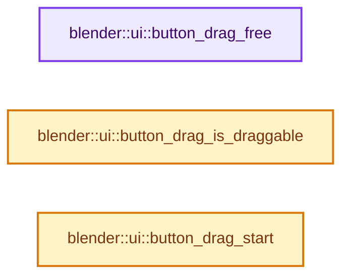
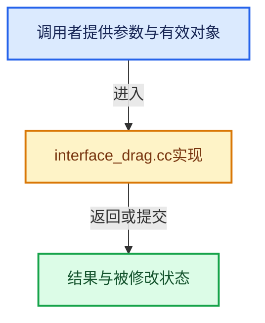

# 实现依赖专题：source/blender/editors/interface/interface_drag.cc

[实现依赖导航](../../../README.md) · [符号索引](../../../../00-课程指南/02-源码与提交索引/符号依赖与实现索引.md)

本专题从正文实际调用进入，集中保存共享实现。函数有稳定锚点，可从调用处直接跳到对应完整函数；递归与互相调用通过回链组织。

## 本文件的实现关系






## 完整成员与函数实现

<a id="f-33ced7532fc15880"></a>

### `blender::ui::button_drag_free`

实现位置：[source/blender/editors/interface/interface_drag.cc](../../../../../../../../source/blender/editors/interface/interface_drag.cc) · L92—L97。

接口参数：

- `Button *but`

**教学注释版**

<!-- annotated:4b94a632e95432 -->

```cpp
void button_drag_free(Button *but)
{
  if (but->dragpoin && (but->dragflag & BUT_DRAGPOIN_FREE)) {
    WM_drag_data_free(but->dragtype, but->dragpoin);
  }
}
```

<details>
<summary>核对原始源码：source/blender/editors/interface/interface_drag.cc · L92—L97</summary>

<!-- original:4b94a632e95432:source/blender/editors/interface/interface_drag.cc:92:97 -->

```cpp
void button_drag_free(Button *but)
{
  if (but->dragpoin && (but->dragflag & BUT_DRAGPOIN_FREE)) {
    WM_drag_data_free(but->dragtype, but->dragpoin);
  }
}
```

</details>

**继续追踪实现**

- `WM_drag_data_free` → [blender::WM_drag_data_free · L440](../../windowmanager/intern/wm_dragdrop.cc.md#f-bfd5410020d4ee83)。

<a id="f-758333ecb87927b1"></a>

### `blender::ui::button_drag_is_draggable`

实现位置：[source/blender/editors/interface/interface_drag.cc](../../../../../../../../source/blender/editors/interface/interface_drag.cc) · L99—L102。

接口参数：

- `const Button *but`

**教学注释版**

<!-- annotated:15f2a1302b4b2e -->

```cpp
bool button_drag_is_draggable(const Button *but)
{
  return but->dragpoin != nullptr;
}
```

<details>
<summary>核对原始源码：source/blender/editors/interface/interface_drag.cc · L99—L102</summary>

<!-- original:15f2a1302b4b2e:source/blender/editors/interface/interface_drag.cc:99:102 -->

```cpp
bool button_drag_is_draggable(const Button *but)
{
  return but->dragpoin != nullptr;
}
```

</details>

**结果出口**

- `return but->dragpoin != nullptr;`

**继续追踪实现**

本实现没有需要继续展开的显式调用；检查返回表达式、对象转换和调用者前置条件。

<a id="f-844d3b44db7c8e19"></a>

### `blender::ui::button_drag_start`

实现位置：[source/blender/editors/interface/interface_drag.cc](../../../../../../../../source/blender/editors/interface/interface_drag.cc) · L104—L133。

接口参数：

- `bContext *C`
- `Button *but`

**教学注释版**

<!-- annotated:77055dafc58084 -->

```cpp
void button_drag_start(bContext *C, Button *but)
{
  wmDrag *drag = WM_drag_data_create(C,
                                     but->icon,
                                     but->dragtype,
                                     but->dragpoin,
                                     (but->dragflag & BUT_DRAGPOIN_FREE) ? WM_DRAG_FREE_DATA :
                                                                           WM_DRAG_NOP);
  /* wmDrag has ownership over dragpoin now, stop messing with it. */
  but->dragpoin = nullptr;

  if (but->imb) {
    WM_event_drag_image(drag, but->imb, but->imb_scale);
  }
  else if (but->drag_preview_icon_id) {
    WM_event_drag_preview_icon(drag, but->drag_preview_icon_id);
  }

  WM_event_start_prepared_drag(C, drag);

  /* Special feature for assets: We add another drag item that supports multiple assets. It
   * gets the assets from context. */
  if (ELEM(but->dragtype, WM_DRAG_ASSET, WM_DRAG_ID)) {
    WM_event_start_drag(C, ICON_NONE, WM_DRAG_ASSET_LIST, nullptr, WM_DRAG_NOP);
  }

  if (but->dragtype == WM_DRAG_PATH) {
    WM_event_drag_path_override_poin_data_with_space_file_paths(C, drag);
  }
}
```

<details>
<summary>核对原始源码：source/blender/editors/interface/interface_drag.cc · L104—L133</summary>

<!-- original:77055dafc58084:source/blender/editors/interface/interface_drag.cc:104:133 -->

```cpp
void button_drag_start(bContext *C, Button *but)
{
  wmDrag *drag = WM_drag_data_create(C,
                                     but->icon,
                                     but->dragtype,
                                     but->dragpoin,
                                     (but->dragflag & BUT_DRAGPOIN_FREE) ? WM_DRAG_FREE_DATA :
                                                                           WM_DRAG_NOP);
  /* wmDrag has ownership over dragpoin now, stop messing with it. */
  but->dragpoin = nullptr;

  if (but->imb) {
    WM_event_drag_image(drag, but->imb, but->imb_scale);
  }
  else if (but->drag_preview_icon_id) {
    WM_event_drag_preview_icon(drag, but->drag_preview_icon_id);
  }

  WM_event_start_prepared_drag(C, drag);

  /* Special feature for assets: We add another drag item that supports multiple assets. It
   * gets the assets from context. */
  if (ELEM(but->dragtype, WM_DRAG_ASSET, WM_DRAG_ID)) {
    WM_event_start_drag(C, ICON_NONE, WM_DRAG_ASSET_LIST, nullptr, WM_DRAG_NOP);
  }

  if (but->dragtype == WM_DRAG_PATH) {
    WM_event_drag_path_override_poin_data_with_space_file_paths(C, drag);
  }
}
```

</details>

**沿实际写入检查状态**

- `but->dragpoin = nullptr;`

**继续追踪实现**

- `WM_drag_data_create` → [blender::WM_drag_data_create · L301](../../windowmanager/intern/wm_dragdrop.cc.md#f-e4534e8149709168)。
- `WM_event_drag_image` → [blender::WM_event_drag_image · L409](../../windowmanager/intern/wm_dragdrop.cc.md#f-955b4b1b7fd925ea)。
- `WM_event_drag_preview_icon` → [blender::WM_event_drag_preview_icon · L434](../../windowmanager/intern/wm_dragdrop.cc.md#f-dcf5dae5f9d8bcd2)。
- `WM_event_start_prepared_drag` → [blender::WM_event_start_prepared_drag · L347](../../windowmanager/intern/wm_dragdrop.cc.md#f-dd3c7e1a1926d07b)。
- `ELEM` → [ELEM · L88](../../../07-Intern运行时与平台/ghost/intern/GHOST_utildefines.hh.md#m-d28724a15928)；[ELEM · L135](../../../01-BLI基础库/BLI_utildefines.hh.md#m-d6572de7cae0)。宏定义由构建条件选择。
- `WM_event_start_drag` → [blender::WM_event_start_drag · L355](../../windowmanager/intern/wm_dragdrop.cc.md#f-1cc22b3125da160c)。
- `WM_event_drag_path_override_poin_data_with_space_file_paths` → [blender::WM_event_drag_path_override_poin_data_with_space_file_paths · L415](../../windowmanager/intern/wm_dragdrop.cc.md#f-a3608fc03aa5038c)。
