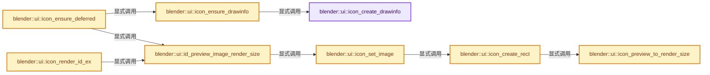

# 实现依赖专题：source/blender/editors/interface/interface_icons.cc

[实现依赖导航](../../../README.md) · [符号索引](../../../../00-课程指南/02-源码与提交索引/符号依赖与实现索引.md)

本专题从正文实际调用进入，集中保存共享实现。函数有稳定锚点，可从调用处直接跳到对应完整函数；递归与互相调用通过回链组织。

## 本文件的实现关系




## 完整成员与函数实现

<a id="f-20e615fdc1f0897b"></a>

### `blender::ui::icon_create_drawinfo`

实现位置：[source/blender/editors/interface/interface_icons.cc](../../../../../../../../source/blender/editors/interface/interface_icons.cc) · L1074—L1100。

接口参数：

- `Icon *icon`

**教学注释版**

<!-- annotated:ceaed7e6c6533b -->

```cpp
static DrawInfo *icon_create_drawinfo(Icon *icon)
{
  const int icon_data_type = icon->obj_type;

  DrawInfo *di = MEM_new_zeroed<DrawInfo>("di_icon");

  if (ELEM(icon_data_type, ICON_DATA_ID, ICON_DATA_PREVIEW)) {
    di->type = ICON_TYPE_PREVIEW;
  }
  else if (icon_data_type == ICON_DATA_IMBUF) {
    di->type = ICON_TYPE_IMBUF;
  }
  else if (icon_data_type == ICON_DATA_GEOM) {
    di->type = ICON_TYPE_GEOM;
  }
  else if (icon_data_type == ICON_DATA_STUDIOLIGHT) {
    di->type = ICON_TYPE_BUFFER;
  }
  else if (icon_data_type == ICON_DATA_GPLAYER) {
    di->type = ICON_TYPE_GPLAYER;
  }
  else {
    BLI_assert(0);
  }

  return di;
}
```

<details>
<summary>核对原始源码：source/blender/editors/interface/interface_icons.cc · L1074—L1100</summary>

<!-- original:ceaed7e6c6533b:source/blender/editors/interface/interface_icons.cc:1074:1100 -->

```cpp
static DrawInfo *icon_create_drawinfo(Icon *icon)
{
  const int icon_data_type = icon->obj_type;

  DrawInfo *di = MEM_new_zeroed<DrawInfo>("di_icon");

  if (ELEM(icon_data_type, ICON_DATA_ID, ICON_DATA_PREVIEW)) {
    di->type = ICON_TYPE_PREVIEW;
  }
  else if (icon_data_type == ICON_DATA_IMBUF) {
    di->type = ICON_TYPE_IMBUF;
  }
  else if (icon_data_type == ICON_DATA_GEOM) {
    di->type = ICON_TYPE_GEOM;
  }
  else if (icon_data_type == ICON_DATA_STUDIOLIGHT) {
    di->type = ICON_TYPE_BUFFER;
  }
  else if (icon_data_type == ICON_DATA_GPLAYER) {
    di->type = ICON_TYPE_GPLAYER;
  }
  else {
    BLI_assert(0);
  }

  return di;
}
```

</details>

**沿实际写入检查状态**

- `di->type = ICON_TYPE_PREVIEW;`
- `di->type = ICON_TYPE_IMBUF;`
- `di->type = ICON_TYPE_GEOM;`
- `di->type = ICON_TYPE_BUFFER;`
- `di->type = ICON_TYPE_GPLAYER;`

**结果出口**

- `return di;`

**继续追踪实现**

- `MEM_new_zeroed<DrawInfo>` → [MEM_new_zeroed · L550](../../../07-Intern运行时与平台/guardedalloc/MEM_guardedalloc.h.md#f-eeb1e2a7f57dd231)；[MEM_new_zeroed · L114](../../../07-Intern运行时与平台/guardedalloc/intern/mallocn.cc.md#f-e04cf01c64c8b180)。同名重载需按实参类型选择。
- `ELEM` → [ELEM · L88](../../../07-Intern运行时与平台/ghost/intern/GHOST_utildefines.hh.md#m-d28724a15928)；[ELEM · L135](../../../01-BLI基础库/BLI_utildefines.hh.md#m-d6572de7cae0)。宏定义由构建条件选择。
- `BLI_assert` → [BLI_assert · L48](../../../01-BLI基础库/BLI_assert.hh.md#m-57a88495704d)；[BLI_assert · L63](../../../01-BLI基础库/BLI_assert.hh.md#m-d07050020cb5)。宏定义由构建条件选择。

<a id="f-02028ab00c155302"></a>

### `blender::ui::icon_ensure_drawinfo`

实现位置：[source/blender/editors/interface/interface_icons.cc](../../../../../../../../source/blender/editors/interface/interface_icons.cc) · L1102—L1111。

接口参数：

- `Icon *icon`

**教学注释版**

<!-- annotated:734f6da25156fb -->

```cpp
static DrawInfo *icon_ensure_drawinfo(Icon *icon)
{
  if (icon->drawinfo) {
    return static_cast<DrawInfo *>(icon->drawinfo);
  }
  DrawInfo *di = icon_create_drawinfo(icon);
  icon->drawinfo = di;
  icon->drawinfo_free = icons_free_drawinfo;
  return di;
}
```

<details>
<summary>核对原始源码：source/blender/editors/interface/interface_icons.cc · L1102—L1111</summary>

<!-- original:734f6da25156fb:source/blender/editors/interface/interface_icons.cc:1102:1111 -->

```cpp
static DrawInfo *icon_ensure_drawinfo(Icon *icon)
{
  if (icon->drawinfo) {
    return static_cast<DrawInfo *>(icon->drawinfo);
  }
  DrawInfo *di = icon_create_drawinfo(icon);
  icon->drawinfo = di;
  icon->drawinfo_free = icons_free_drawinfo;
  return di;
}
```

</details>

**沿实际写入检查状态**

- `icon->drawinfo = di;`
- `icon->drawinfo_free = icons_free_drawinfo;`

**结果出口**

- `return static_cast<DrawInfo *>(icon->drawinfo);`
- `return di;`

**继续追踪实现**

- `icon_create_drawinfo` → [blender::ui::icon_create_drawinfo · L1074](interface_icons.cc.md#f-20e615fdc1f0897b)。

<a id="f-bf7b2406df53d95b"></a>

### `blender::ui::icon_preview_to_render_size`

实现位置：[source/blender/editors/interface/interface_icons.cc](../../../../../../../../source/blender/editors/interface/interface_icons.cc) · L1132—L1142。

接口参数：

- `enum eIconSizes size`

**教学注释版**

<!-- annotated:6b536accec293b -->

```cpp
int icon_preview_to_render_size(enum eIconSizes size)
{
  switch (size) {
    case ICON_SIZE_ICON:
      return ICON_RENDER_DEFAULT_HEIGHT;
    case ICON_SIZE_PREVIEW:
      return PREVIEW_RENDER_DEFAULT_HEIGHT;
    default:
      return 0;
  }
}
```

<details>
<summary>核对原始源码：source/blender/editors/interface/interface_icons.cc · L1132—L1142</summary>

<!-- original:6b536accec293b:source/blender/editors/interface/interface_icons.cc:1132:1142 -->

```cpp
int icon_preview_to_render_size(enum eIconSizes size)
{
  switch (size) {
    case ICON_SIZE_ICON:
      return ICON_RENDER_DEFAULT_HEIGHT;
    case ICON_SIZE_PREVIEW:
      return PREVIEW_RENDER_DEFAULT_HEIGHT;
    default:
      return 0;
  }
}
```

</details>

**结果出口**

- `return ICON_RENDER_DEFAULT_HEIGHT;`
- `return PREVIEW_RENDER_DEFAULT_HEIGHT;`
- `return 0;`

**继续追踪实现**

本实现没有需要继续展开的显式调用；检查返回表达式、对象转换和调用者前置条件。

<a id="f-7ca0460762d4d554"></a>

### `blender::ui::icon_create_rect`

实现位置：[source/blender/editors/interface/interface_icons.cc](../../../../../../../../source/blender/editors/interface/interface_icons.cc) · L1146—L1164。

接口参数：

- `PreviewImage *prv_img`
- `enum eIconSizes size`

**教学注释版**

<!-- annotated:4ae0a30256d772 -->

```cpp
static void icon_create_rect(PreviewImage *prv_img, enum eIconSizes size)
{
  const uint render_size = icon_preview_to_render_size(size);

  if (!prv_img) {
    if (G.debug & G_DEBUG) {
      CLOG_WARN(&LOG, "%s, error: requested preview image does not exist", __func__);
    }
  }
  else if (!prv_img->rect[size]) {
    prv_img->flag[size] |= PRV_CHANGED;
    prv_img->changed_timestamp[size] = 0;
    if (!ED_preview_use_image_size(prv_img, size)) {
      prv_img->w[size] = render_size;
      prv_img->h[size] = render_size;
      prv_img->rect[size] = MEM_new_array_zeroed<uint>(render_size * render_size, "prv_rect");
    }
  }
}
```

<details>
<summary>核对原始源码：source/blender/editors/interface/interface_icons.cc · L1146—L1164</summary>

<!-- original:4ae0a30256d772:source/blender/editors/interface/interface_icons.cc:1146:1164 -->

```cpp
static void icon_create_rect(PreviewImage *prv_img, enum eIconSizes size)
{
  const uint render_size = icon_preview_to_render_size(size);

  if (!prv_img) {
    if (G.debug & G_DEBUG) {
      CLOG_WARN(&LOG, "%s, error: requested preview image does not exist", __func__);
    }
  }
  else if (!prv_img->rect[size]) {
    prv_img->flag[size] |= PRV_CHANGED;
    prv_img->changed_timestamp[size] = 0;
    if (!ED_preview_use_image_size(prv_img, size)) {
      prv_img->w[size] = render_size;
      prv_img->h[size] = render_size;
      prv_img->rect[size] = MEM_new_array_zeroed<uint>(render_size * render_size, "prv_rect");
    }
  }
}
```

</details>

**沿实际写入检查状态**

- `prv_img->flag[size] |= PRV_CHANGED;`
- `prv_img->changed_timestamp[size] = 0;`
- `prv_img->w[size] = render_size;`
- `prv_img->h[size] = render_size;`
- `prv_img->rect[size] = MEM_new_array_zeroed<uint>(render_size * render_size, "prv_rect");`

**继续追踪实现**

- `icon_preview_to_render_size` → [blender::ui::icon_preview_to_render_size · L1132](interface_icons.cc.md#f-bf7b2406df53d95b)。
- `CLOG_WARN` → [CLOG_WARN · L189](../../../07-Intern运行时与平台/clog/CLG_log.h.md#m-9da21a06cdbe)。宏定义由构建条件选择。
- `ED_preview_use_image_size` → [blender::ED_preview_use_image_size · L2201](../render/render_preview.cc.md#f-65bc419f71c0d497)。
- `MEM_new_array_zeroed<uint>` → [MEM_new_array_zeroed · L566](../../../07-Intern运行时与平台/guardedalloc/MEM_guardedalloc.h.md#f-3a0cf63fb5216500)；[MEM_new_array_zeroed · L119](../../../07-Intern运行时与平台/guardedalloc/intern/mallocn.cc.md#f-6825557da566fdbe)。同名重载需按实参类型选择。

<a id="f-08147b225e1a8e06"></a>

### `blender::ui::icon_ensure_deferred`

实现位置：[source/blender/editors/interface/interface_icons.cc](../../../../../../../../source/blender/editors/interface/interface_icons.cc) · L1218—L1283。

接口参数：

- `const bContext *C`
- `const int icon_id`
- `const bool big`

**教学注释版**

<!-- annotated:9d4b5ac572e037 -->

```cpp
void icon_ensure_deferred(const bContext *C, const int icon_id, const bool big)
{
  Icon *icon = BKE_icon_get(icon_id);

  if (icon == nullptr) {
    return;
  }

  DrawInfo *di = icon_ensure_drawinfo(icon);

  if (di == nullptr) {
    return;
  }

  switch (di->type) {
    case ICON_TYPE_PREVIEW: {
      ID *id = (icon->id_type != 0) ? static_cast<ID *>(icon->obj) : nullptr;
      PreviewImage *prv = id ? BKE_previewimg_id_ensure(id) :
                               static_cast<PreviewImage *>(icon->obj);
      /* Using jobs for screen previews crashes due to off-screen rendering.
       * XXX: would be nicer if #PreviewImage could store if it supports jobs. */
      const bool use_jobs = !id || (GS(id->name) != ID_SCR);

      if (prv) {
        const int size = big ? ICON_SIZE_PREVIEW : ICON_SIZE_ICON;

        if (id || prv->runtime->deferred_loading_data) {
          id_preview_image_render_size(C, nullptr, id, prv, size, use_jobs);
        }
      }
      break;
    }
    case ICON_TYPE_BUFFER: {
      if (icon->obj_type == ICON_DATA_STUDIOLIGHT) {
        if (di->data.buffer.image == nullptr) {
          wmWindowManager *wm = CTX_wm_manager(C);
          StudioLight *sl = static_cast<StudioLight *>(icon->obj);
          BKE_studiolight_set_free_function(sl, &studiolight_free_function, wm);
          IconImage *img = MEM_new_zeroed<IconImage>(__func__);

          img->w = STUDIOLIGHT_ICON_SIZE;
          img->h = STUDIOLIGHT_ICON_SIZE;
          const size_t size = STUDIOLIGHT_ICON_SIZE * STUDIOLIGHT_ICON_SIZE * sizeof(uint);
          img->rect = MEM_new_array_uninitialized<uint8_t>(size, __func__);
          // [讲解] memset：填充字节，不调用T构造函数，也不保证任意类型的全零表示是合法或期望值。
          memset(img->rect, 0, size);
          di->data.buffer.image = img;

          wmJob *wm_job = WM_jobs_get(wm,
                                      CTX_wm_window(C),
                                      icon,
                                      "Generating StudioLight icon...",
                                      WM_JOB_BACKGROUND,
                                      WM_JOB_TYPE_STUDIOLIGHT);
          Icon **tmp = MEM_new_zeroed<Icon *>(__func__);
          *tmp = icon;
          WM_jobs_customdata_set(wm_job, tmp, MEM_delete_void);
          WM_jobs_timer(wm_job, 0.01, 0, NC_WINDOW);
          WM_jobs_callbacks(
              wm_job, studiolight_icon_job_exec, nullptr, nullptr, studiolight_icon_job_end);
          WM_jobs_start(CTX_wm_manager(C), wm_job);
        }
      }
      break;
    }
  }
}
```

<details>
<summary>核对原始源码：source/blender/editors/interface/interface_icons.cc · L1218—L1283</summary>

<!-- original:9d4b5ac572e037:source/blender/editors/interface/interface_icons.cc:1218:1283 -->

```cpp
void icon_ensure_deferred(const bContext *C, const int icon_id, const bool big)
{
  Icon *icon = BKE_icon_get(icon_id);

  if (icon == nullptr) {
    return;
  }

  DrawInfo *di = icon_ensure_drawinfo(icon);

  if (di == nullptr) {
    return;
  }

  switch (di->type) {
    case ICON_TYPE_PREVIEW: {
      ID *id = (icon->id_type != 0) ? static_cast<ID *>(icon->obj) : nullptr;
      PreviewImage *prv = id ? BKE_previewimg_id_ensure(id) :
                               static_cast<PreviewImage *>(icon->obj);
      /* Using jobs for screen previews crashes due to off-screen rendering.
       * XXX: would be nicer if #PreviewImage could store if it supports jobs. */
      const bool use_jobs = !id || (GS(id->name) != ID_SCR);

      if (prv) {
        const int size = big ? ICON_SIZE_PREVIEW : ICON_SIZE_ICON;

        if (id || prv->runtime->deferred_loading_data) {
          id_preview_image_render_size(C, nullptr, id, prv, size, use_jobs);
        }
      }
      break;
    }
    case ICON_TYPE_BUFFER: {
      if (icon->obj_type == ICON_DATA_STUDIOLIGHT) {
        if (di->data.buffer.image == nullptr) {
          wmWindowManager *wm = CTX_wm_manager(C);
          StudioLight *sl = static_cast<StudioLight *>(icon->obj);
          BKE_studiolight_set_free_function(sl, &studiolight_free_function, wm);
          IconImage *img = MEM_new_zeroed<IconImage>(__func__);

          img->w = STUDIOLIGHT_ICON_SIZE;
          img->h = STUDIOLIGHT_ICON_SIZE;
          const size_t size = STUDIOLIGHT_ICON_SIZE * STUDIOLIGHT_ICON_SIZE * sizeof(uint);
          img->rect = MEM_new_array_uninitialized<uint8_t>(size, __func__);
          memset(img->rect, 0, size);
          di->data.buffer.image = img;

          wmJob *wm_job = WM_jobs_get(wm,
                                      CTX_wm_window(C),
                                      icon,
                                      "Generating StudioLight icon...",
                                      WM_JOB_BACKGROUND,
                                      WM_JOB_TYPE_STUDIOLIGHT);
          Icon **tmp = MEM_new_zeroed<Icon *>(__func__);
          *tmp = icon;
          WM_jobs_customdata_set(wm_job, tmp, MEM_delete_void);
          WM_jobs_timer(wm_job, 0.01, 0, NC_WINDOW);
          WM_jobs_callbacks(
              wm_job, studiolight_icon_job_exec, nullptr, nullptr, studiolight_icon_job_end);
          WM_jobs_start(CTX_wm_manager(C), wm_job);
        }
      }
      break;
    }
  }
}
```

</details>

**沿实际写入检查状态**

- `img->w = STUDIOLIGHT_ICON_SIZE;`
- `img->h = STUDIOLIGHT_ICON_SIZE;`
- `img->rect = MEM_new_array_uninitialized<uint8_t>(size, __func__);`
- `di->data.buffer.image = img;`

**继续追踪实现**

- `BKE_icon_get` → [blender::BKE_icon_get · L491](../../../02-BKE几何与数据/intern/icons.cc.md#f-ee3d759f1924e7c9)。
- `icon_ensure_drawinfo` → [blender::ui::icon_ensure_drawinfo · L1102](interface_icons.cc.md#f-02028ab00c155302)。
- `BKE_previewimg_id_ensure` → [blender::BKE_previewimg_id_ensure · L264](../../../02-BKE几何与数据/intern/preview_image.cc.md#f-6af4997fedf2ae02)。
- `GS` → [blender::GS · L410](../../makesdna/DNA_ID.h.md#f-c3ff509f79f21b05)。
- `id_preview_image_render_size` → [blender::ui::id_preview_image_render_size · L1887](interface_icons.cc.md#f-d9bd37a8ad9d6ce8)。
- `CTX_wm_manager` → [blender::CTX_wm_manager · L928](../../../02-BKE几何与数据/intern/context.cc.md#f-158f36db7379fbe8)。
- `BKE_studiolight_set_free_function` → [BKE_studiolight_set_free_function · L1006](../../../02-BKE几何与数据/intern/studiolight.cc.md#f-d8cf982d316f0e8f)。
- `MEM_new_zeroed<IconImage>` → [MEM_new_zeroed · L550](../../../07-Intern运行时与平台/guardedalloc/MEM_guardedalloc.h.md#f-eeb1e2a7f57dd231)；[MEM_new_zeroed · L114](../../../07-Intern运行时与平台/guardedalloc/intern/mallocn.cc.md#f-e04cf01c64c8b180)。同名重载需按实参类型选择。
- `MEM_new_array_uninitialized<uint8_t>` → [MEM_new_array_uninitialized · L608](../../../07-Intern运行时与平台/guardedalloc/MEM_guardedalloc.h.md#f-b7103eae8eb57b05)；[MEM_new_array_uninitialized · L129](../../../07-Intern运行时与平台/guardedalloc/intern/mallocn.cc.md#f-bf6ef4ddcfb6e5df)。同名重载需按实参类型选择。
- `memset` → [外部契约](https://eel.is/c++draft/cstring.syn)：填充字节，不调用T构造函数，也不保证任意类型的全零表示是合法或期望值。
- `WM_jobs_get` → [blender::WM_jobs_get · L228](../../windowmanager/intern/wm_jobs.cc.md#f-c8729db4ef26b0e7)。
- `CTX_wm_window` → [blender::CTX_wm_window · L938](../../../02-BKE几何与数据/intern/context.cc.md#f-a1996003b2409854)。
- `MEM_new_zeroed<Icon *>` → [MEM_new_zeroed · L550](../../../07-Intern运行时与平台/guardedalloc/MEM_guardedalloc.h.md#f-eeb1e2a7f57dd231)；[MEM_new_zeroed · L114](../../../07-Intern运行时与平台/guardedalloc/intern/mallocn.cc.md#f-e04cf01c64c8b180)。同名重载需按实参类型选择。
- `WM_jobs_customdata_set` → [blender::WM_jobs_customdata_set · L377](../../windowmanager/intern/wm_jobs.cc.md#f-129383343a19f471)。
- `WM_jobs_timer` → [blender::WM_jobs_timer · L393](../../windowmanager/intern/wm_jobs.cc.md#f-98d85930af2bed33)。
- `WM_jobs_callbacks` → [blender::WM_jobs_callbacks · L407](../../windowmanager/intern/wm_jobs.cc.md#f-f8d54fc5ad0ce02c)。
- `WM_jobs_start` → [blender::WM_jobs_start · L498](../../windowmanager/intern/wm_jobs.cc.md#f-718e40aed5c7c087)。

<a id="f-7c323321cd0680fc"></a>

### `blender::ui::icon_set_image`

实现位置：[source/blender/editors/interface/interface_icons.cc](../../../../../../../../source/blender/editors/interface/interface_icons.cc) · L1317—L1355。

接口参数：

- `const bContext *C`
- `Scene *scene`
- `ID *id`
- `PreviewImage *prv_img`
- `enum eIconSizes size`
- `const bool use_job`

**教学注释版**

<!-- annotated:b603e547a4308f -->

```cpp
static void icon_set_image(const bContext *C,
                           Scene *scene,
                           ID *id,
                           PreviewImage *prv_img,
                           enum eIconSizes size,
                           const bool use_job)
{
  if (!prv_img) {
    if (G.debug & G_DEBUG) {
      CLOG_WARN(&LOG, "%s: no preview image for this ID: %s", __func__, id->name);
    }
    return;
  }

  if (prv_img->flag[size] & PRV_USER_EDITED) {
    /* user-edited preview, do not auto-update! */
    return;
  }

  /* Check if the ID supports preview loading or rendering. */
  if (!prv_img->runtime->deferred_loading_data && !ED_preview_id_render_is_supported(id)) {
    return;
  }

  const bool delay = prv_img->rect[size] != nullptr;
  icon_create_rect(prv_img, size);

  if (use_job && (!id || BKE_previewimg_id_supports_jobs(id))) {
    /* Job (background) version */
    ED_preview_icon_job(C, prv_img, id, size, delay);
  }
  else {
    if (!scene) {
      scene = CTX_data_scene(C);
    }
    /* Immediate version */
    ED_preview_icon_render(C, scene, prv_img, id, size);
  }
}
```

<details>
<summary>核对原始源码：source/blender/editors/interface/interface_icons.cc · L1317—L1355</summary>

<!-- original:b603e547a4308f:source/blender/editors/interface/interface_icons.cc:1317:1355 -->

```cpp
static void icon_set_image(const bContext *C,
                           Scene *scene,
                           ID *id,
                           PreviewImage *prv_img,
                           enum eIconSizes size,
                           const bool use_job)
{
  if (!prv_img) {
    if (G.debug & G_DEBUG) {
      CLOG_WARN(&LOG, "%s: no preview image for this ID: %s", __func__, id->name);
    }
    return;
  }

  if (prv_img->flag[size] & PRV_USER_EDITED) {
    /* user-edited preview, do not auto-update! */
    return;
  }

  /* Check if the ID supports preview loading or rendering. */
  if (!prv_img->runtime->deferred_loading_data && !ED_preview_id_render_is_supported(id)) {
    return;
  }

  const bool delay = prv_img->rect[size] != nullptr;
  icon_create_rect(prv_img, size);

  if (use_job && (!id || BKE_previewimg_id_supports_jobs(id))) {
    /* Job (background) version */
    ED_preview_icon_job(C, prv_img, id, size, delay);
  }
  else {
    if (!scene) {
      scene = CTX_data_scene(C);
    }
    /* Immediate version */
    ED_preview_icon_render(C, scene, prv_img, id, size);
  }
}
```

</details>

**沿实际写入检查状态**

- `scene = CTX_data_scene(C);`

**继续追踪实现**

- `CLOG_WARN` → [CLOG_WARN · L189](../../../07-Intern运行时与平台/clog/CLG_log.h.md#m-9da21a06cdbe)。宏定义由构建条件选择。
- `ED_preview_id_render_is_supported` → [blender::ED_preview_id_render_is_supported · L2206](../render/render_preview.cc.md#f-213e999f30eb9c0b)。
- `icon_create_rect` → [blender::ui::icon_create_rect · L1146](interface_icons.cc.md#f-7ca0460762d4d554)。
- `BKE_previewimg_id_supports_jobs` → [blender::BKE_previewimg_id_supports_jobs · L296](../../../02-BKE几何与数据/intern/preview_image.cc.md#f-9c389708dfca3760)。
- `ED_preview_icon_job` → [blender::ED_preview_icon_job · L2313](../render/render_preview.cc.md#f-365384daa8d811b9)。
- `CTX_data_scene` → [blender::CTX_data_scene · L1329](../../../02-BKE几何与数据/intern/context.cc.md#f-6a2fb518a7aa2eee)。
- `ED_preview_icon_render` → [blender::ED_preview_icon_render · L2258](../render/render_preview.cc.md#f-f99711f20a1b0f3a)。

<a id="f-d9bd37a8ad9d6ce8"></a>

### `blender::ui::id_preview_image_render_size`

实现位置：[source/blender/editors/interface/interface_icons.cc](../../../../../../../../source/blender/editors/interface/interface_icons.cc) · L1887—L1903。

接口参数：

- `const bContext *C`
- `Scene *scene`
- `ID *id`
- `PreviewImage *pi`
- `int size`
- `const bool use_job`

**教学注释版**

<!-- annotated:0d0405111a7456 -->

```cpp
static void id_preview_image_render_size(
    const bContext *C, Scene *scene, ID *id, PreviewImage *pi, int size, const bool use_job)
{
  BLI_assert((id == nullptr) || (BKE_previewimg_id_get(id) == pi));

  /* changed only ever set by dynamic icons */
  if ((pi->flag[size] & PRV_CHANGED) || (!pi->rect[size] && !BKE_previewimg_is_invalid(pi, size)))
  {
    /* create the rect if necessary */
    icon_set_image(C, scene, id, pi, eIconSizes(size), use_job);

    if ((id == nullptr) || BKE_previewimg_id_get(id)) {
      /* Only change the preview image flag if it hasn't been freed yet. */
      pi->flag[size] &= ~PRV_CHANGED;
    }
  }
}
```

<details>
<summary>核对原始源码：source/blender/editors/interface/interface_icons.cc · L1887—L1903</summary>

<!-- original:0d0405111a7456:source/blender/editors/interface/interface_icons.cc:1887:1903 -->

```cpp
static void id_preview_image_render_size(
    const bContext *C, Scene *scene, ID *id, PreviewImage *pi, int size, const bool use_job)
{
  BLI_assert((id == nullptr) || (BKE_previewimg_id_get(id) == pi));

  /* changed only ever set by dynamic icons */
  if ((pi->flag[size] & PRV_CHANGED) || (!pi->rect[size] && !BKE_previewimg_is_invalid(pi, size)))
  {
    /* create the rect if necessary */
    icon_set_image(C, scene, id, pi, eIconSizes(size), use_job);

    if ((id == nullptr) || BKE_previewimg_id_get(id)) {
      /* Only change the preview image flag if it hasn't been freed yet. */
      pi->flag[size] &= ~PRV_CHANGED;
    }
  }
}
```

</details>

**沿实际写入检查状态**

- `pi->flag[size] &= ~PRV_CHANGED;`

**继续追踪实现**

- `BLI_assert` → [BLI_assert · L48](../../../01-BLI基础库/BLI_assert.hh.md#m-57a88495704d)；[BLI_assert · L63](../../../01-BLI基础库/BLI_assert.hh.md#m-d07050020cb5)。宏定义由构建条件选择。
- `BKE_previewimg_id_get` → [blender::BKE_previewimg_id_get · L250](../../../02-BKE几何与数据/intern/preview_image.cc.md#f-099dfed2f9ba7399)。
- `BKE_previewimg_is_invalid` → [blender::BKE_previewimg_is_invalid · L578](../../../02-BKE几何与数据/intern/preview_image.cc.md#f-364826143aabf3c8)。
- `icon_set_image` → [blender::ui::icon_set_image · L1317](interface_icons.cc.md#f-7c323321cd0680fc)。
- `eIconSizes` → [blender::eIconSizes](../../../02-BKE几何与数据/BKE_preview_image.hh.md#t-9df2fd9aad7e)；[blender::ui::eIconSizes](../include/UI_interface_icons.hh.md#t-1390cb9fb413)；[blender::ui::eIconSizes](../include/UI_interface_icons.hh.md#t-61aa9949b7e7)；[blender::ui::eIconSizes](../include/UI_interface_icons.hh.md#t-d0e32d23ee45)；[blender::eIconSizes](../include/ED_render.hh.md#t-e59a14ca48fb)；[blender::eIconSizes](../include/ED_render.hh.md#t-ef3289855614)；[blender::eIconSizes](../../makesdna/DNA_ID_enums.h.md#t-c694e1e91f39)。

<a id="f-8fd01217ddfede2b"></a>

### `blender::ui::icon_render_id_ex`

实现位置：[source/blender/editors/interface/interface_icons.cc](../../../../../../../../source/blender/editors/interface/interface_icons.cc) · L1905—L1913。

接口参数：

- `const bContext *C`
- `Scene *scene`
- `ID *id_to_render`
- `const enum eIconSizes size`
- `const bool use_job`
- `PreviewImage *r_preview_image`

**教学注释版**

<!-- annotated:a26c6d5fd5c825 -->

```cpp
void icon_render_id_ex(const bContext *C,
                       Scene *scene,
                       ID *id_to_render,
                       const enum eIconSizes size,
                       const bool use_job,
                       PreviewImage *r_preview_image)
{
  id_preview_image_render_size(C, scene, id_to_render, r_preview_image, size, use_job);
}
```

<details>
<summary>核对原始源码：source/blender/editors/interface/interface_icons.cc · L1905—L1913</summary>

<!-- original:a26c6d5fd5c825:source/blender/editors/interface/interface_icons.cc:1905:1913 -->

```cpp
void icon_render_id_ex(const bContext *C,
                       Scene *scene,
                       ID *id_to_render,
                       const enum eIconSizes size,
                       const bool use_job,
                       PreviewImage *r_preview_image)
{
  id_preview_image_render_size(C, scene, id_to_render, r_preview_image, size, use_job);
}
```

</details>

**继续追踪实现**

- `id_preview_image_render_size` → [blender::ui::id_preview_image_render_size · L1887](interface_icons.cc.md#f-d9bd37a8ad9d6ce8)。

<a id="f-9c5d5c90a5abf645"></a>

### `blender::ui::icon_render_id`

实现位置：[source/blender/editors/interface/interface_icons.cc](../../../../../../../../source/blender/editors/interface/interface_icons.cc) · L1915—L1938。

接口参数：

- `const bContext *C`
- `Scene *scene`
- `ID *id`
- `const enum eIconSizes size`
- `const bool use_job`

**教学注释版**

<!-- annotated:e2e39a11ffa216 -->

```cpp
void icon_render_id(
    const bContext *C, Scene *scene, ID *id, const enum eIconSizes size, const bool use_job)
{
  PreviewImage *pi = BKE_previewimg_id_ensure(id);
  if (pi == nullptr) {
    return;
  }

  ID *id_to_render = id;

  /* For objects, first try if a preview can created via the object data. */
  if (GS(id->name) == ID_OB) {
    Object *ob = id_cast<Object *>(id);
    if (ED_preview_id_render_is_supported(static_cast<const ID *>(ob->data))) {
      id_to_render = ob->data;
    }
  }

  if (!ED_preview_id_render_is_supported(id_to_render)) {
    return;
  }

  icon_render_id_ex(C, scene, id_to_render, size, use_job, pi);
}
```

<details>
<summary>核对原始源码：source/blender/editors/interface/interface_icons.cc · L1915—L1938</summary>

<!-- original:e2e39a11ffa216:source/blender/editors/interface/interface_icons.cc:1915:1938 -->

```cpp
void icon_render_id(
    const bContext *C, Scene *scene, ID *id, const enum eIconSizes size, const bool use_job)
{
  PreviewImage *pi = BKE_previewimg_id_ensure(id);
  if (pi == nullptr) {
    return;
  }

  ID *id_to_render = id;

  /* For objects, first try if a preview can created via the object data. */
  if (GS(id->name) == ID_OB) {
    Object *ob = id_cast<Object *>(id);
    if (ED_preview_id_render_is_supported(static_cast<const ID *>(ob->data))) {
      id_to_render = ob->data;
    }
  }

  if (!ED_preview_id_render_is_supported(id_to_render)) {
    return;
  }

  icon_render_id_ex(C, scene, id_to_render, size, use_job, pi);
}
```

</details>

**沿实际写入检查状态**

- `id_to_render = ob->data;`

**继续追踪实现**

- `BKE_previewimg_id_ensure` → [blender::BKE_previewimg_id_ensure · L264](../../../02-BKE几何与数据/intern/preview_image.cc.md#f-6af4997fedf2ae02)。
- `GS` → [blender::GS · L410](../../makesdna/DNA_ID.h.md#f-c3ff509f79f21b05)。
- `id_cast<Object *>` → [blender::id_cast · L1417](../../makesdna/DNA_ID.h.md#f-6c8ac6412850ac5a)。
- `ED_preview_id_render_is_supported` → [blender::ED_preview_id_render_is_supported · L2206](../render/render_preview.cc.md#f-213e999f30eb9c0b)。
- `icon_render_id_ex` → [blender::ui::icon_render_id_ex · L1905](interface_icons.cc.md#f-8fd01217ddfede2b)。

<a id="f-70822d070b462f9b"></a>

### `blender::ui::id_icon_render`

实现位置：[source/blender/editors/interface/interface_icons.cc](../../../../../../../../source/blender/editors/interface/interface_icons.cc) · L1940—L1951。

接口参数：

- `const bContext *C`
- `ID *id`
- `bool use_jobs`

**教学注释版**

<!-- annotated:5c6fb233475a3e -->

```cpp
static void id_icon_render(const bContext *C, ID *id, bool use_jobs)
{
  PreviewImage *pi = BKE_previewimg_id_ensure(id);

  if (!pi) {
    return;
  }

  for (int i = 0; i < NUM_ICON_SIZES; i++) {
    id_preview_image_render_size(C, nullptr, id, pi, i, use_jobs);
  }
}
```

<details>
<summary>核对原始源码：source/blender/editors/interface/interface_icons.cc · L1940—L1951</summary>

<!-- original:5c6fb233475a3e:source/blender/editors/interface/interface_icons.cc:1940:1951 -->

```cpp
static void id_icon_render(const bContext *C, ID *id, bool use_jobs)
{
  PreviewImage *pi = BKE_previewimg_id_ensure(id);

  if (!pi) {
    return;
  }

  for (int i = 0; i < NUM_ICON_SIZES; i++) {
    id_preview_image_render_size(C, nullptr, id, pi, i, use_jobs);
  }
}
```

</details>

**继续追踪实现**

- `BKE_previewimg_id_ensure` → [blender::BKE_previewimg_id_ensure · L264](../../../02-BKE几何与数据/intern/preview_image.cc.md#f-6af4997fedf2ae02)。
- `id_preview_image_render_size` → [blender::ui::id_preview_image_render_size · L1887](interface_icons.cc.md#f-d9bd37a8ad9d6ce8)。

<a id="f-fb0e3b9d47cebed8"></a>

### `blender::ui::id_screen_get_icon`

实现位置：[source/blender/editors/interface/interface_icons.cc](../../../../../../../../source/blender/editors/interface/interface_icons.cc) · L1953—L1960。

接口参数：

- `const bContext *C`
- `ID *id`

**教学注释版**

<!-- annotated:de1ee503bc4415 -->

```cpp
static int id_screen_get_icon(const bContext *C, ID *id)
{
  BKE_icon_id_ensure(id);
  /* Don't use jobs here, off-screen rendering doesn't like this and crashes. */
  id_icon_render(C, id, false);

  return id->icon_id;
}
```

<details>
<summary>核对原始源码：source/blender/editors/interface/interface_icons.cc · L1953—L1960</summary>

<!-- original:de1ee503bc4415:source/blender/editors/interface/interface_icons.cc:1953:1960 -->

```cpp
static int id_screen_get_icon(const bContext *C, ID *id)
{
  BKE_icon_id_ensure(id);
  /* Don't use jobs here, off-screen rendering doesn't like this and crashes. */
  id_icon_render(C, id, false);

  return id->icon_id;
}
```

</details>

**结果出口**

- `return id->icon_id;`

**继续追踪实现**

- `BKE_icon_id_ensure` → [blender::BKE_icon_id_ensure · L279](../../../02-BKE几何与数据/intern/icons.cc.md#f-9ba71d667742343a)。
- `id_icon_render` → [blender::ui::id_icon_render · L1940](interface_icons.cc.md#f-70822d070b462f9b)。

<a id="f-038074a948994ecd"></a>

### `blender::ui::id_icon_get`

实现位置：[source/blender/editors/interface/interface_icons.cc](../../../../../../../../source/blender/editors/interface/interface_icons.cc) · L1962—L1991。

接口参数：

- `const bContext *C`
- `ID *id`
- `const bool big`

**教学注释版**

<!-- annotated:75dc392b435765 -->

```cpp
int id_icon_get(const bContext *C, ID *id, const bool big)
{
  int iconid = 0;

  /* icon */
  switch (GS(id->name)) {
    case ID_MA: /* fall through */
    case ID_TE: /* fall through */
    case ID_IM: /* fall through */
    case ID_WO: /* fall through */
    case ID_LA: /* fall through */
      iconid = BKE_icon_id_ensure(id);
      /* checks if not exists, or changed */
      icon_render_id(C, nullptr, id, big ? ICON_SIZE_PREVIEW : ICON_SIZE_ICON, true);
      break;
    case ID_SCR:
      iconid = id_screen_get_icon(C, id);
      break;
    case ID_OB:
      iconid = icon_from_object_type(id_cast<Object *>(id));
      break;
    case ID_GR:
      iconid = icon_color_from_collection(id_cast<Collection *>(id));
      break;
    default:
      break;
  }

  return iconid;
}
```

<details>
<summary>核对原始源码：source/blender/editors/interface/interface_icons.cc · L1962—L1991</summary>

<!-- original:75dc392b435765:source/blender/editors/interface/interface_icons.cc:1962:1991 -->

```cpp
int id_icon_get(const bContext *C, ID *id, const bool big)
{
  int iconid = 0;

  /* icon */
  switch (GS(id->name)) {
    case ID_MA: /* fall through */
    case ID_TE: /* fall through */
    case ID_IM: /* fall through */
    case ID_WO: /* fall through */
    case ID_LA: /* fall through */
      iconid = BKE_icon_id_ensure(id);
      /* checks if not exists, or changed */
      icon_render_id(C, nullptr, id, big ? ICON_SIZE_PREVIEW : ICON_SIZE_ICON, true);
      break;
    case ID_SCR:
      iconid = id_screen_get_icon(C, id);
      break;
    case ID_OB:
      iconid = icon_from_object_type(id_cast<Object *>(id));
      break;
    case ID_GR:
      iconid = icon_color_from_collection(id_cast<Collection *>(id));
      break;
    default:
      break;
  }

  return iconid;
}
```

</details>

**沿实际写入检查状态**

- `iconid = BKE_icon_id_ensure(id);`
- `iconid = id_screen_get_icon(C, id);`
- `iconid = icon_from_object_type(id_cast<Object *>(id));`
- `iconid = icon_color_from_collection(id_cast<Collection *>(id));`

**结果出口**

- `return iconid;`

**继续追踪实现**

- `GS` → [blender::GS · L410](../../makesdna/DNA_ID.h.md#f-c3ff509f79f21b05)。
- `BKE_icon_id_ensure` → [blender::BKE_icon_id_ensure · L279](../../../02-BKE几何与数据/intern/icons.cc.md#f-9ba71d667742343a)。
- `icon_render_id` → [blender::ui::icon_render_id · L1915](interface_icons.cc.md#f-9c5d5c90a5abf645)。
- `id_screen_get_icon` → [blender::ui::id_screen_get_icon · L1953](interface_icons.cc.md#f-fb0e3b9d47cebed8)。
- `icon_from_object_type` → [blender::ui::icon_from_object_type · L2197](interface_icons.cc.md#f-7406be8cb90c0105)。
- `id_cast<Object *>` → [blender::id_cast · L1417](../../makesdna/DNA_ID.h.md#f-6c8ac6412850ac5a)。
- `icon_color_from_collection` → [blender::ui::icon_color_from_collection · L2250](interface_icons.cc.md#f-67283cf96c608f49)。
- `id_cast<Collection *>` → [blender::id_cast · L1417](../../makesdna/DNA_ID.h.md#f-6c8ac6412850ac5a)。

<a id="f-4ae903df2c5b2a3d"></a>

### `blender::ui::icon_from_rnaptr`

实现位置：[source/blender/editors/interface/interface_icons.cc](../../../../../../../../source/blender/editors/interface/interface_icons.cc) · L2025—L2080。

接口参数：

- `const bContext *C`
- `PointerRNA *ptr`
- `int rnaicon`
- `const bool big`

**教学注释版**

<!-- annotated:c0bda77989210f -->

```cpp
int icon_from_rnaptr(const bContext *C, PointerRNA *ptr, int rnaicon, const bool big)
{
  ID *id = nullptr;

  if (!*ptr) {
    return rnaicon;
  }

  /* Try ID, material, texture or dynamic-paint slot. */
  if (RNA_struct_is_ID(ptr->type)) {
    id = ptr->owner_id;
  }
  else if (RNA_struct_is_a(ptr->type, RNA_MaterialSlot)) {
    id = static_cast<ID *>(RNA_pointer_get(ptr, "material").data);
  }
  else if (RNA_struct_is_a(ptr->type, RNA_TextureSlot)) {
    id = static_cast<ID *>(RNA_pointer_get(ptr, "texture").data);
  }
  else if (RNA_struct_is_a(ptr->type, RNA_FileBrowserFSMenuEntry)) {
    return RNA_int_get(ptr, "icon");
  }
  else if (RNA_struct_is_a(ptr->type, RNA_DynamicPaintSurface)) {
    const DynamicPaintSurface *surface = static_cast<const DynamicPaintSurface *>(ptr->data);

    if (surface->format == MOD_DPAINT_SURFACE_F_PTEX) {
      return ICON_SHADING_TEXTURE;
    }
    if (surface->format == MOD_DPAINT_SURFACE_F_VERTEX) {
      return ICON_OUTLINER_DATA_MESH;
    }
    if (surface->format == MOD_DPAINT_SURFACE_F_IMAGESEQ) {
      return ICON_FILE_IMAGE;
    }
  }
  else if (RNA_struct_is_a(ptr->type, RNA_StudioLight)) {
    StudioLight *sl = static_cast<StudioLight *>(ptr->data);
    switch (sl->flag & STUDIOLIGHT_FLAG_ORIENTATIONS) {
      case STUDIOLIGHT_TYPE_STUDIO:
        return sl->icon_id_irradiance;
      case STUDIOLIGHT_TYPE_WORLD:
      default:
        return sl->icon_id_radiance;
      case STUDIOLIGHT_TYPE_MATCAP:
        return sl->icon_id_matcap;
    }
  }

  /* get icon from ID */
  if (id) {
    const int icon = id_icon_get(C, id, big);

    return icon ? icon : rnaicon;
  }

  return rnaicon;
}
```

<details>
<summary>核对原始源码：source/blender/editors/interface/interface_icons.cc · L2025—L2080</summary>

<!-- original:c0bda77989210f:source/blender/editors/interface/interface_icons.cc:2025:2080 -->

```cpp
int icon_from_rnaptr(const bContext *C, PointerRNA *ptr, int rnaicon, const bool big)
{
  ID *id = nullptr;

  if (!*ptr) {
    return rnaicon;
  }

  /* Try ID, material, texture or dynamic-paint slot. */
  if (RNA_struct_is_ID(ptr->type)) {
    id = ptr->owner_id;
  }
  else if (RNA_struct_is_a(ptr->type, RNA_MaterialSlot)) {
    id = static_cast<ID *>(RNA_pointer_get(ptr, "material").data);
  }
  else if (RNA_struct_is_a(ptr->type, RNA_TextureSlot)) {
    id = static_cast<ID *>(RNA_pointer_get(ptr, "texture").data);
  }
  else if (RNA_struct_is_a(ptr->type, RNA_FileBrowserFSMenuEntry)) {
    return RNA_int_get(ptr, "icon");
  }
  else if (RNA_struct_is_a(ptr->type, RNA_DynamicPaintSurface)) {
    const DynamicPaintSurface *surface = static_cast<const DynamicPaintSurface *>(ptr->data);

    if (surface->format == MOD_DPAINT_SURFACE_F_PTEX) {
      return ICON_SHADING_TEXTURE;
    }
    if (surface->format == MOD_DPAINT_SURFACE_F_VERTEX) {
      return ICON_OUTLINER_DATA_MESH;
    }
    if (surface->format == MOD_DPAINT_SURFACE_F_IMAGESEQ) {
      return ICON_FILE_IMAGE;
    }
  }
  else if (RNA_struct_is_a(ptr->type, RNA_StudioLight)) {
    StudioLight *sl = static_cast<StudioLight *>(ptr->data);
    switch (sl->flag & STUDIOLIGHT_FLAG_ORIENTATIONS) {
      case STUDIOLIGHT_TYPE_STUDIO:
        return sl->icon_id_irradiance;
      case STUDIOLIGHT_TYPE_WORLD:
      default:
        return sl->icon_id_radiance;
      case STUDIOLIGHT_TYPE_MATCAP:
        return sl->icon_id_matcap;
    }
  }

  /* get icon from ID */
  if (id) {
    const int icon = id_icon_get(C, id, big);

    return icon ? icon : rnaicon;
  }

  return rnaicon;
}
```

</details>

**沿实际写入检查状态**

- `id = ptr->owner_id;`
- `id = static_cast<ID *>(RNA_pointer_get(ptr, "material").data);`
- `id = static_cast<ID *>(RNA_pointer_get(ptr, "texture").data);`

**结果出口**

- `return rnaicon;`
- `return RNA_int_get(ptr, "icon");`
- `return ICON_SHADING_TEXTURE;`
- `return ICON_OUTLINER_DATA_MESH;`
- `return ICON_FILE_IMAGE;`
- `return sl->icon_id_irradiance;`
- `return sl->icon_id_radiance;`
- `return sl->icon_id_matcap;`
- `return icon ? icon : rnaicon;`

**继续追踪实现**

- `RNA_struct_is_ID` → [blender::RNA_struct_is_ID · L793](../../makesrna/intern/rna_access.cc.md#f-d146fa9a7698b857)。
- `RNA_struct_is_a` → [blender::RNA_struct_is_a · L833](../../makesrna/intern/rna_access.cc.md#f-9eaabe3c6e731ea5)。
- `RNA_pointer_get` → [blender::RNA_pointer_get · L7040](../../makesrna/intern/rna_access.cc.md#f-3ccd96658ac85256)。
- `RNA_int_get` → [blender::RNA_int_get · L6771](../../makesrna/intern/rna_access.cc.md#f-22b00c34f0e656c9)。
- `id_icon_get` → [blender::ui::id_icon_get · L1962](interface_icons.cc.md#f-038074a948994ecd)。

<a id="f-7406be8cb90c0105"></a>

### `blender::ui::icon_from_object_type`

实现位置：[source/blender/editors/interface/interface_icons.cc](../../../../../../../../source/blender/editors/interface/interface_icons.cc) · L2197—L2248。

接口参数：

- `const Object *object`

**教学注释版**

<!-- annotated:c4d6474c9be3a8 -->

```cpp
int icon_from_object_type(const Object *object)
{
  switch (object->type) {
    case OB_LAMP:
      return ICON_OUTLINER_OB_LIGHT;
    case OB_MESH:
      return ICON_OUTLINER_OB_MESH;
    case OB_CAMERA:
      return ICON_OUTLINER_OB_CAMERA;
    case OB_CURVES_LEGACY:
      return ICON_OUTLINER_OB_CURVE;
    case OB_MBALL:
      return ICON_OUTLINER_OB_META;
    case OB_LATTICE:
      return ICON_OUTLINER_OB_LATTICE;
    case OB_ARMATURE:
      return ICON_OUTLINER_OB_ARMATURE;
    case OB_FONT:
      return ICON_OUTLINER_OB_FONT;
    case OB_SURF:
      return ICON_OUTLINER_OB_SURFACE;
    case OB_SPEAKER:
      return ICON_OUTLINER_OB_SPEAKER;
    case OB_LIGHTPROBE:
      return ICON_OUTLINER_OB_LIGHTPROBE;
    case OB_CURVES:
      return ICON_OUTLINER_OB_CURVES;
    case OB_POINTCLOUD:
      return ICON_OUTLINER_OB_POINTCLOUD;
    case OB_VOLUME:
      return ICON_OUTLINER_OB_VOLUME;
    case OB_EMPTY:
      if (object->instance_collection && (object->transflag & OB_DUPLICOLLECTION)) {
        return ICON_OUTLINER_OB_GROUP_INSTANCE;
      }
      else if (object->empty_drawtype == OB_EMPTY_IMAGE) {
        return ICON_OUTLINER_OB_IMAGE;
      }
      else if (object->pd && object->pd->forcefield) {
        return ICON_OUTLINER_OB_FORCE_FIELD;
      }
      else {
        return ICON_OUTLINER_OB_EMPTY;
      }
    case OB_GREASE_PENCIL:
      return ICON_OUTLINER_OB_GREASEPENCIL;
    case OB_GPENCIL_LEGACY:
    case OB_TYPE_MAX:
      break;
  }
  return ICON_NONE;
}
```

<details>
<summary>核对原始源码：source/blender/editors/interface/interface_icons.cc · L2197—L2248</summary>

<!-- original:c4d6474c9be3a8:source/blender/editors/interface/interface_icons.cc:2197:2248 -->

```cpp
int icon_from_object_type(const Object *object)
{
  switch (object->type) {
    case OB_LAMP:
      return ICON_OUTLINER_OB_LIGHT;
    case OB_MESH:
      return ICON_OUTLINER_OB_MESH;
    case OB_CAMERA:
      return ICON_OUTLINER_OB_CAMERA;
    case OB_CURVES_LEGACY:
      return ICON_OUTLINER_OB_CURVE;
    case OB_MBALL:
      return ICON_OUTLINER_OB_META;
    case OB_LATTICE:
      return ICON_OUTLINER_OB_LATTICE;
    case OB_ARMATURE:
      return ICON_OUTLINER_OB_ARMATURE;
    case OB_FONT:
      return ICON_OUTLINER_OB_FONT;
    case OB_SURF:
      return ICON_OUTLINER_OB_SURFACE;
    case OB_SPEAKER:
      return ICON_OUTLINER_OB_SPEAKER;
    case OB_LIGHTPROBE:
      return ICON_OUTLINER_OB_LIGHTPROBE;
    case OB_CURVES:
      return ICON_OUTLINER_OB_CURVES;
    case OB_POINTCLOUD:
      return ICON_OUTLINER_OB_POINTCLOUD;
    case OB_VOLUME:
      return ICON_OUTLINER_OB_VOLUME;
    case OB_EMPTY:
      if (object->instance_collection && (object->transflag & OB_DUPLICOLLECTION)) {
        return ICON_OUTLINER_OB_GROUP_INSTANCE;
      }
      else if (object->empty_drawtype == OB_EMPTY_IMAGE) {
        return ICON_OUTLINER_OB_IMAGE;
      }
      else if (object->pd && object->pd->forcefield) {
        return ICON_OUTLINER_OB_FORCE_FIELD;
      }
      else {
        return ICON_OUTLINER_OB_EMPTY;
      }
    case OB_GREASE_PENCIL:
      return ICON_OUTLINER_OB_GREASEPENCIL;
    case OB_GPENCIL_LEGACY:
    case OB_TYPE_MAX:
      break;
  }
  return ICON_NONE;
}
```

</details>

**结果出口**

- `return ICON_OUTLINER_OB_LIGHT;`
- `return ICON_OUTLINER_OB_MESH;`
- `return ICON_OUTLINER_OB_CAMERA;`
- `return ICON_OUTLINER_OB_CURVE;`
- `return ICON_OUTLINER_OB_META;`
- `return ICON_OUTLINER_OB_LATTICE;`
- `return ICON_OUTLINER_OB_ARMATURE;`
- `return ICON_OUTLINER_OB_FONT;`
- `return ICON_OUTLINER_OB_SURFACE;`
- `return ICON_OUTLINER_OB_SPEAKER;`
- `return ICON_OUTLINER_OB_LIGHTPROBE;`
- `return ICON_OUTLINER_OB_CURVES;`
- `return ICON_OUTLINER_OB_POINTCLOUD;`
- `return ICON_OUTLINER_OB_VOLUME;`
- `return ICON_OUTLINER_OB_GROUP_INSTANCE;`
- `return ICON_OUTLINER_OB_IMAGE;`
- `return ICON_OUTLINER_OB_FORCE_FIELD;`
- `return ICON_OUTLINER_OB_EMPTY;`
- `return ICON_OUTLINER_OB_GREASEPENCIL;`
- `return ICON_NONE;`

**继续追踪实现**

本实现没有需要继续展开的显式调用；检查返回表达式、对象转换和调用者前置条件。

<a id="f-67283cf96c608f49"></a>

### `blender::ui::icon_color_from_collection`

实现位置：[source/blender/editors/interface/interface_icons.cc](../../../../../../../../source/blender/editors/interface/interface_icons.cc) · L2250—L2259。

接口参数：

- `const Collection *collection`

**教学注释版**

<!-- annotated:e3afc6be2496c1 -->

```cpp
int icon_color_from_collection(const Collection *collection)
{
  int icon = ICON_OUTLINER_COLLECTION;

  if (collection->color_tag != COLLECTION_COLOR_NONE) {
    icon = ICON_COLLECTION_COLOR_01 + int(collection->color_tag);
  }

  return icon;
}
```

<details>
<summary>核对原始源码：source/blender/editors/interface/interface_icons.cc · L2250—L2259</summary>

<!-- original:e3afc6be2496c1:source/blender/editors/interface/interface_icons.cc:2250:2259 -->

```cpp
int icon_color_from_collection(const Collection *collection)
{
  int icon = ICON_OUTLINER_COLLECTION;

  if (collection->color_tag != COLLECTION_COLOR_NONE) {
    icon = ICON_COLLECTION_COLOR_01 + int(collection->color_tag);
  }

  return icon;
}
```

</details>

**沿实际写入检查状态**

- `icon = ICON_COLLECTION_COLOR_01 + int(collection->color_tag);`

**结果出口**

- `return icon;`

**继续追踪实现**

本实现没有需要继续展开的显式调用；检查返回表达式、对象转换和调用者前置条件。
