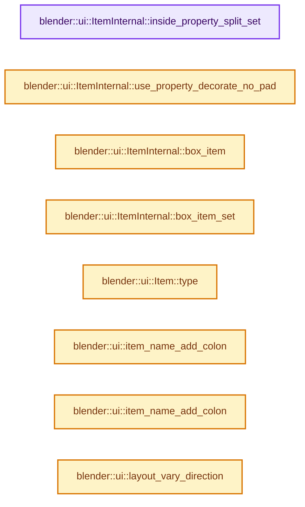

# 实现依赖专题：source/blender/editors/interface/interface_layout.cc

[实现依赖导航](../../../README.md) · [符号索引](../../../../00-课程指南/02-源码与提交索引/符号依赖与实现索引.md)

本专题从正文实际调用进入，集中保存共享实现。函数有稳定锚点，可从调用处直接跳到对应完整函数；递归与互相调用通过回链组织。

## 本文件的实现关系




<a id="m-2db9cf314487"></a>

## 宏 `UI_OPERATOR_ERROR_RET`

<!-- annotated:708710fd5a192d -->

```cpp
#define UI_OPERATOR_ERROR_RET(_ot, _opname, _caller_fn_name) \
  if (ot == nullptr) { \
    item_disabled(this, _opname); \
    RNA_warning_bare("%s: '%s' unknown operator", _caller_fn_name, _opname); \
    return {}; \
  } \
  (void)0

```

<details>
<summary>核对原始源码：source/blender/editors/interface/interface_layout.cc · L73—L80</summary>

<!-- original:708710fd5a192d:source/blender/editors/interface/interface_layout.cc:73:80 -->

```cpp
#define UI_OPERATOR_ERROR_RET(_ot, _opname, _caller_fn_name) \
  if (ot == nullptr) { \
    item_disabled(this, _opname); \
    RNA_warning_bare("%s: '%s' unknown operator", _caller_fn_name, _opname); \
    return {}; \
  } \
  (void)0

```

</details>

宏在预处理阶段展开，参数替换、重复求值和条件编译应直接从该定义检查。与普通函数不同，宏不会自动提供参数类型检查；构建配置选择哪个定义需结合外围条件。

## 完整成员与函数实现

<a id="f-8507437a9fb75fe5"></a>

### `blender::ui::ItemInternal::inside_property_split_set`

实现位置：[source/blender/editors/interface/interface_layout.cc](../../../../../../../../source/blender/editors/interface/interface_layout.cc) · L146—L149。

接口参数：

- `Item *item`
- `bool inside_prop_sep`

**教学注释版**

<!-- annotated:62318bdf9836a1 -->

```cpp
  static void inside_property_split_set(Item *item, bool inside_prop_sep)
  {
    SET_FLAG_FROM_TEST(item->flag_, inside_prop_sep, ItemInternalFlag::InsidePropSep);
  }
```

<details>
<summary>核对原始源码：source/blender/editors/interface/interface_layout.cc · L146—L149</summary>

<!-- original:62318bdf9836a1:source/blender/editors/interface/interface_layout.cc:146:149 -->

```cpp
  static void inside_property_split_set(Item *item, bool inside_prop_sep)
  {
    SET_FLAG_FROM_TEST(item->flag_, inside_prop_sep, ItemInternalFlag::InsidePropSep);
  }
```

</details>

**继续追踪实现**

- `SET_FLAG_FROM_TEST` → [SET_FLAG_FROM_TEST · L557](../../../01-BLI基础库/BLI_utildefines.hh.md#m-8e0dc83e01a8)。宏定义由构建条件选择。

<a id="f-46bc83f8b640d3f0"></a>

### `blender::ui::ItemInternal::use_property_decorate_no_pad`

实现位置：[source/blender/editors/interface/interface_layout.cc](../../../../../../../../source/blender/editors/interface/interface_layout.cc) · L151—L154。

接口参数：

- `const Item *item`

**教学注释版**

<!-- annotated:9c856c2edbf8f6 -->

```cpp
  [[nodiscard]] static bool use_property_decorate_no_pad(const Item *item)
  {
    return flag_is_set(item->flag_, ItemInternalFlag::PropDecorateNoPad);
  };
```

<details>
<summary>核对原始源码：source/blender/editors/interface/interface_layout.cc · L151—L154</summary>

<!-- original:9c856c2edbf8f6:source/blender/editors/interface/interface_layout.cc:151:154 -->

```cpp
  [[nodiscard]] static bool use_property_decorate_no_pad(const Item *item)
  {
    return flag_is_set(item->flag_, ItemInternalFlag::PropDecorateNoPad);
  };
```

</details>

**结果出口**

- `return flag_is_set(item->flag_, ItemInternalFlag::PropDecorateNoPad);`

**继续追踪实现**

- `flag_is_set` → [调用协议](../../../../00-课程指南/01-路线与规范/模板宏与动态分派协议.md)：函数指针、局部可调用对象或未展开的宏；必须结合调用者环境。调用位置L153。

<a id="f-cf57d6dac77d48c8"></a>

### `blender::ui::ItemInternal::box_item`

实现位置：[source/blender/editors/interface/interface_layout.cc](../../../../../../../../source/blender/editors/interface/interface_layout.cc) · L156—L159。

接口参数：

- `const Item *item`

**教学注释版**

<!-- annotated:d3871f1c81ccad -->

```cpp
  [[nodiscard]] static bool box_item(const Item *item)
  {
    return flag_is_set(item->flag_, ItemInternalFlag::BoxItem);
  }
```

<details>
<summary>核对原始源码：source/blender/editors/interface/interface_layout.cc · L156—L159</summary>

<!-- original:d3871f1c81ccad:source/blender/editors/interface/interface_layout.cc:156:159 -->

```cpp
  [[nodiscard]] static bool box_item(const Item *item)
  {
    return flag_is_set(item->flag_, ItemInternalFlag::BoxItem);
  }
```

</details>

**结果出口**

- `return flag_is_set(item->flag_, ItemInternalFlag::BoxItem);`

**继续追踪实现**

- `flag_is_set` → [调用协议](../../../../00-课程指南/01-路线与规范/模板宏与动态分派协议.md)：函数指针、局部可调用对象或未展开的宏；必须结合调用者环境。调用位置L158。

<a id="f-11898ad960852a36"></a>

### `blender::ui::ItemInternal::box_item_set`

实现位置：[source/blender/editors/interface/interface_layout.cc](../../../../../../../../source/blender/editors/interface/interface_layout.cc) · L160—L163。

接口参数：

- `Item *item`
- `bool box_item`

**教学注释版**

<!-- annotated:e31d6626cd5df5 -->

```cpp
  static void box_item_set(Item *item, bool box_item)
  {
    SET_FLAG_FROM_TEST(item->flag_, box_item, ItemInternalFlag::BoxItem);
  }
```

<details>
<summary>核对原始源码：source/blender/editors/interface/interface_layout.cc · L160—L163</summary>

<!-- original:e31d6626cd5df5:source/blender/editors/interface/interface_layout.cc:160:163 -->

```cpp
  static void box_item_set(Item *item, bool box_item)
  {
    SET_FLAG_FROM_TEST(item->flag_, box_item, ItemInternalFlag::BoxItem);
  }
```

</details>

**继续追踪实现**

- `SET_FLAG_FROM_TEST` → [SET_FLAG_FROM_TEST · L557](../../../01-BLI基础库/BLI_utildefines.hh.md#m-8e0dc83e01a8)。宏定义由构建条件选择。

<a id="f-aa481312649de317"></a>

### `blender::ui::Item::type`

实现位置：[source/blender/editors/interface/interface_layout.cc](../../../../../../../../source/blender/editors/interface/interface_layout.cc) · L194—L197。

**教学注释版**

<!-- annotated:e66f2fa1bf2fb0 -->

```cpp
ItemType Item::type() const
{
  return type_;
};
```

<details>
<summary>核对原始源码：source/blender/editors/interface/interface_layout.cc · L194—L197</summary>

<!-- original:e66f2fa1bf2fb0:source/blender/editors/interface/interface_layout.cc:194:197 -->

```cpp
ItemType Item::type() const
{
  return type_;
};
```

</details>

**结果出口**

- `return type_;`

**继续追踪实现**

本实现没有需要继续展开的显式调用；检查返回表达式、对象转换和调用者前置条件。

<a id="f-202fa6c49424dbab"></a>

### `blender::ui::item_name_add_colon`

实现位置：[source/blender/editors/interface/interface_layout.cc](../../../../../../../../source/blender/editors/interface/interface_layout.cc) · L322—L334。

接口参数：

- `StringRef name`
- `char namestr[UI_MAX_NAME_STR]`

**教学注释版**

<!-- annotated:8e04d63e2f4d84 -->

```cpp
static StringRef item_name_add_colon(StringRef name, char namestr[UI_MAX_NAME_STR])
{
  const int len = name.size();

  if (len != 0 && len + 1 < UI_MAX_NAME_STR) {
    // [讲解] memcpy：复制字节，源与目标不应重叠。类型生命周期、对齐和可复制表示须由调用者证明，不是任意对象的复制构造。
    memcpy(namestr, name.data(), len);
    namestr[len] = ':';
    namestr[len + 1] = '\0';
    return namestr;
  }

  return name;
}
```

<details>
<summary>核对原始源码：source/blender/editors/interface/interface_layout.cc · L322—L334</summary>

<!-- original:8e04d63e2f4d84:source/blender/editors/interface/interface_layout.cc:322:334 -->

```cpp
static StringRef item_name_add_colon(StringRef name, char namestr[UI_MAX_NAME_STR])
{
  const int len = name.size();

  if (len != 0 && len + 1 < UI_MAX_NAME_STR) {
    memcpy(namestr, name.data(), len);
    namestr[len] = ':';
    namestr[len + 1] = '\0';
    return namestr;
  }

  return name;
}
```

</details>

**沿实际写入检查状态**

- `namestr[len] = ':';`

**结果出口**

- `return namestr;`
- `return name;`

**继续追踪实现**

- `name.size` → [blender::ui::Item::size · L480](interface_layout.cc.md#f-8a41e6d2d9e32851)；[blender::ui::Layout::size · L494](interface_layout.cc.md#f-81377b9c1286eb5d)。同名重载需按实参类型选择。
- `memcpy` → [外部契约](https://eel.is/c++draft/cstring.syn)：复制字节，源与目标不应重叠。类型生命周期、对齐和可复制表示须由调用者证明，不是任意对象的复制构造。
- `name.data` → [调用协议](../../../../00-课程指南/01-路线与规范/模板宏与动态分派协议.md)：由接收对象具体类型或运行时策略提供实现。调用位置L327。

<a id="f-b0baada42c411ded"></a>

### `blender::ui::item_name_add_colon`

实现位置：[source/blender/editors/interface/interface_layout.cc](../../../../../../../../source/blender/editors/interface/interface_layout.cc) · L336—L348。

接口参数：

- `StringRefNull name`
- `char namestr[UI_MAX_NAME_STR]`

**教学注释版**

<!-- annotated:cc46f2339cd070 -->

```cpp
static StringRefNull item_name_add_colon(StringRefNull name, char namestr[UI_MAX_NAME_STR])
{
  const int len = name.size();

  if (len != 0 && len + 1 < UI_MAX_NAME_STR) {
    // [讲解] memcpy：复制字节，源与目标不应重叠。类型生命周期、对齐和可复制表示须由调用者证明，不是任意对象的复制构造。
    memcpy(namestr, name.data(), len);
    namestr[len] = ':';
    namestr[len + 1] = '\0';
    return namestr;
  }

  return name;
}
```

<details>
<summary>核对原始源码：source/blender/editors/interface/interface_layout.cc · L336—L348</summary>

<!-- original:cc46f2339cd070:source/blender/editors/interface/interface_layout.cc:336:348 -->

```cpp
static StringRefNull item_name_add_colon(StringRefNull name, char namestr[UI_MAX_NAME_STR])
{
  const int len = name.size();

  if (len != 0 && len + 1 < UI_MAX_NAME_STR) {
    memcpy(namestr, name.data(), len);
    namestr[len] = ':';
    namestr[len + 1] = '\0';
    return namestr;
  }

  return name;
}
```

</details>

**沿实际写入检查状态**

- `namestr[len] = ':';`

**结果出口**

- `return namestr;`
- `return name;`

**继续追踪实现**

- `name.size` → [blender::ui::Item::size · L480](interface_layout.cc.md#f-8a41e6d2d9e32851)；[blender::ui::Layout::size · L494](interface_layout.cc.md#f-81377b9c1286eb5d)。同名重载需按实参类型选择。
- `memcpy` → [外部契约](https://eel.is/c++draft/cstring.syn)：复制字节，源与目标不应重叠。类型生命周期、对齐和可复制表示须由调用者证明，不是任意对象的复制构造。
- `name.data` → [调用协议](../../../../00-课程指南/01-路线与规范/模板宏与动态分派协议.md)：由接收对象具体类型或运行时策略提供实现。调用位置L341。

<a id="f-9fe1541209a454a0"></a>

### `blender::ui::layout_vary_direction`

实现位置：[source/blender/editors/interface/interface_layout.cc](../../../../../../../../source/blender/editors/interface/interface_layout.cc) · L391—L397。

接口参数：

- `Layout *layout`

**教学注释版**

<!-- annotated:d54f4764b1718a -->

```cpp
static int layout_vary_direction(Layout *layout)
{
  return ((ELEM(layout->root()->type, LayoutType::Header, LayoutType::PieMenu) ||
           (layout->alignment() != LayoutAlign::Expand)) ?
              UI_ITEM_VARY_X :
              UI_ITEM_VARY_Y);
}
```

<details>
<summary>核对原始源码：source/blender/editors/interface/interface_layout.cc · L391—L397</summary>

<!-- original:d54f4764b1718a:source/blender/editors/interface/interface_layout.cc:391:397 -->

```cpp
static int layout_vary_direction(Layout *layout)
{
  return ((ELEM(layout->root()->type, LayoutType::Header, LayoutType::PieMenu) ||
           (layout->alignment() != LayoutAlign::Expand)) ?
              UI_ITEM_VARY_X :
              UI_ITEM_VARY_Y);
}
```

</details>

**结果出口**

- `return ((ELEM(layout->root()->type, LayoutType::Header, LayoutType::PieMenu) ||`

**继续追踪实现**

- `ELEM` → [ELEM · L88](../../../07-Intern运行时与平台/ghost/intern/GHOST_utildefines.hh.md#m-d28724a15928)；[ELEM · L135](../../../01-BLI基础库/BLI_utildefines.hh.md#m-d6572de7cae0)。宏定义由构建条件选择。
- `layout->root` → [blender::ui::Layout::root · L6598](interface_layout.cc.md#f-2063a07e04ccfbbb)。
- `layout->alignment` → [blender::ui::Layout::alignment · L801](../include/UI_interface_layout.hh.md#f-f41a0a1aeb21e92d)。

<a id="f-bd9e8f64606aa93e"></a>

### `blender::ui::layout_variable_size`

实现位置：[source/blender/editors/interface/interface_layout.cc](../../../../../../../../source/blender/editors/interface/interface_layout.cc) · L399—L405。

接口参数：

- `Layout *layout`

**教学注释版**

<!-- annotated:9d594f47099c6f -->

```cpp
static bool layout_variable_size(Layout *layout)
{
  /* Note that this code is probably a bit unreliable, we'd probably want to know whether it's
   * variable in X and/or Y, etc. But for now it mimics previous one,
   * with addition of variable flag set for children of grid-flow layouts. */
  return layout_vary_direction(layout) == UI_ITEM_VARY_X || layout->variable_size();
}
```

<details>
<summary>核对原始源码：source/blender/editors/interface/interface_layout.cc · L399—L405</summary>

<!-- original:9d594f47099c6f:source/blender/editors/interface/interface_layout.cc:399:405 -->

```cpp
static bool layout_variable_size(Layout *layout)
{
  /* Note that this code is probably a bit unreliable, we'd probably want to know whether it's
   * variable in X and/or Y, etc. But for now it mimics previous one,
   * with addition of variable flag set for children of grid-flow layouts. */
  return layout_vary_direction(layout) == UI_ITEM_VARY_X || layout->variable_size();
}
```

</details>

**结果出口**

- `return layout_vary_direction(layout) == UI_ITEM_VARY_X || layout->variable_size();`

**继续追踪实现**

- `layout_vary_direction` → [blender::ui::layout_vary_direction · L391](interface_layout.cc.md#f-9fe1541209a454a0)。
- `layout->variable_size` → [blender::ui::Layout::variable_size · L6626](interface_layout.cc.md#f-3945596344df3e28)。

<a id="f-07eafd5450d8846e"></a>

### `blender::ui::text_icon_width_ex`

实现位置：[source/blender/editors/interface/interface_layout.cc](../../../../../../../../source/blender/editors/interface/interface_layout.cc) · L436—L469。

接口参数：

- `Layout *layout`
- `const StringRef name`
- `int icon`
- `const TextIconPadFactor &pad_factor`
- `const uiFontStyle *fstyle`

**教学注释版**

<!-- annotated:6a3e7407784a03 -->

```cpp
static int text_icon_width_ex(Layout *layout,
                              const StringRef name,
                              int icon,
                              const TextIconPadFactor &pad_factor,
                              const uiFontStyle *fstyle)
{
  const int unit_x = UI_UNIT_X * (layout->scale_x() ? layout->scale_x() : 1.0f);

  /* When there is no text, always behave as if this is an icon-only button
   * since it's not useful to return empty space. */
  if (icon && name.is_empty()) {
    return unit_x * (1.0f + pad_factor.icon_only);
  }

  if (layout_variable_size(layout)) {
    if (!icon && name.is_empty()) {
      return unit_x * (1.0f + pad_factor.icon_only);
    }

    if (layout->alignment() != LayoutAlign::Expand) {
      layout->fixed_size_set(true);
    }

    float margin = pad_factor.text;
    if (icon) {
      margin += pad_factor.icon;
    }

    const float aspect = layout->block()->aspect;
    return fontstyle_string_width_with_block_aspect(fstyle, name, aspect) +
           int(ceilf(unit_x * margin));
  }
  return unit_x * 10;
}
```

<details>
<summary>核对原始源码：source/blender/editors/interface/interface_layout.cc · L436—L469</summary>

<!-- original:6a3e7407784a03:source/blender/editors/interface/interface_layout.cc:436:469 -->

```cpp
static int text_icon_width_ex(Layout *layout,
                              const StringRef name,
                              int icon,
                              const TextIconPadFactor &pad_factor,
                              const uiFontStyle *fstyle)
{
  const int unit_x = UI_UNIT_X * (layout->scale_x() ? layout->scale_x() : 1.0f);

  /* When there is no text, always behave as if this is an icon-only button
   * since it's not useful to return empty space. */
  if (icon && name.is_empty()) {
    return unit_x * (1.0f + pad_factor.icon_only);
  }

  if (layout_variable_size(layout)) {
    if (!icon && name.is_empty()) {
      return unit_x * (1.0f + pad_factor.icon_only);
    }

    if (layout->alignment() != LayoutAlign::Expand) {
      layout->fixed_size_set(true);
    }

    float margin = pad_factor.text;
    if (icon) {
      margin += pad_factor.icon;
    }

    const float aspect = layout->block()->aspect;
    return fontstyle_string_width_with_block_aspect(fstyle, name, aspect) +
           int(ceilf(unit_x * margin));
  }
  return unit_x * 10;
}
```

</details>

**沿实际写入检查状态**

- `margin += pad_factor.icon;`

**结果出口**

- `return unit_x * (1.0f + pad_factor.icon_only);`
- `return fontstyle_string_width_with_block_aspect(fstyle, name, aspect) +`
- `return unit_x * 10;`

**继续追踪实现**

- `layout->scale_x` → [blender::ui::Layout::scale_x · L843](../include/UI_interface_layout.hh.md#f-ac68f12cf1ee83da)。
- `name.is_empty` → [调用协议](../../../../00-课程指南/01-路线与规范/模板宏与动态分派协议.md)：由接收对象具体类型或运行时策略提供实现。调用位置L446。
- `layout_variable_size` → [blender::ui::layout_variable_size · L399](interface_layout.cc.md#f-bd9e8f64606aa93e)。
- `layout->alignment` → [blender::ui::Layout::alignment · L801](../include/UI_interface_layout.hh.md#f-f41a0a1aeb21e92d)。
- `layout->fixed_size_set` → [blender::ui::Item::fixed_size_set · L6061](interface_layout.cc.md#f-9a7b3faf2cd935e1)。
- `layout->block` → [blender::ui::Layout::block · L5954](interface_layout.cc.md#f-b9334360b99e3b66)。
- `fontstyle_string_width_with_block_aspect` → [blender::ui::fontstyle_string_width_with_block_aspect · L457](interface_style.cc.md#f-cd38642759d7341b)。
- `ceilf` → [ceilf · L19](../../../07-Intern运行时与平台/cycles/kernel/svm/radial_tiling_shared.h.md#m-30f54371dd32)；[ceilf · L41](../../../07-Intern运行时与平台/cycles/kernel/svm/radial_tiling_shared.h.md#m-227f233ea8b8)；[ceilf · L72](../../../07-Intern运行时与平台/cycles/kernel/svm/radial_tiling_shared.h.md#m-093dc1c96d76)；[ceilf · L23](../../../01-BLI基础库/intern/radial_tiling_shared.hh.md#m-d2cb70ab3380)；[ceilf · L45](../../../01-BLI基础库/intern/radial_tiling_shared.hh.md#m-e7bc3f4e92a8)；[ceilf · L76](../../../01-BLI基础库/intern/radial_tiling_shared.hh.md#m-3815d2ca4ed1)；[ceilf · L19](../../../07-Intern运行时与平台/cycles/kernel/osl/shaders/node_radial_tiling_shared.h.md#m-392d4a61825d)；[ceilf · L41](../../../07-Intern运行时与平台/cycles/kernel/osl/shaders/node_radial_tiling_shared.h.md#m-6bc83db21146)；[ceilf · L72](../../../07-Intern运行时与平台/cycles/kernel/osl/shaders/node_radial_tiling_shared.h.md#m-3cb77b1f59b4)；[ceilf · L173](../../../07-Intern运行时与平台/cycles/kernel/device/oneapi/compat.h.md#m-8b19a4af8ed1)；[ceilf · L271](../../../07-Intern运行时与平台/cycles/kernel/device/metal/compat.h.md#m-95cb074a923c)；[ceilf · L50](../../gpu/GPU_shader_shared_utils.hh.md#m-9a3148f04496)；[ceilf · L71](../../gpu/GPU_shader_shared_utils.hh.md#m-a5269177f54f)。宏定义由构建条件选择。

<a id="f-77d94b08bad73024"></a>

### `blender::ui::text_icon_width`

实现位置：[source/blender/editors/interface/interface_layout.cc](../../../../../../../../source/blender/editors/interface/interface_layout.cc) · L471—L478。

接口参数：

- `Layout *layout`
- `const StringRef name`
- `const int icon`
- `const bool compact`

**教学注释版**

<!-- annotated:1375d4159d54c9 -->

```cpp
static int text_icon_width(Layout *layout,
                           const StringRef name,
                           const int icon,
                           const bool compact)
{
  return text_icon_width_ex(
      layout, name, icon, compact ? text_pad_compact : text_pad_default, UI_FSTYLE_WIDGET);
}
```

<details>
<summary>核对原始源码：source/blender/editors/interface/interface_layout.cc · L471—L478</summary>

<!-- original:1375d4159d54c9:source/blender/editors/interface/interface_layout.cc:471:478 -->

```cpp
static int text_icon_width(Layout *layout,
                           const StringRef name,
                           const int icon,
                           const bool compact)
{
  return text_icon_width_ex(
      layout, name, icon, compact ? text_pad_compact : text_pad_default, UI_FSTYLE_WIDGET);
}
```

</details>

**结果出口**

- `return text_icon_width_ex(`

**继续追踪实现**

- `text_icon_width_ex` → [blender::ui::text_icon_width_ex · L436](interface_layout.cc.md#f-07eafd5450d8846e)。

<a id="f-8a41e6d2d9e32851"></a>

### `blender::ui::Item::size`

实现位置：[source/blender/editors/interface/interface_layout.cc](../../../../../../../../source/blender/editors/interface/interface_layout.cc) · L480—L487。

**教学注释版**

<!-- annotated:939bf05d8ac1eb -->

```cpp
int2 Item::size() const
{
  if (this->type() == ItemType::Button) {
    const ButtonItem *bitem = static_cast<const ButtonItem *>(this);
    return {int(BLI_rctf_size_x(&bitem->but->rect)), int(BLI_rctf_size_y(&bitem->but->rect))};
  }
  return static_cast<const Layout *>(this)->size();
}
```

<details>
<summary>核对原始源码：source/blender/editors/interface/interface_layout.cc · L480—L487</summary>

<!-- original:939bf05d8ac1eb:source/blender/editors/interface/interface_layout.cc:480:487 -->

```cpp
int2 Item::size() const
{
  if (this->type() == ItemType::Button) {
    const ButtonItem *bitem = static_cast<const ButtonItem *>(this);
    return {int(BLI_rctf_size_x(&bitem->but->rect)), int(BLI_rctf_size_y(&bitem->but->rect))};
  }
  return static_cast<const Layout *>(this)->size();
}
```

</details>

**结果出口**

- `return {int(BLI_rctf_size_x(&bitem->but->rect)), int(BLI_rctf_size_y(&bitem->but->rect))};`
- `return static_cast<const Layout *>(this)->size();`

**继续追踪实现**

- `this->type` → [blender::ui::Item::type · L194](interface_layout.cc.md#f-aa481312649de317)。
- `BLI_rctf_size_x` → [blender::BLI_rctf_size_x · L211](../../../01-BLI基础库/BLI_rect.hh.md#f-017b86a9d189e3ba)。
- `BLI_rctf_size_y` → [blender::BLI_rctf_size_y · L215](../../../01-BLI基础库/BLI_rect.hh.md#f-6d179bc3c1b71b0e)。
- `static_cast<const Layout *>(this)->size` → [调用协议](../../../../00-课程指南/01-路线与规范/模板宏与动态分派协议.md)：接收对象类型依赖auto、返回值或模板实例；不按同名猜测目标。调用位置L486。

<a id="f-c1d84452d6bf1cd1"></a>

### `blender::ui::Layout::offset`

实现位置：[source/blender/editors/interface/interface_layout.cc](../../../../../../../../source/blender/editors/interface/interface_layout.cc) · L489—L492。

**教学注释版**

<!-- annotated:10ba90dee50700 -->

```cpp
int2 Layout::offset() const
{
  return {x_, y_};
}
```

<details>
<summary>核对原始源码：source/blender/editors/interface/interface_layout.cc · L489—L492</summary>

<!-- original:10ba90dee50700:source/blender/editors/interface/interface_layout.cc:489:492 -->

```cpp
int2 Layout::offset() const
{
  return {x_, y_};
}
```

</details>

**结果出口**

- `return {x_, y_};`

**继续追踪实现**

本实现没有需要继续展开的显式调用；检查返回表达式、对象转换和调用者前置条件。

<a id="f-81377b9c1286eb5d"></a>

### `blender::ui::Layout::size`

实现位置：[source/blender/editors/interface/interface_layout.cc](../../../../../../../../source/blender/editors/interface/interface_layout.cc) · L494—L497。

**教学注释版**

<!-- annotated:8b5b6427843206 -->

```cpp
int2 Layout::size() const
{
  return {w_, h_};
}
```

<details>
<summary>核对原始源码：source/blender/editors/interface/interface_layout.cc · L494—L497</summary>

<!-- original:8b5b6427843206:source/blender/editors/interface/interface_layout.cc:494:497 -->

```cpp
int2 Layout::size() const
{
  return {w_, h_};
}
```

</details>

**结果出口**

- `return {w_, h_};`

**继续追踪实现**

本实现没有需要继续展开的显式调用；检查返回表达式、对象转换和调用者前置条件。

<a id="f-322f6e5b75598517"></a>

### `blender::ui::item_position`

实现位置：[source/blender/editors/interface/interface_layout.cc](../../../../../../../../source/blender/editors/interface/interface_layout.cc) · L508—L523。

接口参数：

- `Item *item`
- `const int x`
- `const int y`
- `const int w`
- `const int h`

**教学注释版**

<!-- annotated:d96d7eaa29a201 -->

```cpp
static void item_position(Item *item, const int x, const int y, const int w, const int h)
{
  if (item->type() == ItemType::Button) {
    ButtonItem *bitem = static_cast<ButtonItem *>(item);

    bitem->but->rect.xmin = x;
    bitem->but->rect.ymin = y;
    bitem->but->rect.xmax = x + w;
    bitem->but->rect.ymax = y + h;

    button_update(bitem->but); /* For `strlen`. */
  }
  else {
    LayoutInternal::layout_offset_size_set(static_cast<Layout *>(item), x, y + h, w, h);
  }
}
```

<details>
<summary>核对原始源码：source/blender/editors/interface/interface_layout.cc · L508—L523</summary>

<!-- original:d96d7eaa29a201:source/blender/editors/interface/interface_layout.cc:508:523 -->

```cpp
static void item_position(Item *item, const int x, const int y, const int w, const int h)
{
  if (item->type() == ItemType::Button) {
    ButtonItem *bitem = static_cast<ButtonItem *>(item);

    bitem->but->rect.xmin = x;
    bitem->but->rect.ymin = y;
    bitem->but->rect.xmax = x + w;
    bitem->but->rect.ymax = y + h;

    button_update(bitem->but); /* For `strlen`. */
  }
  else {
    LayoutInternal::layout_offset_size_set(static_cast<Layout *>(item), x, y + h, w, h);
  }
}
```

</details>

**沿实际写入检查状态**

- `bitem->but->rect.xmin = x;`
- `bitem->but->rect.ymin = y;`
- `bitem->but->rect.xmax = x + w;`
- `bitem->but->rect.ymax = y + h;`

**继续追踪实现**

- `item->type` → [blender::ui::Item::type · L194](interface_layout.cc.md#f-aa481312649de317)。
- `button_update` → [blender::ui::button_update · L4395](interface.cc.md#f-9d3f997a4952204a)。
- `LayoutInternal::layout_offset_size_set` → [blender::ui::LayoutInternal::layout_offset_size_set · L525](interface_layout.cc.md#f-8ff46984fdc723dc)。

<a id="f-8ff46984fdc723dc"></a>

### `blender::ui::LayoutInternal::layout_offset_size_set`

实现位置：[source/blender/editors/interface/interface_layout.cc](../../../../../../../../source/blender/editors/interface/interface_layout.cc) · L525—L531。

接口参数：

- `Layout *layout`
- `int x`
- `int y`
- `int w`
- `int h`

**教学注释版**

<!-- annotated:5acc9468554217 -->

```cpp
void LayoutInternal::layout_offset_size_set(Layout *layout, int x, int y, int w, int h)
{
  layout->x_ = x;
  layout->y_ = y;
  layout->w_ = w;
  layout->h_ = h;
}
```

<details>
<summary>核对原始源码：source/blender/editors/interface/interface_layout.cc · L525—L531</summary>

<!-- original:5acc9468554217:source/blender/editors/interface/interface_layout.cc:525:531 -->

```cpp
void LayoutInternal::layout_offset_size_set(Layout *layout, int x, int y, int w, int h)
{
  layout->x_ = x;
  layout->y_ = y;
  layout->w_ = w;
  layout->h_ = h;
}
```

</details>

**沿实际写入检查状态**

- `layout->x_ = x;`
- `layout->y_ = y;`
- `layout->w_ = w;`
- `layout->h_ = h;`

**继续追踪实现**

本实现没有需要继续展开的显式调用；检查返回表达式、对象转换和调用者前置条件。

<a id="f-b854786b7ba26dbd"></a>

### `blender::ui::LayoutInternal::layout_translate_y`

实现位置：[source/blender/editors/interface/interface_layout.cc](../../../../../../../../source/blender/editors/interface/interface_layout.cc) · L533—L536。

接口参数：

- `Layout *layout`
- `int delta`

**教学注释版**

<!-- annotated:f28124d3bf43f6 -->

```cpp
void LayoutInternal::layout_translate_y(Layout *layout, int delta)
{
  layout->y_ += delta;
}
```

<details>
<summary>核对原始源码：source/blender/editors/interface/interface_layout.cc · L533—L536</summary>

<!-- original:f28124d3bf43f6:source/blender/editors/interface/interface_layout.cc:533:536 -->

```cpp
void LayoutInternal::layout_translate_y(Layout *layout, int delta)
{
  layout->y_ += delta;
}
```

</details>

**沿实际写入检查状态**

- `layout->y_ += delta;`

**继续追踪实现**

本实现没有需要继续展开的显式调用；检查返回表达式、对象转换和调用者前置条件。

<a id="f-4c6ef100d850d8f0"></a>

### `blender::ui::item_translate_y`

实现位置：[source/blender/editors/interface/interface_layout.cc](../../../../../../../../source/blender/editors/interface/interface_layout.cc) · L538—L556。

接口参数：

- `Item *item`
- `const int delta`

**教学注释版**

<!-- annotated:0c75730036de57 -->

```cpp
static void item_translate_y(Item *item, const int delta)
{
  if (delta == 0) {
    /* Early return for recursive calls. */
    return;
  }
  if (item->type() == ItemType::Button) {
    const auto *bitem = static_cast<const ButtonItem *>(item);
    bitem->but->rect.ymin += delta;
    bitem->but->rect.ymax += delta;
  }
  else {
    auto *layout = static_cast<Layout *>(item);
    LayoutInternal::layout_translate_y(layout, delta);
    for (Item *sub : layout->items()) {
      item_translate_y(sub, delta);
    }
  }
}
```

<details>
<summary>核对原始源码：source/blender/editors/interface/interface_layout.cc · L538—L556</summary>

<!-- original:0c75730036de57:source/blender/editors/interface/interface_layout.cc:538:556 -->

```cpp
static void item_translate_y(Item *item, const int delta)
{
  if (delta == 0) {
    /* Early return for recursive calls. */
    return;
  }
  if (item->type() == ItemType::Button) {
    const auto *bitem = static_cast<const ButtonItem *>(item);
    bitem->but->rect.ymin += delta;
    bitem->but->rect.ymax += delta;
  }
  else {
    auto *layout = static_cast<Layout *>(item);
    LayoutInternal::layout_translate_y(layout, delta);
    for (Item *sub : layout->items()) {
      item_translate_y(sub, delta);
    }
  }
}
```

</details>

**沿实际写入检查状态**

- `bitem->but->rect.ymin += delta;`
- `bitem->but->rect.ymax += delta;`

**继续追踪实现**

- `item->type` → [blender::ui::Item::type · L194](interface_layout.cc.md#f-aa481312649de317)。
- `LayoutInternal::layout_translate_y` → [blender::ui::LayoutInternal::layout_translate_y · L533](interface_layout.cc.md#f-b854786b7ba26dbd)。
- `layout->items` → [调用协议](../../../../00-课程指南/01-路线与规范/模板宏与动态分派协议.md)：接收对象类型依赖auto、返回值或模板实例；不按同名猜测目标。调用位置L552。
- `item_translate_y` → [blender::ui::item_translate_y · L538](interface_layout.cc.md#f-4c6ef100d850d8f0)。

<a id="f-b3bf0d82072c01f5"></a>

### `blender::ui::LayoutInternal::layout_space_set`

实现位置：[source/blender/editors/interface/interface_layout.cc](../../../../../../../../source/blender/editors/interface/interface_layout.cc) · L583—L586。

接口参数：

- `Layout *layout`
- `int space`

**教学注释版**

<!-- annotated:33e49661a971a4 -->

```cpp
void LayoutInternal::layout_space_set(Layout *layout, int space)
{
  layout->space_ = space;
}
```

<details>
<summary>核对原始源码：source/blender/editors/interface/interface_layout.cc · L583—L586</summary>

<!-- original:33e49661a971a4:source/blender/editors/interface/interface_layout.cc:583:586 -->

```cpp
void LayoutInternal::layout_space_set(Layout *layout, int space)
{
  layout->space_ = space;
}
```

</details>

**沿实际写入检查状态**

- `layout->space_ = space;`

**继续追踪实现**

本实现没有需要继续展开的显式调用；检查返回表达式、对象转换和调用者前置条件。

<a id="f-35158c02318bb650"></a>

### `blender::ui::Layout::local_direction`

实现位置：[source/blender/editors/interface/interface_layout.cc](../../../../../../../../source/blender/editors/interface/interface_layout.cc) · L599—L617。

**教学注释版**

<!-- annotated:08edff907dba68 -->

```cpp
LayoutDirection Layout::local_direction() const
{
  switch (this->type()) {
    case ItemType::LayoutRoot:
    case ItemType::LayoutRow:
    case ItemType::LayoutOverlap:
    case ItemType::LayoutPanelHeader:
    case ItemType::LayoutGridFlow:
      return LayoutDirection::Horizontal;
    case ItemType::LayoutColumn:
    case ItemType::LayoutColumnFlow:
    case ItemType::LayoutSplit:
    case ItemType::LayoutAbsolute:
    case ItemType::LayoutBox:
    case ItemType::LayoutPanelBody:
    default:
      return LayoutDirection::Vertical;
  }
}
```

<details>
<summary>核对原始源码：source/blender/editors/interface/interface_layout.cc · L599—L617</summary>

<!-- original:08edff907dba68:source/blender/editors/interface/interface_layout.cc:599:617 -->

```cpp
LayoutDirection Layout::local_direction() const
{
  switch (this->type()) {
    case ItemType::LayoutRoot:
    case ItemType::LayoutRow:
    case ItemType::LayoutOverlap:
    case ItemType::LayoutPanelHeader:
    case ItemType::LayoutGridFlow:
      return LayoutDirection::Horizontal;
    case ItemType::LayoutColumn:
    case ItemType::LayoutColumnFlow:
    case ItemType::LayoutSplit:
    case ItemType::LayoutAbsolute:
    case ItemType::LayoutBox:
    case ItemType::LayoutPanelBody:
    default:
      return LayoutDirection::Vertical;
  }
}
```

</details>

**结果出口**

- `return LayoutDirection::Horizontal;`
- `return LayoutDirection::Vertical;`

**继续追踪实现**

- `this->type` → [blender::ui::Item::type · L194](interface_layout.cc.md#f-aa481312649de317)。

<a id="f-0406b4107e07a85b"></a>

### `blender::ui::item_local_sublayout`

实现位置：[source/blender/editors/interface/interface_layout.cc](../../../../../../../../source/blender/editors/interface/interface_layout.cc) · L619—L631。

接口参数：

- `Layout *test`
- `Layout *layout`
- `bool align`

**教学注释版**

<!-- annotated:5d007cf3aa46dc -->

```cpp
static Layout *item_local_sublayout(Layout *test, Layout *layout, bool align)
{
  Layout *sub;
  if (test->local_direction() == LayoutDirection::Horizontal) {
    sub = &layout->row(align);
  }
  else {
    sub = &layout->column(align);
  }

  LayoutInternal::layout_space_set(sub, 0);
  return sub;
}
```

<details>
<summary>核对原始源码：source/blender/editors/interface/interface_layout.cc · L619—L631</summary>

<!-- original:5d007cf3aa46dc:source/blender/editors/interface/interface_layout.cc:619:631 -->

```cpp
static Layout *item_local_sublayout(Layout *test, Layout *layout, bool align)
{
  Layout *sub;
  if (test->local_direction() == LayoutDirection::Horizontal) {
    sub = &layout->row(align);
  }
  else {
    sub = &layout->column(align);
  }

  LayoutInternal::layout_space_set(sub, 0);
  return sub;
}
```

</details>

**沿实际写入检查状态**

- `sub = &layout->row(align);`
- `sub = &layout->column(align);`

**结果出口**

- `return sub;`

**继续追踪实现**

- `test->local_direction` → [blender::ui::Layout::local_direction · L599](interface_layout.cc.md#f-35158c02318bb650)。
- `layout->row` → [blender::ui::Layout::row · L5106](interface_layout.cc.md#f-24ee673b84edc004)；[blender::ui::Layout::row · L5246](interface_layout.cc.md#f-6523ad37239727e7)。同名重载需按实参类型选择。
- `layout->column` → [blender::ui::Layout::column · L5253](interface_layout.cc.md#f-140bcf7b423ed61b)；[blender::ui::Layout::column · L5265](interface_layout.cc.md#f-6f6ab854f102e925)。同名重载需按实参类型选择。
- `LayoutInternal::layout_space_set` → [blender::ui::LayoutInternal::layout_space_set · L583](interface_layout.cc.md#f-b3bf0d82072c01f5)。

<a id="f-acbff7e2eb6a6a78"></a>

### `blender::ui::item_array`

实现位置：[source/blender/editors/interface/interface_layout.cc](../../../../../../../../source/blender/editors/interface/interface_layout.cc) · L660—L868。

接口参数：

- `Layout *layout`
- `Block *block`
- `const StringRef name`
- `int icon`
- `PointerRNA *ptr`
- `PropertyRNA *prop`
- `const int len`
- `int x`
- `const int y`
- `int w`
- `const int`
- `const bool expand`
- `const bool slider`
- `const int toggle`
- `const bool icon_only`
- `const bool compact`
- `const bool show_text`

**教学注释版**

<!-- annotated:4f2655bafb2090 -->

```cpp
static void item_array(Layout *layout,
                       Block *block,
                       const StringRef name,
                       int icon,
                       PointerRNA *ptr,
                       PropertyRNA *prop,
                       const int len,
                       int x,
                       const int y,
                       int w,
                       const int /*h*/,
                       const bool expand,
                       const bool slider,
                       const int toggle,
                       const bool icon_only,
                       const bool compact,
                       const bool show_text)
{
  const uiStyle *style = layout->root()->style;

  /* retrieve type and subtype */
  const PropertyType type = RNA_property_type(prop);
  const PropertySubType subtype = RNA_property_subtype(prop);

  Layout *sub = item_local_sublayout(layout, layout, true);
  block_layout_set_current(block, sub);

  /* create label */
  if (!name.is_empty() && show_text) {
    uiDefBut(block, ButtonType::Label, name, 0, 0, w, UI_UNIT_Y, nullptr, 0.0, 0.0, "");
  }

  /* create buttons */
  if (type == PROP_BOOLEAN && ELEM(subtype, PROP_LAYER, PROP_LAYER_MEMBER)) {
    /* special check for layer layout */
    const int cols = (len >= 20) ? 2 : 1;
    const int colbuts = len / (2 * cols);
    uint layer_used = 0;
    uint layer_active = 0;

    block_layout_set_current(block, &layout->absolute(false));

    const int butw = UI_UNIT_X * 0.75;
    const int buth = UI_UNIT_X * 0.75;

    for (int b = 0; b < cols; b++) {
      block_align_begin(block);

      for (int a = 0; a < colbuts; a++) {
        const int layer_num = a + b * colbuts;
        const uint layer_flag = (1u << layer_num);

        if (layer_used & layer_flag) {
          if (layer_active & layer_flag) {
            icon = ICON_LAYER_ACTIVE;
          }
          else {
            icon = ICON_LAYER_USED;
          }
        }
        else {
          icon = ICON_BLANK1;
        }

        Button *but = uiDefAutoButR(
            block, ptr, prop, layer_num, "", icon, x + butw * a, y + buth, butw, buth);
        if (subtype == PROP_LAYER_MEMBER) {
          button_func_set(but, layer_but_cb, but, POINTER_FROM_INT(layer_num));
        }
      }
      for (int a = 0; a < colbuts; a++) {
        const int layer_num = a + len / 2 + b * colbuts;
        const uint layer_flag = (1u << layer_num);

        if (layer_used & layer_flag) {
          if (layer_active & layer_flag) {
            icon = ICON_LAYER_ACTIVE;
          }
          else {
            icon = ICON_LAYER_USED;
          }
        }
        else {
          icon = ICON_BLANK1;
        }

        Button *but = uiDefAutoButR(
            block, ptr, prop, layer_num, "", icon, x + butw * a, y, butw, buth);
        if (subtype == PROP_LAYER_MEMBER) {
          button_func_set(but, layer_but_cb, but, POINTER_FROM_INT(layer_num));
        }
      }
      block_align_end(block);

      x += colbuts * butw + style->buttonspacex;
    }
  }
  else if (subtype == PROP_MATRIX) {
    int totdim, dim_size[/*RNA_MAX_ARRAY_DIMENSION*/ 3];
    int row, col;

    block_layout_set_current(block, &layout->absolute(true));

    totdim = RNA_property_array_dimension(ptr, prop, dim_size);
    if (totdim != 2) {
      /* Only 2D matrices supported in UI so far. */
      return;
    }

    w /= dim_size[1];
    // h /= dim_size[0]; /* UNUSED */

    for (int a = 0; a < len; a++) {
      /* We are going over flat array indices (the way matrices are stored internally [also check
       * logic in #pyrna_py_from_array_index()]) -- and they are not ordered "row first" -- , so
       * map these to rows/columns. */
      col = a % dim_size[1];
      row = a / dim_size[1];
      std::optional<ButtonType> button_type = slider ? std::optional(ButtonType::NumSlider) :
                                                       std::nullopt;
      uiDefAutoButR(block,
                    ptr,
                    prop,
                    a,
                    "",
                    ICON_NONE,
                    x + w * col,
                    y + (dim_size[0] * UI_UNIT_Y) - (row * UI_UNIT_Y),
                    w,
                    UI_UNIT_Y,
                    button_type);
    }
  }
  else if (subtype == PROP_DIRECTION && !expand) {
    uiDefButR_prop(block,
                   ButtonType::Unitvec,
                   name,
                   x,
                   y,
                   UI_UNIT_X * 3,
                   UI_UNIT_Y * 3,
                   ptr,
                   prop,
                   -1,
                   0,
                   0,
                   std::nullopt);
  }
  else {
    /* NOTE: this block of code is a bit arbitrary and has just been made
     * to work with common cases, but may need to be re-worked */

    /* special case, boolean array in a menu, this could be used in a more generic way too */
    if (ELEM(subtype, PROP_COLOR, PROP_COLOR_GAMMA) && !expand && ELEM(len, 3, 4)) {
      uiDefAutoButR(block, ptr, prop, -1, "", ICON_NONE, 0, 0, w, UI_UNIT_Y);
    }
    else {
      /* Even if 'expand' is false, we expand anyway. */

      /* Layout for known array sub-types. */
      char str[3] = {'\0'};

      if (!icon_only && show_text) {
        if (type != PROP_BOOLEAN) {
          str[1] = ':';
        }
      }

      /* Show check-boxes for rna on a non-emboss block (menu for eg). */
      bool *boolarr = nullptr;
      if (type == PROP_BOOLEAN &&
          ELEM(layout->block()->emboss, EmbossType::None, EmbossType::Pulldown))
      {
        boolarr = MEM_new_array_zeroed<bool>(len, __func__);
        RNA_property_boolean_get_array(ptr, prop, boolarr);
      }

      const char *str_buf = show_text ? str : "";
      for (int a = 0; a < len; a++) {
        if (!icon_only && show_text) {
          str[0] = RNA_property_array_item_char(prop, a);
        }
        if (boolarr) {
          icon = boolarr[a] ? ICON_CHECKBOX_HLT : ICON_CHECKBOX_DEHLT;
        }

        const int width_item = ((compact && type == PROP_BOOLEAN) ?
                                    min_ii(w, text_icon_width(layout, str_buf, icon, false)) :
                                    w);
        std::optional<ButtonType> button_type = slider ? std::optional(ButtonType::NumSlider) :
                                                         std::nullopt;
        Button *but = uiDefAutoButR(
            block, ptr, prop, a, str_buf, icon, 0, 0, width_item, UI_UNIT_Y, button_type);
        if ((toggle == 1) && but->type == ButtonType::Checkbox) {
          but->type = ButtonType::Toggle;
        }
        if ((a == 0) && (subtype == PROP_AXISANGLE)) {
          button_unit_type_set(but, PROP_UNIT_ROTATION);
        }
      }

      if (boolarr) {
        MEM_delete(boolarr);
      }
    }
  }

  block_layout_set_current(block, layout);
}
```

<details>
<summary>核对原始源码：source/blender/editors/interface/interface_layout.cc · L660—L868</summary>

<!-- original:4f2655bafb2090:source/blender/editors/interface/interface_layout.cc:660:868 -->

```cpp
static void item_array(Layout *layout,
                       Block *block,
                       const StringRef name,
                       int icon,
                       PointerRNA *ptr,
                       PropertyRNA *prop,
                       const int len,
                       int x,
                       const int y,
                       int w,
                       const int /*h*/,
                       const bool expand,
                       const bool slider,
                       const int toggle,
                       const bool icon_only,
                       const bool compact,
                       const bool show_text)
{
  const uiStyle *style = layout->root()->style;

  /* retrieve type and subtype */
  const PropertyType type = RNA_property_type(prop);
  const PropertySubType subtype = RNA_property_subtype(prop);

  Layout *sub = item_local_sublayout(layout, layout, true);
  block_layout_set_current(block, sub);

  /* create label */
  if (!name.is_empty() && show_text) {
    uiDefBut(block, ButtonType::Label, name, 0, 0, w, UI_UNIT_Y, nullptr, 0.0, 0.0, "");
  }

  /* create buttons */
  if (type == PROP_BOOLEAN && ELEM(subtype, PROP_LAYER, PROP_LAYER_MEMBER)) {
    /* special check for layer layout */
    const int cols = (len >= 20) ? 2 : 1;
    const int colbuts = len / (2 * cols);
    uint layer_used = 0;
    uint layer_active = 0;

    block_layout_set_current(block, &layout->absolute(false));

    const int butw = UI_UNIT_X * 0.75;
    const int buth = UI_UNIT_X * 0.75;

    for (int b = 0; b < cols; b++) {
      block_align_begin(block);

      for (int a = 0; a < colbuts; a++) {
        const int layer_num = a + b * colbuts;
        const uint layer_flag = (1u << layer_num);

        if (layer_used & layer_flag) {
          if (layer_active & layer_flag) {
            icon = ICON_LAYER_ACTIVE;
          }
          else {
            icon = ICON_LAYER_USED;
          }
        }
        else {
          icon = ICON_BLANK1;
        }

        Button *but = uiDefAutoButR(
            block, ptr, prop, layer_num, "", icon, x + butw * a, y + buth, butw, buth);
        if (subtype == PROP_LAYER_MEMBER) {
          button_func_set(but, layer_but_cb, but, POINTER_FROM_INT(layer_num));
        }
      }
      for (int a = 0; a < colbuts; a++) {
        const int layer_num = a + len / 2 + b * colbuts;
        const uint layer_flag = (1u << layer_num);

        if (layer_used & layer_flag) {
          if (layer_active & layer_flag) {
            icon = ICON_LAYER_ACTIVE;
          }
          else {
            icon = ICON_LAYER_USED;
          }
        }
        else {
          icon = ICON_BLANK1;
        }

        Button *but = uiDefAutoButR(
            block, ptr, prop, layer_num, "", icon, x + butw * a, y, butw, buth);
        if (subtype == PROP_LAYER_MEMBER) {
          button_func_set(but, layer_but_cb, but, POINTER_FROM_INT(layer_num));
        }
      }
      block_align_end(block);

      x += colbuts * butw + style->buttonspacex;
    }
  }
  else if (subtype == PROP_MATRIX) {
    int totdim, dim_size[/*RNA_MAX_ARRAY_DIMENSION*/ 3];
    int row, col;

    block_layout_set_current(block, &layout->absolute(true));

    totdim = RNA_property_array_dimension(ptr, prop, dim_size);
    if (totdim != 2) {
      /* Only 2D matrices supported in UI so far. */
      return;
    }

    w /= dim_size[1];
    // h /= dim_size[0]; /* UNUSED */

    for (int a = 0; a < len; a++) {
      /* We are going over flat array indices (the way matrices are stored internally [also check
       * logic in #pyrna_py_from_array_index()]) -- and they are not ordered "row first" -- , so
       * map these to rows/columns. */
      col = a % dim_size[1];
      row = a / dim_size[1];
      std::optional<ButtonType> button_type = slider ? std::optional(ButtonType::NumSlider) :
                                                       std::nullopt;
      uiDefAutoButR(block,
                    ptr,
                    prop,
                    a,
                    "",
                    ICON_NONE,
                    x + w * col,
                    y + (dim_size[0] * UI_UNIT_Y) - (row * UI_UNIT_Y),
                    w,
                    UI_UNIT_Y,
                    button_type);
    }
  }
  else if (subtype == PROP_DIRECTION && !expand) {
    uiDefButR_prop(block,
                   ButtonType::Unitvec,
                   name,
                   x,
                   y,
                   UI_UNIT_X * 3,
                   UI_UNIT_Y * 3,
                   ptr,
                   prop,
                   -1,
                   0,
                   0,
                   std::nullopt);
  }
  else {
    /* NOTE: this block of code is a bit arbitrary and has just been made
     * to work with common cases, but may need to be re-worked */

    /* special case, boolean array in a menu, this could be used in a more generic way too */
    if (ELEM(subtype, PROP_COLOR, PROP_COLOR_GAMMA) && !expand && ELEM(len, 3, 4)) {
      uiDefAutoButR(block, ptr, prop, -1, "", ICON_NONE, 0, 0, w, UI_UNIT_Y);
    }
    else {
      /* Even if 'expand' is false, we expand anyway. */

      /* Layout for known array sub-types. */
      char str[3] = {'\0'};

      if (!icon_only && show_text) {
        if (type != PROP_BOOLEAN) {
          str[1] = ':';
        }
      }

      /* Show check-boxes for rna on a non-emboss block (menu for eg). */
      bool *boolarr = nullptr;
      if (type == PROP_BOOLEAN &&
          ELEM(layout->block()->emboss, EmbossType::None, EmbossType::Pulldown))
      {
        boolarr = MEM_new_array_zeroed<bool>(len, __func__);
        RNA_property_boolean_get_array(ptr, prop, boolarr);
      }

      const char *str_buf = show_text ? str : "";
      for (int a = 0; a < len; a++) {
        if (!icon_only && show_text) {
          str[0] = RNA_property_array_item_char(prop, a);
        }
        if (boolarr) {
          icon = boolarr[a] ? ICON_CHECKBOX_HLT : ICON_CHECKBOX_DEHLT;
        }

        const int width_item = ((compact && type == PROP_BOOLEAN) ?
                                    min_ii(w, text_icon_width(layout, str_buf, icon, false)) :
                                    w);
        std::optional<ButtonType> button_type = slider ? std::optional(ButtonType::NumSlider) :
                                                         std::nullopt;
        Button *but = uiDefAutoButR(
            block, ptr, prop, a, str_buf, icon, 0, 0, width_item, UI_UNIT_Y, button_type);
        if ((toggle == 1) && but->type == ButtonType::Checkbox) {
          but->type = ButtonType::Toggle;
        }
        if ((a == 0) && (subtype == PROP_AXISANGLE)) {
          button_unit_type_set(but, PROP_UNIT_ROTATION);
        }
      }

      if (boolarr) {
        MEM_delete(boolarr);
      }
    }
  }

  block_layout_set_current(block, layout);
}
```

</details>

**沿实际写入检查状态**

- `icon = ICON_LAYER_ACTIVE;`
- `icon = ICON_LAYER_USED;`
- `icon = ICON_BLANK1;`
- `x += colbuts * butw + style->buttonspacex;`
- `totdim = RNA_property_array_dimension(ptr, prop, dim_size);`
- `col = a % dim_size[1];`
- `row = a / dim_size[1];`
- `str[1] = ':';`
- `boolarr = MEM_new_array_zeroed<bool>(len, __func__);`
- `str[0] = RNA_property_array_item_char(prop, a);`
- `icon = boolarr[a] ? ICON_CHECKBOX_HLT : ICON_CHECKBOX_DEHLT;`
- `but->type = ButtonType::Toggle;`

**继续追踪实现**

- `layout->root` → [blender::ui::Layout::root · L6598](interface_layout.cc.md#f-2063a07e04ccfbbb)。
- `RNA_property_type` → [blender::RNA_property_type · L1293](../../makesrna/intern/rna_access.cc.md#f-4465a90d55f022df)。
- `RNA_property_subtype` → [blender::RNA_property_subtype · L1298](../../makesrna/intern/rna_access.cc.md#f-993b1583bfe2d18a)。
- `item_local_sublayout` → [blender::ui::item_local_sublayout · L619](interface_layout.cc.md#f-0406b4107e07a85b)。
- `block_layout_set_current` → [blender::ui::block_layout_set_current · L6076](interface_layout.cc.md#f-dbb946c8d784127d)。
- `name.is_empty` → [调用协议](../../../../00-课程指南/01-路线与规范/模板宏与动态分派协议.md)：由接收对象具体类型或运行时策略提供实现。调用位置L688。
- `uiDefBut` → [blender::ui::uiDefBut · L5283](interface.cc.md#f-48c75396a251b6a7)。
- `ELEM` → [ELEM · L88](../../../07-Intern运行时与平台/ghost/intern/GHOST_utildefines.hh.md#m-d28724a15928)；[ELEM · L135](../../../01-BLI基础库/BLI_utildefines.hh.md#m-d6572de7cae0)。宏定义由构建条件选择。
- `layout->absolute` → [blender::ui::Layout::absolute · L5378](interface_layout.cc.md#f-5061193192a1d555)。
- `block_align_begin` → [blender::ui::block_align_begin · L4405](interface.cc.md#f-1af735228e85a30f)。
- `uiDefAutoButR` → [blender::ui::uiDefAutoButR · L57](interface_utils.cc.md#f-7d6854c554fa14a8)。
- `button_func_set` → [blender::ui::button_func_set · L6062](interface.cc.md#f-039463272dc41126)；[blender::ui::button_func_set · L6069](interface.cc.md#f-24dfcf96036eb701)。同名重载需按实参类型选择。
- `POINTER_FROM_INT` → [POINTER_FROM_INT · L321](../../../01-BLI基础库/BLI_utildefines.hh.md#m-17841357bb5a)。宏定义由构建条件选择。
- `block_align_end` → [blender::ui::block_align_end · L4418](interface.cc.md#f-ab4aaa082c421d07)。
- `RNA_property_array_dimension` → [blender::RNA_property_array_dimension · L1381](../../makesrna/intern/rna_access.cc.md#f-6ea6bed1f6abd9fe)。
- `std::optional` → [外部契约](https://eel.is/c++draft/)：这个边界按实际表达式及所属类型核对参数、返回值、寿命与失败行为。这里提供接口入口，不声称已解释该第三方版本的内部实现。
- `uiDefButR_prop` → [blender::ui::uiDefButR_prop · L5492](interface.cc.md#f-e09a311da8c0451e)。
- `layout->block` → [blender::ui::Layout::block · L5954](interface_layout.cc.md#f-b9334360b99e3b66)。
- `MEM_new_array_zeroed<bool>` → [MEM_new_array_zeroed · L566](../../../07-Intern运行时与平台/guardedalloc/MEM_guardedalloc.h.md#f-3a0cf63fb5216500)；[MEM_new_array_zeroed · L119](../../../07-Intern运行时与平台/guardedalloc/intern/mallocn.cc.md#f-6825557da566fdbe)。同名重载需按实参类型选择。
- `RNA_property_boolean_get_array` → [blender::RNA_property_boolean_get_array · L2844](../../makesrna/intern/rna_access.cc.md#f-3643cfa3ec19b142)。
- `RNA_property_array_item_char` → [blender::RNA_property_array_item_char · L1401](../../makesrna/intern/rna_access.cc.md#f-824e5d3d9ab1c66d)。
- `min_ii` → [blender::min_ii · L364](../../../01-BLI基础库/intern/math_base_inline.cc.md#f-30336db35b2810b8)。
- `text_icon_width` → [blender::ui::text_icon_width · L471](interface_layout.cc.md#f-77d94b08bad73024)。
- `button_unit_type_set` → [blender::ui::button_unit_type_set · L5969](interface.cc.md#f-d79fe28c514d46b8)。
- `MEM_delete` → [MEM_delete · L400](../../../07-Intern运行时与平台/guardedalloc/MEM_guardedalloc.h.md#f-9049ffdd1682887c)。

<a id="f-94cee35a6d342ffd"></a>

### `blender::ui::item_enum_expand_elem_exec`

实现位置：[source/blender/editors/interface/interface_layout.cc](../../../../../../../../source/blender/editors/interface/interface_layout.cc) · L892—L939。

接口参数：

- `Layout *layout`
- `Block *block`
- `PointerRNA *ptr`
- `PropertyRNA *prop`
- `const std::optional<StringRef> uiname`
- `const int h`
- `const ButtonType but_type`
- `const bool icon_only`
- `const EnumPropertyItem *item`
- `const bool is_first`

**教学注释版**

<!-- annotated:d1cd0b30dd894a -->

```cpp
static void item_enum_expand_elem_exec(Layout *layout,
                                       Block *block,
                                       PointerRNA *ptr,
                                       PropertyRNA *prop,
                                       const std::optional<StringRef> uiname,
                                       const int h,
                                       const ButtonType but_type,
                                       const bool icon_only,
                                       const EnumPropertyItem *item,
                                       const bool is_first)
{
  const char *name = (!uiname || !uiname->is_empty()) ? item->name : "";
  const int icon = item->icon;
  const int value = item->value;
  const int itemw = text_icon_width(block->curlayout, icon_only ? "" : name, icon, false);

  Button *but;
  if (icon && name[0] && !icon_only) {
    but = uiDefIconTextButR_prop(
        block, but_type, icon, name, 0, 0, itemw, h, ptr, prop, -1, 0, value, std::nullopt);
  }
  else if (icon) {
    const int w = (is_first) ? itemw : ceilf(itemw - U.pixelsize);
    but = uiDefIconButR_prop(
        block, but_type, icon, 0, 0, w, h, ptr, prop, -1, 0, value, std::nullopt);
  }
  else {
    but = uiDefButR_prop(
        block, but_type, name, 0, 0, itemw, h, ptr, prop, -1, 0, value, std::nullopt);
  }

  if (RNA_property_flag(prop) & PROP_ENUM_FLAG) {
    /* If this is set, assert since we're clobbering someone else's callback. */
    /* Buttons get their block's func by default, so we cannot assert in that case either. */
    BLI_assert(ELEM(but->func, nullptr, block->func));
    button_func_set(but, item_enum_expand_handle, but, POINTER_FROM_INT(value));
  }

  if (layout->local_direction() != LayoutDirection::Horizontal) {
    but->drawflag |= BUT_TEXT_LEFT;
  }

  /* Allow quick, inaccurate swipe motions to switch tabs
   * (no need to keep cursor over them). */
  if (but_type == ButtonType::Tab) {
    but->flag |= BUT_DRAG_LOCK;
  }
}
```

<details>
<summary>核对原始源码：source/blender/editors/interface/interface_layout.cc · L892—L939</summary>

<!-- original:d1cd0b30dd894a:source/blender/editors/interface/interface_layout.cc:892:939 -->

```cpp
static void item_enum_expand_elem_exec(Layout *layout,
                                       Block *block,
                                       PointerRNA *ptr,
                                       PropertyRNA *prop,
                                       const std::optional<StringRef> uiname,
                                       const int h,
                                       const ButtonType but_type,
                                       const bool icon_only,
                                       const EnumPropertyItem *item,
                                       const bool is_first)
{
  const char *name = (!uiname || !uiname->is_empty()) ? item->name : "";
  const int icon = item->icon;
  const int value = item->value;
  const int itemw = text_icon_width(block->curlayout, icon_only ? "" : name, icon, false);

  Button *but;
  if (icon && name[0] && !icon_only) {
    but = uiDefIconTextButR_prop(
        block, but_type, icon, name, 0, 0, itemw, h, ptr, prop, -1, 0, value, std::nullopt);
  }
  else if (icon) {
    const int w = (is_first) ? itemw : ceilf(itemw - U.pixelsize);
    but = uiDefIconButR_prop(
        block, but_type, icon, 0, 0, w, h, ptr, prop, -1, 0, value, std::nullopt);
  }
  else {
    but = uiDefButR_prop(
        block, but_type, name, 0, 0, itemw, h, ptr, prop, -1, 0, value, std::nullopt);
  }

  if (RNA_property_flag(prop) & PROP_ENUM_FLAG) {
    /* If this is set, assert since we're clobbering someone else's callback. */
    /* Buttons get their block's func by default, so we cannot assert in that case either. */
    BLI_assert(ELEM(but->func, nullptr, block->func));
    button_func_set(but, item_enum_expand_handle, but, POINTER_FROM_INT(value));
  }

  if (layout->local_direction() != LayoutDirection::Horizontal) {
    but->drawflag |= BUT_TEXT_LEFT;
  }

  /* Allow quick, inaccurate swipe motions to switch tabs
   * (no need to keep cursor over them). */
  if (but_type == ButtonType::Tab) {
    but->flag |= BUT_DRAG_LOCK;
  }
}
```

</details>

**沿实际写入检查状态**

- `but = uiDefIconTextButR_prop(`
- `but = uiDefIconButR_prop(`
- `but = uiDefButR_prop(`
- `but->drawflag |= BUT_TEXT_LEFT;`
- `but->flag |= BUT_DRAG_LOCK;`

**继续追踪实现**

- `uiname->is_empty` → [外部契约](https://eel.is/c++draft/)：这个边界按实际表达式及所属类型核对参数、返回值、寿命与失败行为。这里提供接口入口，不声称已解释该第三方版本的内部实现。
- `text_icon_width` → [blender::ui::text_icon_width · L471](interface_layout.cc.md#f-77d94b08bad73024)。
- `uiDefIconTextButR_prop` → [blender::ui::uiDefIconTextButR_prop · L5688](interface.cc.md#f-01978aebd6c2ff48)。
- `ceilf` → [ceilf · L19](../../../07-Intern运行时与平台/cycles/kernel/svm/radial_tiling_shared.h.md#m-30f54371dd32)；[ceilf · L41](../../../07-Intern运行时与平台/cycles/kernel/svm/radial_tiling_shared.h.md#m-227f233ea8b8)；[ceilf · L72](../../../07-Intern运行时与平台/cycles/kernel/svm/radial_tiling_shared.h.md#m-093dc1c96d76)；[ceilf · L23](../../../01-BLI基础库/intern/radial_tiling_shared.hh.md#m-d2cb70ab3380)；[ceilf · L45](../../../01-BLI基础库/intern/radial_tiling_shared.hh.md#m-e7bc3f4e92a8)；[ceilf · L76](../../../01-BLI基础库/intern/radial_tiling_shared.hh.md#m-3815d2ca4ed1)；[ceilf · L19](../../../07-Intern运行时与平台/cycles/kernel/osl/shaders/node_radial_tiling_shared.h.md#m-392d4a61825d)；[ceilf · L41](../../../07-Intern运行时与平台/cycles/kernel/osl/shaders/node_radial_tiling_shared.h.md#m-6bc83db21146)；[ceilf · L72](../../../07-Intern运行时与平台/cycles/kernel/osl/shaders/node_radial_tiling_shared.h.md#m-3cb77b1f59b4)；[ceilf · L173](../../../07-Intern运行时与平台/cycles/kernel/device/oneapi/compat.h.md#m-8b19a4af8ed1)；[ceilf · L271](../../../07-Intern运行时与平台/cycles/kernel/device/metal/compat.h.md#m-95cb074a923c)；[ceilf · L50](../../gpu/GPU_shader_shared_utils.hh.md#m-9a3148f04496)；[ceilf · L71](../../gpu/GPU_shader_shared_utils.hh.md#m-a5269177f54f)。宏定义由构建条件选择。
- `uiDefIconButR_prop` → [blender::ui::uiDefIconButR_prop · L5604](interface.cc.md#f-2ac2ed3558af99a7)。
- `uiDefButR_prop` → [blender::ui::uiDefButR_prop · L5492](interface.cc.md#f-e09a311da8c0451e)。
- `RNA_property_flag` → [blender::RNA_property_flag · L1342](../../makesrna/intern/rna_access.cc.md#f-c36ad8058f3a533e)。
- `BLI_assert` → [BLI_assert · L48](../../../01-BLI基础库/BLI_assert.hh.md#m-57a88495704d)；[BLI_assert · L63](../../../01-BLI基础库/BLI_assert.hh.md#m-d07050020cb5)。宏定义由构建条件选择。
- `ELEM` → [ELEM · L88](../../../07-Intern运行时与平台/ghost/intern/GHOST_utildefines.hh.md#m-d28724a15928)；[ELEM · L135](../../../01-BLI基础库/BLI_utildefines.hh.md#m-d6572de7cae0)。宏定义由构建条件选择。
- `button_func_set` → [blender::ui::button_func_set · L6062](interface.cc.md#f-039463272dc41126)；[blender::ui::button_func_set · L6069](interface.cc.md#f-24dfcf96036eb701)。同名重载需按实参类型选择。
- `POINTER_FROM_INT` → [POINTER_FROM_INT · L321](../../../01-BLI基础库/BLI_utildefines.hh.md#m-17841357bb5a)。宏定义由构建条件选择。
- `layout->local_direction` → [blender::ui::Layout::local_direction · L599](interface_layout.cc.md#f-35158c02318bb650)。

<a id="f-767b3fa4626d07ea"></a>

### `blender::ui::item_enum_expand_exec`

实现位置：[source/blender/editors/interface/interface_layout.cc](../../../../../../../../source/blender/editors/interface/interface_layout.cc) · L941—L1039。

接口参数：

- `Layout *layout`
- `Block *block`
- `PointerRNA *ptr`
- `PropertyRNA *prop`
- `const std::optional<StringRef> uiname`
- `const int h`
- `const ButtonType but_type`
- `const bool icon_only`

**教学注释版**

<!-- annotated:5296b6ffe2cd79 -->

```cpp
static void item_enum_expand_exec(Layout *layout,
                                  Block *block,
                                  PointerRNA *ptr,
                                  PropertyRNA *prop,
                                  const std::optional<StringRef> uiname,
                                  const int h,
                                  const ButtonType but_type,
                                  const bool icon_only)
{
  /* XXX: The way this function currently handles uiname parameter
   * is insane and inconsistent with general UI API:
   *
   * - uiname is the *enum property* label.
   * - when it is nullptr or empty, we do not draw *enum items* labels,
   *   this doubles the icon_only parameter.
   * - we *never* draw (i.e. really use) the enum label uiname, it is just used as a mere flag!
   *
   * Unfortunately, fixing this implies an API "soft break", so better to defer it for later... :/
   * - mont29
   */

  BLI_assert(RNA_property_type(prop) == PROP_ENUM);

  const bool radial = (layout->root()->type == LayoutType::PieMenu);

  bool free;
  const EnumPropertyItem *item_array;
  if (radial) {
    RNA_property_enum_items_gettexted_all(
        static_cast<bContext *>(block->evil_C), ptr, prop, &item_array, nullptr, &free);
  }
  else {
    RNA_property_enum_items_gettexted(
        static_cast<bContext *>(block->evil_C), ptr, prop, &item_array, nullptr, &free);
  }

  /* We don't want nested rows, cols in menus. */
  Layout *layout_radial = nullptr;
  if (radial) {
    if (layout->root()->layout == layout) {
      layout_radial = &layout->menu_pie();
      block_layout_set_current(block, layout_radial);
    }
    else {
      if (layout->type() == ItemType::LayoutRadial) {
        layout_radial = layout;
      }
      block_layout_set_current(block, layout);
    }
  }
  else if (ELEM(layout->type(), ItemType::LayoutGridFlow, ItemType::LayoutColumnFlow) ||
           layout->root()->type == LayoutType::Menu)
  {
    block_layout_set_current(block, layout);
  }
  else {
    block_layout_set_current(block, item_local_sublayout(layout, layout, true));
  }

  if (!item_array->identifier) {
    item_disabled(layout, IFACE_("Empty list"));
  }

  for (const EnumPropertyItem *item = item_array; item->identifier; item++) {
    const bool is_first = item == item_array;

    if (!item->identifier[0]) {
      const EnumPropertyItem *next_item = item + 1;

      /* Separate items, potentially with a label. */
      if (next_item->identifier) {
        /* Item without identifier but with name:
         * Add group label for the following items. */
        if (item->name) {
          if (!is_first) {
            block->curlayout->separator();
          }
          block->curlayout->label(item->name, item->icon);
        }
        else if (radial && layout_radial) {
          layout_radial->separator();
        }
        else {
          block->curlayout->separator();
        }
      }
      continue;
    }

    item_enum_expand_elem_exec(
        layout, block, ptr, prop, uiname, h, but_type, icon_only, item, is_first);
  }

  block_layout_set_current(block, layout);

  if (free) {
    MEM_delete(item_array);
  }
}
```

<details>
<summary>核对原始源码：source/blender/editors/interface/interface_layout.cc · L941—L1039</summary>

<!-- original:5296b6ffe2cd79:source/blender/editors/interface/interface_layout.cc:941:1039 -->

```cpp
static void item_enum_expand_exec(Layout *layout,
                                  Block *block,
                                  PointerRNA *ptr,
                                  PropertyRNA *prop,
                                  const std::optional<StringRef> uiname,
                                  const int h,
                                  const ButtonType but_type,
                                  const bool icon_only)
{
  /* XXX: The way this function currently handles uiname parameter
   * is insane and inconsistent with general UI API:
   *
   * - uiname is the *enum property* label.
   * - when it is nullptr or empty, we do not draw *enum items* labels,
   *   this doubles the icon_only parameter.
   * - we *never* draw (i.e. really use) the enum label uiname, it is just used as a mere flag!
   *
   * Unfortunately, fixing this implies an API "soft break", so better to defer it for later... :/
   * - mont29
   */

  BLI_assert(RNA_property_type(prop) == PROP_ENUM);

  const bool radial = (layout->root()->type == LayoutType::PieMenu);

  bool free;
  const EnumPropertyItem *item_array;
  if (radial) {
    RNA_property_enum_items_gettexted_all(
        static_cast<bContext *>(block->evil_C), ptr, prop, &item_array, nullptr, &free);
  }
  else {
    RNA_property_enum_items_gettexted(
        static_cast<bContext *>(block->evil_C), ptr, prop, &item_array, nullptr, &free);
  }

  /* We don't want nested rows, cols in menus. */
  Layout *layout_radial = nullptr;
  if (radial) {
    if (layout->root()->layout == layout) {
      layout_radial = &layout->menu_pie();
      block_layout_set_current(block, layout_radial);
    }
    else {
      if (layout->type() == ItemType::LayoutRadial) {
        layout_radial = layout;
      }
      block_layout_set_current(block, layout);
    }
  }
  else if (ELEM(layout->type(), ItemType::LayoutGridFlow, ItemType::LayoutColumnFlow) ||
           layout->root()->type == LayoutType::Menu)
  {
    block_layout_set_current(block, layout);
  }
  else {
    block_layout_set_current(block, item_local_sublayout(layout, layout, true));
  }

  if (!item_array->identifier) {
    item_disabled(layout, IFACE_("Empty list"));
  }

  for (const EnumPropertyItem *item = item_array; item->identifier; item++) {
    const bool is_first = item == item_array;

    if (!item->identifier[0]) {
      const EnumPropertyItem *next_item = item + 1;

      /* Separate items, potentially with a label. */
      if (next_item->identifier) {
        /* Item without identifier but with name:
         * Add group label for the following items. */
        if (item->name) {
          if (!is_first) {
            block->curlayout->separator();
          }
          block->curlayout->label(item->name, item->icon);
        }
        else if (radial && layout_radial) {
          layout_radial->separator();
        }
        else {
          block->curlayout->separator();
        }
      }
      continue;
    }

    item_enum_expand_elem_exec(
        layout, block, ptr, prop, uiname, h, but_type, icon_only, item, is_first);
  }

  block_layout_set_current(block, layout);

  if (free) {
    MEM_delete(item_array);
  }
}
```

</details>

**沿实际写入检查状态**

- `layout_radial = &layout->menu_pie();`
- `layout_radial = layout;`

**继续追踪实现**

- `BLI_assert` → [BLI_assert · L48](../../../01-BLI基础库/BLI_assert.hh.md#m-57a88495704d)；[BLI_assert · L63](../../../01-BLI基础库/BLI_assert.hh.md#m-d07050020cb5)。宏定义由构建条件选择。
- `RNA_property_type` → [blender::RNA_property_type · L1293](../../makesrna/intern/rna_access.cc.md#f-4465a90d55f022df)。
- `layout->root` → [blender::ui::Layout::root · L6598](interface_layout.cc.md#f-2063a07e04ccfbbb)。
- `RNA_property_enum_items_gettexted_all` → [blender::RNA_property_enum_items_gettexted_all · L1945](../../makesrna/intern/rna_access.cc.md#f-7bdb4c85ae328647)。
- `RNA_property_enum_items_gettexted` → [blender::RNA_property_enum_items_gettexted · L1929](../../makesrna/intern/rna_access.cc.md#f-2a993f336034a488)。
- `layout->menu_pie` → [blender::ui::Layout::menu_pie · L5316](interface_layout.cc.md#f-474338fcad3b311d)。
- `block_layout_set_current` → [blender::ui::block_layout_set_current · L6076](interface_layout.cc.md#f-dbb946c8d784127d)。
- `layout->type` → [blender::ui::Item::type · L194](interface_layout.cc.md#f-aa481312649de317)。
- `ELEM` → [ELEM · L88](../../../07-Intern运行时与平台/ghost/intern/GHOST_utildefines.hh.md#m-d28724a15928)；[ELEM · L135](../../../01-BLI基础库/BLI_utildefines.hh.md#m-d6572de7cae0)。宏定义由构建条件选择。
- `item_local_sublayout` → [blender::ui::item_local_sublayout · L619](interface_layout.cc.md#f-0406b4107e07a85b)。
- `item_disabled` → [blender::ui::item_disabled · L1383](interface_layout.cc.md#f-a2ef01a8433d34c1)。
- `IFACE_` → [IFACE_ · L49](../../blentranslation/BLT_translation.hh.md#m-378ed115fdc8)。宏定义由构建条件选择。
- `block->curlayout->separator` → [调用协议](../../../../00-课程指南/01-路线与规范/模板宏与动态分派协议.md)：接收对象类型依赖auto、返回值或模板实例；不按同名猜测目标。调用位置L1016。
- `block->curlayout->label` → [调用协议](../../../../00-课程指南/01-路线与规范/模板宏与动态分派协议.md)：接收对象类型依赖auto、返回值或模板实例；不按同名猜测目标。调用位置L1018。
- `layout_radial->separator` → [blender::ui::Layout::separator · L3551](interface_layout.cc.md#f-541f31ea4bf14324)。
- `item_enum_expand_elem_exec` → [blender::ui::item_enum_expand_elem_exec · L892](interface_layout.cc.md#f-94cee35a6d342ffd)。
- `MEM_delete` → [MEM_delete · L400](../../../07-Intern运行时与平台/guardedalloc/MEM_guardedalloc.h.md#f-9049ffdd1682887c)。

<a id="f-bd98838f863c8a1c"></a>

### `blender::ui::item_enum_expand`

实现位置：[source/blender/editors/interface/interface_layout.cc](../../../../../../../../source/blender/editors/interface/interface_layout.cc) · L1040—L1049。

接口参数：

- `Layout *layout`
- `Block *block`
- `PointerRNA *ptr`
- `PropertyRNA *prop`
- `const std::optional<StringRef> uiname`
- `const int h`
- `const bool icon_only`

**教学注释版**

<!-- annotated:26c445a1a875cc -->

```cpp
static void item_enum_expand(Layout *layout,
                             Block *block,
                             PointerRNA *ptr,
                             PropertyRNA *prop,
                             const std::optional<StringRef> uiname,
                             const int h,
                             const bool icon_only)
{
  item_enum_expand_exec(layout, block, ptr, prop, uiname, h, ButtonType::Row, icon_only);
}
```

<details>
<summary>核对原始源码：source/blender/editors/interface/interface_layout.cc · L1040—L1049</summary>

<!-- original:26c445a1a875cc:source/blender/editors/interface/interface_layout.cc:1040:1049 -->

```cpp
static void item_enum_expand(Layout *layout,
                             Block *block,
                             PointerRNA *ptr,
                             PropertyRNA *prop,
                             const std::optional<StringRef> uiname,
                             const int h,
                             const bool icon_only)
{
  item_enum_expand_exec(layout, block, ptr, prop, uiname, h, ButtonType::Row, icon_only);
}
```

</details>

**继续追踪实现**

- `item_enum_expand_exec` → [blender::ui::item_enum_expand_exec · L941](interface_layout.cc.md#f-767b3fa4626d07ea)。

<a id="f-49436c75ed1ce86e"></a>

### `blender::ui::item_with_label`

实现位置：[source/blender/editors/interface/interface_layout.cc](../../../../../../../../source/blender/editors/interface/interface_layout.cc) · L1130—L1323。

接口参数：

- `Layout *layout`
- `Block *block`
- `const StringRef name`
- `const int icon`
- `PointerRNA *ptr`
- `PropertyRNA *prop`
- `const int index`
- `const int x`
- `const int y`
- `const int w_hint`
- `const int h`
- `const int flag`
- `std::optional<ButtonType> button_type_override`
- `const char *caller_fn_name`

**教学注释版**

<!-- annotated:1d2ca752f053ac -->

```cpp
static Button *item_with_label(Layout *layout,
                               Block *block,
                               const StringRef name,
                               const int icon,
                               PointerRNA *ptr,
                               PropertyRNA *prop,
                               const int index,
                               const int x,
                               const int y,
                               const int w_hint,
                               const int h,
                               const int flag,
                               std::optional<ButtonType> button_type_override,
                               const char *caller_fn_name)
{
  Layout *sub = layout;
  int prop_but_width = w_hint;
#ifdef UI_PROP_DECORATE
  Layout *layout_prop_decorate = nullptr;
  const bool use_prop_sep = layout->use_property_split();
  const bool use_prop_decorate = use_prop_sep && layout->use_property_decorate() &&
                                 !ItemInternal::use_property_decorate_no_pad(layout);
#endif

  const bool is_keymapitem_ptr = RNA_struct_is_a(ptr->type, RNA_KeyMapItem);
  if ((flag & ITEM_R_FULL_EVENT) && !is_keymapitem_ptr) {
    RNA_warning_bare("%s: Data is not a keymap item struct: %s. Ignoring 'full_event' option.",
                     caller_fn_name,
                     RNA_struct_identifier(ptr->type));
  }

  block_layout_set_current(block, layout);

  /* Only add new row if more than 1 item will be added. */
  if (!name.is_empty()
#ifdef UI_PROP_DECORATE
      || use_prop_decorate
#endif
  )
  {
    /* Also avoid setting 'align' if possible. Set the space to zero instead as aligning a large
     * number of labels can end up aligning thousands of buttons when displaying key-map search (a
     * heavy operation), see: #78636. */
    sub = &layout->row(layout->align());
    LayoutInternal::layout_space_set(sub, 0);
  }

  if (!name.is_empty()) {
#ifdef UI_PROP_DECORATE
    if (use_prop_sep) {
      layout_prop_decorate = uiItemL_respect_property_split(layout, name, ICON_NONE);
    }
    else
#endif
    {
      int w_label;
      if (layout_variable_size(layout)) {
        /* In this case, a pure label without additional padding.
         * Use a default width for property button(s). */
        prop_but_width = UI_UNIT_X * 5;
        w_label = text_icon_width_ex(layout, name, ICON_NONE, text_pad_none, UI_FSTYLE_WIDGET);
      }
      else {
        w_label = w_hint / 3;
      }
      uiDefBut(block, ButtonType::Label, name, x, y, w_label, h, nullptr, 0.0, 0.0, "");
    }
  }

  const PropertyType type = RNA_property_type(prop);
  const PropertySubType subtype = RNA_property_subtype(prop);

  Button *but;
  if (ELEM(subtype, PROP_FILEPATH, PROP_DIRPATH)) {
    block_layout_set_current(block, &sub->row(true));
    but = uiDefAutoButR(block,
                        ptr,
                        prop,
                        index,
                        "",
                        icon,
                        x,
                        y,
                        prop_but_width - UI_UNIT_X,
                        h,
                        button_type_override);

    if (but != nullptr) {
      if (ELEM(subtype, PROP_FILEPATH, PROP_DIRPATH)) {
        if ((RNA_property_flag(prop) & PROP_PATH_SUPPORTS_BLEND_RELATIVE) == 0) {
          if (BLI_path_is_rel(but->drawstr.c_str())) {
            button_flag_enable(but, BUT_REDALERT);
          }
        }
      }
    }

    if ((flag & ITEM_R_PATH_NO_OPEN_BUTTON) == 0) {
      /* #BUTTONS_OT_file_browse calls #context_active_but_prop_get_filebrowser. */
      uiDefIconButO(block,
                    ButtonType::But,
                    subtype == PROP_DIRPATH ? "BUTTONS_OT_directory_browse" :
                                              "BUTTONS_OT_file_browse",
                    wm::OpCallContext::InvokeDefault,
                    RNA_property_editable(ptr, prop) ? ICON_FILEBROWSER : ICON_FOLDER_REDIRECT,
                    x,
                    y,
                    UI_UNIT_X,
                    h,
                    std::nullopt);
    }
  }
  else if (flag & ITEM_R_EVENT) {
    but = uiDefButR_prop(block,
                         ButtonType::KeyEvent,
                         name,
                         x,
                         y,
                         prop_but_width,
                         h,
                         ptr,
                         prop,
                         index,
                         0,
                         0,
                         std::nullopt);
  }
  else if ((flag & ITEM_R_FULL_EVENT) && is_keymapitem_ptr) {
    std::string kmi_str =
        WM_keymap_item_to_string(static_cast<const wmKeyMapItem *>(ptr->data), false).value_or("");

    but = uiDefButR_prop(block,
                         ButtonType::HotkeyEvent,
                         kmi_str,
                         x,
                         y,
                         prop_but_width,
                         h,
                         ptr,
                         prop,
                         0,
                         0,
                         0,
                         std::nullopt);
    button_func_set(but, keymap_but_cb, but, nullptr);
  }
  else {
    const std::optional<StringRefNull> str = (type == PROP_ENUM && !(flag & ITEM_R_ICON_ONLY)) ?
                                                 std::nullopt :
                                                 std::make_optional<StringRefNull>("");
    but = uiDefAutoButR(
        block, ptr, prop, index, str, icon, x, y, prop_but_width, h, button_type_override);
    if (flag & ITEM_R_TEXT_RIGHT) {
      but->drawflag |= BUT_TEXT_RIGHT;
      but->drawflag &= ~BUT_TEXT_LEFT;
    }
  }

  /* Highlight in red on path template validity errors. */
  if (but != nullptr && ELEM(but->type, ButtonType::Text)) {
    /* We include PROP_NONE here because some plain string properties are used
     * as parts of paths. For example, the sub-paths in the compositor's File
     * Output node. */
    if (ELEM(subtype, PROP_FILEPATH, PROP_DIRPATH, PROP_FILENAME, PROP_NONE)) {
      if ((RNA_property_flag(prop) & PROP_PATH_SUPPORTS_TEMPLATES) != 0) {
        const std::string path = RNA_property_string_get(ptr, prop);
        if (BKE_path_contains_template_syntax(path)) {
          const std::optional<bke::path_templates::VariableMap> variables =
              BKE_build_template_variables_for_prop(
                  static_cast<const bContext *>(block->evil_C), ptr, prop);
          BLI_assert(variables.has_value());

          if (!BKE_path_validate_template(path, *variables).is_empty()) {
            button_flag_enable(but, BUT_REDALERT);
          }
        }
      }
    }
  }

  if (flag & ITEM_R_IMMEDIATE) {
    button_flag_enable(but, BUT_ACTIVATE_ON_INIT);
  }

#ifdef UI_PROP_DECORATE
  /* Only for alignment. */
  if (use_prop_decorate) { /* Note that sep flag may have been unset meanwhile. */
    (layout_prop_decorate ? layout_prop_decorate : sub)->label(nullptr, ICON_BLANK1);
  }
#endif /* UI_PROP_DECORATE */

  block_layout_set_current(block, layout);
  return but;
}
```

<details>
<summary>核对原始源码：source/blender/editors/interface/interface_layout.cc · L1130—L1323</summary>

<!-- original:1d2ca752f053ac:source/blender/editors/interface/interface_layout.cc:1130:1323 -->

```cpp
static Button *item_with_label(Layout *layout,
                               Block *block,
                               const StringRef name,
                               const int icon,
                               PointerRNA *ptr,
                               PropertyRNA *prop,
                               const int index,
                               const int x,
                               const int y,
                               const int w_hint,
                               const int h,
                               const int flag,
                               std::optional<ButtonType> button_type_override,
                               const char *caller_fn_name)
{
  Layout *sub = layout;
  int prop_but_width = w_hint;
#ifdef UI_PROP_DECORATE
  Layout *layout_prop_decorate = nullptr;
  const bool use_prop_sep = layout->use_property_split();
  const bool use_prop_decorate = use_prop_sep && layout->use_property_decorate() &&
                                 !ItemInternal::use_property_decorate_no_pad(layout);
#endif

  const bool is_keymapitem_ptr = RNA_struct_is_a(ptr->type, RNA_KeyMapItem);
  if ((flag & ITEM_R_FULL_EVENT) && !is_keymapitem_ptr) {
    RNA_warning_bare("%s: Data is not a keymap item struct: %s. Ignoring 'full_event' option.",
                     caller_fn_name,
                     RNA_struct_identifier(ptr->type));
  }

  block_layout_set_current(block, layout);

  /* Only add new row if more than 1 item will be added. */
  if (!name.is_empty()
#ifdef UI_PROP_DECORATE
      || use_prop_decorate
#endif
  )
  {
    /* Also avoid setting 'align' if possible. Set the space to zero instead as aligning a large
     * number of labels can end up aligning thousands of buttons when displaying key-map search (a
     * heavy operation), see: #78636. */
    sub = &layout->row(layout->align());
    LayoutInternal::layout_space_set(sub, 0);
  }

  if (!name.is_empty()) {
#ifdef UI_PROP_DECORATE
    if (use_prop_sep) {
      layout_prop_decorate = uiItemL_respect_property_split(layout, name, ICON_NONE);
    }
    else
#endif
    {
      int w_label;
      if (layout_variable_size(layout)) {
        /* In this case, a pure label without additional padding.
         * Use a default width for property button(s). */
        prop_but_width = UI_UNIT_X * 5;
        w_label = text_icon_width_ex(layout, name, ICON_NONE, text_pad_none, UI_FSTYLE_WIDGET);
      }
      else {
        w_label = w_hint / 3;
      }
      uiDefBut(block, ButtonType::Label, name, x, y, w_label, h, nullptr, 0.0, 0.0, "");
    }
  }

  const PropertyType type = RNA_property_type(prop);
  const PropertySubType subtype = RNA_property_subtype(prop);

  Button *but;
  if (ELEM(subtype, PROP_FILEPATH, PROP_DIRPATH)) {
    block_layout_set_current(block, &sub->row(true));
    but = uiDefAutoButR(block,
                        ptr,
                        prop,
                        index,
                        "",
                        icon,
                        x,
                        y,
                        prop_but_width - UI_UNIT_X,
                        h,
                        button_type_override);

    if (but != nullptr) {
      if (ELEM(subtype, PROP_FILEPATH, PROP_DIRPATH)) {
        if ((RNA_property_flag(prop) & PROP_PATH_SUPPORTS_BLEND_RELATIVE) == 0) {
          if (BLI_path_is_rel(but->drawstr.c_str())) {
            button_flag_enable(but, BUT_REDALERT);
          }
        }
      }
    }

    if ((flag & ITEM_R_PATH_NO_OPEN_BUTTON) == 0) {
      /* #BUTTONS_OT_file_browse calls #context_active_but_prop_get_filebrowser. */
      uiDefIconButO(block,
                    ButtonType::But,
                    subtype == PROP_DIRPATH ? "BUTTONS_OT_directory_browse" :
                                              "BUTTONS_OT_file_browse",
                    wm::OpCallContext::InvokeDefault,
                    RNA_property_editable(ptr, prop) ? ICON_FILEBROWSER : ICON_FOLDER_REDIRECT,
                    x,
                    y,
                    UI_UNIT_X,
                    h,
                    std::nullopt);
    }
  }
  else if (flag & ITEM_R_EVENT) {
    but = uiDefButR_prop(block,
                         ButtonType::KeyEvent,
                         name,
                         x,
                         y,
                         prop_but_width,
                         h,
                         ptr,
                         prop,
                         index,
                         0,
                         0,
                         std::nullopt);
  }
  else if ((flag & ITEM_R_FULL_EVENT) && is_keymapitem_ptr) {
    std::string kmi_str =
        WM_keymap_item_to_string(static_cast<const wmKeyMapItem *>(ptr->data), false).value_or("");

    but = uiDefButR_prop(block,
                         ButtonType::HotkeyEvent,
                         kmi_str,
                         x,
                         y,
                         prop_but_width,
                         h,
                         ptr,
                         prop,
                         0,
                         0,
                         0,
                         std::nullopt);
    button_func_set(but, keymap_but_cb, but, nullptr);
  }
  else {
    const std::optional<StringRefNull> str = (type == PROP_ENUM && !(flag & ITEM_R_ICON_ONLY)) ?
                                                 std::nullopt :
                                                 std::make_optional<StringRefNull>("");
    but = uiDefAutoButR(
        block, ptr, prop, index, str, icon, x, y, prop_but_width, h, button_type_override);
    if (flag & ITEM_R_TEXT_RIGHT) {
      but->drawflag |= BUT_TEXT_RIGHT;
      but->drawflag &= ~BUT_TEXT_LEFT;
    }
  }

  /* Highlight in red on path template validity errors. */
  if (but != nullptr && ELEM(but->type, ButtonType::Text)) {
    /* We include PROP_NONE here because some plain string properties are used
     * as parts of paths. For example, the sub-paths in the compositor's File
     * Output node. */
    if (ELEM(subtype, PROP_FILEPATH, PROP_DIRPATH, PROP_FILENAME, PROP_NONE)) {
      if ((RNA_property_flag(prop) & PROP_PATH_SUPPORTS_TEMPLATES) != 0) {
        const std::string path = RNA_property_string_get(ptr, prop);
        if (BKE_path_contains_template_syntax(path)) {
          const std::optional<bke::path_templates::VariableMap> variables =
              BKE_build_template_variables_for_prop(
                  static_cast<const bContext *>(block->evil_C), ptr, prop);
          BLI_assert(variables.has_value());

          if (!BKE_path_validate_template(path, *variables).is_empty()) {
            button_flag_enable(but, BUT_REDALERT);
          }
        }
      }
    }
  }

  if (flag & ITEM_R_IMMEDIATE) {
    button_flag_enable(but, BUT_ACTIVATE_ON_INIT);
  }

#ifdef UI_PROP_DECORATE
  /* Only for alignment. */
  if (use_prop_decorate) { /* Note that sep flag may have been unset meanwhile. */
    (layout_prop_decorate ? layout_prop_decorate : sub)->label(nullptr, ICON_BLANK1);
  }
#endif /* UI_PROP_DECORATE */

  block_layout_set_current(block, layout);
  return but;
}
```

</details>

**沿实际写入检查状态**

- `sub = &layout->row(layout->align());`
- `layout_prop_decorate = uiItemL_respect_property_split(layout, name, ICON_NONE);`
- `prop_but_width = UI_UNIT_X * 5;`
- `w_label = text_icon_width_ex(layout, name, ICON_NONE, text_pad_none, UI_FSTYLE_WIDGET);`
- `w_label = w_hint / 3;`
- `but = uiDefAutoButR(block,`
- `but = uiDefButR_prop(block,`
- `but = uiDefAutoButR(`
- `but->drawflag |= BUT_TEXT_RIGHT;`
- `but->drawflag &= ~BUT_TEXT_LEFT;`

**结果出口**

- `return but;`

**继续追踪实现**

- `layout->use_property_split` → [blender::ui::Layout::use_property_split · L5416](interface_layout.cc.md#f-9fb9dffb8be5889d)。
- `layout->use_property_decorate` → [blender::ui::Layout::use_property_decorate · L5426](interface_layout.cc.md#f-69639802d3f57b75)。
- `ItemInternal::use_property_decorate_no_pad` → [blender::ui::ItemInternal::use_property_decorate_no_pad · L151](interface_layout.cc.md#f-46bc83f8b640d3f0)。
- `RNA_struct_is_a` → [blender::RNA_struct_is_a · L833](../../makesrna/intern/rna_access.cc.md#f-9eaabe3c6e731ea5)。
- `RNA_warning_bare` → [RNA_warning_bare · L988](../../makesrna/RNA_access.hh.md#m-c4cd875d3250)；[RNA_warning_bare · L991](../../makesrna/RNA_access.hh.md#m-c9facf2f2b8a)；[RNA_warning_bare · L993](../../makesrna/RNA_access.hh.md#m-687ffd18bf96)。宏定义由构建条件选择。
- `RNA_struct_identifier` → [blender::RNA_struct_identifier · L711](../../makesrna/intern/rna_access.cc.md#f-754de32877e73311)。
- `block_layout_set_current` → [blender::ui::block_layout_set_current · L6076](interface_layout.cc.md#f-dbb946c8d784127d)。
- `name.is_empty` → [调用协议](../../../../00-课程指南/01-路线与规范/模板宏与动态分派协议.md)：由接收对象具体类型或运行时策略提供实现。调用位置L1164。
- `layout->row` → [blender::ui::Layout::row · L5106](interface_layout.cc.md#f-24ee673b84edc004)；[blender::ui::Layout::row · L5246](interface_layout.cc.md#f-6523ad37239727e7)。同名重载需按实参类型选择。
- `layout->align` → [blender::ui::Layout::align · L6622](interface_layout.cc.md#f-5ec10f95940fc500)。
- `LayoutInternal::layout_space_set` → [blender::ui::LayoutInternal::layout_space_set · L583](interface_layout.cc.md#f-b3bf0d82072c01f5)。
- `uiItemL_respect_property_split` → [blender::ui::uiItemL_respect_property_split · L3510](interface_layout.cc.md#f-6a8ff3b09be4f3d4)。
- `layout_variable_size` → [blender::ui::layout_variable_size · L399](interface_layout.cc.md#f-bd9e8f64606aa93e)。
- `text_icon_width_ex` → [blender::ui::text_icon_width_ex · L436](interface_layout.cc.md#f-07eafd5450d8846e)。
- `uiDefBut` → [blender::ui::uiDefBut · L5283](interface.cc.md#f-48c75396a251b6a7)。
- `RNA_property_type` → [blender::RNA_property_type · L1293](../../makesrna/intern/rna_access.cc.md#f-4465a90d55f022df)。
- `RNA_property_subtype` → [blender::RNA_property_subtype · L1298](../../makesrna/intern/rna_access.cc.md#f-993b1583bfe2d18a)。
- `ELEM` → [ELEM · L88](../../../07-Intern运行时与平台/ghost/intern/GHOST_utildefines.hh.md#m-d28724a15928)；[ELEM · L135](../../../01-BLI基础库/BLI_utildefines.hh.md#m-d6572de7cae0)。宏定义由构建条件选择。
- `sub->row` → [blender::ui::Layout::row · L5106](interface_layout.cc.md#f-24ee673b84edc004)；[blender::ui::Layout::row · L5246](interface_layout.cc.md#f-6523ad37239727e7)。同名重载需按实参类型选择。
- `uiDefAutoButR` → [blender::ui::uiDefAutoButR · L57](interface_utils.cc.md#f-7d6854c554fa14a8)。
- `RNA_property_flag` → [blender::RNA_property_flag · L1342](../../makesrna/intern/rna_access.cc.md#f-c36ad8058f3a533e)。
- `BLI_path_is_rel` → [BLI_path_is_rel · L536](../../../01-BLI基础库/intern/path_utils.cc.md#f-d938443d331ba72c)。
- `but->drawstr.c_str` → [调用协议](../../../../00-课程指南/01-路线与规范/模板宏与动态分派协议.md)：接收对象类型依赖auto、返回值或模板实例；不按同名猜测目标。调用位置L1220。
- `button_flag_enable` → [blender::ui::button_flag_enable · L5802](interface.cc.md#f-2a1753fbff9a356d)。
- `uiDefIconButO` → [blender::ui::uiDefIconButO · L5638](interface.cc.md#f-9ca495b48869c5d1)。
- `RNA_property_editable` → [blender::RNA_property_editable · L2412](../../makesrna/intern/rna_access.cc.md#f-7aae4bf0f130d924)。
- `uiDefButR_prop` → [blender::ui::uiDefButR_prop · L5492](interface.cc.md#f-e09a311da8c0451e)。
- `WM_keymap_item_to_string(static_cast<const wmKeyMapItem *>(ptr->data), false).value_or` → [调用协议](../../../../00-课程指南/01-路线与规范/模板宏与动态分派协议.md)：接收对象类型依赖auto、返回值或模板实例；不按同名猜测目标。调用位置L1259。
- `WM_keymap_item_to_string` → [blender::WM_keymap_item_to_string · L1295](../../windowmanager/intern/wm_keymap.cc.md#f-122bd8ddec50eb5d)。
- `button_func_set` → [blender::ui::button_func_set · L6062](interface.cc.md#f-039463272dc41126)；[blender::ui::button_func_set · L6069](interface.cc.md#f-24dfcf96036eb701)。同名重载需按实参类型选择。
- `std::make_optional<StringRefNull>` → [外部契约](https://eel.is/c++draft/)：这个边界按实际表达式及所属类型核对参数、返回值、寿命与失败行为。这里提供接口入口，不声称已解释该第三方版本的内部实现。
- `RNA_property_string_get` → [blender::RNA_property_string_get · L4192](../../makesrna/intern/rna_access.cc.md#f-0072eaedbd1115b6)；[blender::RNA_property_string_get · L4213](../../makesrna/intern/rna_access.cc.md#f-3a3ddf8f06c35121)。同名重载需按实参类型选择。
- `BKE_path_contains_template_syntax` → [blender::BKE_path_contains_template_syntax · L894](../../../02-BKE几何与数据/intern/path_templates.cc.md#f-f3ca8394ded0846a)。
- `BKE_build_template_variables_for_prop` → [blender::BKE_build_template_variables_for_prop · L196](../../../02-BKE几何与数据/intern/path_templates.cc.md#f-7566e4a90928e8a4)。
- `BLI_assert` → [BLI_assert · L48](../../../01-BLI基础库/BLI_assert.hh.md#m-57a88495704d)；[BLI_assert · L63](../../../01-BLI基础库/BLI_assert.hh.md#m-d07050020cb5)。宏定义由构建条件选择。
- `variables.has_value` → [外部契约](https://eel.is/c++draft/)：这个边界按实际表达式及所属类型核对参数、返回值、寿命与失败行为。这里提供接口入口，不声称已解释该第三方版本的内部实现。
- `BKE_path_validate_template(path, *variables).is_empty` → [调用协议](../../../../00-课程指南/01-路线与规范/模板宏与动态分派协议.md)：接收对象类型依赖auto、返回值或模板实例；不按同名猜测目标。调用位置L1302。
- `BKE_path_validate_template` → [blender::BKE_path_validate_template · L1049](../../../02-BKE几何与数据/intern/path_templates.cc.md#f-7340ca7dcea04d61)。
- `(layout_prop_decorate ? layout_prop_decorate : sub)->label` → [调用协议](../../../../00-课程指南/01-路线与规范/模板宏与动态分派协议.md)：接收对象类型依赖auto、返回值或模板实例；不按同名猜测目标。调用位置L1317。

<a id="f-a2ef01a8433d34c1"></a>

### `blender::ui::item_disabled`

实现位置：[source/blender/editors/interface/interface_layout.cc](../../../../../../../../source/blender/editors/interface/interface_layout.cc) · L1383—L1398。

接口参数：

- `Layout *layout`
- `const char *name`

**教学注释版**

<!-- annotated:9133b78162af2d -->

```cpp
static void item_disabled(Layout *layout, const char *name)
{
  Block *block = layout->block();

  block_layout_set_current(block, layout);

  if (!name) {
    name = "";
  }

  const int w = text_icon_width(layout, name, 0, false);

  Button *but = uiDefBut(
      block, ButtonType::Label, name, 0, 0, w, UI_UNIT_Y, nullptr, 0.0, 0.0, "");
  button_disable(but, "");
}
```

<details>
<summary>核对原始源码：source/blender/editors/interface/interface_layout.cc · L1383—L1398</summary>

<!-- original:9133b78162af2d:source/blender/editors/interface/interface_layout.cc:1383:1398 -->

```cpp
static void item_disabled(Layout *layout, const char *name)
{
  Block *block = layout->block();

  block_layout_set_current(block, layout);

  if (!name) {
    name = "";
  }

  const int w = text_icon_width(layout, name, 0, false);

  Button *but = uiDefBut(
      block, ButtonType::Label, name, 0, 0, w, UI_UNIT_Y, nullptr, 0.0, 0.0, "");
  button_disable(but, "");
}
```

</details>

**沿实际写入检查状态**

- `name = "";`

**继续追踪实现**

- `layout->block` → [blender::ui::Layout::block · L5954](interface_layout.cc.md#f-b9334360b99e3b66)。
- `block_layout_set_current` → [blender::ui::block_layout_set_current · L6076](interface_layout.cc.md#f-dbb946c8d784127d)。
- `text_icon_width` → [blender::ui::text_icon_width · L471](interface_layout.cc.md#f-77d94b08bad73024)。
- `uiDefBut` → [blender::ui::uiDefBut · L5283](interface.cc.md#f-48c75396a251b6a7)。
- `button_disable` → [blender::ui::button_disable · L5837](interface.cc.md#f-577083e9ef387895)。

<a id="f-82aaf06a7e721995"></a>

### `blender::ui::uiItemFullO_ptr_ex`

实现位置：[source/blender/editors/interface/interface_layout.cc](../../../../../../../../source/blender/editors/interface/interface_layout.cc) · L1405—L1488。

接口参数：

- `Layout *layout`
- `wmOperatorType *ot`
- `std::optional<StringRef> name`
- `int icon`
- `const wm::OpCallContext context`
- `const eUI_Item_Flag flag`
- `PointerRNA *r_opptr`

**教学注释版**

<!-- annotated:4677339e2c1882 -->

```cpp
static Button *uiItemFullO_ptr_ex(Layout *layout,
                                  wmOperatorType *ot,
                                  std::optional<StringRef> name,
                                  int icon,
                                  const wm::OpCallContext context,
                                  const eUI_Item_Flag flag,
                                  PointerRNA *r_opptr)
{
  /* Take care to fill 'r_opptr' whatever happens. */
  Block *block = layout->block();

  std::string operator_name;
  if (!name) {
    if (ot && ot->srna && (flag & ITEM_R_ICON_ONLY) == 0) {
      operator_name = WM_operatortype_name(ot, nullptr);
      name = operator_name.c_str();
    }
    else {
      name = "";
    }
  }

  if (layout->root()->type == LayoutType::Menu && !icon) {
    icon = ICON_BLANK1;
  }

  block_layout_set_current(block, layout);
  block_new_button_group(block, ButtonGroupFlag(0));

  const int w = text_icon_width(layout, *name, icon, false);

  const EmbossType prev_emboss = layout->emboss_or_undefined();
  if (flag & ITEM_R_NO_BG) {
    layout->emboss_set(EmbossType::NoneOrStatus);
  }

  /* create the button */
  Button *but;
  if (icon) {
    if (!name->is_empty()) {
      but = uiDefIconTextButO_ptr(
          block, ButtonType::But, ot, context, icon, *name, 0, 0, w, UI_UNIT_Y, std::nullopt);
    }
    else {
      but = uiDefIconButO_ptr(
          block, ButtonType::But, ot, context, icon, 0, 0, w, UI_UNIT_Y, std::nullopt);
    }
  }
  else {
    but = uiDefButO_ptr(
        block, ButtonType::But, ot, context, *name, 0, 0, w, UI_UNIT_Y, std::nullopt);
  }

  BLI_assert(but->optype != nullptr);

  if (flag & ITEM_R_NO_BG) {
    layout->emboss_set(prev_emboss);
  }

  if (flag & ITEM_O_DEPRESS) {
    but->flag |= UI_SELECT_DRAW;
  }

  if (flag & ITEM_R_ICON_ONLY) {
    button_drawflag_disable(but, BUT_ICON_LEFT);
  }

  if (layout->red_alert()) {
    button_flag_enable(but, BUT_REDALERT);
  }

  if (layout->active_default()) {
    button_flag_enable(but, BUT_ACTIVE_DEFAULT);
  }

  /* assign properties */
  if (r_opptr) {
    PointerRNA *opptr = button_operator_ptr_ensure(but);
    opptr->data = bke::idprop::create_group("wmOperatorProperties").release();
    *r_opptr = *opptr;
  }

  return but;
}
```

<details>
<summary>核对原始源码：source/blender/editors/interface/interface_layout.cc · L1405—L1488</summary>

<!-- original:4677339e2c1882:source/blender/editors/interface/interface_layout.cc:1405:1488 -->

```cpp
static Button *uiItemFullO_ptr_ex(Layout *layout,
                                  wmOperatorType *ot,
                                  std::optional<StringRef> name,
                                  int icon,
                                  const wm::OpCallContext context,
                                  const eUI_Item_Flag flag,
                                  PointerRNA *r_opptr)
{
  /* Take care to fill 'r_opptr' whatever happens. */
  Block *block = layout->block();

  std::string operator_name;
  if (!name) {
    if (ot && ot->srna && (flag & ITEM_R_ICON_ONLY) == 0) {
      operator_name = WM_operatortype_name(ot, nullptr);
      name = operator_name.c_str();
    }
    else {
      name = "";
    }
  }

  if (layout->root()->type == LayoutType::Menu && !icon) {
    icon = ICON_BLANK1;
  }

  block_layout_set_current(block, layout);
  block_new_button_group(block, ButtonGroupFlag(0));

  const int w = text_icon_width(layout, *name, icon, false);

  const EmbossType prev_emboss = layout->emboss_or_undefined();
  if (flag & ITEM_R_NO_BG) {
    layout->emboss_set(EmbossType::NoneOrStatus);
  }

  /* create the button */
  Button *but;
  if (icon) {
    if (!name->is_empty()) {
      but = uiDefIconTextButO_ptr(
          block, ButtonType::But, ot, context, icon, *name, 0, 0, w, UI_UNIT_Y, std::nullopt);
    }
    else {
      but = uiDefIconButO_ptr(
          block, ButtonType::But, ot, context, icon, 0, 0, w, UI_UNIT_Y, std::nullopt);
    }
  }
  else {
    but = uiDefButO_ptr(
        block, ButtonType::But, ot, context, *name, 0, 0, w, UI_UNIT_Y, std::nullopt);
  }

  BLI_assert(but->optype != nullptr);

  if (flag & ITEM_R_NO_BG) {
    layout->emboss_set(prev_emboss);
  }

  if (flag & ITEM_O_DEPRESS) {
    but->flag |= UI_SELECT_DRAW;
  }

  if (flag & ITEM_R_ICON_ONLY) {
    button_drawflag_disable(but, BUT_ICON_LEFT);
  }

  if (layout->red_alert()) {
    button_flag_enable(but, BUT_REDALERT);
  }

  if (layout->active_default()) {
    button_flag_enable(but, BUT_ACTIVE_DEFAULT);
  }

  /* assign properties */
  if (r_opptr) {
    PointerRNA *opptr = button_operator_ptr_ensure(but);
    opptr->data = bke::idprop::create_group("wmOperatorProperties").release();
    *r_opptr = *opptr;
  }

  return but;
}
```

</details>

**沿实际写入检查状态**

- `operator_name = WM_operatortype_name(ot, nullptr);`
- `name = operator_name.c_str();`
- `name = "";`
- `icon = ICON_BLANK1;`
- `but = uiDefIconTextButO_ptr(`
- `but = uiDefIconButO_ptr(`
- `but = uiDefButO_ptr(`
- `but->flag |= UI_SELECT_DRAW;`
- `opptr->data = bke::idprop::create_group("wmOperatorProperties").release();`

**结果出口**

- `return but;`

**继续追踪实现**

- `layout->block` → [blender::ui::Layout::block · L5954](interface_layout.cc.md#f-b9334360b99e3b66)。
- `WM_operatortype_name` → [blender::WM_operatortype_name · L598](../../windowmanager/intern/wm_operator_type.cc.md#f-19c9f19400462ee9)。
- `operator_name.c_str` → [外部契约](https://eel.is/c++draft/)：这个边界按实际表达式及所属类型核对参数、返回值、寿命与失败行为。这里提供接口入口，不声称已解释该第三方版本的内部实现。
- `layout->root` → [blender::ui::Layout::root · L6598](interface_layout.cc.md#f-2063a07e04ccfbbb)。
- `block_layout_set_current` → [blender::ui::block_layout_set_current · L6076](interface_layout.cc.md#f-dbb946c8d784127d)。
- `block_new_button_group` → [blender::ui::block_new_button_group · L17](interface_button_group.cc.md#f-0a3e429bf75daa78)。
- `ButtonGroupFlag` → [blender::ui::ButtonGroupFlag](interface_intern.hh.md#t-e64b8c99d342)。
- `text_icon_width` → [blender::ui::text_icon_width · L471](interface_layout.cc.md#f-77d94b08bad73024)。
- `layout->emboss_or_undefined` → [blender::ui::Layout::emboss_or_undefined · L6630](interface_layout.cc.md#f-5ecfc316d0353908)。
- `layout->emboss_set` → [blender::ui::Layout::emboss_set · L5411](interface_layout.cc.md#f-194605fc28178cca)。
- `name->is_empty` → [外部契约](https://eel.is/c++draft/)：这个边界按实际表达式及所属类型核对参数、返回值、寿命与失败行为。这里提供接口入口，不声称已解释该第三方版本的内部实现。
- `uiDefIconTextButO_ptr` → [blender::ui::uiDefIconTextButO_ptr · L5709](interface.cc.md#f-9ef249611eec2e04)。
- `uiDefIconButO_ptr` → [blender::ui::uiDefIconButO_ptr · L5623](interface.cc.md#f-2ce3fab8d913c88d)。
- `uiDefButO_ptr` → [blender::ui::uiDefButO_ptr · L5512](interface.cc.md#f-e11efeb7450102c8)。
- `BLI_assert` → [BLI_assert · L48](../../../01-BLI基础库/BLI_assert.hh.md#m-57a88495704d)；[BLI_assert · L63](../../../01-BLI基础库/BLI_assert.hh.md#m-d07050020cb5)。宏定义由构建条件选择。
- `button_drawflag_disable` → [blender::ui::button_drawflag_disable · L5822](interface.cc.md#f-c0419756685f5064)。
- `layout->red_alert` → [blender::ui::Layout::red_alert · L825](../include/UI_interface_layout.hh.md#f-f66a8ef04c913b50)。
- `button_flag_enable` → [blender::ui::button_flag_enable · L5802](interface.cc.md#f-2a1753fbff9a356d)。
- `layout->active_default` → [blender::ui::Layout::active_default · L783](../include/UI_interface_layout.hh.md#f-c2e582226dcb1675)。
- `button_operator_ptr_ensure` → [blender::ui::button_operator_ptr_ensure · L5912](interface.cc.md#f-eb9dfc3bb7da3301)。
- `bke::idprop::create_group("wmOperatorProperties").release` → [调用协议](../../../../00-课程指南/01-路线与规范/模板宏与动态分派协议.md)：接收对象类型依赖auto、返回值或模板实例；不按同名猜测目标。调用位置L1483。
- `bke::idprop::create_group` → [blender::bke::idprop::create_group · L155](../../../02-BKE几何与数据/intern/idprop_create.cc.md#f-b1e2d8bfd5654bc2)。

<a id="f-d5f7af90ad130b93"></a>

### `blender::ui::Layout::op`

实现位置：[source/blender/editors/interface/interface_layout.cc](../../../../../../../../source/blender/editors/interface/interface_layout.cc) · L1531—L1540。

接口参数：

- `wmOperatorType *ot`
- `std::optional<StringRef> name`
- `const int icon`
- `const wm::OpCallContext context`
- `const eUI_Item_Flag flag`

**教学注释版**

<!-- annotated:dc85f7e46bd490 -->

```cpp
PointerRNA Layout::op(wmOperatorType *ot,
                      std::optional<StringRef> name,
                      const int icon,
                      const wm::OpCallContext context,
                      const eUI_Item_Flag flag)
{
  PointerRNA ptr;
  uiItemFullO_ptr_ex(this, ot, name, icon, context, flag, &ptr);
  return ptr;
}
```

<details>
<summary>核对原始源码：source/blender/editors/interface/interface_layout.cc · L1531—L1540</summary>

<!-- original:dc85f7e46bd490:source/blender/editors/interface/interface_layout.cc:1531:1540 -->

```cpp
PointerRNA Layout::op(wmOperatorType *ot,
                      std::optional<StringRef> name,
                      const int icon,
                      const wm::OpCallContext context,
                      const eUI_Item_Flag flag)
{
  PointerRNA ptr;
  uiItemFullO_ptr_ex(this, ot, name, icon, context, flag, &ptr);
  return ptr;
}
```

</details>

**结果出口**

- `return ptr;`

**继续追踪实现**

- `uiItemFullO_ptr_ex` → [blender::ui::uiItemFullO_ptr_ex · L1405](interface_layout.cc.md#f-82aaf06a7e721995)。

<a id="f-e59b70ac0ec010e2"></a>

### `blender::ui::Layout::op`

实现位置：[source/blender/editors/interface/interface_layout.cc](../../../../../../../../source/blender/editors/interface/interface_layout.cc) · L1555—L1564。

接口参数：

- `const StringRefNull opname`
- `const std::optional<StringRef> name`
- `int icon`
- `wm::OpCallContext context`
- `const eUI_Item_Flag flag`

**教学注释版**

<!-- annotated:4f536e4aafc3af -->

```cpp
PointerRNA Layout::op(const StringRefNull opname,
                      const std::optional<StringRef> name,
                      int icon,
                      wm::OpCallContext context,
                      const eUI_Item_Flag flag)
{
  wmOperatorType *ot = WM_operatortype_find(opname.c_str(), false); /* print error next */
  UI_OPERATOR_ERROR_RET(ot, opname.c_str(), "UILayout.operator()");
  return this->op(ot, name, icon, context, flag);
}
```

<details>
<summary>核对原始源码：source/blender/editors/interface/interface_layout.cc · L1555—L1564</summary>

<!-- original:4f536e4aafc3af:source/blender/editors/interface/interface_layout.cc:1555:1564 -->

```cpp
PointerRNA Layout::op(const StringRefNull opname,
                      const std::optional<StringRef> name,
                      int icon,
                      wm::OpCallContext context,
                      const eUI_Item_Flag flag)
{
  wmOperatorType *ot = WM_operatortype_find(opname.c_str(), false); /* print error next */
  UI_OPERATOR_ERROR_RET(ot, opname.c_str(), "UILayout.operator()");
  return this->op(ot, name, icon, context, flag);
}
```

</details>

**结果出口**

- `return this->op(ot, name, icon, context, flag);`

**继续追踪实现**

- `WM_operatortype_find` → [blender::WM_operatortype_find · L78](../../windowmanager/intern/wm_operator_type.cc.md#f-9fc2574dfd3703ee)。
- `opname.c_str` → [blender::StringRefNull::c_str · L544](../../../../01-基础容器与现代CPP/15-StringRef字符串视图.md#f-4a8bbfe1e6d00757)。
- `UI_OPERATOR_ERROR_RET` → [UI_OPERATOR_ERROR_RET · L73](interface_layout.cc.md#m-2db9cf314487)。宏定义由构建条件选择。
- `this->op` → [blender::ui::Layout::op · L1531](interface_layout.cc.md#f-d5f7af90ad130b93)；[blender::ui::Layout::op · L1555](interface_layout.cc.md#f-e59b70ac0ec010e2)；[blender::ui::Layout::op · L1789](interface_layout.cc.md#f-7bb13b495cd02f34)；[blender::ui::Layout::op · L1794](interface_layout.cc.md#f-e5cb7ed4af2acaed)。同名重载需按实参类型选择。

<a id="f-7bb13b495cd02f34"></a>

### `blender::ui::Layout::op`

实现位置：[source/blender/editors/interface/interface_layout.cc](../../../../../../../../source/blender/editors/interface/interface_layout.cc) · L1789—L1792。

接口参数：

- `wmOperatorType *ot`
- `const std::optional<StringRef> name`
- `int icon`

**教学注释版**

<!-- annotated:ea4310e1e3f51d -->

```cpp
PointerRNA Layout::op(wmOperatorType *ot, const std::optional<StringRef> name, int icon)
{
  return this->op(ot, name, icon, root_->opcontext, UI_ITEM_NONE);
}
```

<details>
<summary>核对原始源码：source/blender/editors/interface/interface_layout.cc · L1789—L1792</summary>

<!-- original:ea4310e1e3f51d:source/blender/editors/interface/interface_layout.cc:1789:1792 -->

```cpp
PointerRNA Layout::op(wmOperatorType *ot, const std::optional<StringRef> name, int icon)
{
  return this->op(ot, name, icon, root_->opcontext, UI_ITEM_NONE);
}
```

</details>

**结果出口**

- `return this->op(ot, name, icon, root_->opcontext, UI_ITEM_NONE);`

**继续追踪实现**

- `this->op` → [blender::ui::Layout::op · L1531](interface_layout.cc.md#f-d5f7af90ad130b93)；[blender::ui::Layout::op · L1555](interface_layout.cc.md#f-e59b70ac0ec010e2)；[blender::ui::Layout::op · L1789](interface_layout.cc.md#f-7bb13b495cd02f34)；[blender::ui::Layout::op · L1794](interface_layout.cc.md#f-e5cb7ed4af2acaed)。同名重载需按实参类型选择。

<a id="f-e5cb7ed4af2acaed"></a>

### `blender::ui::Layout::op`

实现位置：[source/blender/editors/interface/interface_layout.cc](../../../../../../../../source/blender/editors/interface/interface_layout.cc) · L1794—L1797。

接口参数：

- `const StringRefNull opname`
- `const std::optional<StringRef> name`
- `int icon`

**教学注释版**

<!-- annotated:2074aaaf3aa061 -->

```cpp
PointerRNA Layout::op(const StringRefNull opname, const std::optional<StringRef> name, int icon)
{
  return this->op(opname, name, icon, root_->opcontext, UI_ITEM_NONE);
}
```

<details>
<summary>核对原始源码：source/blender/editors/interface/interface_layout.cc · L1794—L1797</summary>

<!-- original:2074aaaf3aa061:source/blender/editors/interface/interface_layout.cc:1794:1797 -->

```cpp
PointerRNA Layout::op(const StringRefNull opname, const std::optional<StringRef> name, int icon)
{
  return this->op(opname, name, icon, root_->opcontext, UI_ITEM_NONE);
}
```

</details>

**结果出口**

- `return this->op(opname, name, icon, root_->opcontext, UI_ITEM_NONE);`

**继续追踪实现**

- `this->op` → [blender::ui::Layout::op · L1531](interface_layout.cc.md#f-d5f7af90ad130b93)；[blender::ui::Layout::op · L1555](interface_layout.cc.md#f-e59b70ac0ec010e2)；[blender::ui::Layout::op · L1789](interface_layout.cc.md#f-7bb13b495cd02f34)；[blender::ui::Layout::op · L1794](interface_layout.cc.md#f-e5cb7ed4af2acaed)。同名重载需按实参类型选择。

<a id="f-051d7e7e4ddf5917"></a>

### `blender::ui::item_rna_size`

实现位置：[source/blender/editors/interface/interface_layout.cc](../../../../../../../../source/blender/editors/interface/interface_layout.cc) · L1801—L1906。

接口参数：

- `Layout *layout`
- `StringRef name`
- `int icon`
- `PointerRNA *ptr`
- `PropertyRNA *prop`
- `int index`
- `bool icon_only`
- `bool compact`
- `int *r_w`
- `int *r_h`

**教学注释版**

<!-- annotated:65fe9c333de0c9 -->

```cpp
static void item_rna_size(Layout *layout,
                          StringRef name,
                          int icon,
                          PointerRNA *ptr,
                          PropertyRNA *prop,
                          int index,
                          bool icon_only,
                          bool compact,
                          int *r_w,
                          int *r_h)
{
  int w = 0, h;

  /* arbitrary extended width by type */
  const PropertyType type = RNA_property_type(prop);
  const PropertySubType subtype = RNA_property_subtype(prop);
  const int len = RNA_property_array_length(ptr, prop);

  bool is_checkbox_only = false;
  if (name.is_empty() && !icon_only) {
    if (ELEM(type, PROP_STRING, PROP_POINTER)) {
      name = "non-empty text";
    }
    else if (type == PROP_BOOLEAN) {
      if (icon == ICON_NONE) {
        /* Exception for check-boxes, they need a little less space to align nicely. */
        is_checkbox_only = true;
      }
      icon = ICON_DOT;
    }
    else if (type == PROP_ENUM) {
      /* Find the longest enum item name, instead of using a dummy text! */
      const EnumPropertyItem *item_array;
      bool free;
      RNA_property_enum_items_gettexted(static_cast<bContext *>(layout->block()->evil_C),
                                        ptr,
                                        prop,
                                        &item_array,
                                        nullptr,
                                        &free);

      for (const EnumPropertyItem *item = item_array; item->identifier; item++) {
        if (item->identifier[0]) {
          w = max_ii(w, text_icon_width(layout, item->name, item->icon, compact));
        }
      }
      if (free) {
        MEM_delete(item_array);
      }
    }
  }

  if (!w) {
    if (type == PROP_ENUM && icon_only) {
      w = text_icon_width(layout, "", ICON_BLANK1, compact);
      if (index != RNA_ENUM_VALUE) {
        w += 0.6f * UI_UNIT_X;
      }
    }
    else {
      /* not compact for float/int buttons, looks too squashed */
      w = text_icon_width(layout, name, icon, ELEM(type, PROP_FLOAT, PROP_INT) ? false : compact);
    }
  }
  h = UI_UNIT_Y;

  /* increase height for arrays */
  if (index == RNA_NO_INDEX && len > 0) {
    if (name.is_empty() && icon == ICON_NONE) {
      h = 0;
    }
    if (layout->use_property_split()) {
      h = 0;
    }
    if (ELEM(subtype, PROP_LAYER, PROP_LAYER_MEMBER)) {
      h += 2 * UI_UNIT_Y;
    }
    else if (subtype == PROP_MATRIX) {
      int dim_size[/*RNA_MAX_ARRAY_DIMENSION*/ 3];
      RNA_property_array_dimension(ptr, prop, dim_size);
      h += dim_size[0] * UI_UNIT_Y;
    }
    else {
      h += len * UI_UNIT_Y;
    }
  }

  /* Increase width requirement if in a variable size layout. */
  if (layout_variable_size(layout)) {
    if (type == PROP_BOOLEAN && !name.is_empty()) {
      w += UI_UNIT_X / 5;
    }
    else if (is_checkbox_only) {
      w -= UI_UNIT_X / 4;
    }
    else if (type == PROP_ENUM && !icon_only) {
      w += UI_UNIT_X / 4;
    }
    else if (ELEM(type, PROP_FLOAT, PROP_INT)) {
      w += UI_UNIT_X * 3;
    }
  }

  *r_w = w;
  *r_h = h;
}
```

<details>
<summary>核对原始源码：source/blender/editors/interface/interface_layout.cc · L1801—L1906</summary>

<!-- original:65fe9c333de0c9:source/blender/editors/interface/interface_layout.cc:1801:1906 -->

```cpp
static void item_rna_size(Layout *layout,
                          StringRef name,
                          int icon,
                          PointerRNA *ptr,
                          PropertyRNA *prop,
                          int index,
                          bool icon_only,
                          bool compact,
                          int *r_w,
                          int *r_h)
{
  int w = 0, h;

  /* arbitrary extended width by type */
  const PropertyType type = RNA_property_type(prop);
  const PropertySubType subtype = RNA_property_subtype(prop);
  const int len = RNA_property_array_length(ptr, prop);

  bool is_checkbox_only = false;
  if (name.is_empty() && !icon_only) {
    if (ELEM(type, PROP_STRING, PROP_POINTER)) {
      name = "non-empty text";
    }
    else if (type == PROP_BOOLEAN) {
      if (icon == ICON_NONE) {
        /* Exception for check-boxes, they need a little less space to align nicely. */
        is_checkbox_only = true;
      }
      icon = ICON_DOT;
    }
    else if (type == PROP_ENUM) {
      /* Find the longest enum item name, instead of using a dummy text! */
      const EnumPropertyItem *item_array;
      bool free;
      RNA_property_enum_items_gettexted(static_cast<bContext *>(layout->block()->evil_C),
                                        ptr,
                                        prop,
                                        &item_array,
                                        nullptr,
                                        &free);

      for (const EnumPropertyItem *item = item_array; item->identifier; item++) {
        if (item->identifier[0]) {
          w = max_ii(w, text_icon_width(layout, item->name, item->icon, compact));
        }
      }
      if (free) {
        MEM_delete(item_array);
      }
    }
  }

  if (!w) {
    if (type == PROP_ENUM && icon_only) {
      w = text_icon_width(layout, "", ICON_BLANK1, compact);
      if (index != RNA_ENUM_VALUE) {
        w += 0.6f * UI_UNIT_X;
      }
    }
    else {
      /* not compact for float/int buttons, looks too squashed */
      w = text_icon_width(layout, name, icon, ELEM(type, PROP_FLOAT, PROP_INT) ? false : compact);
    }
  }
  h = UI_UNIT_Y;

  /* increase height for arrays */
  if (index == RNA_NO_INDEX && len > 0) {
    if (name.is_empty() && icon == ICON_NONE) {
      h = 0;
    }
    if (layout->use_property_split()) {
      h = 0;
    }
    if (ELEM(subtype, PROP_LAYER, PROP_LAYER_MEMBER)) {
      h += 2 * UI_UNIT_Y;
    }
    else if (subtype == PROP_MATRIX) {
      int dim_size[/*RNA_MAX_ARRAY_DIMENSION*/ 3];
      RNA_property_array_dimension(ptr, prop, dim_size);
      h += dim_size[0] * UI_UNIT_Y;
    }
    else {
      h += len * UI_UNIT_Y;
    }
  }

  /* Increase width requirement if in a variable size layout. */
  if (layout_variable_size(layout)) {
    if (type == PROP_BOOLEAN && !name.is_empty()) {
      w += UI_UNIT_X / 5;
    }
    else if (is_checkbox_only) {
      w -= UI_UNIT_X / 4;
    }
    else if (type == PROP_ENUM && !icon_only) {
      w += UI_UNIT_X / 4;
    }
    else if (ELEM(type, PROP_FLOAT, PROP_INT)) {
      w += UI_UNIT_X * 3;
    }
  }

  *r_w = w;
  *r_h = h;
}
```

</details>

**沿实际写入检查状态**

- `name = "non-empty text";`
- `is_checkbox_only = true;`
- `icon = ICON_DOT;`
- `w = max_ii(w, text_icon_width(layout, item->name, item->icon, compact));`
- `w = text_icon_width(layout, "", ICON_BLANK1, compact);`
- `w += 0.6f * UI_UNIT_X;`
- `w = text_icon_width(layout, name, icon, ELEM(type, PROP_FLOAT, PROP_INT) ? false : compact);`
- `h = UI_UNIT_Y;`
- `h = 0;`
- `h += 2 * UI_UNIT_Y;`
- `h += dim_size[0] * UI_UNIT_Y;`
- `h += len * UI_UNIT_Y;`
- `w += UI_UNIT_X / 5;`
- `w -= UI_UNIT_X / 4;`
- `w += UI_UNIT_X / 4;`
- `w += UI_UNIT_X * 3;`

**继续追踪实现**

- `RNA_property_type` → [blender::RNA_property_type · L1293](../../makesrna/intern/rna_access.cc.md#f-4465a90d55f022df)。
- `RNA_property_subtype` → [blender::RNA_property_subtype · L1298](../../makesrna/intern/rna_access.cc.md#f-993b1583bfe2d18a)。
- `RNA_property_array_length` → [blender::RNA_property_array_length · L1371](../../makesrna/intern/rna_access.cc.md#f-2258ce063a075147)。
- `name.is_empty` → [调用协议](../../../../00-课程指南/01-路线与规范/模板宏与动态分派协议.md)：由接收对象具体类型或运行时策略提供实现。调用位置L1820。
- `ELEM` → [ELEM · L88](../../../07-Intern运行时与平台/ghost/intern/GHOST_utildefines.hh.md#m-d28724a15928)；[ELEM · L135](../../../01-BLI基础库/BLI_utildefines.hh.md#m-d6572de7cae0)。宏定义由构建条件选择。
- `RNA_property_enum_items_gettexted` → [blender::RNA_property_enum_items_gettexted · L1929](../../makesrna/intern/rna_access.cc.md#f-2a993f336034a488)。
- `layout->block` → [blender::ui::Layout::block · L5954](interface_layout.cc.md#f-b9334360b99e3b66)。
- `max_ii` → [blender::max_ii · L368](../../../01-BLI基础库/intern/math_base_inline.cc.md#f-c45aa7b373adb94c)。
- `text_icon_width` → [blender::ui::text_icon_width · L471](interface_layout.cc.md#f-77d94b08bad73024)。
- `MEM_delete` → [MEM_delete · L400](../../../07-Intern运行时与平台/guardedalloc/MEM_guardedalloc.h.md#f-9049ffdd1682887c)。
- `layout->use_property_split` → [blender::ui::Layout::use_property_split · L5416](interface_layout.cc.md#f-9fb9dffb8be5889d)。
- `RNA_property_array_dimension` → [blender::RNA_property_array_dimension · L1381](../../makesrna/intern/rna_access.cc.md#f-6ea6bed1f6abd9fe)。
- `layout_variable_size` → [blender::ui::layout_variable_size · L399](interface_layout.cc.md#f-bd9e8f64606aa93e)。

<a id="f-25b993f792d630b2"></a>

### `blender::ui::item_rna_is_expand`

实现位置：[source/blender/editors/interface/interface_layout.cc](../../../../../../../../source/blender/editors/interface/interface_layout.cc) · L1908—L1915。

接口参数：

- `PropertyRNA *prop`
- `int index`
- `const eUI_Item_Flag item_flag`

**教学注释版**

<!-- annotated:7dccb5dba2fd8e -->

```cpp
static bool item_rna_is_expand(PropertyRNA *prop, int index, const eUI_Item_Flag item_flag)
{
  const bool is_array = RNA_property_array_check(prop);
  const int subtype = RNA_property_subtype(prop);
  return is_array && (index == RNA_NO_INDEX) &&
         ((item_flag & ITEM_R_EXPAND) ||
          !ELEM(subtype, PROP_COLOR, PROP_COLOR_GAMMA, PROP_DIRECTION));
}
```

<details>
<summary>核对原始源码：source/blender/editors/interface/interface_layout.cc · L1908—L1915</summary>

<!-- original:7dccb5dba2fd8e:source/blender/editors/interface/interface_layout.cc:1908:1915 -->

```cpp
static bool item_rna_is_expand(PropertyRNA *prop, int index, const eUI_Item_Flag item_flag)
{
  const bool is_array = RNA_property_array_check(prop);
  const int subtype = RNA_property_subtype(prop);
  return is_array && (index == RNA_NO_INDEX) &&
         ((item_flag & ITEM_R_EXPAND) ||
          !ELEM(subtype, PROP_COLOR, PROP_COLOR_GAMMA, PROP_DIRECTION));
}
```

</details>

**结果出口**

- `return is_array && (index == RNA_NO_INDEX) &&`

**继续追踪实现**

- `RNA_property_array_check` → [blender::RNA_property_array_check · L1376](../../makesrna/intern/rna_access.cc.md#f-efbdada33e42c28c)。
- `RNA_property_subtype` → [blender::RNA_property_subtype · L1298](../../makesrna/intern/rna_access.cc.md#f-993b1583bfe2d18a)。
- `ELEM` → [ELEM · L88](../../../07-Intern运行时与平台/ghost/intern/GHOST_utildefines.hh.md#m-d28724a15928)；[ELEM · L135](../../../01-BLI基础库/BLI_utildefines.hh.md#m-d6572de7cae0)。宏定义由构建条件选择。

<a id="f-c249361d0bc5c6cd"></a>

### `blender::ui::layout_heading_find`

实现位置：[source/blender/editors/interface/interface_layout.cc](../../../../../../../../source/blender/editors/interface/interface_layout.cc) · L1924—L1933。

接口参数：

- `Layout *cur_layout`

**教学注释版**

<!-- annotated:7e74d37bdbf5bc -->

```cpp
static Layout *layout_heading_find(Layout *cur_layout)
{
  for (Layout *parent = cur_layout; parent; parent = parent->parent()) {
    if (!parent->heading().is_empty()) {
      return parent;
    }
  }

  return nullptr;
}
```

<details>
<summary>核对原始源码：source/blender/editors/interface/interface_layout.cc · L1924—L1933</summary>

<!-- original:7e74d37bdbf5bc:source/blender/editors/interface/interface_layout.cc:1924:1933 -->

```cpp
static Layout *layout_heading_find(Layout *cur_layout)
{
  for (Layout *parent = cur_layout; parent; parent = parent->parent()) {
    if (!parent->heading().is_empty()) {
      return parent;
    }
  }

  return nullptr;
}
```

</details>

**结果出口**

- `return parent;`
- `return nullptr;`

**继续追踪实现**

- `parent->parent` → [blender::ui::Layout::parent · L6606](interface_layout.cc.md#f-7c309f8a6d442dd7)。
- `parent->heading().is_empty` → [调用协议](../../../../00-课程指南/01-路线与规范/模板宏与动态分派协议.md)：接收对象类型依赖auto、返回值或模板实例；不按同名猜测目标。调用位置L1927。
- `parent->heading` → [blender::ui::Layout::heading · L6610](interface_layout.cc.md#f-6c93ee27f79f8848)。

<a id="f-b791c3a335745ae6"></a>

### `blender::ui::layout_heading_label_add`

实现位置：[source/blender/editors/interface/interface_layout.cc](../../../../../../../../source/blender/editors/interface/interface_layout.cc) · L1935—L1957。

接口参数：

- `Layout *layout`
- `Layout *heading_layout`
- `bool right_align`
- `bool respect_prop_split`

**教学注释版**

<!-- annotated:d4f8a5a79c8955 -->

```cpp
static void layout_heading_label_add(Layout *layout,
                                     Layout *heading_layout,
                                     bool right_align,
                                     bool respect_prop_split)
{
  const LayoutAlign prev_alignment = layout->alignment();

  if (right_align) {
    layout->alignment_set(LayoutAlign::Right);
  }

  if (respect_prop_split) {
    uiItemL_respect_property_split(layout, heading_layout->heading(), ICON_NONE);
  }
  else {
    layout->label(heading_layout->heading(), ICON_NONE);
  }
  /* After adding the heading label, we have to mark it somehow as added, so it's not added again
   * for other items in this layout. For now just clear it. */
  heading_layout->heading_reset();

  layout->alignment_set(prev_alignment);
}
```

<details>
<summary>核对原始源码：source/blender/editors/interface/interface_layout.cc · L1935—L1957</summary>

<!-- original:d4f8a5a79c8955:source/blender/editors/interface/interface_layout.cc:1935:1957 -->

```cpp
static void layout_heading_label_add(Layout *layout,
                                     Layout *heading_layout,
                                     bool right_align,
                                     bool respect_prop_split)
{
  const LayoutAlign prev_alignment = layout->alignment();

  if (right_align) {
    layout->alignment_set(LayoutAlign::Right);
  }

  if (respect_prop_split) {
    uiItemL_respect_property_split(layout, heading_layout->heading(), ICON_NONE);
  }
  else {
    layout->label(heading_layout->heading(), ICON_NONE);
  }
  /* After adding the heading label, we have to mark it somehow as added, so it's not added again
   * for other items in this layout. For now just clear it. */
  heading_layout->heading_reset();

  layout->alignment_set(prev_alignment);
}
```

</details>

**继续追踪实现**

- `layout->alignment` → [blender::ui::Layout::alignment · L801](../include/UI_interface_layout.hh.md#f-f41a0a1aeb21e92d)。
- `layout->alignment_set` → [blender::ui::Layout::alignment_set · L806](../include/UI_interface_layout.hh.md#f-37bd9cf9d18c4c17)。
- `uiItemL_respect_property_split` → [blender::ui::uiItemL_respect_property_split · L3510](interface_layout.cc.md#f-6a8ff3b09be4f3d4)。
- `heading_layout->heading` → [blender::ui::Layout::heading · L6610](interface_layout.cc.md#f-6c93ee27f79f8848)。
- `layout->label` → [blender::ui::Layout::label · L3347](interface_layout.cc.md#f-bbbe7909f34266d4)。
- `heading_layout->heading_reset` → [blender::ui::Layout::heading_reset · L6614](interface_layout.cc.md#f-cbdb781f5f00c39d)。

<a id="f-99eaf15e5f8386bd"></a>

### `blender::ui::LayoutInternal::item_prop_split_layout_hack`

实现位置：[source/blender/editors/interface/interface_layout.cc](../../../../../../../../source/blender/editors/interface/interface_layout.cc) · L1964—L1978。

接口参数：

- `Layout *layout_parent`
- `Layout *layout_split`

**教学注释版**

<!-- annotated:f03d9528912128 -->

```cpp
Layout *LayoutInternal::item_prop_split_layout_hack(Layout *layout_parent, Layout *layout_split)
{
  /* Tag item as using property split layout, this is inherited to children so they can get special
   * treatment if needed. */
  ItemInternal::inside_property_split_set(layout_parent, true);

  if (layout_parent->type() == ItemType::LayoutRow) {
    /* Prevent further splits within the row. */
    layout_parent->use_property_split_set(false);

    layout_parent->child_items_layout_ = &layout_split->row(true);
    return layout_parent->child_items_layout_;
  }
  return layout_split;
}
```

<details>
<summary>核对原始源码：source/blender/editors/interface/interface_layout.cc · L1964—L1978</summary>

<!-- original:f03d9528912128:source/blender/editors/interface/interface_layout.cc:1964:1978 -->

```cpp
Layout *LayoutInternal::item_prop_split_layout_hack(Layout *layout_parent, Layout *layout_split)
{
  /* Tag item as using property split layout, this is inherited to children so they can get special
   * treatment if needed. */
  ItemInternal::inside_property_split_set(layout_parent, true);

  if (layout_parent->type() == ItemType::LayoutRow) {
    /* Prevent further splits within the row. */
    layout_parent->use_property_split_set(false);

    layout_parent->child_items_layout_ = &layout_split->row(true);
    return layout_parent->child_items_layout_;
  }
  return layout_split;
}
```

</details>

**沿实际写入检查状态**

- `layout_parent->child_items_layout_ = &layout_split->row(true);`

**结果出口**

- `return layout_parent->child_items_layout_;`
- `return layout_split;`

**继续追踪实现**

- `ItemInternal::inside_property_split_set` → [blender::ui::ItemInternal::inside_property_split_set · L146](interface_layout.cc.md#f-8507437a9fb75fe5)。
- `layout_parent->type` → [blender::ui::Item::type · L194](interface_layout.cc.md#f-aa481312649de317)。
- `layout_parent->use_property_split_set` → [blender::ui::Layout::use_property_split_set · L5421](interface_layout.cc.md#f-df3bdb242a6426c4)。
- `layout_split->row` → [blender::ui::Layout::row · L5106](interface_layout.cc.md#f-24ee673b84edc004)；[blender::ui::Layout::row · L5246](interface_layout.cc.md#f-6523ad37239727e7)。同名重载需按实参类型选择。

<a id="f-fe037a66d23c597c"></a>

### `blender::ui::Layout::prop`

实现位置：[source/blender/editors/interface/interface_layout.cc](../../../../../../../../source/blender/editors/interface/interface_layout.cc) · L1980—L2445。

接口参数：

- `PointerRNA *ptr`
- `PropertyRNA *prop`
- `int index`
- `int value`
- `eUI_Item_Flag flag`
- `const std::optional<StringRef> name_opt`
- `int icon`
- `const std::optional<StringRef> placeholder`

**教学注释版**

<!-- annotated:f4af4c080ee12d -->

```cpp
void Layout::prop(PointerRNA *ptr,
                  PropertyRNA *prop,
                  int index,
                  int value,
                  eUI_Item_Flag flag,
                  const std::optional<StringRef> name_opt,
                  int icon,
                  const std::optional<StringRef> placeholder)
{

  Block *block = this->block();
  char namestr[UI_MAX_NAME_STR];
  const bool use_prop_sep = this->use_property_split();
  const bool inside_prop_sep = flag_is_set(flag_, ItemInternalFlag::InsidePropSep);
  /* Columns can define a heading to insert. If the first item added to a split layout doesn't have
   * a label to display in the first column, the heading is inserted there. Otherwise it's inserted
   * as a new row before the first item. */
  Layout *heading_layout = layout_heading_find(this);
  /* Although check-boxes use the split layout, they are an exception and should only place their
   * label in the second column, to not make that almost empty.
   *
   * Keep using 'use_prop_sep' instead of disabling it entirely because
   * we need the ability to have decorators still. */
  bool use_prop_sep_split_label = use_prop_sep;
  bool use_split_empty_name = (flag & ITEM_R_SPLIT_EMPTY_NAME);

#ifdef UI_PROP_DECORATE
  struct DecorateInfo {
    bool use_prop_decorate;
    int len;
    Layout *layout;
    Button *but;
  };
  DecorateInfo ui_decorate{};
  ui_decorate.use_prop_decorate = this->use_property_decorate() && use_prop_sep;

#endif /* UI_PROP_DECORATE */

  block_layout_set_current(block, this);
  block_new_button_group(block, ButtonGroupFlag(0));

  /* retrieve info */
  const PropertyType type = RNA_property_type(prop);
  const bool is_array = RNA_property_array_check(prop);
  const int len = (is_array) ? RNA_property_array_length(ptr, prop) : 0;
  const bool is_id_name_prop = (ptr->owner_id == ptr->data && type == PROP_STRING &&
                                prop == RNA_struct_name_property(ptr->type));

  const bool icon_only = (flag & ITEM_R_ICON_ONLY) != 0;

  /* Boolean with -1 to signify that the value depends on the presence of an icon. */
  const int toggle = ((flag & ITEM_R_TOGGLE) ? 1 : ((flag & ITEM_R_ICON_NEVER) ? 0 : -1));
  const bool no_icon = (toggle == 0);

  /* set name and icon */
  StringRef name = name_opt.value_or(icon_only ? "" : RNA_property_ui_name(prop));

  if (type != PROP_BOOLEAN) {
    flag &= ~ITEM_R_CHECKBOX_INVERT;
  }

  if (flag & ITEM_R_ICON_ONLY) {
    /* pass */
  }
  else if (ELEM(type, PROP_INT, PROP_FLOAT, PROP_STRING, PROP_POINTER)) {
    if (use_prop_sep == false) {
      name = item_name_add_colon(name, namestr);
    }
  }
  else if (type == PROP_BOOLEAN && is_array && index == RNA_NO_INDEX) {
    if (use_prop_sep == false) {
      name = item_name_add_colon(name, namestr);
    }
  }
  else if (type == PROP_ENUM && index != RNA_ENUM_VALUE) {
    if (flag & ITEM_R_COMPACT) {
      name = "";
    }
    else {
      if (use_prop_sep == false) {
        name = item_name_add_colon(name, namestr);
      }
    }
  }

  if (no_icon == false) {
    if (icon == ICON_NONE) {
      icon = RNA_property_ui_icon(prop);
    }

    /* Menus and pie-menus don't show checkbox without this. */
    if ((root_->type == LayoutType::Menu) ||
        /* Use check-boxes only as a fallback in pie-menu's, when no icon is defined. */
        ((root_->type == LayoutType::PieMenu) && (icon == ICON_NONE)))
    {
      const int prop_flag = RNA_property_flag(prop);
      if (type == PROP_BOOLEAN) {
        if ((is_array == false) || (index != RNA_NO_INDEX)) {
          if (prop_flag & PROP_ICONS_CONSECUTIVE) {
            icon = ICON_CHECKBOX_DEHLT; /* but->iconadd will set to correct icon */
          }
          else if (is_array) {
            icon = RNA_property_boolean_get_index(ptr, prop, index) ? ICON_CHECKBOX_HLT :
                                                                      ICON_CHECKBOX_DEHLT;
          }
          else {
            icon = RNA_property_boolean_get(ptr, prop) ? ICON_CHECKBOX_HLT : ICON_CHECKBOX_DEHLT;
          }
        }
      }
      else if (type == PROP_ENUM) {
        if (index == RNA_ENUM_VALUE) {
          const int enum_value = RNA_property_enum_get(ptr, prop);
          if (prop_flag & PROP_ICONS_CONSECUTIVE) {
            icon = ICON_CHECKBOX_DEHLT; /* but->iconadd will set to correct icon */
          }
          else if (prop_flag & PROP_ENUM_FLAG) {
            icon = (enum_value & value) ? ICON_CHECKBOX_HLT : ICON_CHECKBOX_DEHLT;
          }
          else {
            /* Only a single value can be chosen, so display as radio buttons. */
            icon = (enum_value == value) ? ICON_RADIOBUT_ON : ICON_RADIOBUT_OFF;
          }
        }
      }
    }
  }

#ifdef UI_PROP_SEP_ICON_WIDTH_EXCEPTION
  if (use_prop_sep) {
    if (type == PROP_BOOLEAN && (icon == ICON_NONE) && !icon_only) {
      use_prop_sep_split_label = false;
      /* For check-boxes we make an exception: We allow showing them in a split row even without
       * label. It typically relates to its neighbor items, so no need for an extra label. */
      use_split_empty_name = true;
    }
  }
#endif

  if ((type == PROP_ENUM) && (RNA_property_flag(prop) & PROP_ENUM_FLAG)) {
    flag |= ITEM_R_EXPAND;
  }

  const bool slider = (flag & ITEM_R_SLIDER) != 0;
  const bool expand = (flag & ITEM_R_EXPAND) != 0;
  const bool no_bg = (flag & ITEM_R_NO_BG) != 0;
  const bool compact = (flag & ITEM_R_COMPACT) != 0;

  /* get size */
  int w, h;
  item_rna_size(this, name, icon, ptr, prop, index, icon_only, compact, &w, &h);

  const EmbossType prev_emboss = emboss_;
  if (no_bg) {
    emboss_ = EmbossType::NoneOrStatus;
  }

  Button *but = nullptr;

  /* Split the label / property. */
  Layout *layout_parent = this;
  Layout *layout = this;
  if (use_prop_sep) {
    Layout *layout_row = nullptr;
#ifdef UI_PROP_DECORATE
    if (ui_decorate.use_prop_decorate) {
      layout_row = &layout->row(true);
      layout_row->space_ = 0;
      ui_decorate.len = max_ii(1, len);
    }
#endif /* UI_PROP_DECORATE */

    if (name.is_empty() && !use_split_empty_name) {
      /* Ensure we get a column when text is not set. */
      layout = &(layout_row ? layout_row : layout)->column(true);
      layout->space_ = 0;
      if (heading_layout) {
        layout_heading_label_add(layout, heading_layout, false, false);
      }
    }
    else {
      Layout *layout_split =
          &(layout_row ? layout_row : layout)->split(Layout::PROPERTY_SPLIT_FACTOR, true);
      bool label_added = false;
      Layout *layout_sub = &layout_split->column(true);
      layout_sub->space_ = 0;

      if (!RNA_property_editable(ptr, prop)) {
        layout_sub->enabled_set(false);
      }

      if (!use_prop_sep_split_label) {
        /* Pass */
      }
      else if (item_rna_is_expand(prop, index, flag)) {
        fmt::memory_buffer name_with_suffix;
        char str[2] = {'\0'};
        for (int a = 0; a < len; a++) {
          str[0] = RNA_property_array_item_char(prop, a);
          const bool use_prefix = (a == 0 && !name.is_empty());
          if (use_prefix) {
            fmt::format_to(fmt::appender(name_with_suffix), "{} {}", name, str[0]);
          }
          but = uiDefBut(block,
                         ButtonType::Label,
                         use_prefix ? StringRef(name_with_suffix.data(), name_with_suffix.size()) :
                                      str,
                         0,
                         0,
                         w,
                         UI_UNIT_Y,
                         nullptr,
                         0.0,
                         0.0,
                         "");
          but->drawflag |= BUT_TEXT_RIGHT;
          but->drawflag &= ~BUT_TEXT_LEFT;

          label_added = true;
        }
      }
      else {
        but = uiDefBut(block, ButtonType::Label, name, 0, 0, w, UI_UNIT_Y, nullptr, 0.0, 0.0, "");
        but->drawflag |= BUT_TEXT_RIGHT;
        but->drawflag &= ~BUT_TEXT_LEFT;

        label_added = true;
      }

      if (!label_added && heading_layout) {
        layout_heading_label_add(layout_sub, heading_layout, true, false);
      }

      layout_split = LayoutInternal::item_prop_split_layout_hack(layout_parent, layout_split);

      /* Watch out! We can only write into the new layout now. */
      if ((type == PROP_ENUM) && (flag & ITEM_R_EXPAND)) {
        /* Expanded enums each have their own name. */

        /* Often expanded enum's are better arranged into a row,
         * so check the existing layout. */
        if (layout->local_direction() == LayoutDirection::Horizontal) {
          layout = &layout_split->row(true);
        }
        else {
          layout = &layout_split->column(true);
        }
      }
      else {
        if (use_prop_sep_split_label) {
          name = "";
        }
        layout = &layout_split->column(true);
      }
      layout->space_ = 0;
    }

#ifdef UI_PROP_DECORATE
    if (ui_decorate.use_prop_decorate) {
      ui_decorate.layout = &layout_row->column(true);
      ui_decorate.layout->space_ = 0;
      block_layout_set_current(block, layout);
      ui_decorate.but = block->last_but();

      /* Clear after. */
      layout->flag_ |= ItemInternalFlag::PropDecorateNoPad;
    }
#endif /* UI_PROP_DECORATE */
  }
  /* End split. */
  else if (heading_layout) {
    /* Could not add heading to split layout, fall back to inserting it to the layout with the
     * heading itself. */
    layout_heading_label_add(heading_layout, heading_layout, false, false);
  }

  /* array property */
  if (index == RNA_NO_INDEX && is_array) {
    if (inside_prop_sep) {
      /* Within a split row, add array items to a column so they match the column layout of
       * previous items (e.g. transform vector with lock icon for each item). */
      layout = &layout->column(true);
    }

    item_array(layout,
               block,
               name,
               icon,
               ptr,
               prop,
               len,
               0,
               0,
               w,
               h,
               expand,
               slider,
               toggle,
               icon_only,
               compact,
               !use_prop_sep_split_label);
  }
  /* enum item */
  else if (type == PROP_ENUM && index == RNA_ENUM_VALUE) {
    if (icon && !name.is_empty() && !icon_only) {
      uiDefIconTextButR_prop(
          block, ButtonType::Row, icon, name, 0, 0, w, h, ptr, prop, -1, 0, value, std::nullopt);
    }
    else if (icon) {
      uiDefIconButR_prop(
          block, ButtonType::Row, icon, 0, 0, w, h, ptr, prop, -1, 0, value, std::nullopt);
    }
    else {
      uiDefButR_prop(
          block, ButtonType::Row, name, 0, 0, w, h, ptr, prop, -1, 0, value, std::nullopt);
    }
  }
  /* expanded enum */
  else if (type == PROP_ENUM && expand) {
    item_enum_expand(layout, block, ptr, prop, name, h, icon_only);
  }
  /* property with separate label */
  else if (ELEM(type, PROP_ENUM, PROP_STRING, PROP_POINTER)) {
    but = item_with_label(layout,
                          block,
                          name,
                          icon,
                          ptr,
                          prop,
                          index,
                          0,
                          0,
                          w,
                          h,
                          flag,
                          std::nullopt,
                          "UILayout.prop()");

    if (is_id_name_prop) {
      Main *bmain = CTX_data_main(static_cast<bContext *>(block->evil_C));
      ID *id = ptr->owner_id;
      BLI_assert(type == PROP_STRING);
      BLI_assert(!RNA_property_string_search_flag(prop));
      text_button_func_rename_full_set(
          but, [bmain, id](StringRefNull new_name) { ED_id_rename(*bmain, *id, new_name); });
    }

    if (layout->red_alert()) {
      button_flag_enable(but, BUT_REDALERT);
    }

    if (layout->activate_init()) {
      button_flag_enable(but, BUT_ACTIVATE_ON_INIT);
    }
  }
  /* single button */
  else {
    std::optional<ButtonType> button_type = slider ? std::optional(ButtonType::NumSlider) :
                                                     std::nullopt;
    but = uiDefAutoButR(block, ptr, prop, index, name, icon, 0, 0, w, h, button_type);

    if (flag & ITEM_R_CHECKBOX_INVERT) {
      if (ELEM(but->type,
               ButtonType::Checkbox,
               ButtonType::CheckboxN,
               ButtonType::IconToggle,
               ButtonType::IconToggleN))
      {
        but->drawflag |= BUT_CHECKBOX_INVERT;
      }
    }

    if ((toggle == 1) && but->type == ButtonType::Checkbox) {
      but->type = ButtonType::Toggle;
    }

    if (layout->red_alert()) {
      button_flag_enable(but, BUT_REDALERT);
    }

    if (layout->activate_init()) {
      button_flag_enable(but, BUT_ACTIVATE_ON_INIT);
    }
  }

  /* The resulting button may have the icon set since boolean button drawing
   * is being 'helpful' and adding an icon for us.
   * In this case we want the ability not to have an icon.
   *
   * We could pass an argument not to set the icon to begin with however this is the one case
   * the functionality is needed. */
  if (but && no_icon) {
    if ((icon == ICON_NONE) && (but->icon != ICON_NONE)) {
      def_but_icon_clear(but);
    }
  }

  /* Mark non-embossed text-fields inside a list-box. */
  if (but && (block->flag & BLOCK_LIST_ITEM) && (but->type == ButtonType::Text) &&
      ELEM(but->emboss, EmbossType::None, EmbossType::NoneOrStatus))
  {
    button_flag_enable(but, BUT_LIST_ITEM);
  }

  if (but) {
    if (placeholder) {
      button_placeholder_set(but, *placeholder);
    }
    if (ELEM(but->type, ButtonType::Text) && (flag & ITEM_R_TEXT_BUT_FORCE_SEMI_MODAL_ACTIVE)) {
      button_flag_enable(but, BUT_FORCE_SEMI_MODAL_ACTIVE);
    }
    if (ELEM(but->type, ButtonType::Text) && (flag & ITEM_R_TEXT_BUT_LABEL_STYLE)) {
      static_cast<ButtonText *>(but)->use_label_style = true;
    }
  }

#ifdef UI_PROP_DECORATE
  if (ui_decorate.use_prop_decorate) {
    Button *but_decorate = ui_decorate.but ? block->next_but(ui_decorate.but) : block->first_but();

    /* Move temporarily last buts to avoid multiple reallocations while inserting decorators. */
    Vector<std::unique_ptr<Button>> tmp;
    // [讲解] tmp.reserve：确保可容纳至少min_capacity个元素；当前size和已有元素值不因容量请求本身而增加。
    tmp.reserve(ui_decorate.len);
    while (but_decorate && but_decorate != block->buttons_ptrs.last().get()) {
      // [讲解] tmp.append：在尾部建立新元素，必要时先扩大存储。
      tmp.append(block->buttons_ptrs.pop_last());
    }
    const bool use_blank_decorator = (flag & ITEM_R_FORCE_BLANK_DECORATE);
    Layout *layout_col = &ui_decorate.layout->column(false);
    layout_col->space_ = 0;
    layout_col->emboss_ = EmbossType::None;

    int i;
    for (i = 0; i < ui_decorate.len && but_decorate; i++) {
      PointerRNA *ptr_dec = use_blank_decorator ? nullptr : &but_decorate->rnapoin;
      PropertyRNA *prop_dec = use_blank_decorator ? nullptr : but_decorate->rnaprop;

      /* The icons are set in 'but_anim_flag' */
      layout_col->decorator(ptr_dec, prop_dec, but_decorate->rnaindex);
      but = block->buttons_ptrs.last().get();

      if (!tmp.is_empty()) {
        // [讲解] tmp.pop_last：取走最后一个值并移除末元素。
        block->buttons_ptrs.append(tmp.pop_last());
        but_decorate = block->buttons_ptrs.last().get();
      }
      else {
        but_decorate = nullptr;
      }
    }
    while (!tmp.is_empty()) {
      block->buttons_ptrs.append(tmp.pop_last());
    }
    BLI_assert(ELEM(i, 1, ui_decorate.len));

    layout->flag_ &= ~ItemInternalFlag::PropDecorateNoPad;
  }
#endif /* UI_PROP_DECORATE */

  if (no_bg) {
    emboss_ = prev_emboss;
  }

  /* ensure text isn't added to icon_only buttons */
  if (but && icon_only) {
    BLI_assert(but->str.empty());
  }
}
```

<details>
<summary>核对原始源码：source/blender/editors/interface/interface_layout.cc · L1980—L2445</summary>

<!-- original:f4af4c080ee12d:source/blender/editors/interface/interface_layout.cc:1980:2445 -->

```cpp
void Layout::prop(PointerRNA *ptr,
                  PropertyRNA *prop,
                  int index,
                  int value,
                  eUI_Item_Flag flag,
                  const std::optional<StringRef> name_opt,
                  int icon,
                  const std::optional<StringRef> placeholder)
{

  Block *block = this->block();
  char namestr[UI_MAX_NAME_STR];
  const bool use_prop_sep = this->use_property_split();
  const bool inside_prop_sep = flag_is_set(flag_, ItemInternalFlag::InsidePropSep);
  /* Columns can define a heading to insert. If the first item added to a split layout doesn't have
   * a label to display in the first column, the heading is inserted there. Otherwise it's inserted
   * as a new row before the first item. */
  Layout *heading_layout = layout_heading_find(this);
  /* Although check-boxes use the split layout, they are an exception and should only place their
   * label in the second column, to not make that almost empty.
   *
   * Keep using 'use_prop_sep' instead of disabling it entirely because
   * we need the ability to have decorators still. */
  bool use_prop_sep_split_label = use_prop_sep;
  bool use_split_empty_name = (flag & ITEM_R_SPLIT_EMPTY_NAME);

#ifdef UI_PROP_DECORATE
  struct DecorateInfo {
    bool use_prop_decorate;
    int len;
    Layout *layout;
    Button *but;
  };
  DecorateInfo ui_decorate{};
  ui_decorate.use_prop_decorate = this->use_property_decorate() && use_prop_sep;

#endif /* UI_PROP_DECORATE */

  block_layout_set_current(block, this);
  block_new_button_group(block, ButtonGroupFlag(0));

  /* retrieve info */
  const PropertyType type = RNA_property_type(prop);
  const bool is_array = RNA_property_array_check(prop);
  const int len = (is_array) ? RNA_property_array_length(ptr, prop) : 0;
  const bool is_id_name_prop = (ptr->owner_id == ptr->data && type == PROP_STRING &&
                                prop == RNA_struct_name_property(ptr->type));

  const bool icon_only = (flag & ITEM_R_ICON_ONLY) != 0;

  /* Boolean with -1 to signify that the value depends on the presence of an icon. */
  const int toggle = ((flag & ITEM_R_TOGGLE) ? 1 : ((flag & ITEM_R_ICON_NEVER) ? 0 : -1));
  const bool no_icon = (toggle == 0);

  /* set name and icon */
  StringRef name = name_opt.value_or(icon_only ? "" : RNA_property_ui_name(prop));

  if (type != PROP_BOOLEAN) {
    flag &= ~ITEM_R_CHECKBOX_INVERT;
  }

  if (flag & ITEM_R_ICON_ONLY) {
    /* pass */
  }
  else if (ELEM(type, PROP_INT, PROP_FLOAT, PROP_STRING, PROP_POINTER)) {
    if (use_prop_sep == false) {
      name = item_name_add_colon(name, namestr);
    }
  }
  else if (type == PROP_BOOLEAN && is_array && index == RNA_NO_INDEX) {
    if (use_prop_sep == false) {
      name = item_name_add_colon(name, namestr);
    }
  }
  else if (type == PROP_ENUM && index != RNA_ENUM_VALUE) {
    if (flag & ITEM_R_COMPACT) {
      name = "";
    }
    else {
      if (use_prop_sep == false) {
        name = item_name_add_colon(name, namestr);
      }
    }
  }

  if (no_icon == false) {
    if (icon == ICON_NONE) {
      icon = RNA_property_ui_icon(prop);
    }

    /* Menus and pie-menus don't show checkbox without this. */
    if ((root_->type == LayoutType::Menu) ||
        /* Use check-boxes only as a fallback in pie-menu's, when no icon is defined. */
        ((root_->type == LayoutType::PieMenu) && (icon == ICON_NONE)))
    {
      const int prop_flag = RNA_property_flag(prop);
      if (type == PROP_BOOLEAN) {
        if ((is_array == false) || (index != RNA_NO_INDEX)) {
          if (prop_flag & PROP_ICONS_CONSECUTIVE) {
            icon = ICON_CHECKBOX_DEHLT; /* but->iconadd will set to correct icon */
          }
          else if (is_array) {
            icon = RNA_property_boolean_get_index(ptr, prop, index) ? ICON_CHECKBOX_HLT :
                                                                      ICON_CHECKBOX_DEHLT;
          }
          else {
            icon = RNA_property_boolean_get(ptr, prop) ? ICON_CHECKBOX_HLT : ICON_CHECKBOX_DEHLT;
          }
        }
      }
      else if (type == PROP_ENUM) {
        if (index == RNA_ENUM_VALUE) {
          const int enum_value = RNA_property_enum_get(ptr, prop);
          if (prop_flag & PROP_ICONS_CONSECUTIVE) {
            icon = ICON_CHECKBOX_DEHLT; /* but->iconadd will set to correct icon */
          }
          else if (prop_flag & PROP_ENUM_FLAG) {
            icon = (enum_value & value) ? ICON_CHECKBOX_HLT : ICON_CHECKBOX_DEHLT;
          }
          else {
            /* Only a single value can be chosen, so display as radio buttons. */
            icon = (enum_value == value) ? ICON_RADIOBUT_ON : ICON_RADIOBUT_OFF;
          }
        }
      }
    }
  }

#ifdef UI_PROP_SEP_ICON_WIDTH_EXCEPTION
  if (use_prop_sep) {
    if (type == PROP_BOOLEAN && (icon == ICON_NONE) && !icon_only) {
      use_prop_sep_split_label = false;
      /* For check-boxes we make an exception: We allow showing them in a split row even without
       * label. It typically relates to its neighbor items, so no need for an extra label. */
      use_split_empty_name = true;
    }
  }
#endif

  if ((type == PROP_ENUM) && (RNA_property_flag(prop) & PROP_ENUM_FLAG)) {
    flag |= ITEM_R_EXPAND;
  }

  const bool slider = (flag & ITEM_R_SLIDER) != 0;
  const bool expand = (flag & ITEM_R_EXPAND) != 0;
  const bool no_bg = (flag & ITEM_R_NO_BG) != 0;
  const bool compact = (flag & ITEM_R_COMPACT) != 0;

  /* get size */
  int w, h;
  item_rna_size(this, name, icon, ptr, prop, index, icon_only, compact, &w, &h);

  const EmbossType prev_emboss = emboss_;
  if (no_bg) {
    emboss_ = EmbossType::NoneOrStatus;
  }

  Button *but = nullptr;

  /* Split the label / property. */
  Layout *layout_parent = this;
  Layout *layout = this;
  if (use_prop_sep) {
    Layout *layout_row = nullptr;
#ifdef UI_PROP_DECORATE
    if (ui_decorate.use_prop_decorate) {
      layout_row = &layout->row(true);
      layout_row->space_ = 0;
      ui_decorate.len = max_ii(1, len);
    }
#endif /* UI_PROP_DECORATE */

    if (name.is_empty() && !use_split_empty_name) {
      /* Ensure we get a column when text is not set. */
      layout = &(layout_row ? layout_row : layout)->column(true);
      layout->space_ = 0;
      if (heading_layout) {
        layout_heading_label_add(layout, heading_layout, false, false);
      }
    }
    else {
      Layout *layout_split =
          &(layout_row ? layout_row : layout)->split(Layout::PROPERTY_SPLIT_FACTOR, true);
      bool label_added = false;
      Layout *layout_sub = &layout_split->column(true);
      layout_sub->space_ = 0;

      if (!RNA_property_editable(ptr, prop)) {
        layout_sub->enabled_set(false);
      }

      if (!use_prop_sep_split_label) {
        /* Pass */
      }
      else if (item_rna_is_expand(prop, index, flag)) {
        fmt::memory_buffer name_with_suffix;
        char str[2] = {'\0'};
        for (int a = 0; a < len; a++) {
          str[0] = RNA_property_array_item_char(prop, a);
          const bool use_prefix = (a == 0 && !name.is_empty());
          if (use_prefix) {
            fmt::format_to(fmt::appender(name_with_suffix), "{} {}", name, str[0]);
          }
          but = uiDefBut(block,
                         ButtonType::Label,
                         use_prefix ? StringRef(name_with_suffix.data(), name_with_suffix.size()) :
                                      str,
                         0,
                         0,
                         w,
                         UI_UNIT_Y,
                         nullptr,
                         0.0,
                         0.0,
                         "");
          but->drawflag |= BUT_TEXT_RIGHT;
          but->drawflag &= ~BUT_TEXT_LEFT;

          label_added = true;
        }
      }
      else {
        but = uiDefBut(block, ButtonType::Label, name, 0, 0, w, UI_UNIT_Y, nullptr, 0.0, 0.0, "");
        but->drawflag |= BUT_TEXT_RIGHT;
        but->drawflag &= ~BUT_TEXT_LEFT;

        label_added = true;
      }

      if (!label_added && heading_layout) {
        layout_heading_label_add(layout_sub, heading_layout, true, false);
      }

      layout_split = LayoutInternal::item_prop_split_layout_hack(layout_parent, layout_split);

      /* Watch out! We can only write into the new layout now. */
      if ((type == PROP_ENUM) && (flag & ITEM_R_EXPAND)) {
        /* Expanded enums each have their own name. */

        /* Often expanded enum's are better arranged into a row,
         * so check the existing layout. */
        if (layout->local_direction() == LayoutDirection::Horizontal) {
          layout = &layout_split->row(true);
        }
        else {
          layout = &layout_split->column(true);
        }
      }
      else {
        if (use_prop_sep_split_label) {
          name = "";
        }
        layout = &layout_split->column(true);
      }
      layout->space_ = 0;
    }

#ifdef UI_PROP_DECORATE
    if (ui_decorate.use_prop_decorate) {
      ui_decorate.layout = &layout_row->column(true);
      ui_decorate.layout->space_ = 0;
      block_layout_set_current(block, layout);
      ui_decorate.but = block->last_but();

      /* Clear after. */
      layout->flag_ |= ItemInternalFlag::PropDecorateNoPad;
    }
#endif /* UI_PROP_DECORATE */
  }
  /* End split. */
  else if (heading_layout) {
    /* Could not add heading to split layout, fall back to inserting it to the layout with the
     * heading itself. */
    layout_heading_label_add(heading_layout, heading_layout, false, false);
  }

  /* array property */
  if (index == RNA_NO_INDEX && is_array) {
    if (inside_prop_sep) {
      /* Within a split row, add array items to a column so they match the column layout of
       * previous items (e.g. transform vector with lock icon for each item). */
      layout = &layout->column(true);
    }

    item_array(layout,
               block,
               name,
               icon,
               ptr,
               prop,
               len,
               0,
               0,
               w,
               h,
               expand,
               slider,
               toggle,
               icon_only,
               compact,
               !use_prop_sep_split_label);
  }
  /* enum item */
  else if (type == PROP_ENUM && index == RNA_ENUM_VALUE) {
    if (icon && !name.is_empty() && !icon_only) {
      uiDefIconTextButR_prop(
          block, ButtonType::Row, icon, name, 0, 0, w, h, ptr, prop, -1, 0, value, std::nullopt);
    }
    else if (icon) {
      uiDefIconButR_prop(
          block, ButtonType::Row, icon, 0, 0, w, h, ptr, prop, -1, 0, value, std::nullopt);
    }
    else {
      uiDefButR_prop(
          block, ButtonType::Row, name, 0, 0, w, h, ptr, prop, -1, 0, value, std::nullopt);
    }
  }
  /* expanded enum */
  else if (type == PROP_ENUM && expand) {
    item_enum_expand(layout, block, ptr, prop, name, h, icon_only);
  }
  /* property with separate label */
  else if (ELEM(type, PROP_ENUM, PROP_STRING, PROP_POINTER)) {
    but = item_with_label(layout,
                          block,
                          name,
                          icon,
                          ptr,
                          prop,
                          index,
                          0,
                          0,
                          w,
                          h,
                          flag,
                          std::nullopt,
                          "UILayout.prop()");

    if (is_id_name_prop) {
      Main *bmain = CTX_data_main(static_cast<bContext *>(block->evil_C));
      ID *id = ptr->owner_id;
      BLI_assert(type == PROP_STRING);
      BLI_assert(!RNA_property_string_search_flag(prop));
      text_button_func_rename_full_set(
          but, [bmain, id](StringRefNull new_name) { ED_id_rename(*bmain, *id, new_name); });
    }

    if (layout->red_alert()) {
      button_flag_enable(but, BUT_REDALERT);
    }

    if (layout->activate_init()) {
      button_flag_enable(but, BUT_ACTIVATE_ON_INIT);
    }
  }
  /* single button */
  else {
    std::optional<ButtonType> button_type = slider ? std::optional(ButtonType::NumSlider) :
                                                     std::nullopt;
    but = uiDefAutoButR(block, ptr, prop, index, name, icon, 0, 0, w, h, button_type);

    if (flag & ITEM_R_CHECKBOX_INVERT) {
      if (ELEM(but->type,
               ButtonType::Checkbox,
               ButtonType::CheckboxN,
               ButtonType::IconToggle,
               ButtonType::IconToggleN))
      {
        but->drawflag |= BUT_CHECKBOX_INVERT;
      }
    }

    if ((toggle == 1) && but->type == ButtonType::Checkbox) {
      but->type = ButtonType::Toggle;
    }

    if (layout->red_alert()) {
      button_flag_enable(but, BUT_REDALERT);
    }

    if (layout->activate_init()) {
      button_flag_enable(but, BUT_ACTIVATE_ON_INIT);
    }
  }

  /* The resulting button may have the icon set since boolean button drawing
   * is being 'helpful' and adding an icon for us.
   * In this case we want the ability not to have an icon.
   *
   * We could pass an argument not to set the icon to begin with however this is the one case
   * the functionality is needed. */
  if (but && no_icon) {
    if ((icon == ICON_NONE) && (but->icon != ICON_NONE)) {
      def_but_icon_clear(but);
    }
  }

  /* Mark non-embossed text-fields inside a list-box. */
  if (but && (block->flag & BLOCK_LIST_ITEM) && (but->type == ButtonType::Text) &&
      ELEM(but->emboss, EmbossType::None, EmbossType::NoneOrStatus))
  {
    button_flag_enable(but, BUT_LIST_ITEM);
  }

  if (but) {
    if (placeholder) {
      button_placeholder_set(but, *placeholder);
    }
    if (ELEM(but->type, ButtonType::Text) && (flag & ITEM_R_TEXT_BUT_FORCE_SEMI_MODAL_ACTIVE)) {
      button_flag_enable(but, BUT_FORCE_SEMI_MODAL_ACTIVE);
    }
    if (ELEM(but->type, ButtonType::Text) && (flag & ITEM_R_TEXT_BUT_LABEL_STYLE)) {
      static_cast<ButtonText *>(but)->use_label_style = true;
    }
  }

#ifdef UI_PROP_DECORATE
  if (ui_decorate.use_prop_decorate) {
    Button *but_decorate = ui_decorate.but ? block->next_but(ui_decorate.but) : block->first_but();

    /* Move temporarily last buts to avoid multiple reallocations while inserting decorators. */
    Vector<std::unique_ptr<Button>> tmp;
    tmp.reserve(ui_decorate.len);
    while (but_decorate && but_decorate != block->buttons_ptrs.last().get()) {
      tmp.append(block->buttons_ptrs.pop_last());
    }
    const bool use_blank_decorator = (flag & ITEM_R_FORCE_BLANK_DECORATE);
    Layout *layout_col = &ui_decorate.layout->column(false);
    layout_col->space_ = 0;
    layout_col->emboss_ = EmbossType::None;

    int i;
    for (i = 0; i < ui_decorate.len && but_decorate; i++) {
      PointerRNA *ptr_dec = use_blank_decorator ? nullptr : &but_decorate->rnapoin;
      PropertyRNA *prop_dec = use_blank_decorator ? nullptr : but_decorate->rnaprop;

      /* The icons are set in 'but_anim_flag' */
      layout_col->decorator(ptr_dec, prop_dec, but_decorate->rnaindex);
      but = block->buttons_ptrs.last().get();

      if (!tmp.is_empty()) {
        block->buttons_ptrs.append(tmp.pop_last());
        but_decorate = block->buttons_ptrs.last().get();
      }
      else {
        but_decorate = nullptr;
      }
    }
    while (!tmp.is_empty()) {
      block->buttons_ptrs.append(tmp.pop_last());
    }
    BLI_assert(ELEM(i, 1, ui_decorate.len));

    layout->flag_ &= ~ItemInternalFlag::PropDecorateNoPad;
  }
#endif /* UI_PROP_DECORATE */

  if (no_bg) {
    emboss_ = prev_emboss;
  }

  /* ensure text isn't added to icon_only buttons */
  if (but && icon_only) {
    BLI_assert(but->str.empty());
  }
}
```

</details>

**沿实际写入检查状态**

- `ui_decorate.use_prop_decorate = this->use_property_decorate() && use_prop_sep;`
- `flag &= ~ITEM_R_CHECKBOX_INVERT;`
- `name = item_name_add_colon(name, namestr);`
- `name = "";`
- `icon = RNA_property_ui_icon(prop);`
- `icon = ICON_CHECKBOX_DEHLT; /* but->iconadd will set to correct icon */`
- `icon = RNA_property_boolean_get_index(ptr, prop, index) ? ICON_CHECKBOX_HLT :`
- `icon = RNA_property_boolean_get(ptr, prop) ? ICON_CHECKBOX_HLT : ICON_CHECKBOX_DEHLT;`
- `icon = (enum_value & value) ? ICON_CHECKBOX_HLT : ICON_CHECKBOX_DEHLT;`
- `icon = (enum_value == value) ? ICON_RADIOBUT_ON : ICON_RADIOBUT_OFF;`
- `use_prop_sep_split_label = false;`
- `use_split_empty_name = true;`
- `flag |= ITEM_R_EXPAND;`
- `emboss_ = EmbossType::NoneOrStatus;`
- `layout_row = &layout->row(true);`
- `layout_row->space_ = 0;`
- `ui_decorate.len = max_ii(1, len);`
- `layout = &(layout_row ? layout_row : layout)->column(true);`
- `layout->space_ = 0;`
- `layout_sub->space_ = 0;`
- `str[0] = RNA_property_array_item_char(prop, a);`
- `but = uiDefBut(block,`
- `but->drawflag |= BUT_TEXT_RIGHT;`
- `but->drawflag &= ~BUT_TEXT_LEFT;`
- `label_added = true;`
- `but = uiDefBut(block, ButtonType::Label, name, 0, 0, w, UI_UNIT_Y, nullptr, 0.0, 0.0, "");`
- `layout_split = LayoutInternal::item_prop_split_layout_hack(layout_parent, layout_split);`
- `layout = &layout_split->row(true);`
- `layout = &layout_split->column(true);`
- `ui_decorate.layout = &layout_row->column(true);`
- `ui_decorate.layout->space_ = 0;`
- `ui_decorate.but = block->last_but();`
- `layout->flag_ |= ItemInternalFlag::PropDecorateNoPad;`
- `layout = &layout->column(true);`
- `but = item_with_label(layout,`
- `but = uiDefAutoButR(block, ptr, prop, index, name, icon, 0, 0, w, h, button_type);`
- `but->drawflag |= BUT_CHECKBOX_INVERT;`
- `but->type = ButtonType::Toggle;`
- `layout_col->space_ = 0;`
- `layout_col->emboss_ = EmbossType::None;`
- `but = block->buttons_ptrs.last().get();`
- `but_decorate = block->buttons_ptrs.last().get();`
- `but_decorate = nullptr;`
- `layout->flag_ &= ~ItemInternalFlag::PropDecorateNoPad;`
- `emboss_ = prev_emboss;`

**继续追踪实现**

- `this->block` → [blender::ui::Layout::block · L5954](interface_layout.cc.md#f-b9334360b99e3b66)。
- `this->use_property_split` → [blender::ui::Layout::use_property_split · L5416](interface_layout.cc.md#f-9fb9dffb8be5889d)。
- `flag_is_set` → [调用协议](../../../../00-课程指南/01-路线与规范/模板宏与动态分派协议.md)：函数指针、局部可调用对象或未展开的宏；必须结合调用者环境。调用位置L1993。
- `layout_heading_find` → [blender::ui::layout_heading_find · L1924](interface_layout.cc.md#f-c249361d0bc5c6cd)。
- `this->use_property_decorate` → [blender::ui::Layout::use_property_decorate · L5426](interface_layout.cc.md#f-69639802d3f57b75)。
- `block_layout_set_current` → [blender::ui::block_layout_set_current · L6076](interface_layout.cc.md#f-dbb946c8d784127d)。
- `block_new_button_group` → [blender::ui::block_new_button_group · L17](interface_button_group.cc.md#f-0a3e429bf75daa78)。
- `ButtonGroupFlag` → [blender::ui::ButtonGroupFlag](interface_intern.hh.md#t-e64b8c99d342)。
- `RNA_property_type` → [blender::RNA_property_type · L1293](../../makesrna/intern/rna_access.cc.md#f-4465a90d55f022df)。
- `RNA_property_array_check` → [blender::RNA_property_array_check · L1376](../../makesrna/intern/rna_access.cc.md#f-efbdada33e42c28c)。
- `RNA_property_array_length` → [blender::RNA_property_array_length · L1371](../../makesrna/intern/rna_access.cc.md#f-2258ce063a075147)。
- `RNA_struct_name_property` → [blender::RNA_struct_name_property · L749](../../makesrna/intern/rna_access.cc.md#f-cd7e56afece96a5a)。
- `name_opt.value_or` → [外部契约](https://eel.is/c++draft/)：这个边界按实际表达式及所属类型核对参数、返回值、寿命与失败行为。这里提供接口入口，不声称已解释该第三方版本的内部实现。
- `RNA_property_ui_name` → [blender::RNA_property_ui_name · L2277](../../makesrna/intern/rna_access.cc.md#f-4df37aada7402bd8)。
- `ELEM` → [ELEM · L88](../../../07-Intern运行时与平台/ghost/intern/GHOST_utildefines.hh.md#m-d28724a15928)；[ELEM · L135](../../../01-BLI基础库/BLI_utildefines.hh.md#m-d6572de7cae0)。宏定义由构建条件选择。
- `item_name_add_colon` → [blender::ui::item_name_add_colon · L322](interface_layout.cc.md#f-202fa6c49424dbab)；[blender::ui::item_name_add_colon · L336](interface_layout.cc.md#f-b0baada42c411ded)。同名重载需按实参类型选择。
- `RNA_property_ui_icon` → [blender::RNA_property_ui_icon · L2322](../../makesrna/intern/rna_access.cc.md#f-d01e413b0d6b74f5)。
- `RNA_property_flag` → [blender::RNA_property_flag · L1342](../../makesrna/intern/rna_access.cc.md#f-c36ad8058f3a533e)。
- `RNA_property_boolean_get_index` → [blender::RNA_property_boolean_get_index · L2887](../../makesrna/intern/rna_access.cc.md#f-e8d48870c3e2ceac)。
- `RNA_property_boolean_get` → [blender::RNA_property_boolean_get · L2682](../../makesrna/intern/rna_access.cc.md#f-16ebc777a7f8eb66)。
- `RNA_property_enum_get` → [blender::RNA_property_enum_get · L4499](../../makesrna/intern/rna_access.cc.md#f-7921c83822683274)。
- `item_rna_size` → [blender::ui::item_rna_size · L1801](interface_layout.cc.md#f-051d7e7e4ddf5917)。
- `layout->row` → [blender::ui::Layout::row · L5106](interface_layout.cc.md#f-24ee673b84edc004)；[blender::ui::Layout::row · L5246](interface_layout.cc.md#f-6523ad37239727e7)。同名重载需按实参类型选择。
- `max_ii` → [blender::max_ii · L368](../../../01-BLI基础库/intern/math_base_inline.cc.md#f-c45aa7b373adb94c)。
- `name.is_empty` → [调用协议](../../../../00-课程指南/01-路线与规范/模板宏与动态分派协议.md)：由接收对象具体类型或运行时策略提供实现。调用位置L2152。
- `(layout_row ? layout_row : layout)->column` → [调用协议](../../../../00-课程指南/01-路线与规范/模板宏与动态分派协议.md)：接收对象类型依赖auto、返回值或模板实例；不按同名猜测目标。调用位置L2154。
- `layout_heading_label_add` → [blender::ui::layout_heading_label_add · L1935](interface_layout.cc.md#f-b791c3a335745ae6)。
- `(layout_row ? layout_row : layout)->split` → [调用协议](../../../../00-课程指南/01-路线与规范/模板宏与动态分派协议.md)：接收对象类型依赖auto、返回值或模板实例；不按同名猜测目标。调用位置L2162。
- `layout_split->column` → [blender::ui::Layout::column · L5253](interface_layout.cc.md#f-140bcf7b423ed61b)；[blender::ui::Layout::column · L5265](interface_layout.cc.md#f-6f6ab854f102e925)。同名重载需按实参类型选择。
- `RNA_property_editable` → [blender::RNA_property_editable · L2412](../../makesrna/intern/rna_access.cc.md#f-7aae4bf0f130d924)。
- `layout_sub->enabled_set` → [blender::ui::Layout::enabled_set · L820](../include/UI_interface_layout.hh.md#f-26a620dac8af2301)。
- `item_rna_is_expand` → [blender::ui::item_rna_is_expand · L1908](interface_layout.cc.md#f-25b993f792d630b2)。
- `RNA_property_array_item_char` → [blender::RNA_property_array_item_char · L1401](../../makesrna/intern/rna_access.cc.md#f-824e5d3d9ab1c66d)。
- `fmt::format_to` → [外部契约](https://fmt.dev/latest/api/)：按fmt接口的格式字符串与参数类型契约使用，格式化不改变被格式化对象的拥有关系。
- `fmt::appender` → [外部契约](https://fmt.dev/latest/api/)：按fmt接口的格式字符串与参数类型契约使用，格式化不改变被格式化对象的拥有关系。
- `uiDefBut` → [blender::ui::uiDefBut · L5283](interface.cc.md#f-48c75396a251b6a7)。
- `StringRef` → [blender::StringRef::StringRef · L555](../../../../01-基础容器与现代CPP/15-StringRef字符串视图.md#f-f6aca324a36faa7e)；[blender::StringRef::StringRef · L560](../../../../01-基础容器与现代CPP/15-StringRef字符串视图.md#f-ab9714781ca51bac)；[blender::StringRef::StringRef · L565](../../../../01-基础容器与现代CPP/15-StringRef字符串视图.md#f-95f0b483bbdd7739)；[blender::StringRef::StringRef · L570](../../../../01-基础容器与现代CPP/15-StringRef字符串视图.md#f-808d05699cb33334)；[blender::StringRef::StringRef · L631](../../../../01-基础容器与现代CPP/15-StringRef字符串视图.md#f-37788e5f3fa3b736)；[blender::StringRef::StringRef · L641](../../../../01-基础容器与现代CPP/15-StringRef字符串视图.md#f-11abd0510fb6b926)；[blender::StringRef::StringRef · L646](../../../../01-基础容器与现代CPP/15-StringRef字符串视图.md#f-8437dbd8a582eefd)；[blender::StringRef::StringRef · L651](../../../../01-基础容器与现代CPP/15-StringRef字符串视图.md#f-70bcb338de0db978)。同名重载需按实参类型选择。
- `name_with_suffix.data` → [外部契约](https://eel.is/c++draft/)：这个边界按实际表达式及所属类型核对参数、返回值、寿命与失败行为。这里提供接口入口，不声称已解释该第三方版本的内部实现。
- `name_with_suffix.size` → [外部契约](https://eel.is/c++draft/)：这个边界按实际表达式及所属类型核对参数、返回值、寿命与失败行为。这里提供接口入口，不声称已解释该第三方版本的内部实现。
- `LayoutInternal::item_prop_split_layout_hack` → [blender::ui::LayoutInternal::item_prop_split_layout_hack · L1964](interface_layout.cc.md#f-99eaf15e5f8386bd)。
- `layout->local_direction` → [blender::ui::Layout::local_direction · L599](interface_layout.cc.md#f-35158c02318bb650)。
- `layout_split->row` → [blender::ui::Layout::row · L5106](interface_layout.cc.md#f-24ee673b84edc004)；[blender::ui::Layout::row · L5246](interface_layout.cc.md#f-6523ad37239727e7)。同名重载需按实参类型选择。
- `layout_row->column` → [blender::ui::Layout::column · L5253](interface_layout.cc.md#f-140bcf7b423ed61b)；[blender::ui::Layout::column · L5265](interface_layout.cc.md#f-6f6ab854f102e925)。同名重载需按实参类型选择。
- `block->last_but` → [blender::ui::Block::last_but · L311](interface.cc.md#f-ff9028ecd99e462d)。
- `layout->column` → [blender::ui::Layout::column · L5253](interface_layout.cc.md#f-140bcf7b423ed61b)；[blender::ui::Layout::column · L5265](interface_layout.cc.md#f-6f6ab854f102e925)。同名重载需按实参类型选择。
- `item_array` → [blender::ui::item_array · L660](interface_layout.cc.md#f-acbff7e2eb6a6a78)。
- `uiDefIconTextButR_prop` → [blender::ui::uiDefIconTextButR_prop · L5688](interface.cc.md#f-01978aebd6c2ff48)。
- `uiDefIconButR_prop` → [blender::ui::uiDefIconButR_prop · L5604](interface.cc.md#f-2ac2ed3558af99a7)。
- `uiDefButR_prop` → [blender::ui::uiDefButR_prop · L5492](interface.cc.md#f-e09a311da8c0451e)。
- `item_enum_expand` → [blender::ui::item_enum_expand · L1040](interface_layout.cc.md#f-bd98838f863c8a1c)。
- `item_with_label` → [blender::ui::item_with_label · L1130](interface_layout.cc.md#f-49436c75ed1ce86e)。
- `CTX_data_main` → [blender::CTX_data_main · L1313](../../../02-BKE几何与数据/intern/context.cc.md#f-6d4ba24a62a80b94)。
- `BLI_assert` → [BLI_assert · L48](../../../01-BLI基础库/BLI_assert.hh.md#m-57a88495704d)；[BLI_assert · L63](../../../01-BLI基础库/BLI_assert.hh.md#m-d07050020cb5)。宏定义由构建条件选择。
- `RNA_property_string_search_flag` → [blender::RNA_property_string_search_flag · L4442](../../makesrna/intern/rna_access.cc.md#f-a334276a0f3c5adc)。
- `text_button_func_rename_full_set` → [blender::ui::text_button_func_rename_full_set · L6048](interface.cc.md#f-0185e67cc94123a9)。
- `ED_id_rename` → [blender::ED_id_rename · L26](../id_management/ed_id_management.cc.md#f-7603f92d63149572)。
- `layout->red_alert` → [blender::ui::Layout::red_alert · L825](../include/UI_interface_layout.hh.md#f-f66a8ef04c913b50)。
- `button_flag_enable` → [blender::ui::button_flag_enable · L5802](interface.cc.md#f-2a1753fbff9a356d)。
- `layout->activate_init` → [blender::ui::Layout::activate_init · L792](../include/UI_interface_layout.hh.md#f-34c679dd71f74913)。
- `std::optional` → [外部契约](https://eel.is/c++draft/)：这个边界按实际表达式及所属类型核对参数、返回值、寿命与失败行为。这里提供接口入口，不声称已解释该第三方版本的内部实现。
- `uiDefAutoButR` → [blender::ui::uiDefAutoButR · L57](interface_utils.cc.md#f-7d6854c554fa14a8)。
- `def_but_icon_clear` → [blender::ui::def_but_icon_clear · L4691](interface.cc.md#f-b4d8dd97655d716d)。
- `button_placeholder_set` → [blender::ui::button_placeholder_set · L5864](interface.cc.md#f-2c17bc3164da07dc)。
- `block->next_but` → [blender::ui::Block::next_but · L288](interface.cc.md#f-6742cf33b31af891)。
- `block->first_but` → [blender::ui::Block::first_but · L306](interface.cc.md#f-22409bfd2de2d7e3)。
- `tmp.reserve` → [blender::Vector::reserve · L405](../../../../01-基础容器与现代CPP/10-Vector扩容与增长.md#f-4cf9c0f00e01102e)。
- `block->buttons_ptrs.last().get` → [调用协议](../../../../00-课程指南/01-路线与规范/模板宏与动态分派协议.md)：接收对象类型依赖auto、返回值或模板实例；不按同名猜测目标。调用位置L2403。
- `block->buttons_ptrs.last` → [调用协议](../../../../00-课程指南/01-路线与规范/模板宏与动态分派协议.md)：接收对象类型依赖auto、返回值或模板实例；不按同名猜测目标。调用位置L2403。
- `tmp.append` → [blender::Vector::append · L498](../../../../01-基础容器与现代CPP/11-Vector插入删除与重排.md#f-5bde268a69e443ec)；[blender::Vector::append · L502](../../../../01-基础容器与现代CPP/11-Vector插入删除与重排.md#f-591e0b15e6308532)。同名重载需按实参类型选择。
- `block->buttons_ptrs.pop_last` → [调用协议](../../../../00-课程指南/01-路线与规范/模板宏与动态分派协议.md)：接收对象类型依赖auto、返回值或模板实例；不按同名猜测目标。调用位置L2404。
- `ui_decorate.layout->column` → [调用协议](../../../../00-课程指南/01-路线与规范/模板宏与动态分派协议.md)：接收对象类型依赖auto、返回值或模板实例；不按同名猜测目标。调用位置L2407。
- `layout_col->decorator` → [blender::ui::Layout::decorator · L3101](interface_layout.cc.md#f-c2269dc471ab38ec)；[blender::ui::Layout::decorator · L3154](interface_layout.cc.md#f-a57d21bd805e225b)。同名重载需按实参类型选择。
- `tmp.is_empty` → [blender::Vector::is_empty · L792](../../../../01-基础容器与现代CPP/11-Vector插入删除与重排.md#f-937bbd9cb80bdcc8)。
- `block->buttons_ptrs.append` → [调用协议](../../../../00-课程指南/01-路线与规范/模板宏与动态分派协议.md)：接收对象类型依赖auto、返回值或模板实例；不按同名猜测目标。调用位置L2421。
- `tmp.pop_last` → [blender::Vector::pop_last · L815](../../../../01-基础容器与现代CPP/11-Vector插入删除与重排.md#f-e001e773e04130ce)。
- `but->str.empty` → [调用协议](../../../../00-课程指南/01-路线与规范/模板宏与动态分派协议.md)：接收对象类型依赖auto、返回值或模板实例；不按同名猜测目标。调用位置L2443。

<a id="f-2d185b7c1e4b86bd"></a>

### `blender::ui::Layout::prop`

实现位置：[source/blender/editors/interface/interface_layout.cc](../../../../../../../../source/blender/editors/interface/interface_layout.cc) · L2447—L2464。

接口参数：

- `PointerRNA *ptr`
- `const StringRefNull propname`
- `const eUI_Item_Flag flag`
- `const std::optional<StringRef> name`
- `int icon`

**教学注释版**

<!-- annotated:c53f248f5e222f -->

```cpp
void Layout::prop(PointerRNA *ptr,
                  const StringRefNull propname,
                  const eUI_Item_Flag flag,
                  const std::optional<StringRef> name,
                  int icon)
{
  PropertyRNA *prop = RNA_struct_find_property(ptr, propname.c_str());

  if (!prop) {
    item_disabled(this, propname.c_str());
    RNA_warning_bare("UILayout.prop(): property not found: %s.%s",
                     RNA_struct_identifier(ptr->type),
                     propname.c_str());
    return;
  }

  this->prop(ptr, prop, RNA_NO_INDEX, 0, flag, name, icon);
}
```

<details>
<summary>核对原始源码：source/blender/editors/interface/interface_layout.cc · L2447—L2464</summary>

<!-- original:c53f248f5e222f:source/blender/editors/interface/interface_layout.cc:2447:2464 -->

```cpp
void Layout::prop(PointerRNA *ptr,
                  const StringRefNull propname,
                  const eUI_Item_Flag flag,
                  const std::optional<StringRef> name,
                  int icon)
{
  PropertyRNA *prop = RNA_struct_find_property(ptr, propname.c_str());

  if (!prop) {
    item_disabled(this, propname.c_str());
    RNA_warning_bare("UILayout.prop(): property not found: %s.%s",
                     RNA_struct_identifier(ptr->type),
                     propname.c_str());
    return;
  }

  this->prop(ptr, prop, RNA_NO_INDEX, 0, flag, name, icon);
}
```

</details>

**继续追踪实现**

- `RNA_struct_find_property` → [blender::RNA_struct_find_property · L855](../../makesrna/intern/rna_access.cc.md#f-75b0f3b3cc89dd4c)；[blender::RNA_struct_find_property · L874](../../makesrna/intern/rna_access.cc.md#f-7fb7ab238d64680f)。同名重载需按实参类型选择。
- `propname.c_str` → [blender::StringRefNull::c_str · L544](../../../../01-基础容器与现代CPP/15-StringRef字符串视图.md#f-4a8bbfe1e6d00757)。
- `item_disabled` → [blender::ui::item_disabled · L1383](interface_layout.cc.md#f-a2ef01a8433d34c1)。
- `RNA_warning_bare` → [RNA_warning_bare · L988](../../makesrna/RNA_access.hh.md#m-c4cd875d3250)；[RNA_warning_bare · L991](../../makesrna/RNA_access.hh.md#m-c9facf2f2b8a)；[RNA_warning_bare · L993](../../makesrna/RNA_access.hh.md#m-687ffd18bf96)。宏定义由构建条件选择。
- `RNA_struct_identifier` → [blender::RNA_struct_identifier · L711](../../makesrna/intern/rna_access.cc.md#f-754de32877e73311)。
- `this->prop` → [blender::ui::Layout::prop · L1980](interface_layout.cc.md#f-fe037a66d23c597c)；[blender::ui::Layout::prop · L2447](interface_layout.cc.md#f-2d185b7c1e4b86bd)。同名重载需按实参类型选择。

<a id="f-c77eca0fa9589887"></a>

### `blender::ui::search_id_collection`

实现位置：[source/blender/editors/interface/interface_layout.cc](../../../../../../../../source/blender/editors/interface/interface_layout.cc) · L2688—L2708。

接口参数：

- `StructRNA *ptype`
- `PointerRNA *r_ptr`
- `PropertyRNA **r_prop`

**教学注释版**

<!-- annotated:d8ea457bf39121 -->

```cpp
static void search_id_collection(StructRNA *ptype, PointerRNA *r_ptr, PropertyRNA **r_prop)
{
  /* look for collection property in Main */
  /* NOTE: using global Main is OK-ish here, UI shall not access other Mains anyway. */
  *r_ptr = RNA_main_pointer_create(G_MAIN);

  *r_prop = nullptr;

  RNA_STRUCT_BEGIN (r_ptr, iprop) {
    /* if it's a collection and has same pointer type, we've got it */
    if (RNA_property_type(iprop) == PROP_COLLECTION) {
      StructRNA *srna = RNA_property_pointer_type(r_ptr, iprop);

      if (ptype == srna) {
        *r_prop = iprop;
        break;
      }
    }
  }
  RNA_STRUCT_END;
}
```

<details>
<summary>核对原始源码：source/blender/editors/interface/interface_layout.cc · L2688—L2708</summary>

<!-- original:d8ea457bf39121:source/blender/editors/interface/interface_layout.cc:2688:2708 -->

```cpp
static void search_id_collection(StructRNA *ptype, PointerRNA *r_ptr, PropertyRNA **r_prop)
{
  /* look for collection property in Main */
  /* NOTE: using global Main is OK-ish here, UI shall not access other Mains anyway. */
  *r_ptr = RNA_main_pointer_create(G_MAIN);

  *r_prop = nullptr;

  RNA_STRUCT_BEGIN (r_ptr, iprop) {
    /* if it's a collection and has same pointer type, we've got it */
    if (RNA_property_type(iprop) == PROP_COLLECTION) {
      StructRNA *srna = RNA_property_pointer_type(r_ptr, iprop);

      if (ptype == srna) {
        *r_prop = iprop;
        break;
      }
    }
  }
  RNA_STRUCT_END;
}
```

</details>

**继续追踪实现**

- `RNA_main_pointer_create` → [blender::RNA_main_pointer_create · L165](../../makesrna/intern/rna_access.cc.md#f-f7a37df85a5fe1f1)。
- `RNA_property_type` → [blender::RNA_property_type · L1293](../../makesrna/intern/rna_access.cc.md#f-4465a90d55f022df)。
- `RNA_property_pointer_type` → [blender::RNA_property_pointer_type · L1711](../../makesrna/intern/rna_access.cc.md#f-f3071b5e5c0730f5)。

<a id="f-ef0f742a8478d4e4"></a>

### `blender::ui::button_configure_search`

实现位置：[source/blender/editors/interface/interface_layout.cc](../../../../../../../../source/blender/editors/interface/interface_layout.cc) · L2717—L2804。

接口参数：

- `Button *but`
- `PointerRNA *ptr`
- `PropertyRNA *prop`
- `PointerRNA *searchptr`
- `PropertyRNA *searchprop`
- `PropertyRNA *item_searchprop`
- `const bool results_are_suggestions`

**教学注释版**

<!-- annotated:8fb1972007751a -->

```cpp
void button_configure_search(Button *but,
                             PointerRNA *ptr,
                             PropertyRNA *prop,
                             PointerRNA *searchptr,
                             PropertyRNA *searchprop,
                             PropertyRNA *item_searchprop,
                             const bool results_are_suggestions)
{
  /* for ID's we do automatic lookup */
  bool has_search_fn = false;

  PointerRNA sptr;
  if (!searchprop) {
    if (RNA_property_type(prop) == PROP_STRING) {
      has_search_fn = (RNA_property_string_search_flag(prop) != 0);
    }
    if (RNA_property_type(prop) == PROP_POINTER) {
      StructRNA *ptype = RNA_property_pointer_type(ptr, prop);
      search_id_collection(ptype, &sptr, &searchprop);
      searchptr = &sptr;
    }
  }

  /* turn button into search button */
  if (has_search_fn || searchprop) {
    RNACollectionSearch *coll_search = MEM_new<RNACollectionSearch>(__func__);

    BLI_assert(but->type == ButtonType::SearchMenu);
    ButtonSearch *search_but = static_cast<ButtonSearch *>(but);

    if (searchptr) {
      search_but->rnasearchpoin = *searchptr;
      search_but->rnasearchprop = searchprop;
    }

    // [讲解] std::max：按比较关系选取较大值。本讲解中的增长公式同时满足最低请求和几何增长；若保存返回引用，还需注意实参寿命。
    but->hardmax = std::max(but->hardmax, 256.0f);
    but->drawflag |= BUT_ICON_LEFT | BUT_TEXT_LEFT;
    if (RNA_property_is_unlink(prop)) {
      but->flag |= BUT_VALUE_CLEAR;
    }

    coll_search->target_ptr = *ptr;
    coll_search->target_prop = prop;

    if (searchptr) {
      coll_search->search_ptr = *searchptr;
      coll_search->search_prop = searchprop;
      coll_search->item_search_prop = item_searchprop;
    }
    else {
      /* Rely on `has_search_fn`. */
      coll_search->search_ptr = {};
      coll_search->search_prop = nullptr;
      coll_search->item_search_prop = nullptr;
    }

    coll_search->search_but = but;
    coll_search->butstore_block = but->block;
    coll_search->butstore = butstore_create(coll_search->butstore_block);
    butstore_register(coll_search->butstore, &coll_search->search_but);

    if (RNA_property_type(prop) == PROP_ENUM) {
      /* XXX, this will have a menu string,
       * but in this case we just want the text */
      but->str.clear();
    }

    button_func_search_set_results_are_suggestions(but, results_are_suggestions);

    button_func_search_set(but,
                           searchbox_create_generic,
                           rna_collection_search_update_fn,
                           coll_search,
                           false,
                           rna_collection_search_arg_free_fn,
                           nullptr,
                           nullptr);
    /* If this is called multiple times for the same button, an earlier call may have taken the
     * else branch below so the button was disabled. Now we have a searchprop, so it can be enabled
     * again. */
    but->flag &= ~BUT_DISABLED;
  }
  else if (but->type == ButtonType::SearchMenu) {
    /* In case we fail to find proper searchprop,
     * so other code might have already set but->type to search menu... */
    but->flag |= BUT_DISABLED;
  }
}
```

<details>
<summary>核对原始源码：source/blender/editors/interface/interface_layout.cc · L2717—L2804</summary>

<!-- original:8fb1972007751a:source/blender/editors/interface/interface_layout.cc:2717:2804 -->

```cpp
void button_configure_search(Button *but,
                             PointerRNA *ptr,
                             PropertyRNA *prop,
                             PointerRNA *searchptr,
                             PropertyRNA *searchprop,
                             PropertyRNA *item_searchprop,
                             const bool results_are_suggestions)
{
  /* for ID's we do automatic lookup */
  bool has_search_fn = false;

  PointerRNA sptr;
  if (!searchprop) {
    if (RNA_property_type(prop) == PROP_STRING) {
      has_search_fn = (RNA_property_string_search_flag(prop) != 0);
    }
    if (RNA_property_type(prop) == PROP_POINTER) {
      StructRNA *ptype = RNA_property_pointer_type(ptr, prop);
      search_id_collection(ptype, &sptr, &searchprop);
      searchptr = &sptr;
    }
  }

  /* turn button into search button */
  if (has_search_fn || searchprop) {
    RNACollectionSearch *coll_search = MEM_new<RNACollectionSearch>(__func__);

    BLI_assert(but->type == ButtonType::SearchMenu);
    ButtonSearch *search_but = static_cast<ButtonSearch *>(but);

    if (searchptr) {
      search_but->rnasearchpoin = *searchptr;
      search_but->rnasearchprop = searchprop;
    }

    but->hardmax = std::max(but->hardmax, 256.0f);
    but->drawflag |= BUT_ICON_LEFT | BUT_TEXT_LEFT;
    if (RNA_property_is_unlink(prop)) {
      but->flag |= BUT_VALUE_CLEAR;
    }

    coll_search->target_ptr = *ptr;
    coll_search->target_prop = prop;

    if (searchptr) {
      coll_search->search_ptr = *searchptr;
      coll_search->search_prop = searchprop;
      coll_search->item_search_prop = item_searchprop;
    }
    else {
      /* Rely on `has_search_fn`. */
      coll_search->search_ptr = {};
      coll_search->search_prop = nullptr;
      coll_search->item_search_prop = nullptr;
    }

    coll_search->search_but = but;
    coll_search->butstore_block = but->block;
    coll_search->butstore = butstore_create(coll_search->butstore_block);
    butstore_register(coll_search->butstore, &coll_search->search_but);

    if (RNA_property_type(prop) == PROP_ENUM) {
      /* XXX, this will have a menu string,
       * but in this case we just want the text */
      but->str.clear();
    }

    button_func_search_set_results_are_suggestions(but, results_are_suggestions);

    button_func_search_set(but,
                           searchbox_create_generic,
                           rna_collection_search_update_fn,
                           coll_search,
                           false,
                           rna_collection_search_arg_free_fn,
                           nullptr,
                           nullptr);
    /* If this is called multiple times for the same button, an earlier call may have taken the
     * else branch below so the button was disabled. Now we have a searchprop, so it can be enabled
     * again. */
    but->flag &= ~BUT_DISABLED;
  }
  else if (but->type == ButtonType::SearchMenu) {
    /* In case we fail to find proper searchprop,
     * so other code might have already set but->type to search menu... */
    but->flag |= BUT_DISABLED;
  }
}
```

</details>

**沿实际写入检查状态**

- `has_search_fn = (RNA_property_string_search_flag(prop) != 0);`
- `searchptr = &sptr;`
- `search_but->rnasearchpoin = *searchptr;`
- `search_but->rnasearchprop = searchprop;`
- `but->hardmax = std::max(but->hardmax, 256.0f);`
- `but->drawflag |= BUT_ICON_LEFT | BUT_TEXT_LEFT;`
- `but->flag |= BUT_VALUE_CLEAR;`
- `coll_search->target_ptr = *ptr;`
- `coll_search->target_prop = prop;`
- `coll_search->search_ptr = *searchptr;`
- `coll_search->search_prop = searchprop;`
- `coll_search->item_search_prop = item_searchprop;`
- `coll_search->search_ptr = {};`
- `coll_search->search_prop = nullptr;`
- `coll_search->item_search_prop = nullptr;`
- `coll_search->search_but = but;`
- `coll_search->butstore_block = but->block;`
- `coll_search->butstore = butstore_create(coll_search->butstore_block);`
- `but->flag &= ~BUT_DISABLED;`
- `but->flag |= BUT_DISABLED;`

**继续追踪实现**

- `RNA_property_type` → [blender::RNA_property_type · L1293](../../makesrna/intern/rna_access.cc.md#f-4465a90d55f022df)。
- `RNA_property_string_search_flag` → [blender::RNA_property_string_search_flag · L4442](../../makesrna/intern/rna_access.cc.md#f-a334276a0f3c5adc)。
- `RNA_property_pointer_type` → [blender::RNA_property_pointer_type · L1711](../../makesrna/intern/rna_access.cc.md#f-f3071b5e5c0730f5)。
- `search_id_collection` → [blender::ui::search_id_collection · L2688](interface_layout.cc.md#f-c77eca0fa9589887)。
- `MEM_new<RNACollectionSearch>` → [MEM_new · L351](../../../07-Intern运行时与平台/guardedalloc/MEM_guardedalloc.h.md#f-115f9b6784f89912)。
- `BLI_assert` → [BLI_assert · L48](../../../01-BLI基础库/BLI_assert.hh.md#m-57a88495704d)；[BLI_assert · L63](../../../01-BLI基础库/BLI_assert.hh.md#m-d07050020cb5)。宏定义由构建条件选择。
- `std::max` → [外部契约](https://eel.is/c++draft/alg.min.max)：按比较关系选取较大值。本讲解中的增长公式同时满足最低请求和几何增长；若保存返回引用，还需注意实参寿命。
- `RNA_property_is_unlink` → [blender::RNA_property_is_unlink · L7200](../../makesrna/intern/rna_access.cc.md#f-46f85a3b29563724)。
- `butstore_create` → [blender::ui::butstore_create · L915](interface_utils.cc.md#f-bcc94c04a1e6c622)。
- `butstore_register` → [blender::ui::butstore_register · L964](interface_utils.cc.md#f-7d5f0cde4ed8a383)。
- `but->str.clear` → [调用协议](../../../../00-课程指南/01-路线与规范/模板宏与动态分派协议.md)：接收对象类型依赖auto、返回值或模板实例；不按同名猜测目标。调用位置L2781。
- `button_func_search_set_results_are_suggestions` → [blender::ui::button_func_search_set_results_are_suggestions · L6401](interface.cc.md#f-ec9342df5a12bd99)。
- `button_func_search_set` → [blender::ui::button_func_search_set · L6301](interface.cc.md#f-e6f5f9bee2a24290)。

<a id="f-aa18bb590e0353a4"></a>

### `blender::ui::item_menu`

实现位置：[source/blender/editors/interface/interface_layout.cc](../../../../../../../../source/blender/editors/interface/interface_layout.cc) · L2972—L3046。

接口参数：

- `Layout *layout`
- `const StringRef name`
- `int icon`
- `MenuCreateFunc func`
- `void *arg`
- `void *argN`
- `const std::optional<StringRef> tip`
- `bool force_menu`
- `ButtonArgNFree func_argN_free_fn`
- `ButtonArgNCopy func_argN_copy_fn`

**教学注释版**

<!-- annotated:8ac759c15d226f -->

```cpp
static Button *item_menu(Layout *layout,
                         const StringRef name,
                         int icon,
                         MenuCreateFunc func,
                         void *arg,
                         void *argN,
                         const std::optional<StringRef> tip,
                         bool force_menu,
                         ButtonArgNFree func_argN_free_fn,
                         ButtonArgNCopy func_argN_copy_fn)
{
  Block *block = layout->block();
  Layout *heading_layout = layout_heading_find(layout);

  block_layout_set_current(block, layout);
  block_new_button_group(block, ButtonGroupFlag(0));

  if (layout->root()->type == LayoutType::Menu && !icon) {
    icon = ICON_BLANK1;
  }

  TextIconPadFactor pad_factor = text_pad_compact;
  if (layout->root()->type == LayoutType::Header) { /* Ugly! */
    if (icon == ICON_NONE && force_menu) {
      /* pass */
    }
    else if (force_menu) {
      pad_factor.text = 1.85;
      pad_factor.icon_only = 0.6f;
    }
    else {
      pad_factor.text = 0.75f;
    }
  }

  const int w = text_icon_width_ex(layout, name, icon, pad_factor, UI_FSTYLE_WIDGET);
  const int h = UI_UNIT_Y;

  if (heading_layout) {
    layout_heading_label_add(layout, heading_layout, true, true);
  }

  Button *but;
  if (!name.is_empty() && icon) {
    but = uiDefIconTextMenuBut(block, func, arg, icon, name, 0, 0, w, h, tip);
  }
  else if (icon) {
    but = uiDefIconMenuBut(block, func, arg, icon, 0, 0, w, h, tip);
    if (force_menu && !name.is_empty()) {
      button_drawflag_enable(but, BUT_ICON_LEFT);
    }
  }
  else {
    but = uiDefMenuBut(block, func, arg, name, 0, 0, w, h, tip);
  }

  if (argN) {
    /* ugly! */
    if (arg != argN) {
      but->poin = reinterpret_cast<char *>(but);
    }
    but->func_argN = argN;
    but->func_argN_free_fn = func_argN_free_fn;
    but->func_argN_copy_fn = func_argN_copy_fn;
  }

  if (ELEM(layout->root()->type, LayoutType::Panel, LayoutType::Toolbar) ||
      /* We never want a drop-down in menu! */
      (force_menu && layout->root()->type != LayoutType::Menu))
  {
    button_type_set_menu_from_pulldown(but);
  }

  return but;
}
```

<details>
<summary>核对原始源码：source/blender/editors/interface/interface_layout.cc · L2972—L3046</summary>

<!-- original:8ac759c15d226f:source/blender/editors/interface/interface_layout.cc:2972:3046 -->

```cpp
static Button *item_menu(Layout *layout,
                         const StringRef name,
                         int icon,
                         MenuCreateFunc func,
                         void *arg,
                         void *argN,
                         const std::optional<StringRef> tip,
                         bool force_menu,
                         ButtonArgNFree func_argN_free_fn,
                         ButtonArgNCopy func_argN_copy_fn)
{
  Block *block = layout->block();
  Layout *heading_layout = layout_heading_find(layout);

  block_layout_set_current(block, layout);
  block_new_button_group(block, ButtonGroupFlag(0));

  if (layout->root()->type == LayoutType::Menu && !icon) {
    icon = ICON_BLANK1;
  }

  TextIconPadFactor pad_factor = text_pad_compact;
  if (layout->root()->type == LayoutType::Header) { /* Ugly! */
    if (icon == ICON_NONE && force_menu) {
      /* pass */
    }
    else if (force_menu) {
      pad_factor.text = 1.85;
      pad_factor.icon_only = 0.6f;
    }
    else {
      pad_factor.text = 0.75f;
    }
  }

  const int w = text_icon_width_ex(layout, name, icon, pad_factor, UI_FSTYLE_WIDGET);
  const int h = UI_UNIT_Y;

  if (heading_layout) {
    layout_heading_label_add(layout, heading_layout, true, true);
  }

  Button *but;
  if (!name.is_empty() && icon) {
    but = uiDefIconTextMenuBut(block, func, arg, icon, name, 0, 0, w, h, tip);
  }
  else if (icon) {
    but = uiDefIconMenuBut(block, func, arg, icon, 0, 0, w, h, tip);
    if (force_menu && !name.is_empty()) {
      button_drawflag_enable(but, BUT_ICON_LEFT);
    }
  }
  else {
    but = uiDefMenuBut(block, func, arg, name, 0, 0, w, h, tip);
  }

  if (argN) {
    /* ugly! */
    if (arg != argN) {
      but->poin = reinterpret_cast<char *>(but);
    }
    but->func_argN = argN;
    but->func_argN_free_fn = func_argN_free_fn;
    but->func_argN_copy_fn = func_argN_copy_fn;
  }

  if (ELEM(layout->root()->type, LayoutType::Panel, LayoutType::Toolbar) ||
      /* We never want a drop-down in menu! */
      (force_menu && layout->root()->type != LayoutType::Menu))
  {
    button_type_set_menu_from_pulldown(but);
  }

  return but;
}
```

</details>

**沿实际写入检查状态**

- `icon = ICON_BLANK1;`
- `pad_factor.text = 1.85;`
- `pad_factor.icon_only = 0.6f;`
- `pad_factor.text = 0.75f;`
- `but = uiDefIconTextMenuBut(block, func, arg, icon, name, 0, 0, w, h, tip);`
- `but = uiDefIconMenuBut(block, func, arg, icon, 0, 0, w, h, tip);`
- `but = uiDefMenuBut(block, func, arg, name, 0, 0, w, h, tip);`
- `but->poin = reinterpret_cast<char *>(but);`
- `but->func_argN = argN;`
- `but->func_argN_free_fn = func_argN_free_fn;`
- `but->func_argN_copy_fn = func_argN_copy_fn;`

**结果出口**

- `return but;`

**继续追踪实现**

- `layout->block` → [blender::ui::Layout::block · L5954](interface_layout.cc.md#f-b9334360b99e3b66)。
- `layout_heading_find` → [blender::ui::layout_heading_find · L1924](interface_layout.cc.md#f-c249361d0bc5c6cd)。
- `block_layout_set_current` → [blender::ui::block_layout_set_current · L6076](interface_layout.cc.md#f-dbb946c8d784127d)。
- `block_new_button_group` → [blender::ui::block_new_button_group · L17](interface_button_group.cc.md#f-0a3e429bf75daa78)。
- `ButtonGroupFlag` → [blender::ui::ButtonGroupFlag](interface_intern.hh.md#t-e64b8c99d342)。
- `layout->root` → [blender::ui::Layout::root · L6598](interface_layout.cc.md#f-2063a07e04ccfbbb)。
- `text_icon_width_ex` → [blender::ui::text_icon_width_ex · L436](interface_layout.cc.md#f-07eafd5450d8846e)。
- `layout_heading_label_add` → [blender::ui::layout_heading_label_add · L1935](interface_layout.cc.md#f-b791c3a335745ae6)。
- `name.is_empty` → [调用协议](../../../../00-课程指南/01-路线与规范/模板宏与动态分派协议.md)：由接收对象具体类型或运行时策略提供实现。调用位置L3015。
- `uiDefIconTextMenuBut` → [blender::ui::uiDefIconTextMenuBut · L6206](interface.cc.md#f-1ede9231282763f0)。
- `uiDefIconMenuBut` → [blender::ui::uiDefIconMenuBut · L6230](interface.cc.md#f-17e5d2daf13c3fd0)。
- `button_drawflag_enable` → [blender::ui::button_drawflag_enable · L5817](interface.cc.md#f-dc6200bcea0b4d2a)。
- `uiDefMenuBut` → [blender::ui::uiDefMenuBut · L6190](interface.cc.md#f-069b335211e6c69c)。
- `ELEM` → [ELEM · L88](../../../07-Intern运行时与平台/ghost/intern/GHOST_utildefines.hh.md#m-d28724a15928)；[ELEM · L135](../../../01-BLI基础库/BLI_utildefines.hh.md#m-d6572de7cae0)。宏定义由构建条件选择。
- `button_type_set_menu_from_pulldown` → [blender::ui::button_type_set_menu_from_pulldown · L5899](interface.cc.md#f-c3fdf5ad3a3abeea)。

<a id="f-60e62ab2311142e9"></a>

### `blender::ui::Layout::menu`

实现位置：[source/blender/editors/interface/interface_layout.cc](../../../../../../../../source/blender/editors/interface/interface_layout.cc) · L3048—L3072。

接口参数：

- `MenuType *mt`
- `const std::optional<StringRef> name_opt`
- `int icon`

**教学注释版**

<!-- annotated:457fdcdb130adf -->

```cpp
void Layout::menu(MenuType *mt, const std::optional<StringRef> name_opt, int icon)
{
  Block *block = this->block();
  bContext *C = static_cast<bContext *>(block->evil_C);
  if (WM_menutype_poll(C, mt) == false) {
    return;
  }

  const StringRef name = name_opt.value_or(CTX_IFACE_(mt->translation_context, mt->label));

  if (root_->type == LayoutType::Menu && !icon) {
    icon = ICON_BLANK1;
  }

  item_menu(this,
            name,
            icon,
            item_menutype_func,
            mt,
            nullptr,
            mt->description ? TIP_(mt->description) : "",
            false,
            nullptr,
            nullptr);
}
```

<details>
<summary>核对原始源码：source/blender/editors/interface/interface_layout.cc · L3048—L3072</summary>

<!-- original:457fdcdb130adf:source/blender/editors/interface/interface_layout.cc:3048:3072 -->

```cpp
void Layout::menu(MenuType *mt, const std::optional<StringRef> name_opt, int icon)
{
  Block *block = this->block();
  bContext *C = static_cast<bContext *>(block->evil_C);
  if (WM_menutype_poll(C, mt) == false) {
    return;
  }

  const StringRef name = name_opt.value_or(CTX_IFACE_(mt->translation_context, mt->label));

  if (root_->type == LayoutType::Menu && !icon) {
    icon = ICON_BLANK1;
  }

  item_menu(this,
            name,
            icon,
            item_menutype_func,
            mt,
            nullptr,
            mt->description ? TIP_(mt->description) : "",
            false,
            nullptr,
            nullptr);
}
```

</details>

**沿实际写入检查状态**

- `icon = ICON_BLANK1;`

**继续追踪实现**

- `this->block` → [blender::ui::Layout::block · L5954](interface_layout.cc.md#f-b9334360b99e3b66)。
- `WM_menutype_poll` → [blender::WM_menutype_poll · L94](../../windowmanager/intern/wm_menu_type.cc.md#f-7dbb17ec9d5b037f)。
- `name_opt.value_or` → [外部契约](https://eel.is/c++draft/)：这个边界按实际表达式及所属类型核对参数、返回值、寿命与失败行为。这里提供接口入口，不声称已解释该第三方版本的内部实现。
- `CTX_IFACE_` → [CTX_IFACE_ · L53](../../blentranslation/BLT_translation.hh.md#m-8d5c11953dfa)。宏定义由构建条件选择。
- `item_menu` → [blender::ui::item_menu · L2972](interface_layout.cc.md#f-aa18bb590e0353a4)。
- `TIP_` → [TIP_ · L50](../../blentranslation/BLT_translation.hh.md#m-42b98cfb3af1)。宏定义由构建条件选择。

<a id="f-6923fa0613354184"></a>

### `blender::ui::Layout::menu`

实现位置：[source/blender/editors/interface/interface_layout.cc](../../../../../../../../source/blender/editors/interface/interface_layout.cc) · L3074—L3082。

接口参数：

- `const StringRef menuname`
- `const std::optional<StringRef> name`
- `int icon`

**教学注释版**

<!-- annotated:b119160e86c746 -->

```cpp
void Layout::menu(const StringRef menuname, const std::optional<StringRef> name, int icon)
{
  MenuType *mt = WM_menutype_find(menuname, false);
  if (mt == nullptr) {
    RNA_warning_bare("UILayout.menu(): not found %s", std::string(menuname).c_str());
    return;
  }
  this->menu(mt, name, icon);
}
```

<details>
<summary>核对原始源码：source/blender/editors/interface/interface_layout.cc · L3074—L3082</summary>

<!-- original:b119160e86c746:source/blender/editors/interface/interface_layout.cc:3074:3082 -->

```cpp
void Layout::menu(const StringRef menuname, const std::optional<StringRef> name, int icon)
{
  MenuType *mt = WM_menutype_find(menuname, false);
  if (mt == nullptr) {
    RNA_warning_bare("UILayout.menu(): not found %s", std::string(menuname).c_str());
    return;
  }
  this->menu(mt, name, icon);
}
```

</details>

**继续追踪实现**

- `WM_menutype_find` → [blender::WM_menutype_find · L41](../../windowmanager/intern/wm_menu_type.cc.md#f-f6b7065ddb0df160)。
- `RNA_warning_bare` → [RNA_warning_bare · L988](../../makesrna/RNA_access.hh.md#m-c4cd875d3250)；[RNA_warning_bare · L991](../../makesrna/RNA_access.hh.md#m-c9facf2f2b8a)；[RNA_warning_bare · L993](../../makesrna/RNA_access.hh.md#m-687ffd18bf96)。宏定义由构建条件选择。
- `std::string(menuname).c_str` → [外部契约](https://eel.is/c++draft/)：这个边界按实际表达式及所属类型核对参数、返回值、寿命与失败行为。这里提供接口入口，不声称已解释该第三方版本的内部实现。
- `std::string` → [外部契约](https://eel.is/c++draft/)：这个边界按实际表达式及所属类型核对参数、返回值、寿命与失败行为。这里提供接口入口，不声称已解释该第三方版本的内部实现。
- `this->menu` → [blender::ui::Layout::menu · L3048](interface_layout.cc.md#f-60e62ab2311142e9)；[blender::ui::Layout::menu · L3074](interface_layout.cc.md#f-6923fa0613354184)。同名重载需按实参类型选择。

<a id="f-c2269dc471ab38ec"></a>

### `blender::ui::Layout::decorator`

实现位置：[source/blender/editors/interface/interface_layout.cc](../../../../../../../../source/blender/editors/interface/interface_layout.cc) · L3101—L3152。

接口参数：

- `PointerRNA *ptr`
- `PropertyRNA *prop`
- `int index`

**教学注释版**

<!-- annotated:25c2c561a098e3 -->

```cpp
void Layout::decorator(PointerRNA *ptr, PropertyRNA *prop, int index)
{
  Block *block = this->block();

  block_layout_set_current(block, this);
  Layout &col = this->column(false);
  col.space_ = 0;
  col.emboss_ = EmbossType::None;

  if (ELEM(nullptr, ptr, prop) || !RNA_property_animateable(ptr, prop)) {
    Button *but = uiDefIconBut(block,
                               ButtonType::Decorator,
                               ICON_BLANK1,
                               0,
                               0,
                               UI_UNIT_X,
                               UI_UNIT_Y,
                               nullptr,
                               0.0,
                               0.0,
                               "");
    but->flag |= BUT_DISABLED;
    return;
  }

  const bool is_expand = item_rna_is_expand(prop, index, UI_ITEM_NONE);
  const bool is_array = RNA_property_array_check(prop);

  /* Loop for the array-case, but only do in case of an expanded array. */
  for (int i = 0; i < (is_expand ? RNA_property_array_length(ptr, prop) : 1); i++) {
    ButtonDecorator *but = static_cast<ButtonDecorator *>(uiDefIconBut(block,
                                                                       ButtonType::Decorator,
                                                                       ICON_DOT,
                                                                       0,
                                                                       0,
                                                                       UI_UNIT_X,
                                                                       UI_UNIT_Y,
                                                                       nullptr,
                                                                       0.0,
                                                                       0.0,
                                                                       TIP_("Animate property")));

    button_func_set(but, button_anim_decorate_cb, but, nullptr);
    but->flag |= BUT_UNDO | BUT_DRAG_LOCK;
    /* Decorators have their own RNA data, using the normal #Button RNA members has many
     * side-effects. */
    but->decorated_rnapoin = *ptr;
    but->decorated_rnaprop = prop;
    /* def_but_rna() sets non-array buttons to have a RNA index of 0. */
    but->decorated_rnaindex = (!is_array || is_expand) ? i : index;
  }
}
```

<details>
<summary>核对原始源码：source/blender/editors/interface/interface_layout.cc · L3101—L3152</summary>

<!-- original:25c2c561a098e3:source/blender/editors/interface/interface_layout.cc:3101:3152 -->

```cpp
void Layout::decorator(PointerRNA *ptr, PropertyRNA *prop, int index)
{
  Block *block = this->block();

  block_layout_set_current(block, this);
  Layout &col = this->column(false);
  col.space_ = 0;
  col.emboss_ = EmbossType::None;

  if (ELEM(nullptr, ptr, prop) || !RNA_property_animateable(ptr, prop)) {
    Button *but = uiDefIconBut(block,
                               ButtonType::Decorator,
                               ICON_BLANK1,
                               0,
                               0,
                               UI_UNIT_X,
                               UI_UNIT_Y,
                               nullptr,
                               0.0,
                               0.0,
                               "");
    but->flag |= BUT_DISABLED;
    return;
  }

  const bool is_expand = item_rna_is_expand(prop, index, UI_ITEM_NONE);
  const bool is_array = RNA_property_array_check(prop);

  /* Loop for the array-case, but only do in case of an expanded array. */
  for (int i = 0; i < (is_expand ? RNA_property_array_length(ptr, prop) : 1); i++) {
    ButtonDecorator *but = static_cast<ButtonDecorator *>(uiDefIconBut(block,
                                                                       ButtonType::Decorator,
                                                                       ICON_DOT,
                                                                       0,
                                                                       0,
                                                                       UI_UNIT_X,
                                                                       UI_UNIT_Y,
                                                                       nullptr,
                                                                       0.0,
                                                                       0.0,
                                                                       TIP_("Animate property")));

    button_func_set(but, button_anim_decorate_cb, but, nullptr);
    but->flag |= BUT_UNDO | BUT_DRAG_LOCK;
    /* Decorators have their own RNA data, using the normal #Button RNA members has many
     * side-effects. */
    but->decorated_rnapoin = *ptr;
    but->decorated_rnaprop = prop;
    /* def_but_rna() sets non-array buttons to have a RNA index of 0. */
    but->decorated_rnaindex = (!is_array || is_expand) ? i : index;
  }
}
```

</details>

**沿实际写入检查状态**

- `col.space_ = 0;`
- `col.emboss_ = EmbossType::None;`
- `but->flag |= BUT_DISABLED;`
- `but->flag |= BUT_UNDO | BUT_DRAG_LOCK;`
- `but->decorated_rnapoin = *ptr;`
- `but->decorated_rnaprop = prop;`
- `but->decorated_rnaindex = (!is_array || is_expand) ? i : index;`

**继续追踪实现**

- `this->block` → [blender::ui::Layout::block · L5954](interface_layout.cc.md#f-b9334360b99e3b66)。
- `block_layout_set_current` → [blender::ui::block_layout_set_current · L6076](interface_layout.cc.md#f-dbb946c8d784127d)。
- `this->column` → [blender::ui::Layout::column · L5253](interface_layout.cc.md#f-140bcf7b423ed61b)；[blender::ui::Layout::column · L5265](interface_layout.cc.md#f-6f6ab854f102e925)。同名重载需按实参类型选择。
- `ELEM` → [ELEM · L88](../../../07-Intern运行时与平台/ghost/intern/GHOST_utildefines.hh.md#m-d28724a15928)；[ELEM · L135](../../../01-BLI基础库/BLI_utildefines.hh.md#m-d6572de7cae0)。宏定义由构建条件选择。
- `RNA_property_animateable` → [blender::RNA_property_animateable · L2439](../../makesrna/intern/rna_access.cc.md#f-e1c78c87e38a75a8)。
- `uiDefIconBut` → [blender::ui::uiDefIconBut · L5545](interface.cc.md#f-e6df2a452ca14d24)。
- `item_rna_is_expand` → [blender::ui::item_rna_is_expand · L1908](interface_layout.cc.md#f-25b993f792d630b2)。
- `RNA_property_array_check` → [blender::RNA_property_array_check · L1376](../../makesrna/intern/rna_access.cc.md#f-efbdada33e42c28c)。
- `RNA_property_array_length` → [blender::RNA_property_array_length · L1371](../../makesrna/intern/rna_access.cc.md#f-2258ce063a075147)。
- `TIP_` → [TIP_ · L50](../../blentranslation/BLT_translation.hh.md#m-42b98cfb3af1)。宏定义由构建条件选择。
- `button_func_set` → [blender::ui::button_func_set · L6062](interface.cc.md#f-039463272dc41126)；[blender::ui::button_func_set · L6069](interface.cc.md#f-24dfcf96036eb701)。同名重载需按实参类型选择。

<a id="f-a57d21bd805e225b"></a>

### `blender::ui::Layout::decorator`

实现位置：[source/blender/editors/interface/interface_layout.cc](../../../../../../../../source/blender/editors/interface/interface_layout.cc) · L3154—L3172。

接口参数：

- `PointerRNA *ptr`
- `const std::optional<StringRefNull> propname`
- `int index`

**教学注释版**

<!-- annotated:c5bbf7227939e7 -->

```cpp
void Layout::decorator(PointerRNA *ptr, const std::optional<StringRefNull> propname, int index)
{
  PropertyRNA *prop = nullptr;

  if (ptr && propname) {
    /* validate arguments */
    prop = RNA_struct_find_property(ptr, propname->c_str());
    if (!prop) {
      item_disabled(this, propname->c_str());
      RNA_warning_bare("UILayout::decorator(): property not found: %s.%s",
                       RNA_struct_identifier(ptr->type),
                       propname->c_str());
      return;
    }
  }

  /* ptr and prop are allowed to be nullptr here. */
  this->decorator(ptr, prop, index);
}
```

<details>
<summary>核对原始源码：source/blender/editors/interface/interface_layout.cc · L3154—L3172</summary>

<!-- original:c5bbf7227939e7:source/blender/editors/interface/interface_layout.cc:3154:3172 -->

```cpp
void Layout::decorator(PointerRNA *ptr, const std::optional<StringRefNull> propname, int index)
{
  PropertyRNA *prop = nullptr;

  if (ptr && propname) {
    /* validate arguments */
    prop = RNA_struct_find_property(ptr, propname->c_str());
    if (!prop) {
      item_disabled(this, propname->c_str());
      RNA_warning_bare("UILayout::decorator(): property not found: %s.%s",
                       RNA_struct_identifier(ptr->type),
                       propname->c_str());
      return;
    }
  }

  /* ptr and prop are allowed to be nullptr here. */
  this->decorator(ptr, prop, index);
}
```

</details>

**沿实际写入检查状态**

- `prop = RNA_struct_find_property(ptr, propname->c_str());`

**继续追踪实现**

- `RNA_struct_find_property` → [blender::RNA_struct_find_property · L855](../../makesrna/intern/rna_access.cc.md#f-75b0f3b3cc89dd4c)；[blender::RNA_struct_find_property · L874](../../makesrna/intern/rna_access.cc.md#f-7fb7ab238d64680f)。同名重载需按实参类型选择。
- `propname->c_str` → [外部契约](https://eel.is/c++draft/)：这个边界按实际表达式及所属类型核对参数、返回值、寿命与失败行为。这里提供接口入口，不声称已解释该第三方版本的内部实现。
- `item_disabled` → [blender::ui::item_disabled · L1383](interface_layout.cc.md#f-a2ef01a8433d34c1)。
- `RNA_warning_bare` → [RNA_warning_bare · L988](../../makesrna/RNA_access.hh.md#m-c4cd875d3250)；[RNA_warning_bare · L991](../../makesrna/RNA_access.hh.md#m-c9facf2f2b8a)；[RNA_warning_bare · L993](../../makesrna/RNA_access.hh.md#m-687ffd18bf96)。宏定义由构建条件选择。
- `RNA_struct_identifier` → [blender::RNA_struct_identifier · L711](../../makesrna/intern/rna_access.cc.md#f-754de32877e73311)。
- `this->decorator` → [blender::ui::Layout::decorator · L3101](interface_layout.cc.md#f-c2269dc471ab38ec)；[blender::ui::Layout::decorator · L3154](interface_layout.cc.md#f-a57d21bd805e225b)。同名重载需按实参类型选择。

<a id="f-0a4c512e0726ee92"></a>

### `blender::ui::uiItem_simple`

实现位置：[source/blender/editors/interface/interface_layout.cc](../../../../../../../../source/blender/editors/interface/interface_layout.cc) · L3275—L3328。

接口参数：

- `Layout *layout`
- `const StringRef name`
- `int icon`
- `std::optional<StringRef> tooltip = std::nullopt`
- `const ButtonType but_type = ButtonType::Label`

**教学注释版**

<!-- annotated:ed49ccf529163d -->

```cpp
static Button *uiItem_simple(Layout *layout,
                             const StringRef name,
                             int icon,
                             std::optional<StringRef> tooltip = std::nullopt,
                             const ButtonType but_type = ButtonType::Label)
{
  Block *block = layout->block();

  block_layout_set_current(block, layout);
  block_new_button_group(block, ButtonGroupFlag(0));

  if (layout->root()->type == LayoutType::Menu && !icon) {
    icon = ICON_BLANK1;
  }

  /* When drawing text over an emboss background (like for a normal push button), the widget needs
   * to be slightly wider than just the text, since the text will get some horizontal padding
   * inside the background box when drawing. Otherwise drawing would truncate the text to fit.
   * This is not the most thorough check, but should work well enough and can be expanded as
   * needed. */
  const bool has_emboss = but_type != ButtonType::Label &&
                          layout->emboss() == ui::EmbossType::Emboss;
  const int w = text_icon_width_ex(
      layout, name, icon, has_emboss ? text_pad_default : text_pad_none, UI_FSTYLE_WIDGET);
  Button *but;
  if (icon && !name.is_empty()) {
    but = uiDefIconTextBut(block, but_type, icon, name, 0, 0, w, UI_UNIT_Y, nullptr, tooltip);
  }
  else if (icon) {
    but = uiDefIconBut(block, but_type, icon, 0, 0, w, UI_UNIT_Y, nullptr, 0.0, 0.0, tooltip);
  }
  else {
    but = uiDefBut(block, but_type, name, 0, 0, w, UI_UNIT_Y, nullptr, 0.0, 0.0, tooltip);
  }

  /* to compensate for string size padding in text_icon_width,
   * make text aligned right if the layout is aligned right.
   */
  if (layout->alignment() == LayoutAlign::Right) {
    but->drawflag &= ~BUT_TEXT_LEFT; /* default, needs to be unset */
    but->drawflag |= BUT_TEXT_RIGHT;
  }

  /* Mark as a label inside a list-box. */
  if (block->flag & BLOCK_LIST_ITEM) {
    but->flag |= BUT_LIST_ITEM;
  }

  if (layout->red_alert()) {
    button_flag_enable(but, BUT_REDALERT);
  }

  return but;
}
```

<details>
<summary>核对原始源码：source/blender/editors/interface/interface_layout.cc · L3275—L3328</summary>

<!-- original:ed49ccf529163d:source/blender/editors/interface/interface_layout.cc:3275:3328 -->

```cpp
static Button *uiItem_simple(Layout *layout,
                             const StringRef name,
                             int icon,
                             std::optional<StringRef> tooltip = std::nullopt,
                             const ButtonType but_type = ButtonType::Label)
{
  Block *block = layout->block();

  block_layout_set_current(block, layout);
  block_new_button_group(block, ButtonGroupFlag(0));

  if (layout->root()->type == LayoutType::Menu && !icon) {
    icon = ICON_BLANK1;
  }

  /* When drawing text over an emboss background (like for a normal push button), the widget needs
   * to be slightly wider than just the text, since the text will get some horizontal padding
   * inside the background box when drawing. Otherwise drawing would truncate the text to fit.
   * This is not the most thorough check, but should work well enough and can be expanded as
   * needed. */
  const bool has_emboss = but_type != ButtonType::Label &&
                          layout->emboss() == ui::EmbossType::Emboss;
  const int w = text_icon_width_ex(
      layout, name, icon, has_emboss ? text_pad_default : text_pad_none, UI_FSTYLE_WIDGET);
  Button *but;
  if (icon && !name.is_empty()) {
    but = uiDefIconTextBut(block, but_type, icon, name, 0, 0, w, UI_UNIT_Y, nullptr, tooltip);
  }
  else if (icon) {
    but = uiDefIconBut(block, but_type, icon, 0, 0, w, UI_UNIT_Y, nullptr, 0.0, 0.0, tooltip);
  }
  else {
    but = uiDefBut(block, but_type, name, 0, 0, w, UI_UNIT_Y, nullptr, 0.0, 0.0, tooltip);
  }

  /* to compensate for string size padding in text_icon_width,
   * make text aligned right if the layout is aligned right.
   */
  if (layout->alignment() == LayoutAlign::Right) {
    but->drawflag &= ~BUT_TEXT_LEFT; /* default, needs to be unset */
    but->drawflag |= BUT_TEXT_RIGHT;
  }

  /* Mark as a label inside a list-box. */
  if (block->flag & BLOCK_LIST_ITEM) {
    but->flag |= BUT_LIST_ITEM;
  }

  if (layout->red_alert()) {
    button_flag_enable(but, BUT_REDALERT);
  }

  return but;
}
```

</details>

**沿实际写入检查状态**

- `icon = ICON_BLANK1;`
- `but = uiDefIconTextBut(block, but_type, icon, name, 0, 0, w, UI_UNIT_Y, nullptr, tooltip);`
- `but = uiDefIconBut(block, but_type, icon, 0, 0, w, UI_UNIT_Y, nullptr, 0.0, 0.0, tooltip);`
- `but = uiDefBut(block, but_type, name, 0, 0, w, UI_UNIT_Y, nullptr, 0.0, 0.0, tooltip);`
- `but->drawflag &= ~BUT_TEXT_LEFT; /* default, needs to be unset */`
- `but->drawflag |= BUT_TEXT_RIGHT;`
- `but->flag |= BUT_LIST_ITEM;`

**结果出口**

- `return but;`

**继续追踪实现**

- `layout->block` → [blender::ui::Layout::block · L5954](interface_layout.cc.md#f-b9334360b99e3b66)。
- `block_layout_set_current` → [blender::ui::block_layout_set_current · L6076](interface_layout.cc.md#f-dbb946c8d784127d)。
- `block_new_button_group` → [blender::ui::block_new_button_group · L17](interface_button_group.cc.md#f-0a3e429bf75daa78)。
- `ButtonGroupFlag` → [blender::ui::ButtonGroupFlag](interface_intern.hh.md#t-e64b8c99d342)。
- `layout->root` → [blender::ui::Layout::root · L6598](interface_layout.cc.md#f-2063a07e04ccfbbb)。
- `layout->emboss` → [blender::ui::Layout::emboss · L5441](interface_layout.cc.md#f-27e4fbe82ffaf885)。
- `text_icon_width_ex` → [blender::ui::text_icon_width_ex · L436](interface_layout.cc.md#f-07eafd5450d8846e)。
- `name.is_empty` → [调用协议](../../../../00-课程指南/01-路线与规范/模板宏与动态分派协议.md)：由接收对象具体类型或运行时策略提供实现。调用位置L3300。
- `uiDefIconTextBut` → [blender::ui::uiDefIconTextBut · L5653](interface.cc.md#f-2268a296cec9df41)。
- `uiDefIconBut` → [blender::ui::uiDefIconBut · L5545](interface.cc.md#f-e6df2a452ca14d24)。
- `uiDefBut` → [blender::ui::uiDefBut · L5283](interface.cc.md#f-48c75396a251b6a7)。
- `layout->alignment` → [blender::ui::Layout::alignment · L801](../include/UI_interface_layout.hh.md#f-f41a0a1aeb21e92d)。
- `layout->red_alert` → [blender::ui::Layout::red_alert · L825](../include/UI_interface_layout.hh.md#f-f66a8ef04c913b50)。
- `button_flag_enable` → [blender::ui::button_flag_enable · L5802](interface.cc.md#f-2a1753fbff9a356d)。

<a id="f-bbbe7909f34266d4"></a>

### `blender::ui::Layout::label`

实现位置：[source/blender/editors/interface/interface_layout.cc](../../../../../../../../source/blender/editors/interface/interface_layout.cc) · L3347—L3350。

接口参数：

- `const StringRef name`
- `int icon`

**教学注释版**

<!-- annotated:869d2a24fa6b00 -->

```cpp
void Layout::label(const StringRef name, int icon)
{
  uiItem_simple(this, name, icon);
}
```

<details>
<summary>核对原始源码：source/blender/editors/interface/interface_layout.cc · L3347—L3350</summary>

<!-- original:869d2a24fa6b00:source/blender/editors/interface/interface_layout.cc:3347:3350 -->

```cpp
void Layout::label(const StringRef name, int icon)
{
  uiItem_simple(this, name, icon);
}
```

</details>

**继续追踪实现**

- `uiItem_simple` → [blender::ui::uiItem_simple · L3275](interface_layout.cc.md#f-0a4c512e0726ee92)。

<a id="f-9605f94928141558"></a>

### `blender::ui::uiItemPropertySplitWrapperCreate`

实现位置：[source/blender/editors/interface/interface_layout.cc](../../../../../../../../source/blender/editors/interface/interface_layout.cc) · L3492—L3508。

接口参数：

- `Layout *parent_layout`

**教学注释版**

<!-- annotated:4d795cce411048 -->

```cpp
PropertySplitWrapper uiItemPropertySplitWrapperCreate(Layout *parent_layout)
{
  PropertySplitWrapper split_wrapper = {nullptr};

  Layout *layout_row = &parent_layout->row(true);
  Layout *layout_split = &layout_row->split(Layout::PROPERTY_SPLIT_FACTOR, true);

  split_wrapper.label_column = &layout_split->column(true);
  split_wrapper.label_column->alignment_set(LayoutAlign::Right);
  split_wrapper.property_row = LayoutInternal::item_prop_split_layout_hack(parent_layout,
                                                                           layout_split);
  split_wrapper.decorate_column = parent_layout->use_property_decorate() ?
                                      &layout_row->column(true) :
                                      nullptr;

  return split_wrapper;
}
```

<details>
<summary>核对原始源码：source/blender/editors/interface/interface_layout.cc · L3492—L3508</summary>

<!-- original:4d795cce411048:source/blender/editors/interface/interface_layout.cc:3492:3508 -->

```cpp
PropertySplitWrapper uiItemPropertySplitWrapperCreate(Layout *parent_layout)
{
  PropertySplitWrapper split_wrapper = {nullptr};

  Layout *layout_row = &parent_layout->row(true);
  Layout *layout_split = &layout_row->split(Layout::PROPERTY_SPLIT_FACTOR, true);

  split_wrapper.label_column = &layout_split->column(true);
  split_wrapper.label_column->alignment_set(LayoutAlign::Right);
  split_wrapper.property_row = LayoutInternal::item_prop_split_layout_hack(parent_layout,
                                                                           layout_split);
  split_wrapper.decorate_column = parent_layout->use_property_decorate() ?
                                      &layout_row->column(true) :
                                      nullptr;

  return split_wrapper;
}
```

</details>

**沿实际写入检查状态**

- `split_wrapper.label_column = &layout_split->column(true);`
- `split_wrapper.property_row = LayoutInternal::item_prop_split_layout_hack(parent_layout,`
- `split_wrapper.decorate_column = parent_layout->use_property_decorate() ?`

**结果出口**

- `return split_wrapper;`

**继续追踪实现**

- `parent_layout->row` → [blender::ui::Layout::row · L5106](interface_layout.cc.md#f-24ee673b84edc004)；[blender::ui::Layout::row · L5246](interface_layout.cc.md#f-6523ad37239727e7)。同名重载需按实参类型选择。
- `layout_row->split` → [blender::ui::Layout::split · L5398](interface_layout.cc.md#f-dd1119241bf60af2)。
- `layout_split->column` → [blender::ui::Layout::column · L5253](interface_layout.cc.md#f-140bcf7b423ed61b)；[blender::ui::Layout::column · L5265](interface_layout.cc.md#f-6f6ab854f102e925)。同名重载需按实参类型选择。
- `split_wrapper.label_column->alignment_set` → [调用协议](../../../../00-课程指南/01-路线与规范/模板宏与动态分派协议.md)：接收对象类型依赖auto、返回值或模板实例；不按同名猜测目标。调用位置L3500。
- `LayoutInternal::item_prop_split_layout_hack` → [blender::ui::LayoutInternal::item_prop_split_layout_hack · L1964](interface_layout.cc.md#f-99eaf15e5f8386bd)。
- `parent_layout->use_property_decorate` → [blender::ui::Layout::use_property_decorate · L5426](interface_layout.cc.md#f-69639802d3f57b75)。
- `layout_row->column` → [blender::ui::Layout::column · L5253](interface_layout.cc.md#f-140bcf7b423ed61b)；[blender::ui::Layout::column · L5265](interface_layout.cc.md#f-6f6ab854f102e925)。同名重载需按实参类型选择。

<a id="f-6a8ff3b09be4f3d4"></a>

### `blender::ui::uiItemL_respect_property_split`

实现位置：[source/blender/editors/interface/interface_layout.cc](../../../../../../../../source/blender/editors/interface/interface_layout.cc) · L3510—L3528。

接口参数：

- `Layout *layout`
- `StringRef text`
- `int icon`

**教学注释版**

<!-- annotated:6ed99df2988bf5 -->

```cpp
Layout *uiItemL_respect_property_split(Layout *layout, StringRef text, int icon)
{
  if (layout->use_property_split()) {
    Block *block = layout->block();
    const PropertySplitWrapper split_wrapper = uiItemPropertySplitWrapperCreate(layout);
    /* Further items added to 'layout' will automatically be added to split_wrapper.property_row */

    uiItem_simple(split_wrapper.label_column, text, icon);
    block_layout_set_current(block, split_wrapper.property_row);

    return split_wrapper.decorate_column;
  }

  char namestr[UI_MAX_NAME_STR];
  text = item_name_add_colon(text, namestr);
  uiItem_simple(layout, text, icon);

  return nullptr;
}
```

<details>
<summary>核对原始源码：source/blender/editors/interface/interface_layout.cc · L3510—L3528</summary>

<!-- original:6ed99df2988bf5:source/blender/editors/interface/interface_layout.cc:3510:3528 -->

```cpp
Layout *uiItemL_respect_property_split(Layout *layout, StringRef text, int icon)
{
  if (layout->use_property_split()) {
    Block *block = layout->block();
    const PropertySplitWrapper split_wrapper = uiItemPropertySplitWrapperCreate(layout);
    /* Further items added to 'layout' will automatically be added to split_wrapper.property_row */

    uiItem_simple(split_wrapper.label_column, text, icon);
    block_layout_set_current(block, split_wrapper.property_row);

    return split_wrapper.decorate_column;
  }

  char namestr[UI_MAX_NAME_STR];
  text = item_name_add_colon(text, namestr);
  uiItem_simple(layout, text, icon);

  return nullptr;
}
```

</details>

**沿实际写入检查状态**

- `text = item_name_add_colon(text, namestr);`

**结果出口**

- `return split_wrapper.decorate_column;`
- `return nullptr;`

**继续追踪实现**

- `layout->use_property_split` → [blender::ui::Layout::use_property_split · L5416](interface_layout.cc.md#f-9fb9dffb8be5889d)。
- `layout->block` → [blender::ui::Layout::block · L5954](interface_layout.cc.md#f-b9334360b99e3b66)。
- `uiItemPropertySplitWrapperCreate` → [blender::ui::uiItemPropertySplitWrapperCreate · L3492](interface_layout.cc.md#f-9605f94928141558)。
- `uiItem_simple` → [blender::ui::uiItem_simple · L3275](interface_layout.cc.md#f-0a4c512e0726ee92)。
- `block_layout_set_current` → [blender::ui::block_layout_set_current · L6076](interface_layout.cc.md#f-dbb946c8d784127d)。
- `item_name_add_colon` → [blender::ui::item_name_add_colon · L322](interface_layout.cc.md#f-202fa6c49424dbab)；[blender::ui::item_name_add_colon · L336](interface_layout.cc.md#f-b0baada42c411ded)。同名重载需按实参类型选择。

<a id="f-2cdc84730a0c4818"></a>

### `blender::ui::Layout::button`

实现位置：[source/blender/editors/interface/interface_layout.cc](../../../../../../../../source/blender/editors/interface/interface_layout.cc) · L3541—L3549。

接口参数：

- `const StringRef name`
- `const int icon`
- `std::function<void(bContext &)> func`
- `bContext &`
- `std::optional<StringRef> tooltip`

**教学注释版**

<!-- annotated:4ac71e12d5952e -->

```cpp
Button *Layout::button(const StringRef name,
                       const int icon,
                       std::function<void(bContext &)> func,
                       std::optional<StringRef> tooltip)
{
  Button *but = uiItem_simple(this, name, icon, tooltip, ButtonType::But);
  // [讲解] std::move：把表达式转换成可供移动重载选择的值类别；不保证真的移动，不结束源对象寿命，对const值可能选择复制。
  button_func_set(but, std::move(func));
  return but;
}
```

<details>
<summary>核对原始源码：source/blender/editors/interface/interface_layout.cc · L3541—L3549</summary>

<!-- original:4ac71e12d5952e:source/blender/editors/interface/interface_layout.cc:3541:3549 -->

```cpp
Button *Layout::button(const StringRef name,
                       const int icon,
                       std::function<void(bContext &)> func,
                       std::optional<StringRef> tooltip)
{
  Button *but = uiItem_simple(this, name, icon, tooltip, ButtonType::But);
  button_func_set(but, std::move(func));
  return but;
}
```

</details>

**结果出口**

- `return but;`

**继续追踪实现**

- `uiItem_simple` → [blender::ui::uiItem_simple · L3275](interface_layout.cc.md#f-0a4c512e0726ee92)。
- `button_func_set` → [blender::ui::button_func_set · L6062](interface.cc.md#f-039463272dc41126)；[blender::ui::button_func_set · L6069](interface.cc.md#f-24dfcf96036eb701)。同名重载需按实参类型选择。
- `std::move` → [外部契约](https://eel.is/c++draft/utility.forward)：把表达式转换成可供移动重载选择的值类别；不保证真的移动，不结束源对象寿命，对const值可能选择复制。

<a id="f-541f31ea4bf14324"></a>

### `blender::ui::Layout::separator`

实现位置：[source/blender/editors/interface/interface_layout.cc](../../../../../../../../source/blender/editors/interface/interface_layout.cc) · L3551—L3596。

接口参数：

- `float factor`
- `const LayoutSeparatorType type`

**教学注释版**

<!-- annotated:08290b9dc06a22 -->

```cpp
void Layout::separator(float factor, const LayoutSeparatorType type)
{
  Block *block = this->block();
  const bool is_menu = block_is_menu(block);
  const bool is_pie = block_is_pie_menu(block);
  if (is_menu && !block_can_add_separator(block)) {
    return;
  }

  /* Sizing of spaces should not depend on line width. */
  const int space = (is_menu) ? int(7.0f * UI_SCALE_FAC * factor) :
                                int(6.0f * UI_SCALE_FAC * factor);

  ButtonType but_type;

  switch (type) {
    case LayoutSeparatorType::Line:
      but_type = ButtonType::SeprLine;
      break;
    case LayoutSeparatorType::Auto:
      but_type = (is_menu && !is_pie) ? ButtonType::SeprLine : ButtonType::Sepr;
      break;
    default:
      but_type = ButtonType::Sepr;
  }

  bool is_vertical_bar = (w_ == 0) && but_type == ButtonType::SeprLine;

  block_layout_set_current(block, this);
  Button *but = uiDefBut(block,
                         but_type,
                         "",
                         0,
                         0,
                         space,
                         is_vertical_bar ? UI_UNIT_Y : space,
                         nullptr,
                         0.0,
                         0.0,
                         "");

  if (but_type == ButtonType::SeprLine) {
    auto *but_line = static_cast<ButtonSeparatorLine *>(but);
    but_line->is_vertical = is_vertical_bar;
  }
}
```

<details>
<summary>核对原始源码：source/blender/editors/interface/interface_layout.cc · L3551—L3596</summary>

<!-- original:08290b9dc06a22:source/blender/editors/interface/interface_layout.cc:3551:3596 -->

```cpp
void Layout::separator(float factor, const LayoutSeparatorType type)
{
  Block *block = this->block();
  const bool is_menu = block_is_menu(block);
  const bool is_pie = block_is_pie_menu(block);
  if (is_menu && !block_can_add_separator(block)) {
    return;
  }

  /* Sizing of spaces should not depend on line width. */
  const int space = (is_menu) ? int(7.0f * UI_SCALE_FAC * factor) :
                                int(6.0f * UI_SCALE_FAC * factor);

  ButtonType but_type;

  switch (type) {
    case LayoutSeparatorType::Line:
      but_type = ButtonType::SeprLine;
      break;
    case LayoutSeparatorType::Auto:
      but_type = (is_menu && !is_pie) ? ButtonType::SeprLine : ButtonType::Sepr;
      break;
    default:
      but_type = ButtonType::Sepr;
  }

  bool is_vertical_bar = (w_ == 0) && but_type == ButtonType::SeprLine;

  block_layout_set_current(block, this);
  Button *but = uiDefBut(block,
                         but_type,
                         "",
                         0,
                         0,
                         space,
                         is_vertical_bar ? UI_UNIT_Y : space,
                         nullptr,
                         0.0,
                         0.0,
                         "");

  if (but_type == ButtonType::SeprLine) {
    auto *but_line = static_cast<ButtonSeparatorLine *>(but);
    but_line->is_vertical = is_vertical_bar;
  }
}
```

</details>

**沿实际写入检查状态**

- `but_type = ButtonType::SeprLine;`
- `but_type = (is_menu && !is_pie) ? ButtonType::SeprLine : ButtonType::Sepr;`
- `but_type = ButtonType::Sepr;`
- `but_line->is_vertical = is_vertical_bar;`

**继续追踪实现**

- `this->block` → [blender::ui::Layout::block · L5954](interface_layout.cc.md#f-b9334360b99e3b66)。
- `block_is_menu` → [blender::ui::block_is_menu · L676](interface_query.cc.md#f-e7139d01e3147419)。
- `block_is_pie_menu` → [blender::ui::block_is_pie_menu · L688](interface_query.cc.md#f-5e6f6a59d6f8d62d)。
- `block_can_add_separator` → [blender::ui::block_can_add_separator · L731](interface_query.cc.md#f-795f73658f90ef2b)。
- `block_layout_set_current` → [blender::ui::block_layout_set_current · L6076](interface_layout.cc.md#f-dbb946c8d784127d)。
- `uiDefBut` → [blender::ui::uiDefBut · L5283](interface.cc.md#f-48c75396a251b6a7)。

<a id="f-62224f337a450197"></a>

### `blender::ui::Layout::menu_fn`

实现位置：[source/blender/editors/interface/interface_layout.cc](../../../../../../../../source/blender/editors/interface/interface_layout.cc) · L3659—L3666。

接口参数：

- `const StringRefNull name`
- `int icon`
- `MenuCreateFunc func`
- `void *arg`

**教学注释版**

<!-- annotated:25845ce3dc3edc -->

```cpp
void Layout::menu_fn(const StringRefNull name, int icon, MenuCreateFunc func, void *arg)
{
  if (!func) {
    return;
  }

  item_menu(this, name, icon, func, arg, nullptr, "", false, nullptr, nullptr);
}
```

<details>
<summary>核对原始源码：source/blender/editors/interface/interface_layout.cc · L3659—L3666</summary>

<!-- original:25845ce3dc3edc:source/blender/editors/interface/interface_layout.cc:3659:3666 -->

```cpp
void Layout::menu_fn(const StringRefNull name, int icon, MenuCreateFunc func, void *arg)
{
  if (!func) {
    return;
  }

  item_menu(this, name, icon, func, arg, nullptr, "", false, nullptr, nullptr);
}
```

</details>

**继续追踪实现**

- `item_menu` → [blender::ui::item_menu · L2972](interface_layout.cc.md#f-aa18bb590e0353a4)。

<a id="f-8eb8f2e85d3ce185"></a>

### `blender::ui::LayoutInternal::layout_estimate`

实现位置：[source/blender/editors/interface/interface_layout.cc](../../../../../../../../source/blender/editors/interface/interface_layout.cc) · L3874—L3877。

接口参数：

- `Layout *layout`

**教学注释版**

<!-- annotated:cc694bb03102b8 -->

```cpp
void LayoutInternal::layout_estimate(Layout *layout)
{
  layout->estimate();
}
```

<details>
<summary>核对原始源码：source/blender/editors/interface/interface_layout.cc · L3874—L3877</summary>

<!-- original:cc694bb03102b8:source/blender/editors/interface/interface_layout.cc:3874:3877 -->

```cpp
void LayoutInternal::layout_estimate(Layout *layout)
{
  layout->estimate();
}
```

</details>

**继续追踪实现**

- `layout->estimate` → [blender::ui::Layout::estimate · L5650](interface_layout.cc.md#f-ddb08f8afb17ca19)。

<a id="f-80d121688a265213"></a>

### `blender::ui::LayoutInternal::layout_resolve`

实现位置：[source/blender/editors/interface/interface_layout.cc](../../../../../../../../source/blender/editors/interface/interface_layout.cc) · L3879—L3885。

接口参数：

- `Layout *layout`

**教学注释版**

<!-- annotated:d803d1b1d06fff -->

```cpp
void LayoutInternal::layout_resolve(Layout *layout)
{
  layout->resolve();
  if (layout->root_->use_dynamic_height) {
    layout->resolve_dynamic_height();
  }
}
```

<details>
<summary>核对原始源码：source/blender/editors/interface/interface_layout.cc · L3879—L3885</summary>

<!-- original:d803d1b1d06fff:source/blender/editors/interface/interface_layout.cc:3879:3885 -->

```cpp
void LayoutInternal::layout_resolve(Layout *layout)
{
  layout->resolve();
  if (layout->root_->use_dynamic_height) {
    layout->resolve_dynamic_height();
  }
}
```

</details>

**继续追踪实现**

- `layout->resolve` → [blender::ui::Layout::resolve · L5722](interface_layout.cc.md#f-cab86acaad2ecbc2)。
- `layout->resolve_dynamic_height` → [blender::ui::Layout::resolve_dynamic_height · L5773](interface_layout.cc.md#f-4c6394b433a0a718)。

<a id="f-268837c82f387979"></a>

### `blender::ui::Layout::estimate_impl`

实现位置：[source/blender/editors/interface/interface_layout.cc](../../../../../../../../source/blender/editors/interface/interface_layout.cc) · L4296—L4299。

**教学注释版**

<!-- annotated:a87a559bcfc0a9 -->

```cpp
void Layout::estimate_impl()
{
  /* nothing to do */
}
```

<details>
<summary>核对原始源码：source/blender/editors/interface/interface_layout.cc · L4296—L4299</summary>

<!-- original:a87a559bcfc0a9:source/blender/editors/interface/interface_layout.cc:4296:4299 -->

```cpp
void Layout::estimate_impl()
{
  /* nothing to do */
}
```

</details>

**继续追踪实现**

本实现没有需要继续展开的显式调用；检查返回表达式、对象转换和调用者前置条件。

<a id="f-de82201989257e42"></a>

### `blender::ui::Layout::resolve_impl`

实现位置：[source/blender/editors/interface/interface_layout.cc](../../../../../../../../source/blender/editors/interface/interface_layout.cc) · L4300—L4303。

**教学注释版**

<!-- annotated:e0ac7989e17423 -->

```cpp
void Layout::resolve_impl()
{
  /* Nothing to do. */
}
```

<details>
<summary>核对原始源码：source/blender/editors/interface/interface_layout.cc · L4300—L4303</summary>

<!-- original:e0ac7989e17423:source/blender/editors/interface/interface_layout.cc:4300:4303 -->

```cpp
void Layout::resolve_impl()
{
  /* Nothing to do. */
}
```

</details>

**继续追踪实现**

本实现没有需要继续展开的显式调用；检查返回表达式、对象转换和调用者前置条件。

<a id="f-af3bee853112d01b"></a>

### `blender::ui::LayoutInternal::init_from_parent`

实现位置：[source/blender/editors/interface/interface_layout.cc](../../../../../../../../source/blender/editors/interface/interface_layout.cc) · L5081—L5104。

接口参数：

- `Layout *litem`
- `Layout *layout`
- `int align`

**教学注释版**

<!-- annotated:6ce9eab6ce419f -->

```cpp
void LayoutInternal::init_from_parent(Layout *litem, Layout *layout, int align)
{
  litem->root_ = layout->root_;
  litem->align_ = align;
  /* Children of grid-flow layout shall never have "ideal big size" returned as estimated size. */
  litem->variable_size_ = layout->variable_size_ || layout->type() == ItemType::LayoutGridFlow;
  litem->active_ = true;
  litem->enabled_ = true;
  litem->context_ = layout->context_;
  litem->redalert_ = layout->redalert_;
  litem->w_ = layout->w_;
  litem->emboss_ = layout->emboss_;
  litem->flag_ = (layout->flag_ & (ItemInternalFlag::PropSep | ItemInternalFlag::PropDecorate |
                                   ItemInternalFlag::InsidePropSep));

  if (layout->child_items_layout_) {
    layout->child_items_layout_->items_.append(litem);
    litem->parent_ = layout->child_items_layout_;
  }
  else {
    layout->items_.append(litem);
    litem->parent_ = layout;
  }
}
```

<details>
<summary>核对原始源码：source/blender/editors/interface/interface_layout.cc · L5081—L5104</summary>

<!-- original:6ce9eab6ce419f:source/blender/editors/interface/interface_layout.cc:5081:5104 -->

```cpp
void LayoutInternal::init_from_parent(Layout *litem, Layout *layout, int align)
{
  litem->root_ = layout->root_;
  litem->align_ = align;
  /* Children of grid-flow layout shall never have "ideal big size" returned as estimated size. */
  litem->variable_size_ = layout->variable_size_ || layout->type() == ItemType::LayoutGridFlow;
  litem->active_ = true;
  litem->enabled_ = true;
  litem->context_ = layout->context_;
  litem->redalert_ = layout->redalert_;
  litem->w_ = layout->w_;
  litem->emboss_ = layout->emboss_;
  litem->flag_ = (layout->flag_ & (ItemInternalFlag::PropSep | ItemInternalFlag::PropDecorate |
                                   ItemInternalFlag::InsidePropSep));

  if (layout->child_items_layout_) {
    layout->child_items_layout_->items_.append(litem);
    litem->parent_ = layout->child_items_layout_;
  }
  else {
    layout->items_.append(litem);
    litem->parent_ = layout;
  }
}
```

</details>

**沿实际写入检查状态**

- `litem->root_ = layout->root_;`
- `litem->align_ = align;`
- `litem->variable_size_ = layout->variable_size_ || layout->type() == ItemType::LayoutGridFlow;`
- `litem->active_ = true;`
- `litem->enabled_ = true;`
- `litem->context_ = layout->context_;`
- `litem->redalert_ = layout->redalert_;`
- `litem->w_ = layout->w_;`
- `litem->emboss_ = layout->emboss_;`
- `litem->flag_ = (layout->flag_ & (ItemInternalFlag::PropSep | ItemInternalFlag::PropDecorate |`
- `litem->parent_ = layout->child_items_layout_;`
- `litem->parent_ = layout;`

**继续追踪实现**

- `layout->type` → [blender::ui::Item::type · L194](interface_layout.cc.md#f-aa481312649de317)。
- `layout->child_items_layout_->items_.append` → [调用协议](../../../../00-课程指南/01-路线与规范/模板宏与动态分派协议.md)：接收对象类型依赖auto、返回值或模板实例；不按同名猜测目标。调用位置L5097。
- `layout->items_.append` → [调用协议](../../../../00-课程指南/01-路线与规范/模板宏与动态分派协议.md)：接收对象类型依赖auto、返回值或模板实例；不按同名猜测目标。调用位置L5101。

<a id="f-24ee673b84edc004"></a>

### `blender::ui::Layout::row`

实现位置：[source/blender/editors/interface/interface_layout.cc](../../../../../../../../source/blender/editors/interface/interface_layout.cc) · L5106—L5116。

接口参数：

- `bool align`

**教学注释版**

<!-- annotated:b16c616e078e29 -->

```cpp
Layout &Layout::row(bool align)
{
  Layout *litem = MEM_new<LayoutRow>(__func__, nullptr);
  LayoutInternal::init_from_parent(litem, this, align);

  litem->space_ = (align) ? 0 : root_->style->buttonspacex;

  block_layout_set_current(this->block(), litem);

  return *litem;
}
```

<details>
<summary>核对原始源码：source/blender/editors/interface/interface_layout.cc · L5106—L5116</summary>

<!-- original:b16c616e078e29:source/blender/editors/interface/interface_layout.cc:5106:5116 -->

```cpp
Layout &Layout::row(bool align)
{
  Layout *litem = MEM_new<LayoutRow>(__func__, nullptr);
  LayoutInternal::init_from_parent(litem, this, align);

  litem->space_ = (align) ? 0 : root_->style->buttonspacex;

  block_layout_set_current(this->block(), litem);

  return *litem;
}
```

</details>

**沿实际写入检查状态**

- `litem->space_ = (align) ? 0 : root_->style->buttonspacex;`

**结果出口**

- `return *litem;`

**继续追踪实现**

- `MEM_new<LayoutRow>` → [MEM_new · L351](../../../07-Intern运行时与平台/guardedalloc/MEM_guardedalloc.h.md#f-115f9b6784f89912)。
- `LayoutInternal::init_from_parent` → [blender::ui::LayoutInternal::init_from_parent · L5081](interface_layout.cc.md#f-af3bee853112d01b)。
- `block_layout_set_current` → [blender::ui::block_layout_set_current · L6076](interface_layout.cc.md#f-dbb946c8d784127d)。
- `this->block` → [blender::ui::Layout::block · L5954](interface_layout.cc.md#f-b9334360b99e3b66)。

<a id="f-f20a8a0fd6bcce63"></a>

### `blender::ui::Layout::panel_prop`

实现位置：[source/blender/editors/interface/interface_layout.cc](../../../../../../../../source/blender/editors/interface/interface_layout.cc) · L5118—L5184。

接口参数：

- `const bContext *C`
- `PointerRNA *open_prop_owner`
- `const StringRefNull open_prop_name`

**教学注释版**

<!-- annotated:0560115df03f68 -->

```cpp
PanelLayout Layout::panel_prop(const bContext *C,
                               PointerRNA *open_prop_owner,
                               const StringRefNull open_prop_name)
{
  const ARegion *region = CTX_wm_region(C);

  const bool is_real_open = RNA_boolean_get(open_prop_owner, open_prop_name.c_str());
  const bool search_filter_active = region && (region->flag & RGN_FLAG_SEARCH_FILTER_ACTIVE);
  const bool is_open = is_real_open || search_filter_active;

  PanelLayout panel_layout{};
  {
    LayoutItemPanelHeader *header_litem = MEM_new<LayoutItemPanelHeader>(__func__);
    LayoutInternal::init_from_parent(header_litem, this, false);

    header_litem->open_prop_owner = *open_prop_owner;
    header_litem->open_prop_name = open_prop_name;

    Layout *row = &header_litem->row(true);

    Block *block = row->block();

    const bool is_popup = block_is_popup_any(block);
    bool inside_layout_panel = false;

    if (is_popup) {
      Layout *parent = this;
      while (parent) {
        inside_layout_panel = parent->type_ == ItemType::LayoutPanelBody;
        parent = parent->parent_;
        if (inside_layout_panel) {
          break;
        }
      }
    }
    if (!is_popup || inside_layout_panel) {
      uiDefBut(this->block(),
               ButtonType::Sepr,
               "",
               0,
               0,
               std::round(0.85 * UI_UNIT_X - float(root_->style->panelspace)),
               0,
               nullptr,
               0.0,
               0.0,
               "");
    }
    const int icon = is_open ? ICON_DOWNARROW_HLT : ICON_RIGHTARROW;
    const int icon_width = (UI_UNIT_X * 0.9) + 1.1f * UI_SCALE_FAC;
    uiDefIconTextBut(block, ButtonType::Label, icon, "", 0, 0, icon_width, UI_UNIT_Y, nullptr, "");

    panel_layout.header = row;
  }

  if (!is_open) {
    return panel_layout;
  }

  LayoutItemPanelBody *body_litem = MEM_new<LayoutItemPanelBody>(__func__);
  body_litem->space_ = root_->style->templatespace;
  LayoutInternal::init_from_parent(body_litem, this, false);
  block_layout_set_current(this->block(), body_litem);
  panel_layout.body = body_litem;

  return panel_layout;
}
```

<details>
<summary>核对原始源码：source/blender/editors/interface/interface_layout.cc · L5118—L5184</summary>

<!-- original:0560115df03f68:source/blender/editors/interface/interface_layout.cc:5118:5184 -->

```cpp
PanelLayout Layout::panel_prop(const bContext *C,
                               PointerRNA *open_prop_owner,
                               const StringRefNull open_prop_name)
{
  const ARegion *region = CTX_wm_region(C);

  const bool is_real_open = RNA_boolean_get(open_prop_owner, open_prop_name.c_str());
  const bool search_filter_active = region && (region->flag & RGN_FLAG_SEARCH_FILTER_ACTIVE);
  const bool is_open = is_real_open || search_filter_active;

  PanelLayout panel_layout{};
  {
    LayoutItemPanelHeader *header_litem = MEM_new<LayoutItemPanelHeader>(__func__);
    LayoutInternal::init_from_parent(header_litem, this, false);

    header_litem->open_prop_owner = *open_prop_owner;
    header_litem->open_prop_name = open_prop_name;

    Layout *row = &header_litem->row(true);

    Block *block = row->block();

    const bool is_popup = block_is_popup_any(block);
    bool inside_layout_panel = false;

    if (is_popup) {
      Layout *parent = this;
      while (parent) {
        inside_layout_panel = parent->type_ == ItemType::LayoutPanelBody;
        parent = parent->parent_;
        if (inside_layout_panel) {
          break;
        }
      }
    }
    if (!is_popup || inside_layout_panel) {
      uiDefBut(this->block(),
               ButtonType::Sepr,
               "",
               0,
               0,
               std::round(0.85 * UI_UNIT_X - float(root_->style->panelspace)),
               0,
               nullptr,
               0.0,
               0.0,
               "");
    }
    const int icon = is_open ? ICON_DOWNARROW_HLT : ICON_RIGHTARROW;
    const int icon_width = (UI_UNIT_X * 0.9) + 1.1f * UI_SCALE_FAC;
    uiDefIconTextBut(block, ButtonType::Label, icon, "", 0, 0, icon_width, UI_UNIT_Y, nullptr, "");

    panel_layout.header = row;
  }

  if (!is_open) {
    return panel_layout;
  }

  LayoutItemPanelBody *body_litem = MEM_new<LayoutItemPanelBody>(__func__);
  body_litem->space_ = root_->style->templatespace;
  LayoutInternal::init_from_parent(body_litem, this, false);
  block_layout_set_current(this->block(), body_litem);
  panel_layout.body = body_litem;

  return panel_layout;
}
```

</details>

**沿实际写入检查状态**

- `header_litem->open_prop_owner = *open_prop_owner;`
- `header_litem->open_prop_name = open_prop_name;`
- `inside_layout_panel = parent->type_ == ItemType::LayoutPanelBody;`
- `parent = parent->parent_;`
- `panel_layout.header = row;`
- `body_litem->space_ = root_->style->templatespace;`
- `panel_layout.body = body_litem;`

**结果出口**

- `return panel_layout;`

**继续追踪实现**

- `CTX_wm_region` → [blender::CTX_wm_region · L965](../../../02-BKE几何与数据/intern/context.cc.md#f-6cc0a26bc4539ae0)。
- `RNA_boolean_get` → [blender::RNA_boolean_get · L6724](../../makesrna/intern/rna_access.cc.md#f-13cc43133c6542de)。
- `open_prop_name.c_str` → [blender::StringRefNull::c_str · L544](../../../../01-基础容器与现代CPP/15-StringRef字符串视图.md#f-4a8bbfe1e6d00757)。
- `MEM_new<LayoutItemPanelHeader>` → [MEM_new · L351](../../../07-Intern运行时与平台/guardedalloc/MEM_guardedalloc.h.md#f-115f9b6784f89912)。
- `LayoutInternal::init_from_parent` → [blender::ui::LayoutInternal::init_from_parent · L5081](interface_layout.cc.md#f-af3bee853112d01b)。
- `header_litem->row` → [blender::ui::Layout::row · L5106](interface_layout.cc.md#f-24ee673b84edc004)；[blender::ui::Layout::row · L5246](interface_layout.cc.md#f-6523ad37239727e7)。同名重载需按实参类型选择。
- `row->block` → [blender::ui::Layout::block · L5954](interface_layout.cc.md#f-b9334360b99e3b66)。
- `block_is_popup_any` → [blender::ui::block_is_popup_any · L693](interface_query.cc.md#f-7fa188f90ebca14b)。
- `uiDefBut` → [blender::ui::uiDefBut · L5283](interface.cc.md#f-48c75396a251b6a7)。
- `this->block` → [blender::ui::Layout::block · L5954](interface_layout.cc.md#f-b9334360b99e3b66)。
- `std::round` → [外部契约](https://eel.is/c++draft/)：这个边界按实际表达式及所属类型核对参数、返回值、寿命与失败行为。这里提供接口入口，不声称已解释该第三方版本的内部实现。
- `uiDefIconTextBut` → [blender::ui::uiDefIconTextBut · L5653](interface.cc.md#f-2268a296cec9df41)。
- `MEM_new<LayoutItemPanelBody>` → [MEM_new · L351](../../../07-Intern运行时与平台/guardedalloc/MEM_guardedalloc.h.md#f-115f9b6784f89912)。
- `block_layout_set_current` → [blender::ui::block_layout_set_current · L6076](interface_layout.cc.md#f-dbb946c8d784127d)。

<a id="f-71f15acd4f6f3a4d"></a>

### `blender::ui::Layout::panel_prop`

实现位置：[source/blender/editors/interface/interface_layout.cc](../../../../../../../../source/blender/editors/interface/interface_layout.cc) · L5203—L5212。

接口参数：

- `const bContext *C`
- `PointerRNA *open_prop_owner`
- `const StringRefNull open_prop_name`
- `const StringRef label`

**教学注释版**

<!-- annotated:9aad09d47ec8ed -->

```cpp
Layout *Layout::panel_prop(const bContext *C,
                           PointerRNA *open_prop_owner,
                           const StringRefNull open_prop_name,
                           const StringRef label)
{
  PanelLayout panel_layout = this->panel_prop(C, open_prop_owner, open_prop_name);
  panel_layout.header->label(label, ICON_NONE);

  return panel_layout.body;
}
```

<details>
<summary>核对原始源码：source/blender/editors/interface/interface_layout.cc · L5203—L5212</summary>

<!-- original:9aad09d47ec8ed:source/blender/editors/interface/interface_layout.cc:5203:5212 -->

```cpp
Layout *Layout::panel_prop(const bContext *C,
                           PointerRNA *open_prop_owner,
                           const StringRefNull open_prop_name,
                           const StringRef label)
{
  PanelLayout panel_layout = this->panel_prop(C, open_prop_owner, open_prop_name);
  panel_layout.header->label(label, ICON_NONE);

  return panel_layout.body;
}
```

</details>

**结果出口**

- `return panel_layout.body;`

**继续追踪实现**

- `this->panel_prop` → [blender::ui::Layout::panel_prop · L5118](interface_layout.cc.md#f-f20a8a0fd6bcce63)；[blender::ui::Layout::panel_prop · L5203](interface_layout.cc.md#f-71f15acd4f6f3a4d)。同名重载需按实参类型选择。
- `panel_layout.header->label` → [调用协议](../../../../00-课程指南/01-路线与规范/模板宏与动态分派协议.md)：接收对象类型依赖auto、返回值或模板实例；不按同名猜测目标。调用位置L5209。

<a id="f-3d289dbb292aa3fa"></a>

### `blender::ui::Layout::panel`

实现位置：[source/blender/editors/interface/interface_layout.cc](../../../../../../../../source/blender/editors/interface/interface_layout.cc) · L5214—L5224。

接口参数：

- `const bContext *C`
- `const StringRef idname`
- `const bool default_closed`

**教学注释版**

<!-- annotated:13e5535947e060 -->

```cpp
PanelLayout Layout::panel(const bContext *C, const StringRef idname, const bool default_closed)
{
  Panel *root_panel = this->root_panel();
  BLI_assert(root_panel != nullptr);

  LayoutPanelState *state = BKE_panel_layout_panel_state_ensure(
      root_panel, idname, default_closed);
  PointerRNA state_ptr = RNA_pointer_create_discrete(nullptr, RNA_LayoutPanelState, state);

  return this->panel_prop(C, &state_ptr, "is_open");
}
```

<details>
<summary>核对原始源码：source/blender/editors/interface/interface_layout.cc · L5214—L5224</summary>

<!-- original:13e5535947e060:source/blender/editors/interface/interface_layout.cc:5214:5224 -->

```cpp
PanelLayout Layout::panel(const bContext *C, const StringRef idname, const bool default_closed)
{
  Panel *root_panel = this->root_panel();
  BLI_assert(root_panel != nullptr);

  LayoutPanelState *state = BKE_panel_layout_panel_state_ensure(
      root_panel, idname, default_closed);
  PointerRNA state_ptr = RNA_pointer_create_discrete(nullptr, RNA_LayoutPanelState, state);

  return this->panel_prop(C, &state_ptr, "is_open");
}
```

</details>

**结果出口**

- `return this->panel_prop(C, &state_ptr, "is_open");`

**继续追踪实现**

- `this->root_panel` → [blender::ui::Layout::root_panel · L5436](interface_layout.cc.md#f-e73da0944d14a3b4)。
- `BLI_assert` → [BLI_assert · L48](../../../01-BLI基础库/BLI_assert.hh.md#m-57a88495704d)；[BLI_assert · L63](../../../01-BLI基础库/BLI_assert.hh.md#m-d07050020cb5)。宏定义由构建条件选择。
- `BKE_panel_layout_panel_state_ensure` → [blender::BKE_panel_layout_panel_state_ensure · L654](../../../02-BKE几何与数据/intern/screen.cc.md#f-6ab2eaa02b3f9d33)。
- `RNA_pointer_create_discrete` → [blender::RNA_pointer_create_discrete · L181](../../makesrna/intern/rna_access.cc.md#f-592a276e869c6d94)。
- `this->panel_prop` → [blender::ui::Layout::panel_prop · L5118](interface_layout.cc.md#f-f20a8a0fd6bcce63)；[blender::ui::Layout::panel_prop · L5203](interface_layout.cc.md#f-71f15acd4f6f3a4d)。同名重载需按实参类型选择。

<a id="f-38f1c6beda0aba73"></a>

### `blender::ui::Layout::panel`

实现位置：[source/blender/editors/interface/interface_layout.cc](../../../../../../../../source/blender/editors/interface/interface_layout.cc) · L5226—L5235。

接口参数：

- `const bContext *C`
- `const StringRef idname`
- `const bool default_closed`
- `const StringRef label`

**教学注释版**

<!-- annotated:6d0e57fa79a005 -->

```cpp
Layout *Layout::panel(const bContext *C,
                      const StringRef idname,
                      const bool default_closed,
                      const StringRef label)
{
  PanelLayout panel_layout = this->panel(C, idname, default_closed);
  panel_layout.header->label(label, ICON_NONE);

  return panel_layout.body;
}
```

<details>
<summary>核对原始源码：source/blender/editors/interface/interface_layout.cc · L5226—L5235</summary>

<!-- original:6d0e57fa79a005:source/blender/editors/interface/interface_layout.cc:5226:5235 -->

```cpp
Layout *Layout::panel(const bContext *C,
                      const StringRef idname,
                      const bool default_closed,
                      const StringRef label)
{
  PanelLayout panel_layout = this->panel(C, idname, default_closed);
  panel_layout.header->label(label, ICON_NONE);

  return panel_layout.body;
}
```

</details>

**结果出口**

- `return panel_layout.body;`

**继续追踪实现**

- `this->panel` → [blender::ui::Layout::panel · L5214](interface_layout.cc.md#f-3d289dbb292aa3fa)；[blender::ui::Layout::panel · L5226](interface_layout.cc.md#f-38f1c6beda0aba73)。同名重载需按实参类型选择。
- `panel_layout.header->label` → [调用协议](../../../../00-课程指南/01-路线与规范/模板宏与动态分派协议.md)：接收对象类型依赖auto、返回值或模板实例；不按同名猜测目标。调用位置L5232。

<a id="f-61981aaa68d6271a"></a>

### `blender::ui::uiLayoutEndsWithPanelHeader`

实现位置：[source/blender/editors/interface/interface_layout.cc](../../../../../../../../source/blender/editors/interface/interface_layout.cc) · L5237—L5244。

接口参数：

- `const Layout &layout`

**教学注释版**

<!-- annotated:eb1c3de852b172 -->

```cpp
bool uiLayoutEndsWithPanelHeader(const Layout &layout)
{
  if (layout.items().is_empty()) {
    return false;
  }
  const Item *item = layout.items().last();
  return item->type() == ItemType::LayoutPanelHeader;
}
```

<details>
<summary>核对原始源码：source/blender/editors/interface/interface_layout.cc · L5237—L5244</summary>

<!-- original:eb1c3de852b172:source/blender/editors/interface/interface_layout.cc:5237:5244 -->

```cpp
bool uiLayoutEndsWithPanelHeader(const Layout &layout)
{
  if (layout.items().is_empty()) {
    return false;
  }
  const Item *item = layout.items().last();
  return item->type() == ItemType::LayoutPanelHeader;
}
```

</details>

**结果出口**

- `return false;`
- `return item->type() == ItemType::LayoutPanelHeader;`

**继续追踪实现**

- `layout.items().is_empty` → [调用协议](../../../../00-课程指南/01-路线与规范/模板宏与动态分派协议.md)：接收对象类型依赖auto、返回值或模板实例；不按同名猜测目标。调用位置L5239。
- `layout.items` → [blender::ui::Layout::items · L6618](interface_layout.cc.md#f-0f8e85b6984ad9b3)。
- `layout.items().last` → [调用协议](../../../../00-课程指南/01-路线与规范/模板宏与动态分派协议.md)：接收对象类型依赖auto、返回值或模板实例；不按同名猜测目标。调用位置L5242。
- `item->type` → [blender::ui::Item::type · L194](interface_layout.cc.md#f-aa481312649de317)。

<a id="f-6523ad37239727e7"></a>

### `blender::ui::Layout::row`

实现位置：[source/blender/editors/interface/interface_layout.cc](../../../../../../../../source/blender/editors/interface/interface_layout.cc) · L5246—L5251。

接口参数：

- `bool align`
- `const StringRef heading`

**教学注释版**

<!-- annotated:f3cd6899f56b44 -->

```cpp
Layout &Layout::row(bool align, const StringRef heading)
{
  Layout &litem = this->row(align);
  litem.heading_ = heading;
  return litem;
}
```

<details>
<summary>核对原始源码：source/blender/editors/interface/interface_layout.cc · L5246—L5251</summary>

<!-- original:f3cd6899f56b44:source/blender/editors/interface/interface_layout.cc:5246:5251 -->

```cpp
Layout &Layout::row(bool align, const StringRef heading)
{
  Layout &litem = this->row(align);
  litem.heading_ = heading;
  return litem;
}
```

</details>

**沿实际写入检查状态**

- `litem.heading_ = heading;`

**结果出口**

- `return litem;`

**继续追踪实现**

- `this->row` → [blender::ui::Layout::row · L5106](interface_layout.cc.md#f-24ee673b84edc004)；[blender::ui::Layout::row · L5246](interface_layout.cc.md#f-6523ad37239727e7)。同名重载需按实参类型选择。

<a id="f-140bcf7b423ed61b"></a>

### `blender::ui::Layout::column`

实现位置：[source/blender/editors/interface/interface_layout.cc](../../../../../../../../source/blender/editors/interface/interface_layout.cc) · L5253—L5263。

接口参数：

- `bool align`

**教学注释版**

<!-- annotated:7f23f701c639be -->

```cpp
Layout &Layout::column(bool align)
{
  Layout *litem = MEM_new<LayoutColumn>(__func__, nullptr);
  LayoutInternal::init_from_parent(litem, this, align);

  litem->space_ = (align) ? 0 : root_->style->buttonspacey;

  block_layout_set_current(this->block(), litem);

  return *litem;
}
```

<details>
<summary>核对原始源码：source/blender/editors/interface/interface_layout.cc · L5253—L5263</summary>

<!-- original:7f23f701c639be:source/blender/editors/interface/interface_layout.cc:5253:5263 -->

```cpp
Layout &Layout::column(bool align)
{
  Layout *litem = MEM_new<LayoutColumn>(__func__, nullptr);
  LayoutInternal::init_from_parent(litem, this, align);

  litem->space_ = (align) ? 0 : root_->style->buttonspacey;

  block_layout_set_current(this->block(), litem);

  return *litem;
}
```

</details>

**沿实际写入检查状态**

- `litem->space_ = (align) ? 0 : root_->style->buttonspacey;`

**结果出口**

- `return *litem;`

**继续追踪实现**

- `MEM_new<LayoutColumn>` → [MEM_new · L351](../../../07-Intern运行时与平台/guardedalloc/MEM_guardedalloc.h.md#f-115f9b6784f89912)。
- `LayoutInternal::init_from_parent` → [blender::ui::LayoutInternal::init_from_parent · L5081](interface_layout.cc.md#f-af3bee853112d01b)。
- `block_layout_set_current` → [blender::ui::block_layout_set_current · L6076](interface_layout.cc.md#f-dbb946c8d784127d)。
- `this->block` → [blender::ui::Layout::block · L5954](interface_layout.cc.md#f-b9334360b99e3b66)。

<a id="f-6f6ab854f102e925"></a>

### `blender::ui::Layout::column`

实现位置：[source/blender/editors/interface/interface_layout.cc](../../../../../../../../source/blender/editors/interface/interface_layout.cc) · L5265—L5270。

接口参数：

- `bool align`
- `const StringRef heading`

**教学注释版**

<!-- annotated:1e67e796d5bf8c -->

```cpp
Layout &Layout::column(bool align, const StringRef heading)
{
  Layout &litem = this->column(align);
  litem.heading_ = heading;
  return litem;
}
```

<details>
<summary>核对原始源码：source/blender/editors/interface/interface_layout.cc · L5265—L5270</summary>

<!-- original:1e67e796d5bf8c:source/blender/editors/interface/interface_layout.cc:5265:5270 -->

```cpp
Layout &Layout::column(bool align, const StringRef heading)
{
  Layout &litem = this->column(align);
  litem.heading_ = heading;
  return litem;
}
```

</details>

**沿实际写入检查状态**

- `litem.heading_ = heading;`

**结果出口**

- `return litem;`

**继续追踪实现**

- `this->column` → [blender::ui::Layout::column · L5253](interface_layout.cc.md#f-140bcf7b423ed61b)；[blender::ui::Layout::column · L5265](interface_layout.cc.md#f-6f6ab854f102e925)。同名重载需按实参类型选择。

<a id="f-f368a9874c2b0f17"></a>

### `blender::ui::layout_box`

实现位置：[source/blender/editors/interface/interface_layout.cc](../../../../../../../../source/blender/editors/interface/interface_layout.cc) · L5302—L5314。

接口参数：

- `Layout *layout`
- `ButtonType type`

**教学注释版**

<!-- annotated:58dc720431f8bf -->

```cpp
static LayoutItemBx *layout_box(Layout *layout, ButtonType type)
{
  LayoutItemBx *box = MEM_new<LayoutItemBx>(__func__);
  LayoutInternal::init_from_parent(box, layout, false);

  LayoutInternal::layout_space_set(box, layout->root()->style->columnspace);

  block_layout_set_current(layout->block(), box);

  box->roundbox = uiDefBut(layout->block(), type, "", 0, 0, 0, 0, nullptr, 0.0, 0.0, "");

  return box;
}
```

<details>
<summary>核对原始源码：source/blender/editors/interface/interface_layout.cc · L5302—L5314</summary>

<!-- original:58dc720431f8bf:source/blender/editors/interface/interface_layout.cc:5302:5314 -->

```cpp
static LayoutItemBx *layout_box(Layout *layout, ButtonType type)
{
  LayoutItemBx *box = MEM_new<LayoutItemBx>(__func__);
  LayoutInternal::init_from_parent(box, layout, false);

  LayoutInternal::layout_space_set(box, layout->root()->style->columnspace);

  block_layout_set_current(layout->block(), box);

  box->roundbox = uiDefBut(layout->block(), type, "", 0, 0, 0, 0, nullptr, 0.0, 0.0, "");

  return box;
}
```

</details>

**沿实际写入检查状态**

- `box->roundbox = uiDefBut(layout->block(), type, "", 0, 0, 0, 0, nullptr, 0.0, 0.0, "");`

**结果出口**

- `return box;`

**继续追踪实现**

- `MEM_new<LayoutItemBx>` → [MEM_new · L351](../../../07-Intern运行时与平台/guardedalloc/MEM_guardedalloc.h.md#f-115f9b6784f89912)。
- `LayoutInternal::init_from_parent` → [blender::ui::LayoutInternal::init_from_parent · L5081](interface_layout.cc.md#f-af3bee853112d01b)。
- `LayoutInternal::layout_space_set` → [blender::ui::LayoutInternal::layout_space_set · L583](interface_layout.cc.md#f-b3bf0d82072c01f5)。
- `layout->root` → [blender::ui::Layout::root · L6598](interface_layout.cc.md#f-2063a07e04ccfbbb)。
- `block_layout_set_current` → [blender::ui::block_layout_set_current · L6076](interface_layout.cc.md#f-dbb946c8d784127d)。
- `layout->block` → [blender::ui::Layout::block · L5954](interface_layout.cc.md#f-b9334360b99e3b66)。
- `uiDefBut` → [blender::ui::uiDefBut · L5283](interface.cc.md#f-48c75396a251b6a7)。

<a id="f-474338fcad3b311d"></a>

### `blender::ui::Layout::menu_pie`

实现位置：[source/blender/editors/interface/interface_layout.cc](../../../../../../../../source/blender/editors/interface/interface_layout.cc) · L5316—L5338。

**教学注释版**

<!-- annotated:fce9f5741163ae -->

```cpp
Layout &Layout::menu_pie()
{
  /* radial layouts are only valid for radial menus */
  if (root_->type != LayoutType::PieMenu) {
    return *item_local_sublayout(this, this, false);
  }

  /* only one radial wheel per root layout is allowed, so check and return that, if it exists */
  for (Item *item : root_->layout->items()) {
    if (item->type() == ItemType::LayoutRadial) {
      Layout *litem = static_cast<Layout *>(item);
      block_layout_set_current(this->block(), litem);
      return *litem;
    }
  }

  Layout *litem = MEM_new<LayoutRadial>(__func__);
  LayoutInternal::init_from_parent(litem, this, false);

  block_layout_set_current(this->block(), litem);

  return *litem;
}
```

<details>
<summary>核对原始源码：source/blender/editors/interface/interface_layout.cc · L5316—L5338</summary>

<!-- original:fce9f5741163ae:source/blender/editors/interface/interface_layout.cc:5316:5338 -->

```cpp
Layout &Layout::menu_pie()
{
  /* radial layouts are only valid for radial menus */
  if (root_->type != LayoutType::PieMenu) {
    return *item_local_sublayout(this, this, false);
  }

  /* only one radial wheel per root layout is allowed, so check and return that, if it exists */
  for (Item *item : root_->layout->items()) {
    if (item->type() == ItemType::LayoutRadial) {
      Layout *litem = static_cast<Layout *>(item);
      block_layout_set_current(this->block(), litem);
      return *litem;
    }
  }

  Layout *litem = MEM_new<LayoutRadial>(__func__);
  LayoutInternal::init_from_parent(litem, this, false);

  block_layout_set_current(this->block(), litem);

  return *litem;
}
```

</details>

**结果出口**

- `return *item_local_sublayout(this, this, false);`
- `return *litem;`

**继续追踪实现**

- `item_local_sublayout` → [blender::ui::item_local_sublayout · L619](interface_layout.cc.md#f-0406b4107e07a85b)。
- `root_->layout->items` → [调用协议](../../../../00-课程指南/01-路线与规范/模板宏与动态分派协议.md)：接收对象类型依赖auto、返回值或模板实例；不按同名猜测目标。调用位置L5324。
- `item->type` → [调用协议](../../../../00-课程指南/01-路线与规范/模板宏与动态分派协议.md)：接收对象类型依赖auto、返回值或模板实例；不按同名猜测目标。调用位置L5325。
- `block_layout_set_current` → [blender::ui::block_layout_set_current · L6076](interface_layout.cc.md#f-dbb946c8d784127d)。
- `this->block` → [blender::ui::Layout::block · L5954](interface_layout.cc.md#f-b9334360b99e3b66)。
- `MEM_new<LayoutRadial>` → [MEM_new · L351](../../../07-Intern运行时与平台/guardedalloc/MEM_guardedalloc.h.md#f-115f9b6784f89912)。
- `LayoutInternal::init_from_parent` → [blender::ui::LayoutInternal::init_from_parent · L5081](interface_layout.cc.md#f-af3bee853112d01b)。

<a id="f-5e178c138dcf57cf"></a>

### `blender::ui::layout_list_set_labels_active`

实现位置：[source/blender/editors/interface/interface_layout.cc](../../../../../../../../source/blender/editors/interface/interface_layout.cc) · L5345—L5358。

接口参数：

- `Layout *layout`

**教学注释版**

<!-- annotated:971951305f24eb -->

```cpp
void layout_list_set_labels_active(Layout *layout)
{
  for (Item *item : layout->items()) {
    if (item->type() != ItemType::Button) {
      layout_list_set_labels_active(static_cast<Layout *>(item));
    }
    else {
      ButtonItem *bitem = static_cast<ButtonItem *>(item);
      if (bitem->but->flag & BUT_LIST_ITEM) {
        button_flag_enable(bitem->but, UI_SELECT);
      }
    }
  }
}
```

<details>
<summary>核对原始源码：source/blender/editors/interface/interface_layout.cc · L5345—L5358</summary>

<!-- original:971951305f24eb:source/blender/editors/interface/interface_layout.cc:5345:5358 -->

```cpp
void layout_list_set_labels_active(Layout *layout)
{
  for (Item *item : layout->items()) {
    if (item->type() != ItemType::Button) {
      layout_list_set_labels_active(static_cast<Layout *>(item));
    }
    else {
      ButtonItem *bitem = static_cast<ButtonItem *>(item);
      if (bitem->but->flag & BUT_LIST_ITEM) {
        button_flag_enable(bitem->but, UI_SELECT);
      }
    }
  }
}
```

</details>

**继续追踪实现**

- `layout->items` → [blender::ui::Layout::items · L6618](interface_layout.cc.md#f-0f8e85b6984ad9b3)。
- `item->type` → [调用协议](../../../../00-课程指南/01-路线与规范/模板宏与动态分派协议.md)：接收对象类型依赖auto、返回值或模板实例；不按同名猜测目标。调用位置L5348。
- `layout_list_set_labels_active` → [blender::ui::layout_list_set_labels_active · L5345](interface_layout.cc.md#f-5e178c138dcf57cf)。
- `button_flag_enable` → [blender::ui::button_flag_enable · L5802](interface.cc.md#f-2a1753fbff9a356d)。

<a id="f-21c4ed7e34204a18"></a>

### `blender::ui::Layout::list_box`

实现位置：[source/blender/editors/interface/interface_layout.cc](../../../../../../../../source/blender/editors/interface/interface_layout.cc) · L5360—L5376。

接口参数：

- `uiList *ui_list`
- `PointerRNA *actptr`
- `PropertyRNA *actprop`

**教学注释版**

<!-- annotated:f0771573569a85 -->

```cpp
Layout &Layout::list_box(uiList *ui_list, PointerRNA *actptr, PropertyRNA *actprop)
{
  LayoutItemBx *item_box = layout_box(this, ButtonType::ListBox);
  Button *but = item_box->roundbox;

  but->custom_data = ui_list;

  but->rnapoin = *actptr;
  but->rnaprop = actprop;

  /* only for the undo string */
  if (but->flag & BUT_UNDO) {
    but->tip = RNA_property_description(actprop);
  }

  return *item_box;
}
```

<details>
<summary>核对原始源码：source/blender/editors/interface/interface_layout.cc · L5360—L5376</summary>

<!-- original:f0771573569a85:source/blender/editors/interface/interface_layout.cc:5360:5376 -->

```cpp
Layout &Layout::list_box(uiList *ui_list, PointerRNA *actptr, PropertyRNA *actprop)
{
  LayoutItemBx *item_box = layout_box(this, ButtonType::ListBox);
  Button *but = item_box->roundbox;

  but->custom_data = ui_list;

  but->rnapoin = *actptr;
  but->rnaprop = actprop;

  /* only for the undo string */
  if (but->flag & BUT_UNDO) {
    but->tip = RNA_property_description(actprop);
  }

  return *item_box;
}
```

</details>

**沿实际写入检查状态**

- `but->custom_data = ui_list;`
- `but->rnapoin = *actptr;`
- `but->rnaprop = actprop;`
- `but->tip = RNA_property_description(actprop);`

**结果出口**

- `return *item_box;`

**继续追踪实现**

- `layout_box` → [blender::ui::layout_box · L5302](interface_layout.cc.md#f-f368a9874c2b0f17)。
- `RNA_property_description` → [blender::RNA_property_description · L1280](../../makesrna/intern/rna_access.cc.md#f-0cab4f7060038620)。

<a id="f-5061193192a1d555"></a>

### `blender::ui::Layout::absolute`

实现位置：[source/blender/editors/interface/interface_layout.cc](../../../../../../../../source/blender/editors/interface/interface_layout.cc) · L5378—L5386。

接口参数：

- `bool align`

**教学注释版**

<!-- annotated:d1f0d9bdc19ea0 -->

```cpp
Layout &Layout::absolute(bool align)
{
  Layout *litem = MEM_new<LayoutAbsolute>(__func__);
  LayoutInternal::init_from_parent(litem, this, align);

  block_layout_set_current(this->block(), litem);

  return *litem;
}
```

<details>
<summary>核对原始源码：source/blender/editors/interface/interface_layout.cc · L5378—L5386</summary>

<!-- original:d1f0d9bdc19ea0:source/blender/editors/interface/interface_layout.cc:5378:5386 -->

```cpp
Layout &Layout::absolute(bool align)
{
  Layout *litem = MEM_new<LayoutAbsolute>(__func__);
  LayoutInternal::init_from_parent(litem, this, align);

  block_layout_set_current(this->block(), litem);

  return *litem;
}
```

</details>

**结果出口**

- `return *litem;`

**继续追踪实现**

- `MEM_new<LayoutAbsolute>` → [MEM_new · L351](../../../07-Intern运行时与平台/guardedalloc/MEM_guardedalloc.h.md#f-115f9b6784f89912)。
- `LayoutInternal::init_from_parent` → [blender::ui::LayoutInternal::init_from_parent · L5081](interface_layout.cc.md#f-af3bee853112d01b)。
- `block_layout_set_current` → [blender::ui::block_layout_set_current · L6076](interface_layout.cc.md#f-dbb946c8d784127d)。
- `this->block` → [blender::ui::Layout::block · L5954](interface_layout.cc.md#f-b9334360b99e3b66)。

<a id="f-dd1119241bf60af2"></a>

### `blender::ui::Layout::split`

实现位置：[source/blender/editors/interface/interface_layout.cc](../../../../../../../../source/blender/editors/interface/interface_layout.cc) · L5398—L5409。

接口参数：

- `float percentage`
- `bool align`

**教学注释版**

<!-- annotated:2055a606e9fce7 -->

```cpp
Layout &Layout::split(float percentage, bool align)
{
  LayoutItemSplit *split = MEM_new<LayoutItemSplit>(__func__);
  LayoutInternal::init_from_parent(split, this, align);

  split->space_ = root_->style->columnspace;
  split->percentage = percentage;

  block_layout_set_current(this->block(), split);

  return *split;
}
```

<details>
<summary>核对原始源码：source/blender/editors/interface/interface_layout.cc · L5398—L5409</summary>

<!-- original:2055a606e9fce7:source/blender/editors/interface/interface_layout.cc:5398:5409 -->

```cpp
Layout &Layout::split(float percentage, bool align)
{
  LayoutItemSplit *split = MEM_new<LayoutItemSplit>(__func__);
  LayoutInternal::init_from_parent(split, this, align);

  split->space_ = root_->style->columnspace;
  split->percentage = percentage;

  block_layout_set_current(this->block(), split);

  return *split;
}
```

</details>

**沿实际写入检查状态**

- `split->space_ = root_->style->columnspace;`
- `split->percentage = percentage;`

**结果出口**

- `return *split;`

**继续追踪实现**

- `MEM_new<LayoutItemSplit>` → [MEM_new · L351](../../../07-Intern运行时与平台/guardedalloc/MEM_guardedalloc.h.md#f-115f9b6784f89912)。
- `LayoutInternal::init_from_parent` → [blender::ui::LayoutInternal::init_from_parent · L5081](interface_layout.cc.md#f-af3bee853112d01b)。
- `block_layout_set_current` → [blender::ui::block_layout_set_current · L6076](interface_layout.cc.md#f-dbb946c8d784127d)。
- `this->block` → [blender::ui::Layout::block · L5954](interface_layout.cc.md#f-b9334360b99e3b66)。

<a id="f-194605fc28178cca"></a>

### `blender::ui::Layout::emboss_set`

实现位置：[source/blender/editors/interface/interface_layout.cc](../../../../../../../../source/blender/editors/interface/interface_layout.cc) · L5411—L5414。

接口参数：

- `EmbossType emboss`

**教学注释版**

<!-- annotated:154db1cd2b0e8e -->

```cpp
void Layout::emboss_set(EmbossType emboss)
{
  emboss_ = emboss;
}
```

<details>
<summary>核对原始源码：source/blender/editors/interface/interface_layout.cc · L5411—L5414</summary>

<!-- original:154db1cd2b0e8e:source/blender/editors/interface/interface_layout.cc:5411:5414 -->

```cpp
void Layout::emboss_set(EmbossType emboss)
{
  emboss_ = emboss;
}
```

</details>

**沿实际写入检查状态**

- `emboss_ = emboss;`

**继续追踪实现**

本实现没有需要继续展开的显式调用；检查返回表达式、对象转换和调用者前置条件。

<a id="f-9fb9dffb8be5889d"></a>

### `blender::ui::Layout::use_property_split`

实现位置：[source/blender/editors/interface/interface_layout.cc](../../../../../../../../source/blender/editors/interface/interface_layout.cc) · L5416—L5419。

**教学注释版**

<!-- annotated:ae3fa970b01b73 -->

```cpp
bool Layout::use_property_split() const
{
  return flag_is_set(flag_, ItemInternalFlag::PropSep);
}
```

<details>
<summary>核对原始源码：source/blender/editors/interface/interface_layout.cc · L5416—L5419</summary>

<!-- original:ae3fa970b01b73:source/blender/editors/interface/interface_layout.cc:5416:5419 -->

```cpp
bool Layout::use_property_split() const
{
  return flag_is_set(flag_, ItemInternalFlag::PropSep);
}
```

</details>

**结果出口**

- `return flag_is_set(flag_, ItemInternalFlag::PropSep);`

**继续追踪实现**

- `flag_is_set` → [调用协议](../../../../00-课程指南/01-路线与规范/模板宏与动态分派协议.md)：函数指针、局部可调用对象或未展开的宏；必须结合调用者环境。调用位置L5418。

<a id="f-df3bdb242a6426c4"></a>

### `blender::ui::Layout::use_property_split_set`

实现位置：[source/blender/editors/interface/interface_layout.cc](../../../../../../../../source/blender/editors/interface/interface_layout.cc) · L5421—L5424。

接口参数：

- `bool is_sep`

**教学注释版**

<!-- annotated:80308f3dc84c5d -->

```cpp
void Layout::use_property_split_set(bool is_sep)
{
  SET_FLAG_FROM_TEST(flag_, is_sep, ItemInternalFlag::PropSep);
}
```

<details>
<summary>核对原始源码：source/blender/editors/interface/interface_layout.cc · L5421—L5424</summary>

<!-- original:80308f3dc84c5d:source/blender/editors/interface/interface_layout.cc:5421:5424 -->

```cpp
void Layout::use_property_split_set(bool is_sep)
{
  SET_FLAG_FROM_TEST(flag_, is_sep, ItemInternalFlag::PropSep);
}
```

</details>

**继续追踪实现**

- `SET_FLAG_FROM_TEST` → [SET_FLAG_FROM_TEST · L557](../../../01-BLI基础库/BLI_utildefines.hh.md#m-8e0dc83e01a8)。宏定义由构建条件选择。

<a id="f-69639802d3f57b75"></a>

### `blender::ui::Layout::use_property_decorate`

实现位置：[source/blender/editors/interface/interface_layout.cc](../../../../../../../../source/blender/editors/interface/interface_layout.cc) · L5426—L5429。

**教学注释版**

<!-- annotated:dc3659ec370070 -->

```cpp
bool Layout::use_property_decorate() const
{
  return flag_is_set(flag_, ItemInternalFlag::PropDecorate);
}
```

<details>
<summary>核对原始源码：source/blender/editors/interface/interface_layout.cc · L5426—L5429</summary>

<!-- original:dc3659ec370070:source/blender/editors/interface/interface_layout.cc:5426:5429 -->

```cpp
bool Layout::use_property_decorate() const
{
  return flag_is_set(flag_, ItemInternalFlag::PropDecorate);
}
```

</details>

**结果出口**

- `return flag_is_set(flag_, ItemInternalFlag::PropDecorate);`

**继续追踪实现**

- `flag_is_set` → [调用协议](../../../../00-课程指南/01-路线与规范/模板宏与动态分派协议.md)：函数指针、局部可调用对象或未展开的宏；必须结合调用者环境。调用位置L5428。

<a id="f-b7f062a27a7daed0"></a>

### `blender::ui::Layout::use_property_decorate_set`

实现位置：[source/blender/editors/interface/interface_layout.cc](../../../../../../../../source/blender/editors/interface/interface_layout.cc) · L5431—L5434。

接口参数：

- `bool is_decorate`

**教学注释版**

<!-- annotated:7c7cf716825d88 -->

```cpp
void Layout::use_property_decorate_set(bool is_decorate)
{
  SET_FLAG_FROM_TEST(flag_, is_decorate, ItemInternalFlag::PropDecorate);
}
```

<details>
<summary>核对原始源码：source/blender/editors/interface/interface_layout.cc · L5431—L5434</summary>

<!-- original:7c7cf716825d88:source/blender/editors/interface/interface_layout.cc:5431:5434 -->

```cpp
void Layout::use_property_decorate_set(bool is_decorate)
{
  SET_FLAG_FROM_TEST(flag_, is_decorate, ItemInternalFlag::PropDecorate);
}
```

</details>

**继续追踪实现**

- `SET_FLAG_FROM_TEST` → [SET_FLAG_FROM_TEST · L557](../../../01-BLI基础库/BLI_utildefines.hh.md#m-8e0dc83e01a8)。宏定义由构建条件选择。

<a id="f-e73da0944d14a3b4"></a>

### `blender::ui::Layout::root_panel`

实现位置：[source/blender/editors/interface/interface_layout.cc](../../../../../../../../source/blender/editors/interface/interface_layout.cc) · L5436—L5439。

**教学注释版**

<!-- annotated:9ea406fa88b7ee -->

```cpp
Panel *Layout::root_panel() const
{
  return this->block()->panel;
}
```

<details>
<summary>核对原始源码：source/blender/editors/interface/interface_layout.cc · L5436—L5439</summary>

<!-- original:9ea406fa88b7ee:source/blender/editors/interface/interface_layout.cc:5436:5439 -->

```cpp
Panel *Layout::root_panel() const
{
  return this->block()->panel;
}
```

</details>

**结果出口**

- `return this->block()->panel;`

**继续追踪实现**

- `this->block` → [blender::ui::Layout::block · L5954](interface_layout.cc.md#f-b9334360b99e3b66)。

<a id="f-27e4fbe82ffaf885"></a>

### `blender::ui::Layout::emboss`

实现位置：[source/blender/editors/interface/interface_layout.cc](../../../../../../../../source/blender/editors/interface/interface_layout.cc) · L5441—L5447。

**教学注释版**

<!-- annotated:de3144e5df0dfa -->

```cpp
EmbossType Layout::emboss() const
{
  if (emboss_ == EmbossType::Undefined) {
    return this->block()->emboss;
  }
  return emboss_;
}
```

<details>
<summary>核对原始源码：source/blender/editors/interface/interface_layout.cc · L5441—L5447</summary>

<!-- original:de3144e5df0dfa:source/blender/editors/interface/interface_layout.cc:5441:5447 -->

```cpp
EmbossType Layout::emboss() const
{
  if (emboss_ == EmbossType::Undefined) {
    return this->block()->emboss;
  }
  return emboss_;
}
```

</details>

**结果出口**

- `return this->block()->emboss;`
- `return emboss_;`

**继续追踪实现**

- `this->block` → [blender::ui::Layout::block · L5954](interface_layout.cc.md#f-b9334360b99e3b66)。

<a id="f-9811c219efcc446f"></a>

### `blender::ui::uiLayoutListItemPaddingWidth`

实现位置：[source/blender/editors/interface/interface_layout.cc](../../../../../../../../source/blender/editors/interface/interface_layout.cc) · L5449—L5452。

**教学注释版**

<!-- annotated:7ae8941e73d778 -->

```cpp
int uiLayoutListItemPaddingWidth()
{
  return 5 * UI_SCALE_FAC;
}
```

<details>
<summary>核对原始源码：source/blender/editors/interface/interface_layout.cc · L5449—L5452</summary>

<!-- original:7ae8941e73d778:source/blender/editors/interface/interface_layout.cc:5449:5452 -->

```cpp
int uiLayoutListItemPaddingWidth()
{
  return 5 * UI_SCALE_FAC;
}
```

</details>

**结果出口**

- `return 5 * UI_SCALE_FAC;`

**继续追踪实现**

本实现没有需要继续展开的显式调用；检查返回表达式、对象转换和调用者前置条件。

<a id="f-8690135ebbf88233"></a>

### `blender::ui::uiLayoutListItemAddPadding`

实现位置：[source/blender/editors/interface/interface_layout.cc](../../../../../../../../source/blender/editors/interface/interface_layout.cc) · L5454—L5465。

接口参数：

- `Layout *layout`

**教学注释版**

<!-- annotated:0add9ddbaac553 -->

```cpp
void uiLayoutListItemAddPadding(Layout *layout)
{
  Block *block = layout->block();
  Layout *row = &layout->row(true);
  row->fixed_size_set(true);

  uiDefBut(
      block, ButtonType::Sepr, "", 0, 0, uiLayoutListItemPaddingWidth(), 0, nullptr, 0.0, 0.0, "");

  /* Restore. */
  block_layout_set_current(block, layout);
}
```

<details>
<summary>核对原始源码：source/blender/editors/interface/interface_layout.cc · L5454—L5465</summary>

<!-- original:0add9ddbaac553:source/blender/editors/interface/interface_layout.cc:5454:5465 -->

```cpp
void uiLayoutListItemAddPadding(Layout *layout)
{
  Block *block = layout->block();
  Layout *row = &layout->row(true);
  row->fixed_size_set(true);

  uiDefBut(
      block, ButtonType::Sepr, "", 0, 0, uiLayoutListItemPaddingWidth(), 0, nullptr, 0.0, 0.0, "");

  /* Restore. */
  block_layout_set_current(block, layout);
}
```

</details>

**继续追踪实现**

- `layout->block` → [blender::ui::Layout::block · L5954](interface_layout.cc.md#f-b9334360b99e3b66)。
- `layout->row` → [blender::ui::Layout::row · L5106](interface_layout.cc.md#f-24ee673b84edc004)；[blender::ui::Layout::row · L5246](interface_layout.cc.md#f-6523ad37239727e7)。同名重载需按实参类型选择。
- `row->fixed_size_set` → [blender::ui::Item::fixed_size_set · L6061](interface_layout.cc.md#f-9a7b3faf2cd935e1)。
- `uiDefBut` → [blender::ui::uiDefBut · L5283](interface.cc.md#f-48c75396a251b6a7)。
- `uiLayoutListItemPaddingWidth` → [blender::ui::uiLayoutListItemPaddingWidth · L5449](interface_layout.cc.md#f-9811c219efcc446f)。
- `block_layout_set_current` → [blender::ui::block_layout_set_current · L6076](interface_layout.cc.md#f-dbb946c8d784127d)。

<a id="f-22daef20bfa578e2"></a>

### `blender::ui::block_search_panel_label_matches`

实现位置：[source/blender/editors/interface/interface_layout.cc](../../../../../../../../source/blender/editors/interface/interface_layout.cc) · L5476—L5484。

接口参数：

- `const Block *block`
- `const char *search_string`

**教学注释版**

<!-- annotated:e229d296951a6f -->

```cpp
static bool block_search_panel_label_matches(const Block *block, const char *search_string)
{
  if ((block->panel != nullptr) && (block->panel->type != nullptr)) {
    if (BLI_strcasestr(block->panel->type->label, search_string)) {
      return true;
    }
  }
  return false;
}
```

<details>
<summary>核对原始源码：source/blender/editors/interface/interface_layout.cc · L5476—L5484</summary>

<!-- original:e229d296951a6f:source/blender/editors/interface/interface_layout.cc:5476:5484 -->

```cpp
static bool block_search_panel_label_matches(const Block *block, const char *search_string)
{
  if ((block->panel != nullptr) && (block->panel->type != nullptr)) {
    if (BLI_strcasestr(block->panel->type->label, search_string)) {
      return true;
    }
  }
  return false;
}
```

</details>

**结果出口**

- `return true;`
- `return false;`

**继续追踪实现**

- `BLI_strcasestr` → [blender::BLI_strcasestr · L558](../../../01-BLI基础库/intern/string.cc.md#f-4da372dc496a9c1f)。

<a id="f-f4f16907667ac8ec"></a>

### `blender::ui::button_matches_search_filter`

实现位置：[source/blender/editors/interface/interface_layout.cc](../../../../../../../../source/blender/editors/interface/interface_layout.cc) · L5489—L5547。

接口参数：

- `Button *but`
- `const char *search_filter`

**教学注释版**

<!-- annotated:e797e9d527cf1e -->

```cpp
static bool button_matches_search_filter(Button *but, const char *search_filter)
{
  /* Do the shorter checks first for better performance in case there is a match. */
  if (BLI_strcasestr(but->str.c_str(), search_filter)) {
    return true;
  }

  if (but->optype != nullptr) {
    if (BLI_strcasestr(but->optype->name, search_filter)) {
      return true;
    }
  }

  if (but->rnaprop != nullptr) {
    if (BLI_strcasestr(RNA_property_ui_name(but->rnaprop), search_filter)) {
      return true;
    }
#ifdef PROPERTY_SEARCH_USE_TOOLTIPS
    if (BLI_strcasestr(RNA_property_description(but->rnaprop), search_filter)) {
      return true;
    }
#endif

    /* Search through labels of enum property items if they are in a drop-down menu.
     * Unfortunately we have no #bContext here so we cannot search through RNA enums
     * with dynamic entries (or "itemf" functions) which require context. */
    if (but->type == ButtonType::Menu) {
      PointerRNA *ptr = &but->rnapoin;
      PropertyRNA *enum_prop = but->rnaprop;
      int items_len;
      const EnumPropertyItem *items_array = nullptr;
      bool free;
      RNA_property_enum_items_gettexted(nullptr, ptr, enum_prop, &items_array, &items_len, &free);
      if (items_array == nullptr) {
        return false;
      }

      bool found = false;
      for (int i = 0; i < items_len; i++) {
        /* Check for nullptr name field which enums use for separators. */
        if (items_array[i].name == nullptr) {
          continue;
        }
        if (BLI_strcasestr(items_array[i].name, search_filter)) {
          found = true;
          break;
        }
      }
      if (free) {
        MEM_delete(const_cast<EnumPropertyItem *>(items_array));
      }
      if (found) {
        return true;
      }
    }
  }

  return false;
}
```

<details>
<summary>核对原始源码：source/blender/editors/interface/interface_layout.cc · L5489—L5547</summary>

<!-- original:e797e9d527cf1e:source/blender/editors/interface/interface_layout.cc:5489:5547 -->

```cpp
static bool button_matches_search_filter(Button *but, const char *search_filter)
{
  /* Do the shorter checks first for better performance in case there is a match. */
  if (BLI_strcasestr(but->str.c_str(), search_filter)) {
    return true;
  }

  if (but->optype != nullptr) {
    if (BLI_strcasestr(but->optype->name, search_filter)) {
      return true;
    }
  }

  if (but->rnaprop != nullptr) {
    if (BLI_strcasestr(RNA_property_ui_name(but->rnaprop), search_filter)) {
      return true;
    }
#ifdef PROPERTY_SEARCH_USE_TOOLTIPS
    if (BLI_strcasestr(RNA_property_description(but->rnaprop), search_filter)) {
      return true;
    }
#endif

    /* Search through labels of enum property items if they are in a drop-down menu.
     * Unfortunately we have no #bContext here so we cannot search through RNA enums
     * with dynamic entries (or "itemf" functions) which require context. */
    if (but->type == ButtonType::Menu) {
      PointerRNA *ptr = &but->rnapoin;
      PropertyRNA *enum_prop = but->rnaprop;
      int items_len;
      const EnumPropertyItem *items_array = nullptr;
      bool free;
      RNA_property_enum_items_gettexted(nullptr, ptr, enum_prop, &items_array, &items_len, &free);
      if (items_array == nullptr) {
        return false;
      }

      bool found = false;
      for (int i = 0; i < items_len; i++) {
        /* Check for nullptr name field which enums use for separators. */
        if (items_array[i].name == nullptr) {
          continue;
        }
        if (BLI_strcasestr(items_array[i].name, search_filter)) {
          found = true;
          break;
        }
      }
      if (free) {
        MEM_delete(const_cast<EnumPropertyItem *>(items_array));
      }
      if (found) {
        return true;
      }
    }
  }

  return false;
}
```

</details>

**沿实际写入检查状态**

- `found = true;`

**结果出口**

- `return true;`
- `return false;`

**继续追踪实现**

- `BLI_strcasestr` → [blender::BLI_strcasestr · L558](../../../01-BLI基础库/intern/string.cc.md#f-4da372dc496a9c1f)。
- `but->str.c_str` → [调用协议](../../../../00-课程指南/01-路线与规范/模板宏与动态分派协议.md)：接收对象类型依赖auto、返回值或模板实例；不按同名猜测目标。调用位置L5492。
- `RNA_property_ui_name` → [blender::RNA_property_ui_name · L2277](../../makesrna/intern/rna_access.cc.md#f-4df37aada7402bd8)。
- `RNA_property_description` → [blender::RNA_property_description · L1280](../../makesrna/intern/rna_access.cc.md#f-0cab4f7060038620)。
- `RNA_property_enum_items_gettexted` → [blender::RNA_property_enum_items_gettexted · L1929](../../makesrna/intern/rna_access.cc.md#f-2a993f336034a488)。
- `MEM_delete` → [MEM_delete · L400](../../../07-Intern运行时与平台/guardedalloc/MEM_guardedalloc.h.md#f-9049ffdd1682887c)。

<a id="f-718e05fe6be3e07b"></a>

### `blender::ui::button_group_has_search_match`

实现位置：[source/blender/editors/interface/interface_layout.cc](../../../../../../../../source/blender/editors/interface/interface_layout.cc) · L5552—L5561。

接口参数：

- `const ButtonGroup &group`
- `const char *search_filter`

**教学注释版**

<!-- annotated:0e445f940078f3 -->

```cpp
static bool button_group_has_search_match(const ButtonGroup &group, const char *search_filter)
{
  for (Button *but : group.buttons) {
    if (button_matches_search_filter(but, search_filter)) {
      return true;
    }
  }

  return false;
}
```

<details>
<summary>核对原始源码：source/blender/editors/interface/interface_layout.cc · L5552—L5561</summary>

<!-- original:0e445f940078f3:source/blender/editors/interface/interface_layout.cc:5552:5561 -->

```cpp
static bool button_group_has_search_match(const ButtonGroup &group, const char *search_filter)
{
  for (Button *but : group.buttons) {
    if (button_matches_search_filter(but, search_filter)) {
      return true;
    }
  }

  return false;
}
```

</details>

**结果出口**

- `return true;`
- `return false;`

**继续追踪实现**

- `button_matches_search_filter` → [blender::ui::button_matches_search_filter · L5489](interface_layout.cc.md#f-f4f16907667ac8ec)。

<a id="f-45a979a50787ed8a"></a>

### `blender::ui::block_search_filter_tag_buttons`

实现位置：[source/blender/editors/interface/interface_layout.cc](../../../../../../../../source/blender/editors/interface/interface_layout.cc) · L5572—L5586。

接口参数：

- `Block *block`
- `const char *search_filter`

**教学注释版**

<!-- annotated:1447432be856f8 -->

```cpp
static bool block_search_filter_tag_buttons(Block *block, const char *search_filter)
{
  bool has_result = false;
  for (const ButtonGroup &group : block->button_groups) {
    if (button_group_has_search_match(group, search_filter)) {
      has_result = true;
    }
    else {
      for (Button *but : group.buttons) {
        but->flag |= UI_SEARCH_FILTER_NO_MATCH;
      }
    }
  }
  return has_result;
}
```

<details>
<summary>核对原始源码：source/blender/editors/interface/interface_layout.cc · L5572—L5586</summary>

<!-- original:1447432be856f8:source/blender/editors/interface/interface_layout.cc:5572:5586 -->

```cpp
static bool block_search_filter_tag_buttons(Block *block, const char *search_filter)
{
  bool has_result = false;
  for (const ButtonGroup &group : block->button_groups) {
    if (button_group_has_search_match(group, search_filter)) {
      has_result = true;
    }
    else {
      for (Button *but : group.buttons) {
        but->flag |= UI_SEARCH_FILTER_NO_MATCH;
      }
    }
  }
  return has_result;
}
```

</details>

**沿实际写入检查状态**

- `has_result = true;`
- `but->flag |= UI_SEARCH_FILTER_NO_MATCH;`

**结果出口**

- `return has_result;`

**继续追踪实现**

- `button_group_has_search_match` → [blender::ui::button_group_has_search_match · L5552](interface_layout.cc.md#f-718e05fe6be3e07b)。

<a id="f-05bad7dbcb064d59"></a>

### `blender::ui::block_apply_search_filter`

实现位置：[source/blender/editors/interface/interface_layout.cc](../../../../../../../../source/blender/editors/interface/interface_layout.cc) · L5588—L5617。

接口参数：

- `Block *block`
- `const char *search_filter`

**教学注释版**

<!-- annotated:c7978843df46f0 -->

```cpp
bool block_apply_search_filter(Block *block, const char *search_filter)
{
  if (search_filter == nullptr || search_filter[0] == '\0') {
    return false;
  }

  Panel *panel = block->panel;

  if (panel != nullptr) {
    /* Panels for active blocks should always have a valid `panel->type`,
     * otherwise they wouldn't be created. */
    if (panel->type->flag & PANEL_TYPE_NO_SEARCH) {
      return false;
    }
  }

  const bool panel_label_matches = block_search_panel_label_matches(block, search_filter);

  const bool has_result = (panel_label_matches) ?
                              true :
                              block_search_filter_tag_buttons(block, search_filter);

  if (panel != nullptr) {
    if (has_result) {
      panel_tag_search_filter_match(block->panel);
    }
  }

  return has_result;
}
```

<details>
<summary>核对原始源码：source/blender/editors/interface/interface_layout.cc · L5588—L5617</summary>

<!-- original:c7978843df46f0:source/blender/editors/interface/interface_layout.cc:5588:5617 -->

```cpp
bool block_apply_search_filter(Block *block, const char *search_filter)
{
  if (search_filter == nullptr || search_filter[0] == '\0') {
    return false;
  }

  Panel *panel = block->panel;

  if (panel != nullptr) {
    /* Panels for active blocks should always have a valid `panel->type`,
     * otherwise they wouldn't be created. */
    if (panel->type->flag & PANEL_TYPE_NO_SEARCH) {
      return false;
    }
  }

  const bool panel_label_matches = block_search_panel_label_matches(block, search_filter);

  const bool has_result = (panel_label_matches) ?
                              true :
                              block_search_filter_tag_buttons(block, search_filter);

  if (panel != nullptr) {
    if (has_result) {
      panel_tag_search_filter_match(block->panel);
    }
  }

  return has_result;
}
```

</details>

**结果出口**

- `return false;`
- `return has_result;`

**继续追踪实现**

- `block_search_panel_label_matches` → [blender::ui::block_search_panel_label_matches · L5476](interface_layout.cc.md#f-22daef20bfa578e2)。
- `block_search_filter_tag_buttons` → [blender::ui::block_search_filter_tag_buttons · L5572](interface_layout.cc.md#f-45a979a50787ed8a)。
- `panel_tag_search_filter_match` → [blender::ui::panel_tag_search_filter_match · L907](interface_panel.cc.md#f-198643fb0c436565)。

<a id="f-014a5cd2c2f624ce"></a>

### `blender::ui::item_scale`

实现位置：[source/blender/editors/interface/interface_layout.cc](../../../../../../../../source/blender/editors/interface/interface_layout.cc) · L5625—L5648。

接口参数：

- `Layout *litem`
- `const float scale[2]`

**教学注释版**

<!-- annotated:df03305c81b224 -->

```cpp
static void item_scale(Layout *litem, const float scale[2])
{
  for (Item *item : litem->items()) {
    if (item->type() != ItemType::Button) {
      Layout *subitem = static_cast<Layout *>(item);
      item_scale(subitem, scale);
    }

    int2 size = item->size();
    int2 offset = item->offset();

    if (scale[0] != 0.0f) {
      offset.x *= scale[0];
      size.x *= scale[0];
    }

    if (scale[1] != 0.0f) {
      offset.y *= scale[1];
      size.y *= scale[1];
    }

    item_position(item, offset.x, offset.y, size.x, size.y);
  }
}
```

<details>
<summary>核对原始源码：source/blender/editors/interface/interface_layout.cc · L5625—L5648</summary>

<!-- original:df03305c81b224:source/blender/editors/interface/interface_layout.cc:5625:5648 -->

```cpp
static void item_scale(Layout *litem, const float scale[2])
{
  for (Item *item : litem->items()) {
    if (item->type() != ItemType::Button) {
      Layout *subitem = static_cast<Layout *>(item);
      item_scale(subitem, scale);
    }

    int2 size = item->size();
    int2 offset = item->offset();

    if (scale[0] != 0.0f) {
      offset.x *= scale[0];
      size.x *= scale[0];
    }

    if (scale[1] != 0.0f) {
      offset.y *= scale[1];
      size.y *= scale[1];
    }

    item_position(item, offset.x, offset.y, size.x, size.y);
  }
}
```

</details>

**沿实际写入检查状态**

- `offset.x *= scale[0];`
- `size.x *= scale[0];`
- `offset.y *= scale[1];`
- `size.y *= scale[1];`

**继续追踪实现**

- `litem->items` → [blender::ui::Layout::items · L6618](interface_layout.cc.md#f-0f8e85b6984ad9b3)。
- `item->type` → [调用协议](../../../../00-课程指南/01-路线与规范/模板宏与动态分派协议.md)：接收对象类型依赖auto、返回值或模板实例；不按同名猜测目标。调用位置L5628。
- `item_scale` → [blender::ui::item_scale · L5625](interface_layout.cc.md#f-014a5cd2c2f624ce)。
- `item->size` → [调用协议](../../../../00-课程指南/01-路线与规范/模板宏与动态分派协议.md)：接收对象类型依赖auto、返回值或模板实例；不按同名猜测目标。调用位置L5633。
- `item->offset` → [调用协议](../../../../00-课程指南/01-路线与规范/模板宏与动态分派协议.md)：接收对象类型依赖auto、返回值或模板实例；不按同名猜测目标。调用位置L5634。
- `item_position` → [blender::ui::item_position · L508](interface_layout.cc.md#f-322f6e5b75598517)。

<a id="f-ddb08f8afb17ca19"></a>

### `blender::ui::Layout::estimate`

实现位置：[source/blender/editors/interface/interface_layout.cc](../../../../../../../../source/blender/editors/interface/interface_layout.cc) · L5650—L5677。

**教学注释版**

<!-- annotated:a5f16cf3bec927 -->

```cpp
void Layout::estimate()
{
  if (this->items().is_empty()) {
    w_ = 0;
    h_ = 0;
    return;
  }

  for (Item *subitem : this->items()) {
    if (subitem->type() == ItemType::Button) {
      continue;
    }
    static_cast<Layout *>(subitem)->estimate();
  }

  if (this->scale_x() != 0.0f || this->scale_y() != 0.0f) {
    item_scale(this, float2{this->scale_x(), this->scale_y()});
  }
  this->estimate_impl();

  /* Force fixed size. */
  if (this->ui_units_x() > 0) {
    w_ = UI_UNIT_X * this->ui_units_x();
  }
  if (this->ui_units_y() > 0) {
    h_ = UI_UNIT_Y * this->ui_units_y();
  }
}
```

<details>
<summary>核对原始源码：source/blender/editors/interface/interface_layout.cc · L5650—L5677</summary>

<!-- original:a5f16cf3bec927:source/blender/editors/interface/interface_layout.cc:5650:5677 -->

```cpp
void Layout::estimate()
{
  if (this->items().is_empty()) {
    w_ = 0;
    h_ = 0;
    return;
  }

  for (Item *subitem : this->items()) {
    if (subitem->type() == ItemType::Button) {
      continue;
    }
    static_cast<Layout *>(subitem)->estimate();
  }

  if (this->scale_x() != 0.0f || this->scale_y() != 0.0f) {
    item_scale(this, float2{this->scale_x(), this->scale_y()});
  }
  this->estimate_impl();

  /* Force fixed size. */
  if (this->ui_units_x() > 0) {
    w_ = UI_UNIT_X * this->ui_units_x();
  }
  if (this->ui_units_y() > 0) {
    h_ = UI_UNIT_Y * this->ui_units_y();
  }
}
```

</details>

**沿实际写入检查状态**

- `w_ = 0;`
- `h_ = 0;`
- `w_ = UI_UNIT_X * this->ui_units_x();`
- `h_ = UI_UNIT_Y * this->ui_units_y();`

**继续追踪实现**

- `this->items().is_empty` → [调用协议](../../../../00-课程指南/01-路线与规范/模板宏与动态分派协议.md)：接收对象类型依赖auto、返回值或模板实例；不按同名猜测目标。调用位置L5652。
- `this->items` → [blender::ui::Layout::items · L6618](interface_layout.cc.md#f-0f8e85b6984ad9b3)。
- `subitem->type` → [调用协议](../../../../00-课程指南/01-路线与规范/模板宏与动态分派协议.md)：接收对象类型依赖auto、返回值或模板实例；不按同名猜测目标。调用位置L5659。
- `static_cast<Layout *>(subitem)->estimate` → [调用协议](../../../../00-课程指南/01-路线与规范/模板宏与动态分派协议.md)：接收对象类型依赖auto、返回值或模板实例；不按同名猜测目标。调用位置L5662。
- `this->scale_x` → [blender::ui::Layout::scale_x · L843](../include/UI_interface_layout.hh.md#f-ac68f12cf1ee83da)。
- `this->scale_y` → [blender::ui::Layout::scale_y · L852](../include/UI_interface_layout.hh.md#f-a120613ef2758fa8)。
- `item_scale` → [blender::ui::item_scale · L5625](interface_layout.cc.md#f-014a5cd2c2f624ce)。
- `this->estimate_impl` → [blender::ui::Layout::estimate_impl · L4296](interface_layout.cc.md#f-268837c82f387979)。
- `this->ui_units_x` → [blender::ui::Layout::ui_units_x · L861](../include/UI_interface_layout.hh.md#f-1f0ff0b8b7084296)。
- `this->ui_units_y` → [blender::ui::Layout::ui_units_y · L870](../include/UI_interface_layout.hh.md#f-6769b9beb2a4fbcd)。

<a id="f-ed3709719735de68"></a>

### `blender::ui::item_align`

实现位置：[source/blender/editors/interface/interface_layout.cc](../../../../../../../../source/blender/editors/interface/interface_layout.cc) · L5679—L5707。

接口参数：

- `Layout *litem`
- `short nr`

**教学注释版**

<!-- annotated:9ce242d9ddedd1 -->

```cpp
static void item_align(Layout *litem, short nr)
{
  for (Item *item : litem->items()) {
    if (item->type() == ItemType::Button) {
      ButtonItem *bitem = static_cast<ButtonItem *>(item);
      if (!bitem->but->alignnr) {
        bitem->but->alignnr = nr;
      }
    }
    else if (item->type() == ItemType::LayoutAbsolute) {
      /* pass */
    }
    else if (item->type() == ItemType::LayoutOverlap) {
      /* pass */
    }
    else if (item->type() == ItemType::LayoutBox) {
      LayoutItemBx *box = static_cast<LayoutItemBx *>(item);
      if (!box->roundbox->alignnr) {
        box->roundbox->alignnr = nr;
      }
    }
    else {
      Layout *litem = static_cast<Layout *>(item);
      if (litem->align()) {
        item_align(litem, nr);
      }
    }
  }
}
```

<details>
<summary>核对原始源码：source/blender/editors/interface/interface_layout.cc · L5679—L5707</summary>

<!-- original:9ce242d9ddedd1:source/blender/editors/interface/interface_layout.cc:5679:5707 -->

```cpp
static void item_align(Layout *litem, short nr)
{
  for (Item *item : litem->items()) {
    if (item->type() == ItemType::Button) {
      ButtonItem *bitem = static_cast<ButtonItem *>(item);
      if (!bitem->but->alignnr) {
        bitem->but->alignnr = nr;
      }
    }
    else if (item->type() == ItemType::LayoutAbsolute) {
      /* pass */
    }
    else if (item->type() == ItemType::LayoutOverlap) {
      /* pass */
    }
    else if (item->type() == ItemType::LayoutBox) {
      LayoutItemBx *box = static_cast<LayoutItemBx *>(item);
      if (!box->roundbox->alignnr) {
        box->roundbox->alignnr = nr;
      }
    }
    else {
      Layout *litem = static_cast<Layout *>(item);
      if (litem->align()) {
        item_align(litem, nr);
      }
    }
  }
}
```

</details>

**沿实际写入检查状态**

- `bitem->but->alignnr = nr;`
- `box->roundbox->alignnr = nr;`

**继续追踪实现**

- `litem->items` → [blender::ui::Layout::items · L6618](interface_layout.cc.md#f-0f8e85b6984ad9b3)。
- `item->type` → [调用协议](../../../../00-课程指南/01-路线与规范/模板宏与动态分派协议.md)：接收对象类型依赖auto、返回值或模板实例；不按同名猜测目标。调用位置L5682。
- `litem->align` → [blender::ui::Layout::align · L6622](interface_layout.cc.md#f-5ec10f95940fc500)。
- `item_align` → [blender::ui::item_align · L5679](interface_layout.cc.md#f-ed3709719735de68)。

<a id="f-12c187dc7429fed3"></a>

### `blender::ui::item_flag`

实现位置：[source/blender/editors/interface/interface_layout.cc](../../../../../../../../source/blender/editors/interface/interface_layout.cc) · L5709—L5720。

接口参数：

- `Layout *litem`
- `int64_t flag`

**教学注释版**

<!-- annotated:ea11df0dd3e702 -->

```cpp
static void item_flag(Layout *litem, int64_t flag)
{
  for (Item *item : litem->items()) {
    if (item->type() == ItemType::Button) {
      ButtonItem *bitem = static_cast<ButtonItem *>(item);
      bitem->but->flag |= flag;
    }
    else {
      item_flag(static_cast<Layout *>(item), flag);
    }
  }
}
```

<details>
<summary>核对原始源码：source/blender/editors/interface/interface_layout.cc · L5709—L5720</summary>

<!-- original:ea11df0dd3e702:source/blender/editors/interface/interface_layout.cc:5709:5720 -->

```cpp
static void item_flag(Layout *litem, int64_t flag)
{
  for (Item *item : litem->items()) {
    if (item->type() == ItemType::Button) {
      ButtonItem *bitem = static_cast<ButtonItem *>(item);
      bitem->but->flag |= flag;
    }
    else {
      item_flag(static_cast<Layout *>(item), flag);
    }
  }
}
```

</details>

**沿实际写入检查状态**

- `bitem->but->flag |= flag;`

**继续追踪实现**

- `litem->items` → [blender::ui::Layout::items · L6618](interface_layout.cc.md#f-0f8e85b6984ad9b3)。
- `item->type` → [调用协议](../../../../00-课程指南/01-路线与规范/模板宏与动态分派协议.md)：接收对象类型依赖auto、返回值或模板实例；不按同名猜测目标。调用位置L5712。
- `item_flag` → [blender::ui::item_flag · L5709](interface_layout.cc.md#f-12c187dc7429fed3)。

<a id="f-cab86acaad2ecbc2"></a>

### `blender::ui::Layout::resolve`

实现位置：[source/blender/editors/interface/interface_layout.cc](../../../../../../../../source/blender/editors/interface/interface_layout.cc) · L5722—L5753。

**教学注释版**

<!-- annotated:ea9686dceddf19 -->

```cpp
void Layout::resolve()
{

  if (this->items().is_empty()) {
    return;
  }

  if (this->align()) {
    item_align(this, ++this->block()->alignnr);
  }
  if (!this->active()) {
    item_flag(this, BUT_INACTIVE);
  }
  if (!this->enabled()) {
    item_flag(this, BUT_DISABLED);
  }
  this->resolve_impl();

  for (Item *subitem : this->items()) {
    if (ItemInternal::box_item(this)) {
      ItemInternal::box_item_set(subitem, true);
    }
    if (subitem->type() == ItemType::Button) {
      if (ItemInternal::box_item(this)) {
        ButtonItem *sub_bitem = static_cast<ButtonItem *>(subitem);
        sub_bitem->but->drawflag |= BUT_BOX_ITEM;
      }
      continue;
    }
    static_cast<Layout *>(subitem)->resolve();
  }
}
```

<details>
<summary>核对原始源码：source/blender/editors/interface/interface_layout.cc · L5722—L5753</summary>

<!-- original:ea9686dceddf19:source/blender/editors/interface/interface_layout.cc:5722:5753 -->

```cpp
void Layout::resolve()
{

  if (this->items().is_empty()) {
    return;
  }

  if (this->align()) {
    item_align(this, ++this->block()->alignnr);
  }
  if (!this->active()) {
    item_flag(this, BUT_INACTIVE);
  }
  if (!this->enabled()) {
    item_flag(this, BUT_DISABLED);
  }
  this->resolve_impl();

  for (Item *subitem : this->items()) {
    if (ItemInternal::box_item(this)) {
      ItemInternal::box_item_set(subitem, true);
    }
    if (subitem->type() == ItemType::Button) {
      if (ItemInternal::box_item(this)) {
        ButtonItem *sub_bitem = static_cast<ButtonItem *>(subitem);
        sub_bitem->but->drawflag |= BUT_BOX_ITEM;
      }
      continue;
    }
    static_cast<Layout *>(subitem)->resolve();
  }
}
```

</details>

**沿实际写入检查状态**

- `sub_bitem->but->drawflag |= BUT_BOX_ITEM;`

**继续追踪实现**

- `this->items().is_empty` → [调用协议](../../../../00-课程指南/01-路线与规范/模板宏与动态分派协议.md)：接收对象类型依赖auto、返回值或模板实例；不按同名猜测目标。调用位置L5725。
- `this->items` → [blender::ui::Layout::items · L6618](interface_layout.cc.md#f-0f8e85b6984ad9b3)。
- `this->align` → [blender::ui::Layout::align · L6622](interface_layout.cc.md#f-5ec10f95940fc500)。
- `item_align` → [blender::ui::item_align · L5679](interface_layout.cc.md#f-ed3709719735de68)。
- `this->block` → [blender::ui::Layout::block · L5954](interface_layout.cc.md#f-b9334360b99e3b66)。
- `this->active` → [blender::ui::Layout::active · L774](../include/UI_interface_layout.hh.md#f-f0f97c057891aae3)。
- `item_flag` → [blender::ui::item_flag · L5709](interface_layout.cc.md#f-12c187dc7429fed3)。
- `this->enabled` → [blender::ui::Layout::enabled · L816](../include/UI_interface_layout.hh.md#f-c1e3cfcaa80623af)。
- `this->resolve_impl` → [blender::ui::Layout::resolve_impl · L4300](interface_layout.cc.md#f-de82201989257e42)。
- `ItemInternal::box_item` → [blender::ui::ItemInternal::box_item · L156](interface_layout.cc.md#f-cf57d6dac77d48c8)。
- `ItemInternal::box_item_set` → [blender::ui::ItemInternal::box_item_set · L160](interface_layout.cc.md#f-11898ad960852a36)。
- `subitem->type` → [调用协议](../../../../00-课程指南/01-路线与规范/模板宏与动态分派协议.md)：接收对象类型依赖auto、返回值或模板实例；不按同名猜测目标。调用位置L5744。
- `static_cast<Layout *>(subitem)->resolve` → [调用协议](../../../../00-课程指南/01-路线与规范/模板宏与动态分派协议.md)：接收对象类型依赖auto、返回值或模板实例；不按同名猜测目标。调用位置L5751。

<a id="f-30bd5231ee0e0be9"></a>

### `blender::ui::resolve_label_multiline`

实现位置：[source/blender/editors/interface/interface_layout.cc](../../../../../../../../source/blender/editors/interface/interface_layout.cc) · L5755—L5771。

接口参数：

- `ButtonLabel *button`

**教学注释版**

<!-- annotated:34990fd2f1572c -->

```cpp
static void resolve_label_multiline(ButtonLabel *button)
{
  int icon_pad = 0;
  if (button->flag & UI_HAS_ICON) {
    icon_pad = UI_UNIT_X * (text_pad_none.icon + text_pad_none.text);
  }
  label_multiline_wrap_lines(button, icon_pad);
  const float line_height = ui::fontstyle_height_max(UI_FSTYLE_WIDGET);
  /* Top and bottom text padding. */
  // [讲解] std::max：按比较关系选取较大值。本讲解中的增长公式同时满足最低请求和几何增长；若保存返回引用，还需注意实参寿命。
  const float padding = std::max(UI_UNIT_Y - line_height, 0.0f);
  int lines = button->wrap_cache->wrapped_lines.size();
  if (button->max_lines > 0) {
    // [讲解] std::min：按比较关系选取较小值；截断范围时还需先满足非负和可表示范围，min本身不会证明边界安全。
    lines = std::min(button->max_lines, lines);
  }
  const float height = padding + line_height * lines;
  button->rect.ymin = button->rect.ymax - std::max<float>(UI_UNIT_Y, height);
}
```

<details>
<summary>核对原始源码：source/blender/editors/interface/interface_layout.cc · L5755—L5771</summary>

<!-- original:34990fd2f1572c:source/blender/editors/interface/interface_layout.cc:5755:5771 -->

```cpp
static void resolve_label_multiline(ButtonLabel *button)
{
  int icon_pad = 0;
  if (button->flag & UI_HAS_ICON) {
    icon_pad = UI_UNIT_X * (text_pad_none.icon + text_pad_none.text);
  }
  label_multiline_wrap_lines(button, icon_pad);
  const float line_height = ui::fontstyle_height_max(UI_FSTYLE_WIDGET);
  /* Top and bottom text padding. */
  const float padding = std::max(UI_UNIT_Y - line_height, 0.0f);
  int lines = button->wrap_cache->wrapped_lines.size();
  if (button->max_lines > 0) {
    lines = std::min(button->max_lines, lines);
  }
  const float height = padding + line_height * lines;
  button->rect.ymin = button->rect.ymax - std::max<float>(UI_UNIT_Y, height);
}
```

</details>

**沿实际写入检查状态**

- `icon_pad = UI_UNIT_X * (text_pad_none.icon + text_pad_none.text);`
- `lines = std::min(button->max_lines, lines);`
- `button->rect.ymin = button->rect.ymax - std::max<float>(UI_UNIT_Y, height);`

**继续追踪实现**

- `label_multiline_wrap_lines` → [blender::ui::label_multiline_wrap_lines · L24](buttons/interface_label.cc.md#f-c6d12aa4929ee384)。
- `ui::fontstyle_height_max` → [blender::ui::fontstyle_height_max · L467](interface_style.cc.md#f-35e320b3cd6fff5b)。
- `std::max` → [外部契约](https://eel.is/c++draft/alg.min.max)：按比较关系选取较大值。本讲解中的增长公式同时满足最低请求和几何增长；若保存返回引用，还需注意实参寿命。
- `button->wrap_cache->wrapped_lines.size` → [调用协议](../../../../00-课程指南/01-路线与规范/模板宏与动态分派协议.md)：接收对象类型依赖auto、返回值或模板实例；不按同名猜测目标。调用位置L5765。
- `std::min` → [外部契约](https://eel.is/c++draft/alg.min.max)：按比较关系选取较小值；截断范围时还需先满足非负和可表示范围，min本身不会证明边界安全。
- `std::max<float>` → [外部契约](https://eel.is/c++draft/alg.min.max)：按比较关系选取较大值。本讲解中的增长公式同时满足最低请求和几何增长；若保存返回引用，还需注意实参寿命。

<a id="f-4c6394b433a0a718"></a>

### `blender::ui::Layout::resolve_dynamic_height`

实现位置：[source/blender/editors/interface/interface_layout.cc](../../../../../../../../source/blender/editors/interface/interface_layout.cc) · L5773—L5850。

**教学注释版**

<!-- annotated:909ee562bc323e -->

```cpp
void Layout::resolve_dynamic_height()
{
  if (this->items().is_empty()) {
    return;
  }
  /* Extra vertical offset. */
  int y_offs = 0;

  /* For simplicity a column is a grid of n rows and 1 columns, and a row is a grid of 1 rows and n
   * columns. */
  const LayoutDirection direction = this->type() == ItemType::LayoutRoot ?
                                        this->root_->direction :
                                    this->type() == ItemType::LayoutSplit ?
                                        LayoutDirection::Horizontal :
                                        this->local_direction();
  int rows = direction == LayoutDirection::Vertical ? this->items().size() : 1;
  int cols = direction == LayoutDirection::Horizontal ? this->items().size() : 1;
  bool row_major = direction == LayoutDirection::Vertical;

  if (const LayoutItemGridFlow *flow = this->type() == ItemType::LayoutGridFlow ?
                                           static_cast<const LayoutItemGridFlow *>(this) :
                                           nullptr)
  {
    row_major = flow->row_major;
    rows = flow->tot_rows;
    cols = flow->tot_columns;
  }
  if (const LayoutItemFlow *flow = this->type() == ItemType::LayoutColumnFlow ?
                                       static_cast<const LayoutItemFlow *>(this) :
                                       nullptr)
  {
    row_major = false;
    cols = flow->totcol;
    // [讲解] std::max：按比较关系选取较大值。本讲解中的增长公式同时满足最低请求和几何增长；若保存返回引用，还需注意实参寿命。
    rows = std::ceil(float(flow->items().size() / float(std::max(cols, 1))));
  }
  /* Dynamic height is resolved row by row, and each row pushes down following rows. */
  for (const int row : IndexRange(rows)) {
    /* Maximum sub-item height in the row before resolving its dynamic height. */
    int max_row_subitem_heigth = 0;
    /* Maximum sub-item height in the row after resolving its dynamic height. */
    int max_row_subitem_heigth_new = 0;

    for (const int col : IndexRange(cols)) {
      const int i = (row_major ? (row * cols + col) : (col * rows + row));
      if (i >= this->items_.size()) {
        continue;
      }
      Item *subitem = this->items_[i];
      const int2 size = subitem->size();
      max_row_subitem_heigth = std::max(max_row_subitem_heigth, size.y);

      /* Apply accumulated offset from previous rows. */
      item_translate_y(subitem, -y_offs);

      /* Resolve sub-item dynamic height. */
      if (subitem->type() == ItemType::Button) {
        const auto *sub_bitem = static_cast<const ButtonItem *>(subitem);
        if (button_label_is_multiline(sub_bitem->but)) {
          resolve_label_multiline(static_cast<ButtonLabel *>(sub_bitem->but));
        }
        else if (button_label_is_markdown(sub_bitem->but)) {
          label_markdown_resolve(static_cast<ButtonLabel *>(sub_bitem->but));
        }
      }
      else {
        static_cast<Layout *>(subitem)->resolve_dynamic_height();
      }
      const int2 new_size = subitem->size();
      max_row_subitem_heigth_new = std::max(max_row_subitem_heigth_new, new_size.y);
    }
    /* Apply this row's extra height as offset to following rows. */
    y_offs += std::max(max_row_subitem_heigth_new - max_row_subitem_heigth, 0);
  }

  /* Apply change in height to this layout. */
  this->y_ -= y_offs;
  this->h_ += y_offs;
}
```

<details>
<summary>核对原始源码：source/blender/editors/interface/interface_layout.cc · L5773—L5850</summary>

<!-- original:909ee562bc323e:source/blender/editors/interface/interface_layout.cc:5773:5850 -->

```cpp
void Layout::resolve_dynamic_height()
{
  if (this->items().is_empty()) {
    return;
  }
  /* Extra vertical offset. */
  int y_offs = 0;

  /* For simplicity a column is a grid of n rows and 1 columns, and a row is a grid of 1 rows and n
   * columns. */
  const LayoutDirection direction = this->type() == ItemType::LayoutRoot ?
                                        this->root_->direction :
                                    this->type() == ItemType::LayoutSplit ?
                                        LayoutDirection::Horizontal :
                                        this->local_direction();
  int rows = direction == LayoutDirection::Vertical ? this->items().size() : 1;
  int cols = direction == LayoutDirection::Horizontal ? this->items().size() : 1;
  bool row_major = direction == LayoutDirection::Vertical;

  if (const LayoutItemGridFlow *flow = this->type() == ItemType::LayoutGridFlow ?
                                           static_cast<const LayoutItemGridFlow *>(this) :
                                           nullptr)
  {
    row_major = flow->row_major;
    rows = flow->tot_rows;
    cols = flow->tot_columns;
  }
  if (const LayoutItemFlow *flow = this->type() == ItemType::LayoutColumnFlow ?
                                       static_cast<const LayoutItemFlow *>(this) :
                                       nullptr)
  {
    row_major = false;
    cols = flow->totcol;
    rows = std::ceil(float(flow->items().size() / float(std::max(cols, 1))));
  }
  /* Dynamic height is resolved row by row, and each row pushes down following rows. */
  for (const int row : IndexRange(rows)) {
    /* Maximum sub-item height in the row before resolving its dynamic height. */
    int max_row_subitem_heigth = 0;
    /* Maximum sub-item height in the row after resolving its dynamic height. */
    int max_row_subitem_heigth_new = 0;

    for (const int col : IndexRange(cols)) {
      const int i = (row_major ? (row * cols + col) : (col * rows + row));
      if (i >= this->items_.size()) {
        continue;
      }
      Item *subitem = this->items_[i];
      const int2 size = subitem->size();
      max_row_subitem_heigth = std::max(max_row_subitem_heigth, size.y);

      /* Apply accumulated offset from previous rows. */
      item_translate_y(subitem, -y_offs);

      /* Resolve sub-item dynamic height. */
      if (subitem->type() == ItemType::Button) {
        const auto *sub_bitem = static_cast<const ButtonItem *>(subitem);
        if (button_label_is_multiline(sub_bitem->but)) {
          resolve_label_multiline(static_cast<ButtonLabel *>(sub_bitem->but));
        }
        else if (button_label_is_markdown(sub_bitem->but)) {
          label_markdown_resolve(static_cast<ButtonLabel *>(sub_bitem->but));
        }
      }
      else {
        static_cast<Layout *>(subitem)->resolve_dynamic_height();
      }
      const int2 new_size = subitem->size();
      max_row_subitem_heigth_new = std::max(max_row_subitem_heigth_new, new_size.y);
    }
    /* Apply this row's extra height as offset to following rows. */
    y_offs += std::max(max_row_subitem_heigth_new - max_row_subitem_heigth, 0);
  }

  /* Apply change in height to this layout. */
  this->y_ -= y_offs;
  this->h_ += y_offs;
}
```

</details>

**沿实际写入检查状态**

- `row_major = flow->row_major;`
- `rows = flow->tot_rows;`
- `cols = flow->tot_columns;`
- `row_major = false;`
- `cols = flow->totcol;`
- `rows = std::ceil(float(flow->items().size() / float(std::max(cols, 1))));`
- `max_row_subitem_heigth = std::max(max_row_subitem_heigth, size.y);`
- `max_row_subitem_heigth_new = std::max(max_row_subitem_heigth_new, new_size.y);`
- `y_offs += std::max(max_row_subitem_heigth_new - max_row_subitem_heigth, 0);`
- `this->y_ -= y_offs;`
- `this->h_ += y_offs;`

**继续追踪实现**

- `this->items().is_empty` → [调用协议](../../../../00-课程指南/01-路线与规范/模板宏与动态分派协议.md)：接收对象类型依赖auto、返回值或模板实例；不按同名猜测目标。调用位置L5775。
- `this->items` → [blender::ui::Layout::items · L6618](interface_layout.cc.md#f-0f8e85b6984ad9b3)。
- `this->type` → [blender::ui::Item::type · L194](interface_layout.cc.md#f-aa481312649de317)。
- `this->local_direction` → [blender::ui::Layout::local_direction · L599](interface_layout.cc.md#f-35158c02318bb650)。
- `this->items().size` → [调用协议](../../../../00-课程指南/01-路线与规范/模板宏与动态分派协议.md)：接收对象类型依赖auto、返回值或模板实例；不按同名猜测目标。调用位置L5788。
- `std::ceil` → [外部契约](https://eel.is/c++draft/)：这个边界按实际表达式及所属类型核对参数、返回值、寿命与失败行为。这里提供接口入口，不声称已解释该第三方版本的内部实现。
- `flow->items().size` → [调用协议](../../../../00-课程指南/01-路线与规范/模板宏与动态分派协议.md)：接收对象类型依赖auto、返回值或模板实例；不按同名猜测目标。调用位置L5806。
- `flow->items` → [blender::ui::Layout::items · L6618](interface_layout.cc.md#f-0f8e85b6984ad9b3)。
- `std::max` → [外部契约](https://eel.is/c++draft/alg.min.max)：按比较关系选取较大值。本讲解中的增长公式同时满足最低请求和几何增长；若保存返回引用，还需注意实参寿命。
- `IndexRange` → [blender::IndexRange](../../../01-BLI基础库/BLI_index_range.hh.md#t-caa3466d6776)；[blender::gpu::shader::parser::IndexRange](../../gpu/shader_tool/utils.hh.md#t-82d2bd4ea71c)；[blender::IndexRange](../../makesdna/DNA_node_types.h.md#t-0448cc889d39)。
- `this->items_.size` → [调用协议](../../../../00-课程指南/01-路线与规范/模板宏与动态分派协议.md)：接收对象类型依赖auto、返回值或模板实例；不按同名猜测目标。调用位置L5817。
- `subitem->size` → [blender::ui::Item::size · L480](interface_layout.cc.md#f-8a41e6d2d9e32851)。
- `item_translate_y` → [blender::ui::item_translate_y · L538](interface_layout.cc.md#f-4c6ef100d850d8f0)。
- `subitem->type` → [blender::ui::Item::type · L194](interface_layout.cc.md#f-aa481312649de317)。
- `button_label_is_multiline` → [blender::ui::button_label_is_multiline · L18](buttons/interface_label.cc.md#f-3f3fc16a9e5cfcc2)。
- `resolve_label_multiline` → [blender::ui::resolve_label_multiline · L5755](interface_layout.cc.md#f-30bd5231ee0e0be9)。
- `button_label_is_markdown` → [blender::ui::button_label_is_markdown · L120](buttons/interface_label_markdown.cc.md#f-f77e6197f0e1217f)。
- `label_markdown_resolve` → [blender::ui::label_markdown_resolve · L1364](buttons/interface_label_markdown.cc.md#f-5ec32f343201310c)。
- `static_cast<Layout *>(subitem)->resolve_dynamic_height` → [调用协议](../../../../00-课程指南/01-路线与规范/模板宏与动态分派协议.md)：接收对象类型依赖auto、返回值或模板实例；不按同名猜测目标。调用位置L5838。

<a id="f-b1baaabd7c94a2b0"></a>

### `blender::ui::layout_end`

实现位置：[source/blender/editors/interface/interface_layout.cc](../../../../../../../../source/blender/editors/interface/interface_layout.cc) · L5852—L5857。

接口参数：

- `Layout *layout`

**教学注释版**

<!-- annotated:09d9ef51a75225 -->

```cpp
static int2 layout_end(Layout *layout)
{
  LayoutInternal::layout_estimate(layout);
  LayoutInternal::layout_resolve(layout);
  return layout->offset();
}
```

<details>
<summary>核对原始源码：source/blender/editors/interface/interface_layout.cc · L5852—L5857</summary>

<!-- original:09d9ef51a75225:source/blender/editors/interface/interface_layout.cc:5852:5857 -->

```cpp
static int2 layout_end(Layout *layout)
{
  LayoutInternal::layout_estimate(layout);
  LayoutInternal::layout_resolve(layout);
  return layout->offset();
}
```

</details>

**结果出口**

- `return layout->offset();`

**继续追踪实现**

- `LayoutInternal::layout_estimate` → [blender::ui::LayoutInternal::layout_estimate · L3874](interface_layout.cc.md#f-8eb8f2e85d3ce185)。
- `LayoutInternal::layout_resolve` → [blender::ui::LayoutInternal::layout_resolve · L3879](interface_layout.cc.md#f-80d121688a265213)。
- `layout->offset` → [blender::ui::Layout::offset · L489](interface_layout.cc.md#f-c1d84452d6bf1cd1)。

<a id="f-c6cb870677f6bfdd"></a>

### `blender::ui::layout_free`

实现位置：[source/blender/editors/interface/interface_layout.cc](../../../../../../../../source/blender/editors/interface/interface_layout.cc) · L5859—L5875。

接口参数：

- `Layout *layout`

**教学注释版**

<!-- annotated:f876078f41e0da -->

```cpp
static void layout_free(Layout *layout)
{
  for (Item *item : layout->items()) {
    if (item->type() == ItemType::Button) {
      ButtonItem *bitem = static_cast<ButtonItem *>(item);

      bitem->but->layout = nullptr;
      MEM_delete(item);
    }
    else {
      Layout *litem = static_cast<Layout *>(item);
      layout_free(litem);
    }
  }

  MEM_delete(layout);
}
```

<details>
<summary>核对原始源码：source/blender/editors/interface/interface_layout.cc · L5859—L5875</summary>

<!-- original:f876078f41e0da:source/blender/editors/interface/interface_layout.cc:5859:5875 -->

```cpp
static void layout_free(Layout *layout)
{
  for (Item *item : layout->items()) {
    if (item->type() == ItemType::Button) {
      ButtonItem *bitem = static_cast<ButtonItem *>(item);

      bitem->but->layout = nullptr;
      MEM_delete(item);
    }
    else {
      Layout *litem = static_cast<Layout *>(item);
      layout_free(litem);
    }
  }

  MEM_delete(layout);
}
```

</details>

**沿实际写入检查状态**

- `bitem->but->layout = nullptr;`

**继续追踪实现**

- `layout->items` → [blender::ui::Layout::items · L6618](interface_layout.cc.md#f-0f8e85b6984ad9b3)。
- `item->type` → [调用协议](../../../../00-课程指南/01-路线与规范/模板宏与动态分派协议.md)：接收对象类型依赖auto、返回值或模板实例；不按同名猜测目标。调用位置L5862。
- `MEM_delete` → [MEM_delete · L400](../../../07-Intern运行时与平台/guardedalloc/MEM_guardedalloc.h.md#f-9049ffdd1682887c)。
- `layout_free` → [blender::ui::layout_free · L5859](interface_layout.cc.md#f-c6cb870677f6bfdd)。

<a id="f-d1b834e719191552"></a>

### `blender::ui::layout_add_padding_button`

实现位置：[source/blender/editors/interface/interface_layout.cc](../../../../../../../../source/blender/editors/interface/interface_layout.cc) · L5877—L5889。

接口参数：

- `LayoutRoot *root`

**教学注释版**

<!-- annotated:a9660eca04466e -->

```cpp
static void layout_add_padding_button(LayoutRoot *root)
{
  if (root->padding) {
    /* add an invisible button for padding */
    Block *block = root->block;
    Layout *prev_layout = block->curlayout;

    block->curlayout = root->layout;
    uiDefBut(
        block, ButtonType::Sepr, "", 0, 0, root->padding, root->padding, nullptr, 0.0, 0.0, "");
    block->curlayout = prev_layout;
  }
}
```

<details>
<summary>核对原始源码：source/blender/editors/interface/interface_layout.cc · L5877—L5889</summary>

<!-- original:a9660eca04466e:source/blender/editors/interface/interface_layout.cc:5877:5889 -->

```cpp
static void layout_add_padding_button(LayoutRoot *root)
{
  if (root->padding) {
    /* add an invisible button for padding */
    Block *block = root->block;
    Layout *prev_layout = block->curlayout;

    block->curlayout = root->layout;
    uiDefBut(
        block, ButtonType::Sepr, "", 0, 0, root->padding, root->padding, nullptr, 0.0, 0.0, "");
    block->curlayout = prev_layout;
  }
}
```

</details>

**沿实际写入检查状态**

- `block->curlayout = root->layout;`
- `block->curlayout = prev_layout;`

**继续追踪实现**

- `uiDefBut` → [blender::ui::uiDefBut · L5283](interface.cc.md#f-48c75396a251b6a7)。

<a id="f-40b8f8acb2de8fc4"></a>

### `blender::ui::block_layout`

实现位置：[source/blender/editors/interface/interface_layout.cc](../../../../../../../../source/blender/editors/interface/interface_layout.cc) · L5891—L5952。

接口参数：

- `Block *block`
- `LayoutDirection dir`
- `LayoutType type`
- `int x`
- `int y`
- `int size`
- `int em`
- `int padding`
- `const uiStyle *style`

**教学注释版**

<!-- annotated:49fa10c1e868d4 -->

```cpp
Layout &block_layout(Block *block,
                     LayoutDirection dir,
                     LayoutType type,
                     int x,
                     int y,
                     int size,
                     int em,
                     int padding,
                     const uiStyle *style)
{
  LayoutRoot *root = MEM_new_zeroed<LayoutRoot>(__func__);
  root->type = type;
  root->style = style;
  root->block = block;
  root->padding = padding;
  root->opcontext = wm::OpCallContext::InvokeRegionWin;
  root->direction = dir;
  const char *func = __func__;
  Layout *layout = [&]() -> Layout * {
    switch (type) {
      case LayoutType::VerticalBar:
        return MEM_new<LayoutColumn>(func, root);
      case LayoutType::PieMenu:
        BLI_assert(block->pie_data);
        return MEM_new<LayoutRootPieMenu>(func, root);
      case LayoutType::Header:
        return MEM_new<LayoutRow>(func, ItemType::LayoutRoot, root);
      default:
        return MEM_new<LayoutColumn>(func, ItemType::LayoutRoot, root);
    }
  }();

  /* Only used when 'ItemInternalFlag::PropSep' is set. */
  layout->use_property_decorate_set(true);

  LayoutInternal::layout_space_set(layout, style->templatespace);
  layout->active_set(true);
  layout->enabled_set(true);
  layout->emboss_set(EmbossType::Undefined);
  int w = 0, h = 0;
  if (ELEM(type, LayoutType::Menu, LayoutType::PieMenu)) {
    LayoutInternal::layout_space_set(layout, 0);
  }

  if (dir == LayoutDirection::Horizontal) {
    h = size;
    layout->root()->emh = em * UI_UNIT_Y;
  }
  else {
    w = size;
    layout->root()->emw = em * UI_UNIT_X;
  }
  LayoutInternal::layout_offset_size_set(layout, x, y, w, h);

  block->curlayout = layout;
  root->layout = layout;
  BLI_addtail(&block->layouts, root);

  layout_add_padding_button(root);

  return *layout;
}
```

<details>
<summary>核对原始源码：source/blender/editors/interface/interface_layout.cc · L5891—L5952</summary>

<!-- original:49fa10c1e868d4:source/blender/editors/interface/interface_layout.cc:5891:5952 -->

```cpp
Layout &block_layout(Block *block,
                     LayoutDirection dir,
                     LayoutType type,
                     int x,
                     int y,
                     int size,
                     int em,
                     int padding,
                     const uiStyle *style)
{
  LayoutRoot *root = MEM_new_zeroed<LayoutRoot>(__func__);
  root->type = type;
  root->style = style;
  root->block = block;
  root->padding = padding;
  root->opcontext = wm::OpCallContext::InvokeRegionWin;
  root->direction = dir;
  const char *func = __func__;
  Layout *layout = [&]() -> Layout * {
    switch (type) {
      case LayoutType::VerticalBar:
        return MEM_new<LayoutColumn>(func, root);
      case LayoutType::PieMenu:
        BLI_assert(block->pie_data);
        return MEM_new<LayoutRootPieMenu>(func, root);
      case LayoutType::Header:
        return MEM_new<LayoutRow>(func, ItemType::LayoutRoot, root);
      default:
        return MEM_new<LayoutColumn>(func, ItemType::LayoutRoot, root);
    }
  }();

  /* Only used when 'ItemInternalFlag::PropSep' is set. */
  layout->use_property_decorate_set(true);

  LayoutInternal::layout_space_set(layout, style->templatespace);
  layout->active_set(true);
  layout->enabled_set(true);
  layout->emboss_set(EmbossType::Undefined);
  int w = 0, h = 0;
  if (ELEM(type, LayoutType::Menu, LayoutType::PieMenu)) {
    LayoutInternal::layout_space_set(layout, 0);
  }

  if (dir == LayoutDirection::Horizontal) {
    h = size;
    layout->root()->emh = em * UI_UNIT_Y;
  }
  else {
    w = size;
    layout->root()->emw = em * UI_UNIT_X;
  }
  LayoutInternal::layout_offset_size_set(layout, x, y, w, h);

  block->curlayout = layout;
  root->layout = layout;
  BLI_addtail(&block->layouts, root);

  layout_add_padding_button(root);

  return *layout;
}
```

</details>

**沿实际写入检查状态**

- `root->type = type;`
- `root->style = style;`
- `root->block = block;`
- `root->padding = padding;`
- `root->opcontext = wm::OpCallContext::InvokeRegionWin;`
- `root->direction = dir;`
- `h = size;`
- `w = size;`
- `block->curlayout = layout;`
- `root->layout = layout;`

**结果出口**

- `return MEM_new<LayoutColumn>(func, root);`
- `return MEM_new<LayoutRootPieMenu>(func, root);`
- `return MEM_new<LayoutRow>(func, ItemType::LayoutRoot, root);`
- `return MEM_new<LayoutColumn>(func, ItemType::LayoutRoot, root);`
- `return *layout;`

**继续追踪实现**

- `MEM_new_zeroed<LayoutRoot>` → [MEM_new_zeroed · L550](../../../07-Intern运行时与平台/guardedalloc/MEM_guardedalloc.h.md#f-eeb1e2a7f57dd231)；[MEM_new_zeroed · L114](../../../07-Intern运行时与平台/guardedalloc/intern/mallocn.cc.md#f-e04cf01c64c8b180)。同名重载需按实参类型选择。
- `[&]() -> Layout * { switch (type) { case LayoutType::VerticalBar: return MEM_new<LayoutColumn>(func, root); case LayoutType::PieMenu: BLI_assert(block->pie_data); return MEM_new<La …（完整表达式见本函数源码）` → [调用协议](../../../../00-课程指南/01-路线与规范/模板宏与动态分派协议.md)：函数指针、局部可调用对象或未展开的宏；必须结合调用者环境。调用位置L5909。
- `MEM_new<LayoutColumn>` → [MEM_new · L351](../../../07-Intern运行时与平台/guardedalloc/MEM_guardedalloc.h.md#f-115f9b6784f89912)。
- `BLI_assert` → [BLI_assert · L48](../../../01-BLI基础库/BLI_assert.hh.md#m-57a88495704d)；[BLI_assert · L63](../../../01-BLI基础库/BLI_assert.hh.md#m-d07050020cb5)。宏定义由构建条件选择。
- `MEM_new<LayoutRootPieMenu>` → [MEM_new · L351](../../../07-Intern运行时与平台/guardedalloc/MEM_guardedalloc.h.md#f-115f9b6784f89912)。
- `MEM_new<LayoutRow>` → [MEM_new · L351](../../../07-Intern运行时与平台/guardedalloc/MEM_guardedalloc.h.md#f-115f9b6784f89912)。
- `layout->use_property_decorate_set` → [blender::ui::Layout::use_property_decorate_set · L5431](interface_layout.cc.md#f-b7f062a27a7daed0)。
- `LayoutInternal::layout_space_set` → [blender::ui::LayoutInternal::layout_space_set · L583](interface_layout.cc.md#f-b3bf0d82072c01f5)。
- `layout->active_set` → [blender::ui::Layout::active_set · L778](../include/UI_interface_layout.hh.md#f-832c07a1949d07c0)。
- `layout->enabled_set` → [blender::ui::Layout::enabled_set · L820](../include/UI_interface_layout.hh.md#f-26a620dac8af2301)。
- `layout->emboss_set` → [blender::ui::Layout::emboss_set · L5411](interface_layout.cc.md#f-194605fc28178cca)。
- `ELEM` → [ELEM · L88](../../../07-Intern运行时与平台/ghost/intern/GHOST_utildefines.hh.md#m-d28724a15928)；[ELEM · L135](../../../01-BLI基础库/BLI_utildefines.hh.md#m-d6572de7cae0)。宏定义由构建条件选择。
- `layout->root` → [blender::ui::Layout::root · L6598](interface_layout.cc.md#f-2063a07e04ccfbbb)。
- `LayoutInternal::layout_offset_size_set` → [blender::ui::LayoutInternal::layout_offset_size_set · L525](interface_layout.cc.md#f-8ff46984fdc723dc)。
- `BLI_addtail` → [blender::BLI_addtail · L118](../../../01-BLI基础库/intern/listbase.cc.md#f-4fb027713fa3115b)。
- `layout_add_padding_button` → [blender::ui::layout_add_padding_button · L5877](interface_layout.cc.md#f-d1b834e719191552)。

<a id="f-b9334360b99e3b66"></a>

### `blender::ui::Layout::block`

实现位置：[source/blender/editors/interface/interface_layout.cc](../../../../../../../../source/blender/editors/interface/interface_layout.cc) · L5954—L5957。

**教学注释版**

<!-- annotated:653c637c6c672e -->

```cpp
Block *Layout::block() const
{
  return root_->block;
}
```

<details>
<summary>核对原始源码：source/blender/editors/interface/interface_layout.cc · L5954—L5957</summary>

<!-- original:653c637c6c672e:source/blender/editors/interface/interface_layout.cc:5954:5957 -->

```cpp
Block *Layout::block() const
{
  return root_->block;
}
```

</details>

**结果出口**

- `return root_->block;`

**继续追踪实现**

本实现没有需要继续展开的显式调用；检查返回表达式、对象转换和调用者前置条件。

<a id="f-4744f037ab7bf19d"></a>

### `blender::ui::LayoutInternal::layout_add_but`

实现位置：[source/blender/editors/interface/interface_layout.cc](../../../../../../../../source/blender/editors/interface/interface_layout.cc) · L5964—L5995。

接口参数：

- `Layout *layout`
- `Button *but`

**教学注释版**

<!-- annotated:ca68a910b519d3 -->

```cpp
void LayoutInternal::layout_add_but(Layout *layout, Button *but)
{
  ButtonItem *bitem = MEM_new<ButtonItem>(__func__);
  bitem->but = but;

  int2 size = bitem->size();
  /* XXX Button hasn't scaled yet
   * we can flag the button as not expandable, depending on its size */
  if (size.x <= 2 * UI_UNIT_X && but->str.empty()) {
    bitem->fixed_size_set(true);
  }

  if (layout->child_items_layout_) {
    layout->child_items_layout_->items_.append(bitem);
  }
  else {
    layout->items_.append(bitem);
  }
  but->layout = layout;
  but->search_weight = layout->search_weight_;

  if (layout->context_) {
    but->context = layout->context_;
    layout->context_->used = true;
  }

  if (layout->emboss_ != EmbossType::Undefined) {
    but->emboss = layout->emboss_;
  }

  button_group_add_but(layout->block(), but);
}
```

<details>
<summary>核对原始源码：source/blender/editors/interface/interface_layout.cc · L5964—L5995</summary>

<!-- original:ca68a910b519d3:source/blender/editors/interface/interface_layout.cc:5964:5995 -->

```cpp
void LayoutInternal::layout_add_but(Layout *layout, Button *but)
{
  ButtonItem *bitem = MEM_new<ButtonItem>(__func__);
  bitem->but = but;

  int2 size = bitem->size();
  /* XXX Button hasn't scaled yet
   * we can flag the button as not expandable, depending on its size */
  if (size.x <= 2 * UI_UNIT_X && but->str.empty()) {
    bitem->fixed_size_set(true);
  }

  if (layout->child_items_layout_) {
    layout->child_items_layout_->items_.append(bitem);
  }
  else {
    layout->items_.append(bitem);
  }
  but->layout = layout;
  but->search_weight = layout->search_weight_;

  if (layout->context_) {
    but->context = layout->context_;
    layout->context_->used = true;
  }

  if (layout->emboss_ != EmbossType::Undefined) {
    but->emboss = layout->emboss_;
  }

  button_group_add_but(layout->block(), but);
}
```

</details>

**沿实际写入检查状态**

- `bitem->but = but;`
- `but->layout = layout;`
- `but->search_weight = layout->search_weight_;`
- `but->context = layout->context_;`
- `layout->context_->used = true;`
- `but->emboss = layout->emboss_;`

**继续追踪实现**

- `MEM_new<ButtonItem>` → [MEM_new · L351](../../../07-Intern运行时与平台/guardedalloc/MEM_guardedalloc.h.md#f-115f9b6784f89912)。
- `bitem->size` → [blender::ui::Item::size · L480](interface_layout.cc.md#f-8a41e6d2d9e32851)；[blender::ui::Layout::size · L494](interface_layout.cc.md#f-81377b9c1286eb5d)。同名重载需按实参类型选择。
- `but->str.empty` → [调用协议](../../../../00-课程指南/01-路线与规范/模板宏与动态分派协议.md)：接收对象类型依赖auto、返回值或模板实例；不按同名猜测目标。调用位置L5972。
- `bitem->fixed_size_set` → [blender::ui::Item::fixed_size_set · L6061](interface_layout.cc.md#f-9a7b3faf2cd935e1)。
- `layout->child_items_layout_->items_.append` → [调用协议](../../../../00-课程指南/01-路线与规范/模板宏与动态分派协议.md)：接收对象类型依赖auto、返回值或模板实例；不按同名猜测目标。调用位置L5977。
- `layout->items_.append` → [调用协议](../../../../00-课程指南/01-路线与规范/模板宏与动态分派协议.md)：接收对象类型依赖auto、返回值或模板实例；不按同名猜测目标。调用位置L5980。
- `button_group_add_but` → [blender::ui::button_group_add_but · L31](interface_button_group.cc.md#f-3cbfb45268de9cca)。
- `layout->block` → [blender::ui::Layout::block · L5954](interface_layout.cc.md#f-b9334360b99e3b66)。

<a id="f-580ee12a1fb04ce6"></a>

### `blender::ui::layout_add_but`

实现位置：[source/blender/editors/interface/interface_layout.cc](../../../../../../../../source/blender/editors/interface/interface_layout.cc) · L5997—L6000。

接口参数：

- `Layout *layout`
- `Button *but`

**教学注释版**

<!-- annotated:132e1591f638ff -->

```cpp
void layout_add_but(Layout *layout, Button *but)
{
  LayoutInternal::layout_add_but(layout, but);
};
```

<details>
<summary>核对原始源码：source/blender/editors/interface/interface_layout.cc · L5997—L6000</summary>

<!-- original:132e1591f638ff:source/blender/editors/interface/interface_layout.cc:5997:6000 -->

```cpp
void layout_add_but(Layout *layout, Button *but)
{
  LayoutInternal::layout_add_but(layout, but);
};
```

</details>

**继续追踪实现**

- `LayoutInternal::layout_add_but` → [blender::ui::LayoutInternal::layout_add_but · L5964](interface_layout.cc.md#f-4744f037ab7bf19d)。

<a id="f-412c6e8b9df2acc1"></a>

### `blender::ui::LayoutInternal::layout_remove_but`

实现位置：[source/blender/editors/interface/interface_layout.cc](../../../../../../../../source/blender/editors/interface/interface_layout.cc) · L6028—L6042。

接口参数：

- `Layout *layout`
- `const Button *but`

**教学注释版**

<!-- annotated:afc5fa91656557 -->

```cpp
void LayoutInternal::layout_remove_but(Layout *layout, const Button *but)
{
  Vector<Item *> &child_list = layout->child_items_layout_ ? layout->child_items_layout_->items_ :
                                                             layout->items_;
  const int64_t removed_num = child_list.remove_if([but](auto item) {
    if (item->type() == ItemType::Button) {
      ButtonItem *bitem = static_cast<ButtonItem *>(item);
      return (bitem->but == but);
    }
    return false;
  });

  BLI_assert(removed_num <= 1);
  UNUSED_VARS_NDEBUG(removed_num);
}
```

<details>
<summary>核对原始源码：source/blender/editors/interface/interface_layout.cc · L6028—L6042</summary>

<!-- original:afc5fa91656557:source/blender/editors/interface/interface_layout.cc:6028:6042 -->

```cpp
void LayoutInternal::layout_remove_but(Layout *layout, const Button *but)
{
  Vector<Item *> &child_list = layout->child_items_layout_ ? layout->child_items_layout_->items_ :
                                                             layout->items_;
  const int64_t removed_num = child_list.remove_if([but](auto item) {
    if (item->type() == ItemType::Button) {
      ButtonItem *bitem = static_cast<ButtonItem *>(item);
      return (bitem->but == but);
    }
    return false;
  });

  BLI_assert(removed_num <= 1);
  UNUSED_VARS_NDEBUG(removed_num);
}
```

</details>

**结果出口**

- `return (bitem->but == but);`
- `return false;`

**继续追踪实现**

- `child_list.remove_if` → [blender::Vector::remove_if · L900](../../../../01-基础容器与现代CPP/11-Vector插入删除与重排.md#f-3da7f50a7f2f34b7)。
- `item->type` → [调用协议](../../../../00-课程指南/01-路线与规范/模板宏与动态分派协议.md)：接收对象类型依赖auto、返回值或模板实例；不按同名猜测目标。调用位置L6033。
- `BLI_assert` → [BLI_assert · L48](../../../01-BLI基础库/BLI_assert.hh.md#m-57a88495704d)；[BLI_assert · L63](../../../01-BLI基础库/BLI_assert.hh.md#m-d07050020cb5)。宏定义由构建条件选择。
- `UNUSED_VARS_NDEBUG` → [UNUSED_VARS_NDEBUG · L526](../../../01-BLI基础库/BLI_utildefines.hh.md#m-fea439f7d366)；[UNUSED_VARS_NDEBUG · L528](../../../01-BLI基础库/BLI_utildefines.hh.md#m-a8f8cfac06c0)。宏定义由构建条件选择。

<a id="f-981b6983acb5191c"></a>

### `blender::ui::layout_remove_but`

实现位置：[source/blender/editors/interface/interface_layout.cc](../../../../../../../../source/blender/editors/interface/interface_layout.cc) · L6044—L6047。

接口参数：

- `Layout *layout`
- `const Button *but`

**教学注释版**

<!-- annotated:467d2002b208e2 -->

```cpp
void layout_remove_but(Layout *layout, const Button *but)
{
  LayoutInternal::layout_remove_but(layout, but);
}
```

<details>
<summary>核对原始源码：source/blender/editors/interface/interface_layout.cc · L6044—L6047</summary>

<!-- original:467d2002b208e2:source/blender/editors/interface/interface_layout.cc:6044:6047 -->

```cpp
void layout_remove_but(Layout *layout, const Button *but)
{
  LayoutInternal::layout_remove_but(layout, but);
}
```

</details>

**继续追踪实现**

- `LayoutInternal::layout_remove_but` → [blender::ui::LayoutInternal::layout_remove_but · L6028](interface_layout.cc.md#f-412c6e8b9df2acc1)。

<a id="f-9a7b3faf2cd935e1"></a>

### `blender::ui::Item::fixed_size_set`

实现位置：[source/blender/editors/interface/interface_layout.cc](../../../../../../../../source/blender/editors/interface/interface_layout.cc) · L6061—L6064。

接口参数：

- `bool fixed_size`

**教学注释版**

<!-- annotated:dfc6f6cc3c546d -->

```cpp
void Item::fixed_size_set(bool fixed_size)
{
  SET_FLAG_FROM_TEST(flag_, fixed_size, ItemInternalFlag::FixedSize);
}
```

<details>
<summary>核对原始源码：source/blender/editors/interface/interface_layout.cc · L6061—L6064</summary>

<!-- original:dfc6f6cc3c546d:source/blender/editors/interface/interface_layout.cc:6061:6064 -->

```cpp
void Item::fixed_size_set(bool fixed_size)
{
  SET_FLAG_FROM_TEST(flag_, fixed_size, ItemInternalFlag::FixedSize);
}
```

</details>

**继续追踪实现**

- `SET_FLAG_FROM_TEST` → [SET_FLAG_FROM_TEST · L557](../../../01-BLI基础库/BLI_utildefines.hh.md#m-8e0dc83e01a8)。宏定义由构建条件选择。

<a id="f-b3918b10d37b9dbc"></a>

### `blender::ui::Layout::operator_context_set`

实现位置：[source/blender/editors/interface/interface_layout.cc](../../../../../../../../source/blender/editors/interface/interface_layout.cc) · L6071—L6074。

接口参数：

- `wm::OpCallContext opcontext`

**教学注释版**

<!-- annotated:3db2f7ea6cbe2d -->

```cpp
void Layout::operator_context_set(wm::OpCallContext opcontext)
{
  root_->opcontext = opcontext;
}
```

<details>
<summary>核对原始源码：source/blender/editors/interface/interface_layout.cc · L6071—L6074</summary>

<!-- original:3db2f7ea6cbe2d:source/blender/editors/interface/interface_layout.cc:6071:6074 -->

```cpp
void Layout::operator_context_set(wm::OpCallContext opcontext)
{
  root_->opcontext = opcontext;
}
```

</details>

**沿实际写入检查状态**

- `root_->opcontext = opcontext;`

**继续追踪实现**

本实现没有需要继续展开的显式调用；检查返回表达式、对象转换和调用者前置条件。

<a id="f-dbb946c8d784127d"></a>

### `blender::ui::block_layout_set_current`

实现位置：[source/blender/editors/interface/interface_layout.cc](../../../../../../../../source/blender/editors/interface/interface_layout.cc) · L6076—L6079。

接口参数：

- `Block *block`
- `Layout *layout`

**教学注释版**

<!-- annotated:d63d0d343510a3 -->

```cpp
void block_layout_set_current(Block *block, Layout *layout)
{
  block->curlayout = layout;
}
```

<details>
<summary>核对原始源码：source/blender/editors/interface/interface_layout.cc · L6076—L6079</summary>

<!-- original:d63d0d343510a3:source/blender/editors/interface/interface_layout.cc:6076:6079 -->

```cpp
void block_layout_set_current(Block *block, Layout *layout)
{
  block->curlayout = layout;
}
```

</details>

**沿实际写入检查状态**

- `block->curlayout = layout;`

**继续追踪实现**

本实现没有需要继续展开的显式调用；检查返回表达式、对象转换和调用者前置条件。

<a id="f-db71c255d9959d4b"></a>

### `blender::ui::block_layout_free`

实现位置：[source/blender/editors/interface/interface_layout.cc](../../../../../../../../source/blender/editors/interface/interface_layout.cc) · L6081—L6087。

接口参数：

- `Block *block`

**教学注释版**

<!-- annotated:971a91379952c3 -->

```cpp
void block_layout_free(Block *block)
{
  for (LayoutRoot &root : block->layouts.items_mutable()) {
    layout_free(root.layout);
    MEM_delete(&root);
  }
}
```

<details>
<summary>核对原始源码：source/blender/editors/interface/interface_layout.cc · L6081—L6087</summary>

<!-- original:971a91379952c3:source/blender/editors/interface/interface_layout.cc:6081:6087 -->

```cpp
void block_layout_free(Block *block)
{
  for (LayoutRoot &root : block->layouts.items_mutable()) {
    layout_free(root.layout);
    MEM_delete(&root);
  }
}
```

</details>

**继续追踪实现**

- `block->layouts.items_mutable` → [调用协议](../../../../00-课程指南/01-路线与规范/模板宏与动态分派协议.md)：接收对象类型依赖auto、返回值或模板实例；不按同名猜测目标。调用位置L6083。
- `layout_free` → [blender::ui::layout_free · L5859](interface_layout.cc.md#f-c6cb870677f6bfdd)。
- `MEM_delete` → [MEM_delete · L400](../../../07-Intern运行时与平台/guardedalloc/MEM_guardedalloc.h.md#f-9049ffdd1682887c)。

<a id="f-0f097d72534295c2"></a>

### `blender::ui::block_layout_resolve`

实现位置：[source/blender/editors/interface/interface_layout.cc](../../../../../../../../source/blender/editors/interface/interface_layout.cc) · L6089—L6111。

接口参数：

- `Block *block`

**教学注释版**

<!-- annotated:bec90c83de01d0 -->

```cpp
int2 block_layout_resolve(Block *block)
{
  BLI_assert(block->active);
  int2 block_size = {0, 0};

  block->curlayout = nullptr;

  for (LayoutRoot &root : block->layouts.items_mutable()) {
    layout_add_padding_button(&root);

    /* nullptr in advance so we don't interfere when adding button */
    block_size = layout_end(root.layout);
    layout_free(root.layout);
    MEM_delete(&root);
  }

  block->layouts.clear_no_delete();

  /* Link hit-targets need final button positions from layout resolve. */
  label_markdown_create_link_buttons(block);

  return block_size;
}
```

<details>
<summary>核对原始源码：source/blender/editors/interface/interface_layout.cc · L6089—L6111</summary>

<!-- original:bec90c83de01d0:source/blender/editors/interface/interface_layout.cc:6089:6111 -->

```cpp
int2 block_layout_resolve(Block *block)
{
  BLI_assert(block->active);
  int2 block_size = {0, 0};

  block->curlayout = nullptr;

  for (LayoutRoot &root : block->layouts.items_mutable()) {
    layout_add_padding_button(&root);

    /* nullptr in advance so we don't interfere when adding button */
    block_size = layout_end(root.layout);
    layout_free(root.layout);
    MEM_delete(&root);
  }

  block->layouts.clear_no_delete();

  /* Link hit-targets need final button positions from layout resolve. */
  label_markdown_create_link_buttons(block);

  return block_size;
}
```

</details>

**沿实际写入检查状态**

- `block->curlayout = nullptr;`
- `block_size = layout_end(root.layout);`

**结果出口**

- `return block_size;`

**继续追踪实现**

- `BLI_assert` → [BLI_assert · L48](../../../01-BLI基础库/BLI_assert.hh.md#m-57a88495704d)；[BLI_assert · L63](../../../01-BLI基础库/BLI_assert.hh.md#m-d07050020cb5)。宏定义由构建条件选择。
- `block->layouts.items_mutable` → [调用协议](../../../../00-课程指南/01-路线与规范/模板宏与动态分派协议.md)：接收对象类型依赖auto、返回值或模板实例；不按同名猜测目标。调用位置L6096。
- `layout_add_padding_button` → [blender::ui::layout_add_padding_button · L5877](interface_layout.cc.md#f-d1b834e719191552)。
- `layout_end` → [blender::ui::layout_end · L5852](interface_layout.cc.md#f-b1baaabd7c94a2b0)。
- `layout_free` → [blender::ui::layout_free · L5859](interface_layout.cc.md#f-c6cb870677f6bfdd)。
- `MEM_delete` → [MEM_delete · L400](../../../07-Intern运行时与平台/guardedalloc/MEM_guardedalloc.h.md#f-9049ffdd1682887c)。
- `block->layouts.clear_no_delete` → [调用协议](../../../../00-课程指南/01-路线与规范/模板宏与动态分派协议.md)：接收对象类型依赖auto、返回值或模板实例；不按同名猜测目标。调用位置L6105。
- `label_markdown_create_link_buttons` → [blender::ui::label_markdown_create_link_buttons · L1334](buttons/interface_label_markdown.cc.md#f-33d226435da048bb)。

<a id="f-8cc5af219404798e"></a>

### `blender::ui::block_layout_needs_resolving`

实现位置：[source/blender/editors/interface/interface_layout.cc](../../../../../../../../source/blender/editors/interface/interface_layout.cc) · L6112—L6115。

接口参数：

- `const Block *block`

**教学注释版**

<!-- annotated:0b96cff38c885f -->

```cpp
bool block_layout_needs_resolving(const Block *block)
{
  return !block->layouts.is_empty();
}
```

<details>
<summary>核对原始源码：source/blender/editors/interface/interface_layout.cc · L6112—L6115</summary>

<!-- original:0b96cff38c885f:source/blender/editors/interface/interface_layout.cc:6112:6115 -->

```cpp
bool block_layout_needs_resolving(const Block *block)
{
  return !block->layouts.is_empty();
}
```

</details>

**结果出口**

- `return !block->layouts.is_empty();`

**继续追踪实现**

- `block->layouts.is_empty` → [调用协议](../../../../00-课程指南/01-路线与规范/模板宏与动态分派协议.md)：接收对象类型依赖auto、返回值或模板实例；不按同名猜测目标。调用位置L6114。

<a id="f-047cea67de820d96"></a>

### `blender::ui::Layout::context_ptr_set`

实现位置：[source/blender/editors/interface/interface_layout.cc](../../../../../../../../source/blender/editors/interface/interface_layout.cc) · L6125—L6129。

接口参数：

- `StringRef name`
- `const PointerRNA *ptr`

**教学注释版**

<!-- annotated:e6783d19f6a00c -->

```cpp
void Layout::context_ptr_set(StringRef name, const PointerRNA *ptr)
{
  Block *block = this->block();
  context_ = CTX_store_add(block->contexts, name, ptr);
}
```

<details>
<summary>核对原始源码：source/blender/editors/interface/interface_layout.cc · L6125—L6129</summary>

<!-- original:e6783d19f6a00c:source/blender/editors/interface/interface_layout.cc:6125:6129 -->

```cpp
void Layout::context_ptr_set(StringRef name, const PointerRNA *ptr)
{
  Block *block = this->block();
  context_ = CTX_store_add(block->contexts, name, ptr);
}
```

</details>

**沿实际写入检查状态**

- `context_ = CTX_store_add(block->contexts, name, ptr);`

**继续追踪实现**

- `this->block` → [blender::ui::Layout::block · L5954](interface_layout.cc.md#f-b9334360b99e3b66)。
- `CTX_store_add` → [blender::CTX_store_add · L161](../../../02-BKE几何与数据/intern/context.cc.md#f-6cf9114bf60eeaa4)；[blender::CTX_store_add · L170](../../../02-BKE几何与数据/intern/context.cc.md#f-822b1dbffea067cc)；[blender::CTX_store_add · L179](../../../02-BKE几何与数据/intern/context.cc.md#f-73e7c790d35aa775)。同名重载需按实参类型选择。

<a id="f-d0ab6f636be3543c"></a>

### `blender::ui::Layout::context_copy`

实现位置：[source/blender/editors/interface/interface_layout.cc](../../../../../../../../source/blender/editors/interface/interface_layout.cc) · L6158—L6162。

接口参数：

- `const bContextStore *context`

**教学注释版**

<!-- annotated:376d19d97bb6d1 -->

```cpp
void Layout::context_copy(const bContextStore *context)
{
  Block *block = this->block();
  context_ = CTX_store_add_all(block->contexts, context);
}
```

<details>
<summary>核对原始源码：source/blender/editors/interface/interface_layout.cc · L6158—L6162</summary>

<!-- original:376d19d97bb6d1:source/blender/editors/interface/interface_layout.cc:6158:6162 -->

```cpp
void Layout::context_copy(const bContextStore *context)
{
  Block *block = this->block();
  context_ = CTX_store_add_all(block->contexts, context);
}
```

</details>

**沿实际写入检查状态**

- `context_ = CTX_store_add_all(block->contexts, context);`

**继续追踪实现**

- `this->block` → [blender::ui::Layout::block · L5954](interface_layout.cc.md#f-b9334360b99e3b66)。
- `CTX_store_add_all` → [blender::CTX_store_add_all · L188](../../../02-BKE几何与数据/intern/context.cc.md#f-1708b550bf6c0808)。

<a id="f-13b0e18470e8d485"></a>

### `blender::ui::Layout::context_set_from_but`

实现位置：[source/blender/editors/interface/interface_layout.cc](../../../../../../../../source/blender/editors/interface/interface_layout.cc) · L6230—L6242。

接口参数：

- `const Button *but`

**教学注释版**

<!-- annotated:57dd68a323592e -->

```cpp
void Layout::context_set_from_but(const Button *but)
{
  if (but->opptr) {
    this->context_ptr_set("button_operator", but->opptr);
  }

  if (but->rnapoin && but->rnaprop) {
    /* TODO: index could be supported as well */
    PointerRNA ptr_prop = RNA_pointer_create_discrete(nullptr, RNA_Property, but->rnaprop);
    this->context_ptr_set("button_prop", &ptr_prop);
    this->context_ptr_set("button_pointer", &but->rnapoin);
  }
}
```

<details>
<summary>核对原始源码：source/blender/editors/interface/interface_layout.cc · L6230—L6242</summary>

<!-- original:57dd68a323592e:source/blender/editors/interface/interface_layout.cc:6230:6242 -->

```cpp
void Layout::context_set_from_but(const Button *but)
{
  if (but->opptr) {
    this->context_ptr_set("button_operator", but->opptr);
  }

  if (but->rnapoin && but->rnaprop) {
    /* TODO: index could be supported as well */
    PointerRNA ptr_prop = RNA_pointer_create_discrete(nullptr, RNA_Property, but->rnaprop);
    this->context_ptr_set("button_prop", &ptr_prop);
    this->context_ptr_set("button_pointer", &but->rnapoin);
  }
}
```

</details>

**继续追踪实现**

- `this->context_ptr_set` → [blender::ui::Layout::context_ptr_set · L6125](interface_layout.cc.md#f-047cea67de820d96)。
- `RNA_pointer_create_discrete` → [blender::RNA_pointer_create_discrete · L181](../../makesrna/intern/rna_access.cc.md#f-592a276e869c6d94)。

<a id="f-010c97387f2c437e"></a>

### `blender::ui::button_operatortype_get_from_enum_menu`

实现位置：[source/blender/editors/interface/interface_layout.cc](../../../../../../../../source/blender/editors/interface/interface_layout.cc) · L6244—L6259。

接口参数：

- `Button *but`
- `PropertyRNA **r_prop`

**教学注释版**

<!-- annotated:b8b9079b7a2933 -->

```cpp
wmOperatorType *button_operatortype_get_from_enum_menu(Button *but, PropertyRNA **r_prop)
{
  if (r_prop != nullptr) {
    *r_prop = nullptr;
  }

  if (but->menu_create_func == menu_item_enum_opname_menu) {
    MenuItemLevel *lvl = static_cast<MenuItemLevel *>(but->func_argN);
    wmOperatorType *ot = WM_operatortype_find(lvl->opname, false);
    if ((ot != nullptr) && (r_prop != nullptr)) {
      *r_prop = RNA_struct_type_find_property(ot->srna, lvl->propname);
    }
    return ot;
  }
  return nullptr;
}
```

<details>
<summary>核对原始源码：source/blender/editors/interface/interface_layout.cc · L6244—L6259</summary>

<!-- original:b8b9079b7a2933:source/blender/editors/interface/interface_layout.cc:6244:6259 -->

```cpp
wmOperatorType *button_operatortype_get_from_enum_menu(Button *but, PropertyRNA **r_prop)
{
  if (r_prop != nullptr) {
    *r_prop = nullptr;
  }

  if (but->menu_create_func == menu_item_enum_opname_menu) {
    MenuItemLevel *lvl = static_cast<MenuItemLevel *>(but->func_argN);
    wmOperatorType *ot = WM_operatortype_find(lvl->opname, false);
    if ((ot != nullptr) && (r_prop != nullptr)) {
      *r_prop = RNA_struct_type_find_property(ot->srna, lvl->propname);
    }
    return ot;
  }
  return nullptr;
}
```

</details>

**结果出口**

- `return ot;`
- `return nullptr;`

**继续追踪实现**

- `WM_operatortype_find` → [blender::WM_operatortype_find · L78](../../windowmanager/intern/wm_operator_type.cc.md#f-9fc2574dfd3703ee)。
- `RNA_struct_type_find_property` → [blender::RNA_struct_type_find_property · L1061](../../makesrna/intern/rna_access.cc.md#f-ca7d4a9ceba67784)。

<a id="f-3c85ab297edae0d4"></a>

### `blender::ui::button_menutype_get`

实现位置：[source/blender/editors/interface/interface_layout.cc](../../../../../../../../source/blender/editors/interface/interface_layout.cc) · L6261—L6267。

接口参数：

- `const Button *but`

**教学注释版**

<!-- annotated:35d5c345e3af62 -->

```cpp
MenuType *button_menutype_get(const Button *but)
{
  if (but->menu_create_func == item_menutype_func) {
    return reinterpret_cast<MenuType *>(but->poin);
  }
  return nullptr;
}
```

<details>
<summary>核对原始源码：source/blender/editors/interface/interface_layout.cc · L6261—L6267</summary>

<!-- original:35d5c345e3af62:source/blender/editors/interface/interface_layout.cc:6261:6267 -->

```cpp
MenuType *button_menutype_get(const Button *but)
{
  if (but->menu_create_func == item_menutype_func) {
    return reinterpret_cast<MenuType *>(but->poin);
  }
  return nullptr;
}
```

</details>

**结果出口**

- `return reinterpret_cast<MenuType *>(but->poin);`
- `return nullptr;`

**继续追踪实现**

本实现没有需要继续展开的显式调用；检查返回表达式、对象转换和调用者前置条件。

<a id="f-ac4513f9c219a28b"></a>

### `blender::ui::button_paneltype_get`

实现位置：[source/blender/editors/interface/interface_layout.cc](../../../../../../../../source/blender/editors/interface/interface_layout.cc) · L6269—L6275。

接口参数：

- `const Button *but`

**教学注释版**

<!-- annotated:292dee890d66ad -->

```cpp
PanelType *button_paneltype_get(const Button *but)
{
  if (but->menu_create_func == item_paneltype_func) {
    return reinterpret_cast<PanelType *>(but->poin);
  }
  return nullptr;
}
```

<details>
<summary>核对原始源码：source/blender/editors/interface/interface_layout.cc · L6269—L6275</summary>

<!-- original:292dee890d66ad:source/blender/editors/interface/interface_layout.cc:6269:6275 -->

```cpp
PanelType *button_paneltype_get(const Button *but)
{
  if (but->menu_create_func == item_paneltype_func) {
    return reinterpret_cast<PanelType *>(but->poin);
  }
  return nullptr;
}
```

</details>

**结果出口**

- `return reinterpret_cast<PanelType *>(but->poin);`
- `return nullptr;`

**继续追踪实现**

本实现没有需要继续展开的显式调用；检查返回表达式、对象转换和调用者前置条件。

<a id="f-a24d9ca3e0d5f30d"></a>

### `blender::ui::button_asset_shelf_type_idname_get`

实现位置：[source/blender/editors/interface/interface_layout.cc](../../../../../../../../source/blender/editors/interface/interface_layout.cc) · L6277—L6280。

接口参数：

- `const Button *but`

**教学注释版**

<!-- annotated:f0dd077029161a -->

```cpp
std::optional<StringRefNull> button_asset_shelf_type_idname_get(const Button *but)
{
  return asset_shelf_idname_from_button_context(but);
}
```

<details>
<summary>核对原始源码：source/blender/editors/interface/interface_layout.cc · L6277—L6280</summary>

<!-- original:f0dd077029161a:source/blender/editors/interface/interface_layout.cc:6277:6280 -->

```cpp
std::optional<StringRefNull> button_asset_shelf_type_idname_get(const Button *but)
{
  return asset_shelf_idname_from_button_context(but);
}
```

</details>

**结果出口**

- `return asset_shelf_idname_from_button_context(but);`

**继续追踪实现**

- `asset_shelf_idname_from_button_context` → [blender::ui::asset_shelf_idname_from_button_context · L97](templates/interface_template_asset_shelf_popover.cc.md#f-c24524fd7fda6ff7)。

<a id="f-7146cfabc6ce9250"></a>

### `blender::ui::menutype_draw`

实现位置：[source/blender/editors/interface/interface_layout.cc](../../../../../../../../source/blender/editors/interface/interface_layout.cc) · L6282—L6314。

接口参数：

- `bContext *C`
- `MenuType *mt`
- `Layout *layout`

**教学注释版**

<!-- annotated:fbf13d8f130372 -->

```cpp
void menutype_draw(bContext *C, MenuType *mt, Layout *layout)
{
  Menu menu{};
  menu.layout = layout;
  menu.type = mt;

  if (G.debug & G_DEBUG_WM) {
    printf("%s: opening menu \"%s\"\n", __func__, mt->idname);
  }

  Block *block = layout->block();
  if (flag_is_set(mt->flag, MenuTypeFlag::SearchOnKeyPress)) {
    block_flag_enable(block, BLOCK_NO_ACCELERATOR_KEYS);
  }
  if (mt->listener) {
    /* Forward the menu type listener to the block we're drawing in. */
    block_add_dynamic_listener(block, mt->listener);
  }

  bContextStore context_store;
  if (layout->context()) {
    context_store = *layout->context();
  }
  const bContextStore *previous_context_store = CTX_store_get(C);
  if (previous_context_store) {
    context_store.entries.extend(previous_context_store->entries);
  }
  CTX_store_set(C, &context_store);

  mt->draw(C, &menu);

  CTX_store_set(C, previous_context_store);
}
```

<details>
<summary>核对原始源码：source/blender/editors/interface/interface_layout.cc · L6282—L6314</summary>

<!-- original:fbf13d8f130372:source/blender/editors/interface/interface_layout.cc:6282:6314 -->

```cpp
void menutype_draw(bContext *C, MenuType *mt, Layout *layout)
{
  Menu menu{};
  menu.layout = layout;
  menu.type = mt;

  if (G.debug & G_DEBUG_WM) {
    printf("%s: opening menu \"%s\"\n", __func__, mt->idname);
  }

  Block *block = layout->block();
  if (flag_is_set(mt->flag, MenuTypeFlag::SearchOnKeyPress)) {
    block_flag_enable(block, BLOCK_NO_ACCELERATOR_KEYS);
  }
  if (mt->listener) {
    /* Forward the menu type listener to the block we're drawing in. */
    block_add_dynamic_listener(block, mt->listener);
  }

  bContextStore context_store;
  if (layout->context()) {
    context_store = *layout->context();
  }
  const bContextStore *previous_context_store = CTX_store_get(C);
  if (previous_context_store) {
    context_store.entries.extend(previous_context_store->entries);
  }
  CTX_store_set(C, &context_store);

  mt->draw(C, &menu);

  CTX_store_set(C, previous_context_store);
}
```

</details>

**沿实际写入检查状态**

- `menu.layout = layout;`
- `menu.type = mt;`
- `context_store = *layout->context();`

**继续追踪实现**

- `printf` → [外部契约](https://eel.is/c++draft/)：这个边界按实际表达式及所属类型核对参数、返回值、寿命与失败行为。这里提供接口入口，不声称已解释该第三方版本的内部实现。
- `layout->block` → [blender::ui::Layout::block · L5954](interface_layout.cc.md#f-b9334360b99e3b66)。
- `flag_is_set` → [调用协议](../../../../00-课程指南/01-路线与规范/模板宏与动态分派协议.md)：函数指针、局部可调用对象或未展开的宏；必须结合调用者环境。调用位置L6293。
- `block_flag_enable` → [blender::ui::block_flag_enable · L5792](interface.cc.md#f-e945ef4ec180337a)。
- `block_add_dynamic_listener` → [blender::ui::block_add_dynamic_listener · L4119](interface.cc.md#f-2b77d02a537cded2)。
- `layout->context` → [blender::ui::Layout::context · L6602](interface_layout.cc.md#f-9bfd3811b801b300)。
- `CTX_store_get` → [blender::CTX_store_get · L198](../../../02-BKE几何与数据/intern/context.cc.md#f-72120481647ce215)。
- `context_store.entries.extend` → [调用协议](../../../../00-课程指南/01-路线与规范/模板宏与动态分派协议.md)：接收对象类型依赖auto、返回值或模板实例；不按同名猜测目标。调用位置L6307。
- `CTX_store_set` → [blender::CTX_store_set · L203](../../../02-BKE几何与数据/intern/context.cc.md#f-7afda6dfa8323e15)。
- `mt->draw` → [调用协议](../../../../00-课程指南/01-路线与规范/模板宏与动态分派协议.md)：由接收对象具体类型或运行时策略提供实现。调用位置L6311。

<a id="f-2063a07e04ccfbbb"></a>

### `blender::ui::Layout::root`

实现位置：[source/blender/editors/interface/interface_layout.cc](../../../../../../../../source/blender/editors/interface/interface_layout.cc) · L6598—L6601。

**教学注释版**

<!-- annotated:3bc6cebc969d54 -->

```cpp
LayoutRoot *Layout::root() const
{
  return root_;
};
```

<details>
<summary>核对原始源码：source/blender/editors/interface/interface_layout.cc · L6598—L6601</summary>

<!-- original:3bc6cebc969d54:source/blender/editors/interface/interface_layout.cc:6598:6601 -->

```cpp
LayoutRoot *Layout::root() const
{
  return root_;
};
```

</details>

**结果出口**

- `return root_;`

**继续追踪实现**

本实现没有需要继续展开的显式调用；检查返回表达式、对象转换和调用者前置条件。

<a id="f-9bfd3811b801b300"></a>

### `blender::ui::Layout::context`

实现位置：[source/blender/editors/interface/interface_layout.cc](../../../../../../../../source/blender/editors/interface/interface_layout.cc) · L6602—L6605。

**教学注释版**

<!-- annotated:a86839d4faba51 -->

```cpp
const bContextStore *Layout::context() const
{
  return context_;
};
```

<details>
<summary>核对原始源码：source/blender/editors/interface/interface_layout.cc · L6602—L6605</summary>

<!-- original:a86839d4faba51:source/blender/editors/interface/interface_layout.cc:6602:6605 -->

```cpp
const bContextStore *Layout::context() const
{
  return context_;
};
```

</details>

**结果出口**

- `return context_;`

**继续追踪实现**

本实现没有需要继续展开的显式调用；检查返回表达式、对象转换和调用者前置条件。

<a id="f-7c309f8a6d442dd7"></a>

### `blender::ui::Layout::parent`

实现位置：[source/blender/editors/interface/interface_layout.cc](../../../../../../../../source/blender/editors/interface/interface_layout.cc) · L6606—L6609。

**教学注释版**

<!-- annotated:f9ecbe74a50f4f -->

```cpp
Layout *Layout::parent() const
{
  return parent_;
};
```

<details>
<summary>核对原始源码：source/blender/editors/interface/interface_layout.cc · L6606—L6609</summary>

<!-- original:f9ecbe74a50f4f:source/blender/editors/interface/interface_layout.cc:6606:6609 -->

```cpp
Layout *Layout::parent() const
{
  return parent_;
};
```

</details>

**结果出口**

- `return parent_;`

**继续追踪实现**

本实现没有需要继续展开的显式调用；检查返回表达式、对象转换和调用者前置条件。

<a id="f-6c93ee27f79f8848"></a>

### `blender::ui::Layout::heading`

实现位置：[source/blender/editors/interface/interface_layout.cc](../../../../../../../../source/blender/editors/interface/interface_layout.cc) · L6610—L6613。

**教学注释版**

<!-- annotated:388b85d9e646bc -->

```cpp
StringRef Layout::heading() const
{
  return heading_;
};
```

<details>
<summary>核对原始源码：source/blender/editors/interface/interface_layout.cc · L6610—L6613</summary>

<!-- original:388b85d9e646bc:source/blender/editors/interface/interface_layout.cc:6610:6613 -->

```cpp
StringRef Layout::heading() const
{
  return heading_;
};
```

</details>

**结果出口**

- `return heading_;`

**继续追踪实现**

本实现没有需要继续展开的显式调用；检查返回表达式、对象转换和调用者前置条件。

<a id="f-cbdb781f5f00c39d"></a>

### `blender::ui::Layout::heading_reset`

实现位置：[source/blender/editors/interface/interface_layout.cc](../../../../../../../../source/blender/editors/interface/interface_layout.cc) · L6614—L6617。

**教学注释版**

<!-- annotated:41abc127e06d5c -->

```cpp
void Layout::heading_reset()
{
  heading_ = {};
}
```

<details>
<summary>核对原始源码：source/blender/editors/interface/interface_layout.cc · L6614—L6617</summary>

<!-- original:41abc127e06d5c:source/blender/editors/interface/interface_layout.cc:6614:6617 -->

```cpp
void Layout::heading_reset()
{
  heading_ = {};
}
```

</details>

**沿实际写入检查状态**

- `heading_ = {};`

**继续追踪实现**

本实现没有需要继续展开的显式调用；检查返回表达式、对象转换和调用者前置条件。

<a id="f-0f8e85b6984ad9b3"></a>

### `blender::ui::Layout::items`

实现位置：[source/blender/editors/interface/interface_layout.cc](../../../../../../../../source/blender/editors/interface/interface_layout.cc) · L6618—L6621。

**教学注释版**

<!-- annotated:c0d067751d2964 -->

```cpp
Span<Item *> Layout::items() const
{
  return items_;
};
```

<details>
<summary>核对原始源码：source/blender/editors/interface/interface_layout.cc · L6618—L6621</summary>

<!-- original:c0d067751d2964:source/blender/editors/interface/interface_layout.cc:6618:6621 -->

```cpp
Span<Item *> Layout::items() const
{
  return items_;
};
```

</details>

**结果出口**

- `return items_;`

**继续追踪实现**

本实现没有需要继续展开的显式调用；检查返回表达式、对象转换和调用者前置条件。

<a id="f-5ec10f95940fc500"></a>

### `blender::ui::Layout::align`

实现位置：[source/blender/editors/interface/interface_layout.cc](../../../../../../../../source/blender/editors/interface/interface_layout.cc) · L6622—L6625。

**教学注释版**

<!-- annotated:951aaf6632d1f3 -->

```cpp
bool Layout::align() const
{
  return align_;
}
```

<details>
<summary>核对原始源码：source/blender/editors/interface/interface_layout.cc · L6622—L6625</summary>

<!-- original:951aaf6632d1f3:source/blender/editors/interface/interface_layout.cc:6622:6625 -->

```cpp
bool Layout::align() const
{
  return align_;
}
```

</details>

**结果出口**

- `return align_;`

**继续追踪实现**

本实现没有需要继续展开的显式调用；检查返回表达式、对象转换和调用者前置条件。

<a id="f-3945596344df3e28"></a>

### `blender::ui::Layout::variable_size`

实现位置：[source/blender/editors/interface/interface_layout.cc](../../../../../../../../source/blender/editors/interface/interface_layout.cc) · L6626—L6629。

**教学注释版**

<!-- annotated:bab05ebddb05df -->

```cpp
bool Layout::variable_size() const
{
  return variable_size_;
}
```

<details>
<summary>核对原始源码：source/blender/editors/interface/interface_layout.cc · L6626—L6629</summary>

<!-- original:bab05ebddb05df:source/blender/editors/interface/interface_layout.cc:6626:6629 -->

```cpp
bool Layout::variable_size() const
{
  return variable_size_;
}
```

</details>

**结果出口**

- `return variable_size_;`

**继续追踪实现**

本实现没有需要继续展开的显式调用；检查返回表达式、对象转换和调用者前置条件。

<a id="f-5ecfc316d0353908"></a>

### `blender::ui::Layout::emboss_or_undefined`

实现位置：[source/blender/editors/interface/interface_layout.cc](../../../../../../../../source/blender/editors/interface/interface_layout.cc) · L6630—L6633。

**教学注释版**

<!-- annotated:001cd50a0cb799 -->

```cpp
EmbossType Layout::emboss_or_undefined() const
{
  return emboss_;
}
```

<details>
<summary>核对原始源码：source/blender/editors/interface/interface_layout.cc · L6630—L6633</summary>

<!-- original:001cd50a0cb799:source/blender/editors/interface/interface_layout.cc:6630:6633 -->

```cpp
EmbossType Layout::emboss_or_undefined() const
{
  return emboss_;
}
```

</details>

**结果出口**

- `return emboss_;`

**继续追踪实现**

本实现没有需要继续展开的显式调用；检查返回表达式、对象转换和调用者前置条件。
