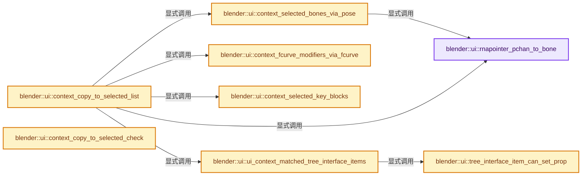
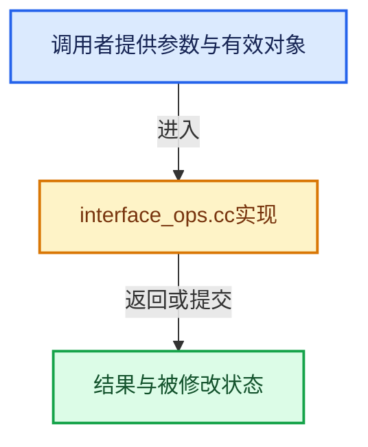

# 实现依赖专题：source/blender/editors/interface/interface_ops.cc

[实现依赖导航](../../../README.md) · [符号索引](../../../../00-课程指南/02-源码与提交索引/符号依赖与实现索引.md)

本专题从正文实际调用进入，集中保存共享实现。函数有稳定锚点，可从调用处直接跳到对应完整函数；递归与互相调用通过回链组织。

## 本文件的实现关系






## 完整成员与函数实现

<a id="f-7b0d5076fae52feb"></a>

### `blender::ui::rnapointer_pchan_to_bone`

实现位置：[source/blender/editors/interface/interface_ops.cc](../../../../../../../../source/blender/editors/interface/interface_ops.cc) · L998—L1010。

接口参数：

- `const PointerRNA &pchan_ptr`

**教学注释版**

<!-- annotated:2ee00e5568a77d -->

```cpp
static PointerRNA rnapointer_pchan_to_bone(const PointerRNA &pchan_ptr)
{
  bPoseChannel *pchan = static_cast<bPoseChannel *>(pchan_ptr.data);

  BLI_assert(GS(pchan_ptr.owner_id->name) == ID_OB);
  Object *object = reinterpret_cast<Object *>(pchan_ptr.owner_id);
  BKE_pose_ensure_bone_indices(*object);

  BLI_assert(GS(object->data->name) == ID_AR);
  bArmature *armature = id_cast<bArmature *>(object->data);

  return RNA_pointer_create_discrete(&armature->id, RNA_Bone, pchan->bone_get(*object));
}
```

<details>
<summary>核对原始源码：source/blender/editors/interface/interface_ops.cc · L998—L1010</summary>

<!-- original:2ee00e5568a77d:source/blender/editors/interface/interface_ops.cc:998:1010 -->

```cpp
static PointerRNA rnapointer_pchan_to_bone(const PointerRNA &pchan_ptr)
{
  bPoseChannel *pchan = static_cast<bPoseChannel *>(pchan_ptr.data);

  BLI_assert(GS(pchan_ptr.owner_id->name) == ID_OB);
  Object *object = reinterpret_cast<Object *>(pchan_ptr.owner_id);
  BKE_pose_ensure_bone_indices(*object);

  BLI_assert(GS(object->data->name) == ID_AR);
  bArmature *armature = id_cast<bArmature *>(object->data);

  return RNA_pointer_create_discrete(&armature->id, RNA_Bone, pchan->bone_get(*object));
}
```

</details>

**结果出口**

- `return RNA_pointer_create_discrete(&armature->id, RNA_Bone, pchan->bone_get(*object));`

**继续追踪实现**

- `BLI_assert` → [BLI_assert · L48](../../../01-BLI基础库/BLI_assert.hh.md#m-57a88495704d)；[BLI_assert · L63](../../../01-BLI基础库/BLI_assert.hh.md#m-d07050020cb5)。宏定义由构建条件选择。
- `GS` → [blender::GS · L410](../../makesdna/DNA_ID.h.md#f-c3ff509f79f21b05)。
- `BKE_pose_ensure_bone_indices` → [blender::BKE_pose_ensure_bone_indices · L3103](../../../02-BKE几何与数据/intern/armature.cc.md#f-642aaede7e1310c6)。
- `id_cast<bArmature *>` → [blender::id_cast · L1417](../../makesdna/DNA_ID.h.md#f-6c8ac6412850ac5a)。
- `RNA_pointer_create_discrete` → [blender::RNA_pointer_create_discrete · L181](../../makesrna/intern/rna_access.cc.md#f-592a276e869c6d94)。
- `pchan->bone_get` → [blender::bPoseChannel::bone_get · L847](../../../02-BKE几何与数据/intern/action.cc.md#f-0eb8bfcf060715cf)；[blender::bPoseChannel::bone_get · L862](../../../02-BKE几何与数据/intern/action.cc.md#f-ccec81f60dc65040)；[blender::bPoseChannel::bone_get · L875](../../../02-BKE几何与数据/intern/action.cc.md#f-b7d34ff46210a1f3)；[blender::bPoseChannel::bone_get · L881](../../../02-BKE几何与数据/intern/action.cc.md#f-0bf83e1e4d68c624)。同名重载需按实参类型选择。

<a id="f-3a59bf397bda3527"></a>

### `blender::ui::context_selected_bones_via_pose`

实现位置：[source/blender/editors/interface/interface_ops.cc](../../../../../../../../source/blender/editors/interface/interface_ops.cc) · L1012—L1021。

接口参数：

- `bContext *C`
- `Vector<PointerRNA> *r_lb`

**教学注释版**

<!-- annotated:335fae50d24bc1 -->

```cpp
static void context_selected_bones_via_pose(bContext *C, Vector<PointerRNA> *r_lb)
{
  Vector<PointerRNA> lb = CTX_data_collection_get(C, "selected_pose_bones");

  for (PointerRNA &ptr : lb) {
    ptr = rnapointer_pchan_to_bone(ptr);
  }

  // [讲解] std::move：把表达式转换成可供移动重载选择的值类别；不保证真的移动，不结束源对象寿命，对const值可能选择复制。
  *r_lb = std::move(lb);
}
```

<details>
<summary>核对原始源码：source/blender/editors/interface/interface_ops.cc · L1012—L1021</summary>

<!-- original:335fae50d24bc1:source/blender/editors/interface/interface_ops.cc:1012:1021 -->

```cpp
static void context_selected_bones_via_pose(bContext *C, Vector<PointerRNA> *r_lb)
{
  Vector<PointerRNA> lb = CTX_data_collection_get(C, "selected_pose_bones");

  for (PointerRNA &ptr : lb) {
    ptr = rnapointer_pchan_to_bone(ptr);
  }

  *r_lb = std::move(lb);
}
```

</details>

**沿实际写入检查状态**

- `ptr = rnapointer_pchan_to_bone(ptr);`

**继续追踪实现**

- `CTX_data_collection_get` → [blender::CTX_data_collection_get · L691](../../../02-BKE几何与数据/intern/context.cc.md#f-88506dcf87cb5a35)。
- `rnapointer_pchan_to_bone` → [blender::ui::rnapointer_pchan_to_bone · L998](interface_ops.cc.md#f-7b0d5076fae52feb)。
- `std::move` → [外部契约](https://eel.is/c++draft/utility.forward)：把表达式转换成可供移动重载选择的值类别；不保证真的移动，不结束源对象寿命，对const值可能选择复制。

<a id="f-89d887bf7b134999"></a>

### `blender::ui::context_fcurve_modifiers_via_fcurve`

实现位置：[source/blender/editors/interface/interface_ops.cc](../../../../../../../../source/blender/editors/interface/interface_ops.cc) · L1023—L1043。

接口参数：

- `bContext *C`
- `Vector<PointerRNA> *r_lb`
- `FModifier *source`

**教学注释版**

<!-- annotated:b6a58a85f544bc -->

```cpp
static void context_fcurve_modifiers_via_fcurve(bContext *C,
                                                Vector<PointerRNA> *r_lb,
                                                FModifier *source)
{
  Vector<PointerRNA> fcurve_links;
  fcurve_links = CTX_data_collection_get(C, "selected_editable_fcurves");
  if (fcurve_links.is_empty()) {
    return;
  }
  // [讲解] r_lb->clear：销毁所有有效元素，把size变为0，但保留原分配或内嵌容量。
  r_lb->clear();
  for (const PointerRNA &ptr : fcurve_links) {
    const FCurve *fcu = static_cast<const FCurve *>(ptr.data);
    for (FModifier &mod : fcu->modifiers) {
      if (STREQ(mod.name, source->name) && mod.type == source->type) {
        // [讲解] r_lb->append：在尾部建立新元素，必要时先扩大存储。
        r_lb->append(RNA_pointer_create_discrete(ptr.owner_id, RNA_FModifier, &mod));
        /* Since names are unique it is safe to break here. */
        break;
      }
    }
  }
}
```

<details>
<summary>核对原始源码：source/blender/editors/interface/interface_ops.cc · L1023—L1043</summary>

<!-- original:b6a58a85f544bc:source/blender/editors/interface/interface_ops.cc:1023:1043 -->

```cpp
static void context_fcurve_modifiers_via_fcurve(bContext *C,
                                                Vector<PointerRNA> *r_lb,
                                                FModifier *source)
{
  Vector<PointerRNA> fcurve_links;
  fcurve_links = CTX_data_collection_get(C, "selected_editable_fcurves");
  if (fcurve_links.is_empty()) {
    return;
  }
  r_lb->clear();
  for (const PointerRNA &ptr : fcurve_links) {
    const FCurve *fcu = static_cast<const FCurve *>(ptr.data);
    for (FModifier &mod : fcu->modifiers) {
      if (STREQ(mod.name, source->name) && mod.type == source->type) {
        r_lb->append(RNA_pointer_create_discrete(ptr.owner_id, RNA_FModifier, &mod));
        /* Since names are unique it is safe to break here. */
        break;
      }
    }
  }
}
```

</details>

**沿实际写入检查状态**

- `fcurve_links = CTX_data_collection_get(C, "selected_editable_fcurves");`

**继续追踪实现**

- `CTX_data_collection_get` → [blender::CTX_data_collection_get · L691](../../../02-BKE几何与数据/intern/context.cc.md#f-88506dcf87cb5a35)。
- `fcurve_links.is_empty` → [blender::Vector::is_empty · L792](../../../../01-基础容器与现代CPP/11-Vector插入删除与重排.md#f-937bbd9cb80bdcc8)。
- `r_lb->clear` → [blender::Vector::clear · L468](../../../../01-基础容器与现代CPP/10-Vector扩容与增长.md#f-d051bebff5275a43)。
- `STREQ` → [STREQ · L112](../../../07-Intern运行时与平台/ghost/intern/GHOST_utildefines.hh.md#m-9549fb6aafd2)；[STREQ · L451](../../../01-BLI基础库/BLI_utildefines.hh.md#m-c7b745bcfad2)；[STREQ · L55](../../../07-Intern运行时与平台/clog/clog.cc.md#m-96e78f386894)。宏定义由构建条件选择。
- `r_lb->append` → [blender::Vector::append · L498](../../../../01-基础容器与现代CPP/11-Vector插入删除与重排.md#f-5bde268a69e443ec)；[blender::Vector::append · L502](../../../../01-基础容器与现代CPP/11-Vector插入删除与重排.md#f-591e0b15e6308532)。同名重载需按实参类型选择。
- `RNA_pointer_create_discrete` → [blender::RNA_pointer_create_discrete · L181](../../makesrna/intern/rna_access.cc.md#f-592a276e869c6d94)。

<a id="f-5f6108ac5b0b3dc3"></a>

### `blender::ui::context_selected_key_blocks`

实现位置：[source/blender/editors/interface/interface_ops.cc](../../../../../../../../source/blender/editors/interface/interface_ops.cc) · L1045—L1059。

接口参数：

- `ID *owner_id_key`
- `Vector<PointerRNA> *r_lb`

**教学注释版**

<!-- annotated:2fd3182f0684d2 -->

```cpp
static void context_selected_key_blocks(ID *owner_id_key, Vector<PointerRNA> *r_lb)
{
  /* This function chooses to return the selected keyblocks of the owning Key ID.
   * The other option would be to return identically named keyblocks from selected objects. I
   * (christoph) think that the first case is more useful which is why the function works as it
   * does. */
  Key *containing_key = reinterpret_cast<Key *>(owner_id_key);
  for (KeyBlock &key_block : containing_key->block) {
    /* This does not use the function `shape_key_is_selected` since that would include the active
     * shapekey which is not required for this function to work. */
    if (key_block.flag & KEYBLOCK_SEL) {
      // [讲解] r_lb->append：在尾部建立新元素，必要时先扩大存储。
      r_lb->append(RNA_pointer_create_discrete(owner_id_key, RNA_ShapeKey, &key_block));
    }
  }
}
```

<details>
<summary>核对原始源码：source/blender/editors/interface/interface_ops.cc · L1045—L1059</summary>

<!-- original:2fd3182f0684d2:source/blender/editors/interface/interface_ops.cc:1045:1059 -->

```cpp
static void context_selected_key_blocks(ID *owner_id_key, Vector<PointerRNA> *r_lb)
{
  /* This function chooses to return the selected keyblocks of the owning Key ID.
   * The other option would be to return identically named keyblocks from selected objects. I
   * (christoph) think that the first case is more useful which is why the function works as it
   * does. */
  Key *containing_key = reinterpret_cast<Key *>(owner_id_key);
  for (KeyBlock &key_block : containing_key->block) {
    /* This does not use the function `shape_key_is_selected` since that would include the active
     * shapekey which is not required for this function to work. */
    if (key_block.flag & KEYBLOCK_SEL) {
      r_lb->append(RNA_pointer_create_discrete(owner_id_key, RNA_ShapeKey, &key_block));
    }
  }
}
```

</details>

**继续追踪实现**

- `r_lb->append` → [blender::Vector::append · L498](../../../../01-基础容器与现代CPP/11-Vector插入删除与重排.md#f-5bde268a69e443ec)；[blender::Vector::append · L502](../../../../01-基础容器与现代CPP/11-Vector插入删除与重排.md#f-591e0b15e6308532)。同名重载需按实参类型选择。
- `RNA_pointer_create_discrete` → [blender::RNA_pointer_create_discrete · L181](../../makesrna/intern/rna_access.cc.md#f-592a276e869c6d94)。

<a id="f-a76793c242b10f7b"></a>

### `blender::ui::tree_interface_item_can_set_prop`

实现位置：[source/blender/editors/interface/interface_ops.cc](../../../../../../../../source/blender/editors/interface/interface_ops.cc) · L1061—L1102。

接口参数：

- `const bNodeTreeInterfaceItem &item`
- `const bNodeTreeInterfaceItem &active_item`
- `PropertyRNA *prop`

**教学注释版**

<!-- annotated:a79de08d8136ab -->

```cpp
static bool tree_interface_item_can_set_prop(const bNodeTreeInterfaceItem &item,
                                             const bNodeTreeInterfaceItem &active_item,
                                             PropertyRNA *prop)
{
  if (active_item.item_type != item.item_type) {
    return false;
  }
  const char *prop_id = RNA_property_identifier(prop);
  const bool is_generic_prop = STR_ELEM(
      prop_id, "socket_type", "description", "optional_label", "hide_value", "hide_in_modifier");

  switch (item.item_type) {
    case NodeTreeInterfaceItemType::Socket: {
      const auto &sock = reinterpret_cast<const bNodeTreeInterfaceSocket &>(item);
      if ((sock.flag & NODE_INTERFACE_SOCKET_SELECT) == 0) {
        return false;
      }
      /* Switch logic based on the property being edited. */
      if (is_generic_prop) {
        if (sock.flag & NODE_INTERFACE_SOCKET_PANEL_TOGGLE) {
          /* Disallow changing socket type for panel toggle. */
          return !STREQ(prop_id, "socket_type");
        }
        return true;
      }
      if (STREQ(prop_id, "structure_type")) {
        return sock.flag & NODE_INTERFACE_SOCKET_INPUT;
      }
      if (STREQ(prop_id, "attribute_domain") && sock.flag & NODE_INTERFACE_SOCKET_OUTPUT) {
        return nodes::socket_type_supports_attributes(sock.socket_typeinfo()->type);
      }
      /* Other properties only support batch setting for selected items of the same type. */
      const auto &active_sock = reinterpret_cast<const bNodeTreeInterfaceSocket &>(active_item);
      return sock.socket_typeinfo()->type == active_sock.socket_typeinfo()->type;
    }
    case NodeTreeInterfaceItemType::Panel: {
      const auto &panel = reinterpret_cast<const bNodeTreeInterfacePanel &>(item);
      return panel.flag & NODE_INTERFACE_PANEL_SELECT;
    }
  }
  return false;
}
```

<details>
<summary>核对原始源码：source/blender/editors/interface/interface_ops.cc · L1061—L1102</summary>

<!-- original:a79de08d8136ab:source/blender/editors/interface/interface_ops.cc:1061:1102 -->

```cpp
static bool tree_interface_item_can_set_prop(const bNodeTreeInterfaceItem &item,
                                             const bNodeTreeInterfaceItem &active_item,
                                             PropertyRNA *prop)
{
  if (active_item.item_type != item.item_type) {
    return false;
  }
  const char *prop_id = RNA_property_identifier(prop);
  const bool is_generic_prop = STR_ELEM(
      prop_id, "socket_type", "description", "optional_label", "hide_value", "hide_in_modifier");

  switch (item.item_type) {
    case NodeTreeInterfaceItemType::Socket: {
      const auto &sock = reinterpret_cast<const bNodeTreeInterfaceSocket &>(item);
      if ((sock.flag & NODE_INTERFACE_SOCKET_SELECT) == 0) {
        return false;
      }
      /* Switch logic based on the property being edited. */
      if (is_generic_prop) {
        if (sock.flag & NODE_INTERFACE_SOCKET_PANEL_TOGGLE) {
          /* Disallow changing socket type for panel toggle. */
          return !STREQ(prop_id, "socket_type");
        }
        return true;
      }
      if (STREQ(prop_id, "structure_type")) {
        return sock.flag & NODE_INTERFACE_SOCKET_INPUT;
      }
      if (STREQ(prop_id, "attribute_domain") && sock.flag & NODE_INTERFACE_SOCKET_OUTPUT) {
        return nodes::socket_type_supports_attributes(sock.socket_typeinfo()->type);
      }
      /* Other properties only support batch setting for selected items of the same type. */
      const auto &active_sock = reinterpret_cast<const bNodeTreeInterfaceSocket &>(active_item);
      return sock.socket_typeinfo()->type == active_sock.socket_typeinfo()->type;
    }
    case NodeTreeInterfaceItemType::Panel: {
      const auto &panel = reinterpret_cast<const bNodeTreeInterfacePanel &>(item);
      return panel.flag & NODE_INTERFACE_PANEL_SELECT;
    }
  }
  return false;
}
```

</details>

**结果出口**

- `return false;`
- `return !STREQ(prop_id, "socket_type");`
- `return true;`
- `return sock.flag & NODE_INTERFACE_SOCKET_INPUT;`
- `return nodes::socket_type_supports_attributes(sock.socket_typeinfo()->type);`
- `return sock.socket_typeinfo()->type == active_sock.socket_typeinfo()->type;`
- `return panel.flag & NODE_INTERFACE_PANEL_SELECT;`

**继续追踪实现**

- `RNA_property_identifier` → [blender::RNA_property_identifier · L1275](../../makesrna/intern/rna_access.cc.md#f-67de6dc6c76092df)。
- `STR_ELEM` → [STR_ELEM · L658](../../../01-BLI基础库/BLI_string.hh.md#m-101109e97582)。宏定义由构建条件选择。
- `STREQ` → [STREQ · L112](../../../07-Intern运行时与平台/ghost/intern/GHOST_utildefines.hh.md#m-9549fb6aafd2)；[STREQ · L451](../../../01-BLI基础库/BLI_utildefines.hh.md#m-c7b745bcfad2)；[STREQ · L55](../../../07-Intern运行时与平台/clog/clog.cc.md#m-96e78f386894)。宏定义由构建条件选择。
- `nodes::socket_type_supports_attributes` → [blender::nodes::socket_type_supports_attributes · L677](../../../04-Nodes节点系统/intern/node_socket.cc.md#f-ebab61bf582595c6)。
- `sock.socket_typeinfo` → [调用协议](../../../../00-课程指南/01-路线与规范/模板宏与动态分派协议.md)：接收对象类型依赖auto、返回值或模板实例；不按同名猜测目标。调用位置L1090。
- `active_sock.socket_typeinfo` → [调用协议](../../../../00-课程指南/01-路线与规范/模板宏与动态分派协议.md)：接收对象类型依赖auto、返回值或模板实例；不按同名猜测目标。调用位置L1094。

<a id="f-c83105e916adb7e2"></a>

### `blender::ui::ui_context_matched_tree_interface_items`

实现位置：[source/blender/editors/interface/interface_ops.cc](../../../../../../../../source/blender/editors/interface/interface_ops.cc) · L1104—L1119。

接口参数：

- `PointerRNA *ptr`
- `PropertyRNA *prop`
- `Vector<PointerRNA> *r_lb`

**教学注释版**

<!-- annotated:7bb591cc827f71 -->

```cpp
static void ui_context_matched_tree_interface_items(PointerRNA *ptr,
                                                    PropertyRNA *prop,
                                                    Vector<PointerRNA> *r_lb)
{
  bNodeTree *ntree = id_cast<bNodeTree *>(ptr->owner_id);
  bNodeTreeInterfaceItem *active_item = static_cast<bNodeTreeInterfaceItem *>(ptr->data);
  if (!active_item) {
    return;
  }
  ntree->tree_interface.foreach_item([&](bNodeTreeInterfaceItem &item) {
    if (tree_interface_item_can_set_prop(item, *active_item, prop)) {
      // [讲解] r_lb->append：在尾部建立新元素，必要时先扩大存储。
      r_lb->append(RNA_pointer_create_discrete(&ntree->id, RNA_NodeTreeInterfaceItem, &item));
    }
    return true;
  });
}
```

<details>
<summary>核对原始源码：source/blender/editors/interface/interface_ops.cc · L1104—L1119</summary>

<!-- original:7bb591cc827f71:source/blender/editors/interface/interface_ops.cc:1104:1119 -->

```cpp
static void ui_context_matched_tree_interface_items(PointerRNA *ptr,
                                                    PropertyRNA *prop,
                                                    Vector<PointerRNA> *r_lb)
{
  bNodeTree *ntree = id_cast<bNodeTree *>(ptr->owner_id);
  bNodeTreeInterfaceItem *active_item = static_cast<bNodeTreeInterfaceItem *>(ptr->data);
  if (!active_item) {
    return;
  }
  ntree->tree_interface.foreach_item([&](bNodeTreeInterfaceItem &item) {
    if (tree_interface_item_can_set_prop(item, *active_item, prop)) {
      r_lb->append(RNA_pointer_create_discrete(&ntree->id, RNA_NodeTreeInterfaceItem, &item));
    }
    return true;
  });
}
```

</details>

**结果出口**

- `return true;`

**继续追踪实现**

- `id_cast<bNodeTree *>` → [blender::id_cast · L1417](../../makesdna/DNA_ID.h.md#f-6c8ac6412850ac5a)。
- `ntree->tree_interface.foreach_item` → [调用协议](../../../../00-课程指南/01-路线与规范/模板宏与动态分派协议.md)：接收对象类型依赖auto、返回值或模板实例；不按同名猜测目标。调用位置L1113。
- `tree_interface_item_can_set_prop` → [blender::ui::tree_interface_item_can_set_prop · L1061](interface_ops.cc.md#f-a76793c242b10f7b)。
- `r_lb->append` → [blender::Vector::append · L498](../../../../01-基础容器与现代CPP/11-Vector插入删除与重排.md#f-5bde268a69e443ec)；[blender::Vector::append · L502](../../../../01-基础容器与现代CPP/11-Vector插入删除与重排.md#f-591e0b15e6308532)。同名重载需按实参类型选择。
- `RNA_pointer_create_discrete` → [blender::RNA_pointer_create_discrete · L181](../../makesrna/intern/rna_access.cc.md#f-592a276e869c6d94)。

<a id="f-c034cc76542fc263"></a>

### `blender::ui::context_copy_to_selected_list`

实现位置：[source/blender/editors/interface/interface_ops.cc](../../../../../../../../source/blender/editors/interface/interface_ops.cc) · L1121—L1477。

接口参数：

- `bContext *C`
- `PointerRNA *ptr`
- `PropertyRNA *prop`
- `Vector<PointerRNA> *r_lb`
- `bool *r_use_path_from_id`
- `std::optional<std::string> *r_path`

**教学注释版**

<!-- annotated:27eb4483eaa2fe -->

```cpp
bool context_copy_to_selected_list(bContext *C,
                                   PointerRNA *ptr,
                                   PropertyRNA *prop,
                                   Vector<PointerRNA> *r_lb,
                                   bool *r_use_path_from_id,
                                   std::optional<std::string> *r_path)
{
  *r_use_path_from_id = false;
  *r_path = std::nullopt;
  /* special case for bone constraints */
  const bool is_rna = !RNA_property_is_idprop(prop);
  /* Remove links from the collection list which don't contain 'prop'. */
  bool ensure_list_items_contain_prop = false;

  /* PropertyGroup objects don't have a reference to the struct that actually owns
   * them, so it is normally necessary to do a brute force search to find it. This
   * handles the search for non-ID owners by using the 'active' reference as a hint
   * to preserve efficiency. Only properties defined through RNA are handled, as
   * custom properties cannot be assumed to be valid for all instances.
   *
   * Properties owned by the ID are handled by the 'if (ptr->owner_id)' case below.
   */
  if (is_rna && RNA_struct_is_a(ptr->type, RNA_PropertyGroup)) {
    PointerRNA owner_ptr;
    std::optional<std::string> idpath;

    /* First, check the active PoseBone and PoseBone->Bone. */
    owner_ptr = CTX_data_pointer_get_type(C, "active_pose_bone", RNA_PoseBone);
    if (owner_ptr) {
      idpath = RNA_path_from_struct_to_idproperty(&owner_ptr,
                                                  static_cast<const IDProperty *>(ptr->data));
      if (idpath) {
        *r_lb = CTX_data_collection_get(C, "selected_pose_bones");
      }
      else {
        PointerRNA bone_ptr = rnapointer_pchan_to_bone(owner_ptr);
        idpath = RNA_path_from_struct_to_idproperty(&bone_ptr,
                                                    static_cast<const IDProperty *>(ptr->data));
        if (idpath) {
          context_selected_bones_via_pose(C, r_lb);
        }
      }
    }

    if (!idpath) {
      /* Check the active EditBone if in edit mode. */
      owner_ptr = CTX_data_pointer_get_type_silent(C, "active_bone", RNA_EditBone);
      if (owner_ptr) {
        idpath = RNA_path_from_struct_to_idproperty(&owner_ptr,
                                                    static_cast<const IDProperty *>(ptr->data));
        if (idpath) {
          *r_lb = CTX_data_collection_get(C, "selected_editable_bones");
        }
      }

      /* Add other simple cases here (Node, NodeSocket, Sequence, ViewLayer etc). */
    }

    if (idpath) {
      *r_path = fmt::format("{}.{}", *idpath, RNA_property_identifier(prop));
      return true;
    }
  }

  if (RNA_struct_is_a(ptr->type, RNA_EditBone)) {
    /* Special case when we do this for #edit_bone.lock.
     * (if the edit_bone is locked, it is not included in "selected_editable_bones"). */
    const char *prop_id = RNA_property_identifier(prop);
    if (STREQ(prop_id, "lock")) {
      *r_lb = CTX_data_collection_get(C, "selected_bones");
    }
    else {
      *r_lb = CTX_data_collection_get(C, "selected_editable_bones");
    }
  }
  else if (RNA_struct_is_a(ptr->type, RNA_PoseBone)) {
    *r_lb = CTX_data_collection_get(C, "selected_pose_bones");
  }
  else if (RNA_struct_is_a(ptr->type, RNA_Bone)) {
    /* "selected_bones" or "selected_editable_bones" will only yield anything in Armature Edit
     * mode. In other modes, it'll be empty, and the only way to get the selected bones is via
     * "selected_pose_bones". */
    context_selected_bones_via_pose(C, r_lb);
  }
  else if (RNA_struct_is_a(ptr->type, RNA_BoneColor)) {
    /* Get the things that own the bone color (bones, pose bones, or edit bones). */
    /* First this will be bones, then gets remapped to colors. */
    Vector<PointerRNA> list_of_things = {};
    switch (GS(ptr->owner_id->name)) {
      case ID_OB:
        list_of_things = CTX_data_collection_get(C, "selected_pose_bones");
        break;
      case ID_AR: {
        /* Armature-owned bones can be accessed from both edit mode and pose mode.
         * - Edit mode: visit selected edit bones.
         * - Pose mode: visit the armature bones of selected pose bones.
         */
        const bArmature *arm = reinterpret_cast<bArmature *>(ptr->owner_id);
        if (arm->edbo) {
          list_of_things = CTX_data_collection_get(C, "selected_editable_bones");
        }
        else {
          list_of_things = CTX_data_collection_get(C, "selected_pose_bones");
          CTX_data_collection_remap_property(list_of_things, "bone");
        }
        break;
      }
      default:
        printf("BoneColor is unexpectedly owned by %s '%s'\n",
               BKE_idtype_idcode_to_name(GS(ptr->owner_id->name)),
               ptr->owner_id->name + 2);
        BLI_assert_msg(false,
                       "expected BoneColor to be owned by the Armature "
                       "(bone & edit bone) or the Object (pose bone)");
        return false;
    }

    /* Remap from some bone to its color, to ensure the items of r_lb are of
     * type ptr->type. Since all three structs `bPoseChan`, `Bone`, and
     * `EditBone` have the same name for their embedded `BoneColor` struct, this
     * code is suitable for all of them. */
    CTX_data_collection_remap_property(list_of_things, "color");

    *r_lb = list_of_things;
  }
  else if (RNA_struct_is_a(ptr->type, RNA_Strip)) {
    /* Special case when we do this for 'Strip.lock'.
     * (if the strip is locked, it won't be in "selected_editable_strips"). */
    const char *prop_id = RNA_property_identifier(prop);
    if (STREQ(prop_id, "lock")) {
      *r_lb = CTX_data_collection_get(C, "selected_strips");
    }
    else {
      *r_lb = CTX_data_collection_get(C, "selected_editable_strips");
    }

    if (is_rna) {
      /* Account for properties only being available for some sequence types. */
      ensure_list_items_contain_prop = true;
    }
  }
  else if (RNA_struct_is_a(ptr->type, RNA_FCurve)) {
    *r_lb = CTX_data_collection_get(C, "selected_editable_fcurves");
  }
  else if (RNA_struct_is_a(ptr->type, RNA_FModifier)) {
    FModifier *mod = static_cast<FModifier *>(ptr->data);
    context_fcurve_modifiers_via_fcurve(C, r_lb, mod);
  }
  else if (RNA_struct_is_a(ptr->type, RNA_Keyframe)) {
    *r_lb = CTX_data_collection_get(C, "selected_editable_keyframes");
  }
  else if (RNA_struct_is_a(ptr->type, RNA_Action)) {
    *r_lb = CTX_data_collection_get(C, "selected_editable_actions");
  }
  else if (RNA_struct_is_a(ptr->type, RNA_NlaStrip)) {
    *r_lb = CTX_data_collection_get(C, "selected_nla_strips");
  }
  else if (RNA_struct_is_a(ptr->type, RNA_MovieTrackingTrack)) {
    *r_lb = CTX_data_collection_get(C, "selected_movieclip_tracks");
  }
  else if (RNA_struct_is_a(ptr->type, RNA_ShapeKey)) {
    context_selected_key_blocks(ptr->owner_id, r_lb);
  }
  else if (const std::optional<std::string> path_from_bone =
               RNA_path_resolve_from_type_to_property(ptr, prop, RNA_PoseBone);
           RNA_struct_is_a(ptr->type, RNA_Constraint) && path_from_bone)
  {
    *r_lb = CTX_data_collection_get(C, "selected_pose_bones");
    *r_path = path_from_bone;
  }
  else if (RNA_struct_is_a(ptr->type, RNA_Node) || RNA_struct_is_a(ptr->type, RNA_NodeSocket)) {
    Vector<PointerRNA> lb;
    std::optional<std::string> path;
    bNode *node = nullptr;

    /* Get the node we're editing */
    if (RNA_struct_is_a(ptr->type, RNA_NodeSocket)) {
      bNodeTree *ntree = id_cast<bNodeTree *>(ptr->owner_id);
      bNodeSocket *sock = static_cast<bNodeSocket *>(ptr->data);
      node = &bke::node_find_node(*ntree, *sock);
      path = RNA_path_resolve_from_type_to_property(ptr, prop, RNA_Node);
      if (path) {
        /* we're good! */
      }
      else {
        node = nullptr;
      }
    }
    else {
      node = static_cast<bNode *>(ptr->data);
    }

    /* Now filter out non-matching nodes (by idname). */
    if (node) {
      const StringRef node_idname = node->idname;
      lb = CTX_data_collection_get(C, "selected_nodes");
      lb.remove_if([&](const PointerRNA &link) {
        bNode *node_data = static_cast<bNode *>(link.data);
        if (node_data->idname != node_idname) {
          return true;
        }
        return false;
      });
    }

    *r_lb = lb;
    *r_path = path;
  }
  else if (RNA_struct_is_a(ptr->type, RNA_NodeTreeInterfaceItem)) {
    ui_context_matched_tree_interface_items(ptr, prop, r_lb);
  }
  else if (RNA_struct_is_a(ptr->type, RNA_AssetMetaData)) {
    /* Remap from #AssetRepresentation to #AssetMetaData. */
    Vector<PointerRNA> list_of_things = CTX_data_collection_get(C, "selected_assets");
    CTX_data_collection_remap_property(list_of_things, "metadata");
    *r_lb = list_of_things;
  }
  else if (CTX_wm_space_outliner(C)) {
    const ID *id = ptr->owner_id;
    if (!(id && (GS(id->name) == ID_OB))) {
      return false;
    }

    ListBaseT<LinkData> selected_objects = {nullptr};
    ED_outliner_selected_objects_get(C, &selected_objects);
    for (LinkData &link : selected_objects) {
      Object *ob = static_cast<Object *>(link.data);
      // [讲解] r_lb->append：在尾部建立新元素，必要时先扩大存储。
      r_lb->append(RNA_id_pointer_create(&ob->id));
    }
  }
  else if (ptr->owner_id) {
    ID *id = ptr->owner_id;

    if (GS(id->name) == ID_OB) {
      *r_lb = CTX_data_collection_get(C, "selected_editable_objects");
      *r_use_path_from_id = true;
      *r_path = RNA_path_from_ID_to_property(ptr, prop);
    }
    else if (OB_DATA_SUPPORT_ID(GS(id->name))) {
      /* check we're using the active object */
      const short id_code = GS(id->name);
      Vector<PointerRNA> lb = CTX_data_collection_get(C, "selected_editable_objects");
      const std::optional<std::string> path = RNA_path_from_ID_to_property(ptr, prop);

      /* de-duplicate obdata */
      if (!lb.is_empty()) {
        for (const PointerRNA &ob_ptr : lb) {
          Object *ob = id_cast<Object *>(ob_ptr.owner_id);
          if (ID *id_data = ob->data) {
            id_data->tag |= ID_TAG_DOIT;
          }
        }

        Vector<PointerRNA> new_lb;
        for (const PointerRNA &link : lb) {
          Object *ob = id_cast<Object *>(link.owner_id);
          ID *id_data = ob->data;
          if ((id_data == nullptr) || (id_data->tag & ID_TAG_DOIT) == 0 ||
              !ID_IS_EDITABLE(id_data) || (GS(id_data->name) != id_code))
          {
            continue;
          }
          /* Avoid prepending 'data' to the path. */
          new_lb.append(RNA_id_pointer_create(id_data));

          if (id_data) {
            id_data->tag &= ~ID_TAG_DOIT;
          }
        }

        // [讲解] std::move：把表达式转换成可供移动重载选择的值类别；不保证真的移动，不结束源对象寿命，对const值可能选择复制。
        lb = std::move(new_lb);
      }

      *r_lb = lb;
      *r_path = path;
    }
    else if (GS(id->name) == ID_SCE) {
      /* Sequencer's ID is scene :/ */
      /* Try to recursively find an RNA_Strip ancestor,
       * to handle situations like #41062... */
      *r_path = RNA_path_resolve_from_type_to_property(ptr, prop, RNA_Strip);
      if (r_path->has_value()) {
        /* Special case when we do this for 'Strip.lock'.
         * (if the strip is locked, it won't be in "selected_editable_strips"). */
        const char *prop_id = RNA_property_identifier(prop);
        if (is_rna && STREQ(prop_id, "lock")) {
          *r_lb = CTX_data_collection_get(C, "selected_strips");
        }
        else {
          *r_lb = CTX_data_collection_get(C, "selected_editable_strips");
        }

        if (is_rna) {
          /* Account for properties only being available for some sequence types. */
          ensure_list_items_contain_prop = true;
        }
      }
    }
    return r_path->has_value();
  }
  else {
    return false;
  }

  if (RNA_property_is_idprop(prop)) {
    if (!r_path->has_value()) {
      *r_path = RNA_path_from_ptr_to_property_index(ptr, prop, 0, -1);
      BLI_assert(*r_path);
    }
    /* Always resolve custom-properties because they can always exist per-item. */
    ensure_list_items_contain_prop = true;
  }

  if (ensure_list_items_contain_prop) {
    if (is_rna) {
      const char *prop_id = RNA_property_identifier(prop);
      r_lb->remove_if([&](const PointerRNA &link) {
        if ((ptr->type != link.type) &&
            (RNA_struct_type_find_property(link.type, prop_id) != prop))
        {
          return true;
        }
        return false;
      });
    }
    else {
      const bool prop_is_array = RNA_property_array_check(prop);
      const int prop_array_len = prop_is_array ? RNA_property_array_length(ptr, prop) : -1;
      const PropertyType prop_type = RNA_property_type(prop);
      r_lb->remove_if([&](PointerRNA &link) {
        PointerRNA lptr;
        PropertyRNA *lprop = nullptr;
        RNA_path_resolve_property(
            &link, r_path->has_value() ? r_path->value().c_str() : nullptr, &lptr, &lprop);

        if (lprop == nullptr) {
          return true;
        }
        if (!RNA_property_is_idprop(lprop)) {
          return true;
        }
        if (prop_type != RNA_property_type(lprop)) {
          return true;
        }
        if (prop_is_array != RNA_property_array_check(lprop)) {
          return true;
        }
        if (prop_is_array && (prop_array_len != RNA_property_array_length(&link, lprop))) {
          return true;
        }
        return false;
      });
    }
  }

  return true;
}
```

<details>
<summary>核对原始源码：source/blender/editors/interface/interface_ops.cc · L1121—L1477</summary>

<!-- original:27eb4483eaa2fe:source/blender/editors/interface/interface_ops.cc:1121:1477 -->

```cpp
bool context_copy_to_selected_list(bContext *C,
                                   PointerRNA *ptr,
                                   PropertyRNA *prop,
                                   Vector<PointerRNA> *r_lb,
                                   bool *r_use_path_from_id,
                                   std::optional<std::string> *r_path)
{
  *r_use_path_from_id = false;
  *r_path = std::nullopt;
  /* special case for bone constraints */
  const bool is_rna = !RNA_property_is_idprop(prop);
  /* Remove links from the collection list which don't contain 'prop'. */
  bool ensure_list_items_contain_prop = false;

  /* PropertyGroup objects don't have a reference to the struct that actually owns
   * them, so it is normally necessary to do a brute force search to find it. This
   * handles the search for non-ID owners by using the 'active' reference as a hint
   * to preserve efficiency. Only properties defined through RNA are handled, as
   * custom properties cannot be assumed to be valid for all instances.
   *
   * Properties owned by the ID are handled by the 'if (ptr->owner_id)' case below.
   */
  if (is_rna && RNA_struct_is_a(ptr->type, RNA_PropertyGroup)) {
    PointerRNA owner_ptr;
    std::optional<std::string> idpath;

    /* First, check the active PoseBone and PoseBone->Bone. */
    owner_ptr = CTX_data_pointer_get_type(C, "active_pose_bone", RNA_PoseBone);
    if (owner_ptr) {
      idpath = RNA_path_from_struct_to_idproperty(&owner_ptr,
                                                  static_cast<const IDProperty *>(ptr->data));
      if (idpath) {
        *r_lb = CTX_data_collection_get(C, "selected_pose_bones");
      }
      else {
        PointerRNA bone_ptr = rnapointer_pchan_to_bone(owner_ptr);
        idpath = RNA_path_from_struct_to_idproperty(&bone_ptr,
                                                    static_cast<const IDProperty *>(ptr->data));
        if (idpath) {
          context_selected_bones_via_pose(C, r_lb);
        }
      }
    }

    if (!idpath) {
      /* Check the active EditBone if in edit mode. */
      owner_ptr = CTX_data_pointer_get_type_silent(C, "active_bone", RNA_EditBone);
      if (owner_ptr) {
        idpath = RNA_path_from_struct_to_idproperty(&owner_ptr,
                                                    static_cast<const IDProperty *>(ptr->data));
        if (idpath) {
          *r_lb = CTX_data_collection_get(C, "selected_editable_bones");
        }
      }

      /* Add other simple cases here (Node, NodeSocket, Sequence, ViewLayer etc). */
    }

    if (idpath) {
      *r_path = fmt::format("{}.{}", *idpath, RNA_property_identifier(prop));
      return true;
    }
  }

  if (RNA_struct_is_a(ptr->type, RNA_EditBone)) {
    /* Special case when we do this for #edit_bone.lock.
     * (if the edit_bone is locked, it is not included in "selected_editable_bones"). */
    const char *prop_id = RNA_property_identifier(prop);
    if (STREQ(prop_id, "lock")) {
      *r_lb = CTX_data_collection_get(C, "selected_bones");
    }
    else {
      *r_lb = CTX_data_collection_get(C, "selected_editable_bones");
    }
  }
  else if (RNA_struct_is_a(ptr->type, RNA_PoseBone)) {
    *r_lb = CTX_data_collection_get(C, "selected_pose_bones");
  }
  else if (RNA_struct_is_a(ptr->type, RNA_Bone)) {
    /* "selected_bones" or "selected_editable_bones" will only yield anything in Armature Edit
     * mode. In other modes, it'll be empty, and the only way to get the selected bones is via
     * "selected_pose_bones". */
    context_selected_bones_via_pose(C, r_lb);
  }
  else if (RNA_struct_is_a(ptr->type, RNA_BoneColor)) {
    /* Get the things that own the bone color (bones, pose bones, or edit bones). */
    /* First this will be bones, then gets remapped to colors. */
    Vector<PointerRNA> list_of_things = {};
    switch (GS(ptr->owner_id->name)) {
      case ID_OB:
        list_of_things = CTX_data_collection_get(C, "selected_pose_bones");
        break;
      case ID_AR: {
        /* Armature-owned bones can be accessed from both edit mode and pose mode.
         * - Edit mode: visit selected edit bones.
         * - Pose mode: visit the armature bones of selected pose bones.
         */
        const bArmature *arm = reinterpret_cast<bArmature *>(ptr->owner_id);
        if (arm->edbo) {
          list_of_things = CTX_data_collection_get(C, "selected_editable_bones");
        }
        else {
          list_of_things = CTX_data_collection_get(C, "selected_pose_bones");
          CTX_data_collection_remap_property(list_of_things, "bone");
        }
        break;
      }
      default:
        printf("BoneColor is unexpectedly owned by %s '%s'\n",
               BKE_idtype_idcode_to_name(GS(ptr->owner_id->name)),
               ptr->owner_id->name + 2);
        BLI_assert_msg(false,
                       "expected BoneColor to be owned by the Armature "
                       "(bone & edit bone) or the Object (pose bone)");
        return false;
    }

    /* Remap from some bone to its color, to ensure the items of r_lb are of
     * type ptr->type. Since all three structs `bPoseChan`, `Bone`, and
     * `EditBone` have the same name for their embedded `BoneColor` struct, this
     * code is suitable for all of them. */
    CTX_data_collection_remap_property(list_of_things, "color");

    *r_lb = list_of_things;
  }
  else if (RNA_struct_is_a(ptr->type, RNA_Strip)) {
    /* Special case when we do this for 'Strip.lock'.
     * (if the strip is locked, it won't be in "selected_editable_strips"). */
    const char *prop_id = RNA_property_identifier(prop);
    if (STREQ(prop_id, "lock")) {
      *r_lb = CTX_data_collection_get(C, "selected_strips");
    }
    else {
      *r_lb = CTX_data_collection_get(C, "selected_editable_strips");
    }

    if (is_rna) {
      /* Account for properties only being available for some sequence types. */
      ensure_list_items_contain_prop = true;
    }
  }
  else if (RNA_struct_is_a(ptr->type, RNA_FCurve)) {
    *r_lb = CTX_data_collection_get(C, "selected_editable_fcurves");
  }
  else if (RNA_struct_is_a(ptr->type, RNA_FModifier)) {
    FModifier *mod = static_cast<FModifier *>(ptr->data);
    context_fcurve_modifiers_via_fcurve(C, r_lb, mod);
  }
  else if (RNA_struct_is_a(ptr->type, RNA_Keyframe)) {
    *r_lb = CTX_data_collection_get(C, "selected_editable_keyframes");
  }
  else if (RNA_struct_is_a(ptr->type, RNA_Action)) {
    *r_lb = CTX_data_collection_get(C, "selected_editable_actions");
  }
  else if (RNA_struct_is_a(ptr->type, RNA_NlaStrip)) {
    *r_lb = CTX_data_collection_get(C, "selected_nla_strips");
  }
  else if (RNA_struct_is_a(ptr->type, RNA_MovieTrackingTrack)) {
    *r_lb = CTX_data_collection_get(C, "selected_movieclip_tracks");
  }
  else if (RNA_struct_is_a(ptr->type, RNA_ShapeKey)) {
    context_selected_key_blocks(ptr->owner_id, r_lb);
  }
  else if (const std::optional<std::string> path_from_bone =
               RNA_path_resolve_from_type_to_property(ptr, prop, RNA_PoseBone);
           RNA_struct_is_a(ptr->type, RNA_Constraint) && path_from_bone)
  {
    *r_lb = CTX_data_collection_get(C, "selected_pose_bones");
    *r_path = path_from_bone;
  }
  else if (RNA_struct_is_a(ptr->type, RNA_Node) || RNA_struct_is_a(ptr->type, RNA_NodeSocket)) {
    Vector<PointerRNA> lb;
    std::optional<std::string> path;
    bNode *node = nullptr;

    /* Get the node we're editing */
    if (RNA_struct_is_a(ptr->type, RNA_NodeSocket)) {
      bNodeTree *ntree = id_cast<bNodeTree *>(ptr->owner_id);
      bNodeSocket *sock = static_cast<bNodeSocket *>(ptr->data);
      node = &bke::node_find_node(*ntree, *sock);
      path = RNA_path_resolve_from_type_to_property(ptr, prop, RNA_Node);
      if (path) {
        /* we're good! */
      }
      else {
        node = nullptr;
      }
    }
    else {
      node = static_cast<bNode *>(ptr->data);
    }

    /* Now filter out non-matching nodes (by idname). */
    if (node) {
      const StringRef node_idname = node->idname;
      lb = CTX_data_collection_get(C, "selected_nodes");
      lb.remove_if([&](const PointerRNA &link) {
        bNode *node_data = static_cast<bNode *>(link.data);
        if (node_data->idname != node_idname) {
          return true;
        }
        return false;
      });
    }

    *r_lb = lb;
    *r_path = path;
  }
  else if (RNA_struct_is_a(ptr->type, RNA_NodeTreeInterfaceItem)) {
    ui_context_matched_tree_interface_items(ptr, prop, r_lb);
  }
  else if (RNA_struct_is_a(ptr->type, RNA_AssetMetaData)) {
    /* Remap from #AssetRepresentation to #AssetMetaData. */
    Vector<PointerRNA> list_of_things = CTX_data_collection_get(C, "selected_assets");
    CTX_data_collection_remap_property(list_of_things, "metadata");
    *r_lb = list_of_things;
  }
  else if (CTX_wm_space_outliner(C)) {
    const ID *id = ptr->owner_id;
    if (!(id && (GS(id->name) == ID_OB))) {
      return false;
    }

    ListBaseT<LinkData> selected_objects = {nullptr};
    ED_outliner_selected_objects_get(C, &selected_objects);
    for (LinkData &link : selected_objects) {
      Object *ob = static_cast<Object *>(link.data);
      r_lb->append(RNA_id_pointer_create(&ob->id));
    }
  }
  else if (ptr->owner_id) {
    ID *id = ptr->owner_id;

    if (GS(id->name) == ID_OB) {
      *r_lb = CTX_data_collection_get(C, "selected_editable_objects");
      *r_use_path_from_id = true;
      *r_path = RNA_path_from_ID_to_property(ptr, prop);
    }
    else if (OB_DATA_SUPPORT_ID(GS(id->name))) {
      /* check we're using the active object */
      const short id_code = GS(id->name);
      Vector<PointerRNA> lb = CTX_data_collection_get(C, "selected_editable_objects");
      const std::optional<std::string> path = RNA_path_from_ID_to_property(ptr, prop);

      /* de-duplicate obdata */
      if (!lb.is_empty()) {
        for (const PointerRNA &ob_ptr : lb) {
          Object *ob = id_cast<Object *>(ob_ptr.owner_id);
          if (ID *id_data = ob->data) {
            id_data->tag |= ID_TAG_DOIT;
          }
        }

        Vector<PointerRNA> new_lb;
        for (const PointerRNA &link : lb) {
          Object *ob = id_cast<Object *>(link.owner_id);
          ID *id_data = ob->data;
          if ((id_data == nullptr) || (id_data->tag & ID_TAG_DOIT) == 0 ||
              !ID_IS_EDITABLE(id_data) || (GS(id_data->name) != id_code))
          {
            continue;
          }
          /* Avoid prepending 'data' to the path. */
          new_lb.append(RNA_id_pointer_create(id_data));

          if (id_data) {
            id_data->tag &= ~ID_TAG_DOIT;
          }
        }

        lb = std::move(new_lb);
      }

      *r_lb = lb;
      *r_path = path;
    }
    else if (GS(id->name) == ID_SCE) {
      /* Sequencer's ID is scene :/ */
      /* Try to recursively find an RNA_Strip ancestor,
       * to handle situations like #41062... */
      *r_path = RNA_path_resolve_from_type_to_property(ptr, prop, RNA_Strip);
      if (r_path->has_value()) {
        /* Special case when we do this for 'Strip.lock'.
         * (if the strip is locked, it won't be in "selected_editable_strips"). */
        const char *prop_id = RNA_property_identifier(prop);
        if (is_rna && STREQ(prop_id, "lock")) {
          *r_lb = CTX_data_collection_get(C, "selected_strips");
        }
        else {
          *r_lb = CTX_data_collection_get(C, "selected_editable_strips");
        }

        if (is_rna) {
          /* Account for properties only being available for some sequence types. */
          ensure_list_items_contain_prop = true;
        }
      }
    }
    return r_path->has_value();
  }
  else {
    return false;
  }

  if (RNA_property_is_idprop(prop)) {
    if (!r_path->has_value()) {
      *r_path = RNA_path_from_ptr_to_property_index(ptr, prop, 0, -1);
      BLI_assert(*r_path);
    }
    /* Always resolve custom-properties because they can always exist per-item. */
    ensure_list_items_contain_prop = true;
  }

  if (ensure_list_items_contain_prop) {
    if (is_rna) {
      const char *prop_id = RNA_property_identifier(prop);
      r_lb->remove_if([&](const PointerRNA &link) {
        if ((ptr->type != link.type) &&
            (RNA_struct_type_find_property(link.type, prop_id) != prop))
        {
          return true;
        }
        return false;
      });
    }
    else {
      const bool prop_is_array = RNA_property_array_check(prop);
      const int prop_array_len = prop_is_array ? RNA_property_array_length(ptr, prop) : -1;
      const PropertyType prop_type = RNA_property_type(prop);
      r_lb->remove_if([&](PointerRNA &link) {
        PointerRNA lptr;
        PropertyRNA *lprop = nullptr;
        RNA_path_resolve_property(
            &link, r_path->has_value() ? r_path->value().c_str() : nullptr, &lptr, &lprop);

        if (lprop == nullptr) {
          return true;
        }
        if (!RNA_property_is_idprop(lprop)) {
          return true;
        }
        if (prop_type != RNA_property_type(lprop)) {
          return true;
        }
        if (prop_is_array != RNA_property_array_check(lprop)) {
          return true;
        }
        if (prop_is_array && (prop_array_len != RNA_property_array_length(&link, lprop))) {
          return true;
        }
        return false;
      });
    }
  }

  return true;
}
```

</details>

**沿实际写入检查状态**

- `owner_ptr = CTX_data_pointer_get_type(C, "active_pose_bone", RNA_PoseBone);`
- `idpath = RNA_path_from_struct_to_idproperty(&owner_ptr,`
- `idpath = RNA_path_from_struct_to_idproperty(&bone_ptr,`
- `owner_ptr = CTX_data_pointer_get_type_silent(C, "active_bone", RNA_EditBone);`
- `list_of_things = CTX_data_collection_get(C, "selected_pose_bones");`
- `list_of_things = CTX_data_collection_get(C, "selected_editable_bones");`
- `ensure_list_items_contain_prop = true;`
- `node = &bke::node_find_node(*ntree, *sock);`
- `path = RNA_path_resolve_from_type_to_property(ptr, prop, RNA_Node);`
- `node = nullptr;`
- `node = static_cast<bNode *>(ptr->data);`
- `lb = CTX_data_collection_get(C, "selected_nodes");`
- `id_data->tag |= ID_TAG_DOIT;`
- `id_data->tag &= ~ID_TAG_DOIT;`
- `lb = std::move(new_lb);`

**结果出口**

- `return true;`
- `return false;`
- `return r_path->has_value();`

**继续追踪实现**

- `RNA_property_is_idprop` → [blender::RNA_property_is_idprop · L7195](../../makesrna/intern/rna_access.cc.md#f-a793ee1ecf5959bc)。
- `RNA_struct_is_a` → [blender::RNA_struct_is_a · L833](../../makesrna/intern/rna_access.cc.md#f-9eaabe3c6e731ea5)。
- `CTX_data_pointer_get_type` → [blender::CTX_data_pointer_get_type · L661](../../../02-BKE几何与数据/intern/context.cc.md#f-beafaf620a33655a)。
- `RNA_path_from_struct_to_idproperty` → [blender::RNA_path_from_struct_to_idproperty · L981](../../makesrna/intern/rna_path.cc.md#f-c148db68afe5cd80)。
- `CTX_data_collection_get` → [blender::CTX_data_collection_get · L691](../../../02-BKE几何与数据/intern/context.cc.md#f-88506dcf87cb5a35)。
- `rnapointer_pchan_to_bone` → [blender::ui::rnapointer_pchan_to_bone · L998](interface_ops.cc.md#f-7b0d5076fae52feb)。
- `context_selected_bones_via_pose` → [blender::ui::context_selected_bones_via_pose · L1012](interface_ops.cc.md#f-3a59bf397bda3527)。
- `CTX_data_pointer_get_type_silent` → [blender::CTX_data_pointer_get_type_silent · L680](../../../02-BKE几何与数据/intern/context.cc.md#f-cbffa111260463df)。
- `fmt::format` → [外部契约](https://fmt.dev/latest/api/)：按fmt接口的格式字符串与参数类型契约使用，格式化不改变被格式化对象的拥有关系。
- `RNA_property_identifier` → [blender::RNA_property_identifier · L1275](../../makesrna/intern/rna_access.cc.md#f-67de6dc6c76092df)。
- `STREQ` → [STREQ · L112](../../../07-Intern运行时与平台/ghost/intern/GHOST_utildefines.hh.md#m-9549fb6aafd2)；[STREQ · L451](../../../01-BLI基础库/BLI_utildefines.hh.md#m-c7b745bcfad2)；[STREQ · L55](../../../07-Intern运行时与平台/clog/clog.cc.md#m-96e78f386894)。宏定义由构建条件选择。
- `GS` → [blender::GS · L410](../../makesdna/DNA_ID.h.md#f-c3ff509f79f21b05)。
- `CTX_data_collection_remap_property` → [blender::CTX_data_collection_remap_property · L701](../../../02-BKE几何与数据/intern/context.cc.md#f-be91073e20e5cd40)。
- `printf` → [外部契约](https://eel.is/c++draft/)：这个边界按实际表达式及所属类型核对参数、返回值、寿命与失败行为。这里提供接口入口，不声称已解释该第三方版本的内部实现。
- `BKE_idtype_idcode_to_name` → [blender::BKE_idtype_idcode_to_name · L261](../../../02-BKE几何与数据/intern/idtype.cc.md#f-282fc9db6d5f0eb2)。
- `BLI_assert_msg` → [BLI_assert_msg · L55](../../../01-BLI基础库/BLI_assert.hh.md#m-695eed20dceb)；[BLI_assert_msg · L64](../../../01-BLI基础库/BLI_assert.hh.md#m-7de5563de4db)。宏定义由构建条件选择。
- `context_fcurve_modifiers_via_fcurve` → [blender::ui::context_fcurve_modifiers_via_fcurve · L1023](interface_ops.cc.md#f-89d887bf7b134999)。
- `context_selected_key_blocks` → [blender::ui::context_selected_key_blocks · L1045](interface_ops.cc.md#f-5f6108ac5b0b3dc3)。
- `RNA_path_resolve_from_type_to_property` → [blender::RNA_path_resolve_from_type_to_property · L1257](../../makesrna/intern/rna_path.cc.md#f-9a823d11f04b1bbc)。
- `id_cast<bNodeTree *>` → [blender::id_cast · L1417](../../makesdna/DNA_ID.h.md#f-6c8ac6412850ac5a)。
- `bke::node_find_node` → [blender::bke::node_find_node · L4053](../../../02-BKE几何与数据/intern/node.cc.md#f-46b5eb64622b4066)；[blender::bke::node_find_node · L4059](../../../02-BKE几何与数据/intern/node.cc.md#f-24effed17d6fc518)。同名重载需按实参类型选择。
- `lb.remove_if` → [blender::Vector::remove_if · L900](../../../../01-基础容器与现代CPP/11-Vector插入删除与重排.md#f-3da7f50a7f2f34b7)。
- `ui_context_matched_tree_interface_items` → [blender::ui::ui_context_matched_tree_interface_items · L1104](interface_ops.cc.md#f-c83105e916adb7e2)。
- `CTX_wm_space_outliner` → [blender::CTX_wm_space_outliner · L1076](../../../02-BKE几何与数据/intern/context.cc.md#f-f8d504d7f208fe51)。
- `ED_outliner_selected_objects_get` → [blender::ED_outliner_selected_objects_get · L153](../space_outliner/outliner_collections.cc.md#f-49463d1f29e92c6b)。
- `r_lb->append` → [blender::Vector::append · L498](../../../../01-基础容器与现代CPP/11-Vector插入删除与重排.md#f-5bde268a69e443ec)；[blender::Vector::append · L502](../../../../01-基础容器与现代CPP/11-Vector插入删除与重排.md#f-591e0b15e6308532)。同名重载需按实参类型选择。
- `RNA_id_pointer_create` → [blender::RNA_id_pointer_create · L170](../../makesrna/intern/rna_access.cc.md#f-d41a2d612ae3a7b6)。
- `RNA_path_from_ID_to_property` → [blender::RNA_path_from_ID_to_property · L1234](../../makesrna/intern/rna_path.cc.md#f-ef329046496e4c69)。
- `OB_DATA_SUPPORT_ID` → [OB_DATA_SUPPORT_ID · L757](../../makesdna/DNA_object_types.h.md#m-6e26060bd356)。宏定义由构建条件选择。
- `lb.is_empty` → [blender::Vector::is_empty · L792](../../../../01-基础容器与现代CPP/11-Vector插入删除与重排.md#f-937bbd9cb80bdcc8)。
- `id_cast<Object *>` → [blender::id_cast · L1417](../../makesdna/DNA_ID.h.md#f-6c8ac6412850ac5a)。
- `ID_IS_EDITABLE` → [ID_IS_EDITABLE · L708](../../makesdna/DNA_ID.h.md#m-57579f93767f)。宏定义由构建条件选择。
- `new_lb.append` → [blender::Vector::append · L498](../../../../01-基础容器与现代CPP/11-Vector插入删除与重排.md#f-5bde268a69e443ec)；[blender::Vector::append · L502](../../../../01-基础容器与现代CPP/11-Vector插入删除与重排.md#f-591e0b15e6308532)。同名重载需按实参类型选择。
- `std::move` → [外部契约](https://eel.is/c++draft/utility.forward)：把表达式转换成可供移动重载选择的值类别；不保证真的移动，不结束源对象寿命，对const值可能选择复制。
- `r_path->has_value` → [外部契约](https://eel.is/c++draft/)：这个边界按实际表达式及所属类型核对参数、返回值、寿命与失败行为。这里提供接口入口，不声称已解释该第三方版本的内部实现。
- `RNA_path_from_ptr_to_property_index` → [blender::RNA_path_from_ptr_to_property_index · L1209](../../makesrna/intern/rna_path.cc.md#f-6b379e5d01454a93)。
- `BLI_assert` → [BLI_assert · L48](../../../01-BLI基础库/BLI_assert.hh.md#m-57a88495704d)；[BLI_assert · L63](../../../01-BLI基础库/BLI_assert.hh.md#m-d07050020cb5)。宏定义由构建条件选择。
- `r_lb->remove_if` → [blender::Vector::remove_if · L900](../../../../01-基础容器与现代CPP/11-Vector插入删除与重排.md#f-3da7f50a7f2f34b7)。
- `RNA_struct_type_find_property` → [blender::RNA_struct_type_find_property · L1061](../../makesrna/intern/rna_access.cc.md#f-ca7d4a9ceba67784)。
- `RNA_property_array_check` → [blender::RNA_property_array_check · L1376](../../makesrna/intern/rna_access.cc.md#f-efbdada33e42c28c)。
- `RNA_property_array_length` → [blender::RNA_property_array_length · L1371](../../makesrna/intern/rna_access.cc.md#f-2258ce063a075147)。
- `RNA_property_type` → [blender::RNA_property_type · L1293](../../makesrna/intern/rna_access.cc.md#f-4465a90d55f022df)。
- `RNA_path_resolve_property` → [blender::RNA_path_resolve_property · L575](../../makesrna/intern/rna_path.cc.md#f-9ccab9d4f53550b5)；[blender::RNA_path_resolve_property · L594](../../makesrna/intern/rna_path.cc.md#f-ea2ad4371e6f4b35)。同名重载需按实参类型选择。
- `r_path->value().c_str` → [调用协议](../../../../00-课程指南/01-路线与规范/模板宏与动态分派协议.md)：接收对象类型依赖auto、返回值或模板实例；不按同名猜测目标。调用位置L1454。
- `r_path->value` → [外部契约](https://eel.is/c++draft/)：这个边界按实际表达式及所属类型核对参数、返回值、寿命与失败行为。这里提供接口入口，不声称已解释该第三方版本的内部实现。

<a id="f-54424ee56c3ae75c"></a>

### `blender::ui::context_copy_to_selected_check`

实现位置：[source/blender/editors/interface/interface_ops.cc](../../../../../../../../source/blender/editors/interface/interface_ops.cc) · L1479—L1569。

接口参数：

- `PointerRNA *ptr`
- `PointerRNA *ptr_link`
- `PropertyRNA *prop`
- `const char *path`
- `bool use_path_from_id`
- `PointerRNA *r_ptr`
- `PropertyRNA **r_prop`

**教学注释版**

<!-- annotated:7283dfacd24fe2 -->

```cpp
bool context_copy_to_selected_check(PointerRNA *ptr,
                                    PointerRNA *ptr_link,
                                    PropertyRNA *prop,
                                    const char *path,
                                    bool use_path_from_id,
                                    PointerRNA *r_ptr,
                                    PropertyRNA **r_prop)
{
  PropertyRNA *lprop;
  PointerRNA lptr;

  if (ptr_link->data == ptr->data) {
    return false;
  }

  if (use_path_from_id) {
    /* Path relative to ID. */
    lprop = nullptr;
    PointerRNA idptr = RNA_id_pointer_create(ptr_link->owner_id);
    RNA_path_resolve_property(&idptr, path, &lptr, &lprop);
  }
  else if (path) {
    /* Path relative to elements from list. */
    lprop = nullptr;
    RNA_path_resolve_property(ptr_link, path, &lptr, &lprop);
  }
  else {
    BLI_assert(!RNA_property_is_idprop(prop));
    lptr = *ptr_link;
    lprop = prop;
  }

  if (lptr.data == ptr->data) {
    /* The source & destination are the same, so there is nothing to copy. */
    return false;
  }

  /* Skip non-existing properties on link. This was previously covered with the `lprop != prop`
   * check but we are now more permissive when it comes to ID properties, see below. */
  if (lprop == nullptr) {
    return false;
  }

  if (RNA_property_type(lprop) != RNA_property_type(prop)) {
    return false;
  }

  /* Check property pointers matching.
   * For ID properties, these pointers match:
   * - If the property is API defined on an existing class (and they are equally named).
   * - Never for ID properties on specific ID (even if they are equally named).
   * - Never for NodesModifierSettings properties (even if they are equally named).
   *
   * Be permissive on ID properties in the following cases:
   * - #NodesModifierSettings properties
   *   - (special check: only if the node-group matches, since the 'Input_n' properties are name
   *      based and similar on potentially very different node-groups).
   * - ID properties on specific ID
   *   - (no special check, copying seems OK [even if type does not match -- does not do anything
   *      then])
   */
  bool ignore_prop_eq = RNA_property_is_idprop(lprop) && RNA_property_is_idprop(prop);
  if (RNA_struct_is_a(lptr.type, RNA_NodesModifier) &&
      RNA_struct_is_a(ptr->type, RNA_NodesModifier))
  {
    ignore_prop_eq = false;

    NodesModifierData *nmd_link = static_cast<NodesModifierData *>(lptr.data);
    NodesModifierData *nmd_src = static_cast<NodesModifierData *>(ptr->data);
    if (nmd_link->node_group == nmd_src->node_group) {
      ignore_prop_eq = true;
    }
  }

  if ((lprop != prop) && !ignore_prop_eq) {
    return false;
  }

  if (!RNA_property_editable(&lptr, lprop)) {
    return false;
  }

  if (r_ptr) {
    *r_ptr = lptr;
  }
  if (r_prop) {
    *r_prop = lprop;
  }

  return true;
}
```

<details>
<summary>核对原始源码：source/blender/editors/interface/interface_ops.cc · L1479—L1569</summary>

<!-- original:7283dfacd24fe2:source/blender/editors/interface/interface_ops.cc:1479:1569 -->

```cpp
bool context_copy_to_selected_check(PointerRNA *ptr,
                                    PointerRNA *ptr_link,
                                    PropertyRNA *prop,
                                    const char *path,
                                    bool use_path_from_id,
                                    PointerRNA *r_ptr,
                                    PropertyRNA **r_prop)
{
  PropertyRNA *lprop;
  PointerRNA lptr;

  if (ptr_link->data == ptr->data) {
    return false;
  }

  if (use_path_from_id) {
    /* Path relative to ID. */
    lprop = nullptr;
    PointerRNA idptr = RNA_id_pointer_create(ptr_link->owner_id);
    RNA_path_resolve_property(&idptr, path, &lptr, &lprop);
  }
  else if (path) {
    /* Path relative to elements from list. */
    lprop = nullptr;
    RNA_path_resolve_property(ptr_link, path, &lptr, &lprop);
  }
  else {
    BLI_assert(!RNA_property_is_idprop(prop));
    lptr = *ptr_link;
    lprop = prop;
  }

  if (lptr.data == ptr->data) {
    /* The source & destination are the same, so there is nothing to copy. */
    return false;
  }

  /* Skip non-existing properties on link. This was previously covered with the `lprop != prop`
   * check but we are now more permissive when it comes to ID properties, see below. */
  if (lprop == nullptr) {
    return false;
  }

  if (RNA_property_type(lprop) != RNA_property_type(prop)) {
    return false;
  }

  /* Check property pointers matching.
   * For ID properties, these pointers match:
   * - If the property is API defined on an existing class (and they are equally named).
   * - Never for ID properties on specific ID (even if they are equally named).
   * - Never for NodesModifierSettings properties (even if they are equally named).
   *
   * Be permissive on ID properties in the following cases:
   * - #NodesModifierSettings properties
   *   - (special check: only if the node-group matches, since the 'Input_n' properties are name
   *      based and similar on potentially very different node-groups).
   * - ID properties on specific ID
   *   - (no special check, copying seems OK [even if type does not match -- does not do anything
   *      then])
   */
  bool ignore_prop_eq = RNA_property_is_idprop(lprop) && RNA_property_is_idprop(prop);
  if (RNA_struct_is_a(lptr.type, RNA_NodesModifier) &&
      RNA_struct_is_a(ptr->type, RNA_NodesModifier))
  {
    ignore_prop_eq = false;

    NodesModifierData *nmd_link = static_cast<NodesModifierData *>(lptr.data);
    NodesModifierData *nmd_src = static_cast<NodesModifierData *>(ptr->data);
    if (nmd_link->node_group == nmd_src->node_group) {
      ignore_prop_eq = true;
    }
  }

  if ((lprop != prop) && !ignore_prop_eq) {
    return false;
  }

  if (!RNA_property_editable(&lptr, lprop)) {
    return false;
  }

  if (r_ptr) {
    *r_ptr = lptr;
  }
  if (r_prop) {
    *r_prop = lprop;
  }

  return true;
}
```

</details>

**沿实际写入检查状态**

- `lprop = nullptr;`
- `lptr = *ptr_link;`
- `lprop = prop;`
- `ignore_prop_eq = false;`
- `ignore_prop_eq = true;`

**结果出口**

- `return false;`
- `return true;`

**继续追踪实现**

- `RNA_id_pointer_create` → [blender::RNA_id_pointer_create · L170](../../makesrna/intern/rna_access.cc.md#f-d41a2d612ae3a7b6)。
- `RNA_path_resolve_property` → [blender::RNA_path_resolve_property · L575](../../makesrna/intern/rna_path.cc.md#f-9ccab9d4f53550b5)；[blender::RNA_path_resolve_property · L594](../../makesrna/intern/rna_path.cc.md#f-ea2ad4371e6f4b35)。同名重载需按实参类型选择。
- `BLI_assert` → [BLI_assert · L48](../../../01-BLI基础库/BLI_assert.hh.md#m-57a88495704d)；[BLI_assert · L63](../../../01-BLI基础库/BLI_assert.hh.md#m-d07050020cb5)。宏定义由构建条件选择。
- `RNA_property_is_idprop` → [blender::RNA_property_is_idprop · L7195](../../makesrna/intern/rna_access.cc.md#f-a793ee1ecf5959bc)。
- `RNA_property_type` → [blender::RNA_property_type · L1293](../../makesrna/intern/rna_access.cc.md#f-4465a90d55f022df)。
- `RNA_struct_is_a` → [blender::RNA_struct_is_a · L833](../../makesrna/intern/rna_access.cc.md#f-9eaabe3c6e731ea5)。
- `RNA_property_editable` → [blender::RNA_property_editable · L2412](../../makesrna/intern/rna_access.cc.md#f-7aae4bf0f130d924)。

<a id="f-6d05148aab4ef075"></a>

### `blender::ui::jump_to_target_ptr`

实现位置：[source/blender/editors/interface/interface_ops.cc](../../../../../../../../source/blender/editors/interface/interface_ops.cc) · L1943—L2003。

接口参数：

- `bContext *C`
- `PointerRNA ptr`
- `const bool poll`

**教学注释版**

<!-- annotated:262108ff1bb9d8 -->

```cpp
static bool jump_to_target_ptr(bContext *C, PointerRNA ptr, const bool poll)
{
  if (!ptr) {
    return false;
  }

  /* Verify pointer type. */
  char bone_name[MAXBONENAME];
  const StructRNA *target_type = nullptr;

  if (ELEM(ptr.type, RNA_EditBone, RNA_PoseBone, RNA_Bone)) {
    RNA_string_get(&ptr, "name", bone_name);
    if (bone_name[0] != '\0') {
      target_type = RNA_Bone;
    }
  }
  else if (RNA_struct_is_a(ptr.type, RNA_Object)) {
    target_type = RNA_Object;
  }

  if (target_type == nullptr) {
    return false;
  }

  /* Find the containing Object. */
  const Main *bmain = CTX_data_main(C);
  const Scene *scene = CTX_data_scene(C);
  ViewLayer *view_layer = CTX_data_view_layer(C);
  Base *base = nullptr;
  const short id_type = GS(ptr.owner_id->name);
  if (id_type == ID_OB) {
    BKE_view_layer_synced_ensure(*bmain, scene, view_layer);
    base = BKE_view_layer_base_find(view_layer, id_cast<Object *>(ptr.owner_id));
  }
  else if (OB_DATA_SUPPORT_ID(id_type)) {
    base = ed::object::find_first_by_data_id(*bmain, scene, view_layer, ptr.owner_id);
  }

  bool ok = false;
  if ((base == nullptr) || ((target_type == RNA_Bone) && (base->object->type != OB_ARMATURE))) {
    /* pass */
  }
  else if (poll) {
    ok = true;
  }
  else {
    /* Make optional. */
    const bool reveal_hidden = true;
    /* Select and activate the target. */
    if (target_type == RNA_Bone) {
      ok = ed::object::jump_to_bone(C, base->object, bone_name, reveal_hidden);
    }
    else if (target_type == RNA_Object) {
      ok = ed::object::jump_to_object(C, base->object, reveal_hidden);
    }
    else {
      BLI_assert(0);
    }
  }
  return ok;
}
```

<details>
<summary>核对原始源码：source/blender/editors/interface/interface_ops.cc · L1943—L2003</summary>

<!-- original:262108ff1bb9d8:source/blender/editors/interface/interface_ops.cc:1943:2003 -->

```cpp
static bool jump_to_target_ptr(bContext *C, PointerRNA ptr, const bool poll)
{
  if (!ptr) {
    return false;
  }

  /* Verify pointer type. */
  char bone_name[MAXBONENAME];
  const StructRNA *target_type = nullptr;

  if (ELEM(ptr.type, RNA_EditBone, RNA_PoseBone, RNA_Bone)) {
    RNA_string_get(&ptr, "name", bone_name);
    if (bone_name[0] != '\0') {
      target_type = RNA_Bone;
    }
  }
  else if (RNA_struct_is_a(ptr.type, RNA_Object)) {
    target_type = RNA_Object;
  }

  if (target_type == nullptr) {
    return false;
  }

  /* Find the containing Object. */
  const Main *bmain = CTX_data_main(C);
  const Scene *scene = CTX_data_scene(C);
  ViewLayer *view_layer = CTX_data_view_layer(C);
  Base *base = nullptr;
  const short id_type = GS(ptr.owner_id->name);
  if (id_type == ID_OB) {
    BKE_view_layer_synced_ensure(*bmain, scene, view_layer);
    base = BKE_view_layer_base_find(view_layer, id_cast<Object *>(ptr.owner_id));
  }
  else if (OB_DATA_SUPPORT_ID(id_type)) {
    base = ed::object::find_first_by_data_id(*bmain, scene, view_layer, ptr.owner_id);
  }

  bool ok = false;
  if ((base == nullptr) || ((target_type == RNA_Bone) && (base->object->type != OB_ARMATURE))) {
    /* pass */
  }
  else if (poll) {
    ok = true;
  }
  else {
    /* Make optional. */
    const bool reveal_hidden = true;
    /* Select and activate the target. */
    if (target_type == RNA_Bone) {
      ok = ed::object::jump_to_bone(C, base->object, bone_name, reveal_hidden);
    }
    else if (target_type == RNA_Object) {
      ok = ed::object::jump_to_object(C, base->object, reveal_hidden);
    }
    else {
      BLI_assert(0);
    }
  }
  return ok;
}
```

</details>

**沿实际写入检查状态**

- `target_type = RNA_Bone;`
- `target_type = RNA_Object;`
- `base = BKE_view_layer_base_find(view_layer, id_cast<Object *>(ptr.owner_id));`
- `base = ed::object::find_first_by_data_id(*bmain, scene, view_layer, ptr.owner_id);`
- `ok = true;`
- `ok = ed::object::jump_to_bone(C, base->object, bone_name, reveal_hidden);`
- `ok = ed::object::jump_to_object(C, base->object, reveal_hidden);`

**结果出口**

- `return false;`
- `return ok;`

**继续追踪实现**

- `ELEM` → [ELEM · L88](../../../07-Intern运行时与平台/ghost/intern/GHOST_utildefines.hh.md#m-d28724a15928)；[ELEM · L135](../../../01-BLI基础库/BLI_utildefines.hh.md#m-d6572de7cae0)。宏定义由构建条件选择。
- `RNA_string_get` → [blender::RNA_string_get · L6979](../../makesrna/intern/rna_access.cc.md#f-57b87978a2dee00c)；[blender::RNA_string_get · L6989](../../makesrna/intern/rna_access.cc.md#f-538049004840f914)。同名重载需按实参类型选择。
- `RNA_struct_is_a` → [blender::RNA_struct_is_a · L833](../../makesrna/intern/rna_access.cc.md#f-9eaabe3c6e731ea5)。
- `CTX_data_main` → [blender::CTX_data_main · L1313](../../../02-BKE几何与数据/intern/context.cc.md#f-6d4ba24a62a80b94)。
- `CTX_data_scene` → [blender::CTX_data_scene · L1329](../../../02-BKE几何与数据/intern/context.cc.md#f-6a2fb518a7aa2eee)。
- `CTX_data_view_layer` → [blender::CTX_data_view_layer · L1352](../../../02-BKE几何与数据/intern/context.cc.md#f-31b9fbfc3ff836d4)。
- `GS` → [blender::GS · L410](../../makesdna/DNA_ID.h.md#f-c3ff509f79f21b05)。
- `BKE_view_layer_synced_ensure` → [blender::BKE_view_layer_synced_ensure · L1035](../../../02-BKE几何与数据/intern/layer.cc.md#f-602c088654ebcb63)。
- `BKE_view_layer_base_find` → [blender::BKE_view_layer_base_find · L400](../../../02-BKE几何与数据/intern/layer.cc.md#f-17d87edb9b906c67)。
- `id_cast<Object *>` → [blender::id_cast · L1417](../../makesdna/DNA_ID.h.md#f-6c8ac6412850ac5a)。
- `OB_DATA_SUPPORT_ID` → [OB_DATA_SUPPORT_ID · L757](../../makesdna/DNA_object_types.h.md#m-6e26060bd356)。宏定义由构建条件选择。
- `ed::object::find_first_by_data_id` → [blender::ed::object::find_first_by_data_id · L219](../object/object_select.cc.md#f-0d056ba998d346aa)。
- `ed::object::jump_to_bone` → [blender::ed::object::jump_to_bone · L288](../object/object_select.cc.md#f-bc6905264f4f6e1a)。
- `ed::object::jump_to_object` → [blender::ed::object::jump_to_object · L253](../object/object_select.cc.md#f-5289736800ca44ec)。
- `BLI_assert` → [BLI_assert · L48](../../../01-BLI基础库/BLI_assert.hh.md#m-57a88495704d)；[BLI_assert · L63](../../../01-BLI基础库/BLI_assert.hh.md#m-d07050020cb5)。宏定义由构建条件选择。

<a id="f-9c9598c1ba7a80bc"></a>

### `blender::ui::jump_to_target_button`

实现位置：[source/blender/editors/interface/interface_ops.cc](../../../../../../../../source/blender/editors/interface/interface_ops.cc) · L2012—L2063。

接口参数：

- `bContext *C`
- `bool poll`

**教学注释版**

<!-- annotated:f2d35cfe09d1f3 -->

```cpp
static bool jump_to_target_button(bContext *C, bool poll)
{
  PointerRNA ptr, target_ptr;
  PropertyRNA *prop;
  int index;

  const Button *but = context_active_but_prop_get(C, &ptr, &prop, &index);

  /* If there is a valid property... */
  if (ptr && prop) {
    const PropertyType type = RNA_property_type(prop);

    /* For pointer properties, use their value directly. */
    if (type == PROP_POINTER) {
      target_ptr = RNA_property_pointer_get(&ptr, prop);

      return jump_to_target_ptr(C, target_ptr, poll);
    }
    /* For string properties with prop_search, look up the search collection item. */
    if (type == PROP_STRING) {
      const ButtonSearch *search_but = (but->type == ButtonType::SearchMenu) ?
                                           static_cast<ButtonSearch *>(const_cast<Button *>(but)) :
                                           nullptr;

      if (search_but && search_but->items_update_fn == rna_collection_search_update_fn) {
        auto *coll_search = static_cast<RNACollectionSearch *>(search_but->arg.get());

        char str_buf[MAXBONENAME];
        char *str_ptr = RNA_property_string_get_alloc(
            &ptr, prop, str_buf, sizeof(str_buf), nullptr);

        bool found = false;
        /* Jump to target only works with search properties currently, not search callbacks yet.
         * See #button_configure_search. */
        if (coll_search->search_prop != nullptr) {
          found = RNA_property_collection_lookup_string(
              &coll_search->search_ptr, coll_search->search_prop, str_ptr, &target_ptr);
        }

        if (str_ptr != str_buf) {
          MEM_delete(str_ptr);
        }

        if (found) {
          return jump_to_target_ptr(C, target_ptr, poll);
        }
      }
    }
  }

  return false;
}
```

<details>
<summary>核对原始源码：source/blender/editors/interface/interface_ops.cc · L2012—L2063</summary>

<!-- original:f2d35cfe09d1f3:source/blender/editors/interface/interface_ops.cc:2012:2063 -->

```cpp
static bool jump_to_target_button(bContext *C, bool poll)
{
  PointerRNA ptr, target_ptr;
  PropertyRNA *prop;
  int index;

  const Button *but = context_active_but_prop_get(C, &ptr, &prop, &index);

  /* If there is a valid property... */
  if (ptr && prop) {
    const PropertyType type = RNA_property_type(prop);

    /* For pointer properties, use their value directly. */
    if (type == PROP_POINTER) {
      target_ptr = RNA_property_pointer_get(&ptr, prop);

      return jump_to_target_ptr(C, target_ptr, poll);
    }
    /* For string properties with prop_search, look up the search collection item. */
    if (type == PROP_STRING) {
      const ButtonSearch *search_but = (but->type == ButtonType::SearchMenu) ?
                                           static_cast<ButtonSearch *>(const_cast<Button *>(but)) :
                                           nullptr;

      if (search_but && search_but->items_update_fn == rna_collection_search_update_fn) {
        auto *coll_search = static_cast<RNACollectionSearch *>(search_but->arg.get());

        char str_buf[MAXBONENAME];
        char *str_ptr = RNA_property_string_get_alloc(
            &ptr, prop, str_buf, sizeof(str_buf), nullptr);

        bool found = false;
        /* Jump to target only works with search properties currently, not search callbacks yet.
         * See #button_configure_search. */
        if (coll_search->search_prop != nullptr) {
          found = RNA_property_collection_lookup_string(
              &coll_search->search_ptr, coll_search->search_prop, str_ptr, &target_ptr);
        }

        if (str_ptr != str_buf) {
          MEM_delete(str_ptr);
        }

        if (found) {
          return jump_to_target_ptr(C, target_ptr, poll);
        }
      }
    }
  }

  return false;
}
```

</details>

**沿实际写入检查状态**

- `target_ptr = RNA_property_pointer_get(&ptr, prop);`
- `found = RNA_property_collection_lookup_string(`

**结果出口**

- `return jump_to_target_ptr(C, target_ptr, poll);`
- `return false;`

**继续追踪实现**

- `context_active_but_prop_get` → [context_active_but_prop_get · L10072](interface_handlers.cc.md#f-291232f3e9456d53)。
- `RNA_property_type` → [blender::RNA_property_type · L1293](../../makesrna/intern/rna_access.cc.md#f-4465a90d55f022df)。
- `RNA_property_pointer_get` → [blender::RNA_property_pointer_get · L4660](../../makesrna/intern/rna_access.cc.md#f-bca774eb7a868daa)。
- `jump_to_target_ptr` → [blender::ui::jump_to_target_ptr · L1943](interface_ops.cc.md#f-6d05148aab4ef075)。
- `search_but->arg.get` → [调用协议](../../../../00-课程指南/01-路线与规范/模板宏与动态分派协议.md)：接收对象类型依赖auto、返回值或模板实例；不按同名猜测目标。调用位置L2037。
- `RNA_property_string_get_alloc` → [blender::RNA_property_string_get_alloc · L4220](../../makesrna/intern/rna_access.cc.md#f-7aaf908f724ade76)。
- `RNA_property_collection_lookup_string` → [blender::RNA_property_collection_lookup_string · L5415](../../makesrna/intern/rna_access.cc.md#f-8fe2ed5dfd0cabc6)。
- `MEM_delete` → [MEM_delete · L400](../../../07-Intern运行时与平台/guardedalloc/MEM_guardedalloc.h.md#f-9049ffdd1682887c)。

<a id="f-9092762c091da039"></a>

### `blender::ui::jump_to_target_button_poll`

实现位置：[source/blender/editors/interface/interface_ops.cc](../../../../../../../../source/blender/editors/interface/interface_ops.cc) · L2065—L2068。

接口参数：

- `bContext *C`

**教学注释版**

<!-- annotated:33aa16874162a4 -->

```cpp
bool jump_to_target_button_poll(bContext *C)
{
  return jump_to_target_button(C, true);
}
```

<details>
<summary>核对原始源码：source/blender/editors/interface/interface_ops.cc · L2065—L2068</summary>

<!-- original:33aa16874162a4:source/blender/editors/interface/interface_ops.cc:2065:2068 -->

```cpp
bool jump_to_target_button_poll(bContext *C)
{
  return jump_to_target_button(C, true);
}
```

</details>

**结果出口**

- `return jump_to_target_button(C, true);`

**继续追踪实现**

- `jump_to_target_button` → [blender::ui::jump_to_target_button · L2012](interface_ops.cc.md#f-9c9598c1ba7a80bc)。

<a id="f-5e0c69037b817d98"></a>

### `blender::ui::editsource_enable_check`

实现位置：[source/blender/editors/interface/interface_ops.cc](../../../../../../../../source/blender/editors/interface/interface_ops.cc) · L2119—L2122。

**教学注释版**

<!-- annotated:d0874c8c4197ce -->

```cpp
bool editsource_enable_check()
{
  return (editsource_info != nullptr);
}
```

<details>
<summary>核对原始源码：source/blender/editors/interface/interface_ops.cc · L2119—L2122</summary>

<!-- original:d0874c8c4197ce:source/blender/editors/interface/interface_ops.cc:2119:2122 -->

```cpp
bool editsource_enable_check()
{
  return (editsource_info != nullptr);
}
```

</details>

**结果出口**

- `return (editsource_info != nullptr);`

**继续追踪实现**

本实现没有需要继续展开的显式调用；检查返回表达式、对象转换和调用者前置条件。

<a id="f-687852134d90a344"></a>

### `blender::ui::editsource_active_but_test`

实现位置：[source/blender/editors/interface/interface_ops.cc](../../../../../../../../source/blender/editors/interface/interface_ops.cc) · L2155—L2178。

接口参数：

- `Button *but`

**教学注释版**

<!-- annotated:aa0a4021ce0968 -->

```cpp
void editsource_active_but_test(Button *but)
{
  // [讲解] std::make_unique<EditSourceButStore>：创建独占拥有的对象，拥有关系可移动，get返回的借用指针不自动延长寿命。
  auto but_store = std::make_unique<EditSourceButStore>();

  const char *fn;
  int line_number = -1;

#  if 0
  printf("comparing buttons: '%s' == '%s'\n", but->drawstr, editsource_info->but_orig.drawstr);
#  endif

  PyC_FileAndNum_Safe(&fn, &line_number);

  if (line_number != -1) {
    STRNCPY(but_store->py_dbg_fn, fn);
    but_store->py_dbg_line_number = line_number;
  }
  else {
    but_store->py_dbg_fn[0] = '\0';
    but_store->py_dbg_line_number = -1;
  }

  // [讲解] std::move：把表达式转换成可供移动重载选择的值类别；不保证真的移动，不结束源对象寿命，对const值可能选择复制。
  editsource_info->hash.add(but, std::move(but_store));
}
```

<details>
<summary>核对原始源码：source/blender/editors/interface/interface_ops.cc · L2155—L2178</summary>

<!-- original:aa0a4021ce0968:source/blender/editors/interface/interface_ops.cc:2155:2178 -->

```cpp
void editsource_active_but_test(Button *but)
{
  auto but_store = std::make_unique<EditSourceButStore>();

  const char *fn;
  int line_number = -1;

#  if 0
  printf("comparing buttons: '%s' == '%s'\n", but->drawstr, editsource_info->but_orig.drawstr);
#  endif

  PyC_FileAndNum_Safe(&fn, &line_number);

  if (line_number != -1) {
    STRNCPY(but_store->py_dbg_fn, fn);
    but_store->py_dbg_line_number = line_number;
  }
  else {
    but_store->py_dbg_fn[0] = '\0';
    but_store->py_dbg_line_number = -1;
  }

  editsource_info->hash.add(but, std::move(but_store));
}
```

</details>

**沿实际写入检查状态**

- `but_store->py_dbg_line_number = line_number;`
- `but_store->py_dbg_fn[0] = '\0';`
- `but_store->py_dbg_line_number = -1;`

**继续追踪实现**

- `std::make_unique<EditSourceButStore>` → [外部契约](https://eel.is/c++draft/unique.ptr.create)：创建独占拥有的对象，拥有关系可移动，get返回的借用指针不自动延长寿命。
- `printf` → [外部契约](https://eel.is/c++draft/)：这个边界按实际表达式及所属类型核对参数、返回值、寿命与失败行为。这里提供接口入口，不声称已解释该第三方版本的内部实现。
- `PyC_FileAndNum_Safe` → [blender::PyC_FileAndNum_Safe · L840](../../python/generic/py_capi_utils.cc.md#f-9c55ba82ad0d8b34)。
- `STRNCPY` → [blender::STRNCPY · L690](../../../01-BLI基础库/BLI_string.hh.md#f-6b2d861724026be6)。
- `editsource_info->hash.add` → [调用协议](../../../../00-课程指南/01-路线与规范/模板宏与动态分派协议.md)：接收对象类型依赖auto、返回值或模板实例；不按同名猜测目标。调用位置L2177。
- `std::move` → [外部契约](https://eel.is/c++draft/utility.forward)：把表达式转换成可供移动重载选择的值类别；不保证真的移动，不结束源对象寿命，对const值可能选择复制。
