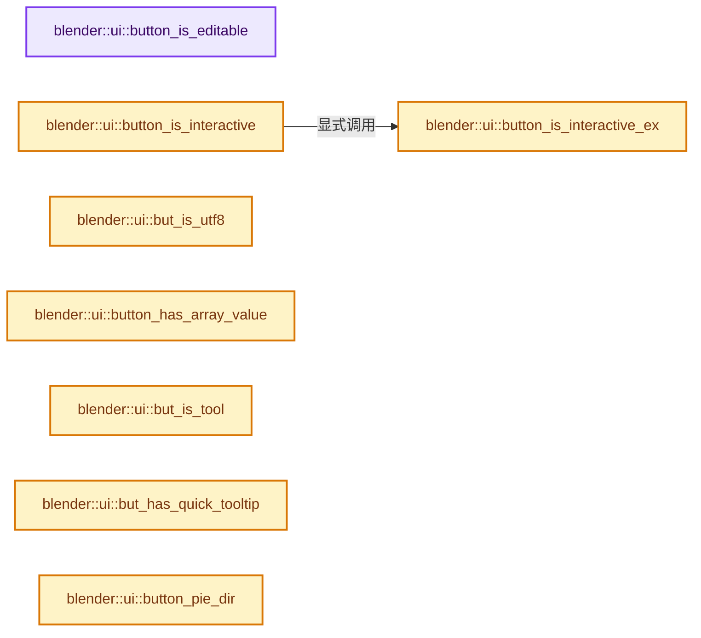

# 实现依赖专题：source/blender/editors/interface/interface_query.cc

[实现依赖导航](../../../README.md) · [符号索引](../../../../00-课程指南/02-源码与提交索引/符号依赖与实现索引.md)

本专题从正文实际调用进入，集中保存共享实现。函数有稳定锚点，可从调用处直接跳到对应完整函数；递归与互相调用通过回链组织。

## 本文件的实现关系




## 完整成员与函数实现

<a id="f-bed57efbef266d2c"></a>

### `blender::ui::button_is_editable`

实现位置：[source/blender/editors/interface/interface_query.cc](../../../../../../../../source/blender/editors/interface/interface_query.cc) · L39—L48。

接口参数：

- `const Button *but`

**教学注释版**

<!-- annotated:81ee0da3196884 -->

```cpp
bool button_is_editable(const Button *but)
{
  return !ELEM(but->type,
               ButtonType::Label,
               ButtonType::Sepr,
               ButtonType::SeprLine,
               ButtonType::Roundbox,
               ButtonType::ListBox,
               ButtonType::Progress);
}
```

<details>
<summary>核对原始源码：source/blender/editors/interface/interface_query.cc · L39—L48</summary>

<!-- original:81ee0da3196884:source/blender/editors/interface/interface_query.cc:39:48 -->

```cpp
bool button_is_editable(const Button *but)
{
  return !ELEM(but->type,
               ButtonType::Label,
               ButtonType::Sepr,
               ButtonType::SeprLine,
               ButtonType::Roundbox,
               ButtonType::ListBox,
               ButtonType::Progress);
}
```

</details>

**结果出口**

- `return !ELEM(but->type,`

**继续追踪实现**

- `ELEM` → [ELEM · L88](../../../07-Intern运行时与平台/ghost/intern/GHOST_utildefines.hh.md#m-d28724a15928)；[ELEM · L135](../../../01-BLI基础库/BLI_utildefines.hh.md#m-d6572de7cae0)。宏定义由构建条件选择。

<a id="f-0f1c64c286166b92"></a>

### `blender::ui::button_is_interactive_ex`

实现位置：[source/blender/editors/interface/interface_query.cc](../../../../../../../../source/blender/editors/interface/interface_query.cc) · L73—L124。

接口参数：

- `const Button *but`
- `const bool labeledit`
- `const bool for_tooltip`

**教学注释版**

<!-- annotated:9ca8710df0601b -->

```cpp
bool button_is_interactive_ex(const Button *but, const bool labeledit, const bool for_tooltip)
{
  /* NOTE: #ButtonType::Label is included for highlights, this allows drags. */
  if (ELEM(but->type, ButtonType::Label, ButtonType::PreviewTile)) {
    if (for_tooltip) {
      /* It's important labels are considered interactive for the purpose of showing tooltip. */
      if (!button_drag_is_draggable(but) && but->tip_func == nullptr &&
          but->tip_custom_func == nullptr && but->tip_quick_func == nullptr &&
          (but->tip == nullptr || but->tip[0] == '\0'))
      {
        return false;
      }
    }
    else {
      if (!button_drag_is_draggable(but)) {
        return false;
      }
    }
  }

  if (ELEM(but->type,
           ButtonType::Roundbox,
           ButtonType::Sepr,
           ButtonType::SeprLine,
           ButtonType::ListBox))
  {
    return false;
  }
  if (but->flag & UI_HIDDEN) {
    return false;
  }
  if (but->flag & UI_SCROLLED) {
    return false;
  }
  if ((but->type == ButtonType::Text) &&
      ELEM(but->emboss, EmbossType::None, EmbossType::NoneOrStatus) && !labeledit)
  {
    /* Make editable text buttons with no emboss interactive. */
    if (!static_cast<const ButtonText *>(but)->use_label_style) {
      return false;
    }
  }
  if ((but->type == ButtonType::ListRow) && labeledit) {
    return false;
  }
  if (but->type == ButtonType::ViewItem) {
    const auto *but_item = static_cast<const ButtonViewItem *>(but);
    return but_item->view_item->is_interactive();
  }

  return true;
}
```

<details>
<summary>核对原始源码：source/blender/editors/interface/interface_query.cc · L73—L124</summary>

<!-- original:9ca8710df0601b:source/blender/editors/interface/interface_query.cc:73:124 -->

```cpp
bool button_is_interactive_ex(const Button *but, const bool labeledit, const bool for_tooltip)
{
  /* NOTE: #ButtonType::Label is included for highlights, this allows drags. */
  if (ELEM(but->type, ButtonType::Label, ButtonType::PreviewTile)) {
    if (for_tooltip) {
      /* It's important labels are considered interactive for the purpose of showing tooltip. */
      if (!button_drag_is_draggable(but) && but->tip_func == nullptr &&
          but->tip_custom_func == nullptr && but->tip_quick_func == nullptr &&
          (but->tip == nullptr || but->tip[0] == '\0'))
      {
        return false;
      }
    }
    else {
      if (!button_drag_is_draggable(but)) {
        return false;
      }
    }
  }

  if (ELEM(but->type,
           ButtonType::Roundbox,
           ButtonType::Sepr,
           ButtonType::SeprLine,
           ButtonType::ListBox))
  {
    return false;
  }
  if (but->flag & UI_HIDDEN) {
    return false;
  }
  if (but->flag & UI_SCROLLED) {
    return false;
  }
  if ((but->type == ButtonType::Text) &&
      ELEM(but->emboss, EmbossType::None, EmbossType::NoneOrStatus) && !labeledit)
  {
    /* Make editable text buttons with no emboss interactive. */
    if (!static_cast<const ButtonText *>(but)->use_label_style) {
      return false;
    }
  }
  if ((but->type == ButtonType::ListRow) && labeledit) {
    return false;
  }
  if (but->type == ButtonType::ViewItem) {
    const auto *but_item = static_cast<const ButtonViewItem *>(but);
    return but_item->view_item->is_interactive();
  }

  return true;
}
```

</details>

**结果出口**

- `return false;`
- `return but_item->view_item->is_interactive();`
- `return true;`

**继续追踪实现**

- `ELEM` → [ELEM · L88](../../../07-Intern运行时与平台/ghost/intern/GHOST_utildefines.hh.md#m-d28724a15928)；[ELEM · L135](../../../01-BLI基础库/BLI_utildefines.hh.md#m-d6572de7cae0)。宏定义由构建条件选择。
- `button_drag_is_draggable` → [blender::ui::button_drag_is_draggable · L99](interface_drag.cc.md#f-758333ecb87927b1)。
- `but_item->view_item->is_interactive` → [调用协议](../../../../00-课程指南/01-路线与规范/模板宏与动态分派协议.md)：接收对象类型依赖auto、返回值或模板实例；不按同名猜测目标。调用位置L120。

<a id="f-0f562b98fb3b0ff2"></a>

### `blender::ui::button_is_interactive`

实现位置：[source/blender/editors/interface/interface_query.cc](../../../../../../../../source/blender/editors/interface/interface_query.cc) · L126—L129。

接口参数：

- `const Button *but`
- `const bool labeledit`

**教学注释版**

<!-- annotated:a457866dd3d67d -->

```cpp
bool button_is_interactive(const Button *but, const bool labeledit)
{
  return button_is_interactive_ex(but, labeledit, false);
}
```

<details>
<summary>核对原始源码：source/blender/editors/interface/interface_query.cc · L126—L129</summary>

<!-- original:a457866dd3d67d:source/blender/editors/interface/interface_query.cc:126:129 -->

```cpp
bool button_is_interactive(const Button *but, const bool labeledit)
{
  return button_is_interactive_ex(but, labeledit, false);
}
```

</details>

**结果出口**

- `return button_is_interactive_ex(but, labeledit, false);`

**继续追踪实现**

- `button_is_interactive_ex` → [blender::ui::button_is_interactive_ex · L73](interface_query.cc.md#f-0f1c64c286166b92)。

<a id="f-8c08f5fa20f1887a"></a>

### `blender::ui::but_is_utf8`

实现位置：[source/blender/editors/interface/interface_query.cc](../../../../../../../../source/blender/editors/interface/interface_query.cc) · L131—L137。

接口参数：

- `const Button *but`

**教学注释版**

<!-- annotated:1de7e79d51c860 -->

```cpp
bool but_is_utf8(const Button *but)
{
  if (but->rnaprop) {
    return RNA_property_string_is_utf8(but->rnaprop);
  }
  return !(but->flag & BUT_NO_UTF8);
}
```

<details>
<summary>核对原始源码：source/blender/editors/interface/interface_query.cc · L131—L137</summary>

<!-- original:1de7e79d51c860:source/blender/editors/interface/interface_query.cc:131:137 -->

```cpp
bool but_is_utf8(const Button *but)
{
  if (but->rnaprop) {
    return RNA_property_string_is_utf8(but->rnaprop);
  }
  return !(but->flag & BUT_NO_UTF8);
}
```

</details>

**结果出口**

- `return RNA_property_string_is_utf8(but->rnaprop);`
- `return !(but->flag & BUT_NO_UTF8);`

**继续追踪实现**

- `RNA_property_string_is_utf8` → [blender::RNA_property_string_is_utf8 · L1705](../../makesrna/intern/rna_access.cc.md#f-f259e9848050c471)。

<a id="f-a8b107bdc273b39f"></a>

### `blender::ui::button_has_array_value`

实现位置：[source/blender/editors/interface/interface_query.cc](../../../../../../../../source/blender/editors/interface/interface_query.cc) · L146—L149。

接口参数：

- `const Button *but`

**教学注释版**

<!-- annotated:a2d137518f52d9 -->

```cpp
bool button_has_array_value(const Button *but)
{
  return (but->rnapoin && but->rnaprop && RNA_property_array_check(but->rnaprop));
}
```

<details>
<summary>核对原始源码：source/blender/editors/interface/interface_query.cc · L146—L149</summary>

<!-- original:a2d137518f52d9:source/blender/editors/interface/interface_query.cc:146:149 -->

```cpp
bool button_has_array_value(const Button *but)
{
  return (but->rnapoin && but->rnaprop && RNA_property_array_check(but->rnaprop));
}
```

</details>

**结果出口**

- `return (but->rnapoin && but->rnaprop && RNA_property_array_check(but->rnaprop));`

**继续追踪实现**

- `RNA_property_array_check` → [blender::RNA_property_array_check · L1376](../../makesrna/intern/rna_access.cc.md#f-efbdada33e42c28c)。

<a id="f-a11ae7632e99a82c"></a>

### `blender::ui::but_is_tool`

实现位置：[source/blender/editors/interface/interface_query.cc](../../../../../../../../source/blender/editors/interface/interface_query.cc) · L152—L164。

接口参数：

- `const Button *but`

**教学注释版**

<!-- annotated:c7e5ed84f6ca90 -->

```cpp
bool but_is_tool(const Button *but)
{
  /* very evil! */
  if (but->optype != nullptr) {
    if (g_ot_tool_set_by_id == nullptr) {
      g_ot_tool_set_by_id = WM_operatortype_find("WM_OT_tool_set_by_id", false);
    }
    if (but->optype == g_ot_tool_set_by_id) {
      return true;
    }
  }
  return false;
}
```

<details>
<summary>核对原始源码：source/blender/editors/interface/interface_query.cc · L152—L164</summary>

<!-- original:c7e5ed84f6ca90:source/blender/editors/interface/interface_query.cc:152:164 -->

```cpp
bool but_is_tool(const Button *but)
{
  /* very evil! */
  if (but->optype != nullptr) {
    if (g_ot_tool_set_by_id == nullptr) {
      g_ot_tool_set_by_id = WM_operatortype_find("WM_OT_tool_set_by_id", false);
    }
    if (but->optype == g_ot_tool_set_by_id) {
      return true;
    }
  }
  return false;
}
```

</details>

**沿实际写入检查状态**

- `g_ot_tool_set_by_id = WM_operatortype_find("WM_OT_tool_set_by_id", false);`

**结果出口**

- `return true;`
- `return false;`

**继续追踪实现**

- `WM_operatortype_find` → [blender::WM_operatortype_find · L78](../../windowmanager/intern/wm_operator_type.cc.md#f-9fc2574dfd3703ee)。

<a id="f-7dbfac74dc77aa9e"></a>

### `blender::ui::but_has_quick_tooltip`

实现位置：[source/blender/editors/interface/interface_query.cc](../../../../../../../../source/blender/editors/interface/interface_query.cc) · L166—L169。

接口参数：

- `const Button *but`

**教学注释版**

<!-- annotated:82bdd9b24f37de -->

```cpp
bool but_has_quick_tooltip(const Button *but)
{
  return (but->drawflag & BUT_HAS_QUICK_TOOLTIP) != 0;
}
```

<details>
<summary>核对原始源码：source/blender/editors/interface/interface_query.cc · L166—L169</summary>

<!-- original:82bdd9b24f37de:source/blender/editors/interface/interface_query.cc:166:169 -->

```cpp
bool but_has_quick_tooltip(const Button *but)
{
  return (but->drawflag & BUT_HAS_QUICK_TOOLTIP) != 0;
}
```

</details>

**结果出口**

- `return (but->drawflag & BUT_HAS_QUICK_TOOLTIP) != 0;`

**继续追踪实现**

本实现没有需要继续展开的显式调用；检查返回表达式、对象转换和调用者前置条件。

<a id="f-fe09d6f7a2db250a"></a>

### `blender::ui::button_pie_dir`

实现位置：[source/blender/editors/interface/interface_query.cc](../../../../../../../../source/blender/editors/interface/interface_query.cc) · L197—L206。

接口参数：

- `RadialDirection dir`
- `float vec[2]`

**教学注释版**

<!-- annotated:b933fa15ff3264 -->

```cpp
void button_pie_dir(RadialDirection dir, float vec[2])
{
  float angle;

  BLI_assert(dir != UI_RADIAL_NONE);

  angle = DEG2RADF(float(radial_dir_to_angle[dir]));
  vec[0] = cosf(angle);
  vec[1] = sinf(angle);
}
```

<details>
<summary>核对原始源码：source/blender/editors/interface/interface_query.cc · L197—L206</summary>

<!-- original:b933fa15ff3264:source/blender/editors/interface/interface_query.cc:197:206 -->

```cpp
void button_pie_dir(RadialDirection dir, float vec[2])
{
  float angle;

  BLI_assert(dir != UI_RADIAL_NONE);

  angle = DEG2RADF(float(radial_dir_to_angle[dir]));
  vec[0] = cosf(angle);
  vec[1] = sinf(angle);
}
```

</details>

**沿实际写入检查状态**

- `angle = DEG2RADF(float(radial_dir_to_angle[dir]));`
- `vec[0] = cosf(angle);`
- `vec[1] = sinf(angle);`

**继续追踪实现**

- `BLI_assert` → [BLI_assert · L48](../../../01-BLI基础库/BLI_assert.hh.md#m-57a88495704d)；[BLI_assert · L63](../../../01-BLI基础库/BLI_assert.hh.md#m-d07050020cb5)。宏定义由构建条件选择。
- `DEG2RADF` → [DEG2RADF · L75](../../../01-BLI基础库/BLI_math_constants.hh.md#m-b7feaa4acbdb)；[DEG2RADF · L17](../../../07-Intern运行时与平台/cycles/app/cycles_xml.h.md#m-de839cbb85d5)。宏定义由构建条件选择。
- `cosf` → [cosf · L20](../../../07-Intern运行时与平台/cycles/kernel/svm/radial_tiling_shared.h.md#m-cee9ebf67d86)；[cosf · L42](../../../07-Intern运行时与平台/cycles/kernel/svm/radial_tiling_shared.h.md#m-346533627567)；[cosf · L73](../../../07-Intern运行时与平台/cycles/kernel/svm/radial_tiling_shared.h.md#m-e01b94a43b72)；[cosf · L24](../../../01-BLI基础库/intern/radial_tiling_shared.hh.md#m-c317cb08dec6)；[cosf · L46](../../../01-BLI基础库/intern/radial_tiling_shared.hh.md#m-93325b515297)；[cosf · L77](../../../01-BLI基础库/intern/radial_tiling_shared.hh.md#m-d3058af0b490)；[cosf · L20](../../../07-Intern运行时与平台/cycles/kernel/osl/shaders/node_radial_tiling_shared.h.md#m-4c6aea22a560)；[cosf · L42](../../../07-Intern运行时与平台/cycles/kernel/osl/shaders/node_radial_tiling_shared.h.md#m-1fd6a5414477)；[cosf · L73](../../../07-Intern运行时与平台/cycles/kernel/osl/shaders/node_radial_tiling_shared.h.md#m-de2402f85270)；[cosf · L186](../../../07-Intern运行时与平台/cycles/kernel/device/oneapi/compat.h.md#m-7fdbd99009e0)；[cosf · L288](../../../07-Intern运行时与平台/cycles/kernel/device/metal/compat.h.md#m-68fe984e8b68)；[cosf · L93](../../../07-Intern运行时与平台/cycles/kernel/device/hip/compat.h.md#m-21bb557a23f1)；[cosf · L91](../../../07-Intern运行时与平台/cycles/kernel/device/cuda/compat.h.md#m-7721be419a49)；[cosf · L43](../../gpu/GPU_shader_shared_utils.hh.md#m-25d02fd11b3b)；[cosf · L64](../../gpu/GPU_shader_shared_utils.hh.md#m-698fc51ccda3)。宏定义由构建条件选择。
- `sinf` → [sinf · L27](../../../07-Intern运行时与平台/cycles/kernel/svm/radial_tiling_shared.h.md#m-40547e913688)；[sinf · L49](../../../07-Intern运行时与平台/cycles/kernel/svm/radial_tiling_shared.h.md#m-8908e5f49833)；[sinf · L80](../../../07-Intern运行时与平台/cycles/kernel/svm/radial_tiling_shared.h.md#m-71130f6adcc4)；[sinf · L31](../../../01-BLI基础库/intern/radial_tiling_shared.hh.md#m-a51a6c88deca)；[sinf · L53](../../../01-BLI基础库/intern/radial_tiling_shared.hh.md#m-9a4db95358ff)；[sinf · L84](../../../01-BLI基础库/intern/radial_tiling_shared.hh.md#m-d26cdafe5b93)；[sinf · L27](../../../07-Intern运行时与平台/cycles/kernel/osl/shaders/node_radial_tiling_shared.h.md#m-9f80b4d363af)；[sinf · L49](../../../07-Intern运行时与平台/cycles/kernel/osl/shaders/node_radial_tiling_shared.h.md#m-f52c29b37ed1)；[sinf · L80](../../../07-Intern运行时与平台/cycles/kernel/osl/shaders/node_radial_tiling_shared.h.md#m-7f1f234ef9ec)；[sinf · L187](../../../07-Intern运行时与平台/cycles/kernel/device/oneapi/compat.h.md#m-aab07e522dda)；[sinf · L287](../../../07-Intern运行时与平台/cycles/kernel/device/metal/compat.h.md#m-7009b99c07ca)；[sinf · L94](../../../07-Intern运行时与平台/cycles/kernel/device/hip/compat.h.md#m-4a1f5d760325)；[sinf · L92](../../../07-Intern运行时与平台/cycles/kernel/device/cuda/compat.h.md#m-e63872738f13)；[sinf · L44](../../gpu/GPU_shader_shared_utils.hh.md#m-a916f31e38c4)；[sinf · L65](../../gpu/GPU_shader_shared_utils.hh.md#m-268edbf6d41e)。宏定义由构建条件选择。

<a id="f-915c02ea0c9955b6"></a>

### `blender::ui::but_isect_pie_seg`

实现位置：[source/blender/editors/interface/interface_query.cc](../../../../../../../../source/blender/editors/interface/interface_query.cc) · L208—L260。

接口参数：

- `const Block *block`
- `const Button *but`

**教学注释版**

<!-- annotated:7d9b1c5f3d2a0d -->

```cpp
static bool but_isect_pie_seg(const Block *block, const Button *but)
{
  if (block->pie_data->flags & PIE_INVALID_DIR) {
    return false;
  }

  /* Plus/minus 45 degrees: `cosf(DEG2RADF(45)) == M_SQRT1_2`. */
  const float angle_4th_cos = M_SQRT1_2;
  /* Plus/minus 22.5 degrees: `cosf(DEG2RADF(22.5))`. */
  const float angle_8th_cos = 0.9238795f;

  /* Use a large bias so edge-cases fall back to comparing with the adjacent direction. */
  const float eps_bias = 1e-4;

  float but_dir[2];
  button_pie_dir(but->pie_dir, but_dir);

  const float angle_but_cos = dot_v2v2(but_dir, block->pie_data->pie_dir);
  /* Outside range (with bias). */
  if (angle_but_cos < angle_4th_cos - eps_bias) {
    return false;
  }
  /* Inside range (with bias). */
  if (angle_but_cos > angle_8th_cos + eps_bias) {
    return true;
  }

  /* Check if adjacent direction is closer (with tie breaker). */
  RadialDirection dir_adjacent_8th, dir_adjacent_4th;
  if (angle_signed_v2v2(but_dir, block->pie_data->pie_dir) < 0.0f) {
    dir_adjacent_8th = UI_RADIAL_DIRECTION_PREV(but->pie_dir);
    dir_adjacent_4th = UI_RADIAL_DIRECTION_PREV(dir_adjacent_8th);
  }
  else {
    dir_adjacent_8th = UI_RADIAL_DIRECTION_NEXT(but->pie_dir);
    dir_adjacent_4th = UI_RADIAL_DIRECTION_NEXT(dir_adjacent_8th);
  }

  const bool has_8th_adjacent = block->pie_data->pie_dir_mask & (1 << int(dir_adjacent_8th));

  /* Compare with the adjacent direction (even if there is no button). */
  const RadialDirection dir_adjacent = has_8th_adjacent ? dir_adjacent_8th : dir_adjacent_4th;
  float but_dir_adjacent[2];
  button_pie_dir(dir_adjacent, but_dir_adjacent);

  const float angle_adjacent_cos = dot_v2v2(but_dir_adjacent, block->pie_data->pie_dir);

  /* Tie breaker, so one of the buttons is always selected. */
  if (angle_but_cos == angle_adjacent_cos) [[unlikely]] {
    return but->pie_dir > dir_adjacent;
  }
  return angle_but_cos > angle_adjacent_cos;
}
```

<details>
<summary>核对原始源码：source/blender/editors/interface/interface_query.cc · L208—L260</summary>

<!-- original:7d9b1c5f3d2a0d:source/blender/editors/interface/interface_query.cc:208:260 -->

```cpp
static bool but_isect_pie_seg(const Block *block, const Button *but)
{
  if (block->pie_data->flags & PIE_INVALID_DIR) {
    return false;
  }

  /* Plus/minus 45 degrees: `cosf(DEG2RADF(45)) == M_SQRT1_2`. */
  const float angle_4th_cos = M_SQRT1_2;
  /* Plus/minus 22.5 degrees: `cosf(DEG2RADF(22.5))`. */
  const float angle_8th_cos = 0.9238795f;

  /* Use a large bias so edge-cases fall back to comparing with the adjacent direction. */
  const float eps_bias = 1e-4;

  float but_dir[2];
  button_pie_dir(but->pie_dir, but_dir);

  const float angle_but_cos = dot_v2v2(but_dir, block->pie_data->pie_dir);
  /* Outside range (with bias). */
  if (angle_but_cos < angle_4th_cos - eps_bias) {
    return false;
  }
  /* Inside range (with bias). */
  if (angle_but_cos > angle_8th_cos + eps_bias) {
    return true;
  }

  /* Check if adjacent direction is closer (with tie breaker). */
  RadialDirection dir_adjacent_8th, dir_adjacent_4th;
  if (angle_signed_v2v2(but_dir, block->pie_data->pie_dir) < 0.0f) {
    dir_adjacent_8th = UI_RADIAL_DIRECTION_PREV(but->pie_dir);
    dir_adjacent_4th = UI_RADIAL_DIRECTION_PREV(dir_adjacent_8th);
  }
  else {
    dir_adjacent_8th = UI_RADIAL_DIRECTION_NEXT(but->pie_dir);
    dir_adjacent_4th = UI_RADIAL_DIRECTION_NEXT(dir_adjacent_8th);
  }

  const bool has_8th_adjacent = block->pie_data->pie_dir_mask & (1 << int(dir_adjacent_8th));

  /* Compare with the adjacent direction (even if there is no button). */
  const RadialDirection dir_adjacent = has_8th_adjacent ? dir_adjacent_8th : dir_adjacent_4th;
  float but_dir_adjacent[2];
  button_pie_dir(dir_adjacent, but_dir_adjacent);

  const float angle_adjacent_cos = dot_v2v2(but_dir_adjacent, block->pie_data->pie_dir);

  /* Tie breaker, so one of the buttons is always selected. */
  if (angle_but_cos == angle_adjacent_cos) [[unlikely]] {
    return but->pie_dir > dir_adjacent;
  }
  return angle_but_cos > angle_adjacent_cos;
}
```

</details>

**沿实际写入检查状态**

- `dir_adjacent_8th = UI_RADIAL_DIRECTION_PREV(but->pie_dir);`
- `dir_adjacent_4th = UI_RADIAL_DIRECTION_PREV(dir_adjacent_8th);`
- `dir_adjacent_8th = UI_RADIAL_DIRECTION_NEXT(but->pie_dir);`
- `dir_adjacent_4th = UI_RADIAL_DIRECTION_NEXT(dir_adjacent_8th);`

**结果出口**

- `return false;`
- `return true;`
- `return but->pie_dir > dir_adjacent;`
- `return angle_but_cos > angle_adjacent_cos;`

**继续追踪实现**

- `button_pie_dir` → [blender::ui::button_pie_dir · L197](interface_query.cc.md#f-fe09d6f7a2db250a)。
- `dot_v2v2` → [blender::dot_v2v2 · L636](../../../01-BLI基础库/intern/math_vector_inline.cc.md#f-48540c18a12b0f43)。
- `angle_signed_v2v2` → [blender::angle_signed_v2v2 · L330](../../../01-BLI基础库/intern/math_vector.cc.md#f-d5f777f74eb07000)。
- `UI_RADIAL_DIRECTION_PREV` → [UI_RADIAL_DIRECTION_PREV · L139](interface_intern.hh.md#m-34886fe7fe27)。宏定义由构建条件选择。
- `UI_RADIAL_DIRECTION_NEXT` → [UI_RADIAL_DIRECTION_NEXT · L137](interface_intern.hh.md#m-1984bb18659d)。宏定义由构建条件选择。

<a id="f-39f4b4fa10a76813"></a>

### `blender::ui::button_contains_pt`

实现位置：[source/blender/editors/interface/interface_query.cc](../../../../../../../../source/blender/editors/interface/interface_query.cc) · L262—L270。

接口参数：

- `const Button *but`
- `float mx`
- `float my`

**教学注释版**

<!-- annotated:8c550a87f57769 -->

```cpp
bool button_contains_pt(const Button *but, float mx, float my)
{
  rctf rect = but->rect;
  /* Add a magin to allow selecting points at the border of curves maps. */
  if (ELEM(but->type, ButtonType::Curve, ButtonType::CurveProfile)) {
    BLI_rctf_pad(&rect, 4, 4);
  }
  return BLI_rctf_isect_pt(&rect, mx, my);
}
```

<details>
<summary>核对原始源码：source/blender/editors/interface/interface_query.cc · L262—L270</summary>

<!-- original:8c550a87f57769:source/blender/editors/interface/interface_query.cc:262:270 -->

```cpp
bool button_contains_pt(const Button *but, float mx, float my)
{
  rctf rect = but->rect;
  /* Add a magin to allow selecting points at the border of curves maps. */
  if (ELEM(but->type, ButtonType::Curve, ButtonType::CurveProfile)) {
    BLI_rctf_pad(&rect, 4, 4);
  }
  return BLI_rctf_isect_pt(&rect, mx, my);
}
```

</details>

**结果出口**

- `return BLI_rctf_isect_pt(&rect, mx, my);`

**继续追踪实现**

- `ELEM` → [ELEM · L88](../../../07-Intern运行时与平台/ghost/intern/GHOST_utildefines.hh.md#m-d28724a15928)；[ELEM · L135](../../../01-BLI基础库/BLI_utildefines.hh.md#m-d6572de7cae0)。宏定义由构建条件选择。
- `BLI_rctf_pad` → [blender::BLI_rctf_pad · L651](../../../01-BLI基础库/intern/rct.cc.md#f-3207ef1b8e8a47e2)。
- `BLI_rctf_isect_pt` → [blender::BLI_rctf_isect_pt · L117](../../../01-BLI基础库/intern/rct.cc.md#f-b77b2af9325e2cfe)。

<a id="f-b6c5a9f3017ee120"></a>

### `blender::ui::button_contains_point_px`

实现位置：[source/blender/editors/interface/interface_query.cc](../../../../../../../../source/blender/editors/interface/interface_query.cc) · L277—L297。

接口参数：

- `const Button *but`
- `const ARegion *region`
- `const int xy[2]`

**教学注释版**

<!-- annotated:97071aa4ea4b3c -->

```cpp
bool button_contains_point_px(const Button *but, const ARegion *region, const int xy[2])
{
  Block *block = but->block;
  if (!region_contains_point_px(region, xy)) {
    return false;
  }

  float mx = xy[0], my = xy[1];
  window_to_block_fl(region, block, &mx, &my);

  if (but->pie_dir != UI_RADIAL_NONE) {
    if (!but_isect_pie_seg(block, but)) {
      return false;
    }
  }
  else if (!button_contains_pt(but, mx, my)) {
    return false;
  }

  return true;
}
```

<details>
<summary>核对原始源码：source/blender/editors/interface/interface_query.cc · L277—L297</summary>

<!-- original:97071aa4ea4b3c:source/blender/editors/interface/interface_query.cc:277:297 -->

```cpp
bool button_contains_point_px(const Button *but, const ARegion *region, const int xy[2])
{
  Block *block = but->block;
  if (!region_contains_point_px(region, xy)) {
    return false;
  }

  float mx = xy[0], my = xy[1];
  window_to_block_fl(region, block, &mx, &my);

  if (but->pie_dir != UI_RADIAL_NONE) {
    if (!but_isect_pie_seg(block, but)) {
      return false;
    }
  }
  else if (!button_contains_pt(but, mx, my)) {
    return false;
  }

  return true;
}
```

</details>

**结果出口**

- `return false;`
- `return true;`

**继续追踪实现**

- `region_contains_point_px` → [blender::ui::region_contains_point_px · L825](interface_query.cc.md#f-a399efe703249d5c)。
- `window_to_block_fl` → [blender::ui::window_to_block_fl · L193](interface.cc.md#f-f9f0f1e8cbd36965)。
- `but_isect_pie_seg` → [blender::ui::but_isect_pie_seg · L208](interface_query.cc.md#f-915c02ea0c9955b6)。
- `button_contains_pt` → [blender::ui::button_contains_pt · L262](interface_query.cc.md#f-39f4b4fa10a76813)。

<a id="f-189cf9ebf1fcdbba"></a>

### `blender::ui::but_contains_point_px_icon`

实现位置：[source/blender/editors/interface/interface_query.cc](../../../../../../../../source/blender/editors/interface/interface_query.cc) · L299—L321。

接口参数：

- `const Button *but`
- `ARegion *region`
- `const wmEvent *event`

**教学注释版**

<!-- annotated:ff245377a56eef -->

```cpp
bool but_contains_point_px_icon(const Button *but, ARegion *region, const wmEvent *event)
{
  rcti rect;
  int x = event->xy[0], y = event->xy[1];

  window_to_block(region, but->block, &x, &y);

  BLI_rcti_rctf_copy(&rect, &but->rect);

  if (but->dragflag & BUT_DRAG_FULL_BUT) {
    /* use button size itself */
  }
  else if (but->drawflag & BUT_ICON_LEFT) {
    rect.xmax = rect.xmin + BLI_rcti_size_y(&rect);
  }
  else {
    const int delta = BLI_rcti_size_x(&rect) - BLI_rcti_size_y(&rect);
    rect.xmin += delta / 2;
    rect.xmax -= delta / 2;
  }

  return BLI_rcti_isect_pt(&rect, x, y);
}
```

<details>
<summary>核对原始源码：source/blender/editors/interface/interface_query.cc · L299—L321</summary>

<!-- original:ff245377a56eef:source/blender/editors/interface/interface_query.cc:299:321 -->

```cpp
bool but_contains_point_px_icon(const Button *but, ARegion *region, const wmEvent *event)
{
  rcti rect;
  int x = event->xy[0], y = event->xy[1];

  window_to_block(region, but->block, &x, &y);

  BLI_rcti_rctf_copy(&rect, &but->rect);

  if (but->dragflag & BUT_DRAG_FULL_BUT) {
    /* use button size itself */
  }
  else if (but->drawflag & BUT_ICON_LEFT) {
    rect.xmax = rect.xmin + BLI_rcti_size_y(&rect);
  }
  else {
    const int delta = BLI_rcti_size_x(&rect) - BLI_rcti_size_y(&rect);
    rect.xmin += delta / 2;
    rect.xmax -= delta / 2;
  }

  return BLI_rcti_isect_pt(&rect, x, y);
}
```

</details>

**沿实际写入检查状态**

- `rect.xmax = rect.xmin + BLI_rcti_size_y(&rect);`
- `rect.xmin += delta / 2;`
- `rect.xmax -= delta / 2;`

**结果出口**

- `return BLI_rcti_isect_pt(&rect, x, y);`

**继续追踪实现**

- `window_to_block` → [blender::ui::window_to_block · L230](interface.cc.md#f-9e1403f8936ce644)。
- `BLI_rcti_rctf_copy` → [blender::BLI_rcti_rctf_copy · L1050](../../../01-BLI基础库/intern/rct.cc.md#f-cfa441661841e72d)。
- `BLI_rcti_size_y` → [blender::BLI_rcti_size_y · L207](../../../01-BLI基础库/BLI_rect.hh.md#f-ac87d6c708d502ad)。
- `BLI_rcti_size_x` → [blender::BLI_rcti_size_x · L203](../../../01-BLI基础库/BLI_rect.hh.md#f-7a8fb2c54a829be6)。
- `BLI_rcti_isect_pt` → [blender::BLI_rcti_isect_pt · L61](../../../01-BLI基础库/intern/rct.cc.md#f-9e89b79c8d771c1b)。

<a id="f-16679eaf4bc6219c"></a>

### `blender::ui::button_find_mouse_over_ex`

实现位置：[source/blender/editors/interface/interface_query.cc](../../../../../../../../source/blender/editors/interface/interface_query.cc) · L339—L388。

接口参数：

- `const ARegion *region`
- `const int xy[2]`
- `const bool labeledit`
- `const bool for_tooltip`
- `const ButtonFindPollFn find_poll`
- `const void *find_custom_data`

**教学注释版**

<!-- annotated:e909467ff3155c -->

```cpp
Button *button_find_mouse_over_ex(const ARegion *region,
                                  const int xy[2],
                                  const bool labeledit,
                                  const bool for_tooltip,
                                  const ButtonFindPollFn find_poll,
                                  const void *find_custom_data)
{
  Button *butover = nullptr;

  if (!region_contains_point_px(region, xy)) {
    return nullptr;
  }
  for (Block &block : region->runtime->uiblocks) {
    float mx = xy[0], my = xy[1];
    window_to_block_fl(region, &block, &mx, &my);
    /* Skip when the mouse is hovering auto-scroll handlers. */
    if ((block.flag & BLOCK_CLIPTOP && block.rect.ymax - UI_MENU_SCROLL_MOUSE < my) ||
        (block.flag & BLOCK_CLIPBOTTOM && block.rect.ymin + UI_MENU_SCROLL_MOUSE > my))
    {
      continue;
    }
    for (Button &but : block.buttons() | std::views::reverse) {
      if (find_poll && find_poll(&but, find_custom_data) == false) {
        continue;
      }
      if (button_is_interactive_ex(&but, labeledit, for_tooltip)) {
        if (but.pie_dir != UI_RADIAL_NONE) {
          if (but_isect_pie_seg(&block, &but)) {
            butover = &but;
            break;
          }
        }
        else if (button_contains_pt(&but, mx, my)) {
          butover = &but;
          break;
        }
      }
    }

    /* CLIP_EVENTS prevents the event from reaching other blocks */
    if (block.flag & BLOCK_CLIP_EVENTS) {
      /* check if mouse is inside block */
      if (BLI_rctf_isect_pt(&block.rect, mx, my)) {
        break;
      }
    }
  }

  return butover;
}
```

<details>
<summary>核对原始源码：source/blender/editors/interface/interface_query.cc · L339—L388</summary>

<!-- original:e909467ff3155c:source/blender/editors/interface/interface_query.cc:339:388 -->

```cpp
Button *button_find_mouse_over_ex(const ARegion *region,
                                  const int xy[2],
                                  const bool labeledit,
                                  const bool for_tooltip,
                                  const ButtonFindPollFn find_poll,
                                  const void *find_custom_data)
{
  Button *butover = nullptr;

  if (!region_contains_point_px(region, xy)) {
    return nullptr;
  }
  for (Block &block : region->runtime->uiblocks) {
    float mx = xy[0], my = xy[1];
    window_to_block_fl(region, &block, &mx, &my);
    /* Skip when the mouse is hovering auto-scroll handlers. */
    if ((block.flag & BLOCK_CLIPTOP && block.rect.ymax - UI_MENU_SCROLL_MOUSE < my) ||
        (block.flag & BLOCK_CLIPBOTTOM && block.rect.ymin + UI_MENU_SCROLL_MOUSE > my))
    {
      continue;
    }
    for (Button &but : block.buttons() | std::views::reverse) {
      if (find_poll && find_poll(&but, find_custom_data) == false) {
        continue;
      }
      if (button_is_interactive_ex(&but, labeledit, for_tooltip)) {
        if (but.pie_dir != UI_RADIAL_NONE) {
          if (but_isect_pie_seg(&block, &but)) {
            butover = &but;
            break;
          }
        }
        else if (button_contains_pt(&but, mx, my)) {
          butover = &but;
          break;
        }
      }
    }

    /* CLIP_EVENTS prevents the event from reaching other blocks */
    if (block.flag & BLOCK_CLIP_EVENTS) {
      /* check if mouse is inside block */
      if (BLI_rctf_isect_pt(&block.rect, mx, my)) {
        break;
      }
    }
  }

  return butover;
}
```

</details>

**沿实际写入检查状态**

- `butover = &but;`

**结果出口**

- `return nullptr;`
- `return butover;`

**继续追踪实现**

- `region_contains_point_px` → [blender::ui::region_contains_point_px · L825](interface_query.cc.md#f-a399efe703249d5c)。
- `window_to_block_fl` → [blender::ui::window_to_block_fl · L193](interface.cc.md#f-f9f0f1e8cbd36965)。
- `block.buttons` → [调用协议](../../../../00-课程指南/01-路线与规范/模板宏与动态分派协议.md)：接收对象类型依赖auto、返回值或模板实例；不按同名猜测目标。调用位置L360。
- `find_poll` → [调用协议](../../../../00-课程指南/01-路线与规范/模板宏与动态分派协议.md)：局部可调用对象，须结合其初始化与捕获环境。调用位置L361。
- `button_is_interactive_ex` → [blender::ui::button_is_interactive_ex · L73](interface_query.cc.md#f-0f1c64c286166b92)。
- `but_isect_pie_seg` → [blender::ui::but_isect_pie_seg · L208](interface_query.cc.md#f-915c02ea0c9955b6)。
- `button_contains_pt` → [blender::ui::button_contains_pt · L262](interface_query.cc.md#f-39f4b4fa10a76813)。
- `BLI_rctf_isect_pt` → [blender::BLI_rctf_isect_pt · L117](../../../01-BLI基础库/intern/rct.cc.md#f-b77b2af9325e2cfe)。

<a id="f-d268ebc1596dce9d"></a>

### `blender::ui::listbox_find_mouse_over_ex`

实现位置：[source/blender/editors/interface/interface_query.cc](../../../../../../../../source/blender/editors/interface/interface_query.cc) · L434—L450。

接口参数：

- `const ARegion *region`
- `const int xy[2]`

**教学注释版**

<!-- annotated:974c3ab778134d -->

```cpp
Button *listbox_find_mouse_over_ex(const ARegion *region, const int xy[2])
{
  if (!region_contains_point_px(region, xy)) {
    return nullptr;
  }
  for (Block &block : region->runtime->uiblocks) {
    float mx = xy[0], my = xy[1];
    window_to_block_fl(region, &block, &mx, &my);
    for (Button &but : block.buttons() | std::views::reverse) {
      if (but.type == ButtonType::ListBox && button_contains_pt(&but, mx, my)) {
        return &but;
      }
    }
  }

  return nullptr;
}
```

<details>
<summary>核对原始源码：source/blender/editors/interface/interface_query.cc · L434—L450</summary>

<!-- original:974c3ab778134d:source/blender/editors/interface/interface_query.cc:434:450 -->

```cpp
Button *listbox_find_mouse_over_ex(const ARegion *region, const int xy[2])
{
  if (!region_contains_point_px(region, xy)) {
    return nullptr;
  }
  for (Block &block : region->runtime->uiblocks) {
    float mx = xy[0], my = xy[1];
    window_to_block_fl(region, &block, &mx, &my);
    for (Button &but : block.buttons() | std::views::reverse) {
      if (but.type == ButtonType::ListBox && button_contains_pt(&but, mx, my)) {
        return &but;
      }
    }
  }

  return nullptr;
}
```

</details>

**结果出口**

- `return nullptr;`
- `return &but;`

**继续追踪实现**

- `region_contains_point_px` → [blender::ui::region_contains_point_px · L825](interface_query.cc.md#f-a399efe703249d5c)。
- `window_to_block_fl` → [blender::ui::window_to_block_fl · L193](interface.cc.md#f-f9f0f1e8cbd36965)。
- `block.buttons` → [调用协议](../../../../00-课程指南/01-路线与规范/模板宏与动态分派协议.md)：接收对象类型依赖auto、返回值或模板实例；不按同名猜测目标。调用位置L442。
- `button_contains_pt` → [blender::ui::button_contains_pt · L262](interface_query.cc.md#f-39f4b4fa10a76813)。

<a id="f-a3d1c3430c26706f"></a>

### `blender::ui::listbox_find_mouse_over`

实现位置：[source/blender/editors/interface/interface_query.cc](../../../../../../../../source/blender/editors/interface/interface_query.cc) · L452—L459。

接口参数：

- `const ARegion *region`
- `const wmEvent *event`

**教学注释版**

<!-- annotated:64e34f36f24db8 -->

```cpp
Button *listbox_find_mouse_over(const ARegion *region, const wmEvent *event)
{
  if (event == nullptr) {
    /* If there is no info about the mouse, just act as if there is nothing underneath it. */
    return nullptr;
  }
  return listbox_find_mouse_over_ex(region, event->xy);
}
```

<details>
<summary>核对原始源码：source/blender/editors/interface/interface_query.cc · L452—L459</summary>

<!-- original:64e34f36f24db8:source/blender/editors/interface/interface_query.cc:452:459 -->

```cpp
Button *listbox_find_mouse_over(const ARegion *region, const wmEvent *event)
{
  if (event == nullptr) {
    /* If there is no info about the mouse, just act as if there is nothing underneath it. */
    return nullptr;
  }
  return listbox_find_mouse_over_ex(region, event->xy);
}
```

</details>

**结果出口**

- `return nullptr;`
- `return listbox_find_mouse_over_ex(region, event->xy);`

**继续追踪实现**

- `listbox_find_mouse_over_ex` → [blender::ui::listbox_find_mouse_over_ex · L434](interface_query.cc.md#f-d268ebc1596dce9d)。

<a id="f-a99c7027467d5f5b"></a>

### `blender::ui::listrow_find_mouse_over`

实现位置：[source/blender/editors/interface/interface_query.cc](../../../../../../../../source/blender/editors/interface/interface_query.cc) · L484—L487。

接口参数：

- `const ARegion *region`
- `const int xy[2]`

**教学注释版**

<!-- annotated:3bf974424e5da2 -->

```cpp
Button *listrow_find_mouse_over(const ARegion *region, const int xy[2])
{
  return button_find_mouse_over_ex(region, xy, false, false, but_is_listrow, nullptr);
}
```

<details>
<summary>核对原始源码：source/blender/editors/interface/interface_query.cc · L484—L487</summary>

<!-- original:3bf974424e5da2:source/blender/editors/interface/interface_query.cc:484:487 -->

```cpp
Button *listrow_find_mouse_over(const ARegion *region, const int xy[2])
{
  return button_find_mouse_over_ex(region, xy, false, false, but_is_listrow, nullptr);
}
```

</details>

**结果出口**

- `return button_find_mouse_over_ex(region, xy, false, false, but_is_listrow, nullptr);`

**继续追踪实现**

- `button_find_mouse_over_ex` → [blender::ui::button_find_mouse_over_ex · L339](interface_query.cc.md#f-16679eaf4bc6219c)。

<a id="f-7e2b5b5a95becf78"></a>

### `blender::ui::view_item_find_mouse_over`

实现位置：[source/blender/editors/interface/interface_query.cc](../../../../../../../../source/blender/editors/interface/interface_query.cc) · L516—L519。

接口参数：

- `const ARegion *region`
- `const int xy[2]`

**教学注释版**

<!-- annotated:d64c7e15b64e9a -->

```cpp
Button *view_item_find_mouse_over(const ARegion *region, const int xy[2])
{
  return button_find_mouse_over_ex(region, xy, false, false, but_is_view_item_fn, nullptr);
}
```

<details>
<summary>核对原始源码：source/blender/editors/interface/interface_query.cc · L516—L519</summary>

<!-- original:d64c7e15b64e9a:source/blender/editors/interface/interface_query.cc:516:519 -->

```cpp
Button *view_item_find_mouse_over(const ARegion *region, const int xy[2])
{
  return button_find_mouse_over_ex(region, xy, false, false, but_is_view_item_fn, nullptr);
}
```

</details>

**结果出口**

- `return button_find_mouse_over_ex(region, xy, false, false, but_is_view_item_fn, nullptr);`

**继续追踪实现**

- `button_find_mouse_over_ex` → [blender::ui::button_find_mouse_over_ex · L339](interface_query.cc.md#f-16679eaf4bc6219c)。

<a id="f-86bd83d7b3cfb9c8"></a>

### `blender::ui::button_first`

实现位置：[source/blender/editors/interface/interface_query.cc](../../../../../../../../source/blender/editors/interface/interface_query.cc) · L580—L588。

接口参数：

- `Block *block`

**教学注释版**

<!-- annotated:045af9f97640b2 -->

```cpp
Button *button_first(Block *block)
{
  for (Button &but : block->buttons()) {
    if (button_is_editable(&but)) {
      return &but;
    }
  }
  return nullptr;
}
```

<details>
<summary>核对原始源码：source/blender/editors/interface/interface_query.cc · L580—L588</summary>

<!-- original:045af9f97640b2:source/blender/editors/interface/interface_query.cc:580:588 -->

```cpp
Button *button_first(Block *block)
{
  for (Button &but : block->buttons()) {
    if (button_is_editable(&but)) {
      return &but;
    }
  }
  return nullptr;
}
```

</details>

**结果出口**

- `return &but;`
- `return nullptr;`

**继续追踪实现**

- `block->buttons` → [blender::ui::Block::buttons · L836](interface_intern.hh.md#f-5296ad5fd22b5505)。
- `button_is_editable` → [blender::ui::button_is_editable · L39](interface_query.cc.md#f-bed57efbef266d2c)。

<a id="f-9d1fc0bdccf5c288"></a>

### `blender::ui::button_is_cursor_warp`

实现位置：[source/blender/editors/interface/interface_query.cc](../../../../../../../../source/blender/editors/interface/interface_query.cc) · L600—L617。

接口参数：

- `const Button *but`

**教学注释版**

<!-- annotated:c2711832e2fbe9 -->

```cpp
bool button_is_cursor_warp(const Button *but)
{
  if (U.uiflag & USER_CONTINUOUS_MOUSE) {
    if (ELEM(but->type,
             ButtonType::Num,
             ButtonType::NumSlider,
             ButtonType::TrackPreview,
             ButtonType::HsvCube,
             ButtonType::HsvCircle,
             ButtonType::Curve,
             ButtonType::CurveProfile))
    {
      return true;
    }
  }

  return false;
}
```

<details>
<summary>核对原始源码：source/blender/editors/interface/interface_query.cc · L600—L617</summary>

<!-- original:c2711832e2fbe9:source/blender/editors/interface/interface_query.cc:600:617 -->

```cpp
bool button_is_cursor_warp(const Button *but)
{
  if (U.uiflag & USER_CONTINUOUS_MOUSE) {
    if (ELEM(but->type,
             ButtonType::Num,
             ButtonType::NumSlider,
             ButtonType::TrackPreview,
             ButtonType::HsvCube,
             ButtonType::HsvCircle,
             ButtonType::Curve,
             ButtonType::CurveProfile))
    {
      return true;
    }
  }

  return false;
}
```

</details>

**结果出口**

- `return true;`
- `return false;`

**继续追踪实现**

- `ELEM` → [ELEM · L88](../../../07-Intern运行时与平台/ghost/intern/GHOST_utildefines.hh.md#m-d28724a15928)；[ELEM · L135](../../../01-BLI基础库/BLI_utildefines.hh.md#m-d6572de7cae0)。宏定义由构建条件选择。

<a id="f-7fb78220c75fc36d"></a>

### `blender::ui::but_contains_password`

实现位置：[source/blender/editors/interface/interface_query.cc](../../../../../../../../source/blender/editors/interface/interface_query.cc) · L619—L622。

接口参数：

- `const Button *but`

**教学注释版**

<!-- annotated:af615904f796a5 -->

```cpp
bool but_contains_password(const Button *but)
{
  return but->rnaprop && (RNA_property_subtype(but->rnaprop) == PROP_PASSWORD);
}
```

<details>
<summary>核对原始源码：source/blender/editors/interface/interface_query.cc · L619—L622</summary>

<!-- original:af615904f796a5:source/blender/editors/interface/interface_query.cc:619:622 -->

```cpp
bool but_contains_password(const Button *but)
{
  return but->rnaprop && (RNA_property_subtype(but->rnaprop) == PROP_PASSWORD);
}
```

</details>

**结果出口**

- `return but->rnaprop && (RNA_property_subtype(but->rnaprop) == PROP_PASSWORD);`

**继续追踪实现**

- `RNA_property_subtype` → [blender::RNA_property_subtype · L1298](../../makesrna/intern/rna_access.cc.md#f-993b1583bfe2d18a)。

<a id="f-8b975866590a4bc8"></a>

### `blender::ui::button_drawstr_len_without_sep_char`

实现位置：[source/blender/editors/interface/interface_query.cc](../../../../../../../../source/blender/editors/interface/interface_query.cc) · L630—L639。

接口参数：

- `const Button *but`

**教学注释版**

<!-- annotated:adee1df7634ccd -->

```cpp
size_t button_drawstr_len_without_sep_char(const Button *but)
{
  if (but->flag & BUT_HAS_SEP_CHAR) {
    const size_t sep_index = but->drawstr.find(UI_SEP_CHAR);
    if (sep_index != std::string::npos) {
      return sep_index;
    }
  }
  return but->drawstr.size();
}
```

<details>
<summary>核对原始源码：source/blender/editors/interface/interface_query.cc · L630—L639</summary>

<!-- original:adee1df7634ccd:source/blender/editors/interface/interface_query.cc:630:639 -->

```cpp
size_t button_drawstr_len_without_sep_char(const Button *but)
{
  if (but->flag & BUT_HAS_SEP_CHAR) {
    const size_t sep_index = but->drawstr.find(UI_SEP_CHAR);
    if (sep_index != std::string::npos) {
      return sep_index;
    }
  }
  return but->drawstr.size();
}
```

</details>

**结果出口**

- `return sep_index;`
- `return but->drawstr.size();`

**继续追踪实现**

- `but->drawstr.find` → [调用协议](../../../../00-课程指南/01-路线与规范/模板宏与动态分派协议.md)：接收对象类型依赖auto、返回值或模板实例；不按同名猜测目标。调用位置L633。
- `but->drawstr.size` → [调用协议](../../../../00-课程指南/01-路线与规范/模板宏与动态分派协议.md)：接收对象类型依赖auto、返回值或模板实例；不按同名猜测目标。调用位置L638。

<a id="f-d05ae8f548002cfa"></a>

### `blender::ui::button_drawstr_without_sep_char`

实现位置：[source/blender/editors/interface/interface_query.cc](../../../../../../../../source/blender/editors/interface/interface_query.cc) · L641—L645。

接口参数：

- `const Button *but`

**教学注释版**

<!-- annotated:a76c34774f21e1 -->

```cpp
StringRef button_drawstr_without_sep_char(const Button *but)
{
  size_t str_len_clip = button_drawstr_len_without_sep_char(but);
  return StringRef(but->drawstr).substr(0, str_len_clip);
}
```

<details>
<summary>核对原始源码：source/blender/editors/interface/interface_query.cc · L641—L645</summary>

<!-- original:a76c34774f21e1:source/blender/editors/interface/interface_query.cc:641:645 -->

```cpp
StringRef button_drawstr_without_sep_char(const Button *but)
{
  size_t str_len_clip = button_drawstr_len_without_sep_char(but);
  return StringRef(but->drawstr).substr(0, str_len_clip);
}
```

</details>

**结果出口**

- `return StringRef(but->drawstr).substr(0, str_len_clip);`

**继续追踪实现**

- `button_drawstr_len_without_sep_char` → [blender::ui::button_drawstr_len_without_sep_char · L630](interface_query.cc.md#f-8b975866590a4bc8)。
- `StringRef(but->drawstr).substr` → [调用协议](../../../../00-课程指南/01-路线与规范/模板宏与动态分派协议.md)：接收对象类型依赖auto、返回值或模板实例；不按同名猜测目标。调用位置L644。
- `StringRef` → [blender::StringRef::StringRef · L555](../../../../01-基础容器与现代CPP/15-StringRef字符串视图.md#f-f6aca324a36faa7e)；[blender::StringRef::StringRef · L560](../../../../01-基础容器与现代CPP/15-StringRef字符串视图.md#f-ab9714781ca51bac)；[blender::StringRef::StringRef · L565](../../../../01-基础容器与现代CPP/15-StringRef字符串视图.md#f-95f0b483bbdd7739)；[blender::StringRef::StringRef · L570](../../../../01-基础容器与现代CPP/15-StringRef字符串视图.md#f-808d05699cb33334)；[blender::StringRef::StringRef · L631](../../../../01-基础容器与现代CPP/15-StringRef字符串视图.md#f-37788e5f3fa3b736)；[blender::StringRef::StringRef · L641](../../../../01-基础容器与现代CPP/15-StringRef字符串视图.md#f-11abd0510fb6b926)；[blender::StringRef::StringRef · L646](../../../../01-基础容器与现代CPP/15-StringRef字符串视图.md#f-8437dbd8a582eefd)；[blender::StringRef::StringRef · L651](../../../../01-基础容器与现代CPP/15-StringRef字符串视图.md#f-70bcb338de0db978)。同名重载需按实参类型选择。

<a id="f-5c83bace6983dd60"></a>

### `blender::ui::button_tip_len_only_first_line`

实现位置：[source/blender/editors/interface/interface_query.cc](../../../../../../../../source/blender/editors/interface/interface_query.cc) · L647—L657。

接口参数：

- `const Button *but`

**教学注释版**

<!-- annotated:1e2a2c0a60fc7c -->

```cpp
size_t button_tip_len_only_first_line(const Button *but)
{
  if (but->tip == nullptr) {
    return 0;
  }
  const int64_t str_step = but->tip.find('\n');
  if (str_step == StringRef::not_found) {
    return but->tip.size();
  }
  return str_step;
}
```

<details>
<summary>核对原始源码：source/blender/editors/interface/interface_query.cc · L647—L657</summary>

<!-- original:1e2a2c0a60fc7c:source/blender/editors/interface/interface_query.cc:647:657 -->

```cpp
size_t button_tip_len_only_first_line(const Button *but)
{
  if (but->tip == nullptr) {
    return 0;
  }
  const int64_t str_step = but->tip.find('\n');
  if (str_step == StringRef::not_found) {
    return but->tip.size();
  }
  return str_step;
}
```

</details>

**结果出口**

- `return 0;`
- `return but->tip.size();`
- `return str_step;`

**继续追踪实现**

- `but->tip.find` → [调用协议](../../../../00-课程指南/01-路线与规范/模板宏与动态分派协议.md)：接收对象类型依赖auto、返回值或模板实例；不按同名猜测目标。调用位置L652。
- `but->tip.size` → [调用协议](../../../../00-课程指南/01-路线与规范/模板宏与动态分派协议.md)：接收对象类型依赖auto、返回值或模板实例；不按同名猜测目标。调用位置L654。

<a id="f-7a5c2c02f751697e"></a>

### `blender::ui::block_active_but_get`

实现位置：[source/blender/editors/interface/interface_query.cc](../../../../../../../../source/blender/editors/interface/interface_query.cc) · L665—L674。

接口参数：

- `const Block *block`

**教学注释版**

<!-- annotated:06456facb54255 -->

```cpp
Button *block_active_but_get(const Block *block)
{
  for (Button &but : block->buttons()) {
    if (but.active) {
      return &but;
    }
  }

  return nullptr;
}
```

<details>
<summary>核对原始源码：source/blender/editors/interface/interface_query.cc · L665—L674</summary>

<!-- original:06456facb54255:source/blender/editors/interface/interface_query.cc:665:674 -->

```cpp
Button *block_active_but_get(const Block *block)
{
  for (Button &but : block->buttons()) {
    if (but.active) {
      return &but;
    }
  }

  return nullptr;
}
```

</details>

**结果出口**

- `return &but;`
- `return nullptr;`

**继续追踪实现**

- `block->buttons` → [blender::ui::Block::buttons · L836](interface_intern.hh.md#f-5296ad5fd22b5505)。

<a id="f-e7139d01e3147419"></a>

### `blender::ui::block_is_menu`

实现位置：[source/blender/editors/interface/interface_query.cc](../../../../../../../../source/blender/editors/interface/interface_query.cc) · L676—L681。

接口参数：

- `const Block *block`

**教学注释版**

<!-- annotated:e12908301378f7 -->

```cpp
bool block_is_menu(const Block *block)
{
  return (((block->flag & BLOCK_LOOP) != 0) &&
          /* non-menu popups use keep-open, so check this is off */
          ((block->flag & BLOCK_KEEP_OPEN) == 0));
}
```

<details>
<summary>核对原始源码：source/blender/editors/interface/interface_query.cc · L676—L681</summary>

<!-- original:e12908301378f7:source/blender/editors/interface/interface_query.cc:676:681 -->

```cpp
bool block_is_menu(const Block *block)
{
  return (((block->flag & BLOCK_LOOP) != 0) &&
          /* non-menu popups use keep-open, so check this is off */
          ((block->flag & BLOCK_KEEP_OPEN) == 0));
}
```

</details>

**结果出口**

- `return (((block->flag & BLOCK_LOOP) != 0) &&`

**继续追踪实现**

本实现没有需要继续展开的显式调用；检查返回表达式、对象转换和调用者前置条件。

<a id="f-b675e6fe4cd5814d"></a>

### `blender::ui::block_is_popover`

实现位置：[source/blender/editors/interface/interface_query.cc](../../../../../../../../source/blender/editors/interface/interface_query.cc) · L683—L686。

接口参数：

- `const Block *block`

**教学注释版**

<!-- annotated:39b932899624f7 -->

```cpp
bool block_is_popover(const Block *block)
{
  return (block->flag & BLOCK_POPOVER) != 0;
}
```

<details>
<summary>核对原始源码：source/blender/editors/interface/interface_query.cc · L683—L686</summary>

<!-- original:39b932899624f7:source/blender/editors/interface/interface_query.cc:683:686 -->

```cpp
bool block_is_popover(const Block *block)
{
  return (block->flag & BLOCK_POPOVER) != 0;
}
```

</details>

**结果出口**

- `return (block->flag & BLOCK_POPOVER) != 0;`

**继续追踪实现**

本实现没有需要继续展开的显式调用；检查返回表达式、对象转换和调用者前置条件。

<a id="f-5e6f6a59d6f8d62d"></a>

### `blender::ui::block_is_pie_menu`

实现位置：[source/blender/editors/interface/interface_query.cc](../../../../../../../../source/blender/editors/interface/interface_query.cc) · L688—L691。

接口参数：

- `const Block *block`

**教学注释版**

<!-- annotated:770bbb0467c1f1 -->

```cpp
bool block_is_pie_menu(const Block *block)
{
  return ((block->flag & BLOCK_PIE_MENU) != 0);
}
```

<details>
<summary>核对原始源码：source/blender/editors/interface/interface_query.cc · L688—L691</summary>

<!-- original:770bbb0467c1f1:source/blender/editors/interface/interface_query.cc:688:691 -->

```cpp
bool block_is_pie_menu(const Block *block)
{
  return ((block->flag & BLOCK_PIE_MENU) != 0);
}
```

</details>

**结果出口**

- `return ((block->flag & BLOCK_PIE_MENU) != 0);`

**继续追踪实现**

本实现没有需要继续展开的显式调用；检查返回表达式、对象转换和调用者前置条件。

<a id="f-7fa188f90ebca14b"></a>

### `blender::ui::block_is_popup_any`

实现位置：[source/blender/editors/interface/interface_query.cc](../../../../../../../../source/blender/editors/interface/interface_query.cc) · L693—L697。

接口参数：

- `const Block *block`

**教学注释版**

<!-- annotated:7e9731b199a7c9 -->

```cpp
bool block_is_popup_any(const Block *block)
{
  return (block_is_menu(block) || block_is_popover(block) || block_is_pie_menu(block) ||
          (block->flag & BLOCK_POPUP));
}
```

<details>
<summary>核对原始源码：source/blender/editors/interface/interface_query.cc · L693—L697</summary>

<!-- original:7e9731b199a7c9:source/blender/editors/interface/interface_query.cc:693:697 -->

```cpp
bool block_is_popup_any(const Block *block)
{
  return (block_is_menu(block) || block_is_popover(block) || block_is_pie_menu(block) ||
          (block->flag & BLOCK_POPUP));
}
```

</details>

**结果出口**

- `return (block_is_menu(block) || block_is_popover(block) || block_is_pie_menu(block) ||`

**继续追踪实现**

- `block_is_menu` → [blender::ui::block_is_menu · L676](interface_query.cc.md#f-e7139d01e3147419)。
- `block_is_popover` → [blender::ui::block_is_popover · L683](interface_query.cc.md#f-b675e6fe4cd5814d)。
- `block_is_pie_menu` → [blender::ui::block_is_pie_menu · L688](interface_query.cc.md#f-5e6f6a59d6f8d62d)。

<a id="f-71a79eb463354137"></a>

### `blender::ui::but_next_non_separator`

实现位置：[source/blender/editors/interface/interface_query.cc](../../../../../../../../source/blender/editors/interface/interface_query.cc) · L699—L710。

接口参数：

- `const Button *but`

**教学注释版**

<!-- annotated:1ee27299a0958b -->

```cpp
static const Button *but_next_non_separator(const Button *but)
{
  if (!but) {
    return nullptr;
  }
  for (Button &button : but->block->buttons() | std::views::drop(but->block->but_index(but) + 1)) {
    if (!ELEM(button.type, ButtonType::Sepr, ButtonType::SeprLine)) {
      return &button;
    }
  }
  return nullptr;
}
```

<details>
<summary>核对原始源码：source/blender/editors/interface/interface_query.cc · L699—L710</summary>

<!-- original:1ee27299a0958b:source/blender/editors/interface/interface_query.cc:699:710 -->

```cpp
static const Button *but_next_non_separator(const Button *but)
{
  if (!but) {
    return nullptr;
  }
  for (Button &button : but->block->buttons() | std::views::drop(but->block->but_index(but) + 1)) {
    if (!ELEM(button.type, ButtonType::Sepr, ButtonType::SeprLine)) {
      return &button;
    }
  }
  return nullptr;
}
```

</details>

**结果出口**

- `return nullptr;`
- `return &button;`

**继续追踪实现**

- `but->block->buttons` → [调用协议](../../../../00-课程指南/01-路线与规范/模板宏与动态分派协议.md)：接收对象类型依赖auto、返回值或模板实例；不按同名猜测目标。调用位置L704。
- `std::views::drop` → [外部契约](https://eel.is/c++draft/)：这个边界按实际表达式及所属类型核对参数、返回值、寿命与失败行为。这里提供接口入口，不声称已解释该第三方版本的内部实现。
- `but->block->but_index` → [调用协议](../../../../00-课程指南/01-路线与规范/模板宏与动态分派协议.md)：接收对象类型依赖auto、返回值或模板实例；不按同名猜测目标。调用位置L704。
- `ELEM` → [ELEM · L88](../../../07-Intern运行时与平台/ghost/intern/GHOST_utildefines.hh.md#m-d28724a15928)；[ELEM · L135](../../../01-BLI基础库/BLI_utildefines.hh.md#m-d6572de7cae0)。宏定义由构建条件选择。

<a id="f-3127287898b70ff8"></a>

### `blender::ui::block_is_empty_ex`

实现位置：[source/blender/editors/interface/interface_query.cc](../../../../../../../../source/blender/editors/interface/interface_query.cc) · L712—L724。

接口参数：

- `const Block *block`
- `const bool skip_title`

**教学注释版**

<!-- annotated:de7bae04fd8556 -->

```cpp
bool block_is_empty_ex(const Block *block, const bool skip_title)
{
  const Button *but = block->first_but();
  if (skip_title) {
    /* Skip the first label, since popups often have a title,
     * we may want to consider the block empty in this case. */
    but = but_next_non_separator(but);
    if (but && but->type == ButtonType::Label) {
      but = block->next_but(but);
    }
  }
  return (but_next_non_separator(but) == nullptr);
}
```

<details>
<summary>核对原始源码：source/blender/editors/interface/interface_query.cc · L712—L724</summary>

<!-- original:de7bae04fd8556:source/blender/editors/interface/interface_query.cc:712:724 -->

```cpp
bool block_is_empty_ex(const Block *block, const bool skip_title)
{
  const Button *but = block->first_but();
  if (skip_title) {
    /* Skip the first label, since popups often have a title,
     * we may want to consider the block empty in this case. */
    but = but_next_non_separator(but);
    if (but && but->type == ButtonType::Label) {
      but = block->next_but(but);
    }
  }
  return (but_next_non_separator(but) == nullptr);
}
```

</details>

**沿实际写入检查状态**

- `but = but_next_non_separator(but);`
- `but = block->next_but(but);`

**结果出口**

- `return (but_next_non_separator(but) == nullptr);`

**继续追踪实现**

- `block->first_but` → [blender::ui::Block::first_but · L306](interface.cc.md#f-22409bfd2de2d7e3)。
- `but_next_non_separator` → [blender::ui::but_next_non_separator · L699](interface_query.cc.md#f-71a79eb463354137)。
- `block->next_but` → [blender::ui::Block::next_but · L288](interface.cc.md#f-6742cf33b31af891)。

<a id="f-795f73658f90ef2b"></a>

### `blender::ui::block_can_add_separator`

实现位置：[source/blender/editors/interface/interface_query.cc](../../../../../../../../source/blender/editors/interface/interface_query.cc) · L731—L738。

接口参数：

- `const Block *block`

**教学注释版**

<!-- annotated:a5a7fa3b7abd3b -->

```cpp
bool block_can_add_separator(const Block *block)
{
  if (block_is_menu(block) && !block_is_pie_menu(block)) {
    const Button *but = block->last_but();
    return (but && !ELEM(but->type, ButtonType::SeprLine, ButtonType::Sepr));
  }
  return true;
}
```

<details>
<summary>核对原始源码：source/blender/editors/interface/interface_query.cc · L731—L738</summary>

<!-- original:a5a7fa3b7abd3b:source/blender/editors/interface/interface_query.cc:731:738 -->

```cpp
bool block_can_add_separator(const Block *block)
{
  if (block_is_menu(block) && !block_is_pie_menu(block)) {
    const Button *but = block->last_but();
    return (but && !ELEM(but->type, ButtonType::SeprLine, ButtonType::Sepr));
  }
  return true;
}
```

</details>

**结果出口**

- `return (but && !ELEM(but->type, ButtonType::SeprLine, ButtonType::Sepr));`
- `return true;`

**继续追踪实现**

- `block_is_menu` → [blender::ui::block_is_menu · L676](interface_query.cc.md#f-e7139d01e3147419)。
- `block_is_pie_menu` → [blender::ui::block_is_pie_menu · L688](interface_query.cc.md#f-5e6f6a59d6f8d62d)。
- `block->last_but` → [blender::ui::Block::last_but · L311](interface.cc.md#f-ff9028ecd99e462d)。
- `ELEM` → [ELEM · L88](../../../07-Intern运行时与平台/ghost/intern/GHOST_utildefines.hh.md#m-d28724a15928)；[ELEM · L135](../../../01-BLI基础库/BLI_utildefines.hh.md#m-d6572de7cae0)。宏定义由构建条件选择。

<a id="f-578d740cb170f591"></a>

### `blender::ui::block_active_default_button_find`

实现位置：[source/blender/editors/interface/interface_query.cc](../../../../../../../../source/blender/editors/interface/interface_query.cc) · L740—L748。

接口参数：

- `const Block *block`

**教学注释版**

<!-- annotated:beebc54f0a6c11 -->

```cpp
const Button *block_active_default_button_find(const Block *block)
{
  for (const Button &but : block->buttons()) {
    if ((but.flag & BUT_ACTIVE_DEFAULT) && ((but.flag & UI_HIDDEN) == 0)) {
      return &but;
    }
  }
  return nullptr;
}
```

<details>
<summary>核对原始源码：source/blender/editors/interface/interface_query.cc · L740—L748</summary>

<!-- original:beebc54f0a6c11:source/blender/editors/interface/interface_query.cc:740:748 -->

```cpp
const Button *block_active_default_button_find(const Block *block)
{
  for (const Button &but : block->buttons()) {
    if ((but.flag & BUT_ACTIVE_DEFAULT) && ((but.flag & UI_HIDDEN) == 0)) {
      return &but;
    }
  }
  return nullptr;
}
```

</details>

**结果出口**

- `return &but;`
- `return nullptr;`

**继续追踪实现**

- `block->buttons` → [blender::ui::Block::buttons · L836](interface_intern.hh.md#f-5296ad5fd22b5505)。

<a id="f-25fead4f8ab86718"></a>

### `blender::ui::region_find_active_but`

实现位置：[source/blender/editors/interface/interface_query.cc](../../../../../../../../source/blender/editors/interface/interface_query.cc) · L792—L802。

接口参数：

- `ARegion *region`

**教学注释版**

<!-- annotated:2751fc4afea016 -->

```cpp
Button *region_find_active_but(ARegion *region)
{
  for (Block &block : region->runtime->uiblocks) {
    Button *but = block_active_but_get(&block);
    if (but) {
      return but;
    }
  }

  return nullptr;
}
```

<details>
<summary>核对原始源码：source/blender/editors/interface/interface_query.cc · L792—L802</summary>

<!-- original:2751fc4afea016:source/blender/editors/interface/interface_query.cc:792:802 -->

```cpp
Button *region_find_active_but(ARegion *region)
{
  for (Block &block : region->runtime->uiblocks) {
    Button *but = block_active_but_get(&block);
    if (but) {
      return but;
    }
  }

  return nullptr;
}
```

</details>

**结果出口**

- `return but;`
- `return nullptr;`

**继续追踪实现**

- `block_active_but_get` → [blender::ui::block_active_but_get · L665](interface_query.cc.md#f-7a5c2c02f751697e)。

<a id="f-a399efe703249d5c"></a>

### `blender::ui::region_contains_point_px`

实现位置：[source/blender/editors/interface/interface_query.cc](../../../../../../../../source/blender/editors/interface/interface_query.cc) · L825—L851。

接口参数：

- `const ARegion *region`
- `const int xy[2]`

**教学注释版**

<!-- annotated:ad45cdd83a6106 -->

```cpp
bool region_contains_point_px(const ARegion *region, const int xy[2])
{
  rcti winrct;
  region_winrct_get_no_margin(region, &winrct);
  if (!BLI_rcti_isect_pt_v(&winrct, xy)) {
    return false;
  }

  /* also, check that with view2d, that the mouse is not over the scroll-bars
   * NOTE: care is needed here, since the mask rect may include the scroll-bars
   * even when they are not visible, so we need to make a copy of the mask to
   * use to check
   */
  if (region->v2d.mask.xmin != region->v2d.mask.xmax) {
    const View2D *v2d = &region->v2d;
    int mx = xy[0], my = xy[1];

    window_to_region(region, &mx, &my);
    if (!BLI_rcti_isect_pt(&v2d->mask, mx, my) ||
        view2d_mouse_in_scrollers(region, &region->v2d, xy))
    {
      return false;
    }
  }

  return true;
}
```

<details>
<summary>核对原始源码：source/blender/editors/interface/interface_query.cc · L825—L851</summary>

<!-- original:ad45cdd83a6106:source/blender/editors/interface/interface_query.cc:825:851 -->

```cpp
bool region_contains_point_px(const ARegion *region, const int xy[2])
{
  rcti winrct;
  region_winrct_get_no_margin(region, &winrct);
  if (!BLI_rcti_isect_pt_v(&winrct, xy)) {
    return false;
  }

  /* also, check that with view2d, that the mouse is not over the scroll-bars
   * NOTE: care is needed here, since the mask rect may include the scroll-bars
   * even when they are not visible, so we need to make a copy of the mask to
   * use to check
   */
  if (region->v2d.mask.xmin != region->v2d.mask.xmax) {
    const View2D *v2d = &region->v2d;
    int mx = xy[0], my = xy[1];

    window_to_region(region, &mx, &my);
    if (!BLI_rcti_isect_pt(&v2d->mask, mx, my) ||
        view2d_mouse_in_scrollers(region, &region->v2d, xy))
    {
      return false;
    }
  }

  return true;
}
```

</details>

**结果出口**

- `return false;`
- `return true;`

**继续追踪实现**

- `region_winrct_get_no_margin` → [blender::ui::region_winrct_get_no_margin · L390](interface.cc.md#f-86b9c12dbd9066fa)。
- `BLI_rcti_isect_pt_v` → [blender::BLI_rcti_isect_pt_v · L78](../../../01-BLI基础库/intern/rct.cc.md#f-fbeeea057dda9fad)。
- `window_to_region` → [blender::ui::window_to_region · L241](interface.cc.md#f-910d056ca114e1a9)。
- `BLI_rcti_isect_pt` → [blender::BLI_rcti_isect_pt · L61](../../../01-BLI基础库/intern/rct.cc.md#f-9e89b79c8d771c1b)。
- `view2d_mouse_in_scrollers` → [blender::ui::view2d_mouse_in_scrollers · L2044](view2d/view2d.cc.md#f-9475490764471156)。

<a id="f-71b21796151a3f46"></a>

### `blender::ui::button_opens_link`

实现位置：[source/blender/editors/interface/interface_query.cc](../../../../../../../../source/blender/editors/interface/interface_query.cc) · L914—L918。

接口参数：

- `const Button *button`

**教学注释版**

<!-- annotated:3cadfb23b18f90 -->

```cpp
bool button_opens_link(const Button *button)
{
  return button->optype && button->opptr &&
         STR_ELEM(button->optype->idname, "WM_OT_url_open", "WM_OT_url_open_preset");
}
```

<details>
<summary>核对原始源码：source/blender/editors/interface/interface_query.cc · L914—L918</summary>

<!-- original:3cadfb23b18f90:source/blender/editors/interface/interface_query.cc:914:918 -->

```cpp
bool button_opens_link(const Button *button)
{
  return button->optype && button->opptr &&
         STR_ELEM(button->optype->idname, "WM_OT_url_open", "WM_OT_url_open_preset");
}
```

</details>

**结果出口**

- `return button->optype && button->opptr &&`

**继续追踪实现**

- `STR_ELEM` → [STR_ELEM · L658](../../../01-BLI基础库/BLI_string.hh.md#m-101109e97582)。宏定义由构建条件选择。
