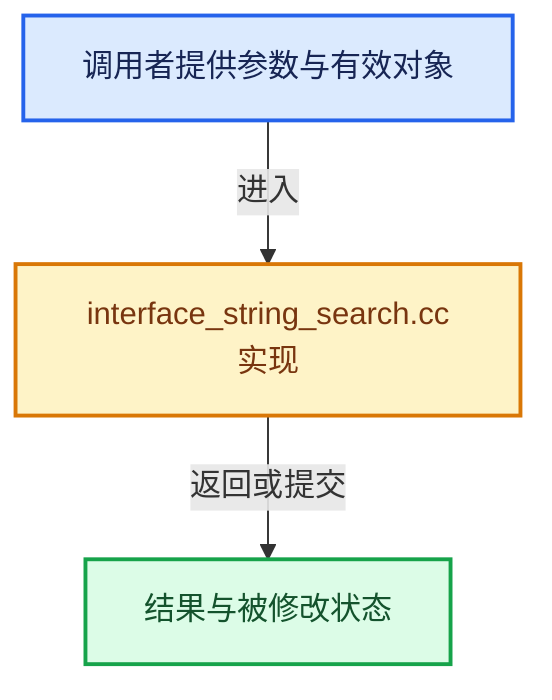

# 实现依赖专题：source/blender/editors/interface/interface_string_search.cc

[实现依赖导航](../../../README.md) · [符号索引](../../../../00-课程指南/02-源码与提交索引/符号依赖与实现索引.md)

本专题从正文实际调用进入，集中保存共享实现。函数有稳定锚点，可从调用处直接跳到对应完整函数；递归与互相调用通过回链组织。

## 本文件的实现关系





## 完整成员与函数实现

<a id="f-5319e40f02b316bc"></a>

### `blender::ui::string_search::get_recent_cache_storage`

实现位置：[source/blender/editors/interface/interface_string_search.cc](../../../../../../../../source/blender/editors/interface/interface_string_search.cc) · L32—L37。

**教学注释版**

<!-- annotated:7a44199f7e9c2b -->

```cpp
static RecentCacheStorage &get_recent_cache_storage()
{
  BLI_assert((U.flag & USER_FLAG_RECENT_SEARCHES_DISABLE) == 0);
  static RecentCacheStorage storage;
  return storage;
}
```

<details>
<summary>核对原始源码：source/blender/editors/interface/interface_string_search.cc · L32—L37</summary>

<!-- original:7a44199f7e9c2b:source/blender/editors/interface/interface_string_search.cc:32:37 -->

```cpp
static RecentCacheStorage &get_recent_cache_storage()
{
  BLI_assert((U.flag & USER_FLAG_RECENT_SEARCHES_DISABLE) == 0);
  static RecentCacheStorage storage;
  return storage;
}
```

</details>

**结果出口**

- `return storage;`

**继续追踪实现**

- `BLI_assert` → [BLI_assert · L48](../../../01-BLI基础库/BLI_assert.hh.md#m-57a88495704d)；[BLI_assert · L63](../../../01-BLI基础库/BLI_assert.hh.md#m-d07050020cb5)。宏定义由构建条件选择。

<a id="f-170acec7b9ed44ff"></a>

### `blender::ui::string_search::add_recent_search`

实现位置：[source/blender/editors/interface/interface_string_search.cc](../../../../../../../../source/blender/editors/interface/interface_string_search.cc) · L39—L44。

接口参数：

- `const StringRef chosen_str`

**教学注释版**

<!-- annotated:05ffeac26f9081 -->

```cpp
void add_recent_search(const StringRef chosen_str)
{
  RecentCacheStorage &storage = get_recent_cache_storage();
  storage.cache.logical_time_by_str.add_overwrite(chosen_str, storage.logical_clock);
  storage.logical_clock++;
}
```

<details>
<summary>核对原始源码：source/blender/editors/interface/interface_string_search.cc · L39—L44</summary>

<!-- original:05ffeac26f9081:source/blender/editors/interface/interface_string_search.cc:39:44 -->

```cpp
void add_recent_search(const StringRef chosen_str)
{
  RecentCacheStorage &storage = get_recent_cache_storage();
  storage.cache.logical_time_by_str.add_overwrite(chosen_str, storage.logical_clock);
  storage.logical_clock++;
}
```

</details>

**继续追踪实现**

- `get_recent_cache_storage` → [blender::ui::string_search::get_recent_cache_storage · L32](interface_string_search.cc.md#f-5319e40f02b316bc)。
- `storage.cache.logical_time_by_str.add_overwrite` → [调用协议](../../../../00-课程指南/01-路线与规范/模板宏与动态分派协议.md)：接收对象类型依赖auto、返回值或模板实例；不按同名猜测目标。调用位置L42。
