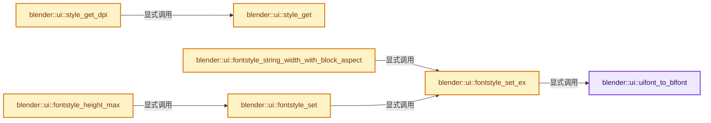

# 实现依赖专题：source/blender/editors/interface/interface_style.cc

[实现依赖导航](../../../README.md) · [符号索引](../../../../00-课程指南/02-源码与提交索引/符号依赖与实现索引.md)

本专题从正文实际调用进入，集中保存共享实现。函数有稳定锚点，可从调用处直接跳到对应完整函数；递归与互相调用通过回链组织。

## 本文件的实现关系




## 完整成员与函数实现

<a id="f-5e4948ec3cadad19"></a>

### `blender::ui::uifont_to_blfont`

实现位置：[source/blender/editors/interface/interface_style.cc](../../../../../../../../source/blender/editors/interface/interface_style.cc) · L115—L125。

接口参数：

- `int id`

**教学注释版**

<!-- annotated:c7ca2337fa98d2 -->

```cpp
static uiFont *uifont_to_blfont(int id)
{
  uiFont *font = U.uifonts.first();

  for (; font; font = font->next) {
    if (font->uifont_id == id) {
      return font;
    }
  }
  return U.uifonts.first();
}
```

<details>
<summary>核对原始源码：source/blender/editors/interface/interface_style.cc · L115—L125</summary>

<!-- original:c7ca2337fa98d2:source/blender/editors/interface/interface_style.cc:115:125 -->

```cpp
static uiFont *uifont_to_blfont(int id)
{
  uiFont *font = U.uifonts.first();

  for (; font; font = font->next) {
    if (font->uifont_id == id) {
      return font;
    }
  }
  return U.uifonts.first();
}
```

</details>

**结果出口**

- `return font;`
- `return U.uifonts.first();`

**继续追踪实现**

- `U.uifonts.first` → [调用协议](../../../../00-课程指南/01-路线与规范/模板宏与动态分派协议.md)：接收对象类型依赖auto、返回值或模板实例；不按同名猜测目标。调用位置L117。

<a id="f-aa005d800e55d1e4"></a>

### `blender::ui::style_get`

实现位置：[source/blender/editors/interface/interface_style.cc](../../../../../../../../source/blender/editors/interface/interface_style.cc) · L412—L422。

**教学注释版**

<!-- annotated:9ec17a67233348 -->

```cpp
const uiStyle *style_get()
{
#if 0
  uiStyle *style = nullptr;
  /* offset is two struct uiStyle pointers */
  style = BLI_findstring(&U.uistyles, "Unifont Style", sizeof(style) * 2);
  return (style != nullptr) ? style : U.uistyles.first;
#else
  return U.uistyles.first();
#endif
}
```

<details>
<summary>核对原始源码：source/blender/editors/interface/interface_style.cc · L412—L422</summary>

<!-- original:9ec17a67233348:source/blender/editors/interface/interface_style.cc:412:422 -->

```cpp
const uiStyle *style_get()
{
#if 0
  uiStyle *style = nullptr;
  /* offset is two struct uiStyle pointers */
  style = BLI_findstring(&U.uistyles, "Unifont Style", sizeof(style) * 2);
  return (style != nullptr) ? style : U.uistyles.first;
#else
  return U.uistyles.first();
#endif
}
```

</details>

**沿实际写入检查状态**

- `style = BLI_findstring(&U.uistyles, "Unifont Style", sizeof(style) * 2);`

**结果出口**

- `return (style != nullptr) ? style : U.uistyles.first;`
- `return U.uistyles.first();`

**继续追踪实现**

- `BLI_findstring` → [blender::BLI_findstring · L615](../../../01-BLI基础库/intern/listbase.cc.md#f-d913b13b2651348e)。
- `U.uistyles.first` → [调用协议](../../../../00-课程指南/01-路线与规范/模板宏与动态分派协议.md)：接收对象类型依赖auto、返回值或模板实例；不按同名猜测目标。调用位置L420。

<a id="f-37e0cedd2705020a"></a>

### `blender::ui::style_get_dpi`

实现位置：[source/blender/editors/interface/interface_style.cc](../../../../../../../../source/blender/editors/interface/interface_style.cc) · L424—L449。

**教学注释版**

<!-- annotated:532e6aa169b6d0 -->

```cpp
const uiStyle *style_get_dpi()
{
  const uiStyle *style = style_get();
  static uiStyle _style;

  _style = *style;

  _style.paneltitle.shadx = short(UI_SCALE_FAC * _style.paneltitle.shadx);
  _style.paneltitle.shady = short(UI_SCALE_FAC * _style.paneltitle.shady);
  _style.grouplabel.shadx = short(UI_SCALE_FAC * _style.grouplabel.shadx);
  _style.grouplabel.shady = short(UI_SCALE_FAC * _style.grouplabel.shady);
  _style.widget.shadx = short(UI_SCALE_FAC * _style.widget.shadx);
  _style.widget.shady = short(UI_SCALE_FAC * _style.widget.shady);
  _style.tooltip.shadx = short(UI_SCALE_FAC * _style.tooltip.shadx);
  _style.tooltip.shady = short(UI_SCALE_FAC * _style.tooltip.shady);

  _style.columnspace = short(UI_SCALE_FAC * _style.columnspace);
  _style.templatespace = short(UI_SCALE_FAC * _style.templatespace);
  _style.boxspace = short(UI_SCALE_FAC * _style.boxspace);
  _style.buttonspacex = short(UI_SCALE_FAC * _style.buttonspacex);
  _style.buttonspacey = short(UI_SCALE_FAC * _style.buttonspacey);
  _style.panelspace = short(UI_SCALE_FAC * _style.panelspace);
  _style.panelouter = short(UI_SCALE_FAC * _style.panelouter);

  return &_style;
}
```

<details>
<summary>核对原始源码：source/blender/editors/interface/interface_style.cc · L424—L449</summary>

<!-- original:532e6aa169b6d0:source/blender/editors/interface/interface_style.cc:424:449 -->

```cpp
const uiStyle *style_get_dpi()
{
  const uiStyle *style = style_get();
  static uiStyle _style;

  _style = *style;

  _style.paneltitle.shadx = short(UI_SCALE_FAC * _style.paneltitle.shadx);
  _style.paneltitle.shady = short(UI_SCALE_FAC * _style.paneltitle.shady);
  _style.grouplabel.shadx = short(UI_SCALE_FAC * _style.grouplabel.shadx);
  _style.grouplabel.shady = short(UI_SCALE_FAC * _style.grouplabel.shady);
  _style.widget.shadx = short(UI_SCALE_FAC * _style.widget.shadx);
  _style.widget.shady = short(UI_SCALE_FAC * _style.widget.shady);
  _style.tooltip.shadx = short(UI_SCALE_FAC * _style.tooltip.shadx);
  _style.tooltip.shady = short(UI_SCALE_FAC * _style.tooltip.shady);

  _style.columnspace = short(UI_SCALE_FAC * _style.columnspace);
  _style.templatespace = short(UI_SCALE_FAC * _style.templatespace);
  _style.boxspace = short(UI_SCALE_FAC * _style.boxspace);
  _style.buttonspacex = short(UI_SCALE_FAC * _style.buttonspacex);
  _style.buttonspacey = short(UI_SCALE_FAC * _style.buttonspacey);
  _style.panelspace = short(UI_SCALE_FAC * _style.panelspace);
  _style.panelouter = short(UI_SCALE_FAC * _style.panelouter);

  return &_style;
}
```

</details>

**沿实际写入检查状态**

- `_style = *style;`
- `_style.paneltitle.shadx = short(UI_SCALE_FAC * _style.paneltitle.shadx);`
- `_style.paneltitle.shady = short(UI_SCALE_FAC * _style.paneltitle.shady);`
- `_style.grouplabel.shadx = short(UI_SCALE_FAC * _style.grouplabel.shadx);`
- `_style.grouplabel.shady = short(UI_SCALE_FAC * _style.grouplabel.shady);`
- `_style.widget.shadx = short(UI_SCALE_FAC * _style.widget.shadx);`
- `_style.widget.shady = short(UI_SCALE_FAC * _style.widget.shady);`
- `_style.tooltip.shadx = short(UI_SCALE_FAC * _style.tooltip.shadx);`
- `_style.tooltip.shady = short(UI_SCALE_FAC * _style.tooltip.shady);`
- `_style.columnspace = short(UI_SCALE_FAC * _style.columnspace);`
- `_style.templatespace = short(UI_SCALE_FAC * _style.templatespace);`
- `_style.boxspace = short(UI_SCALE_FAC * _style.boxspace);`
- `_style.buttonspacex = short(UI_SCALE_FAC * _style.buttonspacex);`
- `_style.buttonspacey = short(UI_SCALE_FAC * _style.buttonspacey);`
- `_style.panelspace = short(UI_SCALE_FAC * _style.panelspace);`
- `_style.panelouter = short(UI_SCALE_FAC * _style.panelouter);`

**结果出口**

- `return &_style;`

**继续追踪实现**

- `style_get` → [blender::ui::style_get · L412](interface_style.cc.md#f-aa005d800e55d1e4)。

<a id="f-cd38642759d7341b"></a>

### `blender::ui::fontstyle_string_width_with_block_aspect`

实现位置：[source/blender/editors/interface/interface_style.cc](../../../../../../../../source/blender/editors/interface/interface_style.cc) · L457—L465。

接口参数：

- `const uiFontStyle *fs`
- `const StringRef str`
- `const float aspect`

**教学注释版**

<!-- annotated:24998e857de752 -->

```cpp
int fontstyle_string_width_with_block_aspect(const uiFontStyle *fs,
                                             const StringRef str,
                                             const float aspect)
{
  /* FIXME(@ideasman42): the final scale of the font is rounded which should be accounted for.
   * Failing to do so causes bad alignment when zoomed out very far in the node-editor. */
  fontstyle_set_ex(fs, UI_SCALE_FAC / aspect);
  return int(BLF_width(fs->uifont_id, str.data(), str.size()) * aspect);
}
```

<details>
<summary>核对原始源码：source/blender/editors/interface/interface_style.cc · L457—L465</summary>

<!-- original:24998e857de752:source/blender/editors/interface/interface_style.cc:457:465 -->

```cpp
int fontstyle_string_width_with_block_aspect(const uiFontStyle *fs,
                                             const StringRef str,
                                             const float aspect)
{
  /* FIXME(@ideasman42): the final scale of the font is rounded which should be accounted for.
   * Failing to do so causes bad alignment when zoomed out very far in the node-editor. */
  fontstyle_set_ex(fs, UI_SCALE_FAC / aspect);
  return int(BLF_width(fs->uifont_id, str.data(), str.size()) * aspect);
}
```

</details>

**结果出口**

- `return int(BLF_width(fs->uifont_id, str.data(), str.size()) * aspect);`

**继续追踪实现**

- `fontstyle_set_ex` → [blender::ui::fontstyle_set_ex · L600](interface_style.cc.md#f-fc353ded8dc075f3)。
- `BLF_width` → [blender::BLF_width · L835](../../blenfont/intern/blf.cc.md#f-5a3d5b80e418409f)。
- `str.data` → [调用协议](../../../../00-课程指南/01-路线与规范/模板宏与动态分派协议.md)：由接收对象具体类型或运行时策略提供实现。调用位置L464。
- `str.size` → [blender::ui::Item::size · L480](interface_layout.cc.md#f-8a41e6d2d9e32851)；[blender::ui::Layout::size · L494](interface_layout.cc.md#f-81377b9c1286eb5d)。同名重载需按实参类型选择。

<a id="f-35e320b3cd6fff5b"></a>

### `blender::ui::fontstyle_height_max`

实现位置：[source/blender/editors/interface/interface_style.cc](../../../../../../../../source/blender/editors/interface/interface_style.cc) · L467—L471。

接口参数：

- `const uiFontStyle *fs`

**教学注释版**

<!-- annotated:527869b63e8db4 -->

```cpp
int fontstyle_height_max(const uiFontStyle *fs)
{
  fontstyle_set(fs);
  return BLF_height_max(fs->uifont_id);
}
```

<details>
<summary>核对原始源码：source/blender/editors/interface/interface_style.cc · L467—L471</summary>

<!-- original:527869b63e8db4:source/blender/editors/interface/interface_style.cc:467:471 -->

```cpp
int fontstyle_height_max(const uiFontStyle *fs)
{
  fontstyle_set(fs);
  return BLF_height_max(fs->uifont_id);
}
```

</details>

**结果出口**

- `return BLF_height_max(fs->uifont_id);`

**继续追踪实现**

- `fontstyle_set` → [blender::ui::fontstyle_set · L608](interface_style.cc.md#f-7c01423f2db0ca8b)。
- `BLF_height_max` → [blender::BLF_height_max · L883](../../blenfont/intern/blf.cc.md#f-1cb95d9e86ed0d39)。

<a id="f-fc353ded8dc075f3"></a>

### `blender::ui::fontstyle_set_ex`

实现位置：[source/blender/editors/interface/interface_style.cc](../../../../../../../../source/blender/editors/interface/interface_style.cc) · L600—L606。

接口参数：

- `const uiFontStyle *fs`
- `const float dpi_fac`

**教学注释版**

<!-- annotated:9aab88bc3d782a -->

```cpp
static void fontstyle_set_ex(const uiFontStyle *fs, const float dpi_fac)
{
  const uiFont *font = uifont_to_blfont(fs->uifont_id);

  BLF_size(font->blf_id, fs->points * dpi_fac);
  BLF_character_weight(font->blf_id, fs->character_weight);
}
```

<details>
<summary>核对原始源码：source/blender/editors/interface/interface_style.cc · L600—L606</summary>

<!-- original:9aab88bc3d782a:source/blender/editors/interface/interface_style.cc:600:606 -->

```cpp
static void fontstyle_set_ex(const uiFontStyle *fs, const float dpi_fac)
{
  const uiFont *font = uifont_to_blfont(fs->uifont_id);

  BLF_size(font->blf_id, fs->points * dpi_fac);
  BLF_character_weight(font->blf_id, fs->character_weight);
}
```

</details>

**继续追踪实现**

- `uifont_to_blfont` → [blender::ui::uifont_to_blfont · L115](interface_style.cc.md#f-5e4948ec3cadad19)。
- `BLF_size` → [blender::BLF_size · L445](../../blenfont/intern/blf.cc.md#f-055ce2de2d1684fd)。
- `BLF_character_weight` → [blender::BLF_character_weight · L349](../../blenfont/intern/blf.cc.md#f-c54c5317361b03c9)。

<a id="f-7c01423f2db0ca8b"></a>

### `blender::ui::fontstyle_set`

实现位置：[source/blender/editors/interface/interface_style.cc](../../../../../../../../source/blender/editors/interface/interface_style.cc) · L608—L611。

接口参数：

- `const uiFontStyle *fs`

**教学注释版**

<!-- annotated:869d3eff906980 -->

```cpp
void fontstyle_set(const uiFontStyle *fs)
{
  fontstyle_set_ex(fs, UI_SCALE_FAC);
}
```

<details>
<summary>核对原始源码：source/blender/editors/interface/interface_style.cc · L608—L611</summary>

<!-- original:869d3eff906980:source/blender/editors/interface/interface_style.cc:608:611 -->

```cpp
void fontstyle_set(const uiFontStyle *fs)
{
  fontstyle_set_ex(fs, UI_SCALE_FAC);
}
```

</details>

**继续追踪实现**

- `fontstyle_set_ex` → [blender::ui::fontstyle_set_ex · L600](interface_style.cc.md#f-fc353ded8dc075f3)。
