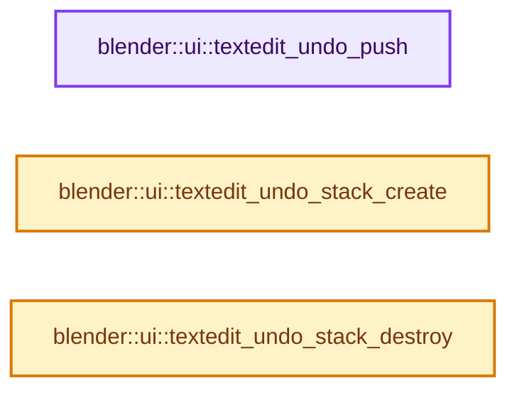

# 实现依赖专题：source/blender/editors/interface/interface_undo.cc

[实现依赖导航](../../../README.md) · [符号索引](../../../../00-课程指南/02-源码与提交索引/符号依赖与实现索引.md)

本专题从正文实际调用进入，集中保存共享实现。函数有稳定锚点，可从调用处直接跳到对应完整函数；递归与互相调用通过回链组织。

## 本文件的实现关系




## 完整成员与函数实现

<a id="f-81b4f306ee437db8"></a>

### `blender::ui::textedit_undo_push`

实现位置：[source/blender/editors/interface/interface_undo.cc](../../../../../../../../source/blender/editors/interface/interface_undo.cc) · L81—L99。

接口参数：

- `UndoStack_Text *stack`
- `const char *text`
- `int cursor_index`

**教学注释版**

<!-- annotated:c3295b97281d6c -->

```cpp
void textedit_undo_push(UndoStack_Text *stack, const char *text, int cursor_index)
{
  /* Clear all redo actions from the current state. */
  if (stack->current != nullptr) {
    while (stack->current->next) {
      UndoStack_Text_State *state = stack->current->next;
      BLI_remlink(&stack->states, state);
      MEM_delete(state);
    }
  }

  /* Create the new state. */
  const int text_size = strlen(text) + 1;
  stack->current = static_cast<UndoStack_Text_State *>(
      MEM_new_uninitialized(sizeof(UndoStack_Text_State) + text_size, __func__));
  stack->current->cursor_index = cursor_index;
  // [讲解] memcpy：复制字节，源与目标不应重叠。类型生命周期、对齐和可复制表示须由调用者证明，不是任意对象的复制构造。
  memcpy(stack->current->text, text, text_size);
  BLI_addtail(&stack->states, stack->current);
}
```

<details>
<summary>核对原始源码：source/blender/editors/interface/interface_undo.cc · L81—L99</summary>

<!-- original:c3295b97281d6c:source/blender/editors/interface/interface_undo.cc:81:99 -->

```cpp
void textedit_undo_push(UndoStack_Text *stack, const char *text, int cursor_index)
{
  /* Clear all redo actions from the current state. */
  if (stack->current != nullptr) {
    while (stack->current->next) {
      UndoStack_Text_State *state = stack->current->next;
      BLI_remlink(&stack->states, state);
      MEM_delete(state);
    }
  }

  /* Create the new state. */
  const int text_size = strlen(text) + 1;
  stack->current = static_cast<UndoStack_Text_State *>(
      MEM_new_uninitialized(sizeof(UndoStack_Text_State) + text_size, __func__));
  stack->current->cursor_index = cursor_index;
  memcpy(stack->current->text, text, text_size);
  BLI_addtail(&stack->states, stack->current);
}
```

</details>

**沿实际写入检查状态**

- `stack->current = static_cast<UndoStack_Text_State *>(`
- `stack->current->cursor_index = cursor_index;`

**继续追踪实现**

- `BLI_remlink` → [blender::BLI_remlink · L138](../../../01-BLI基础库/intern/listbase.cc.md#f-120d80f281ca4cb7)。
- `MEM_delete` → [MEM_delete · L400](../../../07-Intern运行时与平台/guardedalloc/MEM_guardedalloc.h.md#f-9049ffdd1682887c)。
- `strlen` → [外部契约](https://eel.is/c++draft/)：这个边界按实际表达式及所属类型核对参数、返回值、寿命与失败行为。这里提供接口入口，不声称已解释该第三方版本的内部实现。
- `MEM_new_uninitialized` → [MEM_new_uninitialized · L590](../../../07-Intern运行时与平台/guardedalloc/MEM_guardedalloc.h.md#f-c773b2e5b8fe70e4)；[MEM_new_uninitialized · L124](../../../07-Intern运行时与平台/guardedalloc/intern/mallocn.cc.md#f-28a7e00a1e67f699)。同名重载需按实参类型选择。
- `memcpy` → [外部契约](https://eel.is/c++draft/cstring.syn)：复制字节，源与目标不应重叠。类型生命周期、对齐和可复制表示须由调用者证明，不是任意对象的复制构造。
- `BLI_addtail` → [blender::BLI_addtail · L118](../../../01-BLI基础库/intern/listbase.cc.md#f-4fb027713fa3115b)。

<a id="f-12faabb336afe076"></a>

### `blender::ui::textedit_undo_stack_create`

实现位置：[source/blender/editors/interface/interface_undo.cc](../../../../../../../../source/blender/editors/interface/interface_undo.cc) · L101—L108。

**教学注释版**

<!-- annotated:86bf7d36c5591a -->

```cpp
UndoStack_Text *textedit_undo_stack_create()
{
  UndoStack_Text *stack = MEM_new_zeroed<UndoStack_Text>(__func__);
  stack->current = nullptr;
  stack->states.clear_no_delete();

  return stack;
}
```

<details>
<summary>核对原始源码：source/blender/editors/interface/interface_undo.cc · L101—L108</summary>

<!-- original:86bf7d36c5591a:source/blender/editors/interface/interface_undo.cc:101:108 -->

```cpp
UndoStack_Text *textedit_undo_stack_create()
{
  UndoStack_Text *stack = MEM_new_zeroed<UndoStack_Text>(__func__);
  stack->current = nullptr;
  stack->states.clear_no_delete();

  return stack;
}
```

</details>

**沿实际写入检查状态**

- `stack->current = nullptr;`

**结果出口**

- `return stack;`

**继续追踪实现**

- `MEM_new_zeroed<UndoStack_Text>` → [MEM_new_zeroed · L550](../../../07-Intern运行时与平台/guardedalloc/MEM_guardedalloc.h.md#f-eeb1e2a7f57dd231)；[MEM_new_zeroed · L114](../../../07-Intern运行时与平台/guardedalloc/intern/mallocn.cc.md#f-e04cf01c64c8b180)。同名重载需按实参类型选择。
- `stack->states.clear_no_delete` → [调用协议](../../../../00-课程指南/01-路线与规范/模板宏与动态分派协议.md)：接收对象类型依赖auto、返回值或模板实例；不按同名猜测目标。调用位置L105。

<a id="f-3b2053aebe645335"></a>

### `blender::ui::textedit_undo_stack_destroy`

实现位置：[source/blender/editors/interface/interface_undo.cc](../../../../../../../../source/blender/editors/interface/interface_undo.cc) · L110—L114。

接口参数：

- `UndoStack_Text *stack`

**教学注释版**

<!-- annotated:d012f0b33e8cf8 -->

```cpp
void textedit_undo_stack_destroy(UndoStack_Text *stack)
{
  stack->states.free_no_destruct();
  MEM_delete(stack);
}
```

<details>
<summary>核对原始源码：source/blender/editors/interface/interface_undo.cc · L110—L114</summary>

<!-- original:d012f0b33e8cf8:source/blender/editors/interface/interface_undo.cc:110:114 -->

```cpp
void textedit_undo_stack_destroy(UndoStack_Text *stack)
{
  stack->states.free_no_destruct();
  MEM_delete(stack);
}
```

</details>

**继续追踪实现**

- `stack->states.free_no_destruct` → [调用协议](../../../../00-课程指南/01-路线与规范/模板宏与动态分派协议.md)：接收对象类型依赖auto、返回值或模板实例；不按同名猜测目标。调用位置L112。
- `MEM_delete` → [MEM_delete · L400](../../../07-Intern运行时与平台/guardedalloc/MEM_guardedalloc.h.md#f-9049ffdd1682887c)。
