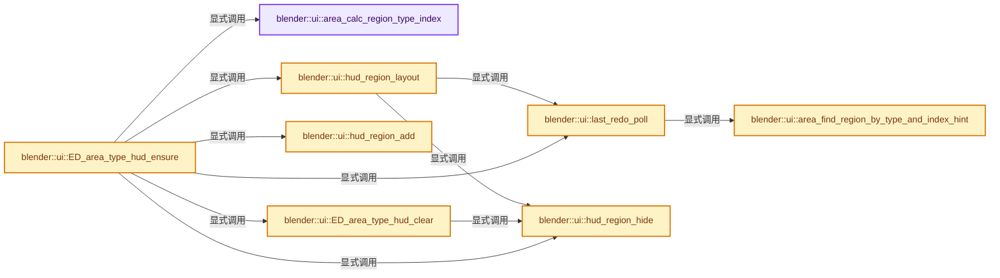
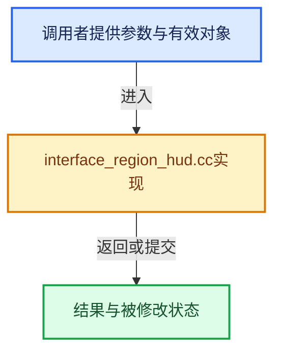

# 实现依赖专题：source/blender/editors/interface/regions/interface_region_hud.cc

[实现依赖导航](../../../../README.md) · [符号索引](../../../../../00-课程指南/02-源码与提交索引/符号依赖与实现索引.md)

本专题从正文实际调用进入，集中保存共享实现。函数有稳定锚点，可从调用处直接跳到对应完整函数；递归与互相调用通过回链组织。

## 本文件的实现关系






## 完整成员与函数实现

<a id="f-64ff5c397cf762c8"></a>

### `blender::ui::area_calc_region_type_index`

实现位置：[source/blender/editors/interface/regions/interface_region_hud.cc](../../../../../../../../../source/blender/editors/interface/regions/interface_region_hud.cc) · L48—L66。

接口参数：

- `const ScrArea *area`
- `const ARegion *region`

**教学注释版**

<!-- annotated:e85a043b6c05b3 -->

```cpp
static int area_calc_region_type_index(const ScrArea *area, const ARegion *region)
{
  const int region_type = region->regiontype;
  int index = 0;
  for (const ARegion &region_iter : area->regionbase) {
    if (region_iter.regiontype != region_type) {
      continue;
    }
    if (&region_iter == region) {
      return index;
    }
    index += 1;
  }

  /* Bad input as the `region` was not found in the `area`,
   * -1 causes the first to be returned. */
  BLI_assert_unreachable();
  return -1;
}
```

<details>
<summary>核对原始源码：source/blender/editors/interface/regions/interface_region_hud.cc · L48—L66</summary>

<!-- original:e85a043b6c05b3:source/blender/editors/interface/regions/interface_region_hud.cc:48:66 -->

```cpp
static int area_calc_region_type_index(const ScrArea *area, const ARegion *region)
{
  const int region_type = region->regiontype;
  int index = 0;
  for (const ARegion &region_iter : area->regionbase) {
    if (region_iter.regiontype != region_type) {
      continue;
    }
    if (&region_iter == region) {
      return index;
    }
    index += 1;
  }

  /* Bad input as the `region` was not found in the `area`,
   * -1 causes the first to be returned. */
  BLI_assert_unreachable();
  return -1;
}
```

</details>

**沿实际写入检查状态**

- `index += 1;`

**结果出口**

- `return index;`
- `return -1;`

**继续追踪实现**

- `BLI_assert_unreachable` → [BLI_assert_unreachable · L77](../../../../01-BLI基础库/BLI_assert.hh.md#m-7a2d91a67d8e)。宏定义由构建条件选择。

<a id="f-2cb19396d20becc6"></a>

### `blender::ui::area_find_region_by_type_and_index_hint`

实现位置：[source/blender/editors/interface/regions/interface_region_hud.cc](../../../../../../../../../source/blender/editors/interface/regions/interface_region_hud.cc) · L71—L93。

接口参数：

- `const ScrArea *area`
- `const short region_type`
- `int index_hint`

**教学注释版**

<!-- annotated:c341017cd2c79a -->

```cpp
static ARegion *area_find_region_by_type_and_index_hint(const ScrArea *area,
                                                        const short region_type,
                                                        int index_hint)
{
  ARegion *region_match_type = nullptr;
  /* Any negative values can return the first match. */
  // [讲解] std::max：按比较关系选取较大值。本讲解中的增长公式同时满足最低请求和几何增长；若保存返回引用，还需注意实参寿命。
  index_hint = std::max(0, index_hint);
  int index = 0;
  for (ARegion &region : area->regionbase) {
    if (region.regiontype != region_type) {
      continue;
    }
    if (index == index_hint) {
      region_match_type = &region;
      break;
    }
    if (region_match_type == nullptr) {
      region_match_type = &region;
    }
    index += 1;
  }
  return region_match_type;
}
```

<details>
<summary>核对原始源码：source/blender/editors/interface/regions/interface_region_hud.cc · L71—L93</summary>

<!-- original:c341017cd2c79a:source/blender/editors/interface/regions/interface_region_hud.cc:71:93 -->

```cpp
static ARegion *area_find_region_by_type_and_index_hint(const ScrArea *area,
                                                        const short region_type,
                                                        int index_hint)
{
  ARegion *region_match_type = nullptr;
  /* Any negative values can return the first match. */
  index_hint = std::max(0, index_hint);
  int index = 0;
  for (ARegion &region : area->regionbase) {
    if (region.regiontype != region_type) {
      continue;
    }
    if (index == index_hint) {
      region_match_type = &region;
      break;
    }
    if (region_match_type == nullptr) {
      region_match_type = &region;
    }
    index += 1;
  }
  return region_match_type;
}
```

</details>

**沿实际写入检查状态**

- `index_hint = std::max(0, index_hint);`
- `region_match_type = &region;`
- `index += 1;`

**结果出口**

- `return region_match_type;`

**继续追踪实现**

- `std::max` → [外部契约](https://eel.is/c++draft/alg.min.max)：按比较关系选取较大值。本讲解中的增长公式同时满足最低请求和几何增长；若保存返回引用，还需注意实参寿命。

<a id="f-54b7951d0beced50"></a>

### `blender::ui::last_redo_poll`

实现位置：[source/blender/editors/interface/regions/interface_region_hud.cc](../../../../../../../../../source/blender/editors/interface/regions/interface_region_hud.cc) · L108—L134。

接口参数：

- `const bContext *C`
- `short region_type`
- `int region_index_hint`

**教学注释版**

<!-- annotated:b31f74f2961fc0 -->

```cpp
static bool last_redo_poll(const bContext *C, short region_type, int region_index_hint)
{
  wmOperator *op = WM_operator_last_redo(C);
  if (op == nullptr) {
    return false;
  }

  bool success = false;
  {
    /* Make sure that we are using the same region type as the original
     * operator call. Otherwise we would be polling the operator with the
     * wrong context.
     */
    ScrArea *area = CTX_wm_area(C);
    ARegion *region_op = (region_type != -1) ? area_find_region_by_type_and_index_hint(
                                                   area, region_type, region_index_hint) :
                                               nullptr;
    ARegion *region_prev = CTX_wm_region(C);
    CTX_wm_region_set(const_cast<bContext *>(C), region_op);

    if (WM_operator_repeat_check(C, op) && WM_operator_ui_poll(op->type, op->ptr)) {
      success = WM_operator_poll(const_cast<bContext *>(C), op->type);
    }
    CTX_wm_region_set(const_cast<bContext *>(C), region_prev);
  }
  return success;
}
```

<details>
<summary>核对原始源码：source/blender/editors/interface/regions/interface_region_hud.cc · L108—L134</summary>

<!-- original:b31f74f2961fc0:source/blender/editors/interface/regions/interface_region_hud.cc:108:134 -->

```cpp
static bool last_redo_poll(const bContext *C, short region_type, int region_index_hint)
{
  wmOperator *op = WM_operator_last_redo(C);
  if (op == nullptr) {
    return false;
  }

  bool success = false;
  {
    /* Make sure that we are using the same region type as the original
     * operator call. Otherwise we would be polling the operator with the
     * wrong context.
     */
    ScrArea *area = CTX_wm_area(C);
    ARegion *region_op = (region_type != -1) ? area_find_region_by_type_and_index_hint(
                                                   area, region_type, region_index_hint) :
                                               nullptr;
    ARegion *region_prev = CTX_wm_region(C);
    CTX_wm_region_set(const_cast<bContext *>(C), region_op);

    if (WM_operator_repeat_check(C, op) && WM_operator_ui_poll(op->type, op->ptr)) {
      success = WM_operator_poll(const_cast<bContext *>(C), op->type);
    }
    CTX_wm_region_set(const_cast<bContext *>(C), region_prev);
  }
  return success;
}
```

</details>

**沿实际写入检查状态**

- `success = WM_operator_poll(const_cast<bContext *>(C), op->type);`

**结果出口**

- `return false;`
- `return success;`

**继续追踪实现**

- `WM_operator_last_redo` → [blender::WM_operator_last_redo · L1296](../../../windowmanager/intern/wm_operators.cc.md#f-2f8e679023662c57)。
- `CTX_wm_area` → [blender::CTX_wm_area · L954](../../../../02-BKE几何与数据/intern/context.cc.md#f-f8ad7c2c364d711c)。
- `area_find_region_by_type_and_index_hint` → [blender::ui::area_find_region_by_type_and_index_hint · L71](interface_region_hud.cc.md#f-2cb19396d20becc6)。
- `CTX_wm_region` → [blender::CTX_wm_region · L965](../../../../02-BKE几何与数据/intern/context.cc.md#f-6cc0a26bc4539ae0)。
- `CTX_wm_region_set` → [blender::CTX_wm_region_set · L1240](../../../../02-BKE几何与数据/intern/context.cc.md#f-7c17937537b1c2fc)。
- `WM_operator_repeat_check` → [blender::WM_operator_repeat_check · L1477](../../../windowmanager/intern/wm_event_system.cc.md#f-1c0fbf1f114ca1e3)。
- `WM_operator_ui_poll` → [blender::WM_operator_ui_poll · L1160](../../../windowmanager/intern/wm_event_system.cc.md#f-37bb770c622c4f5a)。
- `WM_operator_poll` → [blender::WM_operator_poll · L1110](../../../windowmanager/intern/wm_event_system.cc.md#f-f468dca2684ae99e)。

<a id="f-99affccbe5f8aefd"></a>

### `blender::ui::hud_region_hide`

实现位置：[source/blender/editors/interface/regions/interface_region_hud.cc](../../../../../../../../../source/blender/editors/interface/regions/interface_region_hud.cc) · L136—L142。

接口参数：

- `ARegion *region`

**教学注释版**

<!-- annotated:634b79d8764dcd -->

```cpp
static void hud_region_hide(ARegion *region)
{
  region->flag |= RGN_FLAG_HIDDEN;
  /* Avoids setting 'AREA_FLAG_REGION_SIZE_UPDATE'
   * since other regions don't depend on this. */
  BLI_rcti_init(&region->winrct, 0, 0, 0, 0);
}
```

<details>
<summary>核对原始源码：source/blender/editors/interface/regions/interface_region_hud.cc · L136—L142</summary>

<!-- original:634b79d8764dcd:source/blender/editors/interface/regions/interface_region_hud.cc:136:142 -->

```cpp
static void hud_region_hide(ARegion *region)
{
  region->flag |= RGN_FLAG_HIDDEN;
  /* Avoids setting 'AREA_FLAG_REGION_SIZE_UPDATE'
   * since other regions don't depend on this. */
  BLI_rcti_init(&region->winrct, 0, 0, 0, 0);
}
```

</details>

**沿实际写入检查状态**

- `region->flag |= RGN_FLAG_HIDDEN;`

**继续追踪实现**

- `BLI_rcti_init` → [blender::BLI_rcti_init · L428](../../../../01-BLI基础库/intern/rct.cc.md#f-c75659264970b4d1)。

<a id="f-10b93c9670570335"></a>

### `blender::ui::hud_region_layout`

实现位置：[source/blender/editors/interface/regions/interface_region_hud.cc](../../../../../../../../../source/blender/editors/interface/regions/interface_region_hud.cc) · L227—L271。

接口参数：

- `const bContext *C`
- `ARegion *region`

**教学注释版**

<!-- annotated:b48e1370be906a -->

```cpp
static void hud_region_layout(const bContext *C, ARegion *region)
{
  HudRegionData *hrd = static_cast<HudRegionData *>(region->regiondata);
  if (hrd == nullptr || !last_redo_poll(C, hrd->regionid, hrd->region_index_hint)) {
    ED_region_tag_redraw(region);
    hud_region_hide(region);
    return;
  }

  ScrArea *area = CTX_wm_area(C);
  const int size_y = region->sizey;

  ED_region_panels_layout(C, region);

  if (region->panels.first() &&
      ((area->flag & AREA_FLAG_REGION_SIZE_UPDATE) || (region->sizey != size_y)))
  {
    int winx_new = UI_SCALE_FAC * (region->sizex + 0.5f);
    int winy_new = UI_SCALE_FAC * (region->sizey + 0.5f);
    View2D *v2d = &region->v2d;

    if (region->flag & RGN_FLAG_SIZE_CLAMP_X) {
      CLAMP_MAX(winx_new, region->winx);
    }
    if (region->flag & RGN_FLAG_SIZE_CLAMP_Y) {
      CLAMP_MAX(winy_new, region->winy);
    }

    region->winx = winx_new;
    region->winy = winy_new;

    region->winrct.xmax = (region->winrct.xmin + region->winx) - 1;
    region->winrct.ymax = (region->winrct.ymin + region->winy) - 1;

    view2d_region_reinit(v2d, V2D_COMMONVIEW_LIST, region->winx, region->winy);

    /* Weak, but needed to avoid glitches, especially with hi-dpi
     * (where resizing the view glitches often).
     * Fortunately this only happens occasionally. */
    ED_region_panels_layout(C, region);
  }

  /* restore view matrix */
  view2d_view_restore(C);
}
```

<details>
<summary>核对原始源码：source/blender/editors/interface/regions/interface_region_hud.cc · L227—L271</summary>

<!-- original:b48e1370be906a:source/blender/editors/interface/regions/interface_region_hud.cc:227:271 -->

```cpp
static void hud_region_layout(const bContext *C, ARegion *region)
{
  HudRegionData *hrd = static_cast<HudRegionData *>(region->regiondata);
  if (hrd == nullptr || !last_redo_poll(C, hrd->regionid, hrd->region_index_hint)) {
    ED_region_tag_redraw(region);
    hud_region_hide(region);
    return;
  }

  ScrArea *area = CTX_wm_area(C);
  const int size_y = region->sizey;

  ED_region_panels_layout(C, region);

  if (region->panels.first() &&
      ((area->flag & AREA_FLAG_REGION_SIZE_UPDATE) || (region->sizey != size_y)))
  {
    int winx_new = UI_SCALE_FAC * (region->sizex + 0.5f);
    int winy_new = UI_SCALE_FAC * (region->sizey + 0.5f);
    View2D *v2d = &region->v2d;

    if (region->flag & RGN_FLAG_SIZE_CLAMP_X) {
      CLAMP_MAX(winx_new, region->winx);
    }
    if (region->flag & RGN_FLAG_SIZE_CLAMP_Y) {
      CLAMP_MAX(winy_new, region->winy);
    }

    region->winx = winx_new;
    region->winy = winy_new;

    region->winrct.xmax = (region->winrct.xmin + region->winx) - 1;
    region->winrct.ymax = (region->winrct.ymin + region->winy) - 1;

    view2d_region_reinit(v2d, V2D_COMMONVIEW_LIST, region->winx, region->winy);

    /* Weak, but needed to avoid glitches, especially with hi-dpi
     * (where resizing the view glitches often).
     * Fortunately this only happens occasionally. */
    ED_region_panels_layout(C, region);
  }

  /* restore view matrix */
  view2d_view_restore(C);
}
```

</details>

**沿实际写入检查状态**

- `region->winx = winx_new;`
- `region->winy = winy_new;`
- `region->winrct.xmax = (region->winrct.xmin + region->winx) - 1;`
- `region->winrct.ymax = (region->winrct.ymin + region->winy) - 1;`

**继续追踪实现**

- `last_redo_poll` → [blender::ui::last_redo_poll · L108](interface_region_hud.cc.md#f-54b7951d0beced50)。
- `ED_region_tag_redraw` → [blender::ED_region_tag_redraw · L681](../../screen/area.cc.md#f-8ff5d58c52a4a6e3)。
- `hud_region_hide` → [blender::ui::hud_region_hide · L136](interface_region_hud.cc.md#f-99affccbe5f8aefd)。
- `CTX_wm_area` → [blender::CTX_wm_area · L954](../../../../02-BKE几何与数据/intern/context.cc.md#f-f8ad7c2c364d711c)。
- `ED_region_panels_layout` → [blender::ED_region_panels_layout · L3835](../../screen/area.cc.md#f-0d5d45c0b18c78b3)。
- `region->panels.first` → [调用协议](../../../../../00-课程指南/01-路线与规范/模板宏与动态分派协议.md)：接收对象类型依赖auto、返回值或模板实例；不按同名猜测目标。调用位置L241。
- `CLAMP_MAX` → [CLAMP_MAX · L211](../../../../01-BLI基础库/BLI_utildefines.hh.md#m-ff513c0bdcc5)。宏定义由构建条件选择。
- `view2d_region_reinit` → [blender::ui::view2d_region_reinit · L223](../view2d/view2d.cc.md#f-e20686f1d2fc2832)。
- `view2d_view_restore` → [blender::ui::view2d_view_restore · L1147](../view2d/view2d.cc.md#f-e1f77d629aac0246)。

<a id="f-50ec64103aecf5d7"></a>

### `blender::ui::hud_region_add`

实现位置：[source/blender/editors/interface/regions/interface_region_hud.cc](../../../../../../../../../source/blender/editors/interface/regions/interface_region_hud.cc) · L324—L340。

接口参数：

- `ScrArea *area`

**教学注释版**

<!-- annotated:b1669f10b45eb1 -->

```cpp
static ARegion *hud_region_add(ScrArea *area)
{
  ARegion *region = BKE_area_region_new();
  ARegion *region_win = BKE_area_find_region_type(area, RGN_TYPE_WINDOW);
  if (region_win) {
    BLI_insertlinkbefore(&area->regionbase, region_win, region);
  }
  else {
    BLI_addtail(&area->regionbase, region);
  }
  region->regiontype = RGN_TYPE_HUD;
  region->alignment = RGN_ALIGN_FLOAT;
  region->overlap = true;
  region->flag |= RGN_FLAG_DYNAMIC_SIZE;

  return region;
}
```

<details>
<summary>核对原始源码：source/blender/editors/interface/regions/interface_region_hud.cc · L324—L340</summary>

<!-- original:b1669f10b45eb1:source/blender/editors/interface/regions/interface_region_hud.cc:324:340 -->

```cpp
static ARegion *hud_region_add(ScrArea *area)
{
  ARegion *region = BKE_area_region_new();
  ARegion *region_win = BKE_area_find_region_type(area, RGN_TYPE_WINDOW);
  if (region_win) {
    BLI_insertlinkbefore(&area->regionbase, region_win, region);
  }
  else {
    BLI_addtail(&area->regionbase, region);
  }
  region->regiontype = RGN_TYPE_HUD;
  region->alignment = RGN_ALIGN_FLOAT;
  region->overlap = true;
  region->flag |= RGN_FLAG_DYNAMIC_SIZE;

  return region;
}
```

</details>

**沿实际写入检查状态**

- `region->regiontype = RGN_TYPE_HUD;`
- `region->alignment = RGN_ALIGN_FLOAT;`
- `region->overlap = true;`
- `region->flag |= RGN_FLAG_DYNAMIC_SIZE;`

**结果出口**

- `return region;`

**继续追踪实现**

- `BKE_area_region_new` → [blender::BKE_area_region_new · L520](../../../../02-BKE几何与数据/intern/screen.cc.md#f-65d2bf9c04020290)。
- `BKE_area_find_region_type` → [blender::BKE_area_find_region_type · L1022](../../../../02-BKE几何与数据/intern/screen.cc.md#f-0196b501297e2f5c)。
- `BLI_insertlinkbefore` → [blender::BLI_insertlinkbefore · L378](../../../../01-BLI基础库/intern/listbase.cc.md#f-b9a49151feaf9c08)。
- `BLI_addtail` → [blender::BLI_addtail · L118](../../../../01-BLI基础库/intern/listbase.cc.md#f-4fb027713fa3115b)。

<a id="f-f5827ccd898217da"></a>

### `blender::ui::ED_area_type_hud_clear`

实现位置：[source/blender/editors/interface/regions/interface_region_hud.cc](../../../../../../../../../source/blender/editors/interface/regions/interface_region_hud.cc) · L342—L360。

接口参数：

- `wmWindowManager *wm`
- `ScrArea *area_keep`

**教学注释版**

<!-- annotated:376210940d2a20 -->

```cpp
void ED_area_type_hud_clear(wmWindowManager *wm, ScrArea *area_keep)
{
  for (wmWindow &win : wm->windows) {
    bScreen *screen = WM_window_get_active_screen(&win);
    for (ScrArea &area : screen->areabase) {
      if (&area != area_keep) {
        for (ARegion &region : area.regionbase) {
          if (region.regiontype == RGN_TYPE_HUD) {
            if ((region.flag & RGN_FLAG_HIDDEN) == 0) {
              hud_region_hide(&region);
              ED_region_tag_redraw(&region);
              ED_area_tag_redraw(&area);
            }
          }
        }
      }
    }
  }
}
```

<details>
<summary>核对原始源码：source/blender/editors/interface/regions/interface_region_hud.cc · L342—L360</summary>

<!-- original:376210940d2a20:source/blender/editors/interface/regions/interface_region_hud.cc:342:360 -->

```cpp
void ED_area_type_hud_clear(wmWindowManager *wm, ScrArea *area_keep)
{
  for (wmWindow &win : wm->windows) {
    bScreen *screen = WM_window_get_active_screen(&win);
    for (ScrArea &area : screen->areabase) {
      if (&area != area_keep) {
        for (ARegion &region : area.regionbase) {
          if (region.regiontype == RGN_TYPE_HUD) {
            if ((region.flag & RGN_FLAG_HIDDEN) == 0) {
              hud_region_hide(&region);
              ED_region_tag_redraw(&region);
              ED_area_tag_redraw(&area);
            }
          }
        }
      }
    }
  }
}
```

</details>

**继续追踪实现**

- `WM_window_get_active_screen` → [blender::WM_window_get_active_screen · L3442](../../../windowmanager/intern/wm_window.cc.md#f-54952b6e38dc8344)。
- `hud_region_hide` → [blender::ui::hud_region_hide · L136](interface_region_hud.cc.md#f-99affccbe5f8aefd)。
- `ED_region_tag_redraw` → [blender::ED_region_tag_redraw · L681](../../screen/area.cc.md#f-8ff5d58c52a4a6e3)。
- `ED_area_tag_redraw` → [blender::ED_area_tag_redraw · L784](../../screen/area.cc.md#f-bad077185992988f)。

<a id="f-a0afd86d31b95c6e"></a>

### `blender::ui::ED_area_type_hud_ensure`

实现位置：[source/blender/editors/interface/regions/interface_region_hud.cc](../../../../../../../../../source/blender/editors/interface/regions/interface_region_hud.cc) · L362—L473。

接口参数：

- `bContext *C`
- `ScrArea *area`

**教学注释版**

<!-- annotated:ba64b62ab5c5bb -->

```cpp
void ED_area_type_hud_ensure(bContext *C, ScrArea *area)
{
  wmWindowManager *wm = CTX_wm_manager(C);
  ED_area_type_hud_clear(wm, area);

  ARegionType *art = BKE_regiontype_from_id(area->type, RGN_TYPE_HUD);
  if (art == nullptr) {
    return;
  }

  ARegion *region = BKE_area_find_region_type(area, RGN_TYPE_HUD);

  if (region && (region->flag & RGN_FLAG_HIDDEN_BY_USER)) {
    /* The region is intentionally hidden by the user, don't show it. */
    hud_region_hide(region);
    return;
  }

  bool init = false;
  const bool was_hidden = region == nullptr || region->runtime->visible == false;
  ARegion *region_op = CTX_wm_region(C);
  BLI_assert((region_op == nullptr) || (region_op->regiontype != RGN_TYPE_HUD));
  const int region_index_hint = region_op ? area_calc_region_type_index(area, region_op) : -1;
  if (!last_redo_poll(C, region_op ? region_op->regiontype : -1, region_index_hint)) {
    if (region) {
      ED_region_tag_redraw(region);
      hud_region_hide(region);
    }
    return;
  }

  if (region == nullptr) {
    init = true;
    region = hud_region_add(area);
    region->runtime->type = art;
  }

  /* Let 'ED_area_update_region_sizes' do the work of placing the region.
   * Otherwise we could set the 'region->winrct' & 'region->winx/winy' here. */
  if (init) {
    ED_area_tag_region_size_update(area, region);
  }
  else {
    if (region->flag & RGN_FLAG_HIDDEN) {
      /* Also forces recalculating HUD size in hud_region_layout(). */
      ED_area_tag_region_size_update(area, region);
    }
    region->flag &= ~RGN_FLAG_HIDDEN;
  }

  {
    HudRegionData *hrd = static_cast<HudRegionData *>(region->regiondata);
    if (hrd == nullptr) {
      hrd = MEM_new_zeroed<HudRegionData>(__func__);
      region->regiondata = hrd;
    }
    if (region_op) {
      hrd->regionid = region_op->regiontype;
      hrd->region_index_hint = region_index_hint;
    }
    else {
      hrd->regionid = -1;
      hrd->region_index_hint = -1;
    }
  }

  if (init) {
    /* This is needed or 'winrct' will be invalid. */
    wmWindow *win = CTX_wm_window(C);
    ED_area_update_region_sizes(wm, win, area);
  }

  ED_region_floating_init(region);
  ED_region_tag_redraw(region);

  /* We need to update/initialize the runtime offsets. */
  ARegion *region_win = BKE_area_find_region_type(area, RGN_TYPE_WINDOW);
  if (region_win) {
    float x, y;

    view2d_scroller_size_get(&region_win->v2d, true, &x, &y);
    region->runtime->offset_x = x;
    region->runtime->offset_y = y;
  }

  /* Reset zoom level (not well supported). */
  rctf reset_rect = {};
  reset_rect.xmax = region->winx;
  reset_rect.ymax = region->winy;
  region->v2d.cur = region->v2d.tot = reset_rect;
  region->v2d.minzoom = 1.0f;
  region->v2d.maxzoom = 1.0f;

  region->runtime->visible = !(region->flag & RGN_FLAG_HIDDEN);

  /* We shouldn't need to do this every time :S */
  /* XXX, this is evil! - it also makes the menu show on first draw. :( */
  if (region->runtime->visible) {
    ARegion *region_prev = CTX_wm_region(C);
    CTX_wm_region_set(C, region);
    hud_region_layout(C, region);
    if (was_hidden) {
      region->winx = region->v2d.winx;
      region->winy = region->v2d.winy;
      region->v2d.cur = region->v2d.tot = reset_rect;
    }
    CTX_wm_region_set(C, region_prev);
  }

  region->runtime->visible = !((region->flag & RGN_FLAG_HIDDEN) ||
                               (region->flag & RGN_FLAG_TOO_SMALL));
}
```

<details>
<summary>核对原始源码：source/blender/editors/interface/regions/interface_region_hud.cc · L362—L473</summary>

<!-- original:ba64b62ab5c5bb:source/blender/editors/interface/regions/interface_region_hud.cc:362:473 -->

```cpp
void ED_area_type_hud_ensure(bContext *C, ScrArea *area)
{
  wmWindowManager *wm = CTX_wm_manager(C);
  ED_area_type_hud_clear(wm, area);

  ARegionType *art = BKE_regiontype_from_id(area->type, RGN_TYPE_HUD);
  if (art == nullptr) {
    return;
  }

  ARegion *region = BKE_area_find_region_type(area, RGN_TYPE_HUD);

  if (region && (region->flag & RGN_FLAG_HIDDEN_BY_USER)) {
    /* The region is intentionally hidden by the user, don't show it. */
    hud_region_hide(region);
    return;
  }

  bool init = false;
  const bool was_hidden = region == nullptr || region->runtime->visible == false;
  ARegion *region_op = CTX_wm_region(C);
  BLI_assert((region_op == nullptr) || (region_op->regiontype != RGN_TYPE_HUD));
  const int region_index_hint = region_op ? area_calc_region_type_index(area, region_op) : -1;
  if (!last_redo_poll(C, region_op ? region_op->regiontype : -1, region_index_hint)) {
    if (region) {
      ED_region_tag_redraw(region);
      hud_region_hide(region);
    }
    return;
  }

  if (region == nullptr) {
    init = true;
    region = hud_region_add(area);
    region->runtime->type = art;
  }

  /* Let 'ED_area_update_region_sizes' do the work of placing the region.
   * Otherwise we could set the 'region->winrct' & 'region->winx/winy' here. */
  if (init) {
    ED_area_tag_region_size_update(area, region);
  }
  else {
    if (region->flag & RGN_FLAG_HIDDEN) {
      /* Also forces recalculating HUD size in hud_region_layout(). */
      ED_area_tag_region_size_update(area, region);
    }
    region->flag &= ~RGN_FLAG_HIDDEN;
  }

  {
    HudRegionData *hrd = static_cast<HudRegionData *>(region->regiondata);
    if (hrd == nullptr) {
      hrd = MEM_new_zeroed<HudRegionData>(__func__);
      region->regiondata = hrd;
    }
    if (region_op) {
      hrd->regionid = region_op->regiontype;
      hrd->region_index_hint = region_index_hint;
    }
    else {
      hrd->regionid = -1;
      hrd->region_index_hint = -1;
    }
  }

  if (init) {
    /* This is needed or 'winrct' will be invalid. */
    wmWindow *win = CTX_wm_window(C);
    ED_area_update_region_sizes(wm, win, area);
  }

  ED_region_floating_init(region);
  ED_region_tag_redraw(region);

  /* We need to update/initialize the runtime offsets. */
  ARegion *region_win = BKE_area_find_region_type(area, RGN_TYPE_WINDOW);
  if (region_win) {
    float x, y;

    view2d_scroller_size_get(&region_win->v2d, true, &x, &y);
    region->runtime->offset_x = x;
    region->runtime->offset_y = y;
  }

  /* Reset zoom level (not well supported). */
  rctf reset_rect = {};
  reset_rect.xmax = region->winx;
  reset_rect.ymax = region->winy;
  region->v2d.cur = region->v2d.tot = reset_rect;
  region->v2d.minzoom = 1.0f;
  region->v2d.maxzoom = 1.0f;

  region->runtime->visible = !(region->flag & RGN_FLAG_HIDDEN);

  /* We shouldn't need to do this every time :S */
  /* XXX, this is evil! - it also makes the menu show on first draw. :( */
  if (region->runtime->visible) {
    ARegion *region_prev = CTX_wm_region(C);
    CTX_wm_region_set(C, region);
    hud_region_layout(C, region);
    if (was_hidden) {
      region->winx = region->v2d.winx;
      region->winy = region->v2d.winy;
      region->v2d.cur = region->v2d.tot = reset_rect;
    }
    CTX_wm_region_set(C, region_prev);
  }

  region->runtime->visible = !((region->flag & RGN_FLAG_HIDDEN) ||
                               (region->flag & RGN_FLAG_TOO_SMALL));
}
```

</details>

**沿实际写入检查状态**

- `init = true;`
- `region = hud_region_add(area);`
- `region->runtime->type = art;`
- `region->flag &= ~RGN_FLAG_HIDDEN;`
- `hrd = MEM_new_zeroed<HudRegionData>(__func__);`
- `region->regiondata = hrd;`
- `hrd->regionid = region_op->regiontype;`
- `hrd->region_index_hint = region_index_hint;`
- `hrd->regionid = -1;`
- `hrd->region_index_hint = -1;`
- `region->runtime->offset_x = x;`
- `region->runtime->offset_y = y;`
- `reset_rect.xmax = region->winx;`
- `reset_rect.ymax = region->winy;`
- `region->v2d.cur = region->v2d.tot = reset_rect;`
- `region->v2d.minzoom = 1.0f;`
- `region->v2d.maxzoom = 1.0f;`
- `region->runtime->visible = !(region->flag & RGN_FLAG_HIDDEN);`
- `region->winx = region->v2d.winx;`
- `region->winy = region->v2d.winy;`
- `region->runtime->visible = !((region->flag & RGN_FLAG_HIDDEN) ||`

**继续追踪实现**

- `CTX_wm_manager` → [blender::CTX_wm_manager · L928](../../../../02-BKE几何与数据/intern/context.cc.md#f-158f36db7379fbe8)。
- `ED_area_type_hud_clear` → [blender::ui::ED_area_type_hud_clear · L342](interface_region_hud.cc.md#f-f5827ccd898217da)。
- `BKE_regiontype_from_id` → [blender::BKE_regiontype_from_id · L364](../../../../02-BKE几何与数据/intern/screen.cc.md#f-d9b0736a33bf8d1b)。
- `BKE_area_find_region_type` → [blender::BKE_area_find_region_type · L1022](../../../../02-BKE几何与数据/intern/screen.cc.md#f-0196b501297e2f5c)。
- `hud_region_hide` → [blender::ui::hud_region_hide · L136](interface_region_hud.cc.md#f-99affccbe5f8aefd)。
- `CTX_wm_region` → [blender::CTX_wm_region · L965](../../../../02-BKE几何与数据/intern/context.cc.md#f-6cc0a26bc4539ae0)。
- `BLI_assert` → [BLI_assert · L48](../../../../01-BLI基础库/BLI_assert.hh.md#m-57a88495704d)；[BLI_assert · L63](../../../../01-BLI基础库/BLI_assert.hh.md#m-d07050020cb5)。宏定义由构建条件选择。
- `area_calc_region_type_index` → [blender::ui::area_calc_region_type_index · L48](interface_region_hud.cc.md#f-64ff5c397cf762c8)。
- `last_redo_poll` → [blender::ui::last_redo_poll · L108](interface_region_hud.cc.md#f-54b7951d0beced50)。
- `ED_region_tag_redraw` → [blender::ED_region_tag_redraw · L681](../../screen/area.cc.md#f-8ff5d58c52a4a6e3)。
- `hud_region_add` → [blender::ui::hud_region_add · L324](interface_region_hud.cc.md#f-50ec64103aecf5d7)。
- `ED_area_tag_region_size_update` → [blender::ED_area_tag_region_size_update · L820](../../screen/area.cc.md#f-f39c8559d00c7562)。
- `MEM_new_zeroed<HudRegionData>` → [MEM_new_zeroed · L550](../../../../07-Intern运行时与平台/guardedalloc/MEM_guardedalloc.h.md#f-eeb1e2a7f57dd231)；[MEM_new_zeroed · L114](../../../../07-Intern运行时与平台/guardedalloc/intern/mallocn.cc.md#f-e04cf01c64c8b180)。同名重载需按实参类型选择。
- `CTX_wm_window` → [blender::CTX_wm_window · L938](../../../../02-BKE几何与数据/intern/context.cc.md#f-a1996003b2409854)。
- `ED_area_update_region_sizes` → [blender::ED_area_update_region_sizes · L2290](../../screen/area.cc.md#f-5a3acf532203e641)。
- `ED_region_floating_init` → [blender::ED_region_floating_init · L2544](../../screen/area.cc.md#f-b3ac44ac6b506e43)。
- `view2d_scroller_size_get` → [blender::ui::view2d_scroller_size_get · L1868](../view2d/view2d.cc.md#f-67de08a1b380f2b9)。
- `CTX_wm_region_set` → [blender::CTX_wm_region_set · L1240](../../../../02-BKE几何与数据/intern/context.cc.md#f-7c17937537b1c2fc)。
- `hud_region_layout` → [blender::ui::hud_region_layout · L227](interface_region_hud.cc.md#f-10b93c9670570335)。

<a id="f-8187c864eefee167"></a>

### `blender::ui::ED_area_type_hud_redo_region_find`

实现位置：[source/blender/editors/interface/regions/interface_region_hud.cc](../../../../../../../../../source/blender/editors/interface/regions/interface_region_hud.cc) · L475—L485。

接口参数：

- `const ScrArea *area`
- `const ARegion *hud_region`

**教学注释版**

<!-- annotated:71c856b583fafa -->

```cpp
ARegion *ED_area_type_hud_redo_region_find(const ScrArea *area, const ARegion *hud_region)
{
  BLI_assert(hud_region->regiontype == RGN_TYPE_HUD);
  HudRegionData *hrd = static_cast<HudRegionData *>(hud_region->regiondata);

  if (hrd->regionid == -1) {
    return nullptr;
  }

  return area_find_region_by_type_and_index_hint(area, hrd->regionid, hrd->region_index_hint);
}
```

<details>
<summary>核对原始源码：source/blender/editors/interface/regions/interface_region_hud.cc · L475—L485</summary>

<!-- original:71c856b583fafa:source/blender/editors/interface/regions/interface_region_hud.cc:475:485 -->

```cpp
ARegion *ED_area_type_hud_redo_region_find(const ScrArea *area, const ARegion *hud_region)
{
  BLI_assert(hud_region->regiontype == RGN_TYPE_HUD);
  HudRegionData *hrd = static_cast<HudRegionData *>(hud_region->regiondata);

  if (hrd->regionid == -1) {
    return nullptr;
  }

  return area_find_region_by_type_and_index_hint(area, hrd->regionid, hrd->region_index_hint);
}
```

</details>

**结果出口**

- `return nullptr;`
- `return area_find_region_by_type_and_index_hint(area, hrd->regionid, hrd->region_index_hint);`

**继续追踪实现**

- `BLI_assert` → [BLI_assert · L48](../../../../01-BLI基础库/BLI_assert.hh.md#m-57a88495704d)；[BLI_assert · L63](../../../../01-BLI基础库/BLI_assert.hh.md#m-d07050020cb5)。宏定义由构建条件选择。
- `area_find_region_by_type_and_index_hint` → [blender::ui::area_find_region_by_type_and_index_hint · L71](interface_region_hud.cc.md#f-2cb19396d20becc6)。
