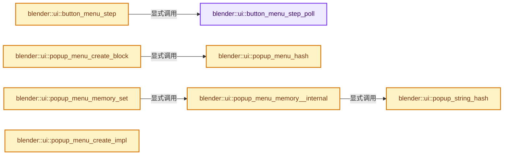
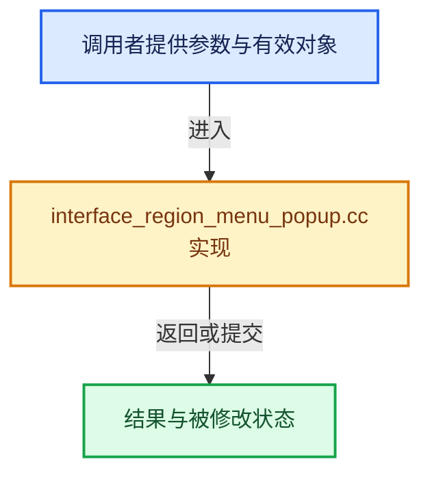

# 实现依赖专题：source/blender/editors/interface/regions/interface_region_menu_popup.cc

[实现依赖导航](../../../../README.md) · [符号索引](../../../../../00-课程指南/02-源码与提交索引/符号依赖与实现索引.md)

本专题从正文实际调用进入，集中保存共享实现。函数有稳定锚点，可从调用处直接跳到对应完整函数；递归与互相调用通过回链组织。

## 本文件的实现关系






## 完整成员与函数实现

<a id="f-b27988555872e2af"></a>

### `blender::ui::button_menu_step_poll`

实现位置：[source/blender/editors/interface/regions/interface_region_menu_popup.cc](../../../../../../../../../source/blender/editors/interface/regions/interface_region_menu_popup.cc) · L52—L59。

接口参数：

- `const Button *but`

**教学注释版**

<!-- annotated:226b15218499e7 -->

```cpp
bool button_menu_step_poll(const Button *but)
{
  BLI_assert(but->type == ButtonType::Menu);

  /* currently only RNA buttons */
  return ((but->menu_step_func != nullptr) ||
          (but->rnaprop && RNA_property_type(but->rnaprop) == PROP_ENUM));
}
```

<details>
<summary>核对原始源码：source/blender/editors/interface/regions/interface_region_menu_popup.cc · L52—L59</summary>

<!-- original:226b15218499e7:source/blender/editors/interface/regions/interface_region_menu_popup.cc:52:59 -->

```cpp
bool button_menu_step_poll(const Button *but)
{
  BLI_assert(but->type == ButtonType::Menu);

  /* currently only RNA buttons */
  return ((but->menu_step_func != nullptr) ||
          (but->rnaprop && RNA_property_type(but->rnaprop) == PROP_ENUM));
}
```

</details>

**结果出口**

- `return ((but->menu_step_func != nullptr) ||`

**继续追踪实现**

- `BLI_assert` → [BLI_assert · L48](../../../../01-BLI基础库/BLI_assert.hh.md#m-57a88495704d)；[BLI_assert · L63](../../../../01-BLI基础库/BLI_assert.hh.md#m-d07050020cb5)。宏定义由构建条件选择。
- `RNA_property_type` → [blender::RNA_property_type · L1293](../../../makesrna/intern/rna_access.cc.md#f-4465a90d55f022df)。

<a id="f-9c4bfe2a5a95f04c"></a>

### `blender::ui::button_menu_step`

实现位置：[source/blender/editors/interface/regions/interface_region_menu_popup.cc](../../../../../../../../../source/blender/editors/interface/regions/interface_region_menu_popup.cc) · L61—L79。

接口参数：

- `Button *but`
- `int direction`

**教学注释版**

<!-- annotated:6bf82ae79f7028 -->

```cpp
int button_menu_step(Button *but, int direction)
{
  if (button_menu_step_poll(but)) {
    if (but->menu_step_func) {
      return but->menu_step_func(
          static_cast<bContext *>(but->block->evil_C), direction, but->poin);
    }

    const int curval = RNA_property_enum_get(&but->rnapoin, but->rnaprop);
    return RNA_property_enum_step(static_cast<bContext *>(but->block->evil_C),
                                  &but->rnapoin,
                                  but->rnaprop,
                                  curval,
                                  direction);
  }

  printf("%s: cannot cycle button '%s'\n", __func__, but->str.c_str());
  return 0;
}
```

<details>
<summary>核对原始源码：source/blender/editors/interface/regions/interface_region_menu_popup.cc · L61—L79</summary>

<!-- original:6bf82ae79f7028:source/blender/editors/interface/regions/interface_region_menu_popup.cc:61:79 -->

```cpp
int button_menu_step(Button *but, int direction)
{
  if (button_menu_step_poll(but)) {
    if (but->menu_step_func) {
      return but->menu_step_func(
          static_cast<bContext *>(but->block->evil_C), direction, but->poin);
    }

    const int curval = RNA_property_enum_get(&but->rnapoin, but->rnaprop);
    return RNA_property_enum_step(static_cast<bContext *>(but->block->evil_C),
                                  &but->rnapoin,
                                  but->rnaprop,
                                  curval,
                                  direction);
  }

  printf("%s: cannot cycle button '%s'\n", __func__, but->str.c_str());
  return 0;
}
```

</details>

**结果出口**

- `return but->menu_step_func(`
- `return RNA_property_enum_step(static_cast<bContext *>(but->block->evil_C),`
- `return 0;`

**继续追踪实现**

- `button_menu_step_poll` → [blender::ui::button_menu_step_poll · L52](interface_region_menu_popup.cc.md#f-b27988555872e2af)。
- `but->menu_step_func` → [调用协议](../../../../../00-课程指南/01-路线与规范/模板宏与动态分派协议.md)：由接收对象具体类型或运行时策略提供实现。调用位置L65。
- `RNA_property_enum_get` → [blender::RNA_property_enum_get · L4499](../../../makesrna/intern/rna_access.cc.md#f-7921c83822683274)。
- `RNA_property_enum_step` → [blender::RNA_property_enum_step · L4580](../../../makesrna/intern/rna_access.cc.md#f-af5ddd509f793c3d)。
- `printf` → [外部契约](https://eel.is/c++draft/)：这个边界按实际表达式及所属类型核对参数、返回值、寿命与失败行为。这里提供接口入口，不声称已解释该第三方版本的内部实现。
- `but->str.c_str` → [调用协议](../../../../../00-课程指南/01-路线与规范/模板宏与动态分派协议.md)：接收对象类型依赖auto、返回值或模板实例；不按同名猜测目标。调用位置L77。

<a id="f-c905ce4eb7a48775"></a>

### `blender::ui::popup_string_hash`

实现位置：[source/blender/editors/interface/regions/interface_region_menu_popup.cc](../../../../../../../../../source/blender/editors/interface/regions/interface_region_menu_popup.cc) · L92—L100。

接口参数：

- `const StringRef str`
- `const bool use_sep`

**教学注释版**

<!-- annotated:37cd45d8547275 -->

```cpp
static uint popup_string_hash(const StringRef str, const bool use_sep)
{
  /* sometimes button contains hotkey, sometimes not, strip for proper compare */
  const size_t sep_index = use_sep ? str.find_first_of(UI_SEP_CHAR) : StringRef::not_found;
  const StringRef before_hotkey = sep_index == StringRef::not_found ? str :
                                                                      str.substr(0, sep_index);

  return get_default_hash(before_hotkey);
}
```

<details>
<summary>核对原始源码：source/blender/editors/interface/regions/interface_region_menu_popup.cc · L92—L100</summary>

<!-- original:37cd45d8547275:source/blender/editors/interface/regions/interface_region_menu_popup.cc:92:100 -->

```cpp
static uint popup_string_hash(const StringRef str, const bool use_sep)
{
  /* sometimes button contains hotkey, sometimes not, strip for proper compare */
  const size_t sep_index = use_sep ? str.find_first_of(UI_SEP_CHAR) : StringRef::not_found;
  const StringRef before_hotkey = sep_index == StringRef::not_found ? str :
                                                                      str.substr(0, sep_index);

  return get_default_hash(before_hotkey);
}
```

</details>

**结果出口**

- `return get_default_hash(before_hotkey);`

**继续追踪实现**

- `str.find_first_of` → [blender::StringRefBase::find_first_of · L363](../../../../../01-基础容器与现代CPP/15-StringRef字符串视图.md#f-1f3c5f639269f8da)；[blender::StringRefBase::find_first_of · L369](../../../../../01-基础容器与现代CPP/15-StringRef字符串视图.md#f-d68ec25e99992ba5)。同名重载需按实参类型选择。
- `str.substr` → [调用协议](../../../../../00-课程指南/01-路线与规范/模板宏与动态分派协议.md)：由接收对象具体类型或运行时策略提供实现。调用位置L97。
- `get_default_hash` → [blender::get_default_hash · L251](../../../../../02-哈希表与关联数据结构/01-哈希与相等契约.md#f-5f2c246aedf3dc0a)。

<a id="f-e397a75247347f8f"></a>

### `blender::ui::popup_menu_hash`

实现位置：[source/blender/editors/interface/regions/interface_region_menu_popup.cc](../../../../../../../../../source/blender/editors/interface/regions/interface_region_menu_popup.cc) · L102—L105。

接口参数：

- `const StringRef str`

**教学注释版**

<!-- annotated:373a16340a0dcf -->

```cpp
uint popup_menu_hash(const StringRef str)
{
  return get_default_hash(str);
}
```

<details>
<summary>核对原始源码：source/blender/editors/interface/regions/interface_region_menu_popup.cc · L102—L105</summary>

<!-- original:373a16340a0dcf:source/blender/editors/interface/regions/interface_region_menu_popup.cc:102:105 -->

```cpp
uint popup_menu_hash(const StringRef str)
{
  return get_default_hash(str);
}
```

</details>

**结果出口**

- `return get_default_hash(str);`

**继续追踪实现**

- `get_default_hash` → [blender::get_default_hash · L251](../../../../../02-哈希表与关联数据结构/01-哈希与相等契约.md#f-5f2c246aedf3dc0a)。

<a id="f-dcfbda4d9d133119"></a>

### `blender::ui::popup_menu_memory__internal`

实现位置：[source/blender/editors/interface/regions/interface_region_menu_popup.cc](../../../../../../../../../source/blender/editors/interface/regions/interface_region_menu_popup.cc) · L108—L142。

接口参数：

- `Block *block`
- `Button *but`

**教学注释版**

<!-- annotated:1923f944472cd4 -->

```cpp
static Button *popup_menu_memory__internal(Block *block, Button *but)
{
  static uint mem[256];
  static bool first = true;

  const uint hash = block->puphash;
  const uint hash_mod = hash & 255;

  if (first) {
    /* init */
    // [讲解] memset：填充字节，不调用T构造函数，也不保证任意类型的全零表示是合法或期望值。
    memset(mem, -1, sizeof(mem));
    first = false;
  }

  if (but) {
    /* set */
    mem[hash_mod] = popup_string_hash(but->str, but->flag & BUT_HAS_SEP_CHAR);
    return nullptr;
  }

  /* get */
  for (Button &but_iter : block->buttons()) {
    /* Prevent labels (typically headings), from being returned in the case the text
     * happens to matches one of the menu items.
     * Skip separators too as checking them is redundant. */
    if (ELEM(but_iter.type, ButtonType::Label, ButtonType::Sepr, ButtonType::SeprLine)) {
      continue;
    }
    if (mem[hash_mod] == popup_string_hash(but_iter.str, but_iter.flag & BUT_HAS_SEP_CHAR)) {
      return &but_iter;
    }
  }

  return nullptr;
}
```

<details>
<summary>核对原始源码：source/blender/editors/interface/regions/interface_region_menu_popup.cc · L108—L142</summary>

<!-- original:1923f944472cd4:source/blender/editors/interface/regions/interface_region_menu_popup.cc:108:142 -->

```cpp
static Button *popup_menu_memory__internal(Block *block, Button *but)
{
  static uint mem[256];
  static bool first = true;

  const uint hash = block->puphash;
  const uint hash_mod = hash & 255;

  if (first) {
    /* init */
    memset(mem, -1, sizeof(mem));
    first = false;
  }

  if (but) {
    /* set */
    mem[hash_mod] = popup_string_hash(but->str, but->flag & BUT_HAS_SEP_CHAR);
    return nullptr;
  }

  /* get */
  for (Button &but_iter : block->buttons()) {
    /* Prevent labels (typically headings), from being returned in the case the text
     * happens to matches one of the menu items.
     * Skip separators too as checking them is redundant. */
    if (ELEM(but_iter.type, ButtonType::Label, ButtonType::Sepr, ButtonType::SeprLine)) {
      continue;
    }
    if (mem[hash_mod] == popup_string_hash(but_iter.str, but_iter.flag & BUT_HAS_SEP_CHAR)) {
      return &but_iter;
    }
  }

  return nullptr;
}
```

</details>

**沿实际写入检查状态**

- `first = false;`
- `mem[hash_mod] = popup_string_hash(but->str, but->flag & BUT_HAS_SEP_CHAR);`

**结果出口**

- `return nullptr;`
- `return &but_iter;`

**继续追踪实现**

- `memset` → [外部契约](https://eel.is/c++draft/cstring.syn)：填充字节，不调用T构造函数，也不保证任意类型的全零表示是合法或期望值。
- `popup_string_hash` → [blender::ui::popup_string_hash · L92](interface_region_menu_popup.cc.md#f-c905ce4eb7a48775)。
- `block->buttons` → [blender::ui::Block::buttons · L836](../interface_intern.hh.md#f-5296ad5fd22b5505)。
- `ELEM` → [ELEM · L88](../../../../07-Intern运行时与平台/ghost/intern/GHOST_utildefines.hh.md#m-d28724a15928)；[ELEM · L135](../../../../01-BLI基础库/BLI_utildefines.hh.md#m-d6572de7cae0)。宏定义由构建条件选择。

<a id="f-245f50a19ce3bd35"></a>

### `blender::ui::popup_menu_memory_set`

实现位置：[source/blender/editors/interface/regions/interface_region_menu_popup.cc](../../../../../../../../../source/blender/editors/interface/regions/interface_region_menu_popup.cc) · L149—L152。

接口参数：

- `Block *block`
- `Button *but`

**教学注释版**

<!-- annotated:488964c3423d42 -->

```cpp
void popup_menu_memory_set(Block *block, Button *but)
{
  popup_menu_memory__internal(block, but);
}
```

<details>
<summary>核对原始源码：source/blender/editors/interface/regions/interface_region_menu_popup.cc · L149—L152</summary>

<!-- original:488964c3423d42:source/blender/editors/interface/regions/interface_region_menu_popup.cc:149:152 -->

```cpp
void popup_menu_memory_set(Block *block, Button *but)
{
  popup_menu_memory__internal(block, but);
}
```

</details>

**继续追踪实现**

- `popup_menu_memory__internal` → [blender::ui::popup_menu_memory__internal · L108](interface_region_menu_popup.cc.md#f-dcfbda4d9d133119)。

<a id="f-b2d54654d78a5004"></a>

### `blender::ui::popup_menu_create_block`

实现位置：[source/blender/editors/interface/regions/interface_region_menu_popup.cc](../../../../../../../../../source/blender/editors/interface/regions/interface_region_menu_popup.cc) · L179—L224。

接口参数：

- `bContext *C`
- `PopupMenu *pup`
- `const StringRef title`
- `const StringRef block_name`

**教学注释版**

<!-- annotated:c8255b5798a634 -->

```cpp
static void popup_menu_create_block(bContext *C,
                                    PopupMenu *pup,
                                    const StringRef title,
                                    const StringRef block_name)
{
  const uiStyle *style = style_get_dpi();

  pup->block = block_begin(C, nullptr, block_name, EmbossType::Pulldown);

  /* A title is only provided when a Menu has a label, this is not always the case, see e.g.
   * `VIEW3D_MT_edit_mesh_context_menu` -- this specifies its own label inside the draw function
   * depending on vertex/edge/face mode. We still want to flag the Block (but only insert into
   * the `puphash` if we have a title provided). Choosing an entry in a menu will still handle
   * `puphash` later (see `button_activate_exit`) though multiple menus without a label might fight
   * for the same storage of the menu memory. Using `idname` instead (or in combination with the
   * label) for the hash could be investigated to solve this. */
  pup->block->flag |= BLOCK_POPUP_MEMORY;
  if (!title.is_empty()) {
    pup->block->puphash = popup_menu_hash(title);
  }
  pup->layout = &block_layout(pup->block,
                              LayoutDirection::Vertical,
                              LayoutType::Menu,
                              0,
                              0,
                              200,
                              0,
                              UI_MENU_PADDING,
                              style);

  /* NOTE: this intentionally differs from the menu & sub-menu default because many operators
   * use popups like this to select one of their options -
   * where having invoke doesn't make sense.
   * When the menu was opened from a button, use invoke still for compatibility. This used to be
   * the default and changing now could cause issues. */
  const wm::OpCallContext opcontext = pup->but ? wm::OpCallContext::InvokeRegionWin :
                                                 wm::OpCallContext::ExecRegionWin;

  pup->layout->operator_context_set(opcontext);

  if (pup->but) {
    if (pup->but->context) {
      pup->layout->context_copy(pup->but->context);
    }
  }
}
```

<details>
<summary>核对原始源码：source/blender/editors/interface/regions/interface_region_menu_popup.cc · L179—L224</summary>

<!-- original:c8255b5798a634:source/blender/editors/interface/regions/interface_region_menu_popup.cc:179:224 -->

```cpp
static void popup_menu_create_block(bContext *C,
                                    PopupMenu *pup,
                                    const StringRef title,
                                    const StringRef block_name)
{
  const uiStyle *style = style_get_dpi();

  pup->block = block_begin(C, nullptr, block_name, EmbossType::Pulldown);

  /* A title is only provided when a Menu has a label, this is not always the case, see e.g.
   * `VIEW3D_MT_edit_mesh_context_menu` -- this specifies its own label inside the draw function
   * depending on vertex/edge/face mode. We still want to flag the Block (but only insert into
   * the `puphash` if we have a title provided). Choosing an entry in a menu will still handle
   * `puphash` later (see `button_activate_exit`) though multiple menus without a label might fight
   * for the same storage of the menu memory. Using `idname` instead (or in combination with the
   * label) for the hash could be investigated to solve this. */
  pup->block->flag |= BLOCK_POPUP_MEMORY;
  if (!title.is_empty()) {
    pup->block->puphash = popup_menu_hash(title);
  }
  pup->layout = &block_layout(pup->block,
                              LayoutDirection::Vertical,
                              LayoutType::Menu,
                              0,
                              0,
                              200,
                              0,
                              UI_MENU_PADDING,
                              style);

  /* NOTE: this intentionally differs from the menu & sub-menu default because many operators
   * use popups like this to select one of their options -
   * where having invoke doesn't make sense.
   * When the menu was opened from a button, use invoke still for compatibility. This used to be
   * the default and changing now could cause issues. */
  const wm::OpCallContext opcontext = pup->but ? wm::OpCallContext::InvokeRegionWin :
                                                 wm::OpCallContext::ExecRegionWin;

  pup->layout->operator_context_set(opcontext);

  if (pup->but) {
    if (pup->but->context) {
      pup->layout->context_copy(pup->but->context);
    }
  }
}
```

</details>

**沿实际写入检查状态**

- `pup->block = block_begin(C, nullptr, block_name, EmbossType::Pulldown);`
- `pup->block->flag |= BLOCK_POPUP_MEMORY;`
- `pup->block->puphash = popup_menu_hash(title);`
- `pup->layout = &block_layout(pup->block,`

**继续追踪实现**

- `style_get_dpi` → [blender::ui::style_get_dpi · L424](../interface_style.cc.md#f-37e0cedd2705020a)。
- `block_begin` → [blender::ui::block_begin · L4062](../interface.cc.md#f-efa18c1a5a853e25)；[blender::ui::block_begin · L4114](../interface.cc.md#f-c453ff44be2282cb)。同名重载需按实参类型选择。
- `title.is_empty` → [调用协议](../../../../../00-课程指南/01-路线与规范/模板宏与动态分派协议.md)：由接收对象具体类型或运行时策略提供实现。调用位置L196。
- `popup_menu_hash` → [blender::ui::popup_menu_hash · L102](interface_region_menu_popup.cc.md#f-e397a75247347f8f)。
- `block_layout` → [blender::ui::block_layout · L5891](../interface_layout.cc.md#f-40b8f8acb2de8fc4)。
- `pup->layout->operator_context_set` → [调用协议](../../../../../00-课程指南/01-路线与规范/模板宏与动态分派协议.md)：接收对象类型依赖auto、返回值或模板实例；不按同名猜测目标。调用位置L217。
- `pup->layout->context_copy` → [调用协议](../../../../../00-课程指南/01-路线与规范/模板宏与动态分派协议.md)：接收对象类型依赖auto、返回值或模板实例；不按同名猜测目标。调用位置L221。

<a id="f-2b274cc25e37439a"></a>

### `blender::ui::popup_menu_create_impl`

实现位置：[source/blender/editors/interface/regions/interface_region_menu_popup.cc](../../../../../../../../../source/blender/editors/interface/regions/interface_region_menu_popup.cc) · L393—L434。

接口参数：

- `bContext *C`
- `ARegion *butregion`
- `Button *but`
- `const char *title`
- `std::function<void(bContext *, Layout *)> menu_func`
- `bContext *`
- `Layout *`
- `const bool can_refresh`

**教学注释版**

<!-- annotated:74d8f3e1ae5109 -->

```cpp
static PopupBlockHandle *popup_menu_create_impl(
    bContext *C,
    ARegion *butregion,
    Button *but,
    const char *title,
    std::function<void(bContext *, Layout *)> menu_func,
    const bool can_refresh)
{
  wmWindow *window = CTX_wm_window(C);

  PopupMenu *pup = MEM_new<PopupMenu>(__func__);
  pup->title = title;
  /* menu is created from a callback */
  pup->menu_func = menu_func;
  if (but) {
    pup->slideout = block_is_menu(but->block);
    pup->but = but;

    if (but->type == ButtonType::Pulldown) {
      WorkspaceStatus status(C);
      status.item(IFACE_("Search"), ICON_EVENT_SPACEKEY);
    }
  }

  if (!but) {
    /* no button to start from, means we are a popup */
    pup->mx = window->runtime->eventstate->xy[0];
    pup->my = window->runtime->eventstate->xy[1];
    pup->popup = true;
  }
  PopupBlockHandle *handle = popup_block_create(
      C, butregion, but, nullptr, block_func_POPUP, pup, block_free_func_POPUP, can_refresh);

  if (!but) {
    handle->popup = true;

    popup_handlers_add(C, &window->runtime->modalhandlers, handle, 0);
    WM_event_add_mousemove(window);
  }

  return handle;
}
```

<details>
<summary>核对原始源码：source/blender/editors/interface/regions/interface_region_menu_popup.cc · L393—L434</summary>

<!-- original:74d8f3e1ae5109:source/blender/editors/interface/regions/interface_region_menu_popup.cc:393:434 -->

```cpp
static PopupBlockHandle *popup_menu_create_impl(
    bContext *C,
    ARegion *butregion,
    Button *but,
    const char *title,
    std::function<void(bContext *, Layout *)> menu_func,
    const bool can_refresh)
{
  wmWindow *window = CTX_wm_window(C);

  PopupMenu *pup = MEM_new<PopupMenu>(__func__);
  pup->title = title;
  /* menu is created from a callback */
  pup->menu_func = menu_func;
  if (but) {
    pup->slideout = block_is_menu(but->block);
    pup->but = but;

    if (but->type == ButtonType::Pulldown) {
      WorkspaceStatus status(C);
      status.item(IFACE_("Search"), ICON_EVENT_SPACEKEY);
    }
  }

  if (!but) {
    /* no button to start from, means we are a popup */
    pup->mx = window->runtime->eventstate->xy[0];
    pup->my = window->runtime->eventstate->xy[1];
    pup->popup = true;
  }
  PopupBlockHandle *handle = popup_block_create(
      C, butregion, but, nullptr, block_func_POPUP, pup, block_free_func_POPUP, can_refresh);

  if (!but) {
    handle->popup = true;

    popup_handlers_add(C, &window->runtime->modalhandlers, handle, 0);
    WM_event_add_mousemove(window);
  }

  return handle;
}
```

</details>

**沿实际写入检查状态**

- `pup->title = title;`
- `pup->menu_func = menu_func;`
- `pup->slideout = block_is_menu(but->block);`
- `pup->but = but;`
- `pup->mx = window->runtime->eventstate->xy[0];`
- `pup->my = window->runtime->eventstate->xy[1];`
- `pup->popup = true;`
- `handle->popup = true;`

**结果出口**

- `return handle;`

**继续追踪实现**

- `CTX_wm_window` → [blender::CTX_wm_window · L938](../../../../02-BKE几何与数据/intern/context.cc.md#f-a1996003b2409854)。
- `MEM_new<PopupMenu>` → [MEM_new · L351](../../../../07-Intern运行时与平台/guardedalloc/MEM_guardedalloc.h.md#f-115f9b6784f89912)。
- `block_is_menu` → [blender::ui::block_is_menu · L676](../interface_query.cc.md#f-e7139d01e3147419)。
- `status.item` → [blender::WorkspaceStatus::item · L1076](../../screen/area.cc.md#f-91ac007b3084f829)。
- `IFACE_` → [IFACE_ · L49](../../../blentranslation/BLT_translation.hh.md#m-378ed115fdc8)。宏定义由构建条件选择。
- `popup_block_create` → [blender::ui::popup_block_create · L924](interface_region_popup.cc.md#f-3fa47eb33567b22b)。
- `popup_handlers_add` → [popup_handlers_add · L13236](../interface_handlers.cc.md#f-2e37f0042b8ed8dc)。
- `WM_event_add_mousemove` → [blender::WM_event_add_mousemove · L5349](../../../windowmanager/intern/wm_event_system.cc.md#f-43a2db8eab31c4e2)。

<a id="f-1b93f76bdd9b0550"></a>

### `blender::ui::popup_menu_create`

实现位置：[source/blender/editors/interface/regions/interface_region_menu_popup.cc](../../../../../../../../../source/blender/editors/interface/regions/interface_region_menu_popup.cc) · L436—L450。

接口参数：

- `bContext *C`
- `ARegion *butregion`
- `Button *but`
- `MenuCreateFunc menu_func`
- `void *arg`
- `const bool can_refresh`

**教学注释版**

<!-- annotated:638fd4cc66b6b9 -->

```cpp
PopupBlockHandle *popup_menu_create(bContext *C,
                                    ARegion *butregion,
                                    Button *but,
                                    MenuCreateFunc menu_func,
                                    void *arg,
                                    const bool can_refresh)
{
  return popup_menu_create_impl(
      C,
      butregion,
      but,
      nullptr,
      [menu_func, arg](bContext *C, Layout *layout) { menu_func(C, layout, arg); },
      can_refresh);
}
```

<details>
<summary>核对原始源码：source/blender/editors/interface/regions/interface_region_menu_popup.cc · L436—L450</summary>

<!-- original:638fd4cc66b6b9:source/blender/editors/interface/regions/interface_region_menu_popup.cc:436:450 -->

```cpp
PopupBlockHandle *popup_menu_create(bContext *C,
                                    ARegion *butregion,
                                    Button *but,
                                    MenuCreateFunc menu_func,
                                    void *arg,
                                    const bool can_refresh)
{
  return popup_menu_create_impl(
      C,
      butregion,
      but,
      nullptr,
      [menu_func, arg](bContext *C, Layout *layout) { menu_func(C, layout, arg); },
      can_refresh);
}
```

</details>

**结果出口**

- `return popup_menu_create_impl(`

**继续追踪实现**

- `popup_menu_create_impl` → [blender::ui::popup_menu_create_impl · L393](interface_region_menu_popup.cc.md#f-2b274cc25e37439a)。
- `menu_func` → [调用协议](../../../../../00-课程指南/01-路线与规范/模板宏与动态分派协议.md)：局部可调用对象，须结合其初始化与捕获环境。调用位置L448。

<a id="f-b96f09563477cba8"></a>

### `blender::ui::create_title_button`

实现位置：[source/blender/editors/interface/regions/interface_region_menu_popup.cc](../../../../../../../../../source/blender/editors/interface/regions/interface_region_menu_popup.cc) · L458—L474。

接口参数：

- `Layout &layout`
- `const char *title`
- `int icon`

**教学注释版**

<!-- annotated:d8ac6ab148f09a -->

```cpp
static void create_title_button(Layout &layout, const char *title, int icon)
{
  Block *block = layout.block();
  char titlestr[256];

  if (icon) {
    SNPRINTF_UTF8(titlestr, " %s", title);
    uiDefIconTextBut(block, ButtonType::Label, icon, titlestr, 0, 0, 200, UI_UNIT_Y, nullptr, "");
  }
  else {
    Button *but = uiDefBut(
        block, ButtonType::Label, title, 0, 0, 200, UI_UNIT_Y, nullptr, 0.0, 0.0, "");
    but->drawflag = BUT_TEXT_LEFT;
  }

  layout.separator();
}
```

<details>
<summary>核对原始源码：source/blender/editors/interface/regions/interface_region_menu_popup.cc · L458—L474</summary>

<!-- original:d8ac6ab148f09a:source/blender/editors/interface/regions/interface_region_menu_popup.cc:458:474 -->

```cpp
static void create_title_button(Layout &layout, const char *title, int icon)
{
  Block *block = layout.block();
  char titlestr[256];

  if (icon) {
    SNPRINTF_UTF8(titlestr, " %s", title);
    uiDefIconTextBut(block, ButtonType::Label, icon, titlestr, 0, 0, 200, UI_UNIT_Y, nullptr, "");
  }
  else {
    Button *but = uiDefBut(
        block, ButtonType::Label, title, 0, 0, 200, UI_UNIT_Y, nullptr, 0.0, 0.0, "");
    but->drawflag = BUT_TEXT_LEFT;
  }

  layout.separator();
}
```

</details>

**沿实际写入检查状态**

- `but->drawflag = BUT_TEXT_LEFT;`

**继续追踪实现**

- `layout.block` → [blender::ui::Layout::block · L5954](../interface_layout.cc.md#f-b9334360b99e3b66)。
- `SNPRINTF_UTF8` → [SNPRINTF_UTF8 · L340](../../../../01-BLI基础库/BLI_string_utf8.hh.md#m-5e57d7a30c64)。宏定义由构建条件选择。
- `uiDefIconTextBut` → [blender::ui::uiDefIconTextBut · L5653](../interface.cc.md#f-2268a296cec9df41)；[blender::ui::uiDefIconTextBut · L1576](../../include/UI_interface_c.hh.md#f-a6da6bbf7fe0d88f)。同名重载需按实参类型选择。
- `uiDefBut` → [blender::ui::uiDefBut · L5283](../interface.cc.md#f-48c75396a251b6a7)。
- `layout.separator` → [blender::ui::Layout::separator · L3551](../interface_layout.cc.md#f-541f31ea4bf14324)。

<a id="f-30cf0f6cc15ed779"></a>

### `blender::ui::popup_menu_begin_ex`

实现位置：[source/blender/editors/interface/regions/interface_region_menu_popup.cc](../../../../../../../../../source/blender/editors/interface/regions/interface_region_menu_popup.cc) · L476—L492。

接口参数：

- `bContext *C`
- `const char *title`
- `const char *block_name`
- `int icon`

**教学注释版**

<!-- annotated:272d497b429cdd -->

```cpp
PopupMenu *popup_menu_begin_ex(bContext *C, const char *title, const char *block_name, int icon)
{
  PopupMenu *pup = MEM_new<PopupMenu>(__func__);

  pup->title = title;

  popup_menu_create_block(C, pup, title, block_name);

  /* create in advance so we can let buttons point to retval already */
  pup->block->handle = MEM_new<PopupBlockHandle>(__func__);

  if (title[0]) {
    create_title_button(*pup->layout, title, icon);
  }

  return pup;
}
```

<details>
<summary>核对原始源码：source/blender/editors/interface/regions/interface_region_menu_popup.cc · L476—L492</summary>

<!-- original:272d497b429cdd:source/blender/editors/interface/regions/interface_region_menu_popup.cc:476:492 -->

```cpp
PopupMenu *popup_menu_begin_ex(bContext *C, const char *title, const char *block_name, int icon)
{
  PopupMenu *pup = MEM_new<PopupMenu>(__func__);

  pup->title = title;

  popup_menu_create_block(C, pup, title, block_name);

  /* create in advance so we can let buttons point to retval already */
  pup->block->handle = MEM_new<PopupBlockHandle>(__func__);

  if (title[0]) {
    create_title_button(*pup->layout, title, icon);
  }

  return pup;
}
```

</details>

**沿实际写入检查状态**

- `pup->title = title;`
- `pup->block->handle = MEM_new<PopupBlockHandle>(__func__);`

**结果出口**

- `return pup;`

**继续追踪实现**

- `MEM_new<PopupMenu>` → [MEM_new · L351](../../../../07-Intern运行时与平台/guardedalloc/MEM_guardedalloc.h.md#f-115f9b6784f89912)。
- `popup_menu_create_block` → [blender::ui::popup_menu_create_block · L179](interface_region_menu_popup.cc.md#f-b2d54654d78a5004)。
- `MEM_new<PopupBlockHandle>` → [MEM_new · L351](../../../../07-Intern运行时与平台/guardedalloc/MEM_guardedalloc.h.md#f-115f9b6784f89912)。
- `create_title_button` → [blender::ui::create_title_button · L458](interface_region_menu_popup.cc.md#f-b96f09563477cba8)。

<a id="f-b5c5abdb70db6f7b"></a>

### `blender::ui::popup_menu_begin`

实现位置：[source/blender/editors/interface/regions/interface_region_menu_popup.cc](../../../../../../../../../source/blender/editors/interface/regions/interface_region_menu_popup.cc) · L494—L497。

接口参数：

- `bContext *C`
- `const char *title`
- `int icon`

**教学注释版**

<!-- annotated:7cc95ee3094591 -->

```cpp
PopupMenu *popup_menu_begin(bContext *C, const char *title, int icon)
{
  return popup_menu_begin_ex(C, title, __func__, icon);
}
```

<details>
<summary>核对原始源码：source/blender/editors/interface/regions/interface_region_menu_popup.cc · L494—L497</summary>

<!-- original:7cc95ee3094591:source/blender/editors/interface/regions/interface_region_menu_popup.cc:494:497 -->

```cpp
PopupMenu *popup_menu_begin(bContext *C, const char *title, int icon)
{
  return popup_menu_begin_ex(C, title, __func__, icon);
}
```

</details>

**结果出口**

- `return popup_menu_begin_ex(C, title, __func__, icon);`

**继续追踪实现**

- `popup_menu_begin_ex` → [blender::ui::popup_menu_begin_ex · L476](interface_region_menu_popup.cc.md#f-30cf0f6cc15ed779)。

<a id="f-60adbdb46f61aaf8"></a>

### `blender::ui::popup_menu_end`

实现位置：[source/blender/editors/interface/regions/interface_region_menu_popup.cc](../../../../../../../../../source/blender/editors/interface/regions/interface_region_menu_popup.cc) · L505—L528。

接口参数：

- `bContext *C`
- `PopupMenu *pup`

**教学注释版**

<!-- annotated:05bf6feade17b7 -->

```cpp
void popup_menu_end(bContext *C, PopupMenu *pup)
{
  wmWindow *window = CTX_wm_window(C);

  pup->popup = true;
  pup->mx = window->runtime->eventstate->xy[0];
  pup->my = window->runtime->eventstate->xy[1];

  Button *but = nullptr;
  ARegion *butregion = nullptr;
  if (pup->but) {
    but = pup->but;
    butregion = pup->butregion;
  }

  PopupBlockHandle *menu = popup_block_create(
      C, butregion, but, nullptr, block_func_POPUP, pup, nullptr, false);
  menu->popup = true;

  popup_handlers_add(C, &window->runtime->modalhandlers, menu, 0);
  WM_event_add_mousemove(window);

  MEM_delete(pup);
}
```

<details>
<summary>核对原始源码：source/blender/editors/interface/regions/interface_region_menu_popup.cc · L505—L528</summary>

<!-- original:05bf6feade17b7:source/blender/editors/interface/regions/interface_region_menu_popup.cc:505:528 -->

```cpp
void popup_menu_end(bContext *C, PopupMenu *pup)
{
  wmWindow *window = CTX_wm_window(C);

  pup->popup = true;
  pup->mx = window->runtime->eventstate->xy[0];
  pup->my = window->runtime->eventstate->xy[1];

  Button *but = nullptr;
  ARegion *butregion = nullptr;
  if (pup->but) {
    but = pup->but;
    butregion = pup->butregion;
  }

  PopupBlockHandle *menu = popup_block_create(
      C, butregion, but, nullptr, block_func_POPUP, pup, nullptr, false);
  menu->popup = true;

  popup_handlers_add(C, &window->runtime->modalhandlers, menu, 0);
  WM_event_add_mousemove(window);

  MEM_delete(pup);
}
```

</details>

**沿实际写入检查状态**

- `pup->popup = true;`
- `pup->mx = window->runtime->eventstate->xy[0];`
- `pup->my = window->runtime->eventstate->xy[1];`
- `but = pup->but;`
- `butregion = pup->butregion;`
- `menu->popup = true;`

**继续追踪实现**

- `CTX_wm_window` → [blender::CTX_wm_window · L938](../../../../02-BKE几何与数据/intern/context.cc.md#f-a1996003b2409854)。
- `popup_block_create` → [blender::ui::popup_block_create · L924](interface_region_popup.cc.md#f-3fa47eb33567b22b)。
- `popup_handlers_add` → [popup_handlers_add · L13236](../interface_handlers.cc.md#f-2e37f0042b8ed8dc)。
- `WM_event_add_mousemove` → [blender::WM_event_add_mousemove · L5349](../../../windowmanager/intern/wm_event_system.cc.md#f-43a2db8eab31c4e2)。
- `MEM_delete` → [MEM_delete · L400](../../../../07-Intern运行时与平台/guardedalloc/MEM_guardedalloc.h.md#f-9049ffdd1682887c)。

<a id="f-ffb973fed7086e80"></a>

### `blender::ui::popup_menu_end_or_cancel`

实现位置：[source/blender/editors/interface/regions/interface_region_menu_popup.cc](../../../../../../../../../source/blender/editors/interface/regions/interface_region_menu_popup.cc) · L530—L541。

接口参数：

- `bContext *C`
- `PopupMenu *pup`

**教学注释版**

<!-- annotated:bbf8d389c25837 -->

```cpp
bool popup_menu_end_or_cancel(bContext *C, PopupMenu *pup)
{
  if (!block_is_empty_ex(pup->block, true)) {
    popup_menu_end(C, pup);
    return true;
  }
  block_layout_resolve(pup->block);
  MEM_delete(pup->block->handle);
  block_free(C, pup->block);
  MEM_delete(pup);
  return false;
}
```

<details>
<summary>核对原始源码：source/blender/editors/interface/regions/interface_region_menu_popup.cc · L530—L541</summary>

<!-- original:bbf8d389c25837:source/blender/editors/interface/regions/interface_region_menu_popup.cc:530:541 -->

```cpp
bool popup_menu_end_or_cancel(bContext *C, PopupMenu *pup)
{
  if (!block_is_empty_ex(pup->block, true)) {
    popup_menu_end(C, pup);
    return true;
  }
  block_layout_resolve(pup->block);
  MEM_delete(pup->block->handle);
  block_free(C, pup->block);
  MEM_delete(pup);
  return false;
}
```

</details>

**结果出口**

- `return true;`
- `return false;`

**继续追踪实现**

- `block_is_empty_ex` → [blender::ui::block_is_empty_ex · L712](../interface_query.cc.md#f-3127287898b70ff8)。
- `popup_menu_end` → [blender::ui::popup_menu_end · L505](interface_region_menu_popup.cc.md#f-60adbdb46f61aaf8)。
- `block_layout_resolve` → [blender::ui::block_layout_resolve · L6089](../interface_layout.cc.md#f-0f097d72534295c2)。
- `MEM_delete` → [MEM_delete · L400](../../../../07-Intern运行时与平台/guardedalloc/MEM_guardedalloc.h.md#f-9049ffdd1682887c)。
- `block_free` → [blender::ui::block_free · L3925](../interface.cc.md#f-adbdf6ddd05b8dbe)。

<a id="f-c5c72209ce833835"></a>

### `blender::ui::popup_menu_layout`

实现位置：[source/blender/editors/interface/regions/interface_region_menu_popup.cc](../../../../../../../../../source/blender/editors/interface/regions/interface_region_menu_popup.cc) · L543—L546。

接口参数：

- `PopupMenu *pup`

**教学注释版**

<!-- annotated:85df2a50924267 -->

```cpp
Layout *popup_menu_layout(PopupMenu *pup)
{
  return pup->layout;
}
```

<details>
<summary>核对原始源码：source/blender/editors/interface/regions/interface_region_menu_popup.cc · L543—L546</summary>

<!-- original:85df2a50924267:source/blender/editors/interface/regions/interface_region_menu_popup.cc:543:546 -->

```cpp
Layout *popup_menu_layout(PopupMenu *pup)
{
  return pup->layout;
}
```

</details>

**结果出口**

- `return pup->layout;`

**继续追踪实现**

本实现没有需要继续展开的显式调用；检查返回表达式、对象转换和调用者前置条件。

<a id="f-6828389bb7206898"></a>

### `blender::ui::popup_menu_reports`

实现位置：[source/blender/editors/interface/regions/interface_region_menu_popup.cc](../../../../../../../../../source/blender/editors/interface/regions/interface_region_menu_popup.cc) · L554—L605。

接口参数：

- `bContext *C`
- `ReportList *reports`

**教学注释版**

<!-- annotated:0708f8326ce7b1 -->

```cpp
void popup_menu_reports(bContext *C, ReportList *reports)
{
  PopupMenu *pup = nullptr;
  Layout *layout;

  if (!CTX_wm_window(C)) {
    return;
  }

  BKE_reports_lock(reports);

  for (Report &report : reports->list) {
    int icon;
    const char *msg, *msg_next;

    if (report.type < reports->printlevel) {
      continue;
    }

    if (pup == nullptr) {
      char title[UI_MAX_DRAW_STR];
      SNPRINTF_UTF8(title, "%s: %s", RPT_("Report"), report.typestr);
      /* popup_menu stuff does just what we need (but pass meaningful block name) */
      pup = popup_menu_begin_ex(C, title, __func__, ICON_NONE);
      layout = popup_menu_layout(pup);
    }
    else {
      layout->separator();
    }

    /* split each newline into a label */
    msg = report.message;
    icon = icon_from_report_type(report.type);
    do {
      char buf[UI_MAX_DRAW_STR];
      msg_next = strchr(msg, '\n');
      if (msg_next) {
        msg_next++;
        // [讲解] std::min：按比较关系选取较小值；截断范围时还需先满足非负和可表示范围，min本身不会证明边界安全。
        BLI_strncpy_utf8(buf, msg, std::min(sizeof(buf), size_t(msg_next - msg)));
        msg = buf;
      }
      layout->label(msg, icon);
      icon = ICON_NONE;
    } while ((msg = msg_next) && *msg);
  }

  BKE_reports_unlock(reports);

  if (pup) {
    popup_menu_end(C, pup);
  }
}
```

<details>
<summary>核对原始源码：source/blender/editors/interface/regions/interface_region_menu_popup.cc · L554—L605</summary>

<!-- original:0708f8326ce7b1:source/blender/editors/interface/regions/interface_region_menu_popup.cc:554:605 -->

```cpp
void popup_menu_reports(bContext *C, ReportList *reports)
{
  PopupMenu *pup = nullptr;
  Layout *layout;

  if (!CTX_wm_window(C)) {
    return;
  }

  BKE_reports_lock(reports);

  for (Report &report : reports->list) {
    int icon;
    const char *msg, *msg_next;

    if (report.type < reports->printlevel) {
      continue;
    }

    if (pup == nullptr) {
      char title[UI_MAX_DRAW_STR];
      SNPRINTF_UTF8(title, "%s: %s", RPT_("Report"), report.typestr);
      /* popup_menu stuff does just what we need (but pass meaningful block name) */
      pup = popup_menu_begin_ex(C, title, __func__, ICON_NONE);
      layout = popup_menu_layout(pup);
    }
    else {
      layout->separator();
    }

    /* split each newline into a label */
    msg = report.message;
    icon = icon_from_report_type(report.type);
    do {
      char buf[UI_MAX_DRAW_STR];
      msg_next = strchr(msg, '\n');
      if (msg_next) {
        msg_next++;
        BLI_strncpy_utf8(buf, msg, std::min(sizeof(buf), size_t(msg_next - msg)));
        msg = buf;
      }
      layout->label(msg, icon);
      icon = ICON_NONE;
    } while ((msg = msg_next) && *msg);
  }

  BKE_reports_unlock(reports);

  if (pup) {
    popup_menu_end(C, pup);
  }
}
```

</details>

**沿实际写入检查状态**

- `pup = popup_menu_begin_ex(C, title, __func__, ICON_NONE);`
- `layout = popup_menu_layout(pup);`
- `msg = report.message;`
- `icon = icon_from_report_type(report.type);`
- `msg_next = strchr(msg, '\n');`
- `msg = buf;`
- `icon = ICON_NONE;`

**继续追踪实现**

- `CTX_wm_window` → [blender::CTX_wm_window · L938](../../../../02-BKE几何与数据/intern/context.cc.md#f-a1996003b2409854)。
- `BKE_reports_lock` → [blender::BKE_reports_lock · L140](../../../../02-BKE几何与数据/intern/report.cc.md#f-878baca4af4ae208)。
- `SNPRINTF_UTF8` → [SNPRINTF_UTF8 · L340](../../../../01-BLI基础库/BLI_string_utf8.hh.md#m-5e57d7a30c64)。宏定义由构建条件选择。
- `RPT_` → [RPT_ · L51](../../../blentranslation/BLT_translation.hh.md#m-c13f94a1a934)。宏定义由构建条件选择。
- `popup_menu_begin_ex` → [blender::ui::popup_menu_begin_ex · L476](interface_region_menu_popup.cc.md#f-30cf0f6cc15ed779)。
- `popup_menu_layout` → [blender::ui::popup_menu_layout · L543](interface_region_menu_popup.cc.md#f-c5c72209ce833835)。
- `layout->separator` → [blender::ui::Layout::separator · L3551](../interface_layout.cc.md#f-541f31ea4bf14324)。
- `icon_from_report_type` → [blender::ui::icon_from_report_type · L655](../interface_utils.cc.md#f-0b7a365129b9c5f1)。
- `strchr` → [调用协议](../../../../../00-课程指南/01-路线与规范/模板宏与动态分派协议.md)：函数指针、局部可调用对象或未展开的宏；必须结合调用者环境。调用位置L589。
- `BLI_strncpy_utf8` → [blender::BLI_strncpy_utf8 · L404](../../../../01-BLI基础库/intern/string_utf8.cc.md#f-ff7c5f28742085a0)。
- `std::min` → [外部契约](https://eel.is/c++draft/alg.min.max)：按比较关系选取较小值；截断范围时还需先满足非负和可表示范围，min本身不会证明边界安全。
- `layout->label` → [blender::ui::Layout::label · L3347](../interface_layout.cc.md#f-bbbe7909f34266d4)。
- `BKE_reports_unlock` → [blender::BKE_reports_unlock · L145](../../../../02-BKE几何与数据/intern/report.cc.md#f-4dab4a4d5b5bcbe4)。
- `popup_menu_end` → [blender::ui::popup_menu_end · L505](interface_region_menu_popup.cc.md#f-60adbdb46f61aaf8)。

<a id="f-b86bbb0692bcf48f"></a>

### `blender::ui::popup_block_invoke_ex`

实现位置：[source/blender/editors/interface/regions/interface_region_menu_popup.cc](../../../../../../../../../source/blender/editors/interface/regions/interface_region_menu_popup.cc) · L674—L695。

接口参数：

- `bContext *C`
- `BlockCreateFunc func`
- `void *arg`
- `FreeArgFunc arg_free`
- `const bool can_refresh`
- `StructRNA *srna_owner`

**教学注释版**

<!-- annotated:30c7f889bef573 -->

```cpp
void popup_block_invoke_ex(bContext *C,
                           BlockCreateFunc func,
                           void *arg,
                           FreeArgFunc arg_free,
                           const bool can_refresh,
                           StructRNA *srna_owner)
{
  wmWindow *window = CTX_wm_window(C);

  PopupBlockHandle *handle = popup_block_create(
      C, nullptr, nullptr, func, nullptr, arg, arg_free, can_refresh);
  handle->popup = true;
  handle->srna_owner = srna_owner;

  /* Clear the status bar. */
  WorkspaceStatus status(C);
  status.item(" ", ICON_NONE);

  popup_handlers_add(C, &window->runtime->modalhandlers, handle, 0);
  block_active_only_flagged_buttons(C, handle->region, handle->region->runtime->uiblocks.first());
  WM_event_add_mousemove(window);
}
```

<details>
<summary>核对原始源码：source/blender/editors/interface/regions/interface_region_menu_popup.cc · L674—L695</summary>

<!-- original:30c7f889bef573:source/blender/editors/interface/regions/interface_region_menu_popup.cc:674:695 -->

```cpp
void popup_block_invoke_ex(bContext *C,
                           BlockCreateFunc func,
                           void *arg,
                           FreeArgFunc arg_free,
                           const bool can_refresh,
                           StructRNA *srna_owner)
{
  wmWindow *window = CTX_wm_window(C);

  PopupBlockHandle *handle = popup_block_create(
      C, nullptr, nullptr, func, nullptr, arg, arg_free, can_refresh);
  handle->popup = true;
  handle->srna_owner = srna_owner;

  /* Clear the status bar. */
  WorkspaceStatus status(C);
  status.item(" ", ICON_NONE);

  popup_handlers_add(C, &window->runtime->modalhandlers, handle, 0);
  block_active_only_flagged_buttons(C, handle->region, handle->region->runtime->uiblocks.first());
  WM_event_add_mousemove(window);
}
```

</details>

**沿实际写入检查状态**

- `handle->popup = true;`
- `handle->srna_owner = srna_owner;`

**继续追踪实现**

- `CTX_wm_window` → [blender::CTX_wm_window · L938](../../../../02-BKE几何与数据/intern/context.cc.md#f-a1996003b2409854)。
- `popup_block_create` → [blender::ui::popup_block_create · L924](interface_region_popup.cc.md#f-3fa47eb33567b22b)。
- `status.item` → [blender::WorkspaceStatus::item · L1076](../../screen/area.cc.md#f-91ac007b3084f829)。
- `popup_handlers_add` → [popup_handlers_add · L13236](../interface_handlers.cc.md#f-2e37f0042b8ed8dc)。
- `block_active_only_flagged_buttons` → [blender::ui::block_active_only_flagged_buttons · L1265](../interface.cc.md#f-dc2406c8bf8e0f4d)。
- `handle->region->runtime->uiblocks.first` → [调用协议](../../../../../00-课程指南/01-路线与规范/模板宏与动态分派协议.md)：接收对象类型依赖auto、返回值或模板实例；不按同名猜测目标。调用位置L693。
- `WM_event_add_mousemove` → [blender::WM_event_add_mousemove · L5349](../../../windowmanager/intern/wm_event_system.cc.md#f-43a2db8eab31c4e2)。

<a id="f-253b3a0a0d9be001"></a>

### `blender::ui::popup_block_invoke`

实现位置：[source/blender/editors/interface/regions/interface_region_menu_popup.cc](../../../../../../../../../source/blender/editors/interface/regions/interface_region_menu_popup.cc) · L697—L701。

接口参数：

- `bContext *C`
- `BlockCreateFunc func`
- `void *arg`
- `FreeArgFunc arg_free`
- `StructRNA *srna_owner`

**教学注释版**

<!-- annotated:60f61d5e9d1a41 -->

```cpp
void popup_block_invoke(
    bContext *C, BlockCreateFunc func, void *arg, FreeArgFunc arg_free, StructRNA *srna_owner)
{
  popup_block_invoke_ex(C, func, arg, arg_free, true, srna_owner);
}
```

<details>
<summary>核对原始源码：source/blender/editors/interface/regions/interface_region_menu_popup.cc · L697—L701</summary>

<!-- original:60f61d5e9d1a41:source/blender/editors/interface/regions/interface_region_menu_popup.cc:697:701 -->

```cpp
void popup_block_invoke(
    bContext *C, BlockCreateFunc func, void *arg, FreeArgFunc arg_free, StructRNA *srna_owner)
{
  popup_block_invoke_ex(C, func, arg, arg_free, true, srna_owner);
}
```

</details>

**继续追踪实现**

- `popup_block_invoke_ex` → [blender::ui::popup_block_invoke_ex · L674](interface_region_menu_popup.cc.md#f-b86bbb0692bcf48f)。

<a id="f-a891e5376503c1f8"></a>

### `blender::ui::popup_block_ex`

实现位置：[source/blender/editors/interface/regions/interface_region_menu_popup.cc](../../../../../../../../../source/blender/editors/interface/regions/interface_region_menu_popup.cc) · L703—L733。

接口参数：

- `bContext *C`
- `BlockCreateFunc func`
- `BlockHandleFunc popup_func`
- `BlockCancelFunc cancel_func`
- `void *arg`
- `wmOperator *op`

**教学注释版**

<!-- annotated:36945aa973973d -->

```cpp
void popup_block_ex(bContext *C,
                    BlockCreateFunc func,
                    BlockHandleFunc popup_func,
                    BlockCancelFunc cancel_func,
                    void *arg,
                    wmOperator *op)
{
  wmWindow *window = CTX_wm_window(C);

  PopupBlockHandle *handle = popup_block_create(
      C, nullptr, nullptr, func, nullptr, arg, nullptr, true);
  handle->popup = true;
  handle->retvalue = 1;

  handle->popup_op = op;
  if (op) {
    handle->srna_owner = op->type->srna;
  }
  handle->popup_arg = arg;
  handle->popup_func = popup_func;
  handle->cancel_func = cancel_func;
  // handle->opcontext = opcontext;

  /* Clear the status bar. */
  WorkspaceStatus status(C);
  status.item(" ", ICON_NONE);

  popup_handlers_add(C, &window->runtime->modalhandlers, handle, 0);
  block_active_only_flagged_buttons(C, handle->region, handle->region->runtime->uiblocks.first());
  WM_event_add_mousemove(window);
}
```

<details>
<summary>核对原始源码：source/blender/editors/interface/regions/interface_region_menu_popup.cc · L703—L733</summary>

<!-- original:36945aa973973d:source/blender/editors/interface/regions/interface_region_menu_popup.cc:703:733 -->

```cpp
void popup_block_ex(bContext *C,
                    BlockCreateFunc func,
                    BlockHandleFunc popup_func,
                    BlockCancelFunc cancel_func,
                    void *arg,
                    wmOperator *op)
{
  wmWindow *window = CTX_wm_window(C);

  PopupBlockHandle *handle = popup_block_create(
      C, nullptr, nullptr, func, nullptr, arg, nullptr, true);
  handle->popup = true;
  handle->retvalue = 1;

  handle->popup_op = op;
  if (op) {
    handle->srna_owner = op->type->srna;
  }
  handle->popup_arg = arg;
  handle->popup_func = popup_func;
  handle->cancel_func = cancel_func;
  // handle->opcontext = opcontext;

  /* Clear the status bar. */
  WorkspaceStatus status(C);
  status.item(" ", ICON_NONE);

  popup_handlers_add(C, &window->runtime->modalhandlers, handle, 0);
  block_active_only_flagged_buttons(C, handle->region, handle->region->runtime->uiblocks.first());
  WM_event_add_mousemove(window);
}
```

</details>

**沿实际写入检查状态**

- `handle->popup = true;`
- `handle->retvalue = 1;`
- `handle->popup_op = op;`
- `handle->srna_owner = op->type->srna;`
- `handle->popup_arg = arg;`
- `handle->popup_func = popup_func;`
- `handle->cancel_func = cancel_func;`

**继续追踪实现**

- `CTX_wm_window` → [blender::CTX_wm_window · L938](../../../../02-BKE几何与数据/intern/context.cc.md#f-a1996003b2409854)。
- `popup_block_create` → [blender::ui::popup_block_create · L924](interface_region_popup.cc.md#f-3fa47eb33567b22b)。
- `status.item` → [blender::WorkspaceStatus::item · L1076](../../screen/area.cc.md#f-91ac007b3084f829)。
- `popup_handlers_add` → [popup_handlers_add · L13236](../interface_handlers.cc.md#f-2e37f0042b8ed8dc)。
- `block_active_only_flagged_buttons` → [blender::ui::block_active_only_flagged_buttons · L1265](../interface.cc.md#f-dc2406c8bf8e0f4d)。
- `handle->region->runtime->uiblocks.first` → [调用协议](../../../../../00-课程指南/01-路线与规范/模板宏与动态分派协议.md)：接收对象类型依赖auto、返回值或模板实例；不按同名猜测目标。调用位置L731。
- `WM_event_add_mousemove` → [blender::WM_event_add_mousemove · L5349](../../../windowmanager/intern/wm_event_system.cc.md#f-43a2db8eab31c4e2)。

<a id="f-efa009e8b3e0b1db"></a>

### `blender::ui::popup_menu_close`

实现位置：[source/blender/editors/interface/regions/interface_region_menu_popup.cc](../../../../../../../../../source/blender/editors/interface/regions/interface_region_menu_popup.cc) · L911—L914。

接口参数：

- `const Block *block`
- `const bool is_cancel`

**教学注释版**

<!-- annotated:7b4d876bbe794b -->

```cpp
void popup_menu_close(const Block *block, const bool is_cancel)
{
  popup_menu_retval_set(block, is_cancel ? RETURN_CANCEL : RETURN_OK, true);
}
```

<details>
<summary>核对原始源码：source/blender/editors/interface/regions/interface_region_menu_popup.cc · L911—L914</summary>

<!-- original:7b4d876bbe794b:source/blender/editors/interface/regions/interface_region_menu_popup.cc:911:914 -->

```cpp
void popup_menu_close(const Block *block, const bool is_cancel)
{
  popup_menu_retval_set(block, is_cancel ? RETURN_CANCEL : RETURN_OK, true);
}
```

</details>

**继续追踪实现**

- `popup_menu_retval_set` → [popup_menu_retval_set · L12833](../interface_handlers.cc.md#f-650761364a9f02e5)。

<a id="f-a4e254b0765cd47a"></a>

### `blender::ui::popup_menu_close_from_but`

实现位置：[source/blender/editors/interface/regions/interface_region_menu_popup.cc](../../../../../../../../../source/blender/editors/interface/regions/interface_region_menu_popup.cc) · L916—L919。

接口参数：

- `const Button *but`
- `const bool is_cancel`

**教学注释版**

<!-- annotated:e23003cf59b75d -->

```cpp
void popup_menu_close_from_but(const Button *but, const bool is_cancel)
{
  popup_menu_close(but->block, is_cancel);
}
```

<details>
<summary>核对原始源码：source/blender/editors/interface/regions/interface_region_menu_popup.cc · L916—L919</summary>

<!-- original:e23003cf59b75d:source/blender/editors/interface/regions/interface_region_menu_popup.cc:916:919 -->

```cpp
void popup_menu_close_from_but(const Button *but, const bool is_cancel)
{
  popup_menu_close(but->block, is_cancel);
}
```

</details>

**继续追踪实现**

- `popup_menu_close` → [blender::ui::popup_menu_close · L911](interface_region_menu_popup.cc.md#f-efa009e8b3e0b1db)。
