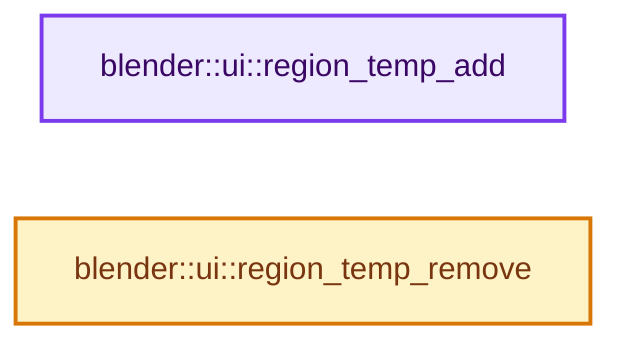

# 实现依赖专题：source/blender/editors/interface/regions/interface_regions.cc

[实现依赖导航](../../../../README.md) · [符号索引](../../../../../00-课程指南/02-源码与提交索引/符号依赖与实现索引.md)

本专题从正文实际调用进入，集中保存共享实现。函数有稳定锚点，可从调用处直接跳到对应完整函数；递归与互相调用通过回链组织。

## 本文件的实现关系




## 完整成员与函数实现

<a id="f-02c95667f98cc1c6"></a>

### `blender::ui::region_temp_add`

实现位置：[source/blender/editors/interface/regions/interface_regions.cc](../../../../../../../../../source/blender/editors/interface/regions/interface_regions.cc) · L26—L35。

接口参数：

- `bScreen *screen`

**教学注释版**

<!-- annotated:38b3ae00c122ff -->

```cpp
ARegion *region_temp_add(bScreen *screen)
{
  ARegion *region = BKE_area_region_new();
  BLI_addtail(&screen->regionbase, region);

  region->regiontype = RGN_TYPE_TEMPORARY;
  region->alignment = RGN_ALIGN_FLOAT;

  return region;
}
```

<details>
<summary>核对原始源码：source/blender/editors/interface/regions/interface_regions.cc · L26—L35</summary>

<!-- original:38b3ae00c122ff:source/blender/editors/interface/regions/interface_regions.cc:26:35 -->

```cpp
ARegion *region_temp_add(bScreen *screen)
{
  ARegion *region = BKE_area_region_new();
  BLI_addtail(&screen->regionbase, region);

  region->regiontype = RGN_TYPE_TEMPORARY;
  region->alignment = RGN_ALIGN_FLOAT;

  return region;
}
```

</details>

**沿实际写入检查状态**

- `region->regiontype = RGN_TYPE_TEMPORARY;`
- `region->alignment = RGN_ALIGN_FLOAT;`

**结果出口**

- `return region;`

**继续追踪实现**

- `BKE_area_region_new` → [blender::BKE_area_region_new · L520](../../../../02-BKE几何与数据/intern/screen.cc.md#f-65d2bf9c04020290)。
- `BLI_addtail` → [blender::BLI_addtail · L118](../../../../01-BLI基础库/intern/listbase.cc.md#f-4fb027713fa3115b)。

<a id="f-b371b19f49866644"></a>

### `blender::ui::region_temp_remove`

实现位置：[source/blender/editors/interface/regions/interface_regions.cc](../../../../../../../../../source/blender/editors/interface/regions/interface_regions.cc) · L37—L57。

接口参数：

- `bContext *C`
- `bScreen *screen`
- `ARegion *region`

**教学注释版**

<!-- annotated:219f7fa66f8fcf -->

```cpp
void region_temp_remove(bContext *C, bScreen *screen, ARegion *region)
{
  wmWindow *win = CTX_wm_window(C);

  BLI_assert(region->regiontype == RGN_TYPE_TEMPORARY);
  BLI_assert(BLI_findindex(&screen->regionbase, region) != -1);
  if (win) {
    wm_draw_region_clear(win, region);
  }

  ED_region_exit(C, region);
  BKE_area_region_free(nullptr, region); /* nullptr: no space-type. */
  BLI_freelinkN(&screen->regionbase, region);

  if (CTX_wm_region(C) == region) {
    CTX_wm_region_set(C, nullptr);
  }
  if (CTX_wm_region_popup(C) == region) {
    CTX_wm_region_popup_set(C, nullptr);
  }
}
```

<details>
<summary>核对原始源码：source/blender/editors/interface/regions/interface_regions.cc · L37—L57</summary>

<!-- original:219f7fa66f8fcf:source/blender/editors/interface/regions/interface_regions.cc:37:57 -->

```cpp
void region_temp_remove(bContext *C, bScreen *screen, ARegion *region)
{
  wmWindow *win = CTX_wm_window(C);

  BLI_assert(region->regiontype == RGN_TYPE_TEMPORARY);
  BLI_assert(BLI_findindex(&screen->regionbase, region) != -1);
  if (win) {
    wm_draw_region_clear(win, region);
  }

  ED_region_exit(C, region);
  BKE_area_region_free(nullptr, region); /* nullptr: no space-type. */
  BLI_freelinkN(&screen->regionbase, region);

  if (CTX_wm_region(C) == region) {
    CTX_wm_region_set(C, nullptr);
  }
  if (CTX_wm_region_popup(C) == region) {
    CTX_wm_region_popup_set(C, nullptr);
  }
}
```

</details>

**继续追踪实现**

- `CTX_wm_window` → [blender::CTX_wm_window · L938](../../../../02-BKE几何与数据/intern/context.cc.md#f-a1996003b2409854)。
- `BLI_assert` → [BLI_assert · L48](../../../../01-BLI基础库/BLI_assert.hh.md#m-57a88495704d)；[BLI_assert · L63](../../../../01-BLI基础库/BLI_assert.hh.md#m-d07050020cb5)。宏定义由构建条件选择。
- `BLI_findindex` → [blender::BLI_findindex · L593](../../../../01-BLI基础库/intern/listbase.cc.md#f-cb9036f12bd486b7)。
- `wm_draw_region_clear` → [blender::wm_draw_region_clear · L1767](../../../windowmanager/intern/wm_draw.cc.md#f-86736891865acab2)。
- `ED_region_exit` → [blender::ED_region_exit · L878](../../screen/screen_edit.cc.md#f-6015caa78b7725c9)。
- `BKE_area_region_free` → [blender::BKE_area_region_free · L734](../../../../02-BKE几何与数据/intern/screen.cc.md#f-d5d6a94225d341ef)。
- `BLI_freelinkN` → [blender::BLI_freelinkN · L277](../../../../01-BLI基础库/intern/listbase.cc.md#f-c7719591852af7da)。
- `CTX_wm_region` → [blender::CTX_wm_region · L965](../../../../02-BKE几何与数据/intern/context.cc.md#f-6cc0a26bc4539ae0)。
- `CTX_wm_region_set` → [blender::CTX_wm_region_set · L1240](../../../../02-BKE几何与数据/intern/context.cc.md#f-7c17937537b1c2fc)。
- `CTX_wm_region_popup` → [blender::CTX_wm_region_popup · L976](../../../../02-BKE几何与数据/intern/context.cc.md#f-0300c76092cd3bbc)。
- `CTX_wm_region_popup_set` → [blender::CTX_wm_region_popup_set · L1253](../../../../02-BKE几何与数据/intern/context.cc.md#f-362f845d998ad9ae)。
