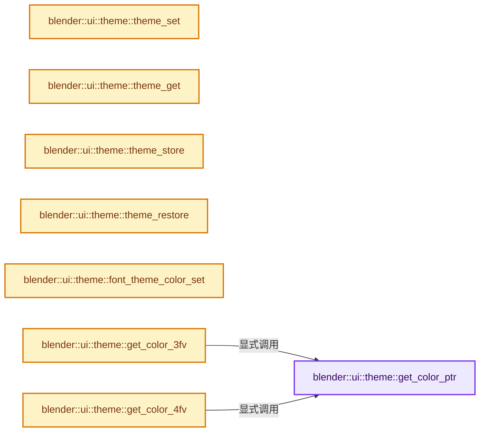
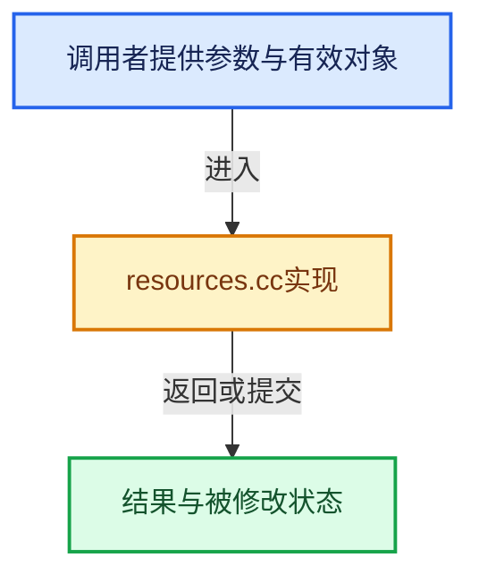

# 实现依赖专题：source/blender/editors/interface/resources.cc

[实现依赖导航](../../../README.md) · [符号索引](../../../../00-课程指南/02-源码与提交索引/符号依赖与实现索引.md)

本专题从正文实际调用进入，集中保存共享实现。函数有稳定锚点，可从调用处直接跳到对应完整函数；递归与互相调用通过回链组织。

## 本文件的实现关系






## 完整成员与函数实现

<a id="f-32aa7622aac63fff"></a>

### `blender::ui::theme::get_color_ptr`

实现位置：[source/blender/editors/interface/resources.cc](../../../../../../../../source/blender/editors/interface/resources.cc) · L80—L1098。

接口参数：

- `const bTheme *btheme`
- `int spacetype`
- `int colorid`

**教学注释版**

<!-- annotated:e71065c6cec12e -->

```cpp
const uchar *get_color_ptr(const bTheme *btheme, int spacetype, int colorid)
{
  const ThemeSpace *ts = nullptr;
  static uchar error[4] = {240, 0, 240, 255};
  static uchar back[4] = {0, 0, 0, 255};
  static uchar none[4] = {0, 0, 0, 0};
  static uchar white[4] = {255, 255, 255, 255};
  static uchar black[4] = {0, 0, 0, 255};
  static uchar setting = 0;
  const uchar *cp = error;

  /* ensure we're not getting a color after running BKE_blender_userdef_free */
  BLI_assert(BLI_findindex(&U.themes, g_theme_state.theme) != -1);
  BLI_assert(colorid != TH_UNDEFINED);

  if (btheme) {

    /* first check for ui buttons theme */
    if (colorid < TH_THEMEUI) {

      switch (colorid) {
        case TH_NONE:
          cp = none;
          break;
        case TH_BLACK:
          cp = black;
          break;
        case TH_WHITE:
          cp = white;
          break;
        case TH_REDALERT:
        case TH_ERROR:
          cp = btheme->tui.wcol_state.error;
          break;
        case TH_WARNING:
          cp = btheme->tui.wcol_state.warning;
          break;
        case TH_INFO:
          cp = btheme->tui.wcol_state.info;
          break;
        case TH_SUCCESS:
          cp = btheme->tui.wcol_state.success;
          break;
        case TH_LINK:
          cp = btheme->tui.link;
          break;
      }
    }
    else {

      switch (spacetype) {
        case SPACE_PROPERTIES:
          ts = &btheme->space_properties;
          break;
        case SPACE_VIEW3D:
          ts = &btheme->space_view3d;
          break;
        case SPACE_GRAPH:
          ts = &btheme->space_graph;
          break;
        case SPACE_FILE:
          ts = &btheme->space_file;
          break;
        case SPACE_NLA:
          ts = &btheme->space_nla;
          break;
        case SPACE_ACTION:
          ts = &btheme->space_action;
          break;
        case SPACE_SEQ:
          ts = &btheme->space_sequencer;
          break;
        case SPACE_IMAGE:
          ts = &btheme->space_image;
          break;
        case SPACE_TEXT:
          ts = &btheme->space_text;
          break;
        case SPACE_OUTLINER:
          ts = &btheme->space_outliner;
          break;
        case SPACE_INFO:
          ts = &btheme->space_info;
          break;
        case SPACE_USERPREF:
        case SPACE_PROJECT:
          ts = &btheme->space_preferences;
          break;
        case SPACE_CONSOLE:
          ts = &btheme->space_console;
          break;
        case SPACE_NODE:
          ts = &btheme->space_node;
          break;
        case SPACE_CLIP:
          ts = &btheme->space_clip;
          break;
        case SPACE_TOPBAR:
          ts = &btheme->space_topbar;
          break;
        case SPACE_STATUSBAR:
          ts = &btheme->space_statusbar;
          break;
        case SPACE_SPREADSHEET:
          ts = &btheme->space_spreadsheet;
          break;
        default:
          ts = &btheme->space_view3d;
          break;
      }

      switch (colorid) {
        case TH_BACK:
          if (ELEM(g_theme_state.regionid, RGN_TYPE_WINDOW, RGN_TYPE_PREVIEW)) {
            cp = ts->back;
          }
          else if (g_theme_state.regionid == RGN_TYPE_CHANNELS) {
            cp = btheme->regions.channels.back;
          }
          else if (ELEM(g_theme_state.regionid, RGN_TYPE_HEADER, RGN_TYPE_FOOTER)) {
            cp = ts->header;
          }
          else if (g_theme_state.regionid == RGN_TYPE_NAV_BAR) {
            cp = btheme->regions.sidebars.tab_back;
          }
          else if (g_theme_state.regionid == RGN_TYPE_ASSET_SHELF) {
            cp = btheme->regions.asset_shelf.back;
          }
          else if (g_theme_state.regionid == RGN_TYPE_ASSET_SHELF_HEADER) {
            cp = btheme->regions.asset_shelf.header_back;
          }
          else {
            cp = btheme->regions.sidebars.back;
          }

          copy_v4_v4_uchar(back, cp);
          if (!ED_region_is_overlap(spacetype, g_theme_state.regionid)) {
            back[3] = 255;
          }
          cp = back;
          break;
        case TH_BACK_GRAD:
          cp = ts->back_grad;
          break;

        case TH_BACKGROUND_TYPE:
          cp = &setting;
          setting = ts->background_type;
          break;
        case TH_TEXT:
          if (ELEM(g_theme_state.regionid, RGN_TYPE_UI, RGN_TYPE_TOOLS) ||
              ELEM(g_theme_state.spacetype, SPACE_PROPERTIES, SPACE_USERPREF, SPACE_PROJECT))
          {
            cp = btheme->tui.panel_text;
          }
          else if (g_theme_state.regionid == RGN_TYPE_CHANNELS) {
            cp = btheme->regions.channels.text;
          }
          else {
            cp = ts->text;
          }
          break;
        case TH_TEXT_HI:
          if (g_theme_state.regionid == RGN_TYPE_CHANNELS) {
            cp = btheme->regions.channels.text_selected;
          }
          else {
            cp = ts->text_hi;
          }
          break;

        case TH_HEADER:
          cp = ts->header;
          break;

        case TH_PANEL_HEADER:
          cp = btheme->tui.panel_header;
          break;
        case TH_PANEL_BACK:
          cp = btheme->tui.panel_back;
          break;
        case TH_PANEL_SUB_BACK:
          cp = btheme->tui.panel_sub_back;
          break;
        case TH_PANEL_OUTLINE:
          cp = btheme->tui.panel_outline;
          break;
        case TH_PANEL_ACTIVE:
          cp = btheme->tui.panel_active;
          break;

        case TH_TAB_TEXT:
          cp = btheme->tui.wcol_tab.text;
          break;
        case TH_TAB_TEXT_HI:
          cp = btheme->tui.wcol_tab.text_sel;
          break;
        case TH_TAB_ACTIVE:
          cp = btheme->tui.wcol_tab.inner_sel;
          break;
        case TH_TAB_INACTIVE:
          cp = btheme->tui.wcol_tab.inner;
          break;
        case TH_TAB_OUTLINE:
          cp = btheme->tui.wcol_tab.outline;
          break;
        case TH_TAB_OUTLINE_ACTIVE:
          cp = btheme->tui.wcol_tab.outline_sel;
          break;
        case TH_TAB_BACK:
          cp = btheme->regions.sidebars.tab_back;
          break;

        case TH_SHADE1:
          cp = ts->shade1;
          break;
        case TH_SHADE2:
          cp = ts->shade2;
          break;
        case TH_HILITE:
          cp = ts->hilite;
          break;

        case TH_GRID:
          cp = ts->grid;
          break;
        case TH_GRID_MAJOR:
          cp = ts->grid_major;
          break;
        case TH_TIME_SCRUB_BACKGROUND:
          cp = btheme->regions.scrubbing.back;
          break;
        case TH_TIME_SCRUB_TEXT:
          cp = btheme->regions.scrubbing.text;
          break;
        case TH_TIME_MARKER_LINE:
          cp = btheme->regions.scrubbing.time_marker;
          break;
        case TH_TIME_MARKER_LINE_SELECTED:
          cp = btheme->regions.scrubbing.time_marker_selected;
          break;
        case TH_VIEW_OVERLAY:
          cp = ts->view_overlay;
          break;
        case TH_WIRE:
          cp = ts->wire;
          break;
        case TH_WIRE_INNER:
          cp = ts->syntaxr;
          break;
        case TH_WIRE_EDIT:
          cp = ts->wire_edit;
          break;
        case TH_LIGHT:
          cp = ts->lamp;
          break;
        case TH_SPEAKER:
          cp = ts->speaker;
          break;
        case TH_CAMERA:
          cp = ts->camera;
          break;
        case TH_EMPTY:
          cp = ts->empty;
          break;
        case TH_SELECT:
          if (g_theme_state.spacetype == SPACE_IMAGE) {
            cp = btheme->space_view3d.select;
          }
          else {
            cp = ts->select;
          }
          break;
        case TH_ACTIVE:
          cp = ts->active;
          break;
        case TH_GROUP:
          cp = btheme->common.anim.channel_group;
          break;
        case TH_GROUP_ACTIVE:
          cp = btheme->common.anim.channel_group_active;
          break;
        case TH_TRANSFORM:
          if (g_theme_state.spacetype == SPACE_IMAGE) {
            cp = btheme->space_view3d.transform;
          }
          else {
            cp = ts->transform;
          }
          break;
        case TH_VERTEX:
          cp = ts->vertex;
          break;
        case TH_VERTEX_SELECT:
          cp = ts->vertex_select;
          break;
        case TH_VERTEX_ACTIVE:
          cp = ts->vertex_active;
          break;
        case TH_VERTEX_UNREFERENCED:
          cp = ts->vertex_unreferenced;
          break;
        case TH_VERTEX_SIZE:
          cp = &ts->vertex_size;
          break;
        case TH_OUTLINE_WIDTH:
          cp = &ts->outline_width;
          break;
        case TH_OBCENTER_DIA:
          cp = &ts->obcenter_dia;
          break;
        case TH_EDGE:
          cp = ts->edge;
          break;
        case TH_EDGE_WIDTH:
          cp = &ts->edge_width;
          break;
        case TH_EDGE_SELECT:
          cp = ts->edge_select;
          break;
        case TH_EDGE_MODE_SELECT:
          cp = ts->edge_mode_select;
          break;
        case TH_EDITMESH_ACTIVE:
          cp = ts->editmesh_active;
          break;
        case TH_FACE:
          cp = ts->face;
          break;
        case TH_FACE_SELECT:
          cp = ts->face_select;
          break;
        case TH_FACE_MODE_SELECT:
          cp = ts->face_mode_select;
          break;
        case TH_FACE_RETOPOLOGY:
          cp = ts->face_retopology;
          break;
        case TH_FACE_BACK:
          cp = ts->face_back;
          break;
        case TH_FACE_FRONT:
          cp = ts->face_front;
          break;
        case TH_FACEDOT_SIZE:
          cp = &ts->facedot_size;
          break;

        case TH_BEVEL:
          cp = btheme->space_view3d.bevel;
          break;
        case TH_CREASE:
          cp = btheme->space_view3d.crease;
          break;
        case TH_SEAM:
          cp = btheme->space_view3d.seam;
          break;
        case TH_SHARP:
          cp = btheme->space_view3d.sharp;
          break;
        case TH_FREESTYLE:
          cp = btheme->space_view3d.freestyle;
          break;

        case TH_DRAWEXTRA_EDGELEN:
          cp = ts->extra_edge_len;
          break;
        case TH_DRAWEXTRA_EDGEANG:
          cp = ts->extra_edge_angle;
          break;
        case TH_DRAWEXTRA_FACEAREA:
          cp = ts->extra_face_area;
          break;
        case TH_DRAWEXTRA_FACEANG:
          cp = ts->extra_face_angle;
          break;
        case TH_NORMAL:
          cp = ts->normal;
          break;
        case TH_VNORMAL:
          cp = ts->vertex_normal;
          break;
        case TH_LNORMAL:
          cp = ts->loop_normal;
          break;
        case TH_BONE_SOLID:
          cp = ts->bone_solid;
          break;
        case TH_BONE_POSE:
          cp = ts->bone_pose;
          break;
        case TH_BONE_POSE_ACTIVE:
          cp = ts->bone_pose_active;
          break;
        case TH_BONE_LOCKED_WEIGHT:
          cp = ts->bone_locked_weight;
          break;
        case TH_LONGKEY:
          cp = btheme->common.anim.long_key;
          break;
        case TH_LONGKEY_SELECT:
          cp = btheme->common.anim.long_key_selected;
          break;
        case TH_STRIP:
          cp = ts->strip;
          break;
        case TH_STRIP_SELECT:
          cp = ts->strip_select;
          break;
        case TH_CHANNEL:
          cp = btheme->common.anim.channel;
          break;
        case TH_CHANNEL_SELECT:
          cp = btheme->common.anim.channel_selected;
          break;
        case TH_KEYTYPE_KEYFRAME:
          cp = btheme->common.anim.keyframe;
          break;
        case TH_KEYTYPE_KEYFRAME_SELECT:
          cp = btheme->common.anim.keyframe_selected;
          break;
        case TH_KEYTYPE_EXTREME:
          cp = btheme->common.anim.keyframe_extreme;
          break;
        case TH_KEYTYPE_EXTREME_SELECT:
          cp = btheme->common.anim.keyframe_extreme_selected;
          break;
        case TH_KEYTYPE_BREAKDOWN:
          cp = btheme->common.anim.keyframe_breakdown;
          break;
        case TH_KEYTYPE_BREAKDOWN_SELECT:
          cp = btheme->common.anim.keyframe_breakdown_selected;
          break;
        case TH_KEYTYPE_JITTER:
          cp = btheme->common.anim.keyframe_jitter;
          break;
        case TH_KEYTYPE_JITTER_SELECT:
          cp = btheme->common.anim.keyframe_jitter_selected;
          break;
        case TH_KEYTYPE_MOVEHOLD:
          cp = btheme->common.anim.keyframe_moving_hold;
          break;
        case TH_KEYTYPE_MOVEHOLD_SELECT:
          cp = btheme->common.anim.keyframe_moving_hold_selected;
          break;
        case TH_KEYTYPE_GENERATED:
          cp = btheme->common.anim.keyframe_generated;
          break;
        case TH_KEYTYPE_GENERATED_SELECT:
          cp = btheme->common.anim.keyframe_generated_selected;
          break;
        case TH_KEYBORDER:
          cp = ts->keyborder;
          break;
        case TH_KEYBORDER_SELECT:
          cp = ts->keyborder_select;
          break;
        case TH_CFRAME:
          cp = btheme->common.anim.playhead;
          break;
        case TH_FRAME_BEFORE:
          cp = ts->before_current_frame;
          break;
        case TH_FRAME_AFTER:
          cp = ts->after_current_frame;
          break;
        case TH_TIME_GP_KEYFRAME:
          cp = ts->time_gp_keyframe;
          break;

        case TH_NURB_ULINE:
          cp = ts->nurb_uline;
          break;
        case TH_NURB_VLINE:
          cp = ts->nurb_vline;
          break;
        case TH_NURB_SEL_ULINE:
          cp = ts->nurb_sel_uline;
          break;
        case TH_NURB_SEL_VLINE:
          cp = ts->nurb_sel_vline;
          break;

        case TH_HANDLE_FREE:
          cp = btheme->common.curves.handle_free;
          break;
        case TH_HANDLE_SEL_FREE:
          cp = btheme->common.curves.handle_sel_free;
          break;
        case TH_HANDLE_AUTO:
          cp = btheme->common.curves.handle_auto;
          break;
        case TH_HANDLE_SEL_AUTO:
          cp = btheme->common.curves.handle_sel_auto;
          break;
        case TH_HANDLE_VECT:
          cp = btheme->common.curves.handle_vect;
          break;
        case TH_HANDLE_SEL_VECT:
          cp = btheme->common.curves.handle_sel_vect;
          break;
        case TH_HANDLE_ALIGN:
          cp = btheme->common.curves.handle_align;
          break;
        case TH_HANDLE_SEL_ALIGN:
          cp = btheme->common.curves.handle_sel_align;
          break;
        case TH_HANDLE_AUTOCLAMP:
          cp = btheme->common.curves.handle_auto_clamped;
          break;
        case TH_HANDLE_SEL_AUTOCLAMP:
          cp = btheme->common.curves.handle_sel_auto_clamped;
          break;

        case TH_SYNTAX_B:
          cp = ts->syntaxb;
          break;
        case TH_SYNTAX_V:
          cp = ts->syntaxv;
          break;
        case TH_SYNTAX_C:
          cp = ts->syntaxc;
          break;
        case TH_SYNTAX_L:
          cp = ts->syntaxl;
          break;
        case TH_SYNTAX_D:
          cp = ts->syntaxd;
          break;
        case TH_SYNTAX_R:
          cp = ts->syntaxr;
          break;
        case TH_SYNTAX_N:
          cp = ts->syntaxn;
          break;
        case TH_SYNTAX_S:
          cp = ts->syntaxs;
          break;
        case TH_LINENUMBERS:
          cp = ts->line_numbers;
          break;

        case TH_NODE:
          cp = ts->syntaxl;
          break;
        case TH_NODE_OUTLINE:
          cp = ts->node_outline;
          break;
        case TH_NODE_INPUT:
          cp = ts->syntaxn;
          break;
        case TH_NODE_OUTPUT:
          cp = ts->nodeclass_output;
          break;
        case TH_NODE_COLOR:
          cp = ts->syntaxb;
          break;
        case TH_NODE_FILTER:
          cp = ts->nodeclass_filter;
          break;
        case TH_NODE_VECTOR:
          cp = ts->nodeclass_vector;
          break;
        case TH_NODE_TEXTURE:
          cp = ts->nodeclass_texture;
          break;
        case TH_NODE_SCRIPT:
          cp = ts->nodeclass_script;
          break;
        case TH_NODE_GEOMETRY:
          cp = ts->nodeclass_geometry;
          break;
        case TH_NODE_ATTRIBUTE:
          cp = ts->nodeclass_attribute;
          break;
        case TH_NODE_SHADER:
          cp = ts->nodeclass_shader;
          break;
        case TH_NODE_CONVERTER:
          cp = ts->syntaxv;
          break;
        case TH_NODE_GROUP:
          cp = ts->syntaxc;
          break;
        case TH_NODE_INTERFACE:
          cp = ts->console_output;
          break;
        case TH_NODE_FRAME:
          cp = ts->movie;
          break;
        case TH_NODE_MATTE:
          cp = ts->syntaxs;
          break;
        case TH_NODE_DISTORT:
          cp = ts->syntaxd;
          break;
        case TH_NODE_CURVING:
          cp = &ts->noodle_curving;
          break;
        case TH_NODE_GRID_LEVELS:
          cp = &ts->grid_levels;
          break;
        case TH_NODE_ZONE_SIMULATION:
          cp = ts->node_zone_simulation;
          break;
        case TH_NODE_ZONE_REPEAT:
          cp = ts->node_zone_repeat;
          break;
        case TH_NODE_ZONE_FOREACH_GEOMETRY_ELEMENT:
          cp = ts->node_zone_foreach_geometry_element;
          break;
        case TH_NODE_ZONE_CLOSURE:
          cp = ts->node_zone_closure;
          break;
        case TH_SIMULATED_FRAMES:
          cp = ts->simulated_frames;
          break;

        case TH_SEQ_MOVIE:
          cp = ts->movie;
          break;
        case TH_SEQ_MOVIECLIP:
          cp = ts->movieclip;
          break;
        case TH_SEQ_MASK:
          cp = ts->mask;
          break;
        case TH_SEQ_IMAGE:
          cp = ts->image;
          break;
        case TH_SEQ_SCENE:
          cp = ts->scene;
          break;
        case TH_SEQ_AUDIO:
          cp = ts->audio;
          break;
        case TH_SEQ_EFFECT:
          cp = ts->effect;
          break;
        case TH_SEQ_TRANSITION:
          cp = ts->transition;
          break;
        case TH_SEQ_META:
          cp = ts->meta;
          break;
        case TH_SEQ_TEXT:
          cp = ts->text_strip;
          break;
        case TH_SEQ_PREVIEW:
          cp = ts->preview_back;
          break;
        case TH_SEQ_COLOR:
          cp = ts->color_strip;
          break;
        case TH_SEQ_ACTIVE:
          cp = ts->active_strip;
          break;
        case TH_SEQ_SELECTED:
          cp = ts->selected_strip;
          break;
        case TH_SEQ_TEXT_CURSOR:
          cp = ts->text_strip_cursor;
          break;
        case TH_SEQ_SELECTED_TEXT:
          cp = ts->selected_text;
          break;

        case TH_CONSOLE_OUTPUT:
          cp = ts->console_output;
          break;
        case TH_CONSOLE_INPUT:
          cp = ts->console_input;
          break;
        case TH_CONSOLE_INFO:
          cp = ts->console_info;
          break;
        case TH_CONSOLE_ERROR:
          cp = ts->console_error;
          break;
        case TH_CONSOLE_CURSOR:
          cp = ts->console_cursor;
          break;
        case TH_CONSOLE_SELECT:
          cp = ts->console_select;
          break;

        case TH_HANDLE_VERTEX:
          cp = btheme->common.curves.handle_vertex;
          break;
        case TH_HANDLE_VERTEX_SELECT:
          cp = btheme->common.curves.handle_vertex_select;
          break;
        case TH_HANDLE_VERTEX_SIZE:
          cp = &btheme->common.curves.handle_vertex_size;
          break;

        case TH_GP_WIRE_EDIT:
          cp = ts->gp_wire_edit;
          break;
        case TH_GP_VERTEX:
          cp = ts->gp_vertex;
          break;
        case TH_GP_VERTEX_SELECT:
          cp = ts->gp_vertex_select;
          break;
        case TH_GP_VERTEX_SIZE:
          cp = &ts->gp_vertex_size;
          break;

        case TH_DOPESHEET_CHANNELOB:
          cp = btheme->common.anim.channels;
          break;
        case TH_DOPESHEET_CHANNELSUBOB:
          cp = btheme->common.anim.channels_sub;
          break;
        case TH_DOPESHEET_IPOLINE:
          cp = ts->anim_interpolation_linear;
          break;
        case TH_DOPESHEET_IPOCONST:
          cp = ts->anim_interpolation_constant;
          break;
        case TH_DOPESHEET_IPOOTHER:
          cp = ts->anim_interpolation_other;
          break;

        case TH_PREVIEW_BACK:
          cp = ts->preview_back;
          break;

        case TH_STITCH_PREVIEW_FACE:
          cp = ts->preview_stitch_face;
          break;

        case TH_STITCH_PREVIEW_EDGE:
          cp = ts->preview_stitch_edge;
          break;

        case TH_STITCH_PREVIEW_VERT:
          cp = ts->preview_stitch_vert;
          break;

        case TH_STITCH_PREVIEW_STITCHABLE:
          cp = ts->preview_stitch_stitchable;
          break;

        case TH_STITCH_PREVIEW_UNSTITCHABLE:
          cp = ts->preview_stitch_unstitchable;
          break;
        case TH_STITCH_PREVIEW_ACTIVE:
          cp = ts->preview_stitch_active;
          break;

        case TH_METADATA_BG:
          cp = ts->metadatabg;
          break;
        case TH_METADATA_TEXT:
          cp = ts->metadatatext;
          break;

        case TH_UV_SHADOW:
          cp = ts->uv_shadow;
          break;

        case TH_MARKER_OUTLINE:
          cp = ts->marker_outline;
          break;
        case TH_MARKER:
          cp = ts->marker;
          break;
        case TH_ACT_MARKER:
          cp = ts->act_marker;
          break;
        case TH_SEL_MARKER:
          cp = ts->sel_marker;
          break;
        case TH_BUNDLE_SOLID:
          cp = ts->bundle_solid;
          break;
        case TH_DIS_MARKER:
          cp = ts->dis_marker;
          break;
        case TH_PATH_BEFORE:
          cp = ts->path_before;
          break;
        case TH_PATH_AFTER:
          cp = ts->path_after;
          break;
        case TH_PATH_KEYFRAME_BEFORE:
          cp = ts->path_keyframe_before;
          break;
        case TH_PATH_KEYFRAME_AFTER:
          cp = ts->path_keyframe_after;
          break;
        case TH_CAMERA_PATH:
          cp = ts->camera_path;
          break;
        case TH_CAMERA_PASSEPARTOUT:
          cp = ts->camera_passepartout;
          break;
        case TH_LOCK_MARKER:
          cp = ts->lock_marker;
          break;

        case TH_MATCH:
          cp = ts->match;
          break;

        case TH_SELECT_HIGHLIGHT:
          cp = ts->selected_highlight;
          break;

        case TH_SELECT_ACTIVE:
          cp = ts->active;
          break;

        case TH_SELECTED_OBJECT:
          cp = ts->selected_object;
          break;

        case TH_ACTIVE_OBJECT:
          cp = ts->active_object;
          break;

        case TH_EDITED_OBJECT:
          cp = ts->edited_object;
          break;

        case TH_ROW_ALTERNATE:
          cp = ts->row_alternate;
          break;

        case TH_SKIN_ROOT:
          cp = ts->skin_root;
          break;

        case TH_ANIM_ACTIVE:
          cp = ts->anim_active;
          break;
        case TH_ANIM_INACTIVE:
          cp = ts->anim_non_active;
          break;
        case TH_ANIM_PREVIEW_RANGE:
          cp = btheme->common.anim.preview_range;
          break;
        case TH_ANIM_SCENE_STRIP_RANGE:
          cp = btheme->common.anim.scene_strip_range;
          break;

        case TH_NLA_TWEAK:
          cp = ts->nla_tweaking;
          break;
        case TH_NLA_TWEAK_DUPLI:
          cp = ts->nla_tweakdupli;
          break;

        case TH_NLA_TRACK:
          cp = btheme->common.anim.channel;
          break;
        case TH_NLA_TRANSITION:
          cp = ts->nla_transition;
          break;
        case TH_NLA_TRANSITION_SEL:
          cp = ts->nla_transition_sel;
          break;
        case TH_NLA_META:
          cp = ts->nla_meta;
          break;
        case TH_NLA_META_SEL:
          cp = ts->nla_meta_sel;
          break;
        case TH_NLA_SOUND:
          cp = ts->nla_sound;
          break;
        case TH_NLA_SOUND_SEL:
          cp = ts->nla_sound_sel;
          break;

        case TH_WIDGET_EMBOSS:
          cp = btheme->tui.widget_emboss;
          break;

        case TH_EDITOR_BORDER:
          cp = btheme->tui.editor_border;
          break;
        case TH_EDITOR_OUTLINE:
          cp = btheme->tui.editor_outline;
          break;
        case TH_EDITOR_OUTLINE_ACTIVE:
          cp = btheme->tui.editor_outline_active;
          break;
        case TH_WIDGET_TEXT_CURSOR:
          cp = btheme->tui.widget_text_cursor;
          break;
        case TH_WIDGET_TEXT_SELECTION:
          cp = btheme->tui.wcol_text.item;
          break;
        case TH_WIDGET_TEXT_HIGHLIGHT:
          cp = btheme->tui.wcol_text.text_sel;
          break;

        case TH_TRANSPARENT_CHECKER_PRIMARY:
          cp = btheme->tui.transparent_checker_primary;
          break;
        case TH_TRANSPARENT_CHECKER_SECONDARY:
          cp = btheme->tui.transparent_checker_secondary;
          break;
        case TH_TRANSPARENT_CHECKER_SIZE:
          cp = &btheme->tui.transparent_checker_size;
          break;

        case TH_AXIS_X:
          cp = btheme->tui.xaxis;
          break;
        case TH_AXIS_Y:
          cp = btheme->tui.yaxis;
          break;
        case TH_AXIS_Z:
          cp = btheme->tui.zaxis;
          break;
        case TH_AXIS_W:
          cp = btheme->tui.waxis;
          break;

        case TH_GIZMO_HI:
          cp = btheme->tui.gizmo_hi;
          break;
        case TH_GIZMO_PRIMARY:
          cp = btheme->tui.gizmo_primary;
          break;
        case TH_GIZMO_SECONDARY:
          cp = btheme->tui.gizmo_secondary;
          break;
        case TH_GIZMO_VIEW_ALIGN:
          cp = btheme->tui.gizmo_view_align;
          break;
        case TH_GIZMO_A:
          cp = btheme->tui.gizmo_a;
          break;
        case TH_GIZMO_B:
          cp = btheme->tui.gizmo_b;
          break;

        case TH_ICON_SCENE:
          cp = btheme->tui.icon_scene;
          break;
        case TH_ICON_COLLECTION:
          cp = btheme->tui.icon_collection;
          break;
        case TH_ICON_OBJECT:
          cp = btheme->tui.icon_object;
          break;
        case TH_ICON_OBJECT_DATA:
          cp = btheme->tui.icon_object_data;
          break;
        case TH_ICON_MODIFIER:
          cp = btheme->tui.icon_modifier;
          break;
        case TH_ICON_SHADING:
          cp = btheme->tui.icon_shading;
          break;
        case TH_ICON_FOLDER:
          cp = btheme->tui.icon_folder;
          break;
        case TH_ICON_AUTOKEY:
          cp = btheme->tui.icon_autokey;
          break;
        case TH_ICON_FUND: {
          /* Development fund icon color is not part of theme. */
          static const uchar red[4] = {204, 48, 72, 255};
          cp = red;
          break;
        }

        case TH_SCROLL_TEXT:
          cp = btheme->tui.wcol_scroll.text;
          break;

        case TH_INFO_SELECTED:
          cp = ts->info_selected;
          break;
        case TH_INFO_SELECTED_TEXT:
          cp = ts->info_selected_text;
          break;
        case TH_INFO_ERROR_TEXT:
          cp = ts->info_error_text;
          break;
        case TH_INFO_WARNING_TEXT:
          cp = ts->info_warning_text;
          break;
        case TH_INFO_INFO_TEXT:
          cp = ts->info_info_text;
          break;
        case TH_INFO_DEBUG:
          cp = ts->info_debug;
          break;
        case TH_INFO_DEBUG_TEXT:
          cp = ts->info_debug_text;
          break;
        case TH_INFO_PROPERTY:
          cp = ts->info_property;
          break;
        case TH_INFO_PROPERTY_TEXT:
          cp = ts->info_property_text;
          break;
        case TH_INFO_OPERATOR:
          cp = ts->info_operator;
          break;
        case TH_INFO_OPERATOR_TEXT:
          cp = ts->info_operator_text;
          break;
        case TH_V3D_CLIPPING_BORDER:
          cp = ts->clipping_border_3d;
          break;
      }
    }
  }

  return cp;
}
```

<details>
<summary>核对原始源码：source/blender/editors/interface/resources.cc · L80—L1098</summary>

<!-- original:e71065c6cec12e:source/blender/editors/interface/resources.cc:80:1098 -->

```cpp
const uchar *get_color_ptr(const bTheme *btheme, int spacetype, int colorid)
{
  const ThemeSpace *ts = nullptr;
  static uchar error[4] = {240, 0, 240, 255};
  static uchar back[4] = {0, 0, 0, 255};
  static uchar none[4] = {0, 0, 0, 0};
  static uchar white[4] = {255, 255, 255, 255};
  static uchar black[4] = {0, 0, 0, 255};
  static uchar setting = 0;
  const uchar *cp = error;

  /* ensure we're not getting a color after running BKE_blender_userdef_free */
  BLI_assert(BLI_findindex(&U.themes, g_theme_state.theme) != -1);
  BLI_assert(colorid != TH_UNDEFINED);

  if (btheme) {

    /* first check for ui buttons theme */
    if (colorid < TH_THEMEUI) {

      switch (colorid) {
        case TH_NONE:
          cp = none;
          break;
        case TH_BLACK:
          cp = black;
          break;
        case TH_WHITE:
          cp = white;
          break;
        case TH_REDALERT:
        case TH_ERROR:
          cp = btheme->tui.wcol_state.error;
          break;
        case TH_WARNING:
          cp = btheme->tui.wcol_state.warning;
          break;
        case TH_INFO:
          cp = btheme->tui.wcol_state.info;
          break;
        case TH_SUCCESS:
          cp = btheme->tui.wcol_state.success;
          break;
        case TH_LINK:
          cp = btheme->tui.link;
          break;
      }
    }
    else {

      switch (spacetype) {
        case SPACE_PROPERTIES:
          ts = &btheme->space_properties;
          break;
        case SPACE_VIEW3D:
          ts = &btheme->space_view3d;
          break;
        case SPACE_GRAPH:
          ts = &btheme->space_graph;
          break;
        case SPACE_FILE:
          ts = &btheme->space_file;
          break;
        case SPACE_NLA:
          ts = &btheme->space_nla;
          break;
        case SPACE_ACTION:
          ts = &btheme->space_action;
          break;
        case SPACE_SEQ:
          ts = &btheme->space_sequencer;
          break;
        case SPACE_IMAGE:
          ts = &btheme->space_image;
          break;
        case SPACE_TEXT:
          ts = &btheme->space_text;
          break;
        case SPACE_OUTLINER:
          ts = &btheme->space_outliner;
          break;
        case SPACE_INFO:
          ts = &btheme->space_info;
          break;
        case SPACE_USERPREF:
        case SPACE_PROJECT:
          ts = &btheme->space_preferences;
          break;
        case SPACE_CONSOLE:
          ts = &btheme->space_console;
          break;
        case SPACE_NODE:
          ts = &btheme->space_node;
          break;
        case SPACE_CLIP:
          ts = &btheme->space_clip;
          break;
        case SPACE_TOPBAR:
          ts = &btheme->space_topbar;
          break;
        case SPACE_STATUSBAR:
          ts = &btheme->space_statusbar;
          break;
        case SPACE_SPREADSHEET:
          ts = &btheme->space_spreadsheet;
          break;
        default:
          ts = &btheme->space_view3d;
          break;
      }

      switch (colorid) {
        case TH_BACK:
          if (ELEM(g_theme_state.regionid, RGN_TYPE_WINDOW, RGN_TYPE_PREVIEW)) {
            cp = ts->back;
          }
          else if (g_theme_state.regionid == RGN_TYPE_CHANNELS) {
            cp = btheme->regions.channels.back;
          }
          else if (ELEM(g_theme_state.regionid, RGN_TYPE_HEADER, RGN_TYPE_FOOTER)) {
            cp = ts->header;
          }
          else if (g_theme_state.regionid == RGN_TYPE_NAV_BAR) {
            cp = btheme->regions.sidebars.tab_back;
          }
          else if (g_theme_state.regionid == RGN_TYPE_ASSET_SHELF) {
            cp = btheme->regions.asset_shelf.back;
          }
          else if (g_theme_state.regionid == RGN_TYPE_ASSET_SHELF_HEADER) {
            cp = btheme->regions.asset_shelf.header_back;
          }
          else {
            cp = btheme->regions.sidebars.back;
          }

          copy_v4_v4_uchar(back, cp);
          if (!ED_region_is_overlap(spacetype, g_theme_state.regionid)) {
            back[3] = 255;
          }
          cp = back;
          break;
        case TH_BACK_GRAD:
          cp = ts->back_grad;
          break;

        case TH_BACKGROUND_TYPE:
          cp = &setting;
          setting = ts->background_type;
          break;
        case TH_TEXT:
          if (ELEM(g_theme_state.regionid, RGN_TYPE_UI, RGN_TYPE_TOOLS) ||
              ELEM(g_theme_state.spacetype, SPACE_PROPERTIES, SPACE_USERPREF, SPACE_PROJECT))
          {
            cp = btheme->tui.panel_text;
          }
          else if (g_theme_state.regionid == RGN_TYPE_CHANNELS) {
            cp = btheme->regions.channels.text;
          }
          else {
            cp = ts->text;
          }
          break;
        case TH_TEXT_HI:
          if (g_theme_state.regionid == RGN_TYPE_CHANNELS) {
            cp = btheme->regions.channels.text_selected;
          }
          else {
            cp = ts->text_hi;
          }
          break;

        case TH_HEADER:
          cp = ts->header;
          break;

        case TH_PANEL_HEADER:
          cp = btheme->tui.panel_header;
          break;
        case TH_PANEL_BACK:
          cp = btheme->tui.panel_back;
          break;
        case TH_PANEL_SUB_BACK:
          cp = btheme->tui.panel_sub_back;
          break;
        case TH_PANEL_OUTLINE:
          cp = btheme->tui.panel_outline;
          break;
        case TH_PANEL_ACTIVE:
          cp = btheme->tui.panel_active;
          break;

        case TH_TAB_TEXT:
          cp = btheme->tui.wcol_tab.text;
          break;
        case TH_TAB_TEXT_HI:
          cp = btheme->tui.wcol_tab.text_sel;
          break;
        case TH_TAB_ACTIVE:
          cp = btheme->tui.wcol_tab.inner_sel;
          break;
        case TH_TAB_INACTIVE:
          cp = btheme->tui.wcol_tab.inner;
          break;
        case TH_TAB_OUTLINE:
          cp = btheme->tui.wcol_tab.outline;
          break;
        case TH_TAB_OUTLINE_ACTIVE:
          cp = btheme->tui.wcol_tab.outline_sel;
          break;
        case TH_TAB_BACK:
          cp = btheme->regions.sidebars.tab_back;
          break;

        case TH_SHADE1:
          cp = ts->shade1;
          break;
        case TH_SHADE2:
          cp = ts->shade2;
          break;
        case TH_HILITE:
          cp = ts->hilite;
          break;

        case TH_GRID:
          cp = ts->grid;
          break;
        case TH_GRID_MAJOR:
          cp = ts->grid_major;
          break;
        case TH_TIME_SCRUB_BACKGROUND:
          cp = btheme->regions.scrubbing.back;
          break;
        case TH_TIME_SCRUB_TEXT:
          cp = btheme->regions.scrubbing.text;
          break;
        case TH_TIME_MARKER_LINE:
          cp = btheme->regions.scrubbing.time_marker;
          break;
        case TH_TIME_MARKER_LINE_SELECTED:
          cp = btheme->regions.scrubbing.time_marker_selected;
          break;
        case TH_VIEW_OVERLAY:
          cp = ts->view_overlay;
          break;
        case TH_WIRE:
          cp = ts->wire;
          break;
        case TH_WIRE_INNER:
          cp = ts->syntaxr;
          break;
        case TH_WIRE_EDIT:
          cp = ts->wire_edit;
          break;
        case TH_LIGHT:
          cp = ts->lamp;
          break;
        case TH_SPEAKER:
          cp = ts->speaker;
          break;
        case TH_CAMERA:
          cp = ts->camera;
          break;
        case TH_EMPTY:
          cp = ts->empty;
          break;
        case TH_SELECT:
          if (g_theme_state.spacetype == SPACE_IMAGE) {
            cp = btheme->space_view3d.select;
          }
          else {
            cp = ts->select;
          }
          break;
        case TH_ACTIVE:
          cp = ts->active;
          break;
        case TH_GROUP:
          cp = btheme->common.anim.channel_group;
          break;
        case TH_GROUP_ACTIVE:
          cp = btheme->common.anim.channel_group_active;
          break;
        case TH_TRANSFORM:
          if (g_theme_state.spacetype == SPACE_IMAGE) {
            cp = btheme->space_view3d.transform;
          }
          else {
            cp = ts->transform;
          }
          break;
        case TH_VERTEX:
          cp = ts->vertex;
          break;
        case TH_VERTEX_SELECT:
          cp = ts->vertex_select;
          break;
        case TH_VERTEX_ACTIVE:
          cp = ts->vertex_active;
          break;
        case TH_VERTEX_UNREFERENCED:
          cp = ts->vertex_unreferenced;
          break;
        case TH_VERTEX_SIZE:
          cp = &ts->vertex_size;
          break;
        case TH_OUTLINE_WIDTH:
          cp = &ts->outline_width;
          break;
        case TH_OBCENTER_DIA:
          cp = &ts->obcenter_dia;
          break;
        case TH_EDGE:
          cp = ts->edge;
          break;
        case TH_EDGE_WIDTH:
          cp = &ts->edge_width;
          break;
        case TH_EDGE_SELECT:
          cp = ts->edge_select;
          break;
        case TH_EDGE_MODE_SELECT:
          cp = ts->edge_mode_select;
          break;
        case TH_EDITMESH_ACTIVE:
          cp = ts->editmesh_active;
          break;
        case TH_FACE:
          cp = ts->face;
          break;
        case TH_FACE_SELECT:
          cp = ts->face_select;
          break;
        case TH_FACE_MODE_SELECT:
          cp = ts->face_mode_select;
          break;
        case TH_FACE_RETOPOLOGY:
          cp = ts->face_retopology;
          break;
        case TH_FACE_BACK:
          cp = ts->face_back;
          break;
        case TH_FACE_FRONT:
          cp = ts->face_front;
          break;
        case TH_FACEDOT_SIZE:
          cp = &ts->facedot_size;
          break;

        case TH_BEVEL:
          cp = btheme->space_view3d.bevel;
          break;
        case TH_CREASE:
          cp = btheme->space_view3d.crease;
          break;
        case TH_SEAM:
          cp = btheme->space_view3d.seam;
          break;
        case TH_SHARP:
          cp = btheme->space_view3d.sharp;
          break;
        case TH_FREESTYLE:
          cp = btheme->space_view3d.freestyle;
          break;

        case TH_DRAWEXTRA_EDGELEN:
          cp = ts->extra_edge_len;
          break;
        case TH_DRAWEXTRA_EDGEANG:
          cp = ts->extra_edge_angle;
          break;
        case TH_DRAWEXTRA_FACEAREA:
          cp = ts->extra_face_area;
          break;
        case TH_DRAWEXTRA_FACEANG:
          cp = ts->extra_face_angle;
          break;
        case TH_NORMAL:
          cp = ts->normal;
          break;
        case TH_VNORMAL:
          cp = ts->vertex_normal;
          break;
        case TH_LNORMAL:
          cp = ts->loop_normal;
          break;
        case TH_BONE_SOLID:
          cp = ts->bone_solid;
          break;
        case TH_BONE_POSE:
          cp = ts->bone_pose;
          break;
        case TH_BONE_POSE_ACTIVE:
          cp = ts->bone_pose_active;
          break;
        case TH_BONE_LOCKED_WEIGHT:
          cp = ts->bone_locked_weight;
          break;
        case TH_LONGKEY:
          cp = btheme->common.anim.long_key;
          break;
        case TH_LONGKEY_SELECT:
          cp = btheme->common.anim.long_key_selected;
          break;
        case TH_STRIP:
          cp = ts->strip;
          break;
        case TH_STRIP_SELECT:
          cp = ts->strip_select;
          break;
        case TH_CHANNEL:
          cp = btheme->common.anim.channel;
          break;
        case TH_CHANNEL_SELECT:
          cp = btheme->common.anim.channel_selected;
          break;
        case TH_KEYTYPE_KEYFRAME:
          cp = btheme->common.anim.keyframe;
          break;
        case TH_KEYTYPE_KEYFRAME_SELECT:
          cp = btheme->common.anim.keyframe_selected;
          break;
        case TH_KEYTYPE_EXTREME:
          cp = btheme->common.anim.keyframe_extreme;
          break;
        case TH_KEYTYPE_EXTREME_SELECT:
          cp = btheme->common.anim.keyframe_extreme_selected;
          break;
        case TH_KEYTYPE_BREAKDOWN:
          cp = btheme->common.anim.keyframe_breakdown;
          break;
        case TH_KEYTYPE_BREAKDOWN_SELECT:
          cp = btheme->common.anim.keyframe_breakdown_selected;
          break;
        case TH_KEYTYPE_JITTER:
          cp = btheme->common.anim.keyframe_jitter;
          break;
        case TH_KEYTYPE_JITTER_SELECT:
          cp = btheme->common.anim.keyframe_jitter_selected;
          break;
        case TH_KEYTYPE_MOVEHOLD:
          cp = btheme->common.anim.keyframe_moving_hold;
          break;
        case TH_KEYTYPE_MOVEHOLD_SELECT:
          cp = btheme->common.anim.keyframe_moving_hold_selected;
          break;
        case TH_KEYTYPE_GENERATED:
          cp = btheme->common.anim.keyframe_generated;
          break;
        case TH_KEYTYPE_GENERATED_SELECT:
          cp = btheme->common.anim.keyframe_generated_selected;
          break;
        case TH_KEYBORDER:
          cp = ts->keyborder;
          break;
        case TH_KEYBORDER_SELECT:
          cp = ts->keyborder_select;
          break;
        case TH_CFRAME:
          cp = btheme->common.anim.playhead;
          break;
        case TH_FRAME_BEFORE:
          cp = ts->before_current_frame;
          break;
        case TH_FRAME_AFTER:
          cp = ts->after_current_frame;
          break;
        case TH_TIME_GP_KEYFRAME:
          cp = ts->time_gp_keyframe;
          break;

        case TH_NURB_ULINE:
          cp = ts->nurb_uline;
          break;
        case TH_NURB_VLINE:
          cp = ts->nurb_vline;
          break;
        case TH_NURB_SEL_ULINE:
          cp = ts->nurb_sel_uline;
          break;
        case TH_NURB_SEL_VLINE:
          cp = ts->nurb_sel_vline;
          break;

        case TH_HANDLE_FREE:
          cp = btheme->common.curves.handle_free;
          break;
        case TH_HANDLE_SEL_FREE:
          cp = btheme->common.curves.handle_sel_free;
          break;
        case TH_HANDLE_AUTO:
          cp = btheme->common.curves.handle_auto;
          break;
        case TH_HANDLE_SEL_AUTO:
          cp = btheme->common.curves.handle_sel_auto;
          break;
        case TH_HANDLE_VECT:
          cp = btheme->common.curves.handle_vect;
          break;
        case TH_HANDLE_SEL_VECT:
          cp = btheme->common.curves.handle_sel_vect;
          break;
        case TH_HANDLE_ALIGN:
          cp = btheme->common.curves.handle_align;
          break;
        case TH_HANDLE_SEL_ALIGN:
          cp = btheme->common.curves.handle_sel_align;
          break;
        case TH_HANDLE_AUTOCLAMP:
          cp = btheme->common.curves.handle_auto_clamped;
          break;
        case TH_HANDLE_SEL_AUTOCLAMP:
          cp = btheme->common.curves.handle_sel_auto_clamped;
          break;

        case TH_SYNTAX_B:
          cp = ts->syntaxb;
          break;
        case TH_SYNTAX_V:
          cp = ts->syntaxv;
          break;
        case TH_SYNTAX_C:
          cp = ts->syntaxc;
          break;
        case TH_SYNTAX_L:
          cp = ts->syntaxl;
          break;
        case TH_SYNTAX_D:
          cp = ts->syntaxd;
          break;
        case TH_SYNTAX_R:
          cp = ts->syntaxr;
          break;
        case TH_SYNTAX_N:
          cp = ts->syntaxn;
          break;
        case TH_SYNTAX_S:
          cp = ts->syntaxs;
          break;
        case TH_LINENUMBERS:
          cp = ts->line_numbers;
          break;

        case TH_NODE:
          cp = ts->syntaxl;
          break;
        case TH_NODE_OUTLINE:
          cp = ts->node_outline;
          break;
        case TH_NODE_INPUT:
          cp = ts->syntaxn;
          break;
        case TH_NODE_OUTPUT:
          cp = ts->nodeclass_output;
          break;
        case TH_NODE_COLOR:
          cp = ts->syntaxb;
          break;
        case TH_NODE_FILTER:
          cp = ts->nodeclass_filter;
          break;
        case TH_NODE_VECTOR:
          cp = ts->nodeclass_vector;
          break;
        case TH_NODE_TEXTURE:
          cp = ts->nodeclass_texture;
          break;
        case TH_NODE_SCRIPT:
          cp = ts->nodeclass_script;
          break;
        case TH_NODE_GEOMETRY:
          cp = ts->nodeclass_geometry;
          break;
        case TH_NODE_ATTRIBUTE:
          cp = ts->nodeclass_attribute;
          break;
        case TH_NODE_SHADER:
          cp = ts->nodeclass_shader;
          break;
        case TH_NODE_CONVERTER:
          cp = ts->syntaxv;
          break;
        case TH_NODE_GROUP:
          cp = ts->syntaxc;
          break;
        case TH_NODE_INTERFACE:
          cp = ts->console_output;
          break;
        case TH_NODE_FRAME:
          cp = ts->movie;
          break;
        case TH_NODE_MATTE:
          cp = ts->syntaxs;
          break;
        case TH_NODE_DISTORT:
          cp = ts->syntaxd;
          break;
        case TH_NODE_CURVING:
          cp = &ts->noodle_curving;
          break;
        case TH_NODE_GRID_LEVELS:
          cp = &ts->grid_levels;
          break;
        case TH_NODE_ZONE_SIMULATION:
          cp = ts->node_zone_simulation;
          break;
        case TH_NODE_ZONE_REPEAT:
          cp = ts->node_zone_repeat;
          break;
        case TH_NODE_ZONE_FOREACH_GEOMETRY_ELEMENT:
          cp = ts->node_zone_foreach_geometry_element;
          break;
        case TH_NODE_ZONE_CLOSURE:
          cp = ts->node_zone_closure;
          break;
        case TH_SIMULATED_FRAMES:
          cp = ts->simulated_frames;
          break;

        case TH_SEQ_MOVIE:
          cp = ts->movie;
          break;
        case TH_SEQ_MOVIECLIP:
          cp = ts->movieclip;
          break;
        case TH_SEQ_MASK:
          cp = ts->mask;
          break;
        case TH_SEQ_IMAGE:
          cp = ts->image;
          break;
        case TH_SEQ_SCENE:
          cp = ts->scene;
          break;
        case TH_SEQ_AUDIO:
          cp = ts->audio;
          break;
        case TH_SEQ_EFFECT:
          cp = ts->effect;
          break;
        case TH_SEQ_TRANSITION:
          cp = ts->transition;
          break;
        case TH_SEQ_META:
          cp = ts->meta;
          break;
        case TH_SEQ_TEXT:
          cp = ts->text_strip;
          break;
        case TH_SEQ_PREVIEW:
          cp = ts->preview_back;
          break;
        case TH_SEQ_COLOR:
          cp = ts->color_strip;
          break;
        case TH_SEQ_ACTIVE:
          cp = ts->active_strip;
          break;
        case TH_SEQ_SELECTED:
          cp = ts->selected_strip;
          break;
        case TH_SEQ_TEXT_CURSOR:
          cp = ts->text_strip_cursor;
          break;
        case TH_SEQ_SELECTED_TEXT:
          cp = ts->selected_text;
          break;

        case TH_CONSOLE_OUTPUT:
          cp = ts->console_output;
          break;
        case TH_CONSOLE_INPUT:
          cp = ts->console_input;
          break;
        case TH_CONSOLE_INFO:
          cp = ts->console_info;
          break;
        case TH_CONSOLE_ERROR:
          cp = ts->console_error;
          break;
        case TH_CONSOLE_CURSOR:
          cp = ts->console_cursor;
          break;
        case TH_CONSOLE_SELECT:
          cp = ts->console_select;
          break;

        case TH_HANDLE_VERTEX:
          cp = btheme->common.curves.handle_vertex;
          break;
        case TH_HANDLE_VERTEX_SELECT:
          cp = btheme->common.curves.handle_vertex_select;
          break;
        case TH_HANDLE_VERTEX_SIZE:
          cp = &btheme->common.curves.handle_vertex_size;
          break;

        case TH_GP_WIRE_EDIT:
          cp = ts->gp_wire_edit;
          break;
        case TH_GP_VERTEX:
          cp = ts->gp_vertex;
          break;
        case TH_GP_VERTEX_SELECT:
          cp = ts->gp_vertex_select;
          break;
        case TH_GP_VERTEX_SIZE:
          cp = &ts->gp_vertex_size;
          break;

        case TH_DOPESHEET_CHANNELOB:
          cp = btheme->common.anim.channels;
          break;
        case TH_DOPESHEET_CHANNELSUBOB:
          cp = btheme->common.anim.channels_sub;
          break;
        case TH_DOPESHEET_IPOLINE:
          cp = ts->anim_interpolation_linear;
          break;
        case TH_DOPESHEET_IPOCONST:
          cp = ts->anim_interpolation_constant;
          break;
        case TH_DOPESHEET_IPOOTHER:
          cp = ts->anim_interpolation_other;
          break;

        case TH_PREVIEW_BACK:
          cp = ts->preview_back;
          break;

        case TH_STITCH_PREVIEW_FACE:
          cp = ts->preview_stitch_face;
          break;

        case TH_STITCH_PREVIEW_EDGE:
          cp = ts->preview_stitch_edge;
          break;

        case TH_STITCH_PREVIEW_VERT:
          cp = ts->preview_stitch_vert;
          break;

        case TH_STITCH_PREVIEW_STITCHABLE:
          cp = ts->preview_stitch_stitchable;
          break;

        case TH_STITCH_PREVIEW_UNSTITCHABLE:
          cp = ts->preview_stitch_unstitchable;
          break;
        case TH_STITCH_PREVIEW_ACTIVE:
          cp = ts->preview_stitch_active;
          break;

        case TH_METADATA_BG:
          cp = ts->metadatabg;
          break;
        case TH_METADATA_TEXT:
          cp = ts->metadatatext;
          break;

        case TH_UV_SHADOW:
          cp = ts->uv_shadow;
          break;

        case TH_MARKER_OUTLINE:
          cp = ts->marker_outline;
          break;
        case TH_MARKER:
          cp = ts->marker;
          break;
        case TH_ACT_MARKER:
          cp = ts->act_marker;
          break;
        case TH_SEL_MARKER:
          cp = ts->sel_marker;
          break;
        case TH_BUNDLE_SOLID:
          cp = ts->bundle_solid;
          break;
        case TH_DIS_MARKER:
          cp = ts->dis_marker;
          break;
        case TH_PATH_BEFORE:
          cp = ts->path_before;
          break;
        case TH_PATH_AFTER:
          cp = ts->path_after;
          break;
        case TH_PATH_KEYFRAME_BEFORE:
          cp = ts->path_keyframe_before;
          break;
        case TH_PATH_KEYFRAME_AFTER:
          cp = ts->path_keyframe_after;
          break;
        case TH_CAMERA_PATH:
          cp = ts->camera_path;
          break;
        case TH_CAMERA_PASSEPARTOUT:
          cp = ts->camera_passepartout;
          break;
        case TH_LOCK_MARKER:
          cp = ts->lock_marker;
          break;

        case TH_MATCH:
          cp = ts->match;
          break;

        case TH_SELECT_HIGHLIGHT:
          cp = ts->selected_highlight;
          break;

        case TH_SELECT_ACTIVE:
          cp = ts->active;
          break;

        case TH_SELECTED_OBJECT:
          cp = ts->selected_object;
          break;

        case TH_ACTIVE_OBJECT:
          cp = ts->active_object;
          break;

        case TH_EDITED_OBJECT:
          cp = ts->edited_object;
          break;

        case TH_ROW_ALTERNATE:
          cp = ts->row_alternate;
          break;

        case TH_SKIN_ROOT:
          cp = ts->skin_root;
          break;

        case TH_ANIM_ACTIVE:
          cp = ts->anim_active;
          break;
        case TH_ANIM_INACTIVE:
          cp = ts->anim_non_active;
          break;
        case TH_ANIM_PREVIEW_RANGE:
          cp = btheme->common.anim.preview_range;
          break;
        case TH_ANIM_SCENE_STRIP_RANGE:
          cp = btheme->common.anim.scene_strip_range;
          break;

        case TH_NLA_TWEAK:
          cp = ts->nla_tweaking;
          break;
        case TH_NLA_TWEAK_DUPLI:
          cp = ts->nla_tweakdupli;
          break;

        case TH_NLA_TRACK:
          cp = btheme->common.anim.channel;
          break;
        case TH_NLA_TRANSITION:
          cp = ts->nla_transition;
          break;
        case TH_NLA_TRANSITION_SEL:
          cp = ts->nla_transition_sel;
          break;
        case TH_NLA_META:
          cp = ts->nla_meta;
          break;
        case TH_NLA_META_SEL:
          cp = ts->nla_meta_sel;
          break;
        case TH_NLA_SOUND:
          cp = ts->nla_sound;
          break;
        case TH_NLA_SOUND_SEL:
          cp = ts->nla_sound_sel;
          break;

        case TH_WIDGET_EMBOSS:
          cp = btheme->tui.widget_emboss;
          break;

        case TH_EDITOR_BORDER:
          cp = btheme->tui.editor_border;
          break;
        case TH_EDITOR_OUTLINE:
          cp = btheme->tui.editor_outline;
          break;
        case TH_EDITOR_OUTLINE_ACTIVE:
          cp = btheme->tui.editor_outline_active;
          break;
        case TH_WIDGET_TEXT_CURSOR:
          cp = btheme->tui.widget_text_cursor;
          break;
        case TH_WIDGET_TEXT_SELECTION:
          cp = btheme->tui.wcol_text.item;
          break;
        case TH_WIDGET_TEXT_HIGHLIGHT:
          cp = btheme->tui.wcol_text.text_sel;
          break;

        case TH_TRANSPARENT_CHECKER_PRIMARY:
          cp = btheme->tui.transparent_checker_primary;
          break;
        case TH_TRANSPARENT_CHECKER_SECONDARY:
          cp = btheme->tui.transparent_checker_secondary;
          break;
        case TH_TRANSPARENT_CHECKER_SIZE:
          cp = &btheme->tui.transparent_checker_size;
          break;

        case TH_AXIS_X:
          cp = btheme->tui.xaxis;
          break;
        case TH_AXIS_Y:
          cp = btheme->tui.yaxis;
          break;
        case TH_AXIS_Z:
          cp = btheme->tui.zaxis;
          break;
        case TH_AXIS_W:
          cp = btheme->tui.waxis;
          break;

        case TH_GIZMO_HI:
          cp = btheme->tui.gizmo_hi;
          break;
        case TH_GIZMO_PRIMARY:
          cp = btheme->tui.gizmo_primary;
          break;
        case TH_GIZMO_SECONDARY:
          cp = btheme->tui.gizmo_secondary;
          break;
        case TH_GIZMO_VIEW_ALIGN:
          cp = btheme->tui.gizmo_view_align;
          break;
        case TH_GIZMO_A:
          cp = btheme->tui.gizmo_a;
          break;
        case TH_GIZMO_B:
          cp = btheme->tui.gizmo_b;
          break;

        case TH_ICON_SCENE:
          cp = btheme->tui.icon_scene;
          break;
        case TH_ICON_COLLECTION:
          cp = btheme->tui.icon_collection;
          break;
        case TH_ICON_OBJECT:
          cp = btheme->tui.icon_object;
          break;
        case TH_ICON_OBJECT_DATA:
          cp = btheme->tui.icon_object_data;
          break;
        case TH_ICON_MODIFIER:
          cp = btheme->tui.icon_modifier;
          break;
        case TH_ICON_SHADING:
          cp = btheme->tui.icon_shading;
          break;
        case TH_ICON_FOLDER:
          cp = btheme->tui.icon_folder;
          break;
        case TH_ICON_AUTOKEY:
          cp = btheme->tui.icon_autokey;
          break;
        case TH_ICON_FUND: {
          /* Development fund icon color is not part of theme. */
          static const uchar red[4] = {204, 48, 72, 255};
          cp = red;
          break;
        }

        case TH_SCROLL_TEXT:
          cp = btheme->tui.wcol_scroll.text;
          break;

        case TH_INFO_SELECTED:
          cp = ts->info_selected;
          break;
        case TH_INFO_SELECTED_TEXT:
          cp = ts->info_selected_text;
          break;
        case TH_INFO_ERROR_TEXT:
          cp = ts->info_error_text;
          break;
        case TH_INFO_WARNING_TEXT:
          cp = ts->info_warning_text;
          break;
        case TH_INFO_INFO_TEXT:
          cp = ts->info_info_text;
          break;
        case TH_INFO_DEBUG:
          cp = ts->info_debug;
          break;
        case TH_INFO_DEBUG_TEXT:
          cp = ts->info_debug_text;
          break;
        case TH_INFO_PROPERTY:
          cp = ts->info_property;
          break;
        case TH_INFO_PROPERTY_TEXT:
          cp = ts->info_property_text;
          break;
        case TH_INFO_OPERATOR:
          cp = ts->info_operator;
          break;
        case TH_INFO_OPERATOR_TEXT:
          cp = ts->info_operator_text;
          break;
        case TH_V3D_CLIPPING_BORDER:
          cp = ts->clipping_border_3d;
          break;
      }
    }
  }

  return cp;
}
```

</details>

**沿实际写入检查状态**

- `cp = none;`
- `cp = black;`
- `cp = white;`
- `cp = btheme->tui.wcol_state.error;`
- `cp = btheme->tui.wcol_state.warning;`
- `cp = btheme->tui.wcol_state.info;`
- `cp = btheme->tui.wcol_state.success;`
- `cp = btheme->tui.link;`
- `ts = &btheme->space_properties;`
- `ts = &btheme->space_view3d;`
- `ts = &btheme->space_graph;`
- `ts = &btheme->space_file;`
- `ts = &btheme->space_nla;`
- `ts = &btheme->space_action;`
- `ts = &btheme->space_sequencer;`
- `ts = &btheme->space_image;`
- `ts = &btheme->space_text;`
- `ts = &btheme->space_outliner;`
- `ts = &btheme->space_info;`
- `ts = &btheme->space_preferences;`
- `ts = &btheme->space_console;`
- `ts = &btheme->space_node;`
- `ts = &btheme->space_clip;`
- `ts = &btheme->space_topbar;`
- `ts = &btheme->space_statusbar;`
- `ts = &btheme->space_spreadsheet;`
- `cp = ts->back;`
- `cp = btheme->regions.channels.back;`
- `cp = ts->header;`
- `cp = btheme->regions.sidebars.tab_back;`
- `cp = btheme->regions.asset_shelf.back;`
- `cp = btheme->regions.asset_shelf.header_back;`
- `cp = btheme->regions.sidebars.back;`
- `back[3] = 255;`
- `cp = back;`
- `cp = ts->back_grad;`
- `cp = &setting;`
- `setting = ts->background_type;`
- `cp = btheme->tui.panel_text;`
- `cp = btheme->regions.channels.text;`
- `cp = ts->text;`
- `cp = btheme->regions.channels.text_selected;`
- `cp = ts->text_hi;`
- `cp = btheme->tui.panel_header;`
- `cp = btheme->tui.panel_back;`
- `cp = btheme->tui.panel_sub_back;`
- `cp = btheme->tui.panel_outline;`
- `cp = btheme->tui.panel_active;`
- `cp = btheme->tui.wcol_tab.text;`
- `cp = btheme->tui.wcol_tab.text_sel;`
- `cp = btheme->tui.wcol_tab.inner_sel;`
- `cp = btheme->tui.wcol_tab.inner;`
- `cp = btheme->tui.wcol_tab.outline;`
- `cp = btheme->tui.wcol_tab.outline_sel;`
- `cp = ts->shade1;`
- `cp = ts->shade2;`
- `cp = ts->hilite;`
- `cp = ts->grid;`
- `cp = ts->grid_major;`
- `cp = btheme->regions.scrubbing.back;`
- `cp = btheme->regions.scrubbing.text;`
- `cp = btheme->regions.scrubbing.time_marker;`
- `cp = btheme->regions.scrubbing.time_marker_selected;`
- `cp = ts->view_overlay;`
- `cp = ts->wire;`
- `cp = ts->syntaxr;`
- `cp = ts->wire_edit;`
- `cp = ts->lamp;`
- `cp = ts->speaker;`
- `cp = ts->camera;`
- `cp = ts->empty;`
- `cp = btheme->space_view3d.select;`
- `cp = ts->select;`
- `cp = ts->active;`
- `cp = btheme->common.anim.channel_group;`
- `cp = btheme->common.anim.channel_group_active;`
- `cp = btheme->space_view3d.transform;`
- `cp = ts->transform;`
- `cp = ts->vertex;`
- `cp = ts->vertex_select;`
- `cp = ts->vertex_active;`
- `cp = ts->vertex_unreferenced;`
- `cp = &ts->vertex_size;`
- `cp = &ts->outline_width;`
- `cp = &ts->obcenter_dia;`
- `cp = ts->edge;`
- `cp = &ts->edge_width;`
- `cp = ts->edge_select;`
- `cp = ts->edge_mode_select;`
- `cp = ts->editmesh_active;`
- `cp = ts->face;`
- `cp = ts->face_select;`
- `cp = ts->face_mode_select;`
- `cp = ts->face_retopology;`
- `cp = ts->face_back;`
- `cp = ts->face_front;`
- `cp = &ts->facedot_size;`
- `cp = btheme->space_view3d.bevel;`
- `cp = btheme->space_view3d.crease;`
- `cp = btheme->space_view3d.seam;`
- `cp = btheme->space_view3d.sharp;`
- `cp = btheme->space_view3d.freestyle;`
- `cp = ts->extra_edge_len;`
- `cp = ts->extra_edge_angle;`
- `cp = ts->extra_face_area;`
- `cp = ts->extra_face_angle;`
- `cp = ts->normal;`
- `cp = ts->vertex_normal;`
- `cp = ts->loop_normal;`
- `cp = ts->bone_solid;`
- `cp = ts->bone_pose;`
- `cp = ts->bone_pose_active;`
- `cp = ts->bone_locked_weight;`
- `cp = btheme->common.anim.long_key;`
- `cp = btheme->common.anim.long_key_selected;`
- `cp = ts->strip;`
- `cp = ts->strip_select;`
- `cp = btheme->common.anim.channel;`
- `cp = btheme->common.anim.channel_selected;`
- `cp = btheme->common.anim.keyframe;`
- `cp = btheme->common.anim.keyframe_selected;`
- `cp = btheme->common.anim.keyframe_extreme;`
- `cp = btheme->common.anim.keyframe_extreme_selected;`
- `cp = btheme->common.anim.keyframe_breakdown;`
- `cp = btheme->common.anim.keyframe_breakdown_selected;`
- `cp = btheme->common.anim.keyframe_jitter;`
- `cp = btheme->common.anim.keyframe_jitter_selected;`
- `cp = btheme->common.anim.keyframe_moving_hold;`
- `cp = btheme->common.anim.keyframe_moving_hold_selected;`
- `cp = btheme->common.anim.keyframe_generated;`
- `cp = btheme->common.anim.keyframe_generated_selected;`
- `cp = ts->keyborder;`
- `cp = ts->keyborder_select;`
- `cp = btheme->common.anim.playhead;`
- `cp = ts->before_current_frame;`
- `cp = ts->after_current_frame;`
- `cp = ts->time_gp_keyframe;`
- `cp = ts->nurb_uline;`
- `cp = ts->nurb_vline;`
- `cp = ts->nurb_sel_uline;`
- `cp = ts->nurb_sel_vline;`
- `cp = btheme->common.curves.handle_free;`
- `cp = btheme->common.curves.handle_sel_free;`
- `cp = btheme->common.curves.handle_auto;`
- `cp = btheme->common.curves.handle_sel_auto;`
- `cp = btheme->common.curves.handle_vect;`
- `cp = btheme->common.curves.handle_sel_vect;`
- `cp = btheme->common.curves.handle_align;`
- `cp = btheme->common.curves.handle_sel_align;`
- `cp = btheme->common.curves.handle_auto_clamped;`
- `cp = btheme->common.curves.handle_sel_auto_clamped;`
- `cp = ts->syntaxb;`
- `cp = ts->syntaxv;`
- `cp = ts->syntaxc;`
- `cp = ts->syntaxl;`
- `cp = ts->syntaxd;`
- `cp = ts->syntaxn;`
- `cp = ts->syntaxs;`
- `cp = ts->line_numbers;`
- `cp = ts->node_outline;`
- `cp = ts->nodeclass_output;`
- `cp = ts->nodeclass_filter;`
- `cp = ts->nodeclass_vector;`
- `cp = ts->nodeclass_texture;`
- `cp = ts->nodeclass_script;`
- `cp = ts->nodeclass_geometry;`
- `cp = ts->nodeclass_attribute;`
- `cp = ts->nodeclass_shader;`
- `cp = ts->console_output;`
- `cp = ts->movie;`
- `cp = &ts->noodle_curving;`
- `cp = &ts->grid_levels;`
- `cp = ts->node_zone_simulation;`
- `cp = ts->node_zone_repeat;`
- `cp = ts->node_zone_foreach_geometry_element;`
- `cp = ts->node_zone_closure;`
- `cp = ts->simulated_frames;`
- `cp = ts->movieclip;`
- `cp = ts->mask;`
- `cp = ts->image;`
- `cp = ts->scene;`
- `cp = ts->audio;`
- `cp = ts->effect;`
- `cp = ts->transition;`
- `cp = ts->meta;`
- `cp = ts->text_strip;`
- `cp = ts->preview_back;`
- `cp = ts->color_strip;`
- `cp = ts->active_strip;`
- `cp = ts->selected_strip;`
- `cp = ts->text_strip_cursor;`
- `cp = ts->selected_text;`
- `cp = ts->console_input;`
- `cp = ts->console_info;`
- `cp = ts->console_error;`
- `cp = ts->console_cursor;`
- `cp = ts->console_select;`
- `cp = btheme->common.curves.handle_vertex;`
- `cp = btheme->common.curves.handle_vertex_select;`
- `cp = &btheme->common.curves.handle_vertex_size;`
- `cp = ts->gp_wire_edit;`
- `cp = ts->gp_vertex;`
- `cp = ts->gp_vertex_select;`
- `cp = &ts->gp_vertex_size;`
- `cp = btheme->common.anim.channels;`
- `cp = btheme->common.anim.channels_sub;`
- `cp = ts->anim_interpolation_linear;`
- `cp = ts->anim_interpolation_constant;`
- `cp = ts->anim_interpolation_other;`
- `cp = ts->preview_stitch_face;`
- `cp = ts->preview_stitch_edge;`
- `cp = ts->preview_stitch_vert;`
- `cp = ts->preview_stitch_stitchable;`
- `cp = ts->preview_stitch_unstitchable;`
- `cp = ts->preview_stitch_active;`
- `cp = ts->metadatabg;`
- `cp = ts->metadatatext;`
- `cp = ts->uv_shadow;`
- `cp = ts->marker_outline;`
- `cp = ts->marker;`
- `cp = ts->act_marker;`
- `cp = ts->sel_marker;`
- `cp = ts->bundle_solid;`
- `cp = ts->dis_marker;`
- `cp = ts->path_before;`
- `cp = ts->path_after;`
- `cp = ts->path_keyframe_before;`
- `cp = ts->path_keyframe_after;`
- `cp = ts->camera_path;`
- `cp = ts->camera_passepartout;`
- `cp = ts->lock_marker;`
- `cp = ts->match;`
- `cp = ts->selected_highlight;`
- `cp = ts->selected_object;`
- `cp = ts->active_object;`
- `cp = ts->edited_object;`
- `cp = ts->row_alternate;`
- `cp = ts->skin_root;`
- `cp = ts->anim_active;`
- `cp = ts->anim_non_active;`
- `cp = btheme->common.anim.preview_range;`
- `cp = btheme->common.anim.scene_strip_range;`
- `cp = ts->nla_tweaking;`
- `cp = ts->nla_tweakdupli;`
- `cp = ts->nla_transition;`
- `cp = ts->nla_transition_sel;`
- `cp = ts->nla_meta;`
- `cp = ts->nla_meta_sel;`
- `cp = ts->nla_sound;`
- `cp = ts->nla_sound_sel;`
- `cp = btheme->tui.widget_emboss;`
- `cp = btheme->tui.editor_border;`
- `cp = btheme->tui.editor_outline;`
- `cp = btheme->tui.editor_outline_active;`
- `cp = btheme->tui.widget_text_cursor;`
- `cp = btheme->tui.wcol_text.item;`
- `cp = btheme->tui.wcol_text.text_sel;`
- `cp = btheme->tui.transparent_checker_primary;`
- `cp = btheme->tui.transparent_checker_secondary;`
- `cp = &btheme->tui.transparent_checker_size;`
- `cp = btheme->tui.xaxis;`
- `cp = btheme->tui.yaxis;`
- `cp = btheme->tui.zaxis;`
- `cp = btheme->tui.waxis;`
- `cp = btheme->tui.gizmo_hi;`
- `cp = btheme->tui.gizmo_primary;`
- `cp = btheme->tui.gizmo_secondary;`
- `cp = btheme->tui.gizmo_view_align;`
- `cp = btheme->tui.gizmo_a;`
- `cp = btheme->tui.gizmo_b;`
- `cp = btheme->tui.icon_scene;`
- `cp = btheme->tui.icon_collection;`
- `cp = btheme->tui.icon_object;`
- `cp = btheme->tui.icon_object_data;`
- `cp = btheme->tui.icon_modifier;`
- `cp = btheme->tui.icon_shading;`
- `cp = btheme->tui.icon_folder;`
- `cp = btheme->tui.icon_autokey;`
- `cp = red;`
- `cp = btheme->tui.wcol_scroll.text;`
- `cp = ts->info_selected;`
- `cp = ts->info_selected_text;`
- `cp = ts->info_error_text;`
- `cp = ts->info_warning_text;`
- `cp = ts->info_info_text;`
- `cp = ts->info_debug;`
- `cp = ts->info_debug_text;`
- `cp = ts->info_property;`
- `cp = ts->info_property_text;`
- `cp = ts->info_operator;`
- `cp = ts->info_operator_text;`
- `cp = ts->clipping_border_3d;`

**结果出口**

- `return cp;`

**继续追踪实现**

- `BLI_assert` → [BLI_assert · L48](../../../01-BLI基础库/BLI_assert.hh.md#m-57a88495704d)；[BLI_assert · L63](../../../01-BLI基础库/BLI_assert.hh.md#m-d07050020cb5)。宏定义由构建条件选择。
- `BLI_findindex` → [blender::BLI_findindex · L593](../../../01-BLI基础库/intern/listbase.cc.md#f-cb9036f12bd486b7)。
- `ELEM` → [ELEM · L88](../../../07-Intern运行时与平台/ghost/intern/GHOST_utildefines.hh.md#m-d28724a15928)；[ELEM · L135](../../../01-BLI基础库/BLI_utildefines.hh.md#m-d6572de7cae0)。宏定义由构建条件选择。
- `copy_v4_v4_uchar` → [blender::copy_v4_v4_uchar · L92](../../../01-BLI基础库/intern/math_vector_inline.cc.md#f-4acd2fff1ffdebcc)。
- `ED_region_is_overlap` → [blender::ED_region_is_overlap · L1653](../screen/area.cc.md#f-b1cbb76f9d4bb439)。

<a id="f-94feaba80cd5b1c0"></a>

### `blender::ui::theme::theme_set`

实现位置：[source/blender/editors/interface/resources.cc](../../../../../../../../source/blender/editors/interface/resources.cc) · L1121—L1141。

接口参数：

- `int spacetype`
- `int regionid`

**教学注释版**

<!-- annotated:bea986c9eff41c -->

```cpp
void theme_set(int spacetype, int regionid)
{
  if (spacetype) {
    /* later on, a local theme can be found too */
    g_theme_state.theme = U.themes.first();
    g_theme_state.spacetype = spacetype;
    g_theme_state.regionid = regionid;
  }
  else if (regionid) {
    /* popups */
    g_theme_state.theme = U.themes.first();
    g_theme_state.spacetype = SPACE_PROPERTIES;
    g_theme_state.regionid = regionid;
  }
  else {
    /* for safety, when theme was deleted */
    g_theme_state.theme = U.themes.first();
    g_theme_state.spacetype = SPACE_VIEW3D;
    g_theme_state.regionid = RGN_TYPE_WINDOW;
  }
}
```

<details>
<summary>核对原始源码：source/blender/editors/interface/resources.cc · L1121—L1141</summary>

<!-- original:bea986c9eff41c:source/blender/editors/interface/resources.cc:1121:1141 -->

```cpp
void theme_set(int spacetype, int regionid)
{
  if (spacetype) {
    /* later on, a local theme can be found too */
    g_theme_state.theme = U.themes.first();
    g_theme_state.spacetype = spacetype;
    g_theme_state.regionid = regionid;
  }
  else if (regionid) {
    /* popups */
    g_theme_state.theme = U.themes.first();
    g_theme_state.spacetype = SPACE_PROPERTIES;
    g_theme_state.regionid = regionid;
  }
  else {
    /* for safety, when theme was deleted */
    g_theme_state.theme = U.themes.first();
    g_theme_state.spacetype = SPACE_VIEW3D;
    g_theme_state.regionid = RGN_TYPE_WINDOW;
  }
}
```

</details>

**沿实际写入检查状态**

- `g_theme_state.theme = U.themes.first();`
- `g_theme_state.spacetype = spacetype;`
- `g_theme_state.regionid = regionid;`
- `g_theme_state.spacetype = SPACE_PROPERTIES;`
- `g_theme_state.spacetype = SPACE_VIEW3D;`
- `g_theme_state.regionid = RGN_TYPE_WINDOW;`

**继续追踪实现**

- `U.themes.first` → [调用协议](../../../../00-课程指南/01-路线与规范/模板宏与动态分派协议.md)：接收对象类型依赖auto、返回值或模板实例；不按同名猜测目标。调用位置L1125。

<a id="f-10e8b0c51d253d2e"></a>

### `blender::ui::theme::theme_get`

实现位置：[source/blender/editors/interface/resources.cc](../../../../../../../../source/blender/editors/interface/resources.cc) · L1143—L1146。

**教学注释版**

<!-- annotated:6760ff343d2dbc -->

```cpp
const bTheme *theme_get()
{
  return U.themes.first();
}
```

<details>
<summary>核对原始源码：source/blender/editors/interface/resources.cc · L1143—L1146</summary>

<!-- original:6760ff343d2dbc:source/blender/editors/interface/resources.cc:1143:1146 -->

```cpp
const bTheme *theme_get()
{
  return U.themes.first();
}
```

</details>

**结果出口**

- `return U.themes.first();`

**继续追踪实现**

- `U.themes.first` → [调用协议](../../../../00-课程指南/01-路线与规范/模板宏与动态分派协议.md)：接收对象类型依赖auto、返回值或模板实例；不按同名猜测目标。调用位置L1145。

<a id="f-6d6d8e734b34bece"></a>

### `blender::ui::theme::theme_store`

实现位置：[source/blender/editors/interface/resources.cc](../../../../../../../../source/blender/editors/interface/resources.cc) · L1148—L1151。

接口参数：

- `bThemeState *theme_state`

**教学注释版**

<!-- annotated:4119d034aebe91 -->

```cpp
void theme_store(bThemeState *theme_state)
{
  *theme_state = g_theme_state;
}
```

<details>
<summary>核对原始源码：source/blender/editors/interface/resources.cc · L1148—L1151</summary>

<!-- original:4119d034aebe91:source/blender/editors/interface/resources.cc:1148:1151 -->

```cpp
void theme_store(bThemeState *theme_state)
{
  *theme_state = g_theme_state;
}
```

</details>

**继续追踪实现**

本实现没有需要继续展开的显式调用；检查返回表达式、对象转换和调用者前置条件。

<a id="f-7eb64080bce3db65"></a>

### `blender::ui::theme::theme_restore`

实现位置：[source/blender/editors/interface/resources.cc](../../../../../../../../source/blender/editors/interface/resources.cc) · L1152—L1155。

接口参数：

- `const bThemeState *theme_state`

**教学注释版**

<!-- annotated:b2f8e0e61cabf9 -->

```cpp
void theme_restore(const bThemeState *theme_state)
{
  g_theme_state = *theme_state;
}
```

<details>
<summary>核对原始源码：source/blender/editors/interface/resources.cc · L1152—L1155</summary>

<!-- original:b2f8e0e61cabf9:source/blender/editors/interface/resources.cc:1152:1155 -->

```cpp
void theme_restore(const bThemeState *theme_state)
{
  g_theme_state = *theme_state;
}
```

</details>

**沿实际写入检查状态**

- `g_theme_state = *theme_state;`

**继续追踪实现**

本实现没有需要继续展开的显式调用；检查返回表达式、对象转换和调用者前置条件。

<a id="f-a31ea767d47af5fd"></a>

### `blender::ui::theme::font_theme_color_set`

实现位置：[source/blender/editors/interface/resources.cc](../../../../../../../../source/blender/editors/interface/resources.cc) · L1210—L1215。

接口参数：

- `int fontid`
- `int colorid`

**教学注释版**

<!-- annotated:568f669fcdb9b4 -->

```cpp
void font_theme_color_set(int fontid, int colorid)
{
  uchar color[4];
  get_color_4ubv(colorid, color);
  BLF_color4ubv(fontid, color);
}
```

<details>
<summary>核对原始源码：source/blender/editors/interface/resources.cc · L1210—L1215</summary>

<!-- original:568f669fcdb9b4:source/blender/editors/interface/resources.cc:1210:1215 -->

```cpp
void font_theme_color_set(int fontid, int colorid)
{
  uchar color[4];
  get_color_4ubv(colorid, color);
  BLF_color4ubv(fontid, color);
}
```

</details>

**继续追踪实现**

- `get_color_4ubv` → [blender::ui::theme::get_color_4ubv · L1427](resources.cc.md#f-856a12d74fb7b7cd)。
- `BLF_color4ubv` → [blender::BLF_color4ubv · L454](../../blenfont/intern/blf.cc.md#f-56cc04db9e5ccbe0)。

<a id="f-6ac6719124c421f4"></a>

### `blender::ui::theme::get_color_3fv`

实现位置：[source/blender/editors/interface/resources.cc](../../../../../../../../source/blender/editors/interface/resources.cc) · L1241—L1247。

接口参数：

- `int colorid`
- `float col[3]`

**教学注释版**

<!-- annotated:4fd17ccff308ff -->

```cpp
void get_color_3fv(int colorid, float col[3])
{
  const uchar *cp = get_color_ptr(g_theme_state.theme, g_theme_state.spacetype, colorid);
  col[0] = float(cp[0]) / 255.0f;
  col[1] = float(cp[1]) / 255.0f;
  col[2] = float(cp[2]) / 255.0f;
}
```

<details>
<summary>核对原始源码：source/blender/editors/interface/resources.cc · L1241—L1247</summary>

<!-- original:4fd17ccff308ff:source/blender/editors/interface/resources.cc:1241:1247 -->

```cpp
void get_color_3fv(int colorid, float col[3])
{
  const uchar *cp = get_color_ptr(g_theme_state.theme, g_theme_state.spacetype, colorid);
  col[0] = float(cp[0]) / 255.0f;
  col[1] = float(cp[1]) / 255.0f;
  col[2] = float(cp[2]) / 255.0f;
}
```

</details>

**沿实际写入检查状态**

- `col[0] = float(cp[0]) / 255.0f;`
- `col[1] = float(cp[1]) / 255.0f;`
- `col[2] = float(cp[2]) / 255.0f;`

**继续追踪实现**

- `get_color_ptr` → [blender::ui::theme::get_color_ptr · L80](resources.cc.md#f-32aa7622aac63fff)。

<a id="f-a6baad76e39427c6"></a>

### `blender::ui::theme::get_color_4fv`

实现位置：[source/blender/editors/interface/resources.cc](../../../../../../../../source/blender/editors/interface/resources.cc) · L1249—L1256。

接口参数：

- `int colorid`
- `float col[4]`

**教学注释版**

<!-- annotated:9dfbe9ee7b9f3f -->

```cpp
void get_color_4fv(int colorid, float col[4])
{
  const uchar *cp = get_color_ptr(g_theme_state.theme, g_theme_state.spacetype, colorid);
  col[0] = float(cp[0]) / 255.0f;
  col[1] = float(cp[1]) / 255.0f;
  col[2] = float(cp[2]) / 255.0f;
  col[3] = float(cp[3]) / 255.0f;
}
```

<details>
<summary>核对原始源码：source/blender/editors/interface/resources.cc · L1249—L1256</summary>

<!-- original:9dfbe9ee7b9f3f:source/blender/editors/interface/resources.cc:1249:1256 -->

```cpp
void get_color_4fv(int colorid, float col[4])
{
  const uchar *cp = get_color_ptr(g_theme_state.theme, g_theme_state.spacetype, colorid);
  col[0] = float(cp[0]) / 255.0f;
  col[1] = float(cp[1]) / 255.0f;
  col[2] = float(cp[2]) / 255.0f;
  col[3] = float(cp[3]) / 255.0f;
}
```

</details>

**沿实际写入检查状态**

- `col[0] = float(cp[0]) / 255.0f;`
- `col[1] = float(cp[1]) / 255.0f;`
- `col[2] = float(cp[2]) / 255.0f;`
- `col[3] = float(cp[3]) / 255.0f;`

**继续追踪实现**

- `get_color_ptr` → [blender::ui::theme::get_color_ptr · L80](resources.cc.md#f-32aa7622aac63fff)。

<a id="f-3b4555c50b897e3d"></a>

### `blender::ui::theme::get_color_shade_3fv`

实现位置：[source/blender/editors/interface/resources.cc](../../../../../../../../source/blender/editors/interface/resources.cc) · L1267—L1282。

接口参数：

- `int colorid`
- `int offset`
- `float col[3]`

**教学注释版**

<!-- annotated:2594ce12cc8b78 -->

```cpp
void get_color_shade_3fv(int colorid, int offset, float col[3])
{
  const uchar *cp = get_color_ptr(g_theme_state.theme, g_theme_state.spacetype, colorid);
  int r, g, b;

  r = offset + int(cp[0]);
  CLAMP(r, 0, 255);
  g = offset + int(cp[1]);
  CLAMP(g, 0, 255);
  b = offset + int(cp[2]);
  CLAMP(b, 0, 255);

  col[0] = float(r) / 255.0f;
  col[1] = float(g) / 255.0f;
  col[2] = float(b) / 255.0f;
}
```

<details>
<summary>核对原始源码：source/blender/editors/interface/resources.cc · L1267—L1282</summary>

<!-- original:2594ce12cc8b78:source/blender/editors/interface/resources.cc:1267:1282 -->

```cpp
void get_color_shade_3fv(int colorid, int offset, float col[3])
{
  const uchar *cp = get_color_ptr(g_theme_state.theme, g_theme_state.spacetype, colorid);
  int r, g, b;

  r = offset + int(cp[0]);
  CLAMP(r, 0, 255);
  g = offset + int(cp[1]);
  CLAMP(g, 0, 255);
  b = offset + int(cp[2]);
  CLAMP(b, 0, 255);

  col[0] = float(r) / 255.0f;
  col[1] = float(g) / 255.0f;
  col[2] = float(b) / 255.0f;
}
```

</details>

**沿实际写入检查状态**

- `r = offset + int(cp[0]);`
- `g = offset + int(cp[1]);`
- `b = offset + int(cp[2]);`
- `col[0] = float(r) / 255.0f;`
- `col[1] = float(g) / 255.0f;`
- `col[2] = float(b) / 255.0f;`

**继续追踪实现**

- `get_color_ptr` → [blender::ui::theme::get_color_ptr · L80](resources.cc.md#f-32aa7622aac63fff)。
- `CLAMP` → [CLAMP · L200](../../../01-BLI基础库/BLI_utildefines.hh.md#m-69703e497120)。宏定义由构建条件选择。

<a id="f-4ce27c9393d494bc"></a>

### `blender::ui::theme::get_color_shade_alpha_4fv`

实现位置：[source/blender/editors/interface/resources.cc](../../../../../../../../source/blender/editors/interface/resources.cc) · L1334—L1352。

接口参数：

- `int colorid`
- `int coloffset`
- `int alphaoffset`
- `float col[4]`

**教学注释版**

<!-- annotated:3336c4e9854b8b -->

```cpp
void get_color_shade_alpha_4fv(int colorid, int coloffset, int alphaoffset, float col[4])
{
  const uchar *cp = get_color_ptr(g_theme_state.theme, g_theme_state.spacetype, colorid);
  int r, g, b, a;

  r = coloffset + int(cp[0]);
  CLAMP(r, 0, 255);
  g = coloffset + int(cp[1]);
  CLAMP(g, 0, 255);
  b = coloffset + int(cp[2]);
  CLAMP(b, 0, 255);
  a = alphaoffset + int(cp[3]);
  CLAMP(a, 0, 255);

  col[0] = float(r) / 255.0f;
  col[1] = float(g) / 255.0f;
  col[2] = float(b) / 255.0f;
  col[3] = float(a) / 255.0f;
}
```

<details>
<summary>核对原始源码：source/blender/editors/interface/resources.cc · L1334—L1352</summary>

<!-- original:3336c4e9854b8b:source/blender/editors/interface/resources.cc:1334:1352 -->

```cpp
void get_color_shade_alpha_4fv(int colorid, int coloffset, int alphaoffset, float col[4])
{
  const uchar *cp = get_color_ptr(g_theme_state.theme, g_theme_state.spacetype, colorid);
  int r, g, b, a;

  r = coloffset + int(cp[0]);
  CLAMP(r, 0, 255);
  g = coloffset + int(cp[1]);
  CLAMP(g, 0, 255);
  b = coloffset + int(cp[2]);
  CLAMP(b, 0, 255);
  a = alphaoffset + int(cp[3]);
  CLAMP(a, 0, 255);

  col[0] = float(r) / 255.0f;
  col[1] = float(g) / 255.0f;
  col[2] = float(b) / 255.0f;
  col[3] = float(a) / 255.0f;
}
```

</details>

**沿实际写入检查状态**

- `r = coloffset + int(cp[0]);`
- `g = coloffset + int(cp[1]);`
- `b = coloffset + int(cp[2]);`
- `a = alphaoffset + int(cp[3]);`
- `col[0] = float(r) / 255.0f;`
- `col[1] = float(g) / 255.0f;`
- `col[2] = float(b) / 255.0f;`
- `col[3] = float(a) / 255.0f;`

**继续追踪实现**

- `get_color_ptr` → [blender::ui::theme::get_color_ptr · L80](resources.cc.md#f-32aa7622aac63fff)。
- `CLAMP` → [CLAMP · L200](../../../01-BLI基础库/BLI_utildefines.hh.md#m-69703e497120)。宏定义由构建条件选择。

<a id="f-856a12d74fb7b7cd"></a>

### `blender::ui::theme::get_color_4ubv`

实现位置：[source/blender/editors/interface/resources.cc](../../../../../../../../source/blender/editors/interface/resources.cc) · L1427—L1434。

接口参数：

- `int colorid`
- `uchar col[4]`

**教学注释版**

<!-- annotated:5f549d4fdf7d47 -->

```cpp
void get_color_4ubv(int colorid, uchar col[4])
{
  const uchar *cp = get_color_ptr(g_theme_state.theme, g_theme_state.spacetype, colorid);
  col[0] = cp[0];
  col[1] = cp[1];
  col[2] = cp[2];
  col[3] = cp[3];
}
```

<details>
<summary>核对原始源码：source/blender/editors/interface/resources.cc · L1427—L1434</summary>

<!-- original:5f549d4fdf7d47:source/blender/editors/interface/resources.cc:1427:1434 -->

```cpp
void get_color_4ubv(int colorid, uchar col[4])
{
  const uchar *cp = get_color_ptr(g_theme_state.theme, g_theme_state.spacetype, colorid);
  col[0] = cp[0];
  col[1] = cp[1];
  col[2] = cp[2];
  col[3] = cp[3];
}
```

</details>

**沿实际写入检查状态**

- `col[0] = cp[0];`
- `col[1] = cp[1];`
- `col[2] = cp[2];`
- `col[3] = cp[3];`

**继续追踪实现**

- `get_color_ptr` → [blender::ui::theme::get_color_ptr · L80](resources.cc.md#f-32aa7622aac63fff)。
