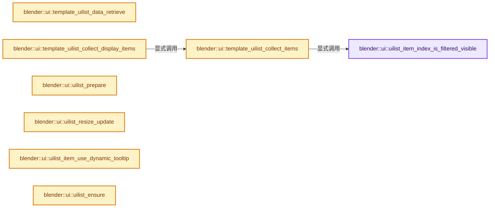
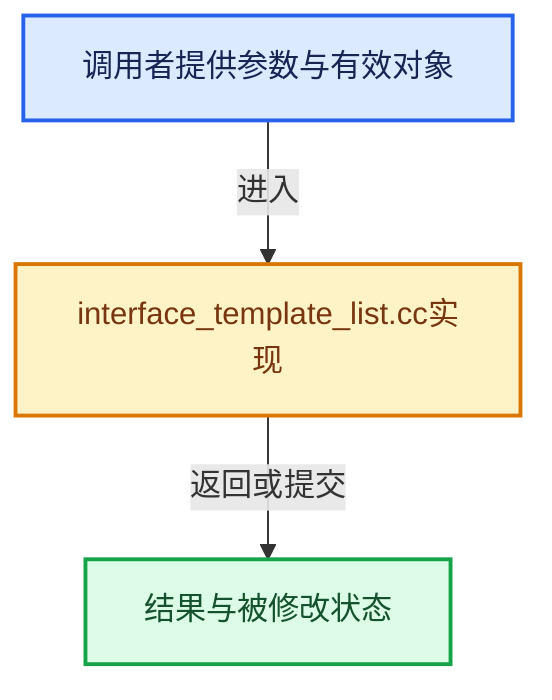

# 实现依赖专题：source/blender/editors/interface/templates/interface_template_list.cc

[实现依赖导航](../../../../README.md) · [符号索引](../../../../../00-课程指南/02-源码与提交索引/符号依赖与实现索引.md)

本专题从正文实际调用进入，集中保存共享实现。函数有稳定锚点，可从调用处直接跳到对应完整函数；递归与互相调用通过回链组织。

## 本文件的实现关系






## 完整成员与函数实现

<a id="f-4ee5ef83de7067bd"></a>

### `blender::ui::uilist_item_index_is_filtered_visible`

实现位置：[source/blender/editors/interface/templates/interface_template_list.cc](../../../../../../../../../source/blender/editors/interface/templates/interface_template_list.cc) · L306—L320。

接口参数：

- `const uiList *ui_list`
- `const int item_idx`

**教学注释版**

<!-- annotated:ceb0a430d7dddc -->

```cpp
bool uilist_item_index_is_filtered_visible(const uiList *ui_list, const int item_idx)
{
  const uiListDyn *dyn_data = ui_list->dyn_data;

  if (!dyn_data->items_filter_flags) {
    /* If there are no filter flags to check, always consider all items visible. */
    return true;
  }

  if (dyn_data->items_filter_flags[item_idx] & UILST_FLT_ITEM_NEVER_SHOW) {
    return false;
  }

  return (dyn_data->items_filter_flags[item_idx] & UILST_FLT_ITEM);
}
```

<details>
<summary>核对原始源码：source/blender/editors/interface/templates/interface_template_list.cc · L306—L320</summary>

<!-- original:ceb0a430d7dddc:source/blender/editors/interface/templates/interface_template_list.cc:306:320 -->

```cpp
bool uilist_item_index_is_filtered_visible(const uiList *ui_list, const int item_idx)
{
  const uiListDyn *dyn_data = ui_list->dyn_data;

  if (!dyn_data->items_filter_flags) {
    /* If there are no filter flags to check, always consider all items visible. */
    return true;
  }

  if (dyn_data->items_filter_flags[item_idx] & UILST_FLT_ITEM_NEVER_SHOW) {
    return false;
  }

  return (dyn_data->items_filter_flags[item_idx] & UILST_FLT_ITEM);
}
```

</details>

**结果出口**

- `return true;`
- `return false;`
- `return (dyn_data->items_filter_flags[item_idx] & UILST_FLT_ITEM);`

**继续追踪实现**

本实现没有需要继续展开的显式调用；检查返回表达式、对象转换和调用者前置条件。

<a id="f-c4daea0fe323bb25"></a>

### `blender::ui::template_uilist_data_retrieve`

实现位置：[source/blender/editors/interface/templates/interface_template_list.cc](../../../../../../../../../source/blender/editors/interface/templates/interface_template_list.cc) · L357—L425。

接口参数：

- `const StringRef listtype_name`
- `const char *list_id`
- `PointerRNA *dataptr`
- `const StringRefNull propname`
- `PointerRNA *active_dataptr`
- `const StringRefNull active_propname`
- `const char *item_dyntip_propname`
- `TemplateListInputData *r_input_data`
- `uiListType **r_list_type`

**教学注释版**

<!-- annotated:5ea9b93dcac811 -->

```cpp
static bool template_uilist_data_retrieve(const StringRef listtype_name,
                                          const char *list_id,
                                          PointerRNA *dataptr,
                                          const StringRefNull propname,
                                          PointerRNA *active_dataptr,
                                          const StringRefNull active_propname,
                                          const char *item_dyntip_propname,
                                          TemplateListInputData *r_input_data,
                                          uiListType **r_list_type)
{
  *r_input_data = {};

  /* Forbid default UI_UL_DEFAULT_CLASS_NAME list class without a custom list_id! */
  if ((UI_UL_DEFAULT_CLASS_NAME == listtype_name) && !(list_id && list_id[0])) {
    RNA_warning("template_list using default '%s' UIList class must provide a custom list_id",
                UI_UL_DEFAULT_CLASS_NAME);
    return false;
  }

  if (!*active_dataptr) {
    RNA_warning("No active data");
    return false;
  }

  r_input_data->dataptr = *dataptr;
  if (*dataptr) {
    r_input_data->prop = RNA_struct_find_property(dataptr, propname.c_str());
    if (!r_input_data->prop) {
      RNA_warning(
          "Property not found: %s.%s", RNA_struct_identifier(dataptr->type), propname.c_str());
      return false;
    }
  }

  r_input_data->active_dataptr = *active_dataptr;
  r_input_data->activeprop = RNA_struct_find_property(active_dataptr, active_propname.c_str());
  if (!r_input_data->activeprop) {
    RNA_warning("Property not found: %s.%s",
                RNA_struct_identifier(active_dataptr->type),
                active_propname.c_str());
    return false;
  }

  if (r_input_data->prop) {
    const PropertyType type = RNA_property_type(r_input_data->prop);
    if (type != PROP_COLLECTION) {
      RNA_warning("Expected a collection data property");
      return false;
    }
  }

  const PropertyType activetype = RNA_property_type(r_input_data->activeprop);
  if (activetype != PROP_INT) {
    RNA_warning("Expected an integer active data property");
    return false;
  }

  /* Find the uiList type. */
  if (!(*r_list_type = WM_uilisttype_find(listtype_name, false))) {
    RNA_warning("List type %s not found", std::string(listtype_name).c_str());
    return false;
  }

  r_input_data->active_item_idx = RNA_property_int_get(&r_input_data->active_dataptr,
                                                       r_input_data->activeprop);
  r_input_data->item_dyntip_propname = item_dyntip_propname;

  return true;
}
```

<details>
<summary>核对原始源码：source/blender/editors/interface/templates/interface_template_list.cc · L357—L425</summary>

<!-- original:5ea9b93dcac811:source/blender/editors/interface/templates/interface_template_list.cc:357:425 -->

```cpp
static bool template_uilist_data_retrieve(const StringRef listtype_name,
                                          const char *list_id,
                                          PointerRNA *dataptr,
                                          const StringRefNull propname,
                                          PointerRNA *active_dataptr,
                                          const StringRefNull active_propname,
                                          const char *item_dyntip_propname,
                                          TemplateListInputData *r_input_data,
                                          uiListType **r_list_type)
{
  *r_input_data = {};

  /* Forbid default UI_UL_DEFAULT_CLASS_NAME list class without a custom list_id! */
  if ((UI_UL_DEFAULT_CLASS_NAME == listtype_name) && !(list_id && list_id[0])) {
    RNA_warning("template_list using default '%s' UIList class must provide a custom list_id",
                UI_UL_DEFAULT_CLASS_NAME);
    return false;
  }

  if (!*active_dataptr) {
    RNA_warning("No active data");
    return false;
  }

  r_input_data->dataptr = *dataptr;
  if (*dataptr) {
    r_input_data->prop = RNA_struct_find_property(dataptr, propname.c_str());
    if (!r_input_data->prop) {
      RNA_warning(
          "Property not found: %s.%s", RNA_struct_identifier(dataptr->type), propname.c_str());
      return false;
    }
  }

  r_input_data->active_dataptr = *active_dataptr;
  r_input_data->activeprop = RNA_struct_find_property(active_dataptr, active_propname.c_str());
  if (!r_input_data->activeprop) {
    RNA_warning("Property not found: %s.%s",
                RNA_struct_identifier(active_dataptr->type),
                active_propname.c_str());
    return false;
  }

  if (r_input_data->prop) {
    const PropertyType type = RNA_property_type(r_input_data->prop);
    if (type != PROP_COLLECTION) {
      RNA_warning("Expected a collection data property");
      return false;
    }
  }

  const PropertyType activetype = RNA_property_type(r_input_data->activeprop);
  if (activetype != PROP_INT) {
    RNA_warning("Expected an integer active data property");
    return false;
  }

  /* Find the uiList type. */
  if (!(*r_list_type = WM_uilisttype_find(listtype_name, false))) {
    RNA_warning("List type %s not found", std::string(listtype_name).c_str());
    return false;
  }

  r_input_data->active_item_idx = RNA_property_int_get(&r_input_data->active_dataptr,
                                                       r_input_data->activeprop);
  r_input_data->item_dyntip_propname = item_dyntip_propname;

  return true;
}
```

</details>

**沿实际写入检查状态**

- `r_input_data->dataptr = *dataptr;`
- `r_input_data->prop = RNA_struct_find_property(dataptr, propname.c_str());`
- `r_input_data->active_dataptr = *active_dataptr;`
- `r_input_data->activeprop = RNA_struct_find_property(active_dataptr, active_propname.c_str());`
- `r_input_data->active_item_idx = RNA_property_int_get(&r_input_data->active_dataptr,`
- `r_input_data->item_dyntip_propname = item_dyntip_propname;`

**结果出口**

- `return false;`
- `return true;`

**继续追踪实现**

- `RNA_warning` → [RNA_warning · L978](../../../makesrna/RNA_access.hh.md#m-0e114f05fab4)；[RNA_warning · L981](../../../makesrna/RNA_access.hh.md#m-bcc724e1f148)；[RNA_warning · L983](../../../makesrna/RNA_access.hh.md#m-918592a98579)。宏定义由构建条件选择。
- `RNA_struct_find_property` → [blender::RNA_struct_find_property · L855](../../../makesrna/intern/rna_access.cc.md#f-75b0f3b3cc89dd4c)；[blender::RNA_struct_find_property · L874](../../../makesrna/intern/rna_access.cc.md#f-7fb7ab238d64680f)。同名重载需按实参类型选择。
- `propname.c_str` → [blender::StringRefNull::c_str · L544](../../../../../01-基础容器与现代CPP/15-StringRef字符串视图.md#f-4a8bbfe1e6d00757)。
- `RNA_struct_identifier` → [blender::RNA_struct_identifier · L711](../../../makesrna/intern/rna_access.cc.md#f-754de32877e73311)。
- `active_propname.c_str` → [blender::StringRefNull::c_str · L544](../../../../../01-基础容器与现代CPP/15-StringRef字符串视图.md#f-4a8bbfe1e6d00757)。
- `RNA_property_type` → [blender::RNA_property_type · L1293](../../../makesrna/intern/rna_access.cc.md#f-4465a90d55f022df)。
- `WM_uilisttype_find` → [blender::WM_uilisttype_find · L47](../../../windowmanager/intern/wm_uilist_type.cc.md#f-c4c6b0f9856de7fa)。
- `std::string(listtype_name).c_str` → [外部契约](https://eel.is/c++draft/)：这个边界按实际表达式及所属类型核对参数、返回值、寿命与失败行为。这里提供接口入口，不声称已解释该第三方版本的内部实现。
- `std::string` → [外部契约](https://eel.is/c++draft/)：这个边界按实际表达式及所属类型核对参数、返回值、寿命与失败行为。这里提供接口入口，不声称已解释该第三方版本的内部实现。
- `RNA_property_int_get` → [blender::RNA_property_int_get · L3198](../../../makesrna/intern/rna_access.cc.md#f-09c89e28122fa344)。

<a id="f-f6f014aa4ecc9067"></a>

### `blender::ui::template_uilist_collect_items`

实现位置：[source/blender/editors/interface/templates/interface_template_list.cc](../../../../../../../../../source/blender/editors/interface/templates/interface_template_list.cc) · L427—L485。

接口参数：

- `PointerRNA *list_ptr`
- `PropertyRNA *list_prop`
- `const uiList *ui_list`
- `int activei`
- `TemplateListItems *r_items`

**教学注释版**

<!-- annotated:43513ab0f3e8a4 -->

```cpp
static void template_uilist_collect_items(PointerRNA *list_ptr,
                                          PropertyRNA *list_prop,
                                          const uiList *ui_list,
                                          int activei,
                                          TemplateListItems *r_items)
{
  const uiListDyn *dyn_data = ui_list->dyn_data;
  const bool order_reverse = (ui_list->filter_sort_flag & UILST_FLT_SORT_REVERSE) != 0;
  int i = 0;
  int reorder_i = 0;
  bool activei_mapping_pending = true;

  RNA_PROP_BEGIN (list_ptr, itemptr, list_prop) {
    if (uilist_item_index_is_filtered_visible(ui_list, i)) {
      int new_order_idx;
      if (dyn_data->items_filter_neworder) {
        new_order_idx = dyn_data->items_filter_neworder[reorder_i++];
        new_order_idx = order_reverse ? dyn_data->items_shown - new_order_idx - 1 : new_order_idx;
      }
      else {
        new_order_idx = order_reverse ? dyn_data->items_shown - ++reorder_i : reorder_i++;
      }
      // printf("%s: ii: %d\n", __func__, ii);
      r_items->item_vec[new_order_idx].item = itemptr;
      r_items->item_vec[new_order_idx].org_idx = i;
      r_items->item_vec[new_order_idx].flt_flag = dyn_data->items_filter_flags ?
                                                      dyn_data->items_filter_flags[i] :
                                                      0;

      if (activei_mapping_pending && activei == i) {
        activei = new_order_idx;
        /* So that we do not map again activei! */
        activei_mapping_pending = false;
      }
#if 0 /* For now, do not alter active element, even if it will be hidden... */
      else if (activei < i) {
        /* We do not want an active but invisible item!
         * Only exception is when all items are filtered out...
         */
        if (prev_order_idx >= 0) {
          activei = prev_order_idx;
          RNA_property_int_set(active_dataptr, activeprop, prev_i);
        }
        else {
          activei = new_order_idx;
          RNA_property_int_set(active_dataptr, activeprop, i);
        }
      }
      prev_i = i;
      prev_ii = new_order_idx;
#endif
    }
    i++;
  }
  RNA_PROP_END;

  /* If mapping is still pending, no active item was found. Mark as invalid (-1) */
  r_items->active_item_idx = activei_mapping_pending ? -1 : activei;
}
```

<details>
<summary>核对原始源码：source/blender/editors/interface/templates/interface_template_list.cc · L427—L485</summary>

<!-- original:43513ab0f3e8a4:source/blender/editors/interface/templates/interface_template_list.cc:427:485 -->

```cpp
static void template_uilist_collect_items(PointerRNA *list_ptr,
                                          PropertyRNA *list_prop,
                                          const uiList *ui_list,
                                          int activei,
                                          TemplateListItems *r_items)
{
  const uiListDyn *dyn_data = ui_list->dyn_data;
  const bool order_reverse = (ui_list->filter_sort_flag & UILST_FLT_SORT_REVERSE) != 0;
  int i = 0;
  int reorder_i = 0;
  bool activei_mapping_pending = true;

  RNA_PROP_BEGIN (list_ptr, itemptr, list_prop) {
    if (uilist_item_index_is_filtered_visible(ui_list, i)) {
      int new_order_idx;
      if (dyn_data->items_filter_neworder) {
        new_order_idx = dyn_data->items_filter_neworder[reorder_i++];
        new_order_idx = order_reverse ? dyn_data->items_shown - new_order_idx - 1 : new_order_idx;
      }
      else {
        new_order_idx = order_reverse ? dyn_data->items_shown - ++reorder_i : reorder_i++;
      }
      // printf("%s: ii: %d\n", __func__, ii);
      r_items->item_vec[new_order_idx].item = itemptr;
      r_items->item_vec[new_order_idx].org_idx = i;
      r_items->item_vec[new_order_idx].flt_flag = dyn_data->items_filter_flags ?
                                                      dyn_data->items_filter_flags[i] :
                                                      0;

      if (activei_mapping_pending && activei == i) {
        activei = new_order_idx;
        /* So that we do not map again activei! */
        activei_mapping_pending = false;
      }
#if 0 /* For now, do not alter active element, even if it will be hidden... */
      else if (activei < i) {
        /* We do not want an active but invisible item!
         * Only exception is when all items are filtered out...
         */
        if (prev_order_idx >= 0) {
          activei = prev_order_idx;
          RNA_property_int_set(active_dataptr, activeprop, prev_i);
        }
        else {
          activei = new_order_idx;
          RNA_property_int_set(active_dataptr, activeprop, i);
        }
      }
      prev_i = i;
      prev_ii = new_order_idx;
#endif
    }
    i++;
  }
  RNA_PROP_END;

  /* If mapping is still pending, no active item was found. Mark as invalid (-1) */
  r_items->active_item_idx = activei_mapping_pending ? -1 : activei;
}
```

</details>

**沿实际写入检查状态**

- `new_order_idx = dyn_data->items_filter_neworder[reorder_i++];`
- `new_order_idx = order_reverse ? dyn_data->items_shown - new_order_idx - 1 : new_order_idx;`
- `new_order_idx = order_reverse ? dyn_data->items_shown - ++reorder_i : reorder_i++;`
- `r_items->item_vec[new_order_idx].item = itemptr;`
- `r_items->item_vec[new_order_idx].org_idx = i;`
- `r_items->item_vec[new_order_idx].flt_flag = dyn_data->items_filter_flags ?`
- `activei = new_order_idx;`
- `activei_mapping_pending = false;`
- `activei = prev_order_idx;`
- `prev_i = i;`
- `prev_ii = new_order_idx;`
- `r_items->active_item_idx = activei_mapping_pending ? -1 : activei;`

**继续追踪实现**

- `uilist_item_index_is_filtered_visible` → [blender::ui::uilist_item_index_is_filtered_visible · L306](interface_template_list.cc.md#f-4ee5ef83de7067bd)。
- `RNA_property_int_set` → [blender::RNA_property_int_set · L3218](../../../makesrna/intern/rna_access.cc.md#f-56cfd6d117befeec)。

<a id="f-94ed745557313827"></a>

### `blender::ui::template_uilist_collect_display_items`

实现位置：[source/blender/editors/interface/templates/interface_template_list.cc](../../../../../../../../../source/blender/editors/interface/templates/interface_template_list.cc) · L490—L524。

接口参数：

- `const bContext *C`
- `uiList *ui_list`
- `TemplateListInputData *input_data`
- `const uiListFilterItemsFunc filter_items_fn`
- `TemplateListItems *r_items`

**教学注释版**

<!-- annotated:60bd8867ce081c -->

```cpp
static void template_uilist_collect_display_items(const bContext *C,
                                                  uiList *ui_list,
                                                  TemplateListInputData *input_data,
                                                  const uiListFilterItemsFunc filter_items_fn,
                                                  TemplateListItems *r_items)
{
  uiListDyn *dyn_data = ui_list->dyn_data;

  /* Filter list items! (not for compact layout, though) */
  if (input_data->dataptr && input_data->prop) {
    int items_shown;
#if 0
    int prev_ii = -1, prev_i;
#endif

    if (ui_list->layout_type == UILST_LAYOUT_COMPACT) {
      dyn_data->items_len = dyn_data->items_shown = RNA_property_collection_length(
          &input_data->dataptr, input_data->prop);
    }
    else {
      // printf("%s: filtering...\n", __func__);
      filter_items_fn(ui_list, C, &input_data->dataptr, RNA_property_identifier(input_data->prop));
      // printf("%s: filtering done.\n", __func__);
    }

    items_shown = dyn_data->items_shown;
    if (items_shown >= 0) {
      r_items->item_vec.resize(items_shown);
      // printf("%s: items shown: %d.\n", __func__, items_shown);

      template_uilist_collect_items(
          &input_data->dataptr, input_data->prop, ui_list, input_data->active_item_idx, r_items);
    }
  }
}
```

<details>
<summary>核对原始源码：source/blender/editors/interface/templates/interface_template_list.cc · L490—L524</summary>

<!-- original:60bd8867ce081c:source/blender/editors/interface/templates/interface_template_list.cc:490:524 -->

```cpp
static void template_uilist_collect_display_items(const bContext *C,
                                                  uiList *ui_list,
                                                  TemplateListInputData *input_data,
                                                  const uiListFilterItemsFunc filter_items_fn,
                                                  TemplateListItems *r_items)
{
  uiListDyn *dyn_data = ui_list->dyn_data;

  /* Filter list items! (not for compact layout, though) */
  if (input_data->dataptr && input_data->prop) {
    int items_shown;
#if 0
    int prev_ii = -1, prev_i;
#endif

    if (ui_list->layout_type == UILST_LAYOUT_COMPACT) {
      dyn_data->items_len = dyn_data->items_shown = RNA_property_collection_length(
          &input_data->dataptr, input_data->prop);
    }
    else {
      // printf("%s: filtering...\n", __func__);
      filter_items_fn(ui_list, C, &input_data->dataptr, RNA_property_identifier(input_data->prop));
      // printf("%s: filtering done.\n", __func__);
    }

    items_shown = dyn_data->items_shown;
    if (items_shown >= 0) {
      r_items->item_vec.resize(items_shown);
      // printf("%s: items shown: %d.\n", __func__, items_shown);

      template_uilist_collect_items(
          &input_data->dataptr, input_data->prop, ui_list, input_data->active_item_idx, r_items);
    }
  }
}
```

</details>

**沿实际写入检查状态**

- `dyn_data->items_len = dyn_data->items_shown = RNA_property_collection_length(`
- `items_shown = dyn_data->items_shown;`

**继续追踪实现**

- `RNA_property_collection_length` → [blender::RNA_property_collection_length · L5001](../../../makesrna/intern/rna_access.cc.md#f-eee12bbdc7502c7b)。
- `filter_items_fn` → [调用协议](../../../../../00-课程指南/01-路线与规范/模板宏与动态分派协议.md)：局部可调用对象，须结合其初始化与捕获环境。调用位置L511。
- `RNA_property_identifier` → [blender::RNA_property_identifier · L1275](../../../makesrna/intern/rna_access.cc.md#f-67de6dc6c76092df)。
- `r_items->item_vec.resize` → [调用协议](../../../../../00-课程指南/01-路线与规范/模板宏与动态分派协议.md)：接收对象类型依赖auto、返回值或模板实例；不按同名猜测目标。调用位置L517。
- `template_uilist_collect_items` → [blender::ui::template_uilist_collect_items · L427](interface_template_list.cc.md#f-f6f014aa4ecc9067)。

<a id="f-ac5298dd15033d6e"></a>

### `blender::ui::uilist_prepare`

实现位置：[source/blender/editors/interface/templates/interface_template_list.cc](../../../../../../../../../source/blender/editors/interface/templates/interface_template_list.cc) · L526—L581。

接口参数：

- `uiList *ui_list`
- `const TemplateListItems *items`
- `const TemplateListLayoutDrawData *layout_data`
- `TemplateListVisualInfo *r_visual_info`

**教学注释版**

<!-- annotated:a7340edcd9c1ce -->

```cpp
static void uilist_prepare(uiList *ui_list,
                           const TemplateListItems *items,
                           const TemplateListLayoutDrawData *layout_data,
                           TemplateListVisualInfo *r_visual_info)
{
  uiListDyn *dyn_data = ui_list->dyn_data;
  const bool use_auto_size = (ui_list->list_grip <
                              (layout_data->rows - UI_LIST_AUTO_SIZE_THRESHOLD));

  int actual_rows = layout_data->rows;
  int actual_maxrows = layout_data->maxrows;

  /* default rows */
  if (actual_rows <= 0) {
    actual_rows = 5;
  }
  dyn_data->visual_height_min = actual_rows;
  if (actual_maxrows < actual_rows) {
    actual_maxrows = max_ii(actual_rows, 5);
  }

  int activei_row;
  dyn_data->height = items->item_vec.size();
  activei_row = items->active_item_idx;

  if (!use_auto_size) {
    /* No auto-size, yet we clamp at min size! */
    actual_rows = max_ii(ui_list->list_grip, actual_rows);
  }
  else if ((actual_rows != actual_maxrows) && (dyn_data->height > actual_rows)) {
    /* Expand size if needed and possible. */
    actual_rows = min_ii(dyn_data->height, actual_maxrows);
  }

  /* If list length changes or list is tagged to check this,
   * and active is out of view, scroll to it. */
  if ((ui_list->list_last_len != items->item_vec.size()) ||
      (ui_list->flag & UILST_SCROLL_TO_ACTIVE_ITEM))
  {
    if (activei_row < ui_list->list_scroll) {
      ui_list->list_scroll = activei_row;
    }
    else if (activei_row >= ui_list->list_scroll + actual_rows) {
      ui_list->list_scroll = activei_row - actual_rows + 1;
    }
    ui_list->flag &= ~UILST_SCROLL_TO_ACTIVE_ITEM;
  }

  const int max_scroll = max_ii(0, dyn_data->height - actual_rows);
  CLAMP(ui_list->list_scroll, 0, max_scroll);
  ui_list->list_last_len = items->item_vec.size();
  dyn_data->visual_height = actual_rows;
  r_visual_info->visual_items = actual_rows;
  r_visual_info->start_idx = ui_list->list_scroll;
  r_visual_info->end_idx = min_ii(r_visual_info->start_idx + actual_rows, items->item_vec.size());
}
```

<details>
<summary>核对原始源码：source/blender/editors/interface/templates/interface_template_list.cc · L526—L581</summary>

<!-- original:a7340edcd9c1ce:source/blender/editors/interface/templates/interface_template_list.cc:526:581 -->

```cpp
static void uilist_prepare(uiList *ui_list,
                           const TemplateListItems *items,
                           const TemplateListLayoutDrawData *layout_data,
                           TemplateListVisualInfo *r_visual_info)
{
  uiListDyn *dyn_data = ui_list->dyn_data;
  const bool use_auto_size = (ui_list->list_grip <
                              (layout_data->rows - UI_LIST_AUTO_SIZE_THRESHOLD));

  int actual_rows = layout_data->rows;
  int actual_maxrows = layout_data->maxrows;

  /* default rows */
  if (actual_rows <= 0) {
    actual_rows = 5;
  }
  dyn_data->visual_height_min = actual_rows;
  if (actual_maxrows < actual_rows) {
    actual_maxrows = max_ii(actual_rows, 5);
  }

  int activei_row;
  dyn_data->height = items->item_vec.size();
  activei_row = items->active_item_idx;

  if (!use_auto_size) {
    /* No auto-size, yet we clamp at min size! */
    actual_rows = max_ii(ui_list->list_grip, actual_rows);
  }
  else if ((actual_rows != actual_maxrows) && (dyn_data->height > actual_rows)) {
    /* Expand size if needed and possible. */
    actual_rows = min_ii(dyn_data->height, actual_maxrows);
  }

  /* If list length changes or list is tagged to check this,
   * and active is out of view, scroll to it. */
  if ((ui_list->list_last_len != items->item_vec.size()) ||
      (ui_list->flag & UILST_SCROLL_TO_ACTIVE_ITEM))
  {
    if (activei_row < ui_list->list_scroll) {
      ui_list->list_scroll = activei_row;
    }
    else if (activei_row >= ui_list->list_scroll + actual_rows) {
      ui_list->list_scroll = activei_row - actual_rows + 1;
    }
    ui_list->flag &= ~UILST_SCROLL_TO_ACTIVE_ITEM;
  }

  const int max_scroll = max_ii(0, dyn_data->height - actual_rows);
  CLAMP(ui_list->list_scroll, 0, max_scroll);
  ui_list->list_last_len = items->item_vec.size();
  dyn_data->visual_height = actual_rows;
  r_visual_info->visual_items = actual_rows;
  r_visual_info->start_idx = ui_list->list_scroll;
  r_visual_info->end_idx = min_ii(r_visual_info->start_idx + actual_rows, items->item_vec.size());
}
```

</details>

**沿实际写入检查状态**

- `actual_rows = 5;`
- `dyn_data->visual_height_min = actual_rows;`
- `actual_maxrows = max_ii(actual_rows, 5);`
- `dyn_data->height = items->item_vec.size();`
- `activei_row = items->active_item_idx;`
- `actual_rows = max_ii(ui_list->list_grip, actual_rows);`
- `actual_rows = min_ii(dyn_data->height, actual_maxrows);`
- `ui_list->list_scroll = activei_row;`
- `ui_list->list_scroll = activei_row - actual_rows + 1;`
- `ui_list->flag &= ~UILST_SCROLL_TO_ACTIVE_ITEM;`
- `ui_list->list_last_len = items->item_vec.size();`
- `dyn_data->visual_height = actual_rows;`
- `r_visual_info->visual_items = actual_rows;`
- `r_visual_info->start_idx = ui_list->list_scroll;`
- `r_visual_info->end_idx = min_ii(r_visual_info->start_idx + actual_rows, items->item_vec.size());`

**继续追踪实现**

- `max_ii` → [blender::max_ii · L368](../../../../01-BLI基础库/intern/math_base_inline.cc.md#f-c45aa7b373adb94c)。
- `items->item_vec.size` → [调用协议](../../../../../00-课程指南/01-路线与规范/模板宏与动态分派协议.md)：接收对象类型依赖auto、返回值或模板实例；不按同名猜测目标。调用位置L548。
- `min_ii` → [blender::min_ii · L364](../../../../01-BLI基础库/intern/math_base_inline.cc.md#f-30336db35b2810b8)。
- `CLAMP` → [CLAMP · L200](../../../../01-BLI基础库/BLI_utildefines.hh.md#m-69703e497120)。宏定义由构建条件选择。

<a id="f-98e5d98f15e88310"></a>

### `blender::ui::uilist_resize_update`

实现位置：[source/blender/editors/interface/templates/interface_template_list.cc](../../../../../../../../../source/blender/editors/interface/templates/interface_template_list.cc) · L583—L599。

接口参数：

- `bContext *C`
- `uiList *ui_list`

**教学注释版**

<!-- annotated:897297478033c7 -->

```cpp
static void uilist_resize_update(bContext *C, uiList *ui_list)
{
  uiListDyn *dyn_data = ui_list->dyn_data;

  /* This way we get diff in number of additional items to show (positive) or hide (negative). */
  const int diff = round_fl_to_int(float(dyn_data->resize - dyn_data->resize_prev) /
                                   float(UI_UNIT_Y));

  if (diff != 0) {
    ui_list->list_grip += diff;
    dyn_data->resize_prev += diff * UI_UNIT_Y;
    ui_list->flag |= UILST_SCROLL_TO_ACTIVE_ITEM;
  }

  /* In case uilist is in popup, we need special refreshing */
  ED_region_tag_refresh_ui(CTX_wm_region_popup(C));
}
```

<details>
<summary>核对原始源码：source/blender/editors/interface/templates/interface_template_list.cc · L583—L599</summary>

<!-- original:897297478033c7:source/blender/editors/interface/templates/interface_template_list.cc:583:599 -->

```cpp
static void uilist_resize_update(bContext *C, uiList *ui_list)
{
  uiListDyn *dyn_data = ui_list->dyn_data;

  /* This way we get diff in number of additional items to show (positive) or hide (negative). */
  const int diff = round_fl_to_int(float(dyn_data->resize - dyn_data->resize_prev) /
                                   float(UI_UNIT_Y));

  if (diff != 0) {
    ui_list->list_grip += diff;
    dyn_data->resize_prev += diff * UI_UNIT_Y;
    ui_list->flag |= UILST_SCROLL_TO_ACTIVE_ITEM;
  }

  /* In case uilist is in popup, we need special refreshing */
  ED_region_tag_refresh_ui(CTX_wm_region_popup(C));
}
```

</details>

**沿实际写入检查状态**

- `ui_list->list_grip += diff;`
- `dyn_data->resize_prev += diff * UI_UNIT_Y;`
- `ui_list->flag |= UILST_SCROLL_TO_ACTIVE_ITEM;`

**继续追踪实现**

- `round_fl_to_int` → [blender::round_fl_to_int · L193](../../../../01-BLI基础库/intern/math_base_inline.cc.md#f-ce88de51b67ea3e6)。
- `ED_region_tag_refresh_ui` → [blender::ED_region_tag_refresh_ui · L738](../../screen/area.cc.md#f-fec3f537791fe9b1)。
- `CTX_wm_region_popup` → [blender::CTX_wm_region_popup · L976](../../../../02-BKE几何与数据/intern/context.cc.md#f-0300c76092cd3bbc)。

<a id="f-2bc61922444ca96f"></a>

### `blender::ui::uilist_item_use_dynamic_tooltip`

实现位置：[source/blender/editors/interface/templates/interface_template_list.cc](../../../../../../../../../source/blender/editors/interface/templates/interface_template_list.cc) · L601—L611。

接口参数：

- `PointerRNA *itemptr`
- `const char *propname`

**教学注释版**

<!-- annotated:2bc6ab8fbd98cc -->

```cpp
static void *uilist_item_use_dynamic_tooltip(PointerRNA *itemptr, const char *propname)
{
  if (propname && propname[0] && itemptr && *itemptr) {
    PropertyRNA *prop = RNA_struct_find_property(itemptr, propname);

    if (prop && (RNA_property_type(prop) == PROP_STRING)) {
      return RNA_property_string_get_alloc(itemptr, prop, nullptr, 0, nullptr);
    }
  }
  return nullptr;
}
```

<details>
<summary>核对原始源码：source/blender/editors/interface/templates/interface_template_list.cc · L601—L611</summary>

<!-- original:2bc6ab8fbd98cc:source/blender/editors/interface/templates/interface_template_list.cc:601:611 -->

```cpp
static void *uilist_item_use_dynamic_tooltip(PointerRNA *itemptr, const char *propname)
{
  if (propname && propname[0] && itemptr && *itemptr) {
    PropertyRNA *prop = RNA_struct_find_property(itemptr, propname);

    if (prop && (RNA_property_type(prop) == PROP_STRING)) {
      return RNA_property_string_get_alloc(itemptr, prop, nullptr, 0, nullptr);
    }
  }
  return nullptr;
}
```

</details>

**结果出口**

- `return RNA_property_string_get_alloc(itemptr, prop, nullptr, 0, nullptr);`
- `return nullptr;`

**继续追踪实现**

- `RNA_struct_find_property` → [blender::RNA_struct_find_property · L855](../../../makesrna/intern/rna_access.cc.md#f-75b0f3b3cc89dd4c)；[blender::RNA_struct_find_property · L874](../../../makesrna/intern/rna_access.cc.md#f-7fb7ab238d64680f)。同名重载需按实参类型选择。
- `RNA_property_type` → [blender::RNA_property_type · L1293](../../../makesrna/intern/rna_access.cc.md#f-4465a90d55f022df)。
- `RNA_property_string_get_alloc` → [blender::RNA_property_string_get_alloc · L4220](../../../makesrna/intern/rna_access.cc.md#f-7aaf908f724ade76)。

<a id="f-996c1d1ebdc41a17"></a>

### `blender::ui::uilist_ensure`

实现位置：[source/blender/editors/interface/templates/interface_template_list.cc](../../../../../../../../../source/blender/editors/interface/templates/interface_template_list.cc) · L627—L679。

接口参数：

- `const bContext *C`
- `uiListType *ui_list_type`
- `const char *list_id`
- `euiList_LayoutType layout_type`
- `bool sort_reverse`
- `bool sort_lock`

**教学注释版**

<!-- annotated:dfd3359da26a6d -->

```cpp
static uiList *uilist_ensure(const bContext *C,
                             uiListType *ui_list_type,
                             const char *list_id,
                             euiList_LayoutType layout_type,
                             bool sort_reverse,
                             bool sort_lock)
{
  /* Allows to work in popups. */
  ARegion *region = CTX_wm_region_popup(C);
  if (region == nullptr) {
    region = CTX_wm_region(C);
  }

  /* Find or add the uiList to the current Region. */

  char full_list_id[UI_MAX_NAME_STR];
  WM_uilisttype_to_full_list_id(ui_list_type, list_id, full_list_id);

  uiList *ui_list = static_cast<uiList *>(
      BLI_findstring(&region->ui_lists, full_list_id, offsetof(uiList, list_id)));

  if (!ui_list) {
    ui_list = MEM_new<uiList>("uiList");
    STRNCPY_UTF8(ui_list->list_id, full_list_id);
    BLI_addtail(&region->ui_lists, ui_list);
    ui_list->list_grip = -UI_LIST_AUTO_SIZE_THRESHOLD; /* Force auto size by default. */
    if (sort_reverse) {
      ui_list->filter_sort_flag |= UILST_FLT_SORT_REVERSE;
    }
    if (sort_lock) {
      ui_list->filter_sort_flag |= UILST_FLT_SORT_LOCK;
    }
  }

  if (!ui_list->dyn_data) {
    ui_list->dyn_data = MEM_new<uiListDyn>("uiList.dyn_data");
  }
  uiListDyn *dyn_data = ui_list->dyn_data;
  /* Note that this isn't a `uiListType` callback, it's stored in the runtime list data. Otherwise
   * the runtime data could leak when the type is unregistered (e.g. on "Reload Scripts"). */
  dyn_data->free_runtime_data_fn = uilist_free_dyn_data;

  /* Because we can't actually pass type across save&load... */
  ui_list->type = ui_list_type;
  ui_list->layout_type = layout_type;

  /* Reset filtering data. */
  MEM_SAFE_DELETE(dyn_data->items_filter_flags);
  MEM_SAFE_DELETE(dyn_data->items_filter_neworder);
  dyn_data->items_len = dyn_data->items_shown = -1;

  return ui_list;
}
```

<details>
<summary>核对原始源码：source/blender/editors/interface/templates/interface_template_list.cc · L627—L679</summary>

<!-- original:dfd3359da26a6d:source/blender/editors/interface/templates/interface_template_list.cc:627:679 -->

```cpp
static uiList *uilist_ensure(const bContext *C,
                             uiListType *ui_list_type,
                             const char *list_id,
                             euiList_LayoutType layout_type,
                             bool sort_reverse,
                             bool sort_lock)
{
  /* Allows to work in popups. */
  ARegion *region = CTX_wm_region_popup(C);
  if (region == nullptr) {
    region = CTX_wm_region(C);
  }

  /* Find or add the uiList to the current Region. */

  char full_list_id[UI_MAX_NAME_STR];
  WM_uilisttype_to_full_list_id(ui_list_type, list_id, full_list_id);

  uiList *ui_list = static_cast<uiList *>(
      BLI_findstring(&region->ui_lists, full_list_id, offsetof(uiList, list_id)));

  if (!ui_list) {
    ui_list = MEM_new<uiList>("uiList");
    STRNCPY_UTF8(ui_list->list_id, full_list_id);
    BLI_addtail(&region->ui_lists, ui_list);
    ui_list->list_grip = -UI_LIST_AUTO_SIZE_THRESHOLD; /* Force auto size by default. */
    if (sort_reverse) {
      ui_list->filter_sort_flag |= UILST_FLT_SORT_REVERSE;
    }
    if (sort_lock) {
      ui_list->filter_sort_flag |= UILST_FLT_SORT_LOCK;
    }
  }

  if (!ui_list->dyn_data) {
    ui_list->dyn_data = MEM_new<uiListDyn>("uiList.dyn_data");
  }
  uiListDyn *dyn_data = ui_list->dyn_data;
  /* Note that this isn't a `uiListType` callback, it's stored in the runtime list data. Otherwise
   * the runtime data could leak when the type is unregistered (e.g. on "Reload Scripts"). */
  dyn_data->free_runtime_data_fn = uilist_free_dyn_data;

  /* Because we can't actually pass type across save&load... */
  ui_list->type = ui_list_type;
  ui_list->layout_type = layout_type;

  /* Reset filtering data. */
  MEM_SAFE_DELETE(dyn_data->items_filter_flags);
  MEM_SAFE_DELETE(dyn_data->items_filter_neworder);
  dyn_data->items_len = dyn_data->items_shown = -1;

  return ui_list;
}
```

</details>

**沿实际写入检查状态**

- `region = CTX_wm_region(C);`
- `ui_list = MEM_new<uiList>("uiList");`
- `ui_list->list_grip = -UI_LIST_AUTO_SIZE_THRESHOLD; /* Force auto size by default. */`
- `ui_list->filter_sort_flag |= UILST_FLT_SORT_REVERSE;`
- `ui_list->filter_sort_flag |= UILST_FLT_SORT_LOCK;`
- `ui_list->dyn_data = MEM_new<uiListDyn>("uiList.dyn_data");`
- `dyn_data->free_runtime_data_fn = uilist_free_dyn_data;`
- `ui_list->type = ui_list_type;`
- `ui_list->layout_type = layout_type;`
- `dyn_data->items_len = dyn_data->items_shown = -1;`

**结果出口**

- `return ui_list;`

**继续追踪实现**

- `CTX_wm_region_popup` → [blender::CTX_wm_region_popup · L976](../../../../02-BKE几何与数据/intern/context.cc.md#f-0300c76092cd3bbc)。
- `CTX_wm_region` → [blender::CTX_wm_region · L965](../../../../02-BKE几何与数据/intern/context.cc.md#f-6cc0a26bc4539ae0)。
- `WM_uilisttype_to_full_list_id` → [blender::WM_uilisttype_to_full_list_id · L154](../../../windowmanager/intern/wm_uilist_type.cc.md#f-35e2f754b856ce4f)。
- `BLI_findstring` → [blender::BLI_findstring · L615](../../../../01-BLI基础库/intern/listbase.cc.md#f-d913b13b2651348e)。
- `MEM_new<uiList>` → [MEM_new · L351](../../../../07-Intern运行时与平台/guardedalloc/MEM_guardedalloc.h.md#f-115f9b6784f89912)。
- `STRNCPY_UTF8` → [STRNCPY_UTF8 · L335](../../../../01-BLI基础库/BLI_string_utf8.hh.md#m-222967f0ab6a)。宏定义由构建条件选择。
- `BLI_addtail` → [blender::BLI_addtail · L118](../../../../01-BLI基础库/intern/listbase.cc.md#f-4fb027713fa3115b)。
- `MEM_new<uiListDyn>` → [MEM_new · L351](../../../../07-Intern运行时与平台/guardedalloc/MEM_guardedalloc.h.md#f-115f9b6784f89912)。
- `MEM_SAFE_DELETE` → [MEM_SAFE_DELETE · L436](../../../../07-Intern运行时与平台/guardedalloc/MEM_guardedalloc.h.md#m-eadb3bc5b902)。宏定义由构建条件选择。

<a id="f-44af62f67ba2e5a9"></a>

### `blender::ui::template_uilist_layout_draw`

实现位置：[source/blender/editors/interface/templates/interface_template_list.cc](../../../../../../../../../source/blender/editors/interface/templates/interface_template_list.cc) · L681—L973。

接口参数：

- `const bContext *C`
- `uiList *ui_list`
- `Layout &layout`
- `TemplateListInputData *input_data`
- `TemplateListItems *items`
- `const TemplateListLayoutDrawData *layout_data`
- `const TemplateListFlags flags`

**教学注释版**

<!-- annotated:3eb3611230d8a9 -->

```cpp
static void template_uilist_layout_draw(const bContext *C,
                                        uiList *ui_list,
                                        Layout &layout,
                                        TemplateListInputData *input_data,
                                        TemplateListItems *items,
                                        const TemplateListLayoutDrawData *layout_data,
                                        const TemplateListFlags flags)
{
  uiListDyn *dyn_data = ui_list->dyn_data;
  const char *active_propname = RNA_property_identifier(input_data->activeprop);

  Layout *glob = nullptr, *box, *row, *col, *sub, *overlap;
  char numstr[32];
  int rnaicon = ICON_NONE, icon = ICON_NONE;
  Button *but;

  Block *block = layout.block();

  /* get icon */
  if (input_data->dataptr && input_data->prop) {
    StructRNA *ptype = RNA_property_pointer_type(&input_data->dataptr, input_data->prop);
    rnaicon = RNA_struct_ui_icon(ptype);
  }

  TemplateListVisualInfo visual_info;
  switch (ui_list->layout_type) {
    case UILST_LAYOUT_DEFAULT: {
      /* layout */
      box = &layout.list_box(ui_list, &input_data->active_dataptr, input_data->activeprop);
      glob = &box->column(true);
      row = &glob->row(false);
      col = &row->column(true);

      TemplateListLayoutDrawData adjusted_layout_data = *layout_data;
      /* init numbers */
      uilist_prepare(ui_list, items, &adjusted_layout_data, &visual_info);

      int i = 0;
      if (input_data->dataptr && input_data->prop) {

        const bool editable = (RNA_property_flag(input_data->prop) & PROP_EDITABLE);

        /* create list items */
        for (i = visual_info.start_idx; i < visual_info.end_idx; i++) {
          PointerRNA *itemptr = &items->item_vec[i].item;
          void *dyntip_data;
          const int org_i = items->item_vec[i].org_idx;
          const int flt_flag = items->item_vec[i].flt_flag;
          Block *subblock = col->block();

          overlap = &col->overlap();

          block_flag_enable(subblock, BLOCK_LIST_ITEM);

          /* list item behind label & other buttons */
          overlap->row(false);

          but = uiDefButR_prop(subblock,
                               ButtonType::ListRow,
                               "",
                               0,
                               0,
                               UI_UNIT_X * 10,
                               UI_UNIT_Y,
                               &input_data->active_dataptr,
                               input_data->activeprop,
                               0,
                               0,
                               org_i,
                               editable ? TIP_("Select List Item "
                                               "(Double click to rename)") :
                                          TIP_("Select List Item"));

          if ((dyntip_data = uilist_item_use_dynamic_tooltip(itemptr,
                                                             input_data->item_dyntip_propname)))
          {
            button_func_tooltip_set(but, uilist_item_tooltip_func, dyntip_data, MEM_delete_void);
          }

          Layout &item_row = overlap->row(true);

          uiLayoutListItemAddPadding(&item_row);

          sub = &item_row.row(false);
          icon = icon_from_rnaptr(C, itemptr, rnaicon, false);
          if (icon == ICON_DOT) {
            icon = ICON_NONE;
          }
          layout_data->draw_item(ui_list,
                                 C,
                                 *sub,
                                 &input_data->dataptr,
                                 itemptr,
                                 icon,
                                 &input_data->active_dataptr,
                                 active_propname,
                                 org_i,
                                 flt_flag);

          /* Items should be able to set context pointers for the layout. But the list-row button
           * swallows events, so it needs the context storage too for handlers to see it. */
          but->context = sub->context_store();

          /* If we are "drawing" active item, set all labels as active. */
          if (i == items->active_item_idx) {
            layout_list_set_labels_active(sub);
          }

          uiLayoutListItemAddPadding(&item_row);
          block_flag_disable(subblock, BLOCK_LIST_ITEM);
        }
      }

      /* add dummy buttons to fill space */
      for (; i < visual_info.start_idx + visual_info.visual_items; i++) {
        col->label("", ICON_NONE);
      }

      /* Add scroll-bar. */
      if (items->item_vec.size() > visual_info.visual_items) {
        row->column(false);
        but = uiDefButV(block,
                        ButtonType::Scroll,
                        "",
                        0,
                        0,
                        V2D_SCROLL_WIDTH,
                        UI_UNIT_Y * dyn_data->visual_height,
                        &ui_list->list_scroll,
                        0,
                        dyn_data->height - dyn_data->visual_height,
                        "");
        auto *but_scroll = reinterpret_cast<ButtonScrollBar *>(but);
        but_scroll->visual_height = dyn_data->visual_height;
      }
      break;
    }
    case UILST_LAYOUT_COMPACT:
      row = &layout.row(true);

      if ((input_data->dataptr && input_data->prop) && (dyn_data->items_shown > 0) &&
          (items->active_item_idx >= 0) && (items->active_item_idx < dyn_data->items_shown))
      {
        PointerRNA *itemptr = &items->item_vec[items->active_item_idx].item;
        const int org_i = items->item_vec[items->active_item_idx].org_idx;

        icon = icon_from_rnaptr(C, itemptr, rnaicon, false);
        if (icon == ICON_DOT) {
          icon = ICON_NONE;
        }
        layout_data->draw_item(ui_list,
                               C,
                               *row,
                               &input_data->dataptr,
                               itemptr,
                               icon,
                               &input_data->active_dataptr,
                               active_propname,
                               org_i,
                               0);
      }
      /* if list is empty, add in dummy button */
      else {
        row->label("", ICON_NONE);
      }

      /* next/prev button */
      SNPRINTF_UTF8(numstr, "%d :", dyn_data->items_shown);
      but = uiDefIconTextButR_prop(block,
                                   ButtonType::Num,
                                   ICON_NONE,
                                   numstr,
                                   0,
                                   0,
                                   UI_UNIT_X * 5,
                                   UI_UNIT_Y,
                                   &input_data->active_dataptr,
                                   input_data->activeprop,
                                   0,
                                   0,
                                   0,
                                   "");
      if (dyn_data->items_shown == 0) {
        button_flag_enable(but, BUT_DISABLED);
      }
      break;
  }

  if (glob) {
    const bool add_grip_but = (flags & TEMPLATE_LIST_NO_GRIP) == 0;

    /* About #ButtonType::Grip drag-resize:
     * We can't directly use results from a grip button, since we have a
     * rather complex behavior here (sizing by discrete steps and, overall, auto-size feature).
     * Since we *never* know whether we are grip-resizing or not
     * (because there is no callback for when a button enters/leaves its "edit mode"),
     * we use the fact that grip-controlled value (dyn_data->resize) is completely handled
     * by the grip during the grab resize, so settings its value here has no effect at all.
     *
     * It is only meaningful when we are not resizing,
     * in which case this gives us the correct "init drag" value.
     * Note we cannot affect `dyn_data->resize_prev here`,
     * since this value is not controlled by the grip!
     */
    dyn_data->resize = dyn_data->resize_prev +
                       (dyn_data->visual_height - ui_list->list_grip) * UI_UNIT_Y;

    row = &glob->row(true);
    Block *subblock = row->block();
    block_emboss_set(subblock, EmbossType::None);

    if (ui_list->filter_flag & UILST_FLT_SHOW) {
      but = uiDefIconButBit(subblock,
                            ButtonType::Toggle,
                            UILST_FLT_SHOW,
                            ICON_DISCLOSURE_TRI_DOWN,
                            0,
                            0,
                            UI_UNIT_X,
                            UI_UNIT_Y * 0.5f,
                            &ui_list->filter_flag,
                            0,
                            0,
                            TIP_("Hide filtering options"));
      button_flag_disable(but, BUT_UNDO); /* skip undo on screen buttons */

      if (add_grip_but) {
        but = uiDefIconButV(subblock,
                            ButtonType::Grip,
                            ICON_GRIP,
                            0,
                            0,
                            UI_UNIT_X * 10.0f,
                            UI_UNIT_Y * 0.5f,
                            &dyn_data->resize,
                            0.0,
                            0.0,
                            "");
        button_func_set(but, [ui_list](bContext &C) { uilist_resize_update(&C, ui_list); });
      }

      block_emboss_set(subblock, EmbossType::Emboss);

      col = &glob->column(false);
      subblock = col->block();
      uiDefBut(subblock,
               ButtonType::Sepr,
               "",
               0,
               0,
               UI_UNIT_X,
               UI_UNIT_Y * 0.05f,
               nullptr,
               0.0,
               0.0,
               "");

      layout_data->draw_filter(ui_list, C, *col);
    }
    else {
      but = uiDefIconButBit(subblock,
                            ButtonType::Toggle,
                            UILST_FLT_SHOW,
                            ICON_DISCLOSURE_TRI_RIGHT,
                            0,
                            0,
                            UI_UNIT_X,
                            UI_UNIT_Y * 0.5f,
                            &ui_list->filter_flag,
                            0,
                            0,
                            TIP_("Show filtering options"));
      button_flag_disable(but, BUT_UNDO); /* skip undo on screen buttons */

      if (add_grip_but) {
        but = uiDefIconButV(subblock,
                            ButtonType::Grip,
                            ICON_GRIP,
                            0,
                            0,
                            UI_UNIT_X * 10.0f,
                            UI_UNIT_Y * 0.5f,
                            &dyn_data->resize,
                            0.0,
                            0.0,
                            "");
        button_func_set(but, [ui_list](bContext &C) { uilist_resize_update(&C, ui_list); });
      }

      block_emboss_set(subblock, EmbossType::Emboss);
    }
  }
}
```

<details>
<summary>核对原始源码：source/blender/editors/interface/templates/interface_template_list.cc · L681—L973</summary>

<!-- original:3eb3611230d8a9:source/blender/editors/interface/templates/interface_template_list.cc:681:973 -->

```cpp
static void template_uilist_layout_draw(const bContext *C,
                                        uiList *ui_list,
                                        Layout &layout,
                                        TemplateListInputData *input_data,
                                        TemplateListItems *items,
                                        const TemplateListLayoutDrawData *layout_data,
                                        const TemplateListFlags flags)
{
  uiListDyn *dyn_data = ui_list->dyn_data;
  const char *active_propname = RNA_property_identifier(input_data->activeprop);

  Layout *glob = nullptr, *box, *row, *col, *sub, *overlap;
  char numstr[32];
  int rnaicon = ICON_NONE, icon = ICON_NONE;
  Button *but;

  Block *block = layout.block();

  /* get icon */
  if (input_data->dataptr && input_data->prop) {
    StructRNA *ptype = RNA_property_pointer_type(&input_data->dataptr, input_data->prop);
    rnaicon = RNA_struct_ui_icon(ptype);
  }

  TemplateListVisualInfo visual_info;
  switch (ui_list->layout_type) {
    case UILST_LAYOUT_DEFAULT: {
      /* layout */
      box = &layout.list_box(ui_list, &input_data->active_dataptr, input_data->activeprop);
      glob = &box->column(true);
      row = &glob->row(false);
      col = &row->column(true);

      TemplateListLayoutDrawData adjusted_layout_data = *layout_data;
      /* init numbers */
      uilist_prepare(ui_list, items, &adjusted_layout_data, &visual_info);

      int i = 0;
      if (input_data->dataptr && input_data->prop) {

        const bool editable = (RNA_property_flag(input_data->prop) & PROP_EDITABLE);

        /* create list items */
        for (i = visual_info.start_idx; i < visual_info.end_idx; i++) {
          PointerRNA *itemptr = &items->item_vec[i].item;
          void *dyntip_data;
          const int org_i = items->item_vec[i].org_idx;
          const int flt_flag = items->item_vec[i].flt_flag;
          Block *subblock = col->block();

          overlap = &col->overlap();

          block_flag_enable(subblock, BLOCK_LIST_ITEM);

          /* list item behind label & other buttons */
          overlap->row(false);

          but = uiDefButR_prop(subblock,
                               ButtonType::ListRow,
                               "",
                               0,
                               0,
                               UI_UNIT_X * 10,
                               UI_UNIT_Y,
                               &input_data->active_dataptr,
                               input_data->activeprop,
                               0,
                               0,
                               org_i,
                               editable ? TIP_("Select List Item "
                                               "(Double click to rename)") :
                                          TIP_("Select List Item"));

          if ((dyntip_data = uilist_item_use_dynamic_tooltip(itemptr,
                                                             input_data->item_dyntip_propname)))
          {
            button_func_tooltip_set(but, uilist_item_tooltip_func, dyntip_data, MEM_delete_void);
          }

          Layout &item_row = overlap->row(true);

          uiLayoutListItemAddPadding(&item_row);

          sub = &item_row.row(false);
          icon = icon_from_rnaptr(C, itemptr, rnaicon, false);
          if (icon == ICON_DOT) {
            icon = ICON_NONE;
          }
          layout_data->draw_item(ui_list,
                                 C,
                                 *sub,
                                 &input_data->dataptr,
                                 itemptr,
                                 icon,
                                 &input_data->active_dataptr,
                                 active_propname,
                                 org_i,
                                 flt_flag);

          /* Items should be able to set context pointers for the layout. But the list-row button
           * swallows events, so it needs the context storage too for handlers to see it. */
          but->context = sub->context_store();

          /* If we are "drawing" active item, set all labels as active. */
          if (i == items->active_item_idx) {
            layout_list_set_labels_active(sub);
          }

          uiLayoutListItemAddPadding(&item_row);
          block_flag_disable(subblock, BLOCK_LIST_ITEM);
        }
      }

      /* add dummy buttons to fill space */
      for (; i < visual_info.start_idx + visual_info.visual_items; i++) {
        col->label("", ICON_NONE);
      }

      /* Add scroll-bar. */
      if (items->item_vec.size() > visual_info.visual_items) {
        row->column(false);
        but = uiDefButV(block,
                        ButtonType::Scroll,
                        "",
                        0,
                        0,
                        V2D_SCROLL_WIDTH,
                        UI_UNIT_Y * dyn_data->visual_height,
                        &ui_list->list_scroll,
                        0,
                        dyn_data->height - dyn_data->visual_height,
                        "");
        auto *but_scroll = reinterpret_cast<ButtonScrollBar *>(but);
        but_scroll->visual_height = dyn_data->visual_height;
      }
      break;
    }
    case UILST_LAYOUT_COMPACT:
      row = &layout.row(true);

      if ((input_data->dataptr && input_data->prop) && (dyn_data->items_shown > 0) &&
          (items->active_item_idx >= 0) && (items->active_item_idx < dyn_data->items_shown))
      {
        PointerRNA *itemptr = &items->item_vec[items->active_item_idx].item;
        const int org_i = items->item_vec[items->active_item_idx].org_idx;

        icon = icon_from_rnaptr(C, itemptr, rnaicon, false);
        if (icon == ICON_DOT) {
          icon = ICON_NONE;
        }
        layout_data->draw_item(ui_list,
                               C,
                               *row,
                               &input_data->dataptr,
                               itemptr,
                               icon,
                               &input_data->active_dataptr,
                               active_propname,
                               org_i,
                               0);
      }
      /* if list is empty, add in dummy button */
      else {
        row->label("", ICON_NONE);
      }

      /* next/prev button */
      SNPRINTF_UTF8(numstr, "%d :", dyn_data->items_shown);
      but = uiDefIconTextButR_prop(block,
                                   ButtonType::Num,
                                   ICON_NONE,
                                   numstr,
                                   0,
                                   0,
                                   UI_UNIT_X * 5,
                                   UI_UNIT_Y,
                                   &input_data->active_dataptr,
                                   input_data->activeprop,
                                   0,
                                   0,
                                   0,
                                   "");
      if (dyn_data->items_shown == 0) {
        button_flag_enable(but, BUT_DISABLED);
      }
      break;
  }

  if (glob) {
    const bool add_grip_but = (flags & TEMPLATE_LIST_NO_GRIP) == 0;

    /* About #ButtonType::Grip drag-resize:
     * We can't directly use results from a grip button, since we have a
     * rather complex behavior here (sizing by discrete steps and, overall, auto-size feature).
     * Since we *never* know whether we are grip-resizing or not
     * (because there is no callback for when a button enters/leaves its "edit mode"),
     * we use the fact that grip-controlled value (dyn_data->resize) is completely handled
     * by the grip during the grab resize, so settings its value here has no effect at all.
     *
     * It is only meaningful when we are not resizing,
     * in which case this gives us the correct "init drag" value.
     * Note we cannot affect `dyn_data->resize_prev here`,
     * since this value is not controlled by the grip!
     */
    dyn_data->resize = dyn_data->resize_prev +
                       (dyn_data->visual_height - ui_list->list_grip) * UI_UNIT_Y;

    row = &glob->row(true);
    Block *subblock = row->block();
    block_emboss_set(subblock, EmbossType::None);

    if (ui_list->filter_flag & UILST_FLT_SHOW) {
      but = uiDefIconButBit(subblock,
                            ButtonType::Toggle,
                            UILST_FLT_SHOW,
                            ICON_DISCLOSURE_TRI_DOWN,
                            0,
                            0,
                            UI_UNIT_X,
                            UI_UNIT_Y * 0.5f,
                            &ui_list->filter_flag,
                            0,
                            0,
                            TIP_("Hide filtering options"));
      button_flag_disable(but, BUT_UNDO); /* skip undo on screen buttons */

      if (add_grip_but) {
        but = uiDefIconButV(subblock,
                            ButtonType::Grip,
                            ICON_GRIP,
                            0,
                            0,
                            UI_UNIT_X * 10.0f,
                            UI_UNIT_Y * 0.5f,
                            &dyn_data->resize,
                            0.0,
                            0.0,
                            "");
        button_func_set(but, [ui_list](bContext &C) { uilist_resize_update(&C, ui_list); });
      }

      block_emboss_set(subblock, EmbossType::Emboss);

      col = &glob->column(false);
      subblock = col->block();
      uiDefBut(subblock,
               ButtonType::Sepr,
               "",
               0,
               0,
               UI_UNIT_X,
               UI_UNIT_Y * 0.05f,
               nullptr,
               0.0,
               0.0,
               "");

      layout_data->draw_filter(ui_list, C, *col);
    }
    else {
      but = uiDefIconButBit(subblock,
                            ButtonType::Toggle,
                            UILST_FLT_SHOW,
                            ICON_DISCLOSURE_TRI_RIGHT,
                            0,
                            0,
                            UI_UNIT_X,
                            UI_UNIT_Y * 0.5f,
                            &ui_list->filter_flag,
                            0,
                            0,
                            TIP_("Show filtering options"));
      button_flag_disable(but, BUT_UNDO); /* skip undo on screen buttons */

      if (add_grip_but) {
        but = uiDefIconButV(subblock,
                            ButtonType::Grip,
                            ICON_GRIP,
                            0,
                            0,
                            UI_UNIT_X * 10.0f,
                            UI_UNIT_Y * 0.5f,
                            &dyn_data->resize,
                            0.0,
                            0.0,
                            "");
        button_func_set(but, [ui_list](bContext &C) { uilist_resize_update(&C, ui_list); });
      }

      block_emboss_set(subblock, EmbossType::Emboss);
    }
  }
}
```

</details>

**沿实际写入检查状态**

- `rnaicon = RNA_struct_ui_icon(ptype);`
- `box = &layout.list_box(ui_list, &input_data->active_dataptr, input_data->activeprop);`
- `glob = &box->column(true);`
- `row = &glob->row(false);`
- `col = &row->column(true);`
- `overlap = &col->overlap();`
- `but = uiDefButR_prop(subblock,`
- `sub = &item_row.row(false);`
- `icon = icon_from_rnaptr(C, itemptr, rnaicon, false);`
- `icon = ICON_NONE;`
- `but->context = sub->context_store();`
- `but = uiDefButV(block,`
- `but_scroll->visual_height = dyn_data->visual_height;`
- `row = &layout.row(true);`
- `but = uiDefIconTextButR_prop(block,`
- `dyn_data->resize = dyn_data->resize_prev +`
- `row = &glob->row(true);`
- `but = uiDefIconButBit(subblock,`
- `but = uiDefIconButV(subblock,`
- `col = &glob->column(false);`
- `subblock = col->block();`

**继续追踪实现**

- `RNA_property_identifier` → [blender::RNA_property_identifier · L1275](../../../makesrna/intern/rna_access.cc.md#f-67de6dc6c76092df)。
- `layout.block` → [blender::ui::Layout::block · L5954](../interface_layout.cc.md#f-b9334360b99e3b66)。
- `RNA_property_pointer_type` → [blender::RNA_property_pointer_type · L1711](../../../makesrna/intern/rna_access.cc.md#f-f3071b5e5c0730f5)。
- `RNA_struct_ui_icon` → [blender::RNA_struct_ui_icon · L726](../../../makesrna/intern/rna_access.cc.md#f-c8e5f067925e4631)。
- `layout.list_box` → [blender::ui::Layout::list_box · L5360](../interface_layout.cc.md#f-21c4ed7e34204a18)。
- `box->column` → [调用协议](../../../../../00-课程指南/01-路线与规范/模板宏与动态分派协议.md)：接收对象类型依赖auto、返回值或模板实例；不按同名猜测目标。调用位置L710。
- `glob->row` → [blender::ui::Layout::row · L5106](../interface_layout.cc.md#f-24ee673b84edc004)；[blender::ui::Layout::row · L5246](../interface_layout.cc.md#f-6523ad37239727e7)。同名重载需按实参类型选择。
- `row->column` → [调用协议](../../../../../00-课程指南/01-路线与规范/模板宏与动态分派协议.md)：接收对象类型依赖auto、返回值或模板实例；不按同名猜测目标。调用位置L712。
- `uilist_prepare` → [blender::ui::uilist_prepare · L526](interface_template_list.cc.md#f-ac5298dd15033d6e)。
- `RNA_property_flag` → [blender::RNA_property_flag · L1342](../../../makesrna/intern/rna_access.cc.md#f-c36ad8058f3a533e)。
- `col->block` → [调用协议](../../../../../00-课程指南/01-路线与规范/模板宏与动态分派协议.md)：接收对象类型依赖auto、返回值或模板实例；不按同名猜测目标。调用位置L729。
- `col->overlap` → [调用协议](../../../../../00-课程指南/01-路线与规范/模板宏与动态分派协议.md)：接收对象类型依赖auto、返回值或模板实例；不按同名猜测目标。调用位置L731。
- `block_flag_enable` → [blender::ui::block_flag_enable · L5792](../interface.cc.md#f-e945ef4ec180337a)。
- `overlap->row` → [调用协议](../../../../../00-课程指南/01-路线与规范/模板宏与动态分派协议.md)：接收对象类型依赖auto、返回值或模板实例；不按同名猜测目标。调用位置L736。
- `uiDefButR_prop` → [blender::ui::uiDefButR_prop · L5492](../interface.cc.md#f-e09a311da8c0451e)。
- `TIP_` → [TIP_ · L50](../../../blentranslation/BLT_translation.hh.md#m-42b98cfb3af1)。宏定义由构建条件选择。
- `uilist_item_use_dynamic_tooltip` → [blender::ui::uilist_item_use_dynamic_tooltip · L601](interface_template_list.cc.md#f-2bc61922444ca96f)。
- `button_func_tooltip_set` → [blender::ui::button_func_tooltip_set · L6114](../interface.cc.md#f-eea8b7956f6b9360)。
- `uiLayoutListItemAddPadding` → [blender::ui::uiLayoutListItemAddPadding · L5454](../interface_layout.cc.md#f-8690135ebbf88233)。
- `item_row.row` → [blender::ui::Layout::row · L5106](../interface_layout.cc.md#f-24ee673b84edc004)；[blender::ui::Layout::row · L5246](../interface_layout.cc.md#f-6523ad37239727e7)。同名重载需按实参类型选择。
- `icon_from_rnaptr` → [blender::ui::icon_from_rnaptr · L2025](../interface_icons.cc.md#f-4ae903df2c5b2a3d)。
- `layout_data->draw_item` → [调用协议](../../../../../00-课程指南/01-路线与规范/模板宏与动态分派协议.md)：由接收对象具体类型或运行时策略提供实现。调用位置L769。
- `sub->context_store` → [调用协议](../../../../../00-课程指南/01-路线与规范/模板宏与动态分派协议.md)：接收对象类型依赖auto、返回值或模板实例；不按同名猜测目标。调用位置L782。
- `layout_list_set_labels_active` → [blender::ui::layout_list_set_labels_active · L5345](../interface_layout.cc.md#f-5e178c138dcf57cf)。
- `block_flag_disable` → [blender::ui::block_flag_disable · L5797](../interface.cc.md#f-7f2df8d591668f1b)。
- `col->label` → [调用协议](../../../../../00-课程指南/01-路线与规范/模板宏与动态分派协议.md)：接收对象类型依赖auto、返回值或模板实例；不按同名猜测目标。调用位置L796。
- `items->item_vec.size` → [调用协议](../../../../../00-课程指南/01-路线与规范/模板宏与动态分派协议.md)：接收对象类型依赖auto、返回值或模板实例；不按同名猜测目标。调用位置L800。
- `uiDefButV` → [blender::ui::uiDefButV · L1340](../../include/UI_interface_c.hh.md#f-a01c44fd0562bd8e)。
- `layout.row` → [blender::ui::Layout::row · L5106](../interface_layout.cc.md#f-24ee673b84edc004)；[blender::ui::Layout::row · L5246](../interface_layout.cc.md#f-6523ad37239727e7)。同名重载需按实参类型选择。
- `row->label` → [调用协议](../../../../../00-课程指南/01-路线与规范/模板宏与动态分派协议.md)：接收对象类型依赖auto、返回值或模板实例；不按同名猜测目标。调用位置L844。
- `SNPRINTF_UTF8` → [SNPRINTF_UTF8 · L340](../../../../01-BLI基础库/BLI_string_utf8.hh.md#m-5e57d7a30c64)。宏定义由构建条件选择。
- `uiDefIconTextButR_prop` → [blender::ui::uiDefIconTextButR_prop · L5688](../interface.cc.md#f-01978aebd6c2ff48)。
- `button_flag_enable` → [blender::ui::button_flag_enable · L5802](../interface.cc.md#f-2a1753fbff9a356d)。
- `row->block` → [调用协议](../../../../../00-课程指南/01-路线与规范/模板宏与动态分派协议.md)：接收对象类型依赖auto、返回值或模板实例；不按同名猜测目标。调用位置L889。
- `block_emboss_set` → [blender::ui::block_emboss_set · L4132](../interface.cc.md#f-37049d7ac81b081d)。
- `uiDefIconButBit` → [blender::ui::uiDefIconButBit · L1475](../../include/UI_interface_c.hh.md#f-82e79d87b55df1e8)。
- `button_flag_disable` → [blender::ui::button_flag_disable · L5807](../interface.cc.md#f-2440d8de92825c4b)。
- `uiDefIconButV` → [blender::ui::uiDefIconButV · L1459](../../include/UI_interface_c.hh.md#f-412f29eee5d4496a)。
- `button_func_set` → [blender::ui::button_func_set · L6062](../interface.cc.md#f-039463272dc41126)；[blender::ui::button_func_set · L6069](../interface.cc.md#f-24dfcf96036eb701)。同名重载需按实参类型选择。
- `uilist_resize_update` → [blender::ui::uilist_resize_update · L583](interface_template_list.cc.md#f-98e5d98f15e88310)。
- `glob->column` → [blender::ui::Layout::column · L5253](../interface_layout.cc.md#f-140bcf7b423ed61b)；[blender::ui::Layout::column · L5265](../interface_layout.cc.md#f-6f6ab854f102e925)。同名重载需按实参类型选择。
- `uiDefBut` → [blender::ui::uiDefBut · L5283](../interface.cc.md#f-48c75396a251b6a7)。
- `layout_data->draw_filter` → [调用协议](../../../../../00-课程指南/01-路线与规范/模板宏与动态分派协议.md)：由接收对象具体类型或运行时策略提供实现。调用位置L938。

<a id="f-f66c3ec309909a2d"></a>

### `blender::ui::template_uilist`

实现位置：[source/blender/editors/interface/templates/interface_template_list.cc](../../../../../../../../../source/blender/editors/interface/templates/interface_template_list.cc) · L975—L1034。

接口参数：

- `Layout *layout`
- `const bContext *C`
- `const char *listtype_name`
- `const char *list_id`
- `PointerRNA *dataptr`
- `const StringRefNull propname`
- `PointerRNA *active_dataptr`
- `const StringRefNull active_propname`
- `const char *item_dyntip_propname`
- `int rows`
- `int maxrows`
- `int layout_type`
- `enum TemplateListFlags flags`

**教学注释版**

<!-- annotated:b4ff5600d24321 -->

```cpp
void template_uilist(Layout *layout,
                     const bContext *C,
                     const char *listtype_name,
                     const char *list_id,
                     PointerRNA *dataptr,
                     const StringRefNull propname,
                     PointerRNA *active_dataptr,
                     const StringRefNull active_propname,
                     const char *item_dyntip_propname,
                     int rows,
                     int maxrows,
                     int layout_type,
                     enum TemplateListFlags flags)
{
  TemplateListInputData input_data = {};
  uiListType *ui_list_type;
  if (!template_uilist_data_retrieve(listtype_name,
                                     list_id,
                                     dataptr,
                                     propname,
                                     active_dataptr,
                                     active_propname,
                                     item_dyntip_propname,
                                     &input_data,
                                     &ui_list_type))
  {
    return;
  }

  uiListDrawItemFunc draw_item = ui_list_type->draw_item ? ui_list_type->draw_item :
                                                           uilist_draw_item_default;
  uiListDrawFilterFunc draw_filter = ui_list_type->draw_filter ? ui_list_type->draw_filter :
                                                                 uilist_draw_filter_default;
  uiListFilterItemsFunc filter_items = ui_list_type->filter_items ? ui_list_type->filter_items :
                                                                    uilist_filter_items_default;

  uiList *ui_list = uilist_ensure(C,
                                  ui_list_type,
                                  list_id,
                                  euiList_LayoutType(layout_type),
                                  flags & TEMPLATE_LIST_SORT_REVERSE,
                                  flags & TEMPLATE_LIST_SORT_LOCK);

  /* When active item changed since last draw, scroll to it. */
  if (input_data.active_item_idx != ui_list->list_last_activei) {
    ui_list->flag |= UILST_SCROLL_TO_ACTIVE_ITEM;
    ui_list->list_last_activei = input_data.active_item_idx;
  }

  TemplateListItems items;
  template_uilist_collect_display_items(C, ui_list, &input_data, filter_items, &items);

  TemplateListLayoutDrawData layout_data;
  layout_data.draw_item = draw_item;
  layout_data.draw_filter = draw_filter;
  layout_data.rows = rows;
  layout_data.maxrows = maxrows;

  template_uilist_layout_draw(C, ui_list, *layout, &input_data, &items, &layout_data, flags);
}
```

<details>
<summary>核对原始源码：source/blender/editors/interface/templates/interface_template_list.cc · L975—L1034</summary>

<!-- original:b4ff5600d24321:source/blender/editors/interface/templates/interface_template_list.cc:975:1034 -->

```cpp
void template_uilist(Layout *layout,
                     const bContext *C,
                     const char *listtype_name,
                     const char *list_id,
                     PointerRNA *dataptr,
                     const StringRefNull propname,
                     PointerRNA *active_dataptr,
                     const StringRefNull active_propname,
                     const char *item_dyntip_propname,
                     int rows,
                     int maxrows,
                     int layout_type,
                     enum TemplateListFlags flags)
{
  TemplateListInputData input_data = {};
  uiListType *ui_list_type;
  if (!template_uilist_data_retrieve(listtype_name,
                                     list_id,
                                     dataptr,
                                     propname,
                                     active_dataptr,
                                     active_propname,
                                     item_dyntip_propname,
                                     &input_data,
                                     &ui_list_type))
  {
    return;
  }

  uiListDrawItemFunc draw_item = ui_list_type->draw_item ? ui_list_type->draw_item :
                                                           uilist_draw_item_default;
  uiListDrawFilterFunc draw_filter = ui_list_type->draw_filter ? ui_list_type->draw_filter :
                                                                 uilist_draw_filter_default;
  uiListFilterItemsFunc filter_items = ui_list_type->filter_items ? ui_list_type->filter_items :
                                                                    uilist_filter_items_default;

  uiList *ui_list = uilist_ensure(C,
                                  ui_list_type,
                                  list_id,
                                  euiList_LayoutType(layout_type),
                                  flags & TEMPLATE_LIST_SORT_REVERSE,
                                  flags & TEMPLATE_LIST_SORT_LOCK);

  /* When active item changed since last draw, scroll to it. */
  if (input_data.active_item_idx != ui_list->list_last_activei) {
    ui_list->flag |= UILST_SCROLL_TO_ACTIVE_ITEM;
    ui_list->list_last_activei = input_data.active_item_idx;
  }

  TemplateListItems items;
  template_uilist_collect_display_items(C, ui_list, &input_data, filter_items, &items);

  TemplateListLayoutDrawData layout_data;
  layout_data.draw_item = draw_item;
  layout_data.draw_filter = draw_filter;
  layout_data.rows = rows;
  layout_data.maxrows = maxrows;

  template_uilist_layout_draw(C, ui_list, *layout, &input_data, &items, &layout_data, flags);
}
```

</details>

**沿实际写入检查状态**

- `ui_list->flag |= UILST_SCROLL_TO_ACTIVE_ITEM;`
- `ui_list->list_last_activei = input_data.active_item_idx;`
- `layout_data.draw_item = draw_item;`
- `layout_data.draw_filter = draw_filter;`
- `layout_data.rows = rows;`
- `layout_data.maxrows = maxrows;`

**继续追踪实现**

- `template_uilist_data_retrieve` → [blender::ui::template_uilist_data_retrieve · L357](interface_template_list.cc.md#f-c4daea0fe323bb25)。
- `uilist_ensure` → [blender::ui::uilist_ensure · L627](interface_template_list.cc.md#f-996c1d1ebdc41a17)。
- `euiList_LayoutType` → [blender::euiList_LayoutType](../../../makesdna/DNA_screen_types.h.md#t-45a6a3977e7e)。
- `template_uilist_collect_display_items` → [blender::ui::template_uilist_collect_display_items · L490](interface_template_list.cc.md#f-94ed745557313827)。
- `template_uilist_layout_draw` → [blender::ui::template_uilist_layout_draw · L681](interface_template_list.cc.md#f-44af62f67ba2e5a9)。
