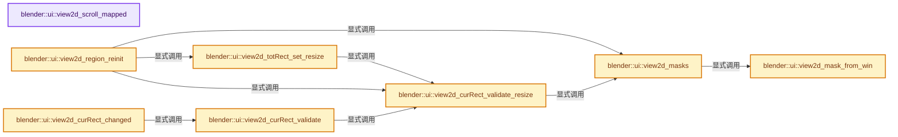
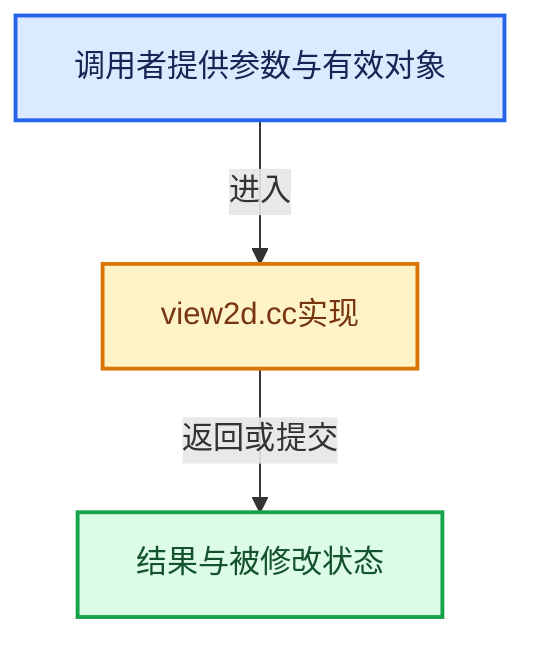

# 实现依赖专题：source/blender/editors/interface/view2d/view2d.cc

[实现依赖导航](../../../../README.md) · [符号索引](../../../../../00-课程指南/02-源码与提交索引/符号依赖与实现索引.md)

本专题从正文实际调用进入，集中保存共享实现。函数有稳定锚点，可从调用处直接跳到对应完整函数；递归与互相调用通过回链组织。

## 本文件的实现关系






## 完整成员与函数实现

<a id="f-274b3061e688b6c2"></a>

### `blender::ui::view2d_scroll_mapped`

实现位置：[source/blender/editors/interface/view2d/view2d.cc](../../../../../../../../../source/blender/editors/interface/view2d/view2d.cc) · L100—L109。

接口参数：

- `int scroll`

**教学注释版**

<!-- annotated:cae7b73fdf2dd7 -->

```cpp
static int view2d_scroll_mapped(int scroll)
{
  if (scroll & V2D_SCROLL_HORIZONTAL_FULLR) {
    scroll &= ~V2D_SCROLL_HORIZONTAL;
  }
  if (scroll & V2D_SCROLL_VERTICAL_FULLR) {
    scroll &= ~V2D_SCROLL_VERTICAL;
  }
  return scroll;
}
```

<details>
<summary>核对原始源码：source/blender/editors/interface/view2d/view2d.cc · L100—L109</summary>

<!-- original:cae7b73fdf2dd7:source/blender/editors/interface/view2d/view2d.cc:100:109 -->

```cpp
static int view2d_scroll_mapped(int scroll)
{
  if (scroll & V2D_SCROLL_HORIZONTAL_FULLR) {
    scroll &= ~V2D_SCROLL_HORIZONTAL;
  }
  if (scroll & V2D_SCROLL_VERTICAL_FULLR) {
    scroll &= ~V2D_SCROLL_VERTICAL;
  }
  return scroll;
}
```

</details>

**沿实际写入检查状态**

- `scroll &= ~V2D_SCROLL_HORIZONTAL;`
- `scroll &= ~V2D_SCROLL_VERTICAL;`

**结果出口**

- `return scroll;`

**继续追踪实现**

本实现没有需要继续展开的显式调用；检查返回表达式、对象转换和调用者前置条件。

<a id="f-5d8e09440a3332c5"></a>

### `blender::ui::view2d_mask_from_win`

实现位置：[source/blender/editors/interface/view2d/view2d.cc](../../../../../../../../../source/blender/editors/interface/view2d/view2d.cc) · L111—L117。

接口参数：

- `const View2D *v2d`
- `rcti *r_mask`

**教学注释版**

<!-- annotated:4e0396f4c62e66 -->

```cpp
void view2d_mask_from_win(const View2D *v2d, rcti *r_mask)
{
  r_mask->xmin = 0;
  r_mask->ymin = 0;
  r_mask->xmax = v2d->winx - 1; /* -1 yes! masks are pixels */
  r_mask->ymax = v2d->winy - 1;
}
```

<details>
<summary>核对原始源码：source/blender/editors/interface/view2d/view2d.cc · L111—L117</summary>

<!-- original:4e0396f4c62e66:source/blender/editors/interface/view2d/view2d.cc:111:117 -->

```cpp
void view2d_mask_from_win(const View2D *v2d, rcti *r_mask)
{
  r_mask->xmin = 0;
  r_mask->ymin = 0;
  r_mask->xmax = v2d->winx - 1; /* -1 yes! masks are pixels */
  r_mask->ymax = v2d->winy - 1;
}
```

</details>

**沿实际写入检查状态**

- `r_mask->xmin = 0;`
- `r_mask->ymin = 0;`
- `r_mask->xmax = v2d->winx - 1; /* -1 yes! masks are pixels */`
- `r_mask->ymax = v2d->winy - 1;`

**继续追踪实现**

本实现没有需要继续展开的显式调用；检查返回表达式、对象转换和调用者前置条件。

<a id="f-83db2cc598241b93"></a>

### `blender::ui::view2d_masks`

实现位置：[source/blender/editors/interface/view2d/view2d.cc](../../../../../../../../../source/blender/editors/interface/view2d/view2d.cc) · L124—L215。

接口参数：

- `View2D *v2d`
- `const rcti *mask_scroll`

**教学注释版**

<!-- annotated:ac7147f8c37c8d -->

```cpp
static void view2d_masks(View2D *v2d, const rcti *mask_scroll)
{
  int scroll;

  /* mask - view frame */
  view2d_mask_from_win(v2d, &v2d->mask);
  if (mask_scroll == nullptr) {
    mask_scroll = &v2d->mask;
  }

  /* check size if hiding flag is set: */
  if (v2d->scroll & V2D_SCROLL_HORIZONTAL_HIDE) {
    if (!(v2d->scroll & V2D_SCROLL_HORIZONTAL_HANDLES)) {
      if (BLI_rctf_size_x(&v2d->tot) > BLI_rctf_size_x(&v2d->cur)) {
        v2d->scroll &= ~V2D_SCROLL_HORIZONTAL_FULLR;
      }
      else {
        v2d->scroll |= V2D_SCROLL_HORIZONTAL_FULLR;
      }
    }
  }
  if (v2d->scroll & V2D_SCROLL_VERTICAL_HIDE) {
    if (!(v2d->scroll & V2D_SCROLL_VERTICAL_HANDLES)) {
      if (BLI_rctf_size_y(&v2d->tot) + 0.01f > BLI_rctf_size_y(&v2d->cur)) {
        v2d->scroll &= ~V2D_SCROLL_VERTICAL_FULLR;
      }
      else {
        v2d->scroll |= V2D_SCROLL_VERTICAL_FULLR;
      }
    }
  }

  /* Do not use mapped scroll here because we want to update scroller rects
   * even if they are not displayed. For initialization purposes. See #75003. */
  scroll = v2d->scroll;

  /* Scrollers are based off region-size:
   * - they can only be on one to two edges of the region they define
   * - if they overlap, they must not occupy the corners (which are reserved for other widgets)
   */
  if (scroll) {
    float scroll_width, scroll_height;

    view2d_scroller_size_get(v2d, false, &scroll_width, &scroll_height);

    /* vertical scroller */
    if (scroll & V2D_SCROLL_LEFT) {
      /* on left-hand edge of region */
      v2d->vert = *mask_scroll;
      v2d->vert.xmax = v2d->vert.xmin + scroll_width;
    }
    else if (scroll & V2D_SCROLL_RIGHT) {
      /* on right-hand edge of region */
      v2d->vert = *mask_scroll;
      v2d->vert.xmax++; /* one pixel extra... was leaving a minor gap... */
      v2d->vert.xmin = v2d->vert.xmax - scroll_width;
    }

    /* horizontal scroller */
    if (scroll & V2D_SCROLL_BOTTOM) {
      /* on bottom edge of region */
      v2d->hor = *mask_scroll;
      v2d->hor.ymax = scroll_height;
    }
    else if (scroll & V2D_SCROLL_TOP) {
      /* on upper edge of region */
      v2d->hor = *mask_scroll;
      v2d->hor.ymin = v2d->hor.ymax - scroll_height;
    }

    /* Adjust horizontal scroller to avoid interfering with splitter areas. */
    if (scroll & V2D_SCROLL_HORIZONTAL) {
      v2d->hor.xmin += UI_AZONESPOTW_LEFT;
      v2d->hor.xmax -= UI_AZONESPOTW_RIGHT;
    }

    /* Adjust vertical scroller to avoid horizontal scrollers and splitter areas. */
    if (scroll & V2D_SCROLL_VERTICAL) {
      /* Note that top splitter areas are in the header,
       * outside of `mask_scroll`, so we can ignore them. */
      v2d->vert.ymin += UI_AZONESPOTH;
      if (scroll & V2D_SCROLL_BOTTOM) {
        /* on bottom edge of region */
        v2d->vert.ymin = max_ii(v2d->hor.ymax, v2d->vert.ymin);
      }
      else if (scroll & V2D_SCROLL_TOP) {
        /* on upper edge of region */
        v2d->vert.ymax = v2d->hor.ymin;
      }
    }
  }
}
```

<details>
<summary>核对原始源码：source/blender/editors/interface/view2d/view2d.cc · L124—L215</summary>

<!-- original:ac7147f8c37c8d:source/blender/editors/interface/view2d/view2d.cc:124:215 -->

```cpp
static void view2d_masks(View2D *v2d, const rcti *mask_scroll)
{
  int scroll;

  /* mask - view frame */
  view2d_mask_from_win(v2d, &v2d->mask);
  if (mask_scroll == nullptr) {
    mask_scroll = &v2d->mask;
  }

  /* check size if hiding flag is set: */
  if (v2d->scroll & V2D_SCROLL_HORIZONTAL_HIDE) {
    if (!(v2d->scroll & V2D_SCROLL_HORIZONTAL_HANDLES)) {
      if (BLI_rctf_size_x(&v2d->tot) > BLI_rctf_size_x(&v2d->cur)) {
        v2d->scroll &= ~V2D_SCROLL_HORIZONTAL_FULLR;
      }
      else {
        v2d->scroll |= V2D_SCROLL_HORIZONTAL_FULLR;
      }
    }
  }
  if (v2d->scroll & V2D_SCROLL_VERTICAL_HIDE) {
    if (!(v2d->scroll & V2D_SCROLL_VERTICAL_HANDLES)) {
      if (BLI_rctf_size_y(&v2d->tot) + 0.01f > BLI_rctf_size_y(&v2d->cur)) {
        v2d->scroll &= ~V2D_SCROLL_VERTICAL_FULLR;
      }
      else {
        v2d->scroll |= V2D_SCROLL_VERTICAL_FULLR;
      }
    }
  }

  /* Do not use mapped scroll here because we want to update scroller rects
   * even if they are not displayed. For initialization purposes. See #75003. */
  scroll = v2d->scroll;

  /* Scrollers are based off region-size:
   * - they can only be on one to two edges of the region they define
   * - if they overlap, they must not occupy the corners (which are reserved for other widgets)
   */
  if (scroll) {
    float scroll_width, scroll_height;

    view2d_scroller_size_get(v2d, false, &scroll_width, &scroll_height);

    /* vertical scroller */
    if (scroll & V2D_SCROLL_LEFT) {
      /* on left-hand edge of region */
      v2d->vert = *mask_scroll;
      v2d->vert.xmax = v2d->vert.xmin + scroll_width;
    }
    else if (scroll & V2D_SCROLL_RIGHT) {
      /* on right-hand edge of region */
      v2d->vert = *mask_scroll;
      v2d->vert.xmax++; /* one pixel extra... was leaving a minor gap... */
      v2d->vert.xmin = v2d->vert.xmax - scroll_width;
    }

    /* horizontal scroller */
    if (scroll & V2D_SCROLL_BOTTOM) {
      /* on bottom edge of region */
      v2d->hor = *mask_scroll;
      v2d->hor.ymax = scroll_height;
    }
    else if (scroll & V2D_SCROLL_TOP) {
      /* on upper edge of region */
      v2d->hor = *mask_scroll;
      v2d->hor.ymin = v2d->hor.ymax - scroll_height;
    }

    /* Adjust horizontal scroller to avoid interfering with splitter areas. */
    if (scroll & V2D_SCROLL_HORIZONTAL) {
      v2d->hor.xmin += UI_AZONESPOTW_LEFT;
      v2d->hor.xmax -= UI_AZONESPOTW_RIGHT;
    }

    /* Adjust vertical scroller to avoid horizontal scrollers and splitter areas. */
    if (scroll & V2D_SCROLL_VERTICAL) {
      /* Note that top splitter areas are in the header,
       * outside of `mask_scroll`, so we can ignore them. */
      v2d->vert.ymin += UI_AZONESPOTH;
      if (scroll & V2D_SCROLL_BOTTOM) {
        /* on bottom edge of region */
        v2d->vert.ymin = max_ii(v2d->hor.ymax, v2d->vert.ymin);
      }
      else if (scroll & V2D_SCROLL_TOP) {
        /* on upper edge of region */
        v2d->vert.ymax = v2d->hor.ymin;
      }
    }
  }
}
```

</details>

**沿实际写入检查状态**

- `mask_scroll = &v2d->mask;`
- `v2d->scroll &= ~V2D_SCROLL_HORIZONTAL_FULLR;`
- `v2d->scroll |= V2D_SCROLL_HORIZONTAL_FULLR;`
- `v2d->scroll &= ~V2D_SCROLL_VERTICAL_FULLR;`
- `v2d->scroll |= V2D_SCROLL_VERTICAL_FULLR;`
- `scroll = v2d->scroll;`
- `v2d->vert = *mask_scroll;`
- `v2d->vert.xmax = v2d->vert.xmin + scroll_width;`
- `v2d->vert.xmin = v2d->vert.xmax - scroll_width;`
- `v2d->hor = *mask_scroll;`
- `v2d->hor.ymax = scroll_height;`
- `v2d->hor.ymin = v2d->hor.ymax - scroll_height;`
- `v2d->hor.xmin += UI_AZONESPOTW_LEFT;`
- `v2d->hor.xmax -= UI_AZONESPOTW_RIGHT;`
- `v2d->vert.ymin += UI_AZONESPOTH;`
- `v2d->vert.ymin = max_ii(v2d->hor.ymax, v2d->vert.ymin);`
- `v2d->vert.ymax = v2d->hor.ymin;`

**继续追踪实现**

- `view2d_mask_from_win` → [blender::ui::view2d_mask_from_win · L111](view2d.cc.md#f-5d8e09440a3332c5)。
- `BLI_rctf_size_x` → [blender::BLI_rctf_size_x · L211](../../../../01-BLI基础库/BLI_rect.hh.md#f-017b86a9d189e3ba)。
- `BLI_rctf_size_y` → [blender::BLI_rctf_size_y · L215](../../../../01-BLI基础库/BLI_rect.hh.md#f-6d179bc3c1b71b0e)。
- `view2d_scroller_size_get` → [blender::ui::view2d_scroller_size_get · L1868](view2d.cc.md#f-67de08a1b380f2b9)。
- `max_ii` → [blender::max_ii · L368](../../../../01-BLI基础库/intern/math_base_inline.cc.md#f-c45aa7b373adb94c)。

<a id="f-e20686f1d2fc2832"></a>

### `blender::ui::view2d_region_reinit`

实现位置：[source/blender/editors/interface/view2d/view2d.cc](../../../../../../../../../source/blender/editors/interface/view2d/view2d.cc) · L223—L382。

接口参数：

- `View2D *v2d`
- `short type`
- `int winx`
- `int winy`

**教学注释版**

<!-- annotated:36920b37c14e6f -->

```cpp
void view2d_region_reinit(View2D *v2d, short type, int winx, int winy)
{
  bool tot_changed = false, do_init;
  const uiStyle *style = style_get();

  do_init = (v2d->flag & V2D_IS_INIT) == 0;

  /* see eView2D_CommonViewTypes in UI_view2d.hh for available view presets */
  switch (type) {
    /* 'standard view' - optimum setup for 'standard' view behavior,
     * that should be used new views as basis for their
     * own unique View2D settings, which should be used instead of this in most cases...
     */
    case V2D_COMMONVIEW_STANDARD: {
      /* for now, aspect ratio should be maintained,
       * and zoom is clamped within sane default limits */
      v2d->keepzoom = (V2D_KEEPASPECT | V2D_LIMITZOOM);
      v2d->minzoom = 0.01f;
      v2d->maxzoom = 1000.0f;

      /* View2D tot rect and cur should be same size,
       * and aligned using 'standard' OpenGL coordinates for now:
       * - region can resize 'tot' later to fit other data
       * - keeptot is only within bounds, as strict locking is not that critical
       * - view is aligned for (0,0) -> (winx-1, winy-1) setup
       */
      v2d->align = (V2D_ALIGN_NO_NEG_X | V2D_ALIGN_NO_NEG_Y);
      v2d->keeptot = V2D_KEEPTOT_BOUNDS;
      if (do_init) {
        v2d->tot.xmin = v2d->tot.ymin = 0.0f;
        v2d->tot.xmax = float(winx - 1);
        v2d->tot.ymax = float(winy - 1);

        v2d->cur = v2d->tot;
      }
      /* scrollers - should we have these by default? */
      /* XXX for now, we don't override this, or set it either! */
      break;
    }
    /* 'list/channel view' - zoom, aspect ratio, and alignment restrictions are set here */
    case V2D_COMMONVIEW_LIST: {
      /* zoom + aspect ratio are locked */
      v2d->keepzoom = (V2D_LOCKZOOM_X | V2D_LOCKZOOM_Y | V2D_LIMITZOOM | V2D_KEEPASPECT);
      v2d->minzoom = v2d->maxzoom = 1.0f;

      /* tot rect has strictly regulated placement, and must only occur in +/- quadrant */
      v2d->align = (V2D_ALIGN_NO_NEG_X | V2D_ALIGN_NO_POS_Y);
      v2d->keeptot = V2D_KEEPTOT_STRICT;
      tot_changed = do_init;

      /* scroller settings are currently not set here... that is left for regions... */
      break;
    }
    /* 'stack view' - practically the same as list/channel view,
     * except is located in the pos y half instead.
     * Zoom, aspect ratio, and alignment restrictions are set here. */
    case V2D_COMMONVIEW_STACK: {
      /* zoom + aspect ratio are locked */
      v2d->keepzoom = (V2D_LOCKZOOM_X | V2D_LOCKZOOM_Y | V2D_LIMITZOOM | V2D_KEEPASPECT);
      v2d->minzoom = v2d->maxzoom = 1.0f;

      /* tot rect has strictly regulated placement, and must only occur in +/+ quadrant */
      v2d->align = (V2D_ALIGN_NO_NEG_X | V2D_ALIGN_NO_NEG_Y);
      v2d->keeptot = V2D_KEEPTOT_STRICT;
      tot_changed = do_init;

      /* scroller settings are currently not set here... that is left for regions... */
      break;
    }
    /* 'header' regions - zoom, aspect ratio,
     * alignment, and panning restrictions are set here */
    case V2D_COMMONVIEW_HEADER: {
      /* zoom + aspect ratio are locked */
      v2d->keepzoom = (V2D_LOCKZOOM_X | V2D_LOCKZOOM_Y | V2D_LIMITZOOM | V2D_KEEPASPECT);
      v2d->minzoom = v2d->maxzoom = 1.0f;

      if (do_init) {
        v2d->tot.xmin = 0.0f;
        v2d->tot.xmax = winx;
        v2d->tot.ymin = 0.0f;
        v2d->tot.ymax = winy;
        v2d->cur = v2d->tot;

        v2d->min[0] = v2d->max[0] = float(winx - 1);
        v2d->min[1] = v2d->max[1] = float(winy - 1);
      }
      /* tot rect has strictly regulated placement, and must only occur in +/+ quadrant */
      v2d->align = (V2D_ALIGN_NO_NEG_X | V2D_ALIGN_NO_NEG_Y);
      v2d->keeptot = V2D_KEEPTOT_STRICT;
      tot_changed = do_init;

      /* panning in y-axis is prohibited */
      v2d->keepofs = V2D_LOCKOFS_Y;

      /* absolutely no scrollers allowed */
      v2d->scroll = eView2D_Scroll{};
      break;
    }
    /* panels view, with horizontal/vertical align */
    case V2D_COMMONVIEW_PANELS_UI: {

      /* for now, aspect ratio should be maintained,
       * and zoom is clamped within sane default limits */
      v2d->keepzoom = (V2D_KEEPASPECT | V2D_LIMITZOOM | V2D_KEEPZOOM);
      v2d->minzoom = 0.5f;
      v2d->maxzoom = 2.0f;

      v2d->align = (V2D_ALIGN_NO_NEG_X | V2D_ALIGN_NO_POS_Y);
      v2d->keeptot = V2D_KEEPTOT_BOUNDS;

      /* NOTE: scroll is being flipped in #ED_region_panels() drawing. */
      v2d->scroll |= (V2D_SCROLL_HORIZONTAL_HIDE | V2D_SCROLL_VERTICAL_HIDE);

      if (do_init) {
        const float panelzoom = (style) ? style->panelzoom : 1.0f;

        v2d->tot.xmin = 0.0f;
        v2d->tot.xmax = winx;

        v2d->tot.ymax = 0.0f;
        v2d->tot.ymin = -winy;

        v2d->cur.xmin = 0.0f;
        v2d->cur.xmax = (winx)*panelzoom;

        v2d->cur.ymax = 0.0f;
        v2d->cur.ymin = (-winy) * panelzoom;
      }
      break;
    }
    /* other view types are completely defined using their own settings already */
    default:
      /* we don't do anything here,
       * as settings should be fine, but just make sure that rect */
      break;
  }

  /* set initialized flag so that View2D doesn't get reinitialized next time again */
  v2d->flag |= V2D_IS_INIT;

  /* store view size */
  v2d->winx = winx;
  v2d->winy = winy;

  view2d_masks(v2d, nullptr);

  if (do_init) {
    /* Visible by default. */
    v2d->alpha_hor = v2d->alpha_vert = 255;
  }

  /* set 'tot' rect before setting cur? */
  /* XXX confusing stuff here still */
  if (tot_changed) {
    view2d_totRect_set_resize(v2d, winx, winy, !do_init);
  }
  else {
    view2d_curRect_validate_resize(v2d, !do_init);
  }
}
```

<details>
<summary>核对原始源码：source/blender/editors/interface/view2d/view2d.cc · L223—L382</summary>

<!-- original:36920b37c14e6f:source/blender/editors/interface/view2d/view2d.cc:223:382 -->

```cpp
void view2d_region_reinit(View2D *v2d, short type, int winx, int winy)
{
  bool tot_changed = false, do_init;
  const uiStyle *style = style_get();

  do_init = (v2d->flag & V2D_IS_INIT) == 0;

  /* see eView2D_CommonViewTypes in UI_view2d.hh for available view presets */
  switch (type) {
    /* 'standard view' - optimum setup for 'standard' view behavior,
     * that should be used new views as basis for their
     * own unique View2D settings, which should be used instead of this in most cases...
     */
    case V2D_COMMONVIEW_STANDARD: {
      /* for now, aspect ratio should be maintained,
       * and zoom is clamped within sane default limits */
      v2d->keepzoom = (V2D_KEEPASPECT | V2D_LIMITZOOM);
      v2d->minzoom = 0.01f;
      v2d->maxzoom = 1000.0f;

      /* View2D tot rect and cur should be same size,
       * and aligned using 'standard' OpenGL coordinates for now:
       * - region can resize 'tot' later to fit other data
       * - keeptot is only within bounds, as strict locking is not that critical
       * - view is aligned for (0,0) -> (winx-1, winy-1) setup
       */
      v2d->align = (V2D_ALIGN_NO_NEG_X | V2D_ALIGN_NO_NEG_Y);
      v2d->keeptot = V2D_KEEPTOT_BOUNDS;
      if (do_init) {
        v2d->tot.xmin = v2d->tot.ymin = 0.0f;
        v2d->tot.xmax = float(winx - 1);
        v2d->tot.ymax = float(winy - 1);

        v2d->cur = v2d->tot;
      }
      /* scrollers - should we have these by default? */
      /* XXX for now, we don't override this, or set it either! */
      break;
    }
    /* 'list/channel view' - zoom, aspect ratio, and alignment restrictions are set here */
    case V2D_COMMONVIEW_LIST: {
      /* zoom + aspect ratio are locked */
      v2d->keepzoom = (V2D_LOCKZOOM_X | V2D_LOCKZOOM_Y | V2D_LIMITZOOM | V2D_KEEPASPECT);
      v2d->minzoom = v2d->maxzoom = 1.0f;

      /* tot rect has strictly regulated placement, and must only occur in +/- quadrant */
      v2d->align = (V2D_ALIGN_NO_NEG_X | V2D_ALIGN_NO_POS_Y);
      v2d->keeptot = V2D_KEEPTOT_STRICT;
      tot_changed = do_init;

      /* scroller settings are currently not set here... that is left for regions... */
      break;
    }
    /* 'stack view' - practically the same as list/channel view,
     * except is located in the pos y half instead.
     * Zoom, aspect ratio, and alignment restrictions are set here. */
    case V2D_COMMONVIEW_STACK: {
      /* zoom + aspect ratio are locked */
      v2d->keepzoom = (V2D_LOCKZOOM_X | V2D_LOCKZOOM_Y | V2D_LIMITZOOM | V2D_KEEPASPECT);
      v2d->minzoom = v2d->maxzoom = 1.0f;

      /* tot rect has strictly regulated placement, and must only occur in +/+ quadrant */
      v2d->align = (V2D_ALIGN_NO_NEG_X | V2D_ALIGN_NO_NEG_Y);
      v2d->keeptot = V2D_KEEPTOT_STRICT;
      tot_changed = do_init;

      /* scroller settings are currently not set here... that is left for regions... */
      break;
    }
    /* 'header' regions - zoom, aspect ratio,
     * alignment, and panning restrictions are set here */
    case V2D_COMMONVIEW_HEADER: {
      /* zoom + aspect ratio are locked */
      v2d->keepzoom = (V2D_LOCKZOOM_X | V2D_LOCKZOOM_Y | V2D_LIMITZOOM | V2D_KEEPASPECT);
      v2d->minzoom = v2d->maxzoom = 1.0f;

      if (do_init) {
        v2d->tot.xmin = 0.0f;
        v2d->tot.xmax = winx;
        v2d->tot.ymin = 0.0f;
        v2d->tot.ymax = winy;
        v2d->cur = v2d->tot;

        v2d->min[0] = v2d->max[0] = float(winx - 1);
        v2d->min[1] = v2d->max[1] = float(winy - 1);
      }
      /* tot rect has strictly regulated placement, and must only occur in +/+ quadrant */
      v2d->align = (V2D_ALIGN_NO_NEG_X | V2D_ALIGN_NO_NEG_Y);
      v2d->keeptot = V2D_KEEPTOT_STRICT;
      tot_changed = do_init;

      /* panning in y-axis is prohibited */
      v2d->keepofs = V2D_LOCKOFS_Y;

      /* absolutely no scrollers allowed */
      v2d->scroll = eView2D_Scroll{};
      break;
    }
    /* panels view, with horizontal/vertical align */
    case V2D_COMMONVIEW_PANELS_UI: {

      /* for now, aspect ratio should be maintained,
       * and zoom is clamped within sane default limits */
      v2d->keepzoom = (V2D_KEEPASPECT | V2D_LIMITZOOM | V2D_KEEPZOOM);
      v2d->minzoom = 0.5f;
      v2d->maxzoom = 2.0f;

      v2d->align = (V2D_ALIGN_NO_NEG_X | V2D_ALIGN_NO_POS_Y);
      v2d->keeptot = V2D_KEEPTOT_BOUNDS;

      /* NOTE: scroll is being flipped in #ED_region_panels() drawing. */
      v2d->scroll |= (V2D_SCROLL_HORIZONTAL_HIDE | V2D_SCROLL_VERTICAL_HIDE);

      if (do_init) {
        const float panelzoom = (style) ? style->panelzoom : 1.0f;

        v2d->tot.xmin = 0.0f;
        v2d->tot.xmax = winx;

        v2d->tot.ymax = 0.0f;
        v2d->tot.ymin = -winy;

        v2d->cur.xmin = 0.0f;
        v2d->cur.xmax = (winx)*panelzoom;

        v2d->cur.ymax = 0.0f;
        v2d->cur.ymin = (-winy) * panelzoom;
      }
      break;
    }
    /* other view types are completely defined using their own settings already */
    default:
      /* we don't do anything here,
       * as settings should be fine, but just make sure that rect */
      break;
  }

  /* set initialized flag so that View2D doesn't get reinitialized next time again */
  v2d->flag |= V2D_IS_INIT;

  /* store view size */
  v2d->winx = winx;
  v2d->winy = winy;

  view2d_masks(v2d, nullptr);

  if (do_init) {
    /* Visible by default. */
    v2d->alpha_hor = v2d->alpha_vert = 255;
  }

  /* set 'tot' rect before setting cur? */
  /* XXX confusing stuff here still */
  if (tot_changed) {
    view2d_totRect_set_resize(v2d, winx, winy, !do_init);
  }
  else {
    view2d_curRect_validate_resize(v2d, !do_init);
  }
}
```

</details>

**沿实际写入检查状态**

- `do_init = (v2d->flag & V2D_IS_INIT) == 0;`
- `v2d->keepzoom = (V2D_KEEPASPECT | V2D_LIMITZOOM);`
- `v2d->minzoom = 0.01f;`
- `v2d->maxzoom = 1000.0f;`
- `v2d->align = (V2D_ALIGN_NO_NEG_X | V2D_ALIGN_NO_NEG_Y);`
- `v2d->keeptot = V2D_KEEPTOT_BOUNDS;`
- `v2d->tot.xmin = v2d->tot.ymin = 0.0f;`
- `v2d->tot.xmax = float(winx - 1);`
- `v2d->tot.ymax = float(winy - 1);`
- `v2d->cur = v2d->tot;`
- `v2d->keepzoom = (V2D_LOCKZOOM_X | V2D_LOCKZOOM_Y | V2D_LIMITZOOM | V2D_KEEPASPECT);`
- `v2d->minzoom = v2d->maxzoom = 1.0f;`
- `v2d->align = (V2D_ALIGN_NO_NEG_X | V2D_ALIGN_NO_POS_Y);`
- `v2d->keeptot = V2D_KEEPTOT_STRICT;`
- `tot_changed = do_init;`
- `v2d->tot.xmin = 0.0f;`
- `v2d->tot.xmax = winx;`
- `v2d->tot.ymin = 0.0f;`
- `v2d->tot.ymax = winy;`
- `v2d->min[0] = v2d->max[0] = float(winx - 1);`
- `v2d->min[1] = v2d->max[1] = float(winy - 1);`
- `v2d->keepofs = V2D_LOCKOFS_Y;`
- `v2d->scroll = eView2D_Scroll{};`
- `v2d->keepzoom = (V2D_KEEPASPECT | V2D_LIMITZOOM | V2D_KEEPZOOM);`
- `v2d->minzoom = 0.5f;`
- `v2d->maxzoom = 2.0f;`
- `v2d->scroll |= (V2D_SCROLL_HORIZONTAL_HIDE | V2D_SCROLL_VERTICAL_HIDE);`
- `v2d->tot.ymax = 0.0f;`
- `v2d->tot.ymin = -winy;`
- `v2d->cur.xmin = 0.0f;`
- `v2d->cur.xmax = (winx)*panelzoom;`
- `v2d->cur.ymax = 0.0f;`
- `v2d->cur.ymin = (-winy) * panelzoom;`
- `v2d->flag |= V2D_IS_INIT;`
- `v2d->winx = winx;`
- `v2d->winy = winy;`
- `v2d->alpha_hor = v2d->alpha_vert = 255;`

**继续追踪实现**

- `style_get` → [blender::ui::style_get · L412](../interface_style.cc.md#f-aa005d800e55d1e4)。
- `view2d_masks` → [blender::ui::view2d_masks · L124](view2d.cc.md#f-83db2cc598241b93)。
- `view2d_totRect_set_resize` → [blender::ui::view2d_totRect_set_resize · L962](view2d.cc.md#f-a8e39363ed622643)。
- `view2d_curRect_validate_resize` → [blender::ui::view2d_curRect_validate_resize · L388](view2d.cc.md#f-a501f8a8fbca73f2)。

<a id="f-a501f8a8fbca73f2"></a>

### `blender::ui::view2d_curRect_validate_resize`

实现位置：[source/blender/editors/interface/view2d/view2d.cc](../../../../../../../../../source/blender/editors/interface/view2d/view2d.cc) · L388—L808。

接口参数：

- `View2D *v2d`
- `bool resize`

**教学注释版**

<!-- annotated:a486bae75fc137 -->

```cpp
static void view2d_curRect_validate_resize(View2D *v2d, bool resize)
{
  /* NOTE: #calculateZfac uses this logic, keep in sync. */
  float curwidth, curheight, width, height;
  float winx, winy;

  /* use mask as size of region that View2D resides in, as it takes into account
   * scroll-bars already - keep in sync with `zoomx/zoomy` in #view_zoomstep_apply_ex! */
  winx = float(BLI_rcti_size_x(&v2d->mask) + 1);
  winy = float(BLI_rcti_size_y(&v2d->mask) + 1);

  /* get pointers to rcts for less typing */
  rctf *cur = &v2d->cur;
  rctf *tot = &v2d->tot;

  /* we must satisfy the following constraints (in decreasing order of importance):
   * - alignment restrictions are respected
   * - cur must not fall outside of tot
   * - axis locks (zoom and offset) must be maintained
   * - zoom must not be excessive (check either sizes or zoom values)
   * - aspect ratio should be respected (NOTE: this is quite closely related to zoom too)
   */

  /* Step 1: if keepzoom, adjust the sizes of the rects only
   * - firstly, we calculate the sizes of the rects
   * - curwidth and curheight are saved as reference... modify width and height values here
   */
  /* Keep in sync with `zoomx/zoomy` in #view_zoomstep_apply_ex! */
  curwidth = width = BLI_rctf_size_x(cur);
  curheight = height = BLI_rctf_size_y(cur);

  /* if zoom is locked, size on the appropriate axis is reset to mask size */
  if (v2d->keepzoom & V2D_LOCKZOOM_X) {
    width = winx;
  }
  if (v2d->keepzoom & V2D_LOCKZOOM_Y) {
    height = winy;
  }

  /* values used to divide, so make it safe
   * NOTE: width and height must use FLT_MIN instead of 1, otherwise it is impossible to
   *       get enough resolution in Graph Editor for editing some curves
   */
  if (width < FLT_MIN) {
    width = 1;
  }
  if (height < FLT_MIN) {
    height = 1;
  }
  // [讲解] std::max<float>：按比较关系选取较大值。本讲解中的增长公式同时满足最低请求和几何增长；若保存返回引用，还需注意实参寿命。
  winx = std::max<float>(winx, 1);
  winy = std::max<float>(winy, 1);
  if (v2d->oldwinx == 0) {
    v2d->oldwinx = winx;
  }
  if (v2d->oldwiny == 0) {
    v2d->oldwiny = winy;
  }

  /* V2D_KEEPZOOM indicates that zoom level should be preserved when the window size changes. */
  if (resize && (v2d->keepzoom & V2D_KEEPZOOM)) {
    float zoom, oldzoom;

    if ((v2d->keepzoom & V2D_LOCKZOOM_X) == 0) {
      zoom = winx / width;
      oldzoom = v2d->oldwinx / curwidth;

      if (oldzoom != zoom) {
        width *= zoom / oldzoom;
      }
    }

    if ((v2d->keepzoom & V2D_LOCKZOOM_Y) == 0) {
      zoom = winy / height;
      oldzoom = v2d->oldwiny / curheight;

      if (oldzoom != zoom) {
        height *= zoom / oldzoom;
      }
    }
  }
  /* keepzoom (V2D_LIMITZOOM set), indicates that zoom level on each axis must not exceed limits
   * NOTE: in general, it is not expected that the lock-zoom will be used in conjunction with this
   */
  else if (v2d->keepzoom & V2D_LIMITZOOM) {

    /* check if excessive zoom on x-axis */
    if ((v2d->keepzoom & V2D_LOCKZOOM_X) == 0) {
      const float zoom = winx / width;
      if (zoom < v2d->minzoom) {
        width = winx / v2d->minzoom;
      }
      else if (zoom > v2d->maxzoom) {
        width = winx / v2d->maxzoom;
      }
    }

    /* check if excessive zoom on y-axis */
    if ((v2d->keepzoom & V2D_LOCKZOOM_Y) == 0) {
      const float zoom = winy / height;
      if (zoom < v2d->minzoom) {
        height = winy / v2d->minzoom;
      }
      else if (zoom > v2d->maxzoom) {
        height = winy / v2d->maxzoom;
      }
    }
  }
  else {
    /* make sure sizes don't exceed that of the min/max sizes
     * (even though we're not doing zoom clamping) */
    CLAMP(width, v2d->min[0], v2d->max[0]);
    CLAMP(height, v2d->min[1], v2d->max[1]);
  }

  /* check if we should restore aspect ratio (if view size changed) */
  if (v2d->keepzoom & V2D_KEEPASPECT) {
    bool do_x = false, do_y = false, do_cur;
    float curRatio, winRatio;

    /* when a window edge changes, the aspect ratio can't be used to
     * find which is the best new 'cur' rect. that's why it stores 'old'
     */
    if (winx != v2d->oldwinx) {
      do_x = true;
    }
    if (winy != v2d->oldwiny) {
      do_y = true;
    }

    curRatio = height / width;
    winRatio = winy / winx;

    /* Both sizes change (area/region maximized). */
    if (do_x == do_y) {
      if (do_x && do_y) {
        /* here is 1,1 case, so all others must be 0,0 */
        if (fabsf(winx - v2d->oldwinx) > fabsf(winy - v2d->oldwiny)) {
          do_y = false;
        }
        else {
          do_x = false;
        }
      }
      else if (winRatio > curRatio) {
        do_x = false;
      }
      else {
        do_x = true;
      }
    }
    do_cur = do_x;
    // do_win = do_y; /* UNUSED. */

    if (do_cur) {
      if ((v2d->keeptot == V2D_KEEPTOT_STRICT) && (winx != v2d->oldwinx)) {
        /* Special exception for Outliner (and later channel-lists):
         * - The view may be moved left to avoid contents
         *   being pushed out of view when view shrinks.
         * - The keeptot code will make sure cur->xmin will not be less than tot->xmin
         *   (which cannot be allowed).
         * - width is not adjusted for changed ratios here.
         */
        if (winx < v2d->oldwinx) {
          const float temp = v2d->oldwinx - winx;

          cur->xmin -= temp;
          cur->xmax -= temp;

          /* Width does not get modified, as keep-aspect here is just set to make
           * sure visible area adjusts to changing view shape! */
        }
      }
      else {
        /* portrait window: correct for x */
        width = height / winRatio;
      }
    }
    else {
      /* landscape window: correct for y */
      height = width * winRatio;
    }
  }

  /* Store region size for next time. */
  v2d->oldwinx = short(winx);
  v2d->oldwiny = short(winy);

  /* Step 2: apply new sizes to cur rect,
   * but need to take into account alignment settings here... */
  const bool do_keepofs = resize || !(v2d->flag & V2D_ZOOM_IGNORE_KEEPOFS);
  if ((width != curwidth) || (height != curheight)) {
    float temp, dh;

    /* Resize from center-point, unless otherwise specified. */
    if (width != curwidth) {
      if (v2d->keepofs & V2D_LOCKOFS_X) {
        cur->xmax += width - BLI_rctf_size_x(cur);
      }
      else if ((v2d->keepofs & V2D_KEEPOFS_X) && do_keepofs) {
        if (v2d->align & V2D_ALIGN_NO_POS_X) {
          cur->xmin -= width - BLI_rctf_size_x(cur);
        }
        else {
          cur->xmax += width - BLI_rctf_size_x(cur);
        }
      }
      else {
        temp = BLI_rctf_cent_x(cur);
        dh = width * 0.5f;

        cur->xmin = temp - dh;
        cur->xmax = temp + dh;
      }
    }
    if (height != curheight) {
      if (v2d->keepofs & V2D_LOCKOFS_Y) {
        cur->ymax += height - BLI_rctf_size_y(cur);
      }
      else if ((v2d->keepofs & V2D_KEEPOFS_Y) && do_keepofs) {
        if (v2d->align & V2D_ALIGN_NO_POS_Y) {
          cur->ymin -= height - BLI_rctf_size_y(cur);
        }
        else {
          cur->ymax += height - BLI_rctf_size_y(cur);
        }
      }
      else {
        temp = BLI_rctf_cent_y(cur);
        dh = height * 0.5f;

        cur->ymin = temp - dh;
        cur->ymax = temp + dh;
      }
    }
  }

  const float totwidth = BLI_rctf_size_x(tot);
  const float totheight = BLI_rctf_size_y(tot);

  /* Step 3: adjust so that it doesn't fall outside of bounds of 'tot' */
  if (v2d->keeptot) {
    float temp, diff;

    /* recalculate extents of cur */
    curwidth = BLI_rctf_size_x(cur);
    curheight = BLI_rctf_size_y(cur);

    /* width */
    if ((curwidth > totwidth) &&
        !(v2d->keepzoom & (V2D_KEEPZOOM | V2D_LOCKZOOM_X | V2D_LIMITZOOM)))
    {
      /* if zoom doesn't have to be maintained, just clamp edges */
      cur->xmin = std::max(cur->xmin, tot->xmin);
      // [讲解] std::min：按比较关系选取较小值；截断范围时还需先满足非负和可表示范围，min本身不会证明边界安全。
      cur->xmax = std::min(cur->xmax, tot->xmax);
    }
    else if (v2d->keeptot == V2D_KEEPTOT_STRICT) {
      /* This is an exception for the outliner (and later channel-lists, headers)
       * - must clamp within tot rect (absolutely no excuses)
       * --> therefore, cur->xmin must not be less than tot->xmin
       */
      if (cur->xmin < tot->xmin) {
        /* move cur across so that it sits at minimum of tot */
        temp = tot->xmin - cur->xmin;

        cur->xmin += temp;
        cur->xmax += temp;
      }
      else if (cur->xmax > tot->xmax) {
        /* - only offset by difference of cur-xmax and tot-xmax if that would not move
         *   cur-xmin to lie past tot-xmin
         * - otherwise, simply shift to tot-xmin???
         */
        temp = cur->xmax - tot->xmax;

        if ((cur->xmin - temp) < tot->xmin) {
          /* only offset by difference from cur-min and tot-min */
          temp = cur->xmin - tot->xmin;

          cur->xmin -= temp;
          cur->xmax -= temp;
        }
        else {
          cur->xmin -= temp;
          cur->xmax -= temp;
        }
      }
    }
    else {
      /* This here occurs when:
       * - width too big, but maintaining zoom (i.e. widths cannot be changed)
       * - width is OK, but need to check if outside of boundaries
       *
       * So, resolution is to just shift view by the gap between the extremities.
       * We favor moving the 'minimum' across, as that's origin for most things.
       * (XXX: in the past, max was favored... if there are bugs, swap!)
       */
      if ((cur->xmin < tot->xmin) && (cur->xmax > tot->xmax)) {
        /* outside boundaries on both sides,
         * so take middle-point of tot, and place in balanced way */
        temp = BLI_rctf_cent_x(tot);
        diff = curwidth * 0.5f;

        cur->xmin = temp - diff;
        cur->xmax = temp + diff;
      }
      else if (cur->xmin < tot->xmin) {
        /* move cur across so that it sits at minimum of tot */
        temp = tot->xmin - cur->xmin;

        cur->xmin += temp;
        cur->xmax += temp;
      }
      else if (cur->xmax > tot->xmax) {
        /* - only offset by difference of cur-xmax and tot-xmax if that would not move
         *   cur-xmin to lie past tot-xmin
         * - otherwise, simply shift to tot-xmin???
         */
        temp = cur->xmax - tot->xmax;

        if ((cur->xmin - temp) < tot->xmin) {
          /* only offset by difference from cur-min and tot-min */
          temp = cur->xmin - tot->xmin;

          cur->xmin -= temp;
          cur->xmax -= temp;
        }
        else {
          cur->xmin -= temp;
          cur->xmax -= temp;
        }
      }
    }

    /* height */
    if ((curheight > totheight) &&
        !(v2d->keepzoom & (V2D_KEEPZOOM | V2D_LOCKZOOM_Y | V2D_LIMITZOOM)))
    {
      /* if zoom doesn't have to be maintained, just clamp edges */
      cur->ymin = std::max(cur->ymin, tot->ymin);
      cur->ymax = std::min(cur->ymax, tot->ymax);
    }
    else {
      /* This here occurs when:
       * - height too big, but maintaining zoom (i.e. heights cannot be changed)
       * - height is OK, but need to check if outside of boundaries
       *
       * So, resolution is to just shift view by the gap between the extremities.
       * We favor moving the 'minimum' across, as that's origin for most things.
       */
      if ((cur->ymin < tot->ymin) && (cur->ymax > tot->ymax)) {
        /* outside boundaries on both sides,
         * so take middle-point of tot, and place in balanced way */
        temp = BLI_rctf_cent_y(tot);
        diff = curheight * 0.5f;

        cur->ymin = temp - diff;
        cur->ymax = temp + diff;
      }
      else if (cur->ymin < tot->ymin) {
        /* there's still space remaining, so shift up */
        temp = tot->ymin - cur->ymin;

        cur->ymin += temp;
        cur->ymax += temp;
      }
      else if (cur->ymax > tot->ymax) {
        /* there's still space remaining, so shift down */
        temp = cur->ymax - tot->ymax;

        cur->ymin -= temp;
        cur->ymax -= temp;
      }
    }
  }

  /* Step 4: Make sure alignment restrictions are respected */
  if (v2d->align) {
    /* If alignment flags are set (but keeptot is not), they must still be respected, as although
     * they don't specify any particular bounds to stay within, they do define ranges which are
     * invalid.
     *
     * Here, we only check to make sure that on each axis, the 'cur' rect doesn't stray into these
     * invalid zones, otherwise we offset.
     */

    /* handle width - posx and negx flags are mutually exclusive, so watch out */
    if ((v2d->align & V2D_ALIGN_NO_POS_X) && !(v2d->align & V2D_ALIGN_NO_NEG_X)) {
      /* width is in negative-x half */
      if (v2d->cur.xmax > 0) {
        v2d->cur.xmin -= v2d->cur.xmax;
        v2d->cur.xmax = 0.0f;
      }
    }
    else if ((v2d->align & V2D_ALIGN_NO_NEG_X) && !(v2d->align & V2D_ALIGN_NO_POS_X)) {
      /* width is in positive-x half */
      if (v2d->cur.xmin < 0) {
        v2d->cur.xmax -= v2d->cur.xmin;
        v2d->cur.xmin = 0.0f;
      }
    }

    /* handle height - posx and negx flags are mutually exclusive, so watch out */
    if ((v2d->align & V2D_ALIGN_NO_POS_Y) && !(v2d->align & V2D_ALIGN_NO_NEG_Y)) {
      /* height is in negative-y half */
      if (v2d->cur.ymax > 0) {
        v2d->cur.ymin -= v2d->cur.ymax;
        v2d->cur.ymax = 0.0f;
      }
    }
    else if ((v2d->align & V2D_ALIGN_NO_NEG_Y) && !(v2d->align & V2D_ALIGN_NO_POS_Y)) {
      /* height is in positive-y half */
      if (v2d->cur.ymin < 0) {
        v2d->cur.ymax -= v2d->cur.ymin;
        v2d->cur.ymin = 0.0f;
      }
    }
  }

  /* set masks */
  view2d_masks(v2d, nullptr);
}
```

<details>
<summary>核对原始源码：source/blender/editors/interface/view2d/view2d.cc · L388—L808</summary>

<!-- original:a486bae75fc137:source/blender/editors/interface/view2d/view2d.cc:388:808 -->

```cpp
static void view2d_curRect_validate_resize(View2D *v2d, bool resize)
{
  /* NOTE: #calculateZfac uses this logic, keep in sync. */
  float curwidth, curheight, width, height;
  float winx, winy;

  /* use mask as size of region that View2D resides in, as it takes into account
   * scroll-bars already - keep in sync with `zoomx/zoomy` in #view_zoomstep_apply_ex! */
  winx = float(BLI_rcti_size_x(&v2d->mask) + 1);
  winy = float(BLI_rcti_size_y(&v2d->mask) + 1);

  /* get pointers to rcts for less typing */
  rctf *cur = &v2d->cur;
  rctf *tot = &v2d->tot;

  /* we must satisfy the following constraints (in decreasing order of importance):
   * - alignment restrictions are respected
   * - cur must not fall outside of tot
   * - axis locks (zoom and offset) must be maintained
   * - zoom must not be excessive (check either sizes or zoom values)
   * - aspect ratio should be respected (NOTE: this is quite closely related to zoom too)
   */

  /* Step 1: if keepzoom, adjust the sizes of the rects only
   * - firstly, we calculate the sizes of the rects
   * - curwidth and curheight are saved as reference... modify width and height values here
   */
  /* Keep in sync with `zoomx/zoomy` in #view_zoomstep_apply_ex! */
  curwidth = width = BLI_rctf_size_x(cur);
  curheight = height = BLI_rctf_size_y(cur);

  /* if zoom is locked, size on the appropriate axis is reset to mask size */
  if (v2d->keepzoom & V2D_LOCKZOOM_X) {
    width = winx;
  }
  if (v2d->keepzoom & V2D_LOCKZOOM_Y) {
    height = winy;
  }

  /* values used to divide, so make it safe
   * NOTE: width and height must use FLT_MIN instead of 1, otherwise it is impossible to
   *       get enough resolution in Graph Editor for editing some curves
   */
  if (width < FLT_MIN) {
    width = 1;
  }
  if (height < FLT_MIN) {
    height = 1;
  }
  winx = std::max<float>(winx, 1);
  winy = std::max<float>(winy, 1);
  if (v2d->oldwinx == 0) {
    v2d->oldwinx = winx;
  }
  if (v2d->oldwiny == 0) {
    v2d->oldwiny = winy;
  }

  /* V2D_KEEPZOOM indicates that zoom level should be preserved when the window size changes. */
  if (resize && (v2d->keepzoom & V2D_KEEPZOOM)) {
    float zoom, oldzoom;

    if ((v2d->keepzoom & V2D_LOCKZOOM_X) == 0) {
      zoom = winx / width;
      oldzoom = v2d->oldwinx / curwidth;

      if (oldzoom != zoom) {
        width *= zoom / oldzoom;
      }
    }

    if ((v2d->keepzoom & V2D_LOCKZOOM_Y) == 0) {
      zoom = winy / height;
      oldzoom = v2d->oldwiny / curheight;

      if (oldzoom != zoom) {
        height *= zoom / oldzoom;
      }
    }
  }
  /* keepzoom (V2D_LIMITZOOM set), indicates that zoom level on each axis must not exceed limits
   * NOTE: in general, it is not expected that the lock-zoom will be used in conjunction with this
   */
  else if (v2d->keepzoom & V2D_LIMITZOOM) {

    /* check if excessive zoom on x-axis */
    if ((v2d->keepzoom & V2D_LOCKZOOM_X) == 0) {
      const float zoom = winx / width;
      if (zoom < v2d->minzoom) {
        width = winx / v2d->minzoom;
      }
      else if (zoom > v2d->maxzoom) {
        width = winx / v2d->maxzoom;
      }
    }

    /* check if excessive zoom on y-axis */
    if ((v2d->keepzoom & V2D_LOCKZOOM_Y) == 0) {
      const float zoom = winy / height;
      if (zoom < v2d->minzoom) {
        height = winy / v2d->minzoom;
      }
      else if (zoom > v2d->maxzoom) {
        height = winy / v2d->maxzoom;
      }
    }
  }
  else {
    /* make sure sizes don't exceed that of the min/max sizes
     * (even though we're not doing zoom clamping) */
    CLAMP(width, v2d->min[0], v2d->max[0]);
    CLAMP(height, v2d->min[1], v2d->max[1]);
  }

  /* check if we should restore aspect ratio (if view size changed) */
  if (v2d->keepzoom & V2D_KEEPASPECT) {
    bool do_x = false, do_y = false, do_cur;
    float curRatio, winRatio;

    /* when a window edge changes, the aspect ratio can't be used to
     * find which is the best new 'cur' rect. that's why it stores 'old'
     */
    if (winx != v2d->oldwinx) {
      do_x = true;
    }
    if (winy != v2d->oldwiny) {
      do_y = true;
    }

    curRatio = height / width;
    winRatio = winy / winx;

    /* Both sizes change (area/region maximized). */
    if (do_x == do_y) {
      if (do_x && do_y) {
        /* here is 1,1 case, so all others must be 0,0 */
        if (fabsf(winx - v2d->oldwinx) > fabsf(winy - v2d->oldwiny)) {
          do_y = false;
        }
        else {
          do_x = false;
        }
      }
      else if (winRatio > curRatio) {
        do_x = false;
      }
      else {
        do_x = true;
      }
    }
    do_cur = do_x;
    // do_win = do_y; /* UNUSED. */

    if (do_cur) {
      if ((v2d->keeptot == V2D_KEEPTOT_STRICT) && (winx != v2d->oldwinx)) {
        /* Special exception for Outliner (and later channel-lists):
         * - The view may be moved left to avoid contents
         *   being pushed out of view when view shrinks.
         * - The keeptot code will make sure cur->xmin will not be less than tot->xmin
         *   (which cannot be allowed).
         * - width is not adjusted for changed ratios here.
         */
        if (winx < v2d->oldwinx) {
          const float temp = v2d->oldwinx - winx;

          cur->xmin -= temp;
          cur->xmax -= temp;

          /* Width does not get modified, as keep-aspect here is just set to make
           * sure visible area adjusts to changing view shape! */
        }
      }
      else {
        /* portrait window: correct for x */
        width = height / winRatio;
      }
    }
    else {
      /* landscape window: correct for y */
      height = width * winRatio;
    }
  }

  /* Store region size for next time. */
  v2d->oldwinx = short(winx);
  v2d->oldwiny = short(winy);

  /* Step 2: apply new sizes to cur rect,
   * but need to take into account alignment settings here... */
  const bool do_keepofs = resize || !(v2d->flag & V2D_ZOOM_IGNORE_KEEPOFS);
  if ((width != curwidth) || (height != curheight)) {
    float temp, dh;

    /* Resize from center-point, unless otherwise specified. */
    if (width != curwidth) {
      if (v2d->keepofs & V2D_LOCKOFS_X) {
        cur->xmax += width - BLI_rctf_size_x(cur);
      }
      else if ((v2d->keepofs & V2D_KEEPOFS_X) && do_keepofs) {
        if (v2d->align & V2D_ALIGN_NO_POS_X) {
          cur->xmin -= width - BLI_rctf_size_x(cur);
        }
        else {
          cur->xmax += width - BLI_rctf_size_x(cur);
        }
      }
      else {
        temp = BLI_rctf_cent_x(cur);
        dh = width * 0.5f;

        cur->xmin = temp - dh;
        cur->xmax = temp + dh;
      }
    }
    if (height != curheight) {
      if (v2d->keepofs & V2D_LOCKOFS_Y) {
        cur->ymax += height - BLI_rctf_size_y(cur);
      }
      else if ((v2d->keepofs & V2D_KEEPOFS_Y) && do_keepofs) {
        if (v2d->align & V2D_ALIGN_NO_POS_Y) {
          cur->ymin -= height - BLI_rctf_size_y(cur);
        }
        else {
          cur->ymax += height - BLI_rctf_size_y(cur);
        }
      }
      else {
        temp = BLI_rctf_cent_y(cur);
        dh = height * 0.5f;

        cur->ymin = temp - dh;
        cur->ymax = temp + dh;
      }
    }
  }

  const float totwidth = BLI_rctf_size_x(tot);
  const float totheight = BLI_rctf_size_y(tot);

  /* Step 3: adjust so that it doesn't fall outside of bounds of 'tot' */
  if (v2d->keeptot) {
    float temp, diff;

    /* recalculate extents of cur */
    curwidth = BLI_rctf_size_x(cur);
    curheight = BLI_rctf_size_y(cur);

    /* width */
    if ((curwidth > totwidth) &&
        !(v2d->keepzoom & (V2D_KEEPZOOM | V2D_LOCKZOOM_X | V2D_LIMITZOOM)))
    {
      /* if zoom doesn't have to be maintained, just clamp edges */
      cur->xmin = std::max(cur->xmin, tot->xmin);
      cur->xmax = std::min(cur->xmax, tot->xmax);
    }
    else if (v2d->keeptot == V2D_KEEPTOT_STRICT) {
      /* This is an exception for the outliner (and later channel-lists, headers)
       * - must clamp within tot rect (absolutely no excuses)
       * --> therefore, cur->xmin must not be less than tot->xmin
       */
      if (cur->xmin < tot->xmin) {
        /* move cur across so that it sits at minimum of tot */
        temp = tot->xmin - cur->xmin;

        cur->xmin += temp;
        cur->xmax += temp;
      }
      else if (cur->xmax > tot->xmax) {
        /* - only offset by difference of cur-xmax and tot-xmax if that would not move
         *   cur-xmin to lie past tot-xmin
         * - otherwise, simply shift to tot-xmin???
         */
        temp = cur->xmax - tot->xmax;

        if ((cur->xmin - temp) < tot->xmin) {
          /* only offset by difference from cur-min and tot-min */
          temp = cur->xmin - tot->xmin;

          cur->xmin -= temp;
          cur->xmax -= temp;
        }
        else {
          cur->xmin -= temp;
          cur->xmax -= temp;
        }
      }
    }
    else {
      /* This here occurs when:
       * - width too big, but maintaining zoom (i.e. widths cannot be changed)
       * - width is OK, but need to check if outside of boundaries
       *
       * So, resolution is to just shift view by the gap between the extremities.
       * We favor moving the 'minimum' across, as that's origin for most things.
       * (XXX: in the past, max was favored... if there are bugs, swap!)
       */
      if ((cur->xmin < tot->xmin) && (cur->xmax > tot->xmax)) {
        /* outside boundaries on both sides,
         * so take middle-point of tot, and place in balanced way */
        temp = BLI_rctf_cent_x(tot);
        diff = curwidth * 0.5f;

        cur->xmin = temp - diff;
        cur->xmax = temp + diff;
      }
      else if (cur->xmin < tot->xmin) {
        /* move cur across so that it sits at minimum of tot */
        temp = tot->xmin - cur->xmin;

        cur->xmin += temp;
        cur->xmax += temp;
      }
      else if (cur->xmax > tot->xmax) {
        /* - only offset by difference of cur-xmax and tot-xmax if that would not move
         *   cur-xmin to lie past tot-xmin
         * - otherwise, simply shift to tot-xmin???
         */
        temp = cur->xmax - tot->xmax;

        if ((cur->xmin - temp) < tot->xmin) {
          /* only offset by difference from cur-min and tot-min */
          temp = cur->xmin - tot->xmin;

          cur->xmin -= temp;
          cur->xmax -= temp;
        }
        else {
          cur->xmin -= temp;
          cur->xmax -= temp;
        }
      }
    }

    /* height */
    if ((curheight > totheight) &&
        !(v2d->keepzoom & (V2D_KEEPZOOM | V2D_LOCKZOOM_Y | V2D_LIMITZOOM)))
    {
      /* if zoom doesn't have to be maintained, just clamp edges */
      cur->ymin = std::max(cur->ymin, tot->ymin);
      cur->ymax = std::min(cur->ymax, tot->ymax);
    }
    else {
      /* This here occurs when:
       * - height too big, but maintaining zoom (i.e. heights cannot be changed)
       * - height is OK, but need to check if outside of boundaries
       *
       * So, resolution is to just shift view by the gap between the extremities.
       * We favor moving the 'minimum' across, as that's origin for most things.
       */
      if ((cur->ymin < tot->ymin) && (cur->ymax > tot->ymax)) {
        /* outside boundaries on both sides,
         * so take middle-point of tot, and place in balanced way */
        temp = BLI_rctf_cent_y(tot);
        diff = curheight * 0.5f;

        cur->ymin = temp - diff;
        cur->ymax = temp + diff;
      }
      else if (cur->ymin < tot->ymin) {
        /* there's still space remaining, so shift up */
        temp = tot->ymin - cur->ymin;

        cur->ymin += temp;
        cur->ymax += temp;
      }
      else if (cur->ymax > tot->ymax) {
        /* there's still space remaining, so shift down */
        temp = cur->ymax - tot->ymax;

        cur->ymin -= temp;
        cur->ymax -= temp;
      }
    }
  }

  /* Step 4: Make sure alignment restrictions are respected */
  if (v2d->align) {
    /* If alignment flags are set (but keeptot is not), they must still be respected, as although
     * they don't specify any particular bounds to stay within, they do define ranges which are
     * invalid.
     *
     * Here, we only check to make sure that on each axis, the 'cur' rect doesn't stray into these
     * invalid zones, otherwise we offset.
     */

    /* handle width - posx and negx flags are mutually exclusive, so watch out */
    if ((v2d->align & V2D_ALIGN_NO_POS_X) && !(v2d->align & V2D_ALIGN_NO_NEG_X)) {
      /* width is in negative-x half */
      if (v2d->cur.xmax > 0) {
        v2d->cur.xmin -= v2d->cur.xmax;
        v2d->cur.xmax = 0.0f;
      }
    }
    else if ((v2d->align & V2D_ALIGN_NO_NEG_X) && !(v2d->align & V2D_ALIGN_NO_POS_X)) {
      /* width is in positive-x half */
      if (v2d->cur.xmin < 0) {
        v2d->cur.xmax -= v2d->cur.xmin;
        v2d->cur.xmin = 0.0f;
      }
    }

    /* handle height - posx and negx flags are mutually exclusive, so watch out */
    if ((v2d->align & V2D_ALIGN_NO_POS_Y) && !(v2d->align & V2D_ALIGN_NO_NEG_Y)) {
      /* height is in negative-y half */
      if (v2d->cur.ymax > 0) {
        v2d->cur.ymin -= v2d->cur.ymax;
        v2d->cur.ymax = 0.0f;
      }
    }
    else if ((v2d->align & V2D_ALIGN_NO_NEG_Y) && !(v2d->align & V2D_ALIGN_NO_POS_Y)) {
      /* height is in positive-y half */
      if (v2d->cur.ymin < 0) {
        v2d->cur.ymax -= v2d->cur.ymin;
        v2d->cur.ymin = 0.0f;
      }
    }
  }

  /* set masks */
  view2d_masks(v2d, nullptr);
}
```

</details>

**沿实际写入检查状态**

- `winx = float(BLI_rcti_size_x(&v2d->mask) + 1);`
- `winy = float(BLI_rcti_size_y(&v2d->mask) + 1);`
- `curwidth = width = BLI_rctf_size_x(cur);`
- `curheight = height = BLI_rctf_size_y(cur);`
- `width = winx;`
- `height = winy;`
- `width = 1;`
- `height = 1;`
- `winx = std::max<float>(winx, 1);`
- `winy = std::max<float>(winy, 1);`
- `v2d->oldwinx = winx;`
- `v2d->oldwiny = winy;`
- `zoom = winx / width;`
- `oldzoom = v2d->oldwinx / curwidth;`
- `width *= zoom / oldzoom;`
- `zoom = winy / height;`
- `oldzoom = v2d->oldwiny / curheight;`
- `height *= zoom / oldzoom;`
- `width = winx / v2d->minzoom;`
- `width = winx / v2d->maxzoom;`
- `height = winy / v2d->minzoom;`
- `height = winy / v2d->maxzoom;`
- `do_x = true;`
- `do_y = true;`
- `curRatio = height / width;`
- `winRatio = winy / winx;`
- `do_y = false;`
- `do_x = false;`
- `do_cur = do_x;`
- `cur->xmin -= temp;`
- `cur->xmax -= temp;`
- `width = height / winRatio;`
- `height = width * winRatio;`
- `v2d->oldwinx = short(winx);`
- `v2d->oldwiny = short(winy);`
- `cur->xmax += width - BLI_rctf_size_x(cur);`
- `cur->xmin -= width - BLI_rctf_size_x(cur);`
- `temp = BLI_rctf_cent_x(cur);`
- `dh = width * 0.5f;`
- `cur->xmin = temp - dh;`
- `cur->xmax = temp + dh;`
- `cur->ymax += height - BLI_rctf_size_y(cur);`
- `cur->ymin -= height - BLI_rctf_size_y(cur);`
- `temp = BLI_rctf_cent_y(cur);`
- `dh = height * 0.5f;`
- `cur->ymin = temp - dh;`
- `cur->ymax = temp + dh;`
- `curwidth = BLI_rctf_size_x(cur);`
- `curheight = BLI_rctf_size_y(cur);`
- `cur->xmin = std::max(cur->xmin, tot->xmin);`
- `cur->xmax = std::min(cur->xmax, tot->xmax);`
- `temp = tot->xmin - cur->xmin;`
- `cur->xmin += temp;`
- `cur->xmax += temp;`
- `temp = cur->xmax - tot->xmax;`
- `temp = cur->xmin - tot->xmin;`
- `temp = BLI_rctf_cent_x(tot);`
- `diff = curwidth * 0.5f;`
- `cur->xmin = temp - diff;`
- `cur->xmax = temp + diff;`
- `cur->ymin = std::max(cur->ymin, tot->ymin);`
- `cur->ymax = std::min(cur->ymax, tot->ymax);`
- `temp = BLI_rctf_cent_y(tot);`
- `diff = curheight * 0.5f;`
- `cur->ymin = temp - diff;`
- `cur->ymax = temp + diff;`
- `temp = tot->ymin - cur->ymin;`
- `cur->ymin += temp;`
- `cur->ymax += temp;`
- `temp = cur->ymax - tot->ymax;`
- `cur->ymin -= temp;`
- `cur->ymax -= temp;`
- `v2d->cur.xmin -= v2d->cur.xmax;`
- `v2d->cur.xmax = 0.0f;`
- `v2d->cur.xmax -= v2d->cur.xmin;`
- `v2d->cur.xmin = 0.0f;`
- `v2d->cur.ymin -= v2d->cur.ymax;`
- `v2d->cur.ymax = 0.0f;`
- `v2d->cur.ymax -= v2d->cur.ymin;`
- `v2d->cur.ymin = 0.0f;`

**继续追踪实现**

- `BLI_rcti_size_x` → [blender::BLI_rcti_size_x · L203](../../../../01-BLI基础库/BLI_rect.hh.md#f-7a8fb2c54a829be6)。
- `BLI_rcti_size_y` → [blender::BLI_rcti_size_y · L207](../../../../01-BLI基础库/BLI_rect.hh.md#f-ac87d6c708d502ad)。
- `BLI_rctf_size_x` → [blender::BLI_rctf_size_x · L211](../../../../01-BLI基础库/BLI_rect.hh.md#f-017b86a9d189e3ba)。
- `BLI_rctf_size_y` → [blender::BLI_rctf_size_y · L215](../../../../01-BLI基础库/BLI_rect.hh.md#f-6d179bc3c1b71b0e)。
- `std::max<float>` → [外部契约](https://eel.is/c++draft/alg.min.max)：按比较关系选取较大值。本讲解中的增长公式同时满足最低请求和几何增长；若保存返回引用，还需注意实参寿命。
- `CLAMP` → [CLAMP · L200](../../../../01-BLI基础库/BLI_utildefines.hh.md#m-69703e497120)。宏定义由构建条件选择。
- `fabsf` → [fabsf · L21](../../../../07-Intern运行时与平台/cycles/kernel/svm/radial_tiling_shared.h.md#m-02cc4c69cfb3)；[fabsf · L43](../../../../07-Intern运行时与平台/cycles/kernel/svm/radial_tiling_shared.h.md#m-04effe61803b)；[fabsf · L74](../../../../07-Intern运行时与平台/cycles/kernel/svm/radial_tiling_shared.h.md#m-927dd4eba7dc)；[fabsf · L25](../../../../01-BLI基础库/intern/radial_tiling_shared.hh.md#m-8348d6b3d08f)；[fabsf · L47](../../../../01-BLI基础库/intern/radial_tiling_shared.hh.md#m-13b7e0b6d84f)；[fabsf · L78](../../../../01-BLI基础库/intern/radial_tiling_shared.hh.md#m-326c83464a0d)；[fabsf · L21](../../../../07-Intern运行时与平台/cycles/kernel/osl/shaders/node_radial_tiling_shared.h.md#m-7c3ee12fc119)；[fabsf · L43](../../../../07-Intern运行时与平台/cycles/kernel/osl/shaders/node_radial_tiling_shared.h.md#m-9112db0e2dd1)；[fabsf · L74](../../../../07-Intern运行时与平台/cycles/kernel/osl/shaders/node_radial_tiling_shared.h.md#m-ee4e61908a6f)；[fabsf · L167](../../../../07-Intern运行时与平台/cycles/kernel/device/oneapi/compat.h.md#m-b039ee6c1601)；[fabsf · L265](../../../../07-Intern运行时与平台/cycles/kernel/device/metal/compat.h.md#m-6b21869e9f3f)。宏定义由构建条件选择。
- `BLI_rctf_cent_x` → [blender::BLI_rctf_cent_x · L194](../../../../01-BLI基础库/BLI_rect.hh.md#f-521da0a7a262e5c8)。
- `BLI_rctf_cent_y` → [blender::BLI_rctf_cent_y · L198](../../../../01-BLI基础库/BLI_rect.hh.md#f-5881beee11bc3403)。
- `std::max` → [外部契约](https://eel.is/c++draft/alg.min.max)：按比较关系选取较大值。本讲解中的增长公式同时满足最低请求和几何增长；若保存返回引用，还需注意实参寿命。
- `std::min` → [外部契约](https://eel.is/c++draft/alg.min.max)：按比较关系选取较小值；截断范围时还需先满足非负和可表示范围，min本身不会证明边界安全。
- `view2d_masks` → [blender::ui::view2d_masks · L124](view2d.cc.md#f-83db2cc598241b93)。

<a id="f-37950a7ec16418c3"></a>

### `blender::ui::view2d_curRect_validate`

实现位置：[source/blender/editors/interface/view2d/view2d.cc](../../../../../../../../../source/blender/editors/interface/view2d/view2d.cc) · L810—L813。

接口参数：

- `View2D *v2d`

**教学注释版**

<!-- annotated:bf4c540fed831a -->

```cpp
void view2d_curRect_validate(View2D *v2d)
{
  view2d_curRect_validate_resize(v2d, false);
}
```

<details>
<summary>核对原始源码：source/blender/editors/interface/view2d/view2d.cc · L810—L813</summary>

<!-- original:bf4c540fed831a:source/blender/editors/interface/view2d/view2d.cc:810:813 -->

```cpp
void view2d_curRect_validate(View2D *v2d)
{
  view2d_curRect_validate_resize(v2d, false);
}
```

</details>

**继续追踪实现**

- `view2d_curRect_validate_resize` → [blender::ui::view2d_curRect_validate_resize · L388](view2d.cc.md#f-a501f8a8fbca73f2)。

<a id="f-dab2aeb508e8b140"></a>

### `blender::ui::view2d_curRect_changed`

实现位置：[source/blender/editors/interface/view2d/view2d.cc](../../../../../../../../../source/blender/editors/interface/view2d/view2d.cc) · L815—L827。

接口参数：

- `const bContext *C`
- `View2D *v2d`

**教学注释版**

<!-- annotated:908f83f18307dd -->

```cpp
void view2d_curRect_changed(const bContext *C, View2D *v2d)
{
  view2d_curRect_validate(v2d);

  ARegion *region = CTX_wm_region(C);

  if (region->runtime->type->on_view2d_changed != nullptr) {
    region->runtime->type->on_view2d_changed(C, region);
  }

  /* Tag IME cursor refresh after the view changes (pan, zoom, etc). */
  region->runtime->do_ime = true;
}
```

<details>
<summary>核对原始源码：source/blender/editors/interface/view2d/view2d.cc · L815—L827</summary>

<!-- original:908f83f18307dd:source/blender/editors/interface/view2d/view2d.cc:815:827 -->

```cpp
void view2d_curRect_changed(const bContext *C, View2D *v2d)
{
  view2d_curRect_validate(v2d);

  ARegion *region = CTX_wm_region(C);

  if (region->runtime->type->on_view2d_changed != nullptr) {
    region->runtime->type->on_view2d_changed(C, region);
  }

  /* Tag IME cursor refresh after the view changes (pan, zoom, etc). */
  region->runtime->do_ime = true;
}
```

</details>

**沿实际写入检查状态**

- `region->runtime->do_ime = true;`

**继续追踪实现**

- `view2d_curRect_validate` → [blender::ui::view2d_curRect_validate · L810](view2d.cc.md#f-37950a7ec16418c3)。
- `CTX_wm_region` → [blender::CTX_wm_region · L965](../../../../02-BKE几何与数据/intern/context.cc.md#f-6cc0a26bc4539ae0)。
- `region->runtime->type->on_view2d_changed` → [调用协议](../../../../../00-课程指南/01-路线与规范/模板宏与动态分派协议.md)：接收对象类型依赖auto、返回值或模板实例；不按同名猜测目标。调用位置L822。

<a id="f-a8e39363ed622643"></a>

### `blender::ui::view2d_totRect_set_resize`

实现位置：[source/blender/editors/interface/view2d/view2d.cc](../../../../../../../../../source/blender/editors/interface/view2d/view2d.cc) · L962—L1019。

接口参数：

- `View2D *v2d`
- `int width`
- `int height`
- `bool resize`

**教学注释版**

<!-- annotated:5295fe7713adc9 -->

```cpp
void view2d_totRect_set_resize(View2D *v2d, int width, int height, bool resize)
{
  /* don't do anything if either value is 0 */
  width = abs(width);
  height = abs(height);

  if (ELEM(0, width, height)) {
    if (G.debug & G_DEBUG) {
      /* XXX: temp debug info. */
      printf("Error: View2D totRect set exiting: v2d=%p width=%d height=%d\n",
             static_cast<void *>(v2d),
             width,
             height);
    }
    return;
  }

  /* handle width - posx and negx flags are mutually exclusive, so watch out */
  if ((v2d->align & V2D_ALIGN_NO_POS_X) && !(v2d->align & V2D_ALIGN_NO_NEG_X)) {
    /* width is in negative-x half */
    v2d->tot.xmin = float(-width);
    v2d->tot.xmax = 0.0f;
  }
  else if ((v2d->align & V2D_ALIGN_NO_NEG_X) && !(v2d->align & V2D_ALIGN_NO_POS_X)) {
    /* width is in positive-x half */
    v2d->tot.xmin = 0.0f;
    v2d->tot.xmax = float(width);
  }
  else {
    /* width is centered around (x == 0) */
    const float dx = float(width) / 2.0f;

    v2d->tot.xmin = -dx;
    v2d->tot.xmax = dx;
  }

  /* handle height - posx and negx flags are mutually exclusive, so watch out */
  if ((v2d->align & V2D_ALIGN_NO_POS_Y) && !(v2d->align & V2D_ALIGN_NO_NEG_Y)) {
    /* height is in negative-y half */
    v2d->tot.ymin = float(-height);
    v2d->tot.ymax = 0.0f;
  }
  else if ((v2d->align & V2D_ALIGN_NO_NEG_Y) && !(v2d->align & V2D_ALIGN_NO_POS_Y)) {
    /* height is in positive-y half */
    v2d->tot.ymin = 0.0f;
    v2d->tot.ymax = float(height);
  }
  else {
    /* height is centered around (y == 0) */
    const float dy = float(height) / 2.0f;

    v2d->tot.ymin = -dy;
    v2d->tot.ymax = dy;
  }

  /* make sure that 'cur' rect is in a valid state as a result of these changes */
  view2d_curRect_validate_resize(v2d, resize);
}
```

<details>
<summary>核对原始源码：source/blender/editors/interface/view2d/view2d.cc · L962—L1019</summary>

<!-- original:5295fe7713adc9:source/blender/editors/interface/view2d/view2d.cc:962:1019 -->

```cpp
void view2d_totRect_set_resize(View2D *v2d, int width, int height, bool resize)
{
  /* don't do anything if either value is 0 */
  width = abs(width);
  height = abs(height);

  if (ELEM(0, width, height)) {
    if (G.debug & G_DEBUG) {
      /* XXX: temp debug info. */
      printf("Error: View2D totRect set exiting: v2d=%p width=%d height=%d\n",
             static_cast<void *>(v2d),
             width,
             height);
    }
    return;
  }

  /* handle width - posx and negx flags are mutually exclusive, so watch out */
  if ((v2d->align & V2D_ALIGN_NO_POS_X) && !(v2d->align & V2D_ALIGN_NO_NEG_X)) {
    /* width is in negative-x half */
    v2d->tot.xmin = float(-width);
    v2d->tot.xmax = 0.0f;
  }
  else if ((v2d->align & V2D_ALIGN_NO_NEG_X) && !(v2d->align & V2D_ALIGN_NO_POS_X)) {
    /* width is in positive-x half */
    v2d->tot.xmin = 0.0f;
    v2d->tot.xmax = float(width);
  }
  else {
    /* width is centered around (x == 0) */
    const float dx = float(width) / 2.0f;

    v2d->tot.xmin = -dx;
    v2d->tot.xmax = dx;
  }

  /* handle height - posx and negx flags are mutually exclusive, so watch out */
  if ((v2d->align & V2D_ALIGN_NO_POS_Y) && !(v2d->align & V2D_ALIGN_NO_NEG_Y)) {
    /* height is in negative-y half */
    v2d->tot.ymin = float(-height);
    v2d->tot.ymax = 0.0f;
  }
  else if ((v2d->align & V2D_ALIGN_NO_NEG_Y) && !(v2d->align & V2D_ALIGN_NO_POS_Y)) {
    /* height is in positive-y half */
    v2d->tot.ymin = 0.0f;
    v2d->tot.ymax = float(height);
  }
  else {
    /* height is centered around (y == 0) */
    const float dy = float(height) / 2.0f;

    v2d->tot.ymin = -dy;
    v2d->tot.ymax = dy;
  }

  /* make sure that 'cur' rect is in a valid state as a result of these changes */
  view2d_curRect_validate_resize(v2d, resize);
}
```

</details>

**沿实际写入检查状态**

- `width = abs(width);`
- `height = abs(height);`
- `v2d->tot.xmin = float(-width);`
- `v2d->tot.xmax = 0.0f;`
- `v2d->tot.xmin = 0.0f;`
- `v2d->tot.xmax = float(width);`
- `v2d->tot.xmin = -dx;`
- `v2d->tot.xmax = dx;`
- `v2d->tot.ymin = float(-height);`
- `v2d->tot.ymax = 0.0f;`
- `v2d->tot.ymin = 0.0f;`
- `v2d->tot.ymax = float(height);`
- `v2d->tot.ymin = -dy;`
- `v2d->tot.ymax = dy;`

**继续追踪实现**

- `abs` → [abs · L104](../../../gpu/shaders/compat/gpu_shader_cxx_builtin.hh.md#m-14b5712612c4)。宏定义由构建条件选择。
- `ELEM` → [ELEM · L88](../../../../07-Intern运行时与平台/ghost/intern/GHOST_utildefines.hh.md#m-d28724a15928)；[ELEM · L135](../../../../01-BLI基础库/BLI_utildefines.hh.md#m-d6572de7cae0)。宏定义由构建条件选择。
- `printf` → [外部契约](https://eel.is/c++draft/)：这个边界按实际表达式及所属类型核对参数、返回值、寿命与失败行为。这里提供接口入口，不声称已解释该第三方版本的内部实现。
- `view2d_curRect_validate_resize` → [blender::ui::view2d_curRect_validate_resize · L388](view2d.cc.md#f-a501f8a8fbca73f2)。

<a id="f-499ab915e6191f34"></a>

### `blender::ui::view2d_totRect_set`

实现位置：[source/blender/editors/interface/view2d/view2d.cc](../../../../../../../../../source/blender/editors/interface/view2d/view2d.cc) · L1021—L1024。

接口参数：

- `View2D *v2d`
- `int width`
- `int height`

**教学注释版**

<!-- annotated:64f394677d4e8e -->

```cpp
void view2d_totRect_set(View2D *v2d, int width, int height)
{
  view2d_totRect_set_resize(v2d, width, height, false);
}
```

<details>
<summary>核对原始源码：source/blender/editors/interface/view2d/view2d.cc · L1021—L1024</summary>

<!-- original:64f394677d4e8e:source/blender/editors/interface/view2d/view2d.cc:1021:1024 -->

```cpp
void view2d_totRect_set(View2D *v2d, int width, int height)
{
  view2d_totRect_set_resize(v2d, width, height, false);
}
```

</details>

**继续追踪实现**

- `view2d_totRect_set_resize` → [blender::ui::view2d_totRect_set_resize · L962](view2d.cc.md#f-a8e39363ed622643)。

<a id="f-4773dfd43092c14e"></a>

### `blender::ui::view2d_map_cur_using_mask`

实现位置：[source/blender/editors/interface/view2d/view2d.cc](../../../../../../../../../source/blender/editors/interface/view2d/view2d.cc) · L1049—L1078。

接口参数：

- `const View2D *v2d`
- `rctf *r_curmasked`

**教学注释版**

<!-- annotated:205a7fe0d4c34a -->

```cpp
static void view2d_map_cur_using_mask(const View2D *v2d, rctf *r_curmasked)
{
  *r_curmasked = v2d->cur;

  if (view2d_scroll_mapped(v2d->scroll)) {
    const float sizex = BLI_rcti_size_x(&v2d->mask);
    const float sizey = BLI_rcti_size_y(&v2d->mask);

    /* prevent tiny or narrow regions to get
     * invalid coordinates - mask can get negative even... */
    if (sizex > 0.0f && sizey > 0.0f) {
      const float dx = BLI_rctf_size_x(&v2d->cur) / (sizex + 1);
      const float dy = BLI_rctf_size_y(&v2d->cur) / (sizey + 1);

      if (v2d->mask.xmin != 0) {
        r_curmasked->xmin -= dx * float(v2d->mask.xmin);
      }
      if (v2d->mask.xmax + 1 != v2d->winx) {
        r_curmasked->xmax += dx * float(v2d->winx - v2d->mask.xmax - 1);
      }

      if (v2d->mask.ymin != 0) {
        r_curmasked->ymin -= dy * float(v2d->mask.ymin);
      }
      if (v2d->mask.ymax + 1 != v2d->winy) {
        r_curmasked->ymax += dy * float(v2d->winy - v2d->mask.ymax - 1);
      }
    }
  }
}
```

<details>
<summary>核对原始源码：source/blender/editors/interface/view2d/view2d.cc · L1049—L1078</summary>

<!-- original:205a7fe0d4c34a:source/blender/editors/interface/view2d/view2d.cc:1049:1078 -->

```cpp
static void view2d_map_cur_using_mask(const View2D *v2d, rctf *r_curmasked)
{
  *r_curmasked = v2d->cur;

  if (view2d_scroll_mapped(v2d->scroll)) {
    const float sizex = BLI_rcti_size_x(&v2d->mask);
    const float sizey = BLI_rcti_size_y(&v2d->mask);

    /* prevent tiny or narrow regions to get
     * invalid coordinates - mask can get negative even... */
    if (sizex > 0.0f && sizey > 0.0f) {
      const float dx = BLI_rctf_size_x(&v2d->cur) / (sizex + 1);
      const float dy = BLI_rctf_size_y(&v2d->cur) / (sizey + 1);

      if (v2d->mask.xmin != 0) {
        r_curmasked->xmin -= dx * float(v2d->mask.xmin);
      }
      if (v2d->mask.xmax + 1 != v2d->winx) {
        r_curmasked->xmax += dx * float(v2d->winx - v2d->mask.xmax - 1);
      }

      if (v2d->mask.ymin != 0) {
        r_curmasked->ymin -= dy * float(v2d->mask.ymin);
      }
      if (v2d->mask.ymax + 1 != v2d->winy) {
        r_curmasked->ymax += dy * float(v2d->winy - v2d->mask.ymax - 1);
      }
    }
  }
}
```

</details>

**沿实际写入检查状态**

- `r_curmasked->xmin -= dx * float(v2d->mask.xmin);`
- `r_curmasked->xmax += dx * float(v2d->winx - v2d->mask.xmax - 1);`
- `r_curmasked->ymin -= dy * float(v2d->mask.ymin);`
- `r_curmasked->ymax += dy * float(v2d->winy - v2d->mask.ymax - 1);`

**继续追踪实现**

- `view2d_scroll_mapped` → [blender::ui::view2d_scroll_mapped · L100](view2d.cc.md#f-274b3061e688b6c2)。
- `BLI_rcti_size_x` → [blender::BLI_rcti_size_x · L203](../../../../01-BLI基础库/BLI_rect.hh.md#f-7a8fb2c54a829be6)。
- `BLI_rcti_size_y` → [blender::BLI_rcti_size_y · L207](../../../../01-BLI基础库/BLI_rect.hh.md#f-ac87d6c708d502ad)。
- `BLI_rctf_size_x` → [blender::BLI_rctf_size_x · L211](../../../../01-BLI基础库/BLI_rect.hh.md#f-017b86a9d189e3ba)。
- `BLI_rctf_size_y` → [blender::BLI_rctf_size_y · L215](../../../../01-BLI基础库/BLI_rect.hh.md#f-6d179bc3c1b71b0e)。

<a id="f-90fc13a8c2c21a2e"></a>

### `blender::ui::view2d_view_ortho`

实现位置：[source/blender/editors/interface/view2d/view2d.cc](../../../../../../../../../source/blender/editors/interface/view2d/view2d.cc) · L1080—L1119。

接口参数：

- `const View2D *v2d`

**教学注释版**

<!-- annotated:5a8e7bb1be6843 -->

```cpp
void view2d_view_ortho(const View2D *v2d)
{
  rctf curmasked;
  const int sizex = BLI_rcti_size_x(&v2d->mask);
  const int sizey = BLI_rcti_size_y(&v2d->mask);
  const float eps = 0.001f;
  float xofs = 0.0f, yofs = 0.0f;

  /* Pixel offsets (-GLA_PIXEL_OFS) are needed to get 1:1
   * correspondence with pixels for smooth UI drawing,
   * but only applied where requested.
   */
  /* XXX(@brecht): instead of zero at least use a tiny offset, otherwise
   * pixel rounding is effectively random due to float inaccuracy */
  if (sizex > 0) {
    xofs = eps * BLI_rctf_size_x(&v2d->cur) / sizex;
  }
  if (sizey > 0) {
    yofs = eps * BLI_rctf_size_y(&v2d->cur) / sizey;
  }

  /* apply mask-based adjustments to cur rect (due to scrollers),
   * to eliminate scaling artifacts */
  view2d_map_cur_using_mask(v2d, &curmasked);

  BLI_rctf_translate(&curmasked, -xofs, -yofs);

  /* XXX ton: this flag set by outliner, for icons */
  if (v2d->flag & V2D_PIXELOFS_X) {
    curmasked.xmin = floorf(curmasked.xmin) - (eps + xofs);
    curmasked.xmax = floorf(curmasked.xmax) - (eps + xofs);
  }
  if (v2d->flag & V2D_PIXELOFS_Y) {
    curmasked.ymin = floorf(curmasked.ymin) - (eps + yofs);
    curmasked.ymax = floorf(curmasked.ymax) - (eps + yofs);
  }

  /* set matrix on all appropriate axes */
  wmOrtho2(curmasked.xmin, curmasked.xmax, curmasked.ymin, curmasked.ymax);
}
```

<details>
<summary>核对原始源码：source/blender/editors/interface/view2d/view2d.cc · L1080—L1119</summary>

<!-- original:5a8e7bb1be6843:source/blender/editors/interface/view2d/view2d.cc:1080:1119 -->

```cpp
void view2d_view_ortho(const View2D *v2d)
{
  rctf curmasked;
  const int sizex = BLI_rcti_size_x(&v2d->mask);
  const int sizey = BLI_rcti_size_y(&v2d->mask);
  const float eps = 0.001f;
  float xofs = 0.0f, yofs = 0.0f;

  /* Pixel offsets (-GLA_PIXEL_OFS) are needed to get 1:1
   * correspondence with pixels for smooth UI drawing,
   * but only applied where requested.
   */
  /* XXX(@brecht): instead of zero at least use a tiny offset, otherwise
   * pixel rounding is effectively random due to float inaccuracy */
  if (sizex > 0) {
    xofs = eps * BLI_rctf_size_x(&v2d->cur) / sizex;
  }
  if (sizey > 0) {
    yofs = eps * BLI_rctf_size_y(&v2d->cur) / sizey;
  }

  /* apply mask-based adjustments to cur rect (due to scrollers),
   * to eliminate scaling artifacts */
  view2d_map_cur_using_mask(v2d, &curmasked);

  BLI_rctf_translate(&curmasked, -xofs, -yofs);

  /* XXX ton: this flag set by outliner, for icons */
  if (v2d->flag & V2D_PIXELOFS_X) {
    curmasked.xmin = floorf(curmasked.xmin) - (eps + xofs);
    curmasked.xmax = floorf(curmasked.xmax) - (eps + xofs);
  }
  if (v2d->flag & V2D_PIXELOFS_Y) {
    curmasked.ymin = floorf(curmasked.ymin) - (eps + yofs);
    curmasked.ymax = floorf(curmasked.ymax) - (eps + yofs);
  }

  /* set matrix on all appropriate axes */
  wmOrtho2(curmasked.xmin, curmasked.xmax, curmasked.ymin, curmasked.ymax);
}
```

</details>

**沿实际写入检查状态**

- `xofs = eps * BLI_rctf_size_x(&v2d->cur) / sizex;`
- `yofs = eps * BLI_rctf_size_y(&v2d->cur) / sizey;`
- `curmasked.xmin = floorf(curmasked.xmin) - (eps + xofs);`
- `curmasked.xmax = floorf(curmasked.xmax) - (eps + xofs);`
- `curmasked.ymin = floorf(curmasked.ymin) - (eps + yofs);`
- `curmasked.ymax = floorf(curmasked.ymax) - (eps + yofs);`

**继续追踪实现**

- `BLI_rcti_size_x` → [blender::BLI_rcti_size_x · L203](../../../../01-BLI基础库/BLI_rect.hh.md#f-7a8fb2c54a829be6)。
- `BLI_rcti_size_y` → [blender::BLI_rcti_size_y · L207](../../../../01-BLI基础库/BLI_rect.hh.md#f-ac87d6c708d502ad)。
- `BLI_rctf_size_x` → [blender::BLI_rctf_size_x · L211](../../../../01-BLI基础库/BLI_rect.hh.md#f-017b86a9d189e3ba)。
- `BLI_rctf_size_y` → [blender::BLI_rctf_size_y · L215](../../../../01-BLI基础库/BLI_rect.hh.md#f-6d179bc3c1b71b0e)。
- `view2d_map_cur_using_mask` → [blender::ui::view2d_map_cur_using_mask · L1049](view2d.cc.md#f-4773dfd43092c14e)。
- `BLI_rctf_translate` → [blender::BLI_rctf_translate · L587](../../../../01-BLI基础库/intern/rct.cc.md#f-529284313e4063a1)。
- `floorf` → [floorf · L22](../../../../07-Intern运行时与平台/cycles/kernel/svm/radial_tiling_shared.h.md#m-fb64dda1b0f0)；[floorf · L44](../../../../07-Intern运行时与平台/cycles/kernel/svm/radial_tiling_shared.h.md#m-25e4a157b53d)；[floorf · L75](../../../../07-Intern运行时与平台/cycles/kernel/svm/radial_tiling_shared.h.md#m-e128f662cbe8)；[floorf · L26](../../../../01-BLI基础库/intern/radial_tiling_shared.hh.md#m-ebadf845d492)；[floorf · L48](../../../../01-BLI基础库/intern/radial_tiling_shared.hh.md#m-efe0b148573a)；[floorf · L79](../../../../01-BLI基础库/intern/radial_tiling_shared.hh.md#m-9df2f26758e8)；[floorf · L22](../../../../07-Intern运行时与平台/cycles/kernel/osl/shaders/node_radial_tiling_shared.h.md#m-6b2e29ad4b19)；[floorf · L44](../../../../07-Intern运行时与平台/cycles/kernel/osl/shaders/node_radial_tiling_shared.h.md#m-f90222d9b445)；[floorf · L75](../../../../07-Intern运行时与平台/cycles/kernel/osl/shaders/node_radial_tiling_shared.h.md#m-938380992bb5)；[floorf · L172](../../../../07-Intern运行时与平台/cycles/kernel/device/oneapi/compat.h.md#m-176475a253a6)；[floorf · L270](../../../../07-Intern运行时与平台/cycles/kernel/device/metal/compat.h.md#m-fb37dbc77698)；[floorf · L49](../../../gpu/GPU_shader_shared_utils.hh.md#m-e7115fdd7560)；[floorf · L70](../../../gpu/GPU_shader_shared_utils.hh.md#m-aee5f6a438e4)。宏定义由构建条件选择。
- `wmOrtho2` → [blender::wmOrtho2 · L108](../../../windowmanager/intern/wm_subwindow.cc.md#f-5dd5c1d1033d899e)。

<a id="f-e1f77d629aac0246"></a>

### `blender::ui::view2d_view_restore`

实现位置：[source/blender/editors/interface/view2d/view2d.cc](../../../../../../../../../source/blender/editors/interface/view2d/view2d.cc) · L1147—L1157。

接口参数：

- `const bContext *C`

**教学注释版**

<!-- annotated:fcbca481d6382f -->

```cpp
void view2d_view_restore(const bContext *C)
{
  ARegion *region = CTX_wm_region(C);
  const int width = BLI_rcti_size_x(&region->winrct) + 1;
  const int height = BLI_rcti_size_y(&region->winrct) + 1;

  wmOrtho2(0.0f, float(width), 0.0f, float(height));
  GPU_matrix_identity_set();

  //  ED_region_pixelspace(CTX_wm_region(C));
}
```

<details>
<summary>核对原始源码：source/blender/editors/interface/view2d/view2d.cc · L1147—L1157</summary>

<!-- original:fcbca481d6382f:source/blender/editors/interface/view2d/view2d.cc:1147:1157 -->

```cpp
void view2d_view_restore(const bContext *C)
{
  ARegion *region = CTX_wm_region(C);
  const int width = BLI_rcti_size_x(&region->winrct) + 1;
  const int height = BLI_rcti_size_y(&region->winrct) + 1;

  wmOrtho2(0.0f, float(width), 0.0f, float(height));
  GPU_matrix_identity_set();

  //  ED_region_pixelspace(CTX_wm_region(C));
}
```

</details>

**继续追踪实现**

- `CTX_wm_region` → [blender::CTX_wm_region · L965](../../../../02-BKE几何与数据/intern/context.cc.md#f-6cc0a26bc4539ae0)。
- `BLI_rcti_size_x` → [blender::BLI_rcti_size_x · L203](../../../../01-BLI基础库/BLI_rect.hh.md#f-7a8fb2c54a829be6)。
- `BLI_rcti_size_y` → [blender::BLI_rcti_size_y · L207](../../../../01-BLI基础库/BLI_rect.hh.md#f-ac87d6c708d502ad)。
- `wmOrtho2` → [blender::wmOrtho2 · L108](../../../windowmanager/intern/wm_subwindow.cc.md#f-5dd5c1d1033d899e)。
- `GPU_matrix_identity_set` → [blender::GPU_matrix_identity_set · L169](../../../gpu/intern/gpu_matrix.cc.md#f-2295e3c9adcce99c)。

<a id="f-222170a5959952f0"></a>

### `blender::ui::view2d_region_to_view_rctf`

实现位置：[source/blender/editors/interface/view2d/view2d.cc](../../../../../../../../../source/blender/editors/interface/view2d/view2d.cc) · L1657—L1671。

接口参数：

- `const View2D *v2d`
- `const rctf *rect_src`
- `rctf *rect_dst`

**教学注释版**

<!-- annotated:835bfcd12a3311 -->

```cpp
void view2d_region_to_view_rctf(const View2D *v2d, const rctf *rect_src, rctf *rect_dst)
{
  const float cur_size[2] = {BLI_rctf_size_x(&v2d->cur), BLI_rctf_size_y(&v2d->cur)};
  const float mask_size[2] = {float(BLI_rcti_size_x(&v2d->mask)),
                              float(BLI_rcti_size_y(&v2d->mask))};

  rect_dst->xmin = (v2d->cur.xmin +
                    (cur_size[0] * (rect_src->xmin - v2d->mask.xmin) / mask_size[0]));
  rect_dst->xmax = (v2d->cur.xmin +
                    (cur_size[0] * (rect_src->xmax - v2d->mask.xmin) / mask_size[0]));
  rect_dst->ymin = (v2d->cur.ymin +
                    (cur_size[1] * (rect_src->ymin - v2d->mask.ymin) / mask_size[1]));
  rect_dst->ymax = (v2d->cur.ymin +
                    (cur_size[1] * (rect_src->ymax - v2d->mask.ymin) / mask_size[1]));
}
```

<details>
<summary>核对原始源码：source/blender/editors/interface/view2d/view2d.cc · L1657—L1671</summary>

<!-- original:835bfcd12a3311:source/blender/editors/interface/view2d/view2d.cc:1657:1671 -->

```cpp
void view2d_region_to_view_rctf(const View2D *v2d, const rctf *rect_src, rctf *rect_dst)
{
  const float cur_size[2] = {BLI_rctf_size_x(&v2d->cur), BLI_rctf_size_y(&v2d->cur)};
  const float mask_size[2] = {float(BLI_rcti_size_x(&v2d->mask)),
                              float(BLI_rcti_size_y(&v2d->mask))};

  rect_dst->xmin = (v2d->cur.xmin +
                    (cur_size[0] * (rect_src->xmin - v2d->mask.xmin) / mask_size[0]));
  rect_dst->xmax = (v2d->cur.xmin +
                    (cur_size[0] * (rect_src->xmax - v2d->mask.xmin) / mask_size[0]));
  rect_dst->ymin = (v2d->cur.ymin +
                    (cur_size[1] * (rect_src->ymin - v2d->mask.ymin) / mask_size[1]));
  rect_dst->ymax = (v2d->cur.ymin +
                    (cur_size[1] * (rect_src->ymax - v2d->mask.ymin) / mask_size[1]));
}
```

</details>

**沿实际写入检查状态**

- `rect_dst->xmin = (v2d->cur.xmin +`
- `rect_dst->xmax = (v2d->cur.xmin +`
- `rect_dst->ymin = (v2d->cur.ymin +`
- `rect_dst->ymax = (v2d->cur.ymin +`

**继续追踪实现**

- `BLI_rctf_size_x` → [blender::BLI_rctf_size_x · L211](../../../../01-BLI基础库/BLI_rect.hh.md#f-017b86a9d189e3ba)。
- `BLI_rctf_size_y` → [blender::BLI_rctf_size_y · L215](../../../../01-BLI基础库/BLI_rect.hh.md#f-6d179bc3c1b71b0e)。
- `BLI_rcti_size_x` → [blender::BLI_rcti_size_x · L203](../../../../01-BLI基础库/BLI_rect.hh.md#f-7a8fb2c54a829be6)。
- `BLI_rcti_size_y` → [blender::BLI_rcti_size_y · L207](../../../../01-BLI基础库/BLI_rect.hh.md#f-ac87d6c708d502ad)。

<a id="f-ffd3766499dfd0e0"></a>

### `blender::ui::view2d_view_to_region_x`

实现位置：[source/blender/editors/interface/view2d/view2d.cc](../../../../../../../../../source/blender/editors/interface/view2d/view2d.cc) · L1673—L1677。

接口参数：

- `const View2D *v2d`
- `float x`

**教学注释版**

<!-- annotated:4558c765a7485c -->

```cpp
float view2d_view_to_region_x(const View2D *v2d, float x)
{
  return (v2d->mask.xmin + (((x - v2d->cur.xmin) / BLI_rctf_size_x(&v2d->cur)) *
                            float(BLI_rcti_size_x(&v2d->mask) + 1)));
}
```

<details>
<summary>核对原始源码：source/blender/editors/interface/view2d/view2d.cc · L1673—L1677</summary>

<!-- original:4558c765a7485c:source/blender/editors/interface/view2d/view2d.cc:1673:1677 -->

```cpp
float view2d_view_to_region_x(const View2D *v2d, float x)
{
  return (v2d->mask.xmin + (((x - v2d->cur.xmin) / BLI_rctf_size_x(&v2d->cur)) *
                            float(BLI_rcti_size_x(&v2d->mask) + 1)));
}
```

</details>

**结果出口**

- `return (v2d->mask.xmin + (((x - v2d->cur.xmin) / BLI_rctf_size_x(&v2d->cur)) *`

**继续追踪实现**

- `BLI_rctf_size_x` → [blender::BLI_rctf_size_x · L211](../../../../01-BLI基础库/BLI_rect.hh.md#f-017b86a9d189e3ba)。
- `BLI_rcti_size_x` → [blender::BLI_rcti_size_x · L203](../../../../01-BLI基础库/BLI_rect.hh.md#f-7a8fb2c54a829be6)。

<a id="f-00a401d6b3dd62e6"></a>

### `blender::ui::view2d_view_to_region_y`

实现位置：[source/blender/editors/interface/view2d/view2d.cc](../../../../../../../../../source/blender/editors/interface/view2d/view2d.cc) · L1678—L1682。

接口参数：

- `const View2D *v2d`
- `float y`

**教学注释版**

<!-- annotated:a55652451bab8c -->

```cpp
float view2d_view_to_region_y(const View2D *v2d, float y)
{
  return (v2d->mask.ymin + (((y - v2d->cur.ymin) / BLI_rctf_size_y(&v2d->cur)) *
                            float(BLI_rcti_size_y(&v2d->mask) + 1)));
}
```

<details>
<summary>核对原始源码：source/blender/editors/interface/view2d/view2d.cc · L1678—L1682</summary>

<!-- original:a55652451bab8c:source/blender/editors/interface/view2d/view2d.cc:1678:1682 -->

```cpp
float view2d_view_to_region_y(const View2D *v2d, float y)
{
  return (v2d->mask.ymin + (((y - v2d->cur.ymin) / BLI_rctf_size_y(&v2d->cur)) *
                            float(BLI_rcti_size_y(&v2d->mask) + 1)));
}
```

</details>

**结果出口**

- `return (v2d->mask.ymin + (((y - v2d->cur.ymin) / BLI_rctf_size_y(&v2d->cur)) *`

**继续追踪实现**

- `BLI_rctf_size_y` → [blender::BLI_rctf_size_y · L215](../../../../01-BLI基础库/BLI_rect.hh.md#f-6d179bc3c1b71b0e)。
- `BLI_rcti_size_y` → [blender::BLI_rcti_size_y · L207](../../../../01-BLI基础库/BLI_rect.hh.md#f-ac87d6c708d502ad)。

<a id="f-67de08a1b380f2b9"></a>

### `blender::ui::view2d_scroller_size_get`

实现位置：[source/blender/editors/interface/view2d/view2d.cc](../../../../../../../../../source/blender/editors/interface/view2d/view2d.cc) · L1868—L1891。

接口参数：

- `const View2D *v2d`
- `bool mapped`
- `float *r_x`
- `float *r_y`

**教学注释版**

<!-- annotated:e2aee3f7263c02 -->

```cpp
void view2d_scroller_size_get(const View2D *v2d, bool mapped, float *r_x, float *r_y)
{
  const int scroll = (mapped) ? view2d_scroll_mapped(v2d->scroll) : v2d->scroll;

  if (r_x) {
    if (scroll & V2D_SCROLL_VERTICAL) {
      *r_x = (scroll & V2D_SCROLL_VERTICAL_HANDLES) ? V2D_SCROLL_HANDLE_WIDTH : V2D_SCROLL_WIDTH;
      *r_x = ((*r_x - V2D_SCROLL_MIN_WIDTH) * (v2d->alpha_vert / 255.0f)) + V2D_SCROLL_MIN_WIDTH;
    }
    else {
      *r_x = 0;
    }
  }
  if (r_y) {
    if (scroll & V2D_SCROLL_HORIZONTAL) {
      *r_y = (scroll & V2D_SCROLL_HORIZONTAL_HANDLES) ? V2D_SCROLL_HANDLE_HEIGHT :
                                                        V2D_SCROLL_HEIGHT;
      *r_y = ((*r_y - V2D_SCROLL_MIN_WIDTH) * (v2d->alpha_hor / 255.0f)) + V2D_SCROLL_MIN_WIDTH;
    }
    else {
      *r_y = 0;
    }
  }
}
```

<details>
<summary>核对原始源码：source/blender/editors/interface/view2d/view2d.cc · L1868—L1891</summary>

<!-- original:e2aee3f7263c02:source/blender/editors/interface/view2d/view2d.cc:1868:1891 -->

```cpp
void view2d_scroller_size_get(const View2D *v2d, bool mapped, float *r_x, float *r_y)
{
  const int scroll = (mapped) ? view2d_scroll_mapped(v2d->scroll) : v2d->scroll;

  if (r_x) {
    if (scroll & V2D_SCROLL_VERTICAL) {
      *r_x = (scroll & V2D_SCROLL_VERTICAL_HANDLES) ? V2D_SCROLL_HANDLE_WIDTH : V2D_SCROLL_WIDTH;
      *r_x = ((*r_x - V2D_SCROLL_MIN_WIDTH) * (v2d->alpha_vert / 255.0f)) + V2D_SCROLL_MIN_WIDTH;
    }
    else {
      *r_x = 0;
    }
  }
  if (r_y) {
    if (scroll & V2D_SCROLL_HORIZONTAL) {
      *r_y = (scroll & V2D_SCROLL_HORIZONTAL_HANDLES) ? V2D_SCROLL_HANDLE_HEIGHT :
                                                        V2D_SCROLL_HEIGHT;
      *r_y = ((*r_y - V2D_SCROLL_MIN_WIDTH) * (v2d->alpha_hor / 255.0f)) + V2D_SCROLL_MIN_WIDTH;
    }
    else {
      *r_y = 0;
    }
  }
}
```

</details>

**继续追踪实现**

- `view2d_scroll_mapped` → [blender::ui::view2d_scroll_mapped · L100](view2d.cc.md#f-274b3061e688b6c2)。

<a id="f-31d7d5c9564ece4c"></a>

### `blender::ui::view2d_scale_get_x`

实现位置：[source/blender/editors/interface/view2d/view2d.cc](../../../../../../../../../source/blender/editors/interface/view2d/view2d.cc) · L1902—L1905。

接口参数：

- `const View2D *v2d`

**教学注释版**

<!-- annotated:ce9f7066c0e786 -->

```cpp
float view2d_scale_get_x(const View2D *v2d)
{
  return BLI_rcti_size_x(&v2d->mask) / BLI_rctf_size_x(&v2d->cur);
}
```

<details>
<summary>核对原始源码：source/blender/editors/interface/view2d/view2d.cc · L1902—L1905</summary>

<!-- original:ce9f7066c0e786:source/blender/editors/interface/view2d/view2d.cc:1902:1905 -->

```cpp
float view2d_scale_get_x(const View2D *v2d)
{
  return BLI_rcti_size_x(&v2d->mask) / BLI_rctf_size_x(&v2d->cur);
}
```

</details>

**结果出口**

- `return BLI_rcti_size_x(&v2d->mask) / BLI_rctf_size_x(&v2d->cur);`

**继续追踪实现**

- `BLI_rcti_size_x` → [blender::BLI_rcti_size_x · L203](../../../../01-BLI基础库/BLI_rect.hh.md#f-7a8fb2c54a829be6)。
- `BLI_rctf_size_x` → [blender::BLI_rctf_size_x · L211](../../../../01-BLI基础库/BLI_rect.hh.md#f-017b86a9d189e3ba)。

<a id="f-1897704c9c351245"></a>

### `blender::ui::view2d_mouse_in_scrollers_ex`

实现位置：[source/blender/editors/interface/view2d/view2d.cc](../../../../../../../../../source/blender/editors/interface/view2d/view2d.cc) · L1988—L2015。

接口参数：

- `const ARegion *region`
- `const View2D *v2d`
- `const int xy[2]`
- `int *r_scroll`

**教学注释版**

<!-- annotated:c182b94a6574d9 -->

```cpp
char view2d_mouse_in_scrollers_ex(const ARegion *region,
                                  const View2D *v2d,
                                  const int xy[2],
                                  int *r_scroll)
{
  const int scroll = view2d_scroll_mapped(v2d->scroll);
  *r_scroll = scroll;

  if (scroll) {
    /* Move to region-coordinates. */
    const int co[2] = {
        xy[0] - region->winrct.xmin,
        xy[1] - region->winrct.ymin,
    };
    if (scroll & V2D_SCROLL_HORIZONTAL) {
      if (IN_2D_HORIZ_SCROLL(v2d, co)) {
        return 'h';
      }
    }
    if (scroll & V2D_SCROLL_VERTICAL) {
      if (IN_2D_VERT_SCROLL(v2d, co)) {
        return 'v';
      }
    }
  }

  return 0;
}
```

<details>
<summary>核对原始源码：source/blender/editors/interface/view2d/view2d.cc · L1988—L2015</summary>

<!-- original:c182b94a6574d9:source/blender/editors/interface/view2d/view2d.cc:1988:2015 -->

```cpp
char view2d_mouse_in_scrollers_ex(const ARegion *region,
                                  const View2D *v2d,
                                  const int xy[2],
                                  int *r_scroll)
{
  const int scroll = view2d_scroll_mapped(v2d->scroll);
  *r_scroll = scroll;

  if (scroll) {
    /* Move to region-coordinates. */
    const int co[2] = {
        xy[0] - region->winrct.xmin,
        xy[1] - region->winrct.ymin,
    };
    if (scroll & V2D_SCROLL_HORIZONTAL) {
      if (IN_2D_HORIZ_SCROLL(v2d, co)) {
        return 'h';
      }
    }
    if (scroll & V2D_SCROLL_VERTICAL) {
      if (IN_2D_VERT_SCROLL(v2d, co)) {
        return 'v';
      }
    }
  }

  return 0;
}
```

</details>

**结果出口**

- `return 'h';`
- `return 'v';`
- `return 0;`

**继续追踪实现**

- `view2d_scroll_mapped` → [blender::ui::view2d_scroll_mapped · L100](view2d.cc.md#f-274b3061e688b6c2)。
- `IN_2D_HORIZ_SCROLL` → [IN_2D_HORIZ_SCROLL · L120](../../include/UI_view2d.hh.md#m-a30837c49ea6)。宏定义由构建条件选择。
- `IN_2D_VERT_SCROLL` → [IN_2D_VERT_SCROLL · L119](../../include/UI_view2d.hh.md#m-9e0327ae5ea9)。宏定义由构建条件选择。

<a id="f-9475490764471156"></a>

### `blender::ui::view2d_mouse_in_scrollers`

实现位置：[source/blender/editors/interface/view2d/view2d.cc](../../../../../../../../../source/blender/editors/interface/view2d/view2d.cc) · L2044—L2048。

接口参数：

- `const ARegion *region`
- `const View2D *v2d`
- `const int xy[2]`

**教学注释版**

<!-- annotated:6eb09b8f30f408 -->

```cpp
char view2d_mouse_in_scrollers(const ARegion *region, const View2D *v2d, const int xy[2])
{
  int scroll_dummy = 0;
  return view2d_mouse_in_scrollers_ex(region, v2d, xy, &scroll_dummy);
}
```

<details>
<summary>核对原始源码：source/blender/editors/interface/view2d/view2d.cc · L2044—L2048</summary>

<!-- original:6eb09b8f30f408:source/blender/editors/interface/view2d/view2d.cc:2044:2048 -->

```cpp
char view2d_mouse_in_scrollers(const ARegion *region, const View2D *v2d, const int xy[2])
{
  int scroll_dummy = 0;
  return view2d_mouse_in_scrollers_ex(region, v2d, xy, &scroll_dummy);
}
```

</details>

**结果出口**

- `return view2d_mouse_in_scrollers_ex(region, v2d, xy, &scroll_dummy);`

**继续追踪实现**

- `view2d_mouse_in_scrollers_ex` → [blender::ui::view2d_mouse_in_scrollers_ex · L1988](view2d.cc.md#f-1897704c9c351245)。
