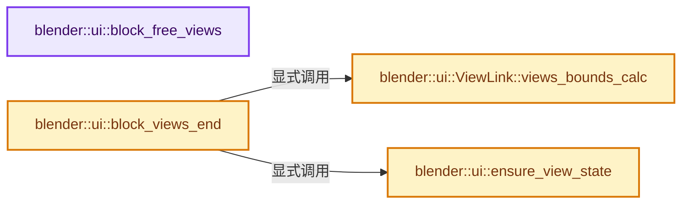
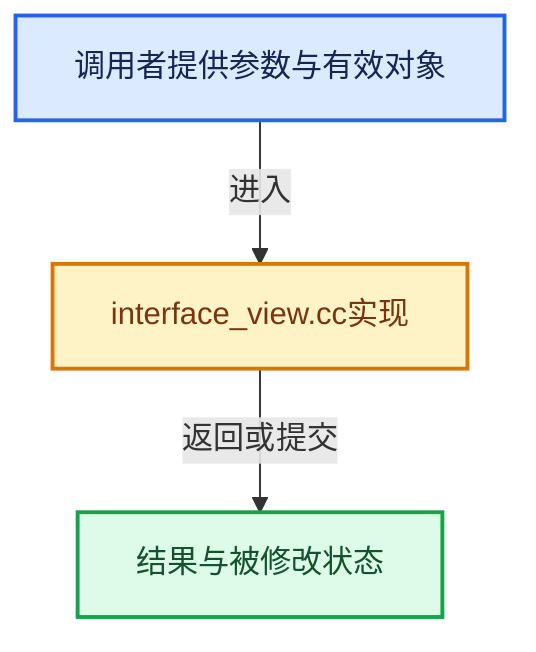

# 实现依赖专题：source/blender/editors/interface/views/interface_view.cc

[实现依赖导航](../../../../README.md) · [符号索引](../../../../../00-课程指南/02-源码与提交索引/符号依赖与实现索引.md)

本专题从正文实际调用进入，集中保存共享实现。函数有稳定锚点，可从调用处直接跳到对应完整函数；递归与互相调用通过回链组织。

## 本文件的实现关系






## 完整成员与函数实现

<a id="f-f57163e477905ab1"></a>

### `blender::ui::block_free_views`

实现位置：[source/blender/editors/interface/views/interface_view.cc](../../../../../../../../../source/blender/editors/interface/views/interface_view.cc) · L81—L86。

接口参数：

- `Block *block`

**教学注释版**

<!-- annotated:c3fc838e4d4f24 -->

```cpp
void block_free_views(Block *block)
{
  for (ViewLink &link : block->views.items_mutable()) {
    MEM_delete(&link);
  }
}
```

<details>
<summary>核对原始源码：source/blender/editors/interface/views/interface_view.cc · L81—L86</summary>

<!-- original:c3fc838e4d4f24:source/blender/editors/interface/views/interface_view.cc:81:86 -->

```cpp
void block_free_views(Block *block)
{
  for (ViewLink &link : block->views.items_mutable()) {
    MEM_delete(&link);
  }
}
```

</details>

**继续追踪实现**

- `block->views.items_mutable` → [调用协议](../../../../../00-课程指南/01-路线与规范/模板宏与动态分派协议.md)：接收对象类型依赖auto、返回值或模板实例；不按同名猜测目标。调用位置L83。
- `MEM_delete` → [MEM_delete · L400](../../../../07-Intern运行时与平台/guardedalloc/MEM_guardedalloc.h.md#f-9049ffdd1682887c)。

<a id="f-38ed3c55d95bcd95"></a>

### `blender::ui::ViewLink::views_bounds_calc`

实现位置：[source/blender/editors/interface/views/interface_view.cc](../../../../../../../../../source/blender/editors/interface/views/interface_view.cc) · L88—L126。

接口参数：

- `const Block &block`

**教学注释版**

<!-- annotated:3215d44f26ae49 -->

```cpp
void ViewLink::views_bounds_calc(const Block &block)
{
  Map<AbstractView *, rcti> views_bounds;

  rcti minmax;
  BLI_rcti_init_minmax(&minmax);
  for (ViewLink &link : block.views) {
    // [讲解] views_bounds.add：按哈希与相等关系加入键或键值。
    views_bounds.add(link.view.get(), minmax);
  }

  for (Button &but : block.buttons()) {
    if (but.type != ButtonType::ViewItem) {
      continue;
    }
    auto *view_item_but = static_cast<ButtonViewItem *>(&but);
    if (!view_item_but->view_item) {
      continue;
    }

    /* Get the view from the button. */
    AbstractViewItem &view_item = *view_item_but->view_item;
    AbstractView &view = view_item.get_view();

    // [讲解] views_bounds.lookup：按键查找对应项。
    rcti &bounds = views_bounds.lookup(&view);
    rcti but_rcti{};
    BLI_rcti_rctf_copy_round(&but_rcti, &view_item_but->rect);
    BLI_rcti_do_minmax_rcti(&bounds, &but_rcti);
  }

  for (const auto item : views_bounds.items()) {
    const rcti &bounds = item.value;
    if (BLI_rcti_is_empty(&bounds)) {
      continue;
    }

    AbstractView &view = *item.key;
    view.bounds_ = bounds;
  }
}
```

<details>
<summary>核对原始源码：source/blender/editors/interface/views/interface_view.cc · L88—L126</summary>

<!-- original:3215d44f26ae49:source/blender/editors/interface/views/interface_view.cc:88:126 -->

```cpp
void ViewLink::views_bounds_calc(const Block &block)
{
  Map<AbstractView *, rcti> views_bounds;

  rcti minmax;
  BLI_rcti_init_minmax(&minmax);
  for (ViewLink &link : block.views) {
    views_bounds.add(link.view.get(), minmax);
  }

  for (Button &but : block.buttons()) {
    if (but.type != ButtonType::ViewItem) {
      continue;
    }
    auto *view_item_but = static_cast<ButtonViewItem *>(&but);
    if (!view_item_but->view_item) {
      continue;
    }

    /* Get the view from the button. */
    AbstractViewItem &view_item = *view_item_but->view_item;
    AbstractView &view = view_item.get_view();

    rcti &bounds = views_bounds.lookup(&view);
    rcti but_rcti{};
    BLI_rcti_rctf_copy_round(&but_rcti, &view_item_but->rect);
    BLI_rcti_do_minmax_rcti(&bounds, &but_rcti);
  }

  for (const auto item : views_bounds.items()) {
    const rcti &bounds = item.value;
    if (BLI_rcti_is_empty(&bounds)) {
      continue;
    }

    AbstractView &view = *item.key;
    view.bounds_ = bounds;
  }
}
```

</details>

**沿实际写入检查状态**

- `view.bounds_ = bounds;`

**继续追踪实现**

- `BLI_rcti_init_minmax` → [blender::BLI_rcti_init_minmax · L488](../../../../01-BLI基础库/intern/rct.cc.md#f-081cdb72e525536c)。
- `views_bounds.add` → [blender::Map::add · L295](../../../../../02-哈希表与关联数据结构/04-Map查找与键访问.md#f-8d38101abf162f88)；[blender::Map::add · L299](../../../../../02-哈希表与关联数据结构/04-Map查找与键访问.md#f-1f59510cdfbd9f87)；[blender::Map::add · L303](../../../../../02-哈希表与关联数据结构/04-Map查找与键访问.md#f-645e0522347aa018)；[blender::Map::add · L307](../../../../../02-哈希表与关联数据结构/04-Map查找与键访问.md#f-03405db0730cedc0)。同名重载需按实参类型选择。
- `link.view.get` → [调用协议](../../../../../00-课程指南/01-路线与规范/模板宏与动态分派协议.md)：接收对象类型依赖auto、返回值或模板实例；不按同名猜测目标。调用位置L95。
- `block.buttons` → [blender::ui::Block::buttons · L836](../interface_intern.hh.md#f-5296ad5fd22b5505)。
- `view_item.get_view` → [blender::ui::AbstractViewItem::get_view · L309](abstract_view_item.cc.md#f-36a19d6c21bd84b2)。
- `views_bounds.lookup` → [blender::Map::lookup · L545](../../../../../02-哈希表与关联数据结构/04-Map查找与键访问.md#f-f25ef95f1454656d)；[blender::Map::lookup · L549](../../../../../02-哈希表与关联数据结构/04-Map查找与键访问.md#f-742f9454fa7ea4b9)。同名重载需按实参类型选择。
- `BLI_rcti_rctf_copy_round` → [blender::BLI_rcti_rctf_copy_round · L1066](../../../../01-BLI基础库/intern/rct.cc.md#f-b85ff4b9908e17dd)。
- `BLI_rcti_do_minmax_rcti` → [blender::BLI_rcti_do_minmax_rcti · L516](../../../../01-BLI基础库/intern/rct.cc.md#f-5925ec804e8ca708)。
- `views_bounds.items` → [blender::Map::items · L902](../../../../../02-哈希表与关联数据结构/06-删除墓碑与值销毁.md#f-9ef4f6f70cba8f81)；[blender::Map::items · L913](../../../../../02-哈希表与关联数据结构/06-删除墓碑与值销毁.md#f-0a69f4e73db8973e)；[blender::Map::items · L926](../../../../../02-哈希表与关联数据结构/06-删除墓碑与值销毁.md#f-092add737130dcfb)；[blender::Map::items · L927](../../../../../02-哈希表与关联数据结构/06-删除墓碑与值销毁.md#f-4bfc999f60cdede4)。同名重载需按实参类型选择。
- `BLI_rcti_is_empty` → [blender::BLI_rcti_is_empty · L29](../../../../01-BLI基础库/intern/rct.cc.md#f-c3e23a3e0854d170)。

<a id="f-e82c91d6edaf3bef"></a>

### `blender::ui::ensure_view_state`

实现位置：[source/blender/editors/interface/views/interface_view.cc](../../../../../../../../../source/blender/editors/interface/views/interface_view.cc) · L153—L165。

接口参数：

- `ARegion &region`
- `const ViewLink &link`

**教学注释版**

<!-- annotated:ec82fa50d015df -->

```cpp
static uiViewStateLink *ensure_view_state(ARegion &region, const ViewLink &link)
{
  for (uiViewStateLink &stored_state : region.view_states) {
    if (link.idname == stored_state.idname) {
      return &stored_state;
    }
  }

  uiViewStateLink *new_state = MEM_new<uiViewStateLink>(__func__);
  link.idname.copy(new_state->idname, sizeof(new_state->idname));
  BLI_addhead(&region.view_states, new_state);
  return new_state;
}
```

<details>
<summary>核对原始源码：source/blender/editors/interface/views/interface_view.cc · L153—L165</summary>

<!-- original:ec82fa50d015df:source/blender/editors/interface/views/interface_view.cc:153:165 -->

```cpp
static uiViewStateLink *ensure_view_state(ARegion &region, const ViewLink &link)
{
  for (uiViewStateLink &stored_state : region.view_states) {
    if (link.idname == stored_state.idname) {
      return &stored_state;
    }
  }

  uiViewStateLink *new_state = MEM_new<uiViewStateLink>(__func__);
  link.idname.copy(new_state->idname, sizeof(new_state->idname));
  BLI_addhead(&region.view_states, new_state);
  return new_state;
}
```

</details>

**结果出口**

- `return &stored_state;`
- `return new_state;`

**继续追踪实现**

- `MEM_new<uiViewStateLink>` → [MEM_new · L351](../../../../07-Intern运行时与平台/guardedalloc/MEM_guardedalloc.h.md#f-115f9b6784f89912)。
- `link.idname.copy` → [调用协议](../../../../../00-课程指南/01-路线与规范/模板宏与动态分派协议.md)：接收对象类型依赖auto、返回值或模板实例；不按同名猜测目标。调用位置L162。
- `BLI_addhead` → [blender::BLI_addhead · L98](../../../../01-BLI基础库/intern/listbase.cc.md#f-fed3ad483fcdfeb9)。

<a id="f-0e9c1bb18baf8823"></a>

### `blender::ui::block_views_end`

实现位置：[source/blender/editors/interface/views/interface_view.cc](../../../../../../../../../source/blender/editors/interface/views/interface_view.cc) · L167—L180。

接口参数：

- `ARegion *region`
- `const Block *block`

**教学注释版**

<!-- annotated:aaaef29deb5c4b -->

```cpp
void block_views_end(ARegion *region, const Block *block)
{
  ViewLink::views_bounds_calc(*block);

  if (region && region->regiontype != RGN_TYPE_TEMPORARY) {
    for (const ViewLink &link : block->views) {
      /* Ensure persistent view state storage for writing to files if needed. */
      if (std::optional<uiViewState> temp_state = link.view->persistent_state()) {
        uiViewStateLink *state_link = ensure_view_state(*region, link);
        state_link->state = *temp_state;
      }
    }
  }
}
```

<details>
<summary>核对原始源码：source/blender/editors/interface/views/interface_view.cc · L167—L180</summary>

<!-- original:aaaef29deb5c4b:source/blender/editors/interface/views/interface_view.cc:167:180 -->

```cpp
void block_views_end(ARegion *region, const Block *block)
{
  ViewLink::views_bounds_calc(*block);

  if (region && region->regiontype != RGN_TYPE_TEMPORARY) {
    for (const ViewLink &link : block->views) {
      /* Ensure persistent view state storage for writing to files if needed. */
      if (std::optional<uiViewState> temp_state = link.view->persistent_state()) {
        uiViewStateLink *state_link = ensure_view_state(*region, link);
        state_link->state = *temp_state;
      }
    }
  }
}
```

</details>

**沿实际写入检查状态**

- `state_link->state = *temp_state;`

**继续追踪实现**

- `ViewLink::views_bounds_calc` → [blender::ui::ViewLink::views_bounds_calc · L88](interface_view.cc.md#f-38ed3c55d95bcd95)。
- `link.view->persistent_state` → [调用协议](../../../../../00-课程指南/01-路线与规范/模板宏与动态分派协议.md)：接收对象类型依赖auto、返回值或模板实例；不按同名猜测目标。调用位置L174。
- `ensure_view_state` → [blender::ui::ensure_view_state · L153](interface_view.cc.md#f-e82c91d6edaf3bef)。
