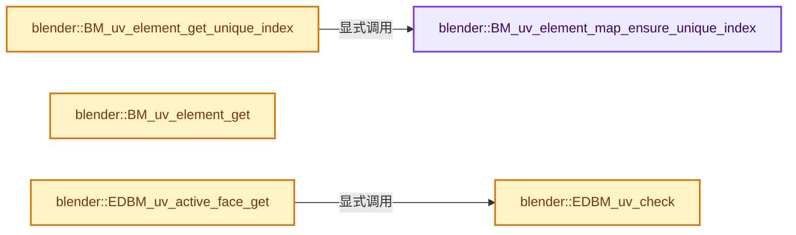
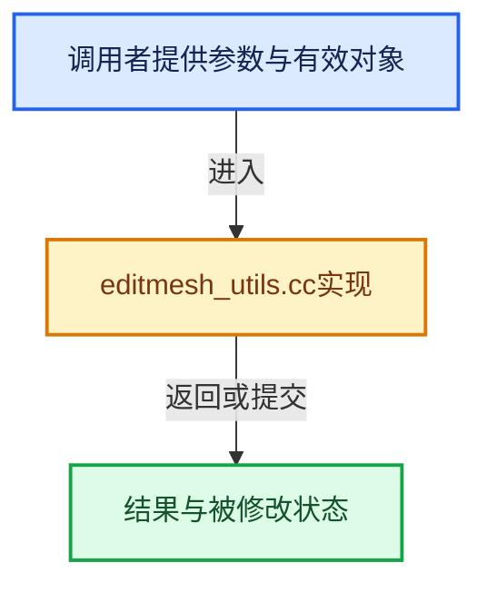

# 实现依赖专题：source/blender/editors/mesh/editmesh_utils.cc

[实现依赖导航](../../../README.md) · [符号索引](../../../../00-课程指南/02-源码与提交索引/符号依赖与实现索引.md)

本专题从正文实际调用进入，集中保存共享实现。函数有稳定锚点，可从调用处直接跳到对应完整函数；递归与互相调用通过回链组织。

## 本文件的实现关系






## 完整成员与函数实现

<a id="f-4f417739b223dcab"></a>

### `blender::BM_uv_element_map_ensure_unique_index`

实现位置：[source/blender/editors/mesh/editmesh_utils.cc](../../../../../../../../source/blender/editors/mesh/editmesh_utils.cc) · L641—L667。

接口参数：

- `UvElementMap *element_map`

**教学注释版**

<!-- annotated:1b7bc75020006f -->

```cpp
int *BM_uv_element_map_ensure_unique_index(UvElementMap *element_map)
{
  if (!element_map->unique_index_table) {
    element_map->unique_index_table = MEM_new_array_zeroed<int>(element_map->total_uvs, __func__);

    int j = 0;
    for (int i = 0; i < element_map->total_uvs; i++) {
      UvElement *element = element_map->storage + i;
      if (!element->separate) {
        continue;
      }
      BLI_assert(0 <= j);
      BLI_assert(j < element_map->total_unique_uvs);
      while (element) {
        element_map->unique_index_table[element - element_map->storage] = j;
        element = element->next;
        if (!element || element->separate) {
          break;
        }
      }
      j++;
    }
    BLI_assert(j == element_map->total_unique_uvs);
  }

  return element_map->unique_index_table;
}
```

<details>
<summary>核对原始源码：source/blender/editors/mesh/editmesh_utils.cc · L641—L667</summary>

<!-- original:1b7bc75020006f:source/blender/editors/mesh/editmesh_utils.cc:641:667 -->

```cpp
int *BM_uv_element_map_ensure_unique_index(UvElementMap *element_map)
{
  if (!element_map->unique_index_table) {
    element_map->unique_index_table = MEM_new_array_zeroed<int>(element_map->total_uvs, __func__);

    int j = 0;
    for (int i = 0; i < element_map->total_uvs; i++) {
      UvElement *element = element_map->storage + i;
      if (!element->separate) {
        continue;
      }
      BLI_assert(0 <= j);
      BLI_assert(j < element_map->total_unique_uvs);
      while (element) {
        element_map->unique_index_table[element - element_map->storage] = j;
        element = element->next;
        if (!element || element->separate) {
          break;
        }
      }
      j++;
    }
    BLI_assert(j == element_map->total_unique_uvs);
  }

  return element_map->unique_index_table;
}
```

</details>

**沿实际写入检查状态**

- `element_map->unique_index_table = MEM_new_array_zeroed<int>(element_map->total_uvs, __func__);`
- `element = element->next;`

**结果出口**

- `return element_map->unique_index_table;`

**继续追踪实现**

- `MEM_new_array_zeroed<int>` → [MEM_new_array_zeroed · L566](../../../07-Intern运行时与平台/guardedalloc/MEM_guardedalloc.h.md#f-3a0cf63fb5216500)；[MEM_new_array_zeroed · L119](../../../07-Intern运行时与平台/guardedalloc/intern/mallocn.cc.md#f-6825557da566fdbe)。同名重载需按实参类型选择。
- `BLI_assert` → [BLI_assert · L48](../../../01-BLI基础库/BLI_assert.hh.md#m-57a88495704d)；[BLI_assert · L63](../../../01-BLI基础库/BLI_assert.hh.md#m-d07050020cb5)。宏定义由构建条件选择。

<a id="f-7b099b284e114e0e"></a>

### `blender::BM_uv_element_get_unique_index`

实现位置：[source/blender/editors/mesh/editmesh_utils.cc](../../../../../../../../source/blender/editors/mesh/editmesh_utils.cc) · L669—L676。

接口参数：

- `UvElementMap *element_map`
- `UvElement *child`

**教学注释版**

<!-- annotated:96b541cee9b50b -->

```cpp
int BM_uv_element_get_unique_index(UvElementMap *element_map, UvElement *child)
{
  int *unique_index = BM_uv_element_map_ensure_unique_index(element_map);
  int index = child - element_map->storage;
  BLI_assert(0 <= index);
  BLI_assert(index < element_map->total_uvs);
  return unique_index[index];
}
```

<details>
<summary>核对原始源码：source/blender/editors/mesh/editmesh_utils.cc · L669—L676</summary>

<!-- original:96b541cee9b50b:source/blender/editors/mesh/editmesh_utils.cc:669:676 -->

```cpp
int BM_uv_element_get_unique_index(UvElementMap *element_map, UvElement *child)
{
  int *unique_index = BM_uv_element_map_ensure_unique_index(element_map);
  int index = child - element_map->storage;
  BLI_assert(0 <= index);
  BLI_assert(index < element_map->total_uvs);
  return unique_index[index];
}
```

</details>

**结果出口**

- `return unique_index[index];`

**继续追踪实现**

- `BM_uv_element_map_ensure_unique_index` → [blender::BM_uv_element_map_ensure_unique_index · L641](editmesh_utils.cc.md#f-4f417739b223dcab)。
- `BLI_assert` → [BLI_assert · L48](../../../01-BLI基础库/BLI_assert.hh.md#m-57a88495704d)；[BLI_assert · L63](../../../01-BLI基础库/BLI_assert.hh.md#m-d07050020cb5)。宏定义由构建条件选择。

<a id="f-82932f6498c48de5"></a>

### `blender::BM_uv_element_get`

实现位置：[source/blender/editors/mesh/editmesh_utils.cc](../../../../../../../../source/blender/editors/mesh/editmesh_utils.cc) · L1242—L1253。

接口参数：

- `const UvElementMap *element_map`
- `const BMLoop *l`

**教学注释版**

<!-- annotated:0b2811d8d56d3d -->

```cpp
UvElement *BM_uv_element_get(const UvElementMap *element_map, const BMLoop *l)
{
  UvElement *element = element_map->vertex[BM_elem_index_get(l->v)];
  while (element) {
    if (element->l == l) {
      return element;
    }
    element = element->next;
  }

  return nullptr;
}
```

<details>
<summary>核对原始源码：source/blender/editors/mesh/editmesh_utils.cc · L1242—L1253</summary>

<!-- original:0b2811d8d56d3d:source/blender/editors/mesh/editmesh_utils.cc:1242:1253 -->

```cpp
UvElement *BM_uv_element_get(const UvElementMap *element_map, const BMLoop *l)
{
  UvElement *element = element_map->vertex[BM_elem_index_get(l->v)];
  while (element) {
    if (element->l == l) {
      return element;
    }
    element = element->next;
  }

  return nullptr;
}
```

</details>

**沿实际写入检查状态**

- `element = element->next;`

**结果出口**

- `return element;`
- `return nullptr;`

**继续追踪实现**

- `BM_elem_index_get` → [BM_elem_index_get · L120](../../bmesh/intern/bmesh_inline.hh.md#m-201981cdc62d)。宏定义由构建条件选择。

<a id="f-7f35e1893f4d1bc0"></a>

### `blender::EDBM_uv_active_face_get`

实现位置：[source/blender/editors/mesh/editmesh_utils.cc](../../../../../../../../source/blender/editors/mesh/editmesh_utils.cc) · L1270—L1282。

接口参数：

- `Mesh *mesh`
- `const bool sloppy`
- `const bool selected`

**教学注释版**

<!-- annotated:55eb40e61b7e83 -->

```cpp
BMFace *EDBM_uv_active_face_get(Mesh *mesh, const bool sloppy, const bool selected)
{
  if (!EDBM_uv_check(mesh)) {
    return nullptr;
  }
  BMesh *bm = BKE_editmesh_bmesh_get_for_write(mesh);
  BMFace *efa = BM_mesh_active_face_get(bm, sloppy, selected);
  if (efa) {
    return efa;
  }

  return nullptr;
}
```

<details>
<summary>核对原始源码：source/blender/editors/mesh/editmesh_utils.cc · L1270—L1282</summary>

<!-- original:55eb40e61b7e83:source/blender/editors/mesh/editmesh_utils.cc:1270:1282 -->

```cpp
BMFace *EDBM_uv_active_face_get(Mesh *mesh, const bool sloppy, const bool selected)
{
  if (!EDBM_uv_check(mesh)) {
    return nullptr;
  }
  BMesh *bm = BKE_editmesh_bmesh_get_for_write(mesh);
  BMFace *efa = BM_mesh_active_face_get(bm, sloppy, selected);
  if (efa) {
    return efa;
  }

  return nullptr;
}
```

</details>

**结果出口**

- `return nullptr;`
- `return efa;`

**继续追踪实现**

- `EDBM_uv_check` → [blender::EDBM_uv_check · L1284](editmesh_utils.cc.md#f-5a91f4be7b0ad4db)。
- `BKE_editmesh_bmesh_get_for_write` → [blender::BKE_editmesh_bmesh_get_for_write · L79](../../../02-BKE几何与数据/intern/editmesh.cc.md#f-fa556ba8fafc4b41)；[blender::BKE_editmesh_bmesh_get_for_write · L87](../../../02-BKE几何与数据/intern/editmesh.cc.md#f-6137590869c86e48)。同名重载需按实参类型选择。
- `BM_mesh_active_face_get` → [blender::BM_mesh_active_face_get · L966](../../bmesh/intern/bmesh_marking.cc.md#f-37dffeb105562938)。

<a id="f-5a91f4be7b0ad4db"></a>

### `blender::EDBM_uv_check`

实现位置：[source/blender/editors/mesh/editmesh_utils.cc](../../../../../../../../source/blender/editors/mesh/editmesh_utils.cc) · L1284—L1297。

接口参数：

- `const Mesh *mesh`

**教学注释版**

<!-- annotated:bd30bf52e6d39b -->

```cpp
bool EDBM_uv_check(const Mesh *mesh)
{
  if (!mesh->runtime->edit_mesh) {
    return false;
  }
  const BMesh *bm = BKE_editmesh_bmesh_get(mesh);
  if (!bm->totface) {
    return false;
  }
  if (!CustomData_has_layer(&bm->ldata, CD_PROP_FLOAT2)) {
    return false;
  }
  return true;
}
```

<details>
<summary>核对原始源码：source/blender/editors/mesh/editmesh_utils.cc · L1284—L1297</summary>

<!-- original:bd30bf52e6d39b:source/blender/editors/mesh/editmesh_utils.cc:1284:1297 -->

```cpp
bool EDBM_uv_check(const Mesh *mesh)
{
  if (!mesh->runtime->edit_mesh) {
    return false;
  }
  const BMesh *bm = BKE_editmesh_bmesh_get(mesh);
  if (!bm->totface) {
    return false;
  }
  if (!CustomData_has_layer(&bm->ldata, CD_PROP_FLOAT2)) {
    return false;
  }
  return true;
}
```

</details>

**结果出口**

- `return false;`
- `return true;`

**继续追踪实现**

- `BKE_editmesh_bmesh_get` → [blender::BKE_editmesh_bmesh_get · L65](../../../02-BKE几何与数据/intern/editmesh.cc.md#f-2afdd2773d3f0d88)；[blender::BKE_editmesh_bmesh_get · L71](../../../02-BKE几何与数据/intern/editmesh.cc.md#f-80631d704a7e9947)。同名重载需按实参类型选择。
- `CustomData_has_layer` → [blender::CustomData_has_layer · L3005](../../../02-BKE几何与数据/intern/customdata.cc.md#f-7333340531d48ea3)。
