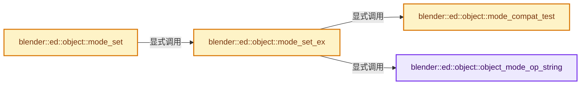
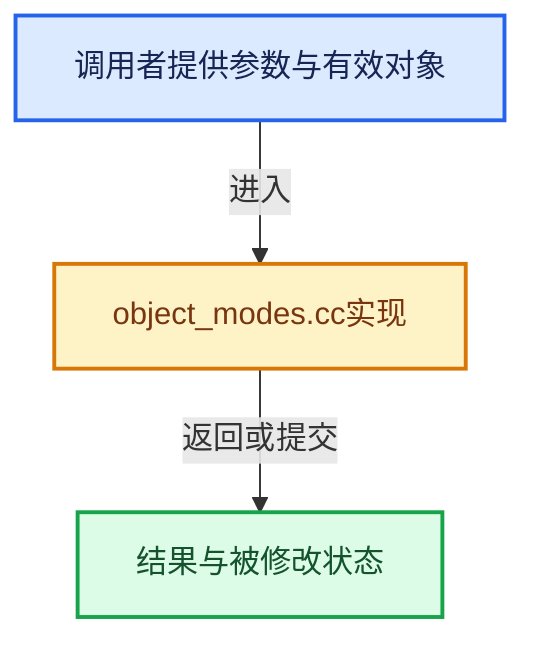

# 实现依赖专题：source/blender/editors/object/object_modes.cc

[实现依赖导航](../../../README.md) · [符号索引](../../../../00-课程指南/02-源码与提交索引/符号依赖与实现索引.md)

本专题从正文实际调用进入，集中保存共享实现。函数有稳定锚点，可从调用处直接跳到对应完整函数；递归与互相调用通过回链组织。

## 本文件的实现关系






## 完整成员与函数实现

<a id="f-09f4baf311d43488"></a>

### `blender::ed::object::object_mode_op_string`

实现位置：[source/blender/editors/object/object_modes.cc](../../../../../../../../source/blender/editors/object/object_modes.cc) · L62—L101。

接口参数：

- `eObjectMode mode`

**教学注释版**

<!-- annotated:c9eab6bbcdbe59 -->

```cpp
static const char *object_mode_op_string(eObjectMode mode)
{
  if (mode & OB_MODE_EDIT) {
    return "OBJECT_OT_editmode_toggle";
  }
  if (mode == OB_MODE_SCULPT) {
    return "SCULPT_OT_sculptmode_toggle";
  }
  if (mode == OB_MODE_VERTEX_PAINT) {
    return "PAINT_OT_vertex_paint_toggle";
  }
  if (mode == OB_MODE_WEIGHT_PAINT) {
    return "PAINT_OT_weight_paint_toggle";
  }
  if (mode == OB_MODE_TEXTURE_PAINT) {
    return "PAINT_OT_texture_paint_toggle";
  }
  if (mode == OB_MODE_PARTICLE_EDIT) {
    return "PARTICLE_OT_particle_edit_toggle";
  }
  if (mode == OB_MODE_POSE) {
    return "OBJECT_OT_posemode_toggle";
  }
  if (mode == OB_MODE_PAINT_GREASE_PENCIL) {
    return "GREASE_PENCIL_OT_paintmode_toggle";
  }
  if (mode == OB_MODE_SCULPT_GREASE_PENCIL) {
    return "GREASE_PENCIL_OT_sculptmode_toggle";
  }
  if (mode == OB_MODE_WEIGHT_GREASE_PENCIL) {
    return "GREASE_PENCIL_OT_weightmode_toggle";
  }
  if (mode == OB_MODE_VERTEX_GREASE_PENCIL) {
    return "GREASE_PENCIL_OT_vertexmode_toggle";
  }
  if (mode == OB_MODE_SCULPT_CURVES) {
    return "CURVES_OT_sculptmode_toggle";
  }
  return nullptr;
}
```

<details>
<summary>核对原始源码：source/blender/editors/object/object_modes.cc · L62—L101</summary>

<!-- original:c9eab6bbcdbe59:source/blender/editors/object/object_modes.cc:62:101 -->

```cpp
static const char *object_mode_op_string(eObjectMode mode)
{
  if (mode & OB_MODE_EDIT) {
    return "OBJECT_OT_editmode_toggle";
  }
  if (mode == OB_MODE_SCULPT) {
    return "SCULPT_OT_sculptmode_toggle";
  }
  if (mode == OB_MODE_VERTEX_PAINT) {
    return "PAINT_OT_vertex_paint_toggle";
  }
  if (mode == OB_MODE_WEIGHT_PAINT) {
    return "PAINT_OT_weight_paint_toggle";
  }
  if (mode == OB_MODE_TEXTURE_PAINT) {
    return "PAINT_OT_texture_paint_toggle";
  }
  if (mode == OB_MODE_PARTICLE_EDIT) {
    return "PARTICLE_OT_particle_edit_toggle";
  }
  if (mode == OB_MODE_POSE) {
    return "OBJECT_OT_posemode_toggle";
  }
  if (mode == OB_MODE_PAINT_GREASE_PENCIL) {
    return "GREASE_PENCIL_OT_paintmode_toggle";
  }
  if (mode == OB_MODE_SCULPT_GREASE_PENCIL) {
    return "GREASE_PENCIL_OT_sculptmode_toggle";
  }
  if (mode == OB_MODE_WEIGHT_GREASE_PENCIL) {
    return "GREASE_PENCIL_OT_weightmode_toggle";
  }
  if (mode == OB_MODE_VERTEX_GREASE_PENCIL) {
    return "GREASE_PENCIL_OT_vertexmode_toggle";
  }
  if (mode == OB_MODE_SCULPT_CURVES) {
    return "CURVES_OT_sculptmode_toggle";
  }
  return nullptr;
}
```

</details>

**结果出口**

- `return "OBJECT_OT_editmode_toggle";`
- `return "SCULPT_OT_sculptmode_toggle";`
- `return "PAINT_OT_vertex_paint_toggle";`
- `return "PAINT_OT_weight_paint_toggle";`
- `return "PAINT_OT_texture_paint_toggle";`
- `return "PARTICLE_OT_particle_edit_toggle";`
- `return "OBJECT_OT_posemode_toggle";`
- `return "GREASE_PENCIL_OT_paintmode_toggle";`
- `return "GREASE_PENCIL_OT_sculptmode_toggle";`
- `return "GREASE_PENCIL_OT_weightmode_toggle";`
- `return "GREASE_PENCIL_OT_vertexmode_toggle";`
- `return "CURVES_OT_sculptmode_toggle";`
- `return nullptr;`

**继续追踪实现**

本实现没有需要继续展开的显式调用；检查返回表达式、对象转换和调用者前置条件。

<a id="f-461713b2a7612b4d"></a>

### `blender::ed::object::mode_compat_test`

实现位置：[source/blender/editors/object/object_modes.cc](../../../../../../../../source/blender/editors/object/object_modes.cc) · L103—L154。

接口参数：

- `const Object *ob`
- `eObjectMode mode`

**教学注释版**

<!-- annotated:116e13202e24eb -->

```cpp
bool mode_compat_test(const Object *ob, eObjectMode mode)
{
  if (mode == OB_MODE_OBJECT) {
    return true;
  }

  switch (ob->type) {
    case OB_MESH:
      if (mode & (OB_MODE_EDIT | OB_MODE_SCULPT | OB_MODE_VERTEX_PAINT | OB_MODE_WEIGHT_PAINT |
                  OB_MODE_TEXTURE_PAINT))
      {
        return true;
      }
      if (mode & OB_MODE_PARTICLE_EDIT) {
        if (ED_object_particle_edit_mode_supported(ob)) {
          return true;
        }
      }
      break;
    case OB_CURVES_LEGACY:
    case OB_SURF:
    case OB_FONT:
    case OB_MBALL:
    case OB_POINTCLOUD:
    case OB_LATTICE:
      if (mode & OB_MODE_EDIT) {
        return true;
      }
      break;
    case OB_ARMATURE:
      if (mode & (OB_MODE_EDIT | OB_MODE_POSE)) {
        return true;
      }
      break;
    case OB_CURVES:
      if (mode & (OB_MODE_EDIT | OB_MODE_SCULPT_CURVES)) {
        return true;
      }
      break;
    case OB_GREASE_PENCIL:
      if (mode & (OB_MODE_EDIT | OB_MODE_PAINT_GREASE_PENCIL | OB_MODE_SCULPT_GREASE_PENCIL |
                  OB_MODE_WEIGHT_GREASE_PENCIL | OB_MODE_VERTEX_GREASE_PENCIL))
      {
        return true;
      }
      break;
    default:
      break;
  }

  return false;
}
```

<details>
<summary>核对原始源码：source/blender/editors/object/object_modes.cc · L103—L154</summary>

<!-- original:116e13202e24eb:source/blender/editors/object/object_modes.cc:103:154 -->

```cpp
bool mode_compat_test(const Object *ob, eObjectMode mode)
{
  if (mode == OB_MODE_OBJECT) {
    return true;
  }

  switch (ob->type) {
    case OB_MESH:
      if (mode & (OB_MODE_EDIT | OB_MODE_SCULPT | OB_MODE_VERTEX_PAINT | OB_MODE_WEIGHT_PAINT |
                  OB_MODE_TEXTURE_PAINT))
      {
        return true;
      }
      if (mode & OB_MODE_PARTICLE_EDIT) {
        if (ED_object_particle_edit_mode_supported(ob)) {
          return true;
        }
      }
      break;
    case OB_CURVES_LEGACY:
    case OB_SURF:
    case OB_FONT:
    case OB_MBALL:
    case OB_POINTCLOUD:
    case OB_LATTICE:
      if (mode & OB_MODE_EDIT) {
        return true;
      }
      break;
    case OB_ARMATURE:
      if (mode & (OB_MODE_EDIT | OB_MODE_POSE)) {
        return true;
      }
      break;
    case OB_CURVES:
      if (mode & (OB_MODE_EDIT | OB_MODE_SCULPT_CURVES)) {
        return true;
      }
      break;
    case OB_GREASE_PENCIL:
      if (mode & (OB_MODE_EDIT | OB_MODE_PAINT_GREASE_PENCIL | OB_MODE_SCULPT_GREASE_PENCIL |
                  OB_MODE_WEIGHT_GREASE_PENCIL | OB_MODE_VERTEX_GREASE_PENCIL))
      {
        return true;
      }
      break;
    default:
      break;
  }

  return false;
}
```

</details>

**结果出口**

- `return true;`
- `return false;`

**继续追踪实现**

- `ED_object_particle_edit_mode_supported` → [ED_object_particle_edit_mode_supported · L5459](../physics/particle_edit.cc.md#f-dea8b0577b041d21)。

<a id="f-75c8f596c66ad3ba"></a>

### `blender::ed::object::mode_set_ex`

实现位置：[source/blender/editors/object/object_modes.cc](../../../../../../../../source/blender/editors/object/object_modes.cc) · L186—L260。

接口参数：

- `bContext *C`
- `eObjectMode mode`
- `bool use_undo`
- `ReportList *reports`

**教学注释版**

<!-- annotated:c1918fe107cb96 -->

```cpp
bool mode_set_ex(bContext *C, eObjectMode mode, bool use_undo, ReportList *reports)
{
  wmWindowManager *wm = CTX_wm_manager(C);
  const Main *bmain = CTX_data_main(C);
  const Scene *scene = CTX_data_scene(C);
  ViewLayer *view_layer = CTX_data_view_layer(C);

  BKE_view_layer_synced_ensure(*bmain, scene, view_layer);
  Object *ob = BKE_view_layer_active_object_get(view_layer);
  if (ob == nullptr) {
    return (mode == OB_MODE_OBJECT);
  }

  if (ob->mode == mode) {
    return true;
  }

  if (!mode_compat_test(ob, mode)) {
    return false;
  }

  const char *opstring = object_mode_op_string((mode == OB_MODE_OBJECT) ? ob->mode : mode);
  if (opstring == nullptr) {
    BKE_reportf(reports,
                RPT_ERROR,
                "Unable to set invalid object mode %d",
                int((mode == OB_MODE_OBJECT) ? ob->mode : mode));
    return false;
  }
  wmOperatorType *ot = WM_operatortype_find(opstring, false);

  if (!use_undo) {
    wm->op_undo_depth++;
  }
  WM_operator_name_call_ptr(C, ot, wm::OpCallContext::ExecRegionWin, nullptr, nullptr);
  if (!use_undo) {
    wm->op_undo_depth--;
  }

  if (ob->mode != mode) {
    /* Give more specific error messages for cases that are known to fail (like linked and packed
     * object-data). */
    if (ob->data && !ID_IS_EDITABLE(ob->data)) {
      const ID &obdata_id = *ob->data;
      char obdata_idtype_name_lower[MAX_ID_NAME];
      const size_t obdata_idtype_name_lower_len = STRNCPY_RLEN(
          obdata_idtype_name_lower, BKE_idtype_idcode_to_name(GS(obdata_id.name)));
      BLI_str_tolower_ascii(obdata_idtype_name_lower, obdata_idtype_name_lower_len);

      if (ID_IS_PACKED(ob->data)) {
        BKE_reportf(reports,
                    RPT_ERROR,
                    "The '%s' %s data-block is packed and not editable. Use \"Make Local\" to "
                    "make it editable.",
                    BKE_id_name(obdata_id),
                    obdata_idtype_name_lower);
        return false;
      }
      if (ID_IS_LINKED(ob->data)) {
        BKE_reportf(reports,
                    RPT_ERROR,
                    "The '%s' %s data-block is linked and not editable. Use \"Make Local\" to "
                    "make it editable.",
                    BKE_id_name(obdata_id),
                    obdata_idtype_name_lower);
        return false;
      }
    }

    BKE_reportf(reports, RPT_ERROR, "Unable to execute '%s', error changing modes", ot->name);
    return false;
  }

  return true;
}
```

<details>
<summary>核对原始源码：source/blender/editors/object/object_modes.cc · L186—L260</summary>

<!-- original:c1918fe107cb96:source/blender/editors/object/object_modes.cc:186:260 -->

```cpp
bool mode_set_ex(bContext *C, eObjectMode mode, bool use_undo, ReportList *reports)
{
  wmWindowManager *wm = CTX_wm_manager(C);
  const Main *bmain = CTX_data_main(C);
  const Scene *scene = CTX_data_scene(C);
  ViewLayer *view_layer = CTX_data_view_layer(C);

  BKE_view_layer_synced_ensure(*bmain, scene, view_layer);
  Object *ob = BKE_view_layer_active_object_get(view_layer);
  if (ob == nullptr) {
    return (mode == OB_MODE_OBJECT);
  }

  if (ob->mode == mode) {
    return true;
  }

  if (!mode_compat_test(ob, mode)) {
    return false;
  }

  const char *opstring = object_mode_op_string((mode == OB_MODE_OBJECT) ? ob->mode : mode);
  if (opstring == nullptr) {
    BKE_reportf(reports,
                RPT_ERROR,
                "Unable to set invalid object mode %d",
                int((mode == OB_MODE_OBJECT) ? ob->mode : mode));
    return false;
  }
  wmOperatorType *ot = WM_operatortype_find(opstring, false);

  if (!use_undo) {
    wm->op_undo_depth++;
  }
  WM_operator_name_call_ptr(C, ot, wm::OpCallContext::ExecRegionWin, nullptr, nullptr);
  if (!use_undo) {
    wm->op_undo_depth--;
  }

  if (ob->mode != mode) {
    /* Give more specific error messages for cases that are known to fail (like linked and packed
     * object-data). */
    if (ob->data && !ID_IS_EDITABLE(ob->data)) {
      const ID &obdata_id = *ob->data;
      char obdata_idtype_name_lower[MAX_ID_NAME];
      const size_t obdata_idtype_name_lower_len = STRNCPY_RLEN(
          obdata_idtype_name_lower, BKE_idtype_idcode_to_name(GS(obdata_id.name)));
      BLI_str_tolower_ascii(obdata_idtype_name_lower, obdata_idtype_name_lower_len);

      if (ID_IS_PACKED(ob->data)) {
        BKE_reportf(reports,
                    RPT_ERROR,
                    "The '%s' %s data-block is packed and not editable. Use \"Make Local\" to "
                    "make it editable.",
                    BKE_id_name(obdata_id),
                    obdata_idtype_name_lower);
        return false;
      }
      if (ID_IS_LINKED(ob->data)) {
        BKE_reportf(reports,
                    RPT_ERROR,
                    "The '%s' %s data-block is linked and not editable. Use \"Make Local\" to "
                    "make it editable.",
                    BKE_id_name(obdata_id),
                    obdata_idtype_name_lower);
        return false;
      }
    }

    BKE_reportf(reports, RPT_ERROR, "Unable to execute '%s', error changing modes", ot->name);
    return false;
  }

  return true;
}
```

</details>

**结果出口**

- `return (mode == OB_MODE_OBJECT);`
- `return true;`
- `return false;`

**继续追踪实现**

- `CTX_wm_manager` → [blender::CTX_wm_manager · L928](../../../02-BKE几何与数据/intern/context.cc.md#f-158f36db7379fbe8)。
- `CTX_data_main` → [blender::CTX_data_main · L1313](../../../02-BKE几何与数据/intern/context.cc.md#f-6d4ba24a62a80b94)。
- `CTX_data_scene` → [blender::CTX_data_scene · L1329](../../../02-BKE几何与数据/intern/context.cc.md#f-6a2fb518a7aa2eee)。
- `CTX_data_view_layer` → [blender::CTX_data_view_layer · L1352](../../../02-BKE几何与数据/intern/context.cc.md#f-31b9fbfc3ff836d4)。
- `BKE_view_layer_synced_ensure` → [blender::BKE_view_layer_synced_ensure · L1035](../../../02-BKE几何与数据/intern/layer.cc.md#f-602c088654ebcb63)。
- `BKE_view_layer_active_object_get` → [blender::BKE_view_layer_active_object_get · L286](../../../02-BKE几何与数据/intern/layer_utils.cc.md#f-aa39df7416329726)。
- `mode_compat_test` → [blender::ed::object::mode_compat_test · L103](object_modes.cc.md#f-461713b2a7612b4d)。
- `object_mode_op_string` → [blender::ed::object::object_mode_op_string · L62](object_modes.cc.md#f-09f4baf311d43488)。
- `BKE_reportf` → [blender::BKE_reportf · L191](../../../02-BKE几何与数据/intern/report.cc.md#f-e776fc632ffb42b3)。
- `WM_operatortype_find` → [blender::WM_operatortype_find · L78](../../windowmanager/intern/wm_operator_type.cc.md#f-9fc2574dfd3703ee)。
- `WM_operator_name_call_ptr` → [blender::WM_operator_name_call_ptr · L1956](../../windowmanager/intern/wm_event_system.cc.md#f-41c9a9d0217a7d8c)。
- `ID_IS_EDITABLE` → [ID_IS_EDITABLE · L708](../../makesdna/DNA_ID.h.md#m-57579f93767f)。宏定义由构建条件选择。
- `STRNCPY_RLEN` → [STRNCPY_RLEN · L600](../../../01-BLI基础库/BLI_string.hh.md#m-81329fe9f9ee)。宏定义由构建条件选择。
- `BKE_idtype_idcode_to_name` → [blender::BKE_idtype_idcode_to_name · L261](../../../02-BKE几何与数据/intern/idtype.cc.md#f-282fc9db6d5f0eb2)。
- `GS` → [blender::GS · L410](../../makesdna/DNA_ID.h.md#f-c3ff509f79f21b05)。
- `BLI_str_tolower_ascii` → [blender::BLI_str_tolower_ascii · L962](../../../01-BLI基础库/intern/string.cc.md#f-a2721b5a991b6953)。
- `ID_IS_PACKED` → [ID_IS_PACKED · L703](../../makesdna/DNA_ID.h.md#m-48f895e65dc3)。宏定义由构建条件选择。
- `BKE_id_name` → [blender::BKE_id_name · L1001](../../../02-BKE几何与数据/BKE_lib_id.hh.md#f-b9397f1fe1fcc017)；[blender::BKE_id_name · L1005](../../../02-BKE几何与数据/BKE_lib_id.hh.md#f-c026427d13979145)。同名重载需按实参类型选择。
- `ID_IS_LINKED` → [ID_IS_LINKED · L697](../../makesdna/DNA_ID.h.md#m-7e1e1e9b20e6)。宏定义由构建条件选择。

<a id="f-0237ee687ff08389"></a>

### `blender::ed::object::mode_set`

实现位置：[source/blender/editors/object/object_modes.cc](../../../../../../../../source/blender/editors/object/object_modes.cc) · L262—L266。

接口参数：

- `bContext *C`
- `eObjectMode mode`

**教学注释版**

<!-- annotated:71b7c455de338c -->

```cpp
bool mode_set(bContext *C, eObjectMode mode)
{
  /* Don't do undo push by default, since this may be called by lower level code. */
  return mode_set_ex(C, mode, true, nullptr);
}
```

<details>
<summary>核对原始源码：source/blender/editors/object/object_modes.cc · L262—L266</summary>

<!-- original:71b7c455de338c:source/blender/editors/object/object_modes.cc:262:266 -->

```cpp
bool mode_set(bContext *C, eObjectMode mode)
{
  /* Don't do undo push by default, since this may be called by lower level code. */
  return mode_set_ex(C, mode, true, nullptr);
}
```

</details>

**结果出口**

- `return mode_set_ex(C, mode, true, nullptr);`

**继续追踪实现**

- `mode_set_ex` → [blender::ed::object::mode_set_ex · L186](object_modes.cc.md#f-75c8f596c66ad3ba)。
