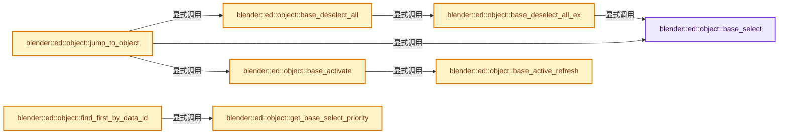
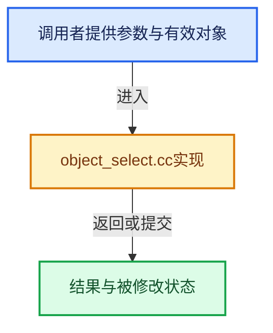

# 实现依赖专题：source/blender/editors/object/object_select.cc

[实现依赖导航](../../../README.md) · [符号索引](../../../../00-课程指南/02-源码与提交索引/符号依赖与实现索引.md)

本专题从正文实际调用进入，集中保存共享实现。函数有稳定锚点，可从调用处直接跳到对应完整函数；递归与互相调用通过回链组织。

## 本文件的实现关系






## 完整成员与函数实现

<a id="f-a4f38deccd91bb7d"></a>

### `blender::ed::object::base_select`

实现位置：[source/blender/editors/object/object_select.cc](../../../../../../../../source/blender/editors/object/object_select.cc) · L76—L98。

接口参数：

- `Base *base`
- `eObjectSelect_Mode mode`

**教学注释版**

<!-- annotated:935f97d153ffb3 -->

```cpp
void base_select(Base *base, eObjectSelect_Mode mode)
{
  if (mode == BA_INVERT) {
    mode = (base->flag & BASE_SELECTED) != 0 ? BA_DESELECT : BA_SELECT;
  }

  if (base) {
    switch (mode) {
      case BA_SELECT:
        if ((base->flag & BASE_SELECTABLE) != 0) {
          base->flag |= BASE_SELECTED;
        }
        break;
      case BA_DESELECT:
        base->flag &= ~BASE_SELECTED;
        break;
      case BA_INVERT:
        /* Never happens. */
        break;
    }
    BKE_scene_object_base_flag_sync_from_base(base);
  }
}
```

<details>
<summary>核对原始源码：source/blender/editors/object/object_select.cc · L76—L98</summary>

<!-- original:935f97d153ffb3:source/blender/editors/object/object_select.cc:76:98 -->

```cpp
void base_select(Base *base, eObjectSelect_Mode mode)
{
  if (mode == BA_INVERT) {
    mode = (base->flag & BASE_SELECTED) != 0 ? BA_DESELECT : BA_SELECT;
  }

  if (base) {
    switch (mode) {
      case BA_SELECT:
        if ((base->flag & BASE_SELECTABLE) != 0) {
          base->flag |= BASE_SELECTED;
        }
        break;
      case BA_DESELECT:
        base->flag &= ~BASE_SELECTED;
        break;
      case BA_INVERT:
        /* Never happens. */
        break;
    }
    BKE_scene_object_base_flag_sync_from_base(base);
  }
}
```

</details>

**沿实际写入检查状态**

- `mode = (base->flag & BASE_SELECTED) != 0 ? BA_DESELECT : BA_SELECT;`
- `base->flag |= BASE_SELECTED;`
- `base->flag &= ~BASE_SELECTED;`

**继续追踪实现**

- `BKE_scene_object_base_flag_sync_from_base` → [blender::BKE_scene_object_base_flag_sync_from_base · L3121](../../../02-BKE几何与数据/intern/scene.cc.md#f-5c4a94fbcd2daf41)。

<a id="f-f3b12ef0ab0498d1"></a>

### `blender::ed::object::base_active_refresh`

实现位置：[source/blender/editors/object/object_select.cc](../../../../../../../../source/blender/editors/object/object_select.cc) · L100—L108。

接口参数：

- `Main *bmain`
- `Scene *scene`
- `ViewLayer *view_layer`

**教学注释版**

<!-- annotated:251b2e404aa0a1 -->

```cpp
void base_active_refresh(Main *bmain, Scene *scene, ViewLayer *view_layer)
{
  WM_main_add_notifier(NC_SCENE | ND_OB_ACTIVE, scene);
  DEG_id_tag_update(&scene->id, ID_RECALC_SELECT);
  wmMsgBus *mbus = (bmain->wm.first())->runtime->message_bus;
  if (mbus != nullptr) {
    WM_msg_publish_rna_prop(mbus, &scene->id, view_layer, LayerObjects, active);
  }
}
```

<details>
<summary>核对原始源码：source/blender/editors/object/object_select.cc · L100—L108</summary>

<!-- original:251b2e404aa0a1:source/blender/editors/object/object_select.cc:100:108 -->

```cpp
void base_active_refresh(Main *bmain, Scene *scene, ViewLayer *view_layer)
{
  WM_main_add_notifier(NC_SCENE | ND_OB_ACTIVE, scene);
  DEG_id_tag_update(&scene->id, ID_RECALC_SELECT);
  wmMsgBus *mbus = (bmain->wm.first())->runtime->message_bus;
  if (mbus != nullptr) {
    WM_msg_publish_rna_prop(mbus, &scene->id, view_layer, LayerObjects, active);
  }
}
```

</details>

**继续追踪实现**

- `WM_main_add_notifier` → [blender::WM_main_add_notifier · L403](../../windowmanager/intern/wm_event_system.cc.md#f-29a090eae8ebe51c)。
- `DEG_id_tag_update` → [blender::DEG_id_tag_update · L844](../../../06-Depsgraph依赖图/intern/depsgraph_tag.cc.md#f-62d2949dd168bb81)。
- `bmain->wm.first` → [调用协议](../../../../00-课程指南/01-路线与规范/模板宏与动态分派协议.md)：接收对象类型依赖auto、返回值或模板实例；不按同名猜测目标。调用位置L104。
- `WM_msg_publish_rna_prop` → [WM_msg_publish_rna_prop · L263](../../windowmanager/message_bus/wm_message_bus.hh.md#m-bb474107c00a)。宏定义由构建条件选择。

<a id="f-5605c65d4e1c16f5"></a>

### `blender::ed::object::base_activate`

实现位置：[source/blender/editors/object/object_select.cc](../../../../../../../../source/blender/editors/object/object_select.cc) · L110—L116。

接口参数：

- `bContext *C`
- `Base *base`

**教学注释版**

<!-- annotated:4e8f08b33ba930 -->

```cpp
void base_activate(bContext *C, Base *base)
{
  Scene *scene = CTX_data_scene(C);
  ViewLayer *view_layer = CTX_data_view_layer(C);
  view_layer->basact = base;
  base_active_refresh(CTX_data_main(C), scene, view_layer);
}
```

<details>
<summary>核对原始源码：source/blender/editors/object/object_select.cc · L110—L116</summary>

<!-- original:4e8f08b33ba930:source/blender/editors/object/object_select.cc:110:116 -->

```cpp
void base_activate(bContext *C, Base *base)
{
  Scene *scene = CTX_data_scene(C);
  ViewLayer *view_layer = CTX_data_view_layer(C);
  view_layer->basact = base;
  base_active_refresh(CTX_data_main(C), scene, view_layer);
}
```

</details>

**沿实际写入检查状态**

- `view_layer->basact = base;`

**继续追踪实现**

- `CTX_data_scene` → [blender::CTX_data_scene · L1329](../../../02-BKE几何与数据/intern/context.cc.md#f-6a2fb518a7aa2eee)。
- `CTX_data_view_layer` → [blender::CTX_data_view_layer · L1352](../../../02-BKE几何与数据/intern/context.cc.md#f-31b9fbfc3ff836d4)。
- `base_active_refresh` → [blender::ed::object::base_active_refresh · L100](object_select.cc.md#f-f3b12ef0ab0498d1)。
- `CTX_data_main` → [blender::CTX_data_main · L1313](../../../02-BKE几何与数据/intern/context.cc.md#f-6d4ba24a62a80b94)。

<a id="f-ccbb56e3951efc14"></a>

### `blender::ed::object::base_deselect_all_ex`

实现位置：[source/blender/editors/object/object_select.cc](../../../../../../../../source/blender/editors/object/object_select.cc) · L136—L194。

接口参数：

- `const Main &bmain`
- `const Scene *scene`
- `ViewLayer *view_layer`
- `View3D *v3d`
- `int action`
- `bool *r_any_visible`

**教学注释版**

<!-- annotated:b54e52d8461309 -->

```cpp
bool base_deselect_all_ex(const Main &bmain,
                          const Scene *scene,
                          ViewLayer *view_layer,
                          View3D *v3d,
                          int action,
                          bool *r_any_visible)
{
  if (action == SEL_TOGGLE) {
    action = SEL_SELECT;
    FOREACH_VISIBLE_BASE_BEGIN (&bmain, scene, view_layer, v3d, base) {
      if (v3d && ((v3d->object_type_exclude_select & (1 << base->object->type)) != 0)) {
        continue;
      }
      if ((base->flag & BASE_SELECTED) != 0) {
        action = SEL_DESELECT;
        break;
      }
    }
    FOREACH_VISIBLE_BASE_END;
  }

  bool any_visible = false;
  bool changed = false;
  FOREACH_VISIBLE_BASE_BEGIN (&bmain, scene, view_layer, v3d, base) {
    if (v3d && ((v3d->object_type_exclude_select & (1 << base->object->type)) != 0)) {
      continue;
    }
    switch (action) {
      case SEL_SELECT:
        if ((base->flag & BASE_SELECTED) == 0) {
          base_select(base, BA_SELECT);
          changed = true;
        }
        break;
      case SEL_DESELECT:
        if ((base->flag & BASE_SELECTED) != 0) {
          base_select(base, BA_DESELECT);
          changed = true;
        }
        break;
      case SEL_INVERT:
        if ((base->flag & BASE_SELECTED) != 0) {
          base_select(base, BA_DESELECT);
          changed = true;
        }
        else {
          base_select(base, BA_SELECT);
          changed = true;
        }
        break;
    }
    any_visible = true;
  }
  FOREACH_VISIBLE_BASE_END;
  if (r_any_visible) {
    *r_any_visible = any_visible;
  }
  return changed;
}
```

<details>
<summary>核对原始源码：source/blender/editors/object/object_select.cc · L136—L194</summary>

<!-- original:b54e52d8461309:source/blender/editors/object/object_select.cc:136:194 -->

```cpp
bool base_deselect_all_ex(const Main &bmain,
                          const Scene *scene,
                          ViewLayer *view_layer,
                          View3D *v3d,
                          int action,
                          bool *r_any_visible)
{
  if (action == SEL_TOGGLE) {
    action = SEL_SELECT;
    FOREACH_VISIBLE_BASE_BEGIN (&bmain, scene, view_layer, v3d, base) {
      if (v3d && ((v3d->object_type_exclude_select & (1 << base->object->type)) != 0)) {
        continue;
      }
      if ((base->flag & BASE_SELECTED) != 0) {
        action = SEL_DESELECT;
        break;
      }
    }
    FOREACH_VISIBLE_BASE_END;
  }

  bool any_visible = false;
  bool changed = false;
  FOREACH_VISIBLE_BASE_BEGIN (&bmain, scene, view_layer, v3d, base) {
    if (v3d && ((v3d->object_type_exclude_select & (1 << base->object->type)) != 0)) {
      continue;
    }
    switch (action) {
      case SEL_SELECT:
        if ((base->flag & BASE_SELECTED) == 0) {
          base_select(base, BA_SELECT);
          changed = true;
        }
        break;
      case SEL_DESELECT:
        if ((base->flag & BASE_SELECTED) != 0) {
          base_select(base, BA_DESELECT);
          changed = true;
        }
        break;
      case SEL_INVERT:
        if ((base->flag & BASE_SELECTED) != 0) {
          base_select(base, BA_DESELECT);
          changed = true;
        }
        else {
          base_select(base, BA_SELECT);
          changed = true;
        }
        break;
    }
    any_visible = true;
  }
  FOREACH_VISIBLE_BASE_END;
  if (r_any_visible) {
    *r_any_visible = any_visible;
  }
  return changed;
}
```

</details>

**沿实际写入检查状态**

- `action = SEL_SELECT;`
- `action = SEL_DESELECT;`
- `changed = true;`
- `any_visible = true;`

**结果出口**

- `return changed;`

**继续追踪实现**

- `FOREACH_VISIBLE_BASE_BEGIN` → [FOREACH_VISIBLE_BASE_BEGIN · L498](../../../02-BKE几何与数据/BKE_layer.hh.md#m-5111e00bb661)。宏定义由构建条件选择。
- `base_select` → [blender::ed::object::base_select · L76](object_select.cc.md#f-a4f38deccd91bb7d)。

<a id="f-413fc4928ead8cb3"></a>

### `blender::ed::object::base_deselect_all`

实现位置：[source/blender/editors/object/object_select.cc](../../../../../../../../source/blender/editors/object/object_select.cc) · L196—L200。

接口参数：

- `const Main &bmain`
- `const Scene *scene`
- `ViewLayer *view_layer`
- `View3D *v3d`
- `int action`

**教学注释版**

<!-- annotated:c082e1aa9d953d -->

```cpp
bool base_deselect_all(
    const Main &bmain, const Scene *scene, ViewLayer *view_layer, View3D *v3d, int action)
{
  return base_deselect_all_ex(bmain, scene, view_layer, v3d, action, nullptr);
}
```

<details>
<summary>核对原始源码：source/blender/editors/object/object_select.cc · L196—L200</summary>

<!-- original:c082e1aa9d953d:source/blender/editors/object/object_select.cc:196:200 -->

```cpp
bool base_deselect_all(
    const Main &bmain, const Scene *scene, ViewLayer *view_layer, View3D *v3d, int action)
{
  return base_deselect_all_ex(bmain, scene, view_layer, v3d, action, nullptr);
}
```

</details>

**结果出口**

- `return base_deselect_all_ex(bmain, scene, view_layer, v3d, action, nullptr);`

**继续追踪实现**

- `base_deselect_all_ex` → [blender::ed::object::base_deselect_all_ex · L136](object_select.cc.md#f-ccbb56e3951efc14)。

<a id="f-b7d0dc42ecd64c1f"></a>

### `blender::ed::object::get_base_select_priority`

实现位置：[source/blender/editors/object/object_select.cc](../../../../../../../../source/blender/editors/object/object_select.cc) · L208—L217。

接口参数：

- `Base *base`

**教学注释版**

<!-- annotated:96de4233dc1ef8 -->

```cpp
static int get_base_select_priority(Base *base)
{
  if (base->flag & BASE_ENABLED_AND_MAYBE_VISIBLE_IN_VIEWPORT) {
    if (base->flag & BASE_SELECTABLE) {
      return 3;
    }
    return 2;
  }
  return 1;
}
```

<details>
<summary>核对原始源码：source/blender/editors/object/object_select.cc · L208—L217</summary>

<!-- original:96de4233dc1ef8:source/blender/editors/object/object_select.cc:208:217 -->

```cpp
static int get_base_select_priority(Base *base)
{
  if (base->flag & BASE_ENABLED_AND_MAYBE_VISIBLE_IN_VIEWPORT) {
    if (base->flag & BASE_SELECTABLE) {
      return 3;
    }
    return 2;
  }
  return 1;
}
```

</details>

**结果出口**

- `return 3;`
- `return 2;`
- `return 1;`

**继续追踪实现**

本实现没有需要继续展开的显式调用；检查返回表达式、对象转换和调用者前置条件。

<a id="f-0d056ba998d346aa"></a>

### `blender::ed::object::find_first_by_data_id`

实现位置：[source/blender/editors/object/object_select.cc](../../../../../../../../source/blender/editors/object/object_select.cc) · L219—L251。

接口参数：

- `const Main &bmain`
- `const Scene *scene`
- `ViewLayer *view_layer`
- `ID *id`

**教学注释版**

<!-- annotated:19918836751cc4 -->

```cpp
Base *find_first_by_data_id(const Main &bmain, const Scene *scene, ViewLayer *view_layer, ID *id)
{
  BLI_assert(OB_DATA_SUPPORT_ID(GS(id->name)));

  /* Try active object. */
  BKE_view_layer_synced_ensure(bmain, scene, view_layer);
  Base *basact = BKE_view_layer_active_base_get(view_layer);

  if (basact && basact->object && basact->object->data == id) {
    return basact;
  }

  /* Try all objects. */
  Base *base_best = nullptr;
  int priority_best = 0;

  for (Base &base : *BKE_view_layer_object_bases_get(view_layer)) {
    if (base.object && base.object->data == id) {
      if (base.flag & BASE_SELECTED) {
        return &base;
      }

      int priority_test = get_base_select_priority(&base);

      if (priority_test > priority_best) {
        priority_best = priority_test;
        base_best = &base;
      }
    }
  }

  return base_best;
}
```

<details>
<summary>核对原始源码：source/blender/editors/object/object_select.cc · L219—L251</summary>

<!-- original:19918836751cc4:source/blender/editors/object/object_select.cc:219:251 -->

```cpp
Base *find_first_by_data_id(const Main &bmain, const Scene *scene, ViewLayer *view_layer, ID *id)
{
  BLI_assert(OB_DATA_SUPPORT_ID(GS(id->name)));

  /* Try active object. */
  BKE_view_layer_synced_ensure(bmain, scene, view_layer);
  Base *basact = BKE_view_layer_active_base_get(view_layer);

  if (basact && basact->object && basact->object->data == id) {
    return basact;
  }

  /* Try all objects. */
  Base *base_best = nullptr;
  int priority_best = 0;

  for (Base &base : *BKE_view_layer_object_bases_get(view_layer)) {
    if (base.object && base.object->data == id) {
      if (base.flag & BASE_SELECTED) {
        return &base;
      }

      int priority_test = get_base_select_priority(&base);

      if (priority_test > priority_best) {
        priority_best = priority_test;
        base_best = &base;
      }
    }
  }

  return base_best;
}
```

</details>

**沿实际写入检查状态**

- `priority_best = priority_test;`
- `base_best = &base;`

**结果出口**

- `return basact;`
- `return &base;`
- `return base_best;`

**继续追踪实现**

- `BLI_assert` → [BLI_assert · L48](../../../01-BLI基础库/BLI_assert.hh.md#m-57a88495704d)；[BLI_assert · L63](../../../01-BLI基础库/BLI_assert.hh.md#m-d07050020cb5)。宏定义由构建条件选择。
- `OB_DATA_SUPPORT_ID` → [OB_DATA_SUPPORT_ID · L757](../../makesdna/DNA_object_types.h.md#m-6e26060bd356)。宏定义由构建条件选择。
- `GS` → [blender::GS · L410](../../makesdna/DNA_ID.h.md#f-c3ff509f79f21b05)。
- `BKE_view_layer_synced_ensure` → [blender::BKE_view_layer_synced_ensure · L1035](../../../02-BKE几何与数据/intern/layer.cc.md#f-602c088654ebcb63)。
- `BKE_view_layer_active_base_get` → [blender::BKE_view_layer_active_base_get · L209](../../../02-BKE几何与数据/intern/layer_utils.cc.md#f-b004b0ac876ae634)。
- `BKE_view_layer_object_bases_get` → [blender::BKE_view_layer_object_bases_get · L202](../../../02-BKE几何与数据/intern/layer_utils.cc.md#f-f7b3adc8941172e4)。
- `get_base_select_priority` → [blender::ed::object::get_base_select_priority · L208](object_select.cc.md#f-b7d0dc42ecd64c1f)。

<a id="f-5289736800ca44ec"></a>

### `blender::ed::object::jump_to_object`

实现位置：[source/blender/editors/object/object_select.cc](../../../../../../../../source/blender/editors/object/object_select.cc) · L253—L286。

接口参数：

- `bContext *C`
- `Object *ob`
- `const bool`

**教学注释版**

<!-- annotated:a11b8f82d5ba4e -->

```cpp
bool jump_to_object(bContext *C, Object *ob, const bool /*reveal_hidden*/)
{
  const Main *bmain = CTX_data_main(C);
  const Scene *scene = CTX_data_scene(C);
  ViewLayer *view_layer = CTX_data_view_layer(C);
  View3D *v3d = CTX_wm_view3d(C);
  BKE_view_layer_synced_ensure(*bmain, scene, view_layer);
  Base *base = BKE_view_layer_base_find(view_layer, ob);

  if (base == nullptr) {
    return false;
  }

  /* TODO: use 'reveal_hidden', as is done with bones. */

  if (BKE_view_layer_active_base_get(view_layer) != base || !(base->flag & BASE_SELECTED)) {
    /* Select if not selected. */
    if (!(base->flag & BASE_SELECTED)) {
      base_deselect_all(*bmain, scene, view_layer, v3d, SEL_DESELECT);

      if (BASE_VISIBLE(v3d, base)) {
        base_select(base, BA_SELECT);
      }

      WM_event_add_notifier(C, NC_SCENE | ND_OB_SELECT, CTX_data_scene(C));
    }

    /* Make active if not active. */
    base_activate(C, base);
    ED_outliner_select_sync_from_object_tag(C);
  }

  return true;
}
```

<details>
<summary>核对原始源码：source/blender/editors/object/object_select.cc · L253—L286</summary>

<!-- original:a11b8f82d5ba4e:source/blender/editors/object/object_select.cc:253:286 -->

```cpp
bool jump_to_object(bContext *C, Object *ob, const bool /*reveal_hidden*/)
{
  const Main *bmain = CTX_data_main(C);
  const Scene *scene = CTX_data_scene(C);
  ViewLayer *view_layer = CTX_data_view_layer(C);
  View3D *v3d = CTX_wm_view3d(C);
  BKE_view_layer_synced_ensure(*bmain, scene, view_layer);
  Base *base = BKE_view_layer_base_find(view_layer, ob);

  if (base == nullptr) {
    return false;
  }

  /* TODO: use 'reveal_hidden', as is done with bones. */

  if (BKE_view_layer_active_base_get(view_layer) != base || !(base->flag & BASE_SELECTED)) {
    /* Select if not selected. */
    if (!(base->flag & BASE_SELECTED)) {
      base_deselect_all(*bmain, scene, view_layer, v3d, SEL_DESELECT);

      if (BASE_VISIBLE(v3d, base)) {
        base_select(base, BA_SELECT);
      }

      WM_event_add_notifier(C, NC_SCENE | ND_OB_SELECT, CTX_data_scene(C));
    }

    /* Make active if not active. */
    base_activate(C, base);
    ED_outliner_select_sync_from_object_tag(C);
  }

  return true;
}
```

</details>

**结果出口**

- `return false;`
- `return true;`

**继续追踪实现**

- `CTX_data_main` → [blender::CTX_data_main · L1313](../../../02-BKE几何与数据/intern/context.cc.md#f-6d4ba24a62a80b94)。
- `CTX_data_scene` → [blender::CTX_data_scene · L1329](../../../02-BKE几何与数据/intern/context.cc.md#f-6a2fb518a7aa2eee)。
- `CTX_data_view_layer` → [blender::CTX_data_view_layer · L1352](../../../02-BKE几何与数据/intern/context.cc.md#f-31b9fbfc3ff836d4)。
- `CTX_wm_view3d` → [blender::CTX_wm_view3d · L1000](../../../02-BKE几何与数据/intern/context.cc.md#f-e2607667360616f7)。
- `BKE_view_layer_synced_ensure` → [blender::BKE_view_layer_synced_ensure · L1035](../../../02-BKE几何与数据/intern/layer.cc.md#f-602c088654ebcb63)。
- `BKE_view_layer_base_find` → [blender::BKE_view_layer_base_find · L400](../../../02-BKE几何与数据/intern/layer.cc.md#f-17d87edb9b906c67)。
- `BKE_view_layer_active_base_get` → [blender::BKE_view_layer_active_base_get · L209](../../../02-BKE几何与数据/intern/layer_utils.cc.md#f-b004b0ac876ae634)。
- `base_deselect_all` → [blender::ed::object::base_deselect_all · L196](object_select.cc.md#f-413fc4928ead8cb3)。
- `BASE_VISIBLE` → [BASE_VISIBLE · L3052](../../makesdna/DNA_scene_types.h.md#m-6d3f839a4237)。宏定义由构建条件选择。
- `base_select` → [blender::ed::object::base_select · L76](object_select.cc.md#f-a4f38deccd91bb7d)。
- `WM_event_add_notifier` → [blender::WM_event_add_notifier · L396](../../windowmanager/intern/wm_event_system.cc.md#f-a1b32e7f4a69b28f)。
- `base_activate` → [blender::ed::object::base_activate · L110](object_select.cc.md#f-5605c65d4e1c16f5)。
- `ED_outliner_select_sync_from_object_tag` → [blender::ED_outliner_select_sync_from_object_tag · L43](../space_outliner/outliner_sync.cc.md#f-5825dbd6aa822a45)。

<a id="f-bc6905264f4f6e1a"></a>

### `blender::ed::object::jump_to_bone`

实现位置：[source/blender/editors/object/object_select.cc](../../../../../../../../source/blender/editors/object/object_select.cc) · L288—L355。

接口参数：

- `bContext *C`
- `Object *ob`
- `const char *bone_name`
- `const bool reveal_hidden`

**教学注释版**

<!-- annotated:21064c39696684 -->

```cpp
bool jump_to_bone(bContext *C, Object *ob, const char *bone_name, const bool reveal_hidden)
{
  /* Verify it's a valid armature object. */
  if (ob == nullptr || ob->type != OB_ARMATURE) {
    return false;
  }

  bArmature *arm = id_cast<bArmature *>(ob->data);

  /* Activate the armature object. */
  if (!jump_to_object(C, ob, reveal_hidden)) {
    return false;
  }

  /* Switch to pose mode from object mode. */
  if (!ELEM(ob->mode, OB_MODE_EDIT, OB_MODE_POSE)) {
    mode_set(C, OB_MODE_POSE);
  }

  if (ob->mode == OB_MODE_EDIT && arm->edbo != nullptr) {
    /* In Edit mode select and activate the target Edit-Bone. */
    EditBone *ebone = ED_armature_ebone_find_name(arm->edbo, bone_name);
    if (ebone != nullptr) {
      if (reveal_hidden) {
        /* Unhide the bone. */
        ebone->flag &= ~BONE_HIDDEN_A;
        ANIM_armature_bonecoll_show_from_ebone(arm, ebone);
      }

      /* Select it. */
      ED_armature_edit_deselect_all(ob);

      if (EBONE_SELECTABLE(arm, ebone)) {
        ED_armature_ebone_select_set(ebone, true);
        ED_armature_edit_sync_selection(arm->edbo);
      }

      arm->act_edbone = ebone;

      ED_pose_bone_select_tag_update(ob);
      ED_outliner_select_sync_from_edit_bone_tag(C);
      return true;
    }
  }
  else if (ob->mode == OB_MODE_POSE && ob->pose != nullptr) {
    /* In Pose mode select and activate the target Bone/Pose-Channel. */
    bPoseChannel *pchan = BKE_pose_channel_find_name(ob->pose, bone_name);
    if (pchan != nullptr) {
      if (reveal_hidden) {
        /* Unhide the bone. */
        pchan->drawflag &= ~PCHAN_DRAW_HIDDEN;
        ANIM_armature_bonecoll_show_from_pchan(arm, pchan);
      }

      /* Select it. */
      ED_pose_deselect_all(ob, SEL_DESELECT, true);
      ED_pose_bone_select(ob, pchan, true, true);

      arm->act_bone = pchan->bone_get(*ob);

      ED_pose_bone_select_tag_update(ob);
      ED_outliner_select_sync_from_pose_bone_tag(C);
      return true;
    }
  }

  return false;
}
```

<details>
<summary>核对原始源码：source/blender/editors/object/object_select.cc · L288—L355</summary>

<!-- original:21064c39696684:source/blender/editors/object/object_select.cc:288:355 -->

```cpp
bool jump_to_bone(bContext *C, Object *ob, const char *bone_name, const bool reveal_hidden)
{
  /* Verify it's a valid armature object. */
  if (ob == nullptr || ob->type != OB_ARMATURE) {
    return false;
  }

  bArmature *arm = id_cast<bArmature *>(ob->data);

  /* Activate the armature object. */
  if (!jump_to_object(C, ob, reveal_hidden)) {
    return false;
  }

  /* Switch to pose mode from object mode. */
  if (!ELEM(ob->mode, OB_MODE_EDIT, OB_MODE_POSE)) {
    mode_set(C, OB_MODE_POSE);
  }

  if (ob->mode == OB_MODE_EDIT && arm->edbo != nullptr) {
    /* In Edit mode select and activate the target Edit-Bone. */
    EditBone *ebone = ED_armature_ebone_find_name(arm->edbo, bone_name);
    if (ebone != nullptr) {
      if (reveal_hidden) {
        /* Unhide the bone. */
        ebone->flag &= ~BONE_HIDDEN_A;
        ANIM_armature_bonecoll_show_from_ebone(arm, ebone);
      }

      /* Select it. */
      ED_armature_edit_deselect_all(ob);

      if (EBONE_SELECTABLE(arm, ebone)) {
        ED_armature_ebone_select_set(ebone, true);
        ED_armature_edit_sync_selection(arm->edbo);
      }

      arm->act_edbone = ebone;

      ED_pose_bone_select_tag_update(ob);
      ED_outliner_select_sync_from_edit_bone_tag(C);
      return true;
    }
  }
  else if (ob->mode == OB_MODE_POSE && ob->pose != nullptr) {
    /* In Pose mode select and activate the target Bone/Pose-Channel. */
    bPoseChannel *pchan = BKE_pose_channel_find_name(ob->pose, bone_name);
    if (pchan != nullptr) {
      if (reveal_hidden) {
        /* Unhide the bone. */
        pchan->drawflag &= ~PCHAN_DRAW_HIDDEN;
        ANIM_armature_bonecoll_show_from_pchan(arm, pchan);
      }

      /* Select it. */
      ED_pose_deselect_all(ob, SEL_DESELECT, true);
      ED_pose_bone_select(ob, pchan, true, true);

      arm->act_bone = pchan->bone_get(*ob);

      ED_pose_bone_select_tag_update(ob);
      ED_outliner_select_sync_from_pose_bone_tag(C);
      return true;
    }
  }

  return false;
}
```

</details>

**沿实际写入检查状态**

- `ebone->flag &= ~BONE_HIDDEN_A;`
- `arm->act_edbone = ebone;`
- `pchan->drawflag &= ~PCHAN_DRAW_HIDDEN;`
- `arm->act_bone = pchan->bone_get(*ob);`

**结果出口**

- `return false;`
- `return true;`

**继续追踪实现**

- `id_cast<bArmature *>` → [blender::id_cast · L1417](../../makesdna/DNA_ID.h.md#f-6c8ac6412850ac5a)。
- `jump_to_object` → [blender::ed::object::jump_to_object · L253](object_select.cc.md#f-5289736800ca44ec)。
- `ELEM` → [ELEM · L88](../../../07-Intern运行时与平台/ghost/intern/GHOST_utildefines.hh.md#m-d28724a15928)；[ELEM · L135](../../../01-BLI基础库/BLI_utildefines.hh.md#m-d6572de7cae0)。宏定义由构建条件选择。
- `mode_set` → [blender::ed::object::mode_set · L262](object_modes.cc.md#f-0237ee687ff08389)。
- `ED_armature_ebone_find_name` → [blender::ED_armature_ebone_find_name · L250](../armature/armature_utils.cc.md#f-851e255f4d857adb)。
- `ANIM_armature_bonecoll_show_from_ebone` → [blender::ANIM_armature_bonecoll_show_from_ebone · L1124](../../animrig/intern/bone_collections.cc.md#f-affa33d2aae2fa61)。
- `ED_armature_edit_deselect_all` → [blender::ED_armature_edit_deselect_all · L928](../armature/armature_select.cc.md#f-f43792ede67f0f93)。
- `EBONE_SELECTABLE` → [EBONE_SELECTABLE · L46](../include/ED_armature.hh.md#m-ab7c91bf8894)。宏定义由构建条件选择。
- `ED_armature_ebone_select_set` → [blender::ED_armature_ebone_select_set · L991](../armature/armature_utils.cc.md#f-d34a3824af000262)。
- `ED_armature_edit_sync_selection` → [blender::ED_armature_edit_sync_selection · L43](../armature/armature_utils.cc.md#f-0314c595a0b2e247)。
- `ED_pose_bone_select_tag_update` → [blender::ED_pose_bone_select_tag_update · L277](../armature/pose_select.cc.md#f-ffdbc8bf04eaf081)。
- `ED_outliner_select_sync_from_edit_bone_tag` → [blender::ED_outliner_select_sync_from_edit_bone_tag · L49](../space_outliner/outliner_sync.cc.md#f-e15b16f7f79d3b20)。
- `BKE_pose_channel_find_name` → [blender::BKE_pose_channel_find_name · L895](../../../02-BKE几何与数据/intern/action.cc.md#f-5997206551bfc9f9)。
- `ANIM_armature_bonecoll_show_from_pchan` → [blender::ANIM_armature_bonecoll_show_from_pchan · L1138](../../animrig/intern/bone_collections.cc.md#f-95ecd810ba5fda68)。
- `ED_pose_deselect_all` → [blender::ED_pose_deselect_all · L514](../armature/pose_select.cc.md#f-af4c2a539896448f)。
- `ED_pose_bone_select` → [blender::ED_pose_bone_select · L292](../armature/pose_select.cc.md#f-fcdb0a830c2e453b)。
- `pchan->bone_get` → [blender::bPoseChannel::bone_get · L847](../../../02-BKE几何与数据/intern/action.cc.md#f-0eb8bfcf060715cf)；[blender::bPoseChannel::bone_get · L862](../../../02-BKE几何与数据/intern/action.cc.md#f-ccec81f60dc65040)；[blender::bPoseChannel::bone_get · L875](../../../02-BKE几何与数据/intern/action.cc.md#f-b7d34ff46210a1f3)；[blender::bPoseChannel::bone_get · L881](../../../02-BKE几何与数据/intern/action.cc.md#f-0bf83e1e4d68c624)。同名重载需按实参类型选择。
- `ED_outliner_select_sync_from_pose_bone_tag` → [blender::ED_outliner_select_sync_from_pose_bone_tag · L55](../space_outliner/outliner_sync.cc.md#f-1b9216da11a76328)。
