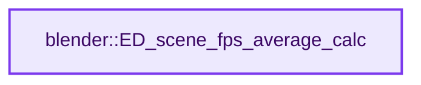
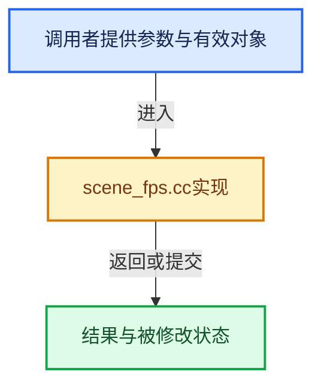

# 实现依赖专题：source/blender/editors/scene/scene_fps.cc

[实现依赖导航](../../../README.md) · [符号索引](../../../../00-课程指南/02-源码与提交索引/符号依赖与实现索引.md)

本专题从正文实际调用进入，集中保存共享实现。函数有稳定锚点，可从调用处直接跳到对应完整函数；递归与互相调用通过回链组织。

## 本文件的实现关系






## 完整成员与函数实现

<a id="f-d61499b57512d639"></a>

### `blender::ED_scene_fps_average_calc`

实现位置：[source/blender/editors/scene/scene_fps.cc](../../../../../../../../source/blender/editors/scene/scene_fps.cc) · L102—L126。

接口参数：

- `const Scene *scene`
- `SceneFPS_State *r_state`

**教学注释版**

<!-- annotated:9a5f0960370bb6 -->

```cpp
bool ED_scene_fps_average_calc(const Scene *scene, SceneFPS_State *r_state)
{
  ScreenFrameRateInfo *fpsi = static_cast<ScreenFrameRateInfo *>(scene->fps_info);
  if (fpsi == nullptr) {
    return false;
  }

  /* Need at least two timestamps to define an interval. */
  if (fpsi->times_num_set < 2) [[unlikely]] {
    return false;
  }

  if (fpsi->fps_average == -1.0f) {
    const int newest_index = ((fpsi->times_index - 1) + fpsi->times_num) % fpsi->times_num;
    const int oldest_index = (fpsi->times_num_set < fpsi->times_num) ? 0 : fpsi->times_index;
    const double delta = fpsi->times[newest_index] - fpsi->times[oldest_index];
    BLI_assert(delta >= 0.0);
    fpsi->fps_average = (delta > 0.0) ? float(double(fpsi->times_num_set - 1) / delta) : 0.0f;
  }

  r_state->fps_average = fpsi->fps_average;
  r_state->fps_target = fpsi->fps_target;
  r_state->fps_target_is_fractional = fpsi->fps_target_is_fractional;
  return true;
}
```

<details>
<summary>核对原始源码：source/blender/editors/scene/scene_fps.cc · L102—L126</summary>

<!-- original:9a5f0960370bb6:source/blender/editors/scene/scene_fps.cc:102:126 -->

```cpp
bool ED_scene_fps_average_calc(const Scene *scene, SceneFPS_State *r_state)
{
  ScreenFrameRateInfo *fpsi = static_cast<ScreenFrameRateInfo *>(scene->fps_info);
  if (fpsi == nullptr) {
    return false;
  }

  /* Need at least two timestamps to define an interval. */
  if (fpsi->times_num_set < 2) [[unlikely]] {
    return false;
  }

  if (fpsi->fps_average == -1.0f) {
    const int newest_index = ((fpsi->times_index - 1) + fpsi->times_num) % fpsi->times_num;
    const int oldest_index = (fpsi->times_num_set < fpsi->times_num) ? 0 : fpsi->times_index;
    const double delta = fpsi->times[newest_index] - fpsi->times[oldest_index];
    BLI_assert(delta >= 0.0);
    fpsi->fps_average = (delta > 0.0) ? float(double(fpsi->times_num_set - 1) / delta) : 0.0f;
  }

  r_state->fps_average = fpsi->fps_average;
  r_state->fps_target = fpsi->fps_target;
  r_state->fps_target_is_fractional = fpsi->fps_target_is_fractional;
  return true;
}
```

</details>

**沿实际写入检查状态**

- `fpsi->fps_average = (delta > 0.0) ? float(double(fpsi->times_num_set - 1) / delta) : 0.0f;`
- `r_state->fps_average = fpsi->fps_average;`
- `r_state->fps_target = fpsi->fps_target;`
- `r_state->fps_target_is_fractional = fpsi->fps_target_is_fractional;`

**结果出口**

- `return false;`
- `return true;`

**继续追踪实现**

- `BLI_assert` → [BLI_assert · L48](../../../01-BLI基础库/BLI_assert.hh.md#m-57a88495704d)；[BLI_assert · L63](../../../01-BLI基础库/BLI_assert.hh.md#m-d07050020cb5)。宏定义由构建条件选择。
