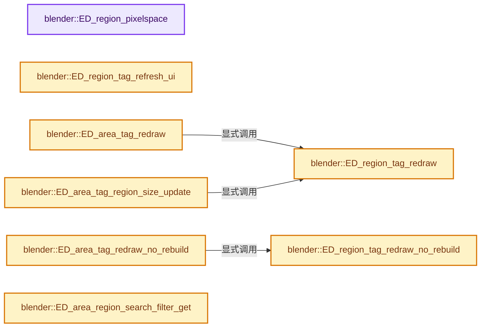
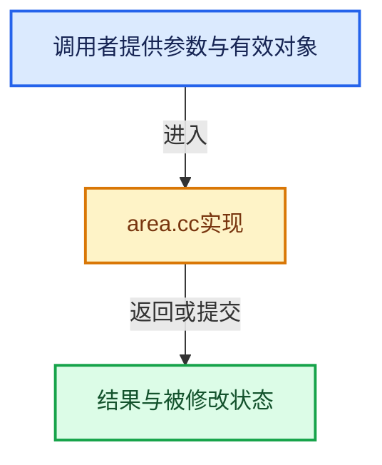

# 实现依赖专题：source/blender/editors/screen/area.cc

[实现依赖导航](../../../README.md) · [符号索引](../../../../00-课程指南/02-源码与提交索引/符号依赖与实现索引.md)

本专题从正文实际调用进入，集中保存共享实现。函数有稳定锚点，可从调用处直接跳到对应完整函数；递归与互相调用通过回链组织。

## 本文件的实现关系






## 完整成员与函数实现

<a id="f-3d2c323a0d99bc92"></a>

### `blender::ED_region_pixelspace`

实现位置：[source/blender/editors/screen/area.cc](../../../../../../../../source/blender/editors/screen/area.cc) · L96—L100。

接口参数：

- `const ARegion *region`

**教学注释版**

<!-- annotated:377bd9675bdbf1 -->

```cpp
void ED_region_pixelspace(const ARegion *region)
{
  wmOrtho2_region_pixelspace(region);
  GPU_matrix_identity_set();
}
```

<details>
<summary>核对原始源码：source/blender/editors/screen/area.cc · L96—L100</summary>

<!-- original:377bd9675bdbf1:source/blender/editors/screen/area.cc:96:100 -->

```cpp
void ED_region_pixelspace(const ARegion *region)
{
  wmOrtho2_region_pixelspace(region);
  GPU_matrix_identity_set();
}
```

</details>

**继续追踪实现**

- `wmOrtho2_region_pixelspace` → [blender::wmOrtho2_region_pixelspace · L127](../../windowmanager/intern/wm_subwindow.cc.md#f-81f42b31d31e8f75)。
- `GPU_matrix_identity_set` → [blender::GPU_matrix_identity_set · L169](../../gpu/intern/gpu_matrix.cc.md#f-2295e3c9adcce99c)。

<a id="f-8ff5d58c52a4a6e3"></a>

### `blender::ED_region_tag_redraw`

实现位置：[source/blender/editors/screen/area.cc](../../../../../../../../source/blender/editors/screen/area.cc) · L681—L694。

接口参数：

- `ARegion *region`

**教学注释版**

<!-- annotated:53829086235746 -->

```cpp
void ED_region_tag_redraw(ARegion *region)
{
  /* don't tag redraw while drawing, it shouldn't happen normally
   * but python scripts can cause this to happen indirectly */
  if (region && !(region->runtime->do_draw & RGN_DRAWING)) {
    /* zero region means full region redraw */
    region->runtime->do_draw &= ~(RGN_DRAW_PARTIAL | RGN_DRAW_NO_REBUILD |
                                  RGN_DRAW_EDITOR_OVERLAYS);
    region->runtime->do_draw |= RGN_DRAW;
    /* Also refresh the IME cursor position on the next draw. */
    region->runtime->do_ime = true;
    region->runtime->drawrct = rcti{};
  }
}
```

<details>
<summary>核对原始源码：source/blender/editors/screen/area.cc · L681—L694</summary>

<!-- original:53829086235746:source/blender/editors/screen/area.cc:681:694 -->

```cpp
void ED_region_tag_redraw(ARegion *region)
{
  /* don't tag redraw while drawing, it shouldn't happen normally
   * but python scripts can cause this to happen indirectly */
  if (region && !(region->runtime->do_draw & RGN_DRAWING)) {
    /* zero region means full region redraw */
    region->runtime->do_draw &= ~(RGN_DRAW_PARTIAL | RGN_DRAW_NO_REBUILD |
                                  RGN_DRAW_EDITOR_OVERLAYS);
    region->runtime->do_draw |= RGN_DRAW;
    /* Also refresh the IME cursor position on the next draw. */
    region->runtime->do_ime = true;
    region->runtime->drawrct = rcti{};
  }
}
```

</details>

**沿实际写入检查状态**

- `region->runtime->do_draw &= ~(RGN_DRAW_PARTIAL | RGN_DRAW_NO_REBUILD |`
- `region->runtime->do_draw |= RGN_DRAW;`
- `region->runtime->do_ime = true;`
- `region->runtime->drawrct = rcti{};`

**继续追踪实现**

本实现没有需要继续展开的显式调用；检查返回表达式、对象转换和调用者前置条件。

<a id="f-6b4eceb5338d6969"></a>

### `blender::ED_region_tag_redraw_no_rebuild`

实现位置：[source/blender/editors/screen/area.cc](../../../../../../../../source/blender/editors/screen/area.cc) · L727—L736。

接口参数：

- `ARegion *region`

**教学注释版**

<!-- annotated:44f49cf66b1694 -->

```cpp
void ED_region_tag_redraw_no_rebuild(ARegion *region)
{
  if (region && !(region->runtime->do_draw & (RGN_DRAWING | RGN_DRAW))) {
    region->runtime->do_draw &= ~(RGN_DRAW_PARTIAL | RGN_DRAW_EDITOR_OVERLAYS);
    region->runtime->do_draw |= RGN_DRAW_NO_REBUILD;
    /* Also refresh the IME cursor position on the next draw. */
    region->runtime->do_ime = true;
    region->runtime->drawrct = rcti{};
  }
}
```

<details>
<summary>核对原始源码：source/blender/editors/screen/area.cc · L727—L736</summary>

<!-- original:44f49cf66b1694:source/blender/editors/screen/area.cc:727:736 -->

```cpp
void ED_region_tag_redraw_no_rebuild(ARegion *region)
{
  if (region && !(region->runtime->do_draw & (RGN_DRAWING | RGN_DRAW))) {
    region->runtime->do_draw &= ~(RGN_DRAW_PARTIAL | RGN_DRAW_EDITOR_OVERLAYS);
    region->runtime->do_draw |= RGN_DRAW_NO_REBUILD;
    /* Also refresh the IME cursor position on the next draw. */
    region->runtime->do_ime = true;
    region->runtime->drawrct = rcti{};
  }
}
```

</details>

**沿实际写入检查状态**

- `region->runtime->do_draw &= ~(RGN_DRAW_PARTIAL | RGN_DRAW_EDITOR_OVERLAYS);`
- `region->runtime->do_draw |= RGN_DRAW_NO_REBUILD;`
- `region->runtime->do_ime = true;`
- `region->runtime->drawrct = rcti{};`

**继续追踪实现**

本实现没有需要继续展开的显式调用；检查返回表达式、对象转换和调用者前置条件。

<a id="f-fec3f537791fe9b1"></a>

### `blender::ED_region_tag_refresh_ui`

实现位置：[source/blender/editors/screen/area.cc](../../../../../../../../source/blender/editors/screen/area.cc) · L738—L743。

接口参数：

- `ARegion *region`

**教学注释版**

<!-- annotated:3cd8432a7d20fb -->

```cpp
void ED_region_tag_refresh_ui(ARegion *region)
{
  if (region) {
    region->runtime->do_draw |= RGN_REFRESH_UI;
  }
}
```

<details>
<summary>核对原始源码：source/blender/editors/screen/area.cc · L738—L743</summary>

<!-- original:3cd8432a7d20fb:source/blender/editors/screen/area.cc:738:743 -->

```cpp
void ED_region_tag_refresh_ui(ARegion *region)
{
  if (region) {
    region->runtime->do_draw |= RGN_REFRESH_UI;
  }
}
```

</details>

**沿实际写入检查状态**

- `region->runtime->do_draw |= RGN_REFRESH_UI;`

**继续追踪实现**

本实现没有需要继续展开的显式调用；检查返回表达式、对象转换和调用者前置条件。

<a id="f-bad077185992988f"></a>

### `blender::ED_area_tag_redraw`

实现位置：[source/blender/editors/screen/area.cc](../../../../../../../../source/blender/editors/screen/area.cc) · L784—L791。

接口参数：

- `ScrArea *area`

**教学注释版**

<!-- annotated:571945a5cd912d -->

```cpp
void ED_area_tag_redraw(ScrArea *area)
{
  if (area) {
    for (ARegion &region : area->regionbase) {
      ED_region_tag_redraw(&region);
    }
  }
}
```

<details>
<summary>核对原始源码：source/blender/editors/screen/area.cc · L784—L791</summary>

<!-- original:571945a5cd912d:source/blender/editors/screen/area.cc:784:791 -->

```cpp
void ED_area_tag_redraw(ScrArea *area)
{
  if (area) {
    for (ARegion &region : area->regionbase) {
      ED_region_tag_redraw(&region);
    }
  }
}
```

</details>

**继续追踪实现**

- `ED_region_tag_redraw` → [blender::ED_region_tag_redraw · L681](area.cc.md#f-8ff5d58c52a4a6e3)。

<a id="f-b3d68fb6c581bbc2"></a>

### `blender::ED_area_tag_redraw_no_rebuild`

实现位置：[source/blender/editors/screen/area.cc](../../../../../../../../source/blender/editors/screen/area.cc) · L793—L800。

接口参数：

- `ScrArea *area`

**教学注释版**

<!-- annotated:708a51cc5695a4 -->

```cpp
void ED_area_tag_redraw_no_rebuild(ScrArea *area)
{
  if (area) {
    for (ARegion &region : area->regionbase) {
      ED_region_tag_redraw_no_rebuild(&region);
    }
  }
}
```

<details>
<summary>核对原始源码：source/blender/editors/screen/area.cc · L793—L800</summary>

<!-- original:708a51cc5695a4:source/blender/editors/screen/area.cc:793:800 -->

```cpp
void ED_area_tag_redraw_no_rebuild(ScrArea *area)
{
  if (area) {
    for (ARegion &region : area->regionbase) {
      ED_region_tag_redraw_no_rebuild(&region);
    }
  }
}
```

</details>

**继续追踪实现**

- `ED_region_tag_redraw_no_rebuild` → [blender::ED_region_tag_redraw_no_rebuild · L727](area.cc.md#f-6b4eceb5338d6969)。

<a id="f-f39c8559d00c7562"></a>

### `blender::ED_area_tag_region_size_update`

实现位置：[source/blender/editors/screen/area.cc](../../../../../../../../source/blender/editors/screen/area.cc) · L820—L849。

接口参数：

- `ScrArea *area`
- `ARegion *changed_region`

**教学注释版**

<!-- annotated:755c3dbf18317d -->

```cpp
void ED_area_tag_region_size_update(ScrArea *area, ARegion *changed_region)
{
  if (!area || (area->flag & AREA_FLAG_REGION_SIZE_UPDATE)) {
    return;
  }

  area->flag |= AREA_FLAG_REGION_SIZE_UPDATE;

  /* Floating regions don't affect other regions, so the following can be skipped. */
  if (changed_region->alignment == RGN_ALIGN_FLOAT) {
    return;
  }

  /* Tag the following regions for redraw, since the size change of this region may affect the
   * available space for them. */
  for (ARegion *following_region = changed_region->next; following_region;
       following_region = following_region->next)
  {
    /* Overlapping and non-overlapping regions don't affect each others space. So layout changes
     * of one don't require redrawing the other. */
    if (changed_region->overlap != following_region->overlap) {
      continue;
    }
    /* Floating regions don't affect space of other regions. */
    if (following_region->alignment == RGN_ALIGN_FLOAT) {
      continue;
    }
    ED_region_tag_redraw(following_region);
  }
}
```

<details>
<summary>核对原始源码：source/blender/editors/screen/area.cc · L820—L849</summary>

<!-- original:755c3dbf18317d:source/blender/editors/screen/area.cc:820:849 -->

```cpp
void ED_area_tag_region_size_update(ScrArea *area, ARegion *changed_region)
{
  if (!area || (area->flag & AREA_FLAG_REGION_SIZE_UPDATE)) {
    return;
  }

  area->flag |= AREA_FLAG_REGION_SIZE_UPDATE;

  /* Floating regions don't affect other regions, so the following can be skipped. */
  if (changed_region->alignment == RGN_ALIGN_FLOAT) {
    return;
  }

  /* Tag the following regions for redraw, since the size change of this region may affect the
   * available space for them. */
  for (ARegion *following_region = changed_region->next; following_region;
       following_region = following_region->next)
  {
    /* Overlapping and non-overlapping regions don't affect each others space. So layout changes
     * of one don't require redrawing the other. */
    if (changed_region->overlap != following_region->overlap) {
      continue;
    }
    /* Floating regions don't affect space of other regions. */
    if (following_region->alignment == RGN_ALIGN_FLOAT) {
      continue;
    }
    ED_region_tag_redraw(following_region);
  }
}
```

</details>

**沿实际写入检查状态**

- `area->flag |= AREA_FLAG_REGION_SIZE_UPDATE;`
- `following_region = following_region->next)`

**继续追踪实现**

- `ED_region_tag_redraw` → [blender::ED_region_tag_redraw · L681](area.cc.md#f-8ff5d58c52a4a6e3)。

<a id="f-095c8117b865cbdd"></a>

### `blender::ED_area_region_search_filter_get`

实现位置：[source/blender/editors/screen/area.cc](../../../../../../../../source/blender/editors/screen/area.cc) · L936—L955。

接口参数：

- `const ScrArea *area`
- `const ARegion *region`

**教学注释版**

<!-- annotated:8498914e303814 -->

```cpp
const char *ED_area_region_search_filter_get(const ScrArea *area, const ARegion *region)
{
  if (BKE_regiontype_uses_panel_categories_search(region->runtime->type)) {
    return region->runtime->search_filter.c_str();
  }
  if (area->spacetype == SPACE_PROPERTIES) {
    SpaceProperties *sbuts = area->spacedata.first_as<SpaceProperties>();
    if (region->regiontype == RGN_TYPE_WINDOW) {
      return ED_buttons_search_string_get(sbuts);
    }
  }
  else if (area->spacetype == SPACE_USERPREF) {
    SpaceUserPref *sprefs = area->spacedata.first_as<SpaceUserPref>();
    if (region->regiontype == RGN_TYPE_WINDOW) {
      return ED_userpref_search_string_get(sprefs);
    }
  }

  return nullptr;
}
```

<details>
<summary>核对原始源码：source/blender/editors/screen/area.cc · L936—L955</summary>

<!-- original:8498914e303814:source/blender/editors/screen/area.cc:936:955 -->

```cpp
const char *ED_area_region_search_filter_get(const ScrArea *area, const ARegion *region)
{
  if (BKE_regiontype_uses_panel_categories_search(region->runtime->type)) {
    return region->runtime->search_filter.c_str();
  }
  if (area->spacetype == SPACE_PROPERTIES) {
    SpaceProperties *sbuts = area->spacedata.first_as<SpaceProperties>();
    if (region->regiontype == RGN_TYPE_WINDOW) {
      return ED_buttons_search_string_get(sbuts);
    }
  }
  else if (area->spacetype == SPACE_USERPREF) {
    SpaceUserPref *sprefs = area->spacedata.first_as<SpaceUserPref>();
    if (region->regiontype == RGN_TYPE_WINDOW) {
      return ED_userpref_search_string_get(sprefs);
    }
  }

  return nullptr;
}
```

</details>

**结果出口**

- `return region->runtime->search_filter.c_str();`
- `return ED_buttons_search_string_get(sbuts);`
- `return ED_userpref_search_string_get(sprefs);`
- `return nullptr;`

**继续追踪实现**

- `BKE_regiontype_uses_panel_categories_search` → [blender::BKE_regiontype_uses_panel_categories_search · L415](../../../02-BKE几何与数据/intern/screen.cc.md#f-40fd2da0111c19c9)。
- `region->runtime->search_filter.c_str` → [调用协议](../../../../00-课程指南/01-路线与规范/模板宏与动态分派协议.md)：接收对象类型依赖auto、返回值或模板实例；不按同名猜测目标。调用位置L939。
- `area->spacedata.first_as<SpaceProperties>` → [调用协议](../../../../00-课程指南/01-路线与规范/模板宏与动态分派协议.md)：接收对象类型依赖auto、返回值或模板实例；不按同名猜测目标。调用位置L942。
- `ED_buttons_search_string_get` → [blender::ED_buttons_search_string_get · L343](../space_buttons/space_buttons.cc.md#f-e752ca14c482ebc3)。
- `area->spacedata.first_as<SpaceUserPref>` → [调用协议](../../../../00-课程指南/01-路线与规范/模板宏与动态分派协议.md)：接收对象类型依赖auto、返回值或模板实例；不按同名猜测目标。调用位置L948。
- `ED_userpref_search_string_get` → [blender::ED_userpref_search_string_get · L140](../space_userpref/space_userpref.cc.md#f-5c11e03153095386)。

<a id="f-70bb6863a3207339"></a>

### `blender::ED_area_status_text`

实现位置：[source/blender/editors/screen/area.cc](../../../../../../../../source/blender/editors/screen/area.cc) · L975—L1008。

接口参数：

- `ScrArea *area`
- `const char *str`

**教学注释版**

<!-- annotated:8f0a0d61f56b6d -->

```cpp
void ED_area_status_text(ScrArea *area, const char *str)
{
  /* happens when running transform operators in background mode */
  if (area == nullptr) {
    return;
  }

  ARegion *ar = nullptr;

  for (ARegion &region : area->regionbase) {
    if (region.regiontype == RGN_TYPE_HEADER && region.runtime->visible) {
      ar = &region;
    }
    else if (region.regiontype == RGN_TYPE_TOOL_HEADER && region.runtime->visible) {
      /* Prefer tool header when we also have a header. */
      ar = &region;
      break;
    }
  }

  if (ar) {
    if (str) {
      if (ar->runtime->headerstr == nullptr) {
        ar->runtime->headerstr = MEM_new_array_uninitialized<char>(UI_MAX_DRAW_STR, "headerprint");
      }
      BLI_strncpy_utf8(ar->runtime->headerstr, str, UI_MAX_DRAW_STR);
      BLI_str_rstrip(ar->runtime->headerstr);
    }
    else {
      MEM_SAFE_DELETE(ar->runtime->headerstr);
    }
    ED_region_tag_redraw(ar);
  }
}
```

<details>
<summary>核对原始源码：source/blender/editors/screen/area.cc · L975—L1008</summary>

<!-- original:8f0a0d61f56b6d:source/blender/editors/screen/area.cc:975:1008 -->

```cpp
void ED_area_status_text(ScrArea *area, const char *str)
{
  /* happens when running transform operators in background mode */
  if (area == nullptr) {
    return;
  }

  ARegion *ar = nullptr;

  for (ARegion &region : area->regionbase) {
    if (region.regiontype == RGN_TYPE_HEADER && region.runtime->visible) {
      ar = &region;
    }
    else if (region.regiontype == RGN_TYPE_TOOL_HEADER && region.runtime->visible) {
      /* Prefer tool header when we also have a header. */
      ar = &region;
      break;
    }
  }

  if (ar) {
    if (str) {
      if (ar->runtime->headerstr == nullptr) {
        ar->runtime->headerstr = MEM_new_array_uninitialized<char>(UI_MAX_DRAW_STR, "headerprint");
      }
      BLI_strncpy_utf8(ar->runtime->headerstr, str, UI_MAX_DRAW_STR);
      BLI_str_rstrip(ar->runtime->headerstr);
    }
    else {
      MEM_SAFE_DELETE(ar->runtime->headerstr);
    }
    ED_region_tag_redraw(ar);
  }
}
```

</details>

**沿实际写入检查状态**

- `ar = &region;`
- `ar->runtime->headerstr = MEM_new_array_uninitialized<char>(UI_MAX_DRAW_STR, "headerprint");`

**继续追踪实现**

- `MEM_new_array_uninitialized<char>` → [MEM_new_array_uninitialized · L608](../../../07-Intern运行时与平台/guardedalloc/MEM_guardedalloc.h.md#f-b7103eae8eb57b05)；[MEM_new_array_uninitialized · L129](../../../07-Intern运行时与平台/guardedalloc/intern/mallocn.cc.md#f-bf6ef4ddcfb6e5df)。同名重载需按实参类型选择。
- `BLI_strncpy_utf8` → [blender::BLI_strncpy_utf8 · L404](../../../01-BLI基础库/intern/string_utf8.cc.md#f-ff7c5f28742085a0)。
- `BLI_str_rstrip` → [blender::BLI_str_rstrip · L986](../../../01-BLI基础库/intern/string.cc.md#f-a5b252149629da29)。
- `MEM_SAFE_DELETE` → [MEM_SAFE_DELETE · L436](../../../07-Intern运行时与平台/guardedalloc/MEM_guardedalloc.h.md#m-eadb3bc5b902)。宏定义由构建条件选择。
- `ED_region_tag_redraw` → [blender::ED_region_tag_redraw · L681](area.cc.md#f-8ff5d58c52a4a6e3)。

<a id="f-892fc15004cb0a98"></a>

### `blender::ed_workspace_status_item`

实现位置：[source/blender/editors/screen/area.cc](../../../../../../../../source/blender/editors/screen/area.cc) · L1010—L1027。

接口参数：

- `WorkSpace *workspace`
- `std::string text`
- `const int icon`
- `const float space_factor = 0.0f`
- `const bool inverted = false`

**教学注释版**

<!-- annotated:a9175b2b9c39d2 -->

```cpp
static void ed_workspace_status_item(WorkSpace *workspace,
                                     std::string text,
                                     const int icon,
                                     const float space_factor = 0.0f,
                                     const bool inverted = false)
{
  /* Can be nullptr when running operators in background mode. */
  if (workspace == nullptr) {
    return;
  }

  bke::WorkSpaceStatusItem item;
  // [讲解] std::move：把表达式转换成可供移动重载选择的值类别；不保证真的移动，不结束源对象寿命，对const值可能选择复制。
  item.text = std::move(text);
  item.icon = icon;
  item.space_factor = space_factor;
  item.inverted = inverted;
  workspace->runtime->status.append(std::move(item));
}
```

<details>
<summary>核对原始源码：source/blender/editors/screen/area.cc · L1010—L1027</summary>

<!-- original:a9175b2b9c39d2:source/blender/editors/screen/area.cc:1010:1027 -->

```cpp
static void ed_workspace_status_item(WorkSpace *workspace,
                                     std::string text,
                                     const int icon,
                                     const float space_factor = 0.0f,
                                     const bool inverted = false)
{
  /* Can be nullptr when running operators in background mode. */
  if (workspace == nullptr) {
    return;
  }

  bke::WorkSpaceStatusItem item;
  item.text = std::move(text);
  item.icon = icon;
  item.space_factor = space_factor;
  item.inverted = inverted;
  workspace->runtime->status.append(std::move(item));
}
```

</details>

**沿实际写入检查状态**

- `item.text = std::move(text);`
- `item.icon = icon;`
- `item.space_factor = space_factor;`
- `item.inverted = inverted;`

**继续追踪实现**

- `std::move` → [外部契约](https://eel.is/c++draft/utility.forward)：把表达式转换成可供移动重载选择的值类别；不保证真的移动，不结束源对象寿命，对const值可能选择复制。
- `workspace->runtime->status.append` → [调用协议](../../../../00-课程指南/01-路线与规范/模板宏与动态分派协议.md)：接收对象类型依赖auto、返回值或模板实例；不按同名猜测目标。调用位置L1026。

<a id="f-862d5cc99f074ffd"></a>

### `blender::ed_workspace_status_space`

实现位置：[source/blender/editors/screen/area.cc](../../../../../../../../source/blender/editors/screen/area.cc) · L1029—L1032。

接口参数：

- `WorkSpace *workspace`
- `const float space_factor`

**教学注释版**

<!-- annotated:8c83ed095e5122 -->

```cpp
static void ed_workspace_status_space(WorkSpace *workspace, const float space_factor)
{
  ed_workspace_status_item(workspace, {}, ICON_NONE, space_factor);
}
```

<details>
<summary>核对原始源码：source/blender/editors/screen/area.cc · L1029—L1032</summary>

<!-- original:8c83ed095e5122:source/blender/editors/screen/area.cc:1029:1032 -->

```cpp
static void ed_workspace_status_space(WorkSpace *workspace, const float space_factor)
{
  ed_workspace_status_item(workspace, {}, ICON_NONE, space_factor);
}
```

</details>

**继续追踪实现**

- `ed_workspace_status_item` → [blender::ed_workspace_status_item · L1010](area.cc.md#f-892fc15004cb0a98)。

<a id="f-404bda9f88452a1d"></a>

### `blender::ed_workspace_status_text_item`

实现位置：[source/blender/editors/screen/area.cc](../../../../../../../../source/blender/editors/screen/area.cc) · L1048—L1055。

接口参数：

- `WorkSpace *workspace`
- `std::string text`

**教学注释版**

<!-- annotated:e13845b7660be8 -->

```cpp
static void ed_workspace_status_text_item(WorkSpace *workspace, std::string text)
{
  if (!text.empty()) {
    ed_workspace_status_space(workspace, STATUS_BEFORE_TEXT);
    // [讲解] std::move：把表达式转换成可供移动重载选择的值类别；不保证真的移动，不结束源对象寿命，对const值可能选择复制。
    ed_workspace_status_item(workspace, std::move(text), ICON_NONE);
    ed_workspace_status_space(workspace, STATUS_AFTER_TEXT);
  }
}
```

<details>
<summary>核对原始源码：source/blender/editors/screen/area.cc · L1048—L1055</summary>

<!-- original:e13845b7660be8:source/blender/editors/screen/area.cc:1048:1055 -->

```cpp
static void ed_workspace_status_text_item(WorkSpace *workspace, std::string text)
{
  if (!text.empty()) {
    ed_workspace_status_space(workspace, STATUS_BEFORE_TEXT);
    ed_workspace_status_item(workspace, std::move(text), ICON_NONE);
    ed_workspace_status_space(workspace, STATUS_AFTER_TEXT);
  }
}
```

</details>

**继续追踪实现**

- `text.empty` → [外部契约](https://eel.is/c++draft/)：这个边界按实际表达式及所属类型核对参数、返回值、寿命与失败行为。这里提供接口入口，不声称已解释该第三方版本的内部实现。
- `ed_workspace_status_space` → [blender::ed_workspace_status_space · L1029](area.cc.md#f-862d5cc99f074ffd)。
- `ed_workspace_status_item` → [blender::ed_workspace_status_item · L1010](area.cc.md#f-892fc15004cb0a98)。
- `std::move` → [外部契约](https://eel.is/c++draft/utility.forward)：把表达式转换成可供移动重载选择的值类别；不保证真的移动，不结束源对象寿命，对const值可能选择复制。

<a id="f-e9997f70ee02ead8"></a>

### `blender::ed_workspace_status_icon_item`

实现位置：[source/blender/editors/screen/area.cc](../../../../../../../../source/blender/editors/screen/area.cc) · L1057—L1068。

接口参数：

- `WorkSpace *workspace`
- `const int icon`
- `const bool inverted = false`

**教学注释版**

<!-- annotated:6cfa986998b7a2 -->

```cpp
static void ed_workspace_status_icon_item(WorkSpace *workspace,
                                          const int icon,
                                          const bool inverted = false)
{
  if (icon) {
    ed_workspace_status_item(workspace, {}, icon, 0.0f, inverted);
    if (icon >= ICON_MOUSE_LMB && icon <= ICON_MOUSE_MMB_SCROLL) {
      /* Negative space after narrow mice icons. */
      ed_workspace_status_space(workspace, STATUS_MOUSE_ICON_PAD);
    }
  }
}
```

<details>
<summary>核对原始源码：source/blender/editors/screen/area.cc · L1057—L1068</summary>

<!-- original:6cfa986998b7a2:source/blender/editors/screen/area.cc:1057:1068 -->

```cpp
static void ed_workspace_status_icon_item(WorkSpace *workspace,
                                          const int icon,
                                          const bool inverted = false)
{
  if (icon) {
    ed_workspace_status_item(workspace, {}, icon, 0.0f, inverted);
    if (icon >= ICON_MOUSE_LMB && icon <= ICON_MOUSE_MMB_SCROLL) {
      /* Negative space after narrow mice icons. */
      ed_workspace_status_space(workspace, STATUS_MOUSE_ICON_PAD);
    }
  }
}
```

</details>

**继续追踪实现**

- `ed_workspace_status_item` → [blender::ed_workspace_status_item · L1010](area.cc.md#f-892fc15004cb0a98)。
- `ed_workspace_status_space` → [blender::ed_workspace_status_space · L1029](area.cc.md#f-862d5cc99f074ffd)。

<a id="f-91ac007b3084f829"></a>

### `blender::WorkspaceStatus::item`

实现位置：[source/blender/editors/screen/area.cc](../../../../../../../../source/blender/editors/screen/area.cc) · L1076—L1081。

接口参数：

- `std::string text`
- `const int icon1`
- `const int icon2`

**教学注释版**

<!-- annotated:c6d65251d370bd -->

```cpp
void WorkspaceStatus::item(std::string text, const int icon1, const int icon2)
{
  ed_workspace_status_icon_item(workspace_, icon1);
  ed_workspace_status_icon_item(workspace_, icon2);
  // [讲解] std::move：把表达式转换成可供移动重载选择的值类别；不保证真的移动，不结束源对象寿命，对const值可能选择复制。
  ed_workspace_status_text_item(workspace_, std::move(text));
}
```

<details>
<summary>核对原始源码：source/blender/editors/screen/area.cc · L1076—L1081</summary>

<!-- original:c6d65251d370bd:source/blender/editors/screen/area.cc:1076:1081 -->

```cpp
void WorkspaceStatus::item(std::string text, const int icon1, const int icon2)
{
  ed_workspace_status_icon_item(workspace_, icon1);
  ed_workspace_status_icon_item(workspace_, icon2);
  ed_workspace_status_text_item(workspace_, std::move(text));
}
```

</details>

**继续追踪实现**

- `ed_workspace_status_icon_item` → [blender::ed_workspace_status_icon_item · L1057](area.cc.md#f-e9997f70ee02ead8)。
- `ed_workspace_status_text_item` → [blender::ed_workspace_status_text_item · L1048](area.cc.md#f-404bda9f88452a1d)。
- `std::move` → [外部契约](https://eel.is/c++draft/utility.forward)：把表达式转换成可供移动重载选择的值类别；不保证真的移动，不结束源对象寿命，对const值可能选择复制。

<a id="f-75b6222476116adb"></a>

### `blender::WorkspaceStatus::range`

实现位置：[source/blender/editors/screen/area.cc](../../../../../../../../source/blender/editors/screen/area.cc) · L1088—L1095。

接口参数：

- `std::string text`
- `const int icon1`
- `const int icon2`

**教学注释版**

<!-- annotated:db55275f07a977 -->

```cpp
void WorkspaceStatus::range(std::string text, const int icon1, const int icon2)
{
  ed_workspace_status_item(workspace_, {}, icon1);
  ed_workspace_status_item(workspace_, "-", ICON_NONE);
  ed_workspace_status_space(workspace_, -0.5f);
  ed_workspace_status_item(workspace_, {}, icon2);
  // [讲解] std::move：把表达式转换成可供移动重载选择的值类别；不保证真的移动，不结束源对象寿命，对const值可能选择复制。
  ed_workspace_status_text_item(workspace_, std::move(text));
}
```

<details>
<summary>核对原始源码：source/blender/editors/screen/area.cc · L1088—L1095</summary>

<!-- original:db55275f07a977:source/blender/editors/screen/area.cc:1088:1095 -->

```cpp
void WorkspaceStatus::range(std::string text, const int icon1, const int icon2)
{
  ed_workspace_status_item(workspace_, {}, icon1);
  ed_workspace_status_item(workspace_, "-", ICON_NONE);
  ed_workspace_status_space(workspace_, -0.5f);
  ed_workspace_status_item(workspace_, {}, icon2);
  ed_workspace_status_text_item(workspace_, std::move(text));
}
```

</details>

**继续追踪实现**

- `ed_workspace_status_item` → [blender::ed_workspace_status_item · L1010](area.cc.md#f-892fc15004cb0a98)。
- `ed_workspace_status_space` → [blender::ed_workspace_status_space · L1029](area.cc.md#f-862d5cc99f074ffd)。
- `ed_workspace_status_text_item` → [blender::ed_workspace_status_text_item · L1048](area.cc.md#f-404bda9f88452a1d)。
- `std::move` → [外部契约](https://eel.is/c++draft/utility.forward)：把表达式转换成可供移动重载选择的值类别；不保证真的移动，不结束源对象寿命，对const值可能选择复制。

<a id="f-3c6c6d4c4cd867ef"></a>

### `blender::ED_workspace_status_text`

实现位置：[source/blender/editors/screen/area.cc](../../../../../../../../source/blender/editors/screen/area.cc) · L1153—L1157。

接口参数：

- `bContext *C`
- `const char *str`

**教学注释版**

<!-- annotated:2df02533eb3454 -->

```cpp
void ED_workspace_status_text(bContext *C, const char *str)
{
  WorkspaceStatus status(C);
  status.item(str ? str : "", ICON_NONE);
}
```

<details>
<summary>核对原始源码：source/blender/editors/screen/area.cc · L1153—L1157</summary>

<!-- original:2df02533eb3454:source/blender/editors/screen/area.cc:1153:1157 -->

```cpp
void ED_workspace_status_text(bContext *C, const char *str)
{
  WorkspaceStatus status(C);
  status.item(str ? str : "", ICON_NONE);
}
```

</details>

**继续追踪实现**

- `status.item` → [blender::WorkspaceStatus::item · L1076](area.cc.md#f-91ac007b3084f829)。

<a id="f-7db045ba7735db23"></a>

### `blender::area_azone_init`

实现位置：[source/blender/editors/screen/area.cc](../../../../../../../../source/blender/editors/screen/area.cc) · L1165—L1237。

接口参数：

- `const wmWindow *win`
- `const bScreen *screen`
- `ScrArea *area`

**教学注释版**

<!-- annotated:15fa174eae7fd7 -->

```cpp
static void area_azone_init(const wmWindow *win, const bScreen *screen, ScrArea *area)
{
  /* reinitialize entirely, regions and full-screen add azones too */
  area->actionzones.free_no_destruct();

  if (screen->state != SCREENNORMAL) {
    return;
  }

  if (U.app_flag & USER_APP_LOCK_CORNER_SPLIT) {
    return;
  }

  if (ED_area_is_global(area)) {
    return;
  }

  if (screen->temp) {
    return;
  }

  /* Use a taller zone on the left side, the height of
   * the header, to make them easier to hit. The others
   * on the right are shorter to not interfere with
   * scroll bars. */

  const float coords[4][4] = {
      /* Bottom-left. */
      {area->totrct.xmin - U.pixelsize,
       area->totrct.ymin - U.pixelsize,
       area->totrct.xmin + UI_AZONESPOTW_LEFT,
       float(area->totrct.ymin + ED_area_headersize())},
      /* Bottom-right. */
      {area->totrct.xmax - UI_AZONESPOTW_RIGHT,
       area->totrct.ymin - U.pixelsize,
       area->totrct.xmax + U.pixelsize,
       area->totrct.ymin + UI_AZONESPOTH},
      /* Top-left. */
      {area->totrct.xmin - U.pixelsize,
       float(area->totrct.ymax - ED_area_headersize()),
       area->totrct.xmin + UI_AZONESPOTW_LEFT,
       area->totrct.ymax + U.pixelsize},
      /* Top-right. */
      {area->totrct.xmax - UI_AZONESPOTW_RIGHT,
       area->totrct.ymax - UI_AZONESPOTH,
       area->totrct.xmax + U.pixelsize,
       area->totrct.ymax + U.pixelsize},
  };

  for (int i = 0; i < 4; i++) {
    /* can't click on bottom corners on OS X, already used for resizing */
#ifdef __APPLE__
    if (!WM_window_is_fullscreen(win) &&
        ((coords[i][0] == 0 && coords[i][1] == 0) ||
         (coords[i][0] == WM_window_native_pixel_x(win) && coords[i][1] == 0)))
    {
      continue;
    }
#else
    (void)win;
#endif

    /* set area action zones */
    AZone *az = MEM_new<AZone>("actionzone");
    BLI_addtail(&(area->actionzones), az);
    az->type = AZONE_AREA;
    az->x1 = coords[i][0];
    az->y1 = coords[i][1];
    az->x2 = coords[i][2];
    az->y2 = coords[i][3];
    BLI_rcti_init(&az->rect, az->x1, az->x2, az->y1, az->y2);
  }
}
```

<details>
<summary>核对原始源码：source/blender/editors/screen/area.cc · L1165—L1237</summary>

<!-- original:15fa174eae7fd7:source/blender/editors/screen/area.cc:1165:1237 -->

```cpp
static void area_azone_init(const wmWindow *win, const bScreen *screen, ScrArea *area)
{
  /* reinitialize entirely, regions and full-screen add azones too */
  area->actionzones.free_no_destruct();

  if (screen->state != SCREENNORMAL) {
    return;
  }

  if (U.app_flag & USER_APP_LOCK_CORNER_SPLIT) {
    return;
  }

  if (ED_area_is_global(area)) {
    return;
  }

  if (screen->temp) {
    return;
  }

  /* Use a taller zone on the left side, the height of
   * the header, to make them easier to hit. The others
   * on the right are shorter to not interfere with
   * scroll bars. */

  const float coords[4][4] = {
      /* Bottom-left. */
      {area->totrct.xmin - U.pixelsize,
       area->totrct.ymin - U.pixelsize,
       area->totrct.xmin + UI_AZONESPOTW_LEFT,
       float(area->totrct.ymin + ED_area_headersize())},
      /* Bottom-right. */
      {area->totrct.xmax - UI_AZONESPOTW_RIGHT,
       area->totrct.ymin - U.pixelsize,
       area->totrct.xmax + U.pixelsize,
       area->totrct.ymin + UI_AZONESPOTH},
      /* Top-left. */
      {area->totrct.xmin - U.pixelsize,
       float(area->totrct.ymax - ED_area_headersize()),
       area->totrct.xmin + UI_AZONESPOTW_LEFT,
       area->totrct.ymax + U.pixelsize},
      /* Top-right. */
      {area->totrct.xmax - UI_AZONESPOTW_RIGHT,
       area->totrct.ymax - UI_AZONESPOTH,
       area->totrct.xmax + U.pixelsize,
       area->totrct.ymax + U.pixelsize},
  };

  for (int i = 0; i < 4; i++) {
    /* can't click on bottom corners on OS X, already used for resizing */
#ifdef __APPLE__
    if (!WM_window_is_fullscreen(win) &&
        ((coords[i][0] == 0 && coords[i][1] == 0) ||
         (coords[i][0] == WM_window_native_pixel_x(win) && coords[i][1] == 0)))
    {
      continue;
    }
#else
    (void)win;
#endif

    /* set area action zones */
    AZone *az = MEM_new<AZone>("actionzone");
    BLI_addtail(&(area->actionzones), az);
    az->type = AZONE_AREA;
    az->x1 = coords[i][0];
    az->y1 = coords[i][1];
    az->x2 = coords[i][2];
    az->y2 = coords[i][3];
    BLI_rcti_init(&az->rect, az->x1, az->x2, az->y1, az->y2);
  }
}
```

</details>

**沿实际写入检查状态**

- `az->type = AZONE_AREA;`
- `az->x1 = coords[i][0];`
- `az->y1 = coords[i][1];`
- `az->x2 = coords[i][2];`
- `az->y2 = coords[i][3];`

**继续追踪实现**

- `area->actionzones.free_no_destruct` → [调用协议](../../../../00-课程指南/01-路线与规范/模板宏与动态分派协议.md)：接收对象类型依赖auto、返回值或模板实例；不按同名猜测目标。调用位置L1168。
- `ED_area_is_global` → [blender::ED_area_is_global · L4451](area.cc.md#f-74a74da4288d7bc7)。
- `ED_area_headersize` → [blender::ED_area_headersize · L4418](area.cc.md#f-33d82d30fa59b297)。
- `WM_window_is_fullscreen` → [blender::WM_window_is_fullscreen · L3244](../../windowmanager/intern/wm_window.cc.md#f-48e1576a1ed4e24f)。
- `WM_window_native_pixel_x` → [blender::WM_window_native_pixel_x · L3130](../../windowmanager/intern/wm_window.cc.md#f-2869fcdd44a332c1)。
- `MEM_new<AZone>` → [MEM_new · L351](../../../07-Intern运行时与平台/guardedalloc/MEM_guardedalloc.h.md#f-115f9b6784f89912)。
- `BLI_addtail` → [blender::BLI_addtail · L118](../../../01-BLI基础库/intern/listbase.cc.md#f-4fb027713fa3115b)。
- `BLI_rcti_init` → [blender::BLI_rcti_init · L428](../../../01-BLI基础库/intern/rct.cc.md#f-c75659264970b4d1)。

<a id="f-55e64c6fbbecc75d"></a>

### `blender::fullscreen_azone_init`

实现位置：[source/blender/editors/screen/area.cc](../../../../../../../../source/blender/editors/screen/area.cc) · L1239—L1264。

接口参数：

- `ScrArea *area`
- `ARegion *region`

**教学注释版**

<!-- annotated:3a239a9592901d -->

```cpp
static void fullscreen_azone_init(ScrArea *area, ARegion *region)
{
  if (ED_area_is_global(area) || !ELEM(region->regiontype, RGN_TYPE_WINDOW, RGN_TYPE_PREVIEW)) {
    return;
  }

  AZone *az = MEM_new<AZone>("fullscreen action zone");
  BLI_addtail(&(area->actionzones), az);
  az->type = AZONE_FULLSCREEN;
  az->region = region;
  az->alpha = 0.0f;

  if (U.uiflag2 & USER_REGION_OVERLAP) {
    const rcti *rect_visible = ED_region_visible_rect(region);
    az->x2 = region->winrct.xmin + rect_visible->xmax;
    az->y2 = region->winrct.ymin + rect_visible->ymax;
  }
  else {
    az->x2 = region->winrct.xmax;
    az->y2 = region->winrct.ymax;
  }
  az->x1 = az->x2 - AZONEFADEOUT;
  az->y1 = az->y2 - AZONEFADEOUT;

  BLI_rcti_init(&az->rect, az->x1, az->x2, az->y1, az->y2);
}
```

<details>
<summary>核对原始源码：source/blender/editors/screen/area.cc · L1239—L1264</summary>

<!-- original:3a239a9592901d:source/blender/editors/screen/area.cc:1239:1264 -->

```cpp
static void fullscreen_azone_init(ScrArea *area, ARegion *region)
{
  if (ED_area_is_global(area) || !ELEM(region->regiontype, RGN_TYPE_WINDOW, RGN_TYPE_PREVIEW)) {
    return;
  }

  AZone *az = MEM_new<AZone>("fullscreen action zone");
  BLI_addtail(&(area->actionzones), az);
  az->type = AZONE_FULLSCREEN;
  az->region = region;
  az->alpha = 0.0f;

  if (U.uiflag2 & USER_REGION_OVERLAP) {
    const rcti *rect_visible = ED_region_visible_rect(region);
    az->x2 = region->winrct.xmin + rect_visible->xmax;
    az->y2 = region->winrct.ymin + rect_visible->ymax;
  }
  else {
    az->x2 = region->winrct.xmax;
    az->y2 = region->winrct.ymax;
  }
  az->x1 = az->x2 - AZONEFADEOUT;
  az->y1 = az->y2 - AZONEFADEOUT;

  BLI_rcti_init(&az->rect, az->x1, az->x2, az->y1, az->y2);
}
```

</details>

**沿实际写入检查状态**

- `az->type = AZONE_FULLSCREEN;`
- `az->region = region;`
- `az->alpha = 0.0f;`
- `az->x2 = region->winrct.xmin + rect_visible->xmax;`
- `az->y2 = region->winrct.ymin + rect_visible->ymax;`
- `az->x2 = region->winrct.xmax;`
- `az->y2 = region->winrct.ymax;`
- `az->x1 = az->x2 - AZONEFADEOUT;`
- `az->y1 = az->y2 - AZONEFADEOUT;`

**继续追踪实现**

- `ED_area_is_global` → [blender::ED_area_is_global · L4451](area.cc.md#f-74a74da4288d7bc7)。
- `ELEM` → [ELEM · L88](../../../07-Intern运行时与平台/ghost/intern/GHOST_utildefines.hh.md#m-d28724a15928)；[ELEM · L135](../../../01-BLI基础库/BLI_utildefines.hh.md#m-d6572de7cae0)。宏定义由构建条件选择。
- `MEM_new<AZone>` → [MEM_new · L351](../../../07-Intern运行时与平台/guardedalloc/MEM_guardedalloc.h.md#f-115f9b6784f89912)。
- `BLI_addtail` → [blender::BLI_addtail · L118](../../../01-BLI基础库/intern/listbase.cc.md#f-4fb027713fa3115b)。
- `ED_region_visible_rect` → [blender::ED_region_visible_rect · L4791](area.cc.md#f-52c1c029608ab8b2)。
- `BLI_rcti_init` → [blender::BLI_rcti_init · L428](../../../01-BLI基础库/intern/rct.cc.md#f-c75659264970b4d1)。

<a id="f-ccfdb0436d17bac5"></a>

### `blender::quadview_azone_init`

实现位置：[source/blender/editors/screen/area.cc](../../../../../../../../source/blender/editors/screen/area.cc) · L1266—L1279。

接口参数：

- `ScrArea *area`
- `ARegion *region`

**教学注释版**

<!-- annotated:a31c1d47729078 -->

```cpp
static void quadview_azone_init(ScrArea *area, ARegion *region)
{
  AZone *az = MEM_new_zeroed<AZone>("Quad View action zone");
  BLI_addtail(&(area->actionzones), az);
  az->type = AZONE_REGION_QUAD;
  az->region = region;
  const int half_line = int(floor(U.pixelsize / 2.0f));
  const int padding = int((UI_SCALE_FAC + U.pixelsize) * 2.0f) + half_line;
  az->x1 = region->winrct.xmax - padding + 1;
  az->y1 = region->winrct.ymax - padding + 1;
  az->x2 = region->winrct.xmax + padding + 1;
  az->y2 = region->winrct.ymax + padding + 1;
  BLI_rcti_init(&az->rect, az->x1, az->x2, az->y1, az->y2);
}
```

<details>
<summary>核对原始源码：source/blender/editors/screen/area.cc · L1266—L1279</summary>

<!-- original:a31c1d47729078:source/blender/editors/screen/area.cc:1266:1279 -->

```cpp
static void quadview_azone_init(ScrArea *area, ARegion *region)
{
  AZone *az = MEM_new_zeroed<AZone>("Quad View action zone");
  BLI_addtail(&(area->actionzones), az);
  az->type = AZONE_REGION_QUAD;
  az->region = region;
  const int half_line = int(floor(U.pixelsize / 2.0f));
  const int padding = int((UI_SCALE_FAC + U.pixelsize) * 2.0f) + half_line;
  az->x1 = region->winrct.xmax - padding + 1;
  az->y1 = region->winrct.ymax - padding + 1;
  az->x2 = region->winrct.xmax + padding + 1;
  az->y2 = region->winrct.ymax + padding + 1;
  BLI_rcti_init(&az->rect, az->x1, az->x2, az->y1, az->y2);
}
```

</details>

**沿实际写入检查状态**

- `az->type = AZONE_REGION_QUAD;`
- `az->region = region;`
- `az->x1 = region->winrct.xmax - padding + 1;`
- `az->y1 = region->winrct.ymax - padding + 1;`
- `az->x2 = region->winrct.xmax + padding + 1;`
- `az->y2 = region->winrct.ymax + padding + 1;`

**继续追踪实现**

- `MEM_new_zeroed<AZone>` → [MEM_new_zeroed · L550](../../../07-Intern运行时与平台/guardedalloc/MEM_guardedalloc.h.md#f-eeb1e2a7f57dd231)；[MEM_new_zeroed · L114](../../../07-Intern运行时与平台/guardedalloc/intern/mallocn.cc.md#f-e04cf01c64c8b180)。同名重载需按实参类型选择。
- `BLI_addtail` → [blender::BLI_addtail · L118](../../../01-BLI基础库/intern/listbase.cc.md#f-4fb027713fa3115b)。
- `floor` → [外部契约](https://eel.is/c++draft/)：这个边界按实际表达式及所属类型核对参数、返回值、寿命与失败行为。这里提供接口入口，不声称已解释该第三方版本的内部实现。
- `BLI_rcti_init` → [blender::BLI_rcti_init · L428](../../../01-BLI基础库/intern/rct.cc.md#f-c75659264970b4d1)。

<a id="f-6da8d46bcd38c55b"></a>

### `blender::region_background_is_transparent`

实现位置：[source/blender/editors/screen/area.cc](../../../../../../../../source/blender/editors/screen/area.cc) · L1286—L1299。

接口参数：

- `const ScrArea *area`
- `const ARegion *region`

**教学注释版**

<!-- annotated:49e0b8988e4c6a -->

```cpp
static bool region_background_is_transparent(const ScrArea *area, const ARegion *region)
{
  /* Ensure the right theme is active, may not be the case on startup, for example. */
  ui::theme::bThemeState theme_state;
  ui::theme::theme_store(&theme_state);
  ui::theme::theme_set(area->spacetype, region->regiontype);

  uchar back[4];
  ui::theme::get_color_4ubv(TH_BACK, back);

  ui::theme::theme_restore(&theme_state);

  return back[3] < 50;
}
```

<details>
<summary>核对原始源码：source/blender/editors/screen/area.cc · L1286—L1299</summary>

<!-- original:49e0b8988e4c6a:source/blender/editors/screen/area.cc:1286:1299 -->

```cpp
static bool region_background_is_transparent(const ScrArea *area, const ARegion *region)
{
  /* Ensure the right theme is active, may not be the case on startup, for example. */
  ui::theme::bThemeState theme_state;
  ui::theme::theme_store(&theme_state);
  ui::theme::theme_set(area->spacetype, region->regiontype);

  uchar back[4];
  ui::theme::get_color_4ubv(TH_BACK, back);

  ui::theme::theme_restore(&theme_state);

  return back[3] < 50;
}
```

</details>

**结果出口**

- `return back[3] < 50;`

**继续追踪实现**

- `ui::theme::theme_store` → [blender::ui::theme::theme_store · L1148](../interface/resources.cc.md#f-6d6d8e734b34bece)。
- `ui::theme::theme_set` → [blender::ui::theme::theme_set · L1121](../interface/resources.cc.md#f-94feaba80cd5b1c0)。
- `ui::theme::get_color_4ubv` → [blender::ui::theme::get_color_4ubv · L1427](../interface/resources.cc.md#f-856a12d74fb7b7cd)。
- `ui::theme::theme_restore` → [blender::ui::theme::theme_restore · L1152](../interface/resources.cc.md#f-7eb64080bce3db65)。

<a id="f-bec1023a483f247f"></a>

### `blender::region_azone_edge`

实现位置：[source/blender/editors/screen/area.cc](../../../../../../../../source/blender/editors/screen/area.cc) · L1301—L1344。

接口参数：

- `const ScrArea *area`
- `AZone *az`
- `const ARegion *region`

**教学注释版**

<!-- annotated:5dcb53b8fd648d -->

```cpp
static void region_azone_edge(const ScrArea *area, AZone *az, const ARegion *region)
{
  /* Narrow regions like headers need a smaller hit-space that
   * does not interfere with content. */
  const bool is_narrow = RGN_TYPE_IS_HEADER_ANY(region->regiontype);
  const bool transparent = !is_narrow && region->overlap &&
                           region_background_is_transparent(area, region);

  /* Only scale the padding inside the region, not outside. */
  const float aspect = BLI_rctf_size_y(&region->v2d.cur) /
                       (BLI_rcti_size_y(&region->v2d.mask) + 1);

  /* Different padding inside and outside the region. */
  const int pad_out = (is_narrow ? 2.0f : 3.0f) * UI_SCALE_FAC;
  const int pad_in = (is_narrow ? 1.0f : (transparent ? 8.0f : 4.0f)) * UI_SCALE_FAC / aspect;

  switch (az->edge) {
    case AE_TOP_TO_BOTTOMRIGHT:
      az->x1 = region->winrct.xmin;
      az->y1 = region->winrct.ymax + pad_out;
      az->x2 = region->winrct.xmax;
      az->y2 = region->winrct.ymax - pad_in;
      break;
    case AE_BOTTOM_TO_TOPLEFT:
      az->x1 = region->winrct.xmin;
      az->y1 = region->winrct.ymin + pad_out;
      az->x2 = region->winrct.xmax;
      az->y2 = region->winrct.ymin - pad_in;
      break;
    case AE_LEFT_TO_TOPRIGHT:
      az->x1 = region->winrct.xmin - pad_out;
      az->y1 = region->winrct.ymin;
      az->x2 = region->winrct.xmin + pad_in;
      az->y2 = region->winrct.ymax;
      break;
    case AE_RIGHT_TO_TOPLEFT:
      az->x1 = region->winrct.xmax - pad_in;
      az->y1 = region->winrct.ymin;
      az->x2 = region->winrct.xmax + pad_out;
      az->y2 = region->winrct.ymax;
      break;
  }
  BLI_rcti_init(&az->rect, az->x1, az->x2, az->y1, az->y2);
}
```

<details>
<summary>核对原始源码：source/blender/editors/screen/area.cc · L1301—L1344</summary>

<!-- original:5dcb53b8fd648d:source/blender/editors/screen/area.cc:1301:1344 -->

```cpp
static void region_azone_edge(const ScrArea *area, AZone *az, const ARegion *region)
{
  /* Narrow regions like headers need a smaller hit-space that
   * does not interfere with content. */
  const bool is_narrow = RGN_TYPE_IS_HEADER_ANY(region->regiontype);
  const bool transparent = !is_narrow && region->overlap &&
                           region_background_is_transparent(area, region);

  /* Only scale the padding inside the region, not outside. */
  const float aspect = BLI_rctf_size_y(&region->v2d.cur) /
                       (BLI_rcti_size_y(&region->v2d.mask) + 1);

  /* Different padding inside and outside the region. */
  const int pad_out = (is_narrow ? 2.0f : 3.0f) * UI_SCALE_FAC;
  const int pad_in = (is_narrow ? 1.0f : (transparent ? 8.0f : 4.0f)) * UI_SCALE_FAC / aspect;

  switch (az->edge) {
    case AE_TOP_TO_BOTTOMRIGHT:
      az->x1 = region->winrct.xmin;
      az->y1 = region->winrct.ymax + pad_out;
      az->x2 = region->winrct.xmax;
      az->y2 = region->winrct.ymax - pad_in;
      break;
    case AE_BOTTOM_TO_TOPLEFT:
      az->x1 = region->winrct.xmin;
      az->y1 = region->winrct.ymin + pad_out;
      az->x2 = region->winrct.xmax;
      az->y2 = region->winrct.ymin - pad_in;
      break;
    case AE_LEFT_TO_TOPRIGHT:
      az->x1 = region->winrct.xmin - pad_out;
      az->y1 = region->winrct.ymin;
      az->x2 = region->winrct.xmin + pad_in;
      az->y2 = region->winrct.ymax;
      break;
    case AE_RIGHT_TO_TOPLEFT:
      az->x1 = region->winrct.xmax - pad_in;
      az->y1 = region->winrct.ymin;
      az->x2 = region->winrct.xmax + pad_out;
      az->y2 = region->winrct.ymax;
      break;
  }
  BLI_rcti_init(&az->rect, az->x1, az->x2, az->y1, az->y2);
}
```

</details>

**沿实际写入检查状态**

- `az->x1 = region->winrct.xmin;`
- `az->y1 = region->winrct.ymax + pad_out;`
- `az->x2 = region->winrct.xmax;`
- `az->y2 = region->winrct.ymax - pad_in;`
- `az->y1 = region->winrct.ymin + pad_out;`
- `az->y2 = region->winrct.ymin - pad_in;`
- `az->x1 = region->winrct.xmin - pad_out;`
- `az->y1 = region->winrct.ymin;`
- `az->x2 = region->winrct.xmin + pad_in;`
- `az->y2 = region->winrct.ymax;`
- `az->x1 = region->winrct.xmax - pad_in;`
- `az->x2 = region->winrct.xmax + pad_out;`

**继续追踪实现**

- `RGN_TYPE_IS_HEADER_ANY` → [RGN_TYPE_IS_HEADER_ANY · L710](../../makesdna/DNA_screen_types.h.md#m-8998f932a229)。宏定义由构建条件选择。
- `region_background_is_transparent` → [blender::region_background_is_transparent · L1286](area.cc.md#f-6da8d46bcd38c55b)。
- `BLI_rctf_size_y` → [blender::BLI_rctf_size_y · L215](../../../01-BLI基础库/BLI_rect.hh.md#f-6d179bc3c1b71b0e)。
- `BLI_rcti_size_y` → [blender::BLI_rcti_size_y · L207](../../../01-BLI基础库/BLI_rect.hh.md#f-ac87d6c708d502ad)。
- `BLI_rcti_init` → [blender::BLI_rcti_init · L428](../../../01-BLI基础库/intern/rct.cc.md#f-c75659264970b4d1)。

<a id="f-d8e53300077ea252"></a>

### `blender::region_azone_tab_plus`

实现位置：[source/blender/editors/screen/area.cc](../../../../../../../../source/blender/editors/screen/area.cc) · L1347—L1383。

接口参数：

- `ScrArea *area`
- `AZone *az`
- `ARegion *region`

**教学注释版**

<!-- annotated:afcb8579dd20fd -->

```cpp
static void region_azone_tab_plus(ScrArea *area, AZone *az, ARegion *region)
{
  float edge_offset = 1.0f;
  const float tab_size_x = 1.0f * U.widget_unit;
  const float tab_size_y = 0.5f * U.widget_unit;

  switch (az->edge) {
    case AE_TOP_TO_BOTTOMRIGHT: {
      int add = (region->winrct.ymax == area->totrct.ymin) ? 1 : 0;
      az->x1 = region->winrct.xmax - ((edge_offset + 1.0f) * tab_size_x);
      az->y1 = region->winrct.ymax - U.pixelsize;
      az->x2 = region->winrct.xmax - (edge_offset * tab_size_x);
      az->y2 = region->winrct.ymax - add + tab_size_y;
      break;
    }
    case AE_BOTTOM_TO_TOPLEFT:
      az->x1 = region->winrct.xmax - ((edge_offset + 1.0f) * tab_size_x);
      az->y1 = region->winrct.ymin - tab_size_y;
      az->x2 = region->winrct.xmax - (edge_offset * tab_size_x);
      az->y2 = region->winrct.ymin + U.pixelsize;
      break;
    case AE_LEFT_TO_TOPRIGHT:
      az->x1 = region->winrct.xmin - tab_size_y;
      az->y1 = region->winrct.ymax - ((edge_offset + 1.0f) * tab_size_x);
      az->x2 = region->winrct.xmin + U.pixelsize;
      az->y2 = region->winrct.ymax - (edge_offset * tab_size_x);
      break;
    case AE_RIGHT_TO_TOPLEFT:
      az->x1 = region->winrct.xmax - U.pixelsize;
      az->y1 = region->winrct.ymax - ((edge_offset + 1.0f) * tab_size_x);
      az->x2 = region->winrct.xmax + tab_size_y;
      az->y2 = region->winrct.ymax - (edge_offset * tab_size_x);
      break;
  }
  /* rect needed for mouse pointer test */
  BLI_rcti_init(&az->rect, az->x1, az->x2, az->y1, az->y2);
}
```

<details>
<summary>核对原始源码：source/blender/editors/screen/area.cc · L1347—L1383</summary>

<!-- original:afcb8579dd20fd:source/blender/editors/screen/area.cc:1347:1383 -->

```cpp
static void region_azone_tab_plus(ScrArea *area, AZone *az, ARegion *region)
{
  float edge_offset = 1.0f;
  const float tab_size_x = 1.0f * U.widget_unit;
  const float tab_size_y = 0.5f * U.widget_unit;

  switch (az->edge) {
    case AE_TOP_TO_BOTTOMRIGHT: {
      int add = (region->winrct.ymax == area->totrct.ymin) ? 1 : 0;
      az->x1 = region->winrct.xmax - ((edge_offset + 1.0f) * tab_size_x);
      az->y1 = region->winrct.ymax - U.pixelsize;
      az->x2 = region->winrct.xmax - (edge_offset * tab_size_x);
      az->y2 = region->winrct.ymax - add + tab_size_y;
      break;
    }
    case AE_BOTTOM_TO_TOPLEFT:
      az->x1 = region->winrct.xmax - ((edge_offset + 1.0f) * tab_size_x);
      az->y1 = region->winrct.ymin - tab_size_y;
      az->x2 = region->winrct.xmax - (edge_offset * tab_size_x);
      az->y2 = region->winrct.ymin + U.pixelsize;
      break;
    case AE_LEFT_TO_TOPRIGHT:
      az->x1 = region->winrct.xmin - tab_size_y;
      az->y1 = region->winrct.ymax - ((edge_offset + 1.0f) * tab_size_x);
      az->x2 = region->winrct.xmin + U.pixelsize;
      az->y2 = region->winrct.ymax - (edge_offset * tab_size_x);
      break;
    case AE_RIGHT_TO_TOPLEFT:
      az->x1 = region->winrct.xmax - U.pixelsize;
      az->y1 = region->winrct.ymax - ((edge_offset + 1.0f) * tab_size_x);
      az->x2 = region->winrct.xmax + tab_size_y;
      az->y2 = region->winrct.ymax - (edge_offset * tab_size_x);
      break;
  }
  /* rect needed for mouse pointer test */
  BLI_rcti_init(&az->rect, az->x1, az->x2, az->y1, az->y2);
}
```

</details>

**沿实际写入检查状态**

- `az->x1 = region->winrct.xmax - ((edge_offset + 1.0f) * tab_size_x);`
- `az->y1 = region->winrct.ymax - U.pixelsize;`
- `az->x2 = region->winrct.xmax - (edge_offset * tab_size_x);`
- `az->y2 = region->winrct.ymax - add + tab_size_y;`
- `az->y1 = region->winrct.ymin - tab_size_y;`
- `az->y2 = region->winrct.ymin + U.pixelsize;`
- `az->x1 = region->winrct.xmin - tab_size_y;`
- `az->y1 = region->winrct.ymax - ((edge_offset + 1.0f) * tab_size_x);`
- `az->x2 = region->winrct.xmin + U.pixelsize;`
- `az->y2 = region->winrct.ymax - (edge_offset * tab_size_x);`
- `az->x1 = region->winrct.xmax - U.pixelsize;`
- `az->x2 = region->winrct.xmax + tab_size_y;`

**继续追踪实现**

- `BLI_rcti_init` → [blender::BLI_rcti_init · L428](../../../01-BLI基础库/intern/rct.cc.md#f-c75659264970b4d1)。

<a id="f-f1990db29ce31eaf"></a>

### `blender::region_azone_edge_poll`

实现位置：[source/blender/editors/screen/area.cc](../../../../../../../../source/blender/editors/screen/area.cc) · L1385—L1426。

接口参数：

- `const ScrArea *area`
- `const ARegion *region`
- `const bool is_fullscreen`

**教学注释版**

<!-- annotated:29be8094c0c5b3 -->

```cpp
static bool region_azone_edge_poll(const ScrArea *area,
                                   const ARegion *region,
                                   const bool is_fullscreen)
{
  if (region->flag & RGN_FLAG_POLL_FAILED) {
    return false;
  }

  if (area->winy < int(float(ED_area_headersize()) * 1.5f)) {
    return false;
  }

  /* Don't use edge if the region hides with previous region which is now hidden. See #116196. */
  if ((region->alignment & (RGN_SPLIT_PREV | RGN_ALIGN_HIDE_WITH_PREV) && region->prev) &&
      region->prev->flag & (RGN_FLAG_HIDDEN | RGN_FLAG_TOO_SMALL))
  {
    return false;
  }

  const bool is_hidden = (region->flag & (RGN_FLAG_HIDDEN | RGN_FLAG_TOO_SMALL));

  if (is_hidden && is_fullscreen) {
    return false;
  }
  if (!is_hidden && ELEM(region->regiontype, RGN_TYPE_HEADER, RGN_TYPE_TOOL_HEADER)) {
    return false;
  }
  if (!is_hidden && region->regiontype == RGN_TYPE_NAV_BAR && area->spacetype == SPACE_PROPERTIES)
  {
    return false;
  }

  if (is_hidden && (U.app_flag & USER_APP_HIDE_REGION_TOGGLE)) {
    return false;
  }

  if (!is_hidden && (U.app_flag & USER_APP_LOCK_EDGE_RESIZE)) {
    return false;
  }

  return true;
}
```

<details>
<summary>核对原始源码：source/blender/editors/screen/area.cc · L1385—L1426</summary>

<!-- original:29be8094c0c5b3:source/blender/editors/screen/area.cc:1385:1426 -->

```cpp
static bool region_azone_edge_poll(const ScrArea *area,
                                   const ARegion *region,
                                   const bool is_fullscreen)
{
  if (region->flag & RGN_FLAG_POLL_FAILED) {
    return false;
  }

  if (area->winy < int(float(ED_area_headersize()) * 1.5f)) {
    return false;
  }

  /* Don't use edge if the region hides with previous region which is now hidden. See #116196. */
  if ((region->alignment & (RGN_SPLIT_PREV | RGN_ALIGN_HIDE_WITH_PREV) && region->prev) &&
      region->prev->flag & (RGN_FLAG_HIDDEN | RGN_FLAG_TOO_SMALL))
  {
    return false;
  }

  const bool is_hidden = (region->flag & (RGN_FLAG_HIDDEN | RGN_FLAG_TOO_SMALL));

  if (is_hidden && is_fullscreen) {
    return false;
  }
  if (!is_hidden && ELEM(region->regiontype, RGN_TYPE_HEADER, RGN_TYPE_TOOL_HEADER)) {
    return false;
  }
  if (!is_hidden && region->regiontype == RGN_TYPE_NAV_BAR && area->spacetype == SPACE_PROPERTIES)
  {
    return false;
  }

  if (is_hidden && (U.app_flag & USER_APP_HIDE_REGION_TOGGLE)) {
    return false;
  }

  if (!is_hidden && (U.app_flag & USER_APP_LOCK_EDGE_RESIZE)) {
    return false;
  }

  return true;
}
```

</details>

**结果出口**

- `return false;`
- `return true;`

**继续追踪实现**

- `ED_area_headersize` → [blender::ED_area_headersize · L4418](area.cc.md#f-33d82d30fa59b297)。
- `ELEM` → [ELEM · L88](../../../07-Intern运行时与平台/ghost/intern/GHOST_utildefines.hh.md#m-d28724a15928)；[ELEM · L135](../../../01-BLI基础库/BLI_utildefines.hh.md#m-d6572de7cae0)。宏定义由构建条件选择。

<a id="f-8fe2d03cc8ed4266"></a>

### `blender::region_azone_edge_init`

实现位置：[source/blender/editors/screen/area.cc](../../../../../../../../source/blender/editors/screen/area.cc) · L1428—L1451。

接口参数：

- `ScrArea *area`
- `ARegion *region`
- `AZEdge edge`
- `const bool is_fullscreen`

**教学注释版**

<!-- annotated:2199e098b19d38 -->

```cpp
static void region_azone_edge_init(ScrArea *area,
                                   ARegion *region,
                                   AZEdge edge,
                                   const bool is_fullscreen)
{
  const bool is_hidden = (region->flag & (RGN_FLAG_HIDDEN | RGN_FLAG_TOO_SMALL));

  if (!region_azone_edge_poll(area, region, is_fullscreen)) {
    return;
  }

  AZone *az = MEM_new<AZone>("actionzone");
  BLI_addtail(&(area->actionzones), az);
  az->type = AZONE_REGION;
  az->region = region;
  az->edge = edge;

  if (is_hidden) {
    region_azone_tab_plus(area, az, region);
  }
  else {
    region_azone_edge(area, az, region);
  }
}
```

<details>
<summary>核对原始源码：source/blender/editors/screen/area.cc · L1428—L1451</summary>

<!-- original:2199e098b19d38:source/blender/editors/screen/area.cc:1428:1451 -->

```cpp
static void region_azone_edge_init(ScrArea *area,
                                   ARegion *region,
                                   AZEdge edge,
                                   const bool is_fullscreen)
{
  const bool is_hidden = (region->flag & (RGN_FLAG_HIDDEN | RGN_FLAG_TOO_SMALL));

  if (!region_azone_edge_poll(area, region, is_fullscreen)) {
    return;
  }

  AZone *az = MEM_new<AZone>("actionzone");
  BLI_addtail(&(area->actionzones), az);
  az->type = AZONE_REGION;
  az->region = region;
  az->edge = edge;

  if (is_hidden) {
    region_azone_tab_plus(area, az, region);
  }
  else {
    region_azone_edge(area, az, region);
  }
}
```

</details>

**沿实际写入检查状态**

- `az->type = AZONE_REGION;`
- `az->region = region;`
- `az->edge = edge;`

**继续追踪实现**

- `region_azone_edge_poll` → [blender::region_azone_edge_poll · L1385](area.cc.md#f-f1990db29ce31eaf)。
- `MEM_new<AZone>` → [MEM_new · L351](../../../07-Intern运行时与平台/guardedalloc/MEM_guardedalloc.h.md#f-115f9b6784f89912)。
- `BLI_addtail` → [blender::BLI_addtail · L118](../../../01-BLI基础库/intern/listbase.cc.md#f-4fb027713fa3115b)。
- `region_azone_tab_plus` → [blender::region_azone_tab_plus · L1347](area.cc.md#f-d8e53300077ea252)。
- `region_azone_edge` → [blender::region_azone_edge · L1301](area.cc.md#f-bec1023a483f247f)。

<a id="f-dbc028c41dd9e1f1"></a>

### `blender::region_azone_scrollbar_init`

实现位置：[source/blender/editors/screen/area.cc](../../../../../../../../source/blender/editors/screen/area.cc) · L1453—L1473。

接口参数：

- `ScrArea *area`
- `ARegion *region`
- `AZScrollDirection direction`

**教学注释版**

<!-- annotated:d134ede23c2df6 -->

```cpp
static void region_azone_scrollbar_init(ScrArea *area,
                                        ARegion *region,
                                        AZScrollDirection direction)
{
  AZone *az = MEM_new<AZone>(__func__);

  BLI_addtail(&area->actionzones, az);
  az->type = AZONE_REGION_SCROLL;
  az->region = region;
  az->direction = direction;

  if (direction == AZ_SCROLL_VERT) {
    az->region->v2d.alpha_vert = 0;
  }
  else if (direction == AZ_SCROLL_HOR) {
    az->region->v2d.alpha_hor = 0;
  }

  /* No need to specify rect for scrollbar az. For intersection we'll test against the area around
   * the region's scroller instead, in `area_actionzone_get_rect`. */
}
```

<details>
<summary>核对原始源码：source/blender/editors/screen/area.cc · L1453—L1473</summary>

<!-- original:d134ede23c2df6:source/blender/editors/screen/area.cc:1453:1473 -->

```cpp
static void region_azone_scrollbar_init(ScrArea *area,
                                        ARegion *region,
                                        AZScrollDirection direction)
{
  AZone *az = MEM_new<AZone>(__func__);

  BLI_addtail(&area->actionzones, az);
  az->type = AZONE_REGION_SCROLL;
  az->region = region;
  az->direction = direction;

  if (direction == AZ_SCROLL_VERT) {
    az->region->v2d.alpha_vert = 0;
  }
  else if (direction == AZ_SCROLL_HOR) {
    az->region->v2d.alpha_hor = 0;
  }

  /* No need to specify rect for scrollbar az. For intersection we'll test against the area around
   * the region's scroller instead, in `area_actionzone_get_rect`. */
}
```

</details>

**沿实际写入检查状态**

- `az->type = AZONE_REGION_SCROLL;`
- `az->region = region;`
- `az->direction = direction;`
- `az->region->v2d.alpha_vert = 0;`
- `az->region->v2d.alpha_hor = 0;`

**继续追踪实现**

- `MEM_new<AZone>` → [MEM_new · L351](../../../07-Intern运行时与平台/guardedalloc/MEM_guardedalloc.h.md#f-115f9b6784f89912)。
- `BLI_addtail` → [blender::BLI_addtail · L118](../../../01-BLI基础库/intern/listbase.cc.md#f-4fb027713fa3115b)。

<a id="f-e6afe8199d8088a5"></a>

### `blender::region_azones_scrollbars_init`

实现位置：[source/blender/editors/screen/area.cc](../../../../../../../../source/blender/editors/screen/area.cc) · L1475—L1485。

接口参数：

- `ScrArea *area`
- `ARegion *region`

**教学注释版**

<!-- annotated:a3221d31f2f17d -->

```cpp
static void region_azones_scrollbars_init(ScrArea *area, ARegion *region)
{
  const View2D *v2d = &region->v2d;

  if (v2d->scroll & V2D_SCROLL_VERTICAL) {
    region_azone_scrollbar_init(area, region, AZ_SCROLL_VERT);
  }
  if (v2d->scroll & V2D_SCROLL_HORIZONTAL) {
    region_azone_scrollbar_init(area, region, AZ_SCROLL_HOR);
  }
}
```

<details>
<summary>核对原始源码：source/blender/editors/screen/area.cc · L1475—L1485</summary>

<!-- original:a3221d31f2f17d:source/blender/editors/screen/area.cc:1475:1485 -->

```cpp
static void region_azones_scrollbars_init(ScrArea *area, ARegion *region)
{
  const View2D *v2d = &region->v2d;

  if (v2d->scroll & V2D_SCROLL_VERTICAL) {
    region_azone_scrollbar_init(area, region, AZ_SCROLL_VERT);
  }
  if (v2d->scroll & V2D_SCROLL_HORIZONTAL) {
    region_azone_scrollbar_init(area, region, AZ_SCROLL_HOR);
  }
}
```

</details>

**继续追踪实现**

- `region_azone_scrollbar_init` → [blender::region_azone_scrollbar_init · L1453](area.cc.md#f-dbc028c41dd9e1f1)。

<a id="f-3e6722723480ee36"></a>

### `blender::region_azones_add_edge`

实现位置：[source/blender/editors/screen/area.cc](../../../../../../../../source/blender/editors/screen/area.cc) · L1487—L1506。

接口参数：

- `ScrArea *area`
- `ARegion *region`
- `const int alignment`
- `const bool is_fullscreen`

**教学注释版**

<!-- annotated:da1b87560fb434 -->

```cpp
static void region_azones_add_edge(ScrArea *area,
                                   ARegion *region,
                                   const int alignment,
                                   const bool is_fullscreen)
{

  /* edge code (t b l r) is along which area edge azone will be drawn */
  if (alignment == RGN_ALIGN_TOP) {
    region_azone_edge_init(area, region, AE_BOTTOM_TO_TOPLEFT, is_fullscreen);
  }
  else if (alignment == RGN_ALIGN_BOTTOM) {
    region_azone_edge_init(area, region, AE_TOP_TO_BOTTOMRIGHT, is_fullscreen);
  }
  else if (alignment == RGN_ALIGN_RIGHT) {
    region_azone_edge_init(area, region, AE_LEFT_TO_TOPRIGHT, is_fullscreen);
  }
  else if (alignment == RGN_ALIGN_LEFT) {
    region_azone_edge_init(area, region, AE_RIGHT_TO_TOPLEFT, is_fullscreen);
  }
}
```

<details>
<summary>核对原始源码：source/blender/editors/screen/area.cc · L1487—L1506</summary>

<!-- original:da1b87560fb434:source/blender/editors/screen/area.cc:1487:1506 -->

```cpp
static void region_azones_add_edge(ScrArea *area,
                                   ARegion *region,
                                   const int alignment,
                                   const bool is_fullscreen)
{

  /* edge code (t b l r) is along which area edge azone will be drawn */
  if (alignment == RGN_ALIGN_TOP) {
    region_azone_edge_init(area, region, AE_BOTTOM_TO_TOPLEFT, is_fullscreen);
  }
  else if (alignment == RGN_ALIGN_BOTTOM) {
    region_azone_edge_init(area, region, AE_TOP_TO_BOTTOMRIGHT, is_fullscreen);
  }
  else if (alignment == RGN_ALIGN_RIGHT) {
    region_azone_edge_init(area, region, AE_LEFT_TO_TOPRIGHT, is_fullscreen);
  }
  else if (alignment == RGN_ALIGN_LEFT) {
    region_azone_edge_init(area, region, AE_RIGHT_TO_TOPLEFT, is_fullscreen);
  }
}
```

</details>

**继续追踪实现**

- `region_azone_edge_init` → [blender::region_azone_edge_init · L1428](area.cc.md#f-8fe2d03cc8ed4266)。

<a id="f-3e80e30893941fab"></a>

### `blender::region_azones_add`

实现位置：[source/blender/editors/screen/area.cc](../../../../../../../../source/blender/editors/screen/area.cc) · L1508—L1539。

接口参数：

- `const bScreen *screen`
- `ScrArea *area`
- `ARegion *region`

**教学注释版**

<!-- annotated:1a42f26deaac51 -->

```cpp
static void region_azones_add(const bScreen *screen, ScrArea *area, ARegion *region)
{
  const bool is_fullscreen = screen->state == SCREENFULL;

  /* Only display tab or icons when the header region is hidden
   * (not the tool header - they overlap). */
  if (region->regiontype == RGN_TYPE_TOOL_HEADER) {
    return;
  }

  /* Quad View center resizing zone. */
  if (region->alignment == RGN_ALIGN_QSPLIT &&
      region->runtime->quadview_index == bke::ARegionQuadviewIndex::BottomLeft)
  {
    quadview_azone_init(area, region);
  }

  region_azones_add_edge(area, region, RGN_ALIGN_ENUM_FROM_MASK(region->alignment), is_fullscreen);

  /* For a split region also continue the azone edge from the next region if this region is aligned
   * with the next */
  if ((region->alignment & RGN_SPLIT_PREV) && region->prev) {
    region_azones_add_edge(
        area, region, RGN_ALIGN_ENUM_FROM_MASK(region->prev->alignment), is_fullscreen);
  }

  if (is_fullscreen) {
    fullscreen_azone_init(area, region);
  }

  region_azones_scrollbars_init(area, region);
}
```

<details>
<summary>核对原始源码：source/blender/editors/screen/area.cc · L1508—L1539</summary>

<!-- original:1a42f26deaac51:source/blender/editors/screen/area.cc:1508:1539 -->

```cpp
static void region_azones_add(const bScreen *screen, ScrArea *area, ARegion *region)
{
  const bool is_fullscreen = screen->state == SCREENFULL;

  /* Only display tab or icons when the header region is hidden
   * (not the tool header - they overlap). */
  if (region->regiontype == RGN_TYPE_TOOL_HEADER) {
    return;
  }

  /* Quad View center resizing zone. */
  if (region->alignment == RGN_ALIGN_QSPLIT &&
      region->runtime->quadview_index == bke::ARegionQuadviewIndex::BottomLeft)
  {
    quadview_azone_init(area, region);
  }

  region_azones_add_edge(area, region, RGN_ALIGN_ENUM_FROM_MASK(region->alignment), is_fullscreen);

  /* For a split region also continue the azone edge from the next region if this region is aligned
   * with the next */
  if ((region->alignment & RGN_SPLIT_PREV) && region->prev) {
    region_azones_add_edge(
        area, region, RGN_ALIGN_ENUM_FROM_MASK(region->prev->alignment), is_fullscreen);
  }

  if (is_fullscreen) {
    fullscreen_azone_init(area, region);
  }

  region_azones_scrollbars_init(area, region);
}
```

</details>

**继续追踪实现**

- `quadview_azone_init` → [blender::quadview_azone_init · L1266](area.cc.md#f-ccfdb0436d17bac5)。
- `region_azones_add_edge` → [blender::region_azones_add_edge · L1487](area.cc.md#f-3e6722723480ee36)。
- `RGN_ALIGN_ENUM_FROM_MASK` → [RGN_ALIGN_ENUM_FROM_MASK · L747](../../makesdna/DNA_screen_types.h.md#m-7267b0776dc7)。宏定义由构建条件选择。
- `fullscreen_azone_init` → [blender::fullscreen_azone_init · L1239](area.cc.md#f-55e64c6fbbecc75d)。
- `region_azones_scrollbars_init` → [blender::region_azones_scrollbars_init · L1475](area.cc.md#f-e6afe8199d8088a5)。

<a id="f-2afd27a961379115"></a>

### `blender::rct_fits`

实现位置：[source/blender/editors/screen/area.cc](../../../../../../../../source/blender/editors/screen/area.cc) · L1548—L1555。

接口参数：

- `const rcti *rect`
- `const eScreenAxis dir_axis`
- `int size`

**教学注释版**

<!-- annotated:fdfbf979f8b13b -->

```cpp
static int rct_fits(const rcti *rect, const eScreenAxis dir_axis, int size)
{
  if (dir_axis == SCREEN_AXIS_H) {
    return BLI_rcti_size_x(rect) + 1 - size;
  }
  /* Vertical. */
  return BLI_rcti_size_y(rect) + 1 - size;
}
```

<details>
<summary>核对原始源码：source/blender/editors/screen/area.cc · L1548—L1555</summary>

<!-- original:fdfbf979f8b13b:source/blender/editors/screen/area.cc:1548:1555 -->

```cpp
static int rct_fits(const rcti *rect, const eScreenAxis dir_axis, int size)
{
  if (dir_axis == SCREEN_AXIS_H) {
    return BLI_rcti_size_x(rect) + 1 - size;
  }
  /* Vertical. */
  return BLI_rcti_size_y(rect) + 1 - size;
}
```

</details>

**结果出口**

- `return BLI_rcti_size_x(rect) + 1 - size;`
- `return BLI_rcti_size_y(rect) + 1 - size;`

**继续追踪实现**

- `BLI_rcti_size_x` → [blender::BLI_rcti_size_x · L203](../../../01-BLI基础库/BLI_rect.hh.md#f-7a8fb2c54a829be6)。
- `BLI_rcti_size_y` → [blender::BLI_rcti_size_y · L207](../../../01-BLI基础库/BLI_rect.hh.md#f-ac87d6c708d502ad)。

<a id="f-f403079f426b9a73"></a>

### `blender::region_is_hidden`

实现位置：[source/blender/editors/screen/area.cc](../../../../../../../../source/blender/editors/screen/area.cc) · L1559—L1568。

接口参数：

- `const ARegion *region`

**教学注释版**

<!-- annotated:153e4f000e6c0d -->

```cpp
static bool region_is_hidden(const ARegion *region)
{
  if (region->flag & RGN_FLAG_HIDDEN) {
    return true;
  }
  if (region->alignment & RGN_ALIGN_HIDE_WITH_PREV) {
    return region->prev && (region->prev->flag & RGN_FLAG_HIDDEN);
  }
  return false;
}
```

<details>
<summary>核对原始源码：source/blender/editors/screen/area.cc · L1559—L1568</summary>

<!-- original:153e4f000e6c0d:source/blender/editors/screen/area.cc:1559:1568 -->

```cpp
static bool region_is_hidden(const ARegion *region)
{
  if (region->flag & RGN_FLAG_HIDDEN) {
    return true;
  }
  if (region->alignment & RGN_ALIGN_HIDE_WITH_PREV) {
    return region->prev && (region->prev->flag & RGN_FLAG_HIDDEN);
  }
  return false;
}
```

</details>

**结果出口**

- `return true;`
- `return region->prev && (region->prev->flag & RGN_FLAG_HIDDEN);`
- `return false;`

**继续追踪实现**

本实现没有需要继续展开的显式调用；检查返回表达式、对象转换和调用者前置条件。

<a id="f-6b5c5c04e70987a9"></a>

### `blender::region_overlap_fix`

实现位置：[source/blender/editors/screen/area.cc](../../../../../../../../source/blender/editors/screen/area.cc) · L1572—L1651。

接口参数：

- `ScrArea *area`
- `ARegion *region`

**教学注释版**

<!-- annotated:73438f2e29ac71 -->

```cpp
static void region_overlap_fix(ScrArea *area, ARegion *region)
{
  /* find overlapping previous region on same place */
  ARegion *region_iter;
  int align1 = 0;
  const int align = RGN_ALIGN_ENUM_FROM_MASK(region->alignment);
  for (region_iter = region->prev; region_iter; region_iter = region_iter->prev) {
    if (region_is_hidden(region_iter)) {
      continue;
    }
    if (region_iter->flag & RGN_FLAG_POLL_FAILED) {
      continue;
    }
    if (!region_iter->overlap || (region_iter->alignment & RGN_SPLIT_PREV)) {
      continue;
    }

    const int align_iter = RGN_ALIGN_ENUM_FROM_MASK(region_iter->alignment);
    if (ELEM(align_iter, RGN_ALIGN_FLOAT)) {
      continue;
    }

    align1 = align_iter;
    if (BLI_rcti_isect(&region_iter->winrct, &region->winrct, nullptr)) {
      if (align1 != align) {
        /* Left overlapping right or vice-versa, forbid this! */
        region->flag |= RGN_FLAG_TOO_SMALL;
        return;
      }
      /* Else, we have our previous region on same side. */
      break;
    }
  }

  /* Guard against flags slipping through that would have to be masked out in usages below. */
  BLI_assert(align1 == RGN_ALIGN_ENUM_FROM_MASK(align1));

  /* translate or close */
  if (region_iter) {
    if (align1 == RGN_ALIGN_LEFT) {
      if (region->winrct.xmax + region_iter->winx > area->winx - U.widget_unit) {
        region->flag |= RGN_FLAG_TOO_SMALL;
        return;
      }
      BLI_rcti_translate(&region->winrct, region_iter->winx, 0);
    }
    else if (align1 == RGN_ALIGN_RIGHT) {
      if (region->winrct.xmin - region_iter->winx < U.widget_unit) {
        region->flag |= RGN_FLAG_TOO_SMALL;
        return;
      }
      BLI_rcti_translate(&region->winrct, -region_iter->winx, 0);
    }
  }

  /* At this point, 'region' is in its final position and still open.
   * Make a final check it does not overlap any previous 'other side' region. */
  for (region_iter = region->prev; region_iter; region_iter = region_iter->prev) {
    if (region_is_hidden(region_iter)) {
      continue;
    }
    if (region_iter->flag & RGN_FLAG_POLL_FAILED) {
      continue;
    }
    if (!region_iter->overlap || (region_iter->alignment & RGN_SPLIT_PREV)) {
      continue;
    }

    const int align_iter = RGN_ALIGN_ENUM_FROM_MASK(region_iter->alignment);
    if (ELEM(align_iter, RGN_ALIGN_FLOAT)) {
      continue;
    }

    if ((align_iter != align) && BLI_rcti_isect(&region_iter->winrct, &region->winrct, nullptr)) {
      /* Left overlapping right or vice-versa, forbid this! */
      region->flag |= RGN_FLAG_TOO_SMALL;
      return;
    }
  }
}
```

<details>
<summary>核对原始源码：source/blender/editors/screen/area.cc · L1572—L1651</summary>

<!-- original:73438f2e29ac71:source/blender/editors/screen/area.cc:1572:1651 -->

```cpp
static void region_overlap_fix(ScrArea *area, ARegion *region)
{
  /* find overlapping previous region on same place */
  ARegion *region_iter;
  int align1 = 0;
  const int align = RGN_ALIGN_ENUM_FROM_MASK(region->alignment);
  for (region_iter = region->prev; region_iter; region_iter = region_iter->prev) {
    if (region_is_hidden(region_iter)) {
      continue;
    }
    if (region_iter->flag & RGN_FLAG_POLL_FAILED) {
      continue;
    }
    if (!region_iter->overlap || (region_iter->alignment & RGN_SPLIT_PREV)) {
      continue;
    }

    const int align_iter = RGN_ALIGN_ENUM_FROM_MASK(region_iter->alignment);
    if (ELEM(align_iter, RGN_ALIGN_FLOAT)) {
      continue;
    }

    align1 = align_iter;
    if (BLI_rcti_isect(&region_iter->winrct, &region->winrct, nullptr)) {
      if (align1 != align) {
        /* Left overlapping right or vice-versa, forbid this! */
        region->flag |= RGN_FLAG_TOO_SMALL;
        return;
      }
      /* Else, we have our previous region on same side. */
      break;
    }
  }

  /* Guard against flags slipping through that would have to be masked out in usages below. */
  BLI_assert(align1 == RGN_ALIGN_ENUM_FROM_MASK(align1));

  /* translate or close */
  if (region_iter) {
    if (align1 == RGN_ALIGN_LEFT) {
      if (region->winrct.xmax + region_iter->winx > area->winx - U.widget_unit) {
        region->flag |= RGN_FLAG_TOO_SMALL;
        return;
      }
      BLI_rcti_translate(&region->winrct, region_iter->winx, 0);
    }
    else if (align1 == RGN_ALIGN_RIGHT) {
      if (region->winrct.xmin - region_iter->winx < U.widget_unit) {
        region->flag |= RGN_FLAG_TOO_SMALL;
        return;
      }
      BLI_rcti_translate(&region->winrct, -region_iter->winx, 0);
    }
  }

  /* At this point, 'region' is in its final position and still open.
   * Make a final check it does not overlap any previous 'other side' region. */
  for (region_iter = region->prev; region_iter; region_iter = region_iter->prev) {
    if (region_is_hidden(region_iter)) {
      continue;
    }
    if (region_iter->flag & RGN_FLAG_POLL_FAILED) {
      continue;
    }
    if (!region_iter->overlap || (region_iter->alignment & RGN_SPLIT_PREV)) {
      continue;
    }

    const int align_iter = RGN_ALIGN_ENUM_FROM_MASK(region_iter->alignment);
    if (ELEM(align_iter, RGN_ALIGN_FLOAT)) {
      continue;
    }

    if ((align_iter != align) && BLI_rcti_isect(&region_iter->winrct, &region->winrct, nullptr)) {
      /* Left overlapping right or vice-versa, forbid this! */
      region->flag |= RGN_FLAG_TOO_SMALL;
      return;
    }
  }
}
```

</details>

**沿实际写入检查状态**

- `align1 = align_iter;`
- `region->flag |= RGN_FLAG_TOO_SMALL;`

**继续追踪实现**

- `RGN_ALIGN_ENUM_FROM_MASK` → [RGN_ALIGN_ENUM_FROM_MASK · L747](../../makesdna/DNA_screen_types.h.md#m-7267b0776dc7)。宏定义由构建条件选择。
- `region_is_hidden` → [blender::region_is_hidden · L1559](area.cc.md#f-f403079f426b9a73)。
- `ELEM` → [ELEM · L88](../../../07-Intern运行时与平台/ghost/intern/GHOST_utildefines.hh.md#m-d28724a15928)；[ELEM · L135](../../../01-BLI基础库/BLI_utildefines.hh.md#m-d6572de7cae0)。宏定义由构建条件选择。
- `BLI_rcti_isect` → [blender::BLI_rcti_isect · L941](../../../01-BLI基础库/intern/rct.cc.md#f-a238c14d2934c44e)。
- `BLI_assert` → [BLI_assert · L48](../../../01-BLI基础库/BLI_assert.hh.md#m-57a88495704d)；[BLI_assert · L63](../../../01-BLI基础库/BLI_assert.hh.md#m-d07050020cb5)。宏定义由构建条件选择。
- `BLI_rcti_translate` → [blender::BLI_rcti_translate · L580](../../../01-BLI基础库/intern/rct.cc.md#f-31c762127669dc4c)。

<a id="f-b1cbb76f9d4bb439"></a>

### `blender::ED_region_is_overlap`

实现位置：[source/blender/editors/screen/area.cc](../../../../../../../../source/blender/editors/screen/area.cc) · L1653—L1701。

接口参数：

- `const int spacetype`
- `const int regiontype`

**教学注释版**

<!-- annotated:8c49fa3fd6673e -->

```cpp
bool ED_region_is_overlap(const int spacetype, const int regiontype)
{
  if (regiontype == RGN_TYPE_HUD) {
    return true;
  }
  if ((U.uiflag2 & USER_REGION_OVERLAP) == 0) {
    return false;
  }

  switch (spacetype) {
    case SPACE_NODE:
      return ELEM(regiontype,
                  RGN_TYPE_TOOLS,
                  RGN_TYPE_UI,
                  RGN_TYPE_ASSET_SHELF,
                  RGN_TYPE_ASSET_SHELF_HEADER);

    case SPACE_VIEW3D:
      if (regiontype == RGN_TYPE_HEADER) {
        /* Only treat as overlapped if there is transparency. */
        const bTheme *theme = ui::theme::theme_get();
        return theme->space_view3d.header[3] != 255;
      }
      return ELEM(regiontype,
                  RGN_TYPE_TOOLS,
                  RGN_TYPE_UI,
                  RGN_TYPE_TOOL_PROPS,
                  RGN_TYPE_FOOTER,
                  RGN_TYPE_TOOL_HEADER,
                  RGN_TYPE_ASSET_SHELF,
                  RGN_TYPE_ASSET_SHELF_HEADER);

    case SPACE_IMAGE:
      return ELEM(regiontype,
                  RGN_TYPE_TOOLS,
                  RGN_TYPE_UI,
                  RGN_TYPE_TOOL_PROPS,
                  RGN_TYPE_FOOTER,
                  RGN_TYPE_TOOL_HEADER,
                  RGN_TYPE_ASSET_SHELF,
                  RGN_TYPE_ASSET_SHELF_HEADER);

    default:
      /* Most editors do not support any region overlap. It is fine if newly-added space types also
       * default to not having region overlap; this 'switch' doesn't have to be religiously updated
       * for every newly added type. */
      return false;
  }
}
```

<details>
<summary>核对原始源码：source/blender/editors/screen/area.cc · L1653—L1701</summary>

<!-- original:8c49fa3fd6673e:source/blender/editors/screen/area.cc:1653:1701 -->

```cpp
bool ED_region_is_overlap(const int spacetype, const int regiontype)
{
  if (regiontype == RGN_TYPE_HUD) {
    return true;
  }
  if ((U.uiflag2 & USER_REGION_OVERLAP) == 0) {
    return false;
  }

  switch (spacetype) {
    case SPACE_NODE:
      return ELEM(regiontype,
                  RGN_TYPE_TOOLS,
                  RGN_TYPE_UI,
                  RGN_TYPE_ASSET_SHELF,
                  RGN_TYPE_ASSET_SHELF_HEADER);

    case SPACE_VIEW3D:
      if (regiontype == RGN_TYPE_HEADER) {
        /* Only treat as overlapped if there is transparency. */
        const bTheme *theme = ui::theme::theme_get();
        return theme->space_view3d.header[3] != 255;
      }
      return ELEM(regiontype,
                  RGN_TYPE_TOOLS,
                  RGN_TYPE_UI,
                  RGN_TYPE_TOOL_PROPS,
                  RGN_TYPE_FOOTER,
                  RGN_TYPE_TOOL_HEADER,
                  RGN_TYPE_ASSET_SHELF,
                  RGN_TYPE_ASSET_SHELF_HEADER);

    case SPACE_IMAGE:
      return ELEM(regiontype,
                  RGN_TYPE_TOOLS,
                  RGN_TYPE_UI,
                  RGN_TYPE_TOOL_PROPS,
                  RGN_TYPE_FOOTER,
                  RGN_TYPE_TOOL_HEADER,
                  RGN_TYPE_ASSET_SHELF,
                  RGN_TYPE_ASSET_SHELF_HEADER);

    default:
      /* Most editors do not support any region overlap. It is fine if newly-added space types also
       * default to not having region overlap; this 'switch' doesn't have to be religiously updated
       * for every newly added type. */
      return false;
  }
}
```

</details>

**结果出口**

- `return true;`
- `return false;`
- `return ELEM(regiontype,`
- `return theme->space_view3d.header[3] != 255;`

**继续追踪实现**

- `ELEM` → [ELEM · L88](../../../07-Intern运行时与平台/ghost/intern/GHOST_utildefines.hh.md#m-d28724a15928)；[ELEM · L135](../../../01-BLI基础库/BLI_utildefines.hh.md#m-d6572de7cae0)。宏定义由构建条件选择。
- `ui::theme::theme_get` → [blender::ui::theme::theme_get · L1143](../interface/resources.cc.md#f-10e8b0c51d253d2e)。

<a id="f-5182252b7cae5246"></a>

### `blender::region_rect_recursive`

实现位置：[source/blender/editors/screen/area.cc](../../../../../../../../source/blender/editors/screen/area.cc) · L1703—L2105。

接口参数：

- `ScrArea *area`
- `ARegion *region`
- `rcti *remainder`
- `rcti *overlap_remainder`
- `int quad`

**教学注释版**

<!-- annotated:8b1b8fc7fc444d -->

```cpp
static void region_rect_recursive(
    ScrArea *area, ARegion *region, rcti *remainder, rcti *overlap_remainder, int quad)
{
  using namespace blender::ed;
  rcti *remainder_prev = remainder;

  if (region == nullptr) {
    return;
  }

  int prev_winx = region->winx;
  int prev_winy = region->winy;

  /* no returns in function, winrct gets set in the end again */
  BLI_rcti_init(&region->winrct, 0, 0, 0, 0);

  /* for test; allow split of previously defined region */
  if (region->alignment & RGN_SPLIT_PREV) {
    if (region->prev) {
      remainder = &region->prev->winrct;
    }
  }

  int alignment = RGN_ALIGN_ENUM_FROM_MASK(region->alignment);
  const bool is_hidden = region_is_hidden(region);

  /* set here, assuming userpref switching forces to call this again */
  region->overlap = ED_region_is_overlap(area->spacetype, region->regiontype);

  /* clear state flags first */
  region->flag &= ~(RGN_FLAG_TOO_SMALL | RGN_FLAG_SIZE_CLAMP_X | RGN_FLAG_SIZE_CLAMP_Y);
  /* user errors */
  if ((region->next == nullptr) && !ELEM(alignment, RGN_ALIGN_QSPLIT, RGN_ALIGN_FLOAT)) {
    alignment = RGN_ALIGN_NONE;
  }

  /* If both the #ARegion.sizex/y and the #ARegionType.prefsizex/y are 0, the region is tagged as
   * too small, even before the layout for dynamically sized regions is created.
   * #wm_draw_window_offscreen() allows the layout to be created despite the #RGN_FLAG_TOO_SMALL
   * flag being set. But there may still be regions that don't have a separate #ARegionType.layout
   * callback. For those, set a default #ARegionType.prefsizex/y so they can become visible. */
  if ((region->flag & RGN_FLAG_DYNAMIC_SIZE) && !(region->runtime->type->layout)) {
    if ((region->sizex == 0) && (region->runtime->type->prefsizex == 0)) {
      region->runtime->type->prefsizex = AREAMINX;
    }
    if ((region->sizey == 0) && (region->runtime->type->prefsizey == 0)) {
      region->runtime->type->prefsizey = HEADERY;
    }
  }

  /* `prefsizex/y`, taking into account DPI. */
  int prefsizex = UI_SCALE_FAC *
                  ((region->sizex > 1) ? region->sizex + 0.5f : region->runtime->type->prefsizex);
  int prefsizey;

  if (region->regiontype == RGN_TYPE_HEADER) {
    prefsizey = ED_area_headersize();
  }
  else if (region->regiontype == RGN_TYPE_TOOL_HEADER) {
    prefsizey = ED_area_headersize();
  }
  else if (region->regiontype == RGN_TYPE_FOOTER) {
    prefsizey = ED_area_footersize();
  }
  else if (region->regiontype == RGN_TYPE_SCRUBBING) {
    prefsizey = 0.9f * ED_area_footersize();
  }
  else if (region->regiontype == RGN_TYPE_ASSET_SHELF) {
    prefsizey = region->sizey > 1 ? (UI_SCALE_FAC * (region->sizey + 0.5f)) :
                                    asset::shelf::region_prefsizey();
  }
  else if (region->regiontype == RGN_TYPE_ASSET_SHELF_HEADER) {
    prefsizey = asset::shelf::header_region_size();
  }
  else if (ED_area_is_global(area)) {
    prefsizey = ED_region_global_size_y();
  }
  else {
    prefsizey = UI_SCALE_FAC *
                (region->sizey > 1 ? region->sizey + 0.5f : region->runtime->type->prefsizey);
  }

  if (is_hidden || (region->flag & RGN_FLAG_POLL_FAILED)) {
    /* hidden is user flag */
  }
  else if (alignment == RGN_ALIGN_FLOAT) {
    /**
     * \note Currently this window type is only used for #RGN_TYPE_HUD,
     * We expect the panel to resize itself to be larger.
     *
     * This aligns to the lower left of the area.
     */
    const int size_min[2] = {UI_UNIT_X, UI_UNIT_Y};
    rcti overlap_remainder_margin = *overlap_remainder;

    BLI_rcti_resize(&overlap_remainder_margin,
                    max_ii(0, BLI_rcti_size_x(overlap_remainder) - UI_UNIT_X / 2),
                    max_ii(0, BLI_rcti_size_y(overlap_remainder) - UI_UNIT_Y / 2));
    region->winrct.xmin = overlap_remainder_margin.xmin + region->runtime->offset_x;
    region->winrct.ymin = overlap_remainder_margin.ymin + region->runtime->offset_y;
    if (region->runtime->flag & bke::ARegionRuntimeFlag::HUD_PADDING) {
      region->winrct.ymin += UI_UNIT_Y;
    }
    region->winrct.xmax = region->winrct.xmin + prefsizex - 1;
    region->winrct.ymax = region->winrct.ymin + prefsizey - 1;

    BLI_rcti_isect(&region->winrct, &overlap_remainder_margin, &region->winrct);

    if (BLI_rcti_size_x(&region->winrct) != prefsizex - 1) {
      region->flag |= RGN_FLAG_SIZE_CLAMP_X;
    }
    if (BLI_rcti_size_y(&region->winrct) != prefsizey - 1) {
      region->flag |= RGN_FLAG_SIZE_CLAMP_Y;
    }

    /* We need to use a test that won't have been previously clamped. */
    rcti winrct_test{};
    winrct_test.xmin = region->winrct.xmin;
    winrct_test.ymin = region->winrct.ymin;
    winrct_test.xmax = region->winrct.xmin + size_min[0];
    winrct_test.ymax = region->winrct.ymin + size_min[1];

    BLI_rcti_isect(&winrct_test, &overlap_remainder_margin, &winrct_test);
    if (BLI_rcti_size_x(&winrct_test) < size_min[0] || BLI_rcti_size_y(&winrct_test) < size_min[1])
    {
      region->flag |= RGN_FLAG_TOO_SMALL;
    }
  }
  else if (rct_fits(remainder, SCREEN_AXIS_V, 1) < 0 || rct_fits(remainder, SCREEN_AXIS_H, 1) < 0)
  {
    /* remainder is too small for any usage */
    region->flag |= RGN_FLAG_TOO_SMALL;
  }
  else if (alignment == RGN_ALIGN_NONE) {
    /* typically last region */
    region->winrct = *remainder;
    BLI_rcti_init(remainder, 0, 0, 0, 0);
  }
  else if (ELEM(alignment, RGN_ALIGN_TOP, RGN_ALIGN_BOTTOM)) {
    rcti *winrct = (region->overlap) ? overlap_remainder : remainder;

    if ((prefsizey == 0) || (rct_fits(winrct, SCREEN_AXIS_V, prefsizey) < (U.pixelsize * -2))) {
      region->flag |= RGN_FLAG_TOO_SMALL;
    }
    else {
      int fac = rct_fits(winrct, SCREEN_AXIS_V, prefsizey);

      if (fac < 0) {
        prefsizey += fac;
      }

      region->winrct = *winrct;

      if (alignment == RGN_ALIGN_TOP) {
        region->winrct.ymin = region->winrct.ymax - prefsizey + 1;
        winrct->ymax = region->winrct.ymin - 1;
      }
      else {
        region->winrct.ymax = region->winrct.ymin + prefsizey - 1;
        winrct->ymin = region->winrct.ymax + 1;
      }
      BLI_rcti_sanitize(winrct);
    }
  }
  else if (ELEM(alignment, RGN_ALIGN_LEFT, RGN_ALIGN_RIGHT)) {
    rcti *winrct = (region->overlap) ? overlap_remainder : remainder;
    const int width = BLI_rcti_size_x(winrct) + 1;
    if (prefsizex == 0) {
      region->flag |= RGN_FLAG_TOO_SMALL;
    }
    else if (width < prefsizex) {
      const float aspect = (region->v2d.flag & V2D_IS_INIT) ?
                               (BLI_rctf_size_y(&region->v2d.cur) /
                                (BLI_rcti_size_y(&region->v2d.mask) + 1)) :
                               1.0f;

      const bool has_tabs = BKE_regiontype_uses_category_tabs(region->runtime->type);
      const int min = int(UI_SCALE_FAC *
                          (has_tabs ? UI_PANEL_CATEGORY_MIN_SNAP_WIDTH : UI_TOOLBAR_WIDTH) /
                          aspect);
      if (width > min) {
        /* Adjust width to fit. */
        region->winrct = *winrct;
        BLI_rcti_sanitize(winrct);
      }
      else if (has_tabs) {
        /* Too narrow for content so show only the category tabs. */
        const int cat_min = int(UI_PANEL_CATEGORY_MIN_WIDTH * UI_SCALE_FAC / aspect);
        region->winrct = *winrct;
        if (alignment == RGN_ALIGN_RIGHT) {
          region->winrct.xmin = region->winrct.xmax - cat_min + 1;
        }
        else {
          region->winrct.xmax = region->winrct.xmin + cat_min - 1;
        }
        BLI_rcti_sanitize(winrct);
      }
      else {
        region->flag |= RGN_FLAG_TOO_SMALL;
      }
    }
    else {
      if (BKE_regiontype_uses_category_tabs(region->runtime->type)) {
        /* Update category tab width when #USER_UIFLAG2_PANEL_TABS_COMPACT flag is set/unset. */
        const float aspect = (region->v2d.flag & V2D_IS_INIT) ?
                                 (BLI_rctf_size_y(&region->v2d.cur) /
                                  (BLI_rcti_size_y(&region->v2d.mask) + 1)) :
                                 1.0f;
        const int tab_auto_snap_width = (UI_PANEL_CATEGORY_MIN_WIDTH + ui::PANEL_MIN_DRAW_WIDTH) *
                                        UI_SCALE_FAC / aspect;
        if (prefsizex < tab_auto_snap_width) {
          prefsizex = UI_PANEL_CATEGORY_MIN_WIDTH * UI_SCALE_FAC / aspect;
        }
      }
      int fac = rct_fits(winrct, SCREEN_AXIS_H, prefsizex);

      if (fac < 0) {
        prefsizex += fac;
      }

      region->winrct = *winrct;

      if (alignment == RGN_ALIGN_RIGHT) {
        region->winrct.xmin = region->winrct.xmax - prefsizex + 1;
        winrct->xmax = region->winrct.xmin - 1;
      }
      else {
        region->winrct.xmax = region->winrct.xmin + prefsizex - 1;
        winrct->xmin = region->winrct.xmax + 1;
      }
      BLI_rcti_sanitize(winrct);
    }
  }
  else if (ELEM(alignment, RGN_ALIGN_VSPLIT, RGN_ALIGN_HSPLIT)) {
    /* Percentage subdiv. */
    region->winrct = *remainder;

    if (alignment == RGN_ALIGN_HSPLIT) {
      if (rct_fits(remainder, SCREEN_AXIS_H, prefsizex) > 4) {
        region->winrct.xmax = BLI_rcti_cent_x(remainder);
        remainder->xmin = region->winrct.xmax + 1;
      }
      else {
        BLI_rcti_init(remainder, 0, 0, 0, 0);
      }
    }
    else {
      if (rct_fits(remainder, SCREEN_AXIS_V, prefsizey) > 4) {
        region->winrct.ymax = BLI_rcti_cent_y(remainder);
        remainder->ymin = region->winrct.ymax + 1;
      }
      else {
        BLI_rcti_init(remainder, 0, 0, 0, 0);
      }
    }
  }
  else if (alignment == RGN_ALIGN_QSPLIT) {
    region->winrct = *remainder;

    /* test if there's still 4 regions left */
    if (quad == 0) {
      ARegion *region_test = region->next;
      int count = 1;

      while (region_test) {
        region_test->alignment = RGN_ALIGN_QSPLIT;
        region_test = region_test->next;
        count++;
      }

      if (count != 4) {
        /* let's stop adding regions */
        BLI_rcti_init(remainder, 0, 0, 0, 0);
        if (G.debug & G_DEBUG) {
          printf("region quadsplit failed\n");
        }
      }
      else {
        quad = 1;
      }
    }
    if (quad) {
      const float ratio_x = (area->quadview_ratio[0] != 0.0f) ? area->quadview_ratio[0] : 0.5f;
      const float ratio_y = (area->quadview_ratio[1] != 0.0f) ? area->quadview_ratio[1] : 0.5f;
      const int x = remainder->xmin + int(float(remainder->xmax - remainder->xmin) * ratio_x);
      const int y = remainder->ymin + int(float(remainder->ymax - remainder->ymin) * ratio_y);

      region->runtime->quadview_index = bke::ARegionQuadviewIndex(quad);

      switch (region->runtime->quadview_index) {
        case bke::ARegionQuadviewIndex::BottomLeft:
          region->winrct.xmax = x;
          region->winrct.ymax = y;
          break;
        case bke::ARegionQuadviewIndex::TopLeft:
          region->winrct.xmax = x;
          region->winrct.ymin = y + 1;
          break;
        case bke::ARegionQuadviewIndex::BottomRight:
          region->winrct.xmin = x + 1;
          region->winrct.ymax = y;
          break;
        case bke::ARegionQuadviewIndex::TopRight:
          region->winrct.xmin = x + 1;
          region->winrct.ymin = y + 1;
          BLI_rcti_init(remainder, 0, 0, 0, 0);
          break;
        default:
          BLI_assert_unreachable();
      }

      /* Fix any negative dimensions. This can happen when a quad split 3d view gets too small.
       * (see #72200). */
      BLI_rcti_sanitize(&region->winrct);

      quad++;
    }
  }

  /* for speedup */
  region->winx = BLI_rcti_size_x(&region->winrct) + 1;
  region->winy = BLI_rcti_size_y(&region->winrct) + 1;

  if (region->winy <= U.border_width && !is_hidden) {
    /* Don't draw when just a couple pixels tall. #143617. */
    region->flag |= RGN_FLAG_TOO_SMALL;
  }

  /* If region opened normally, we store this for hide/reveal usage. */
  /* Prevent rounding errors for UI_SCALE_FAC multiply and divide. */
  if (region->winx > 1) {
    region->sizex = (region->winx + 0.5f) / UI_SCALE_FAC;
  }
  if (region->winy > 1) {
    region->sizey = (region->winy + 0.5f) / UI_SCALE_FAC;
  }

  /* exception for multiple overlapping regions on same spot */
  if (region->overlap && (alignment != RGN_ALIGN_FLOAT)) {
    region_overlap_fix(area, region);
  }

  /* Set `region->winrct` for action-zones. */
  if (is_hidden || (region->flag & RGN_FLAG_TOO_SMALL)) {
    region->winrct = (region->overlap) ? *overlap_remainder : *remainder;

    switch (alignment) {
      case RGN_ALIGN_TOP:
        region->winrct.ymin = region->winrct.ymax;
        break;
      case RGN_ALIGN_BOTTOM:
        region->winrct.ymax = region->winrct.ymin;
        break;
      case RGN_ALIGN_RIGHT:
        region->winrct.xmin = region->winrct.xmax;
        break;
      case RGN_ALIGN_LEFT:
        region->winrct.xmax = region->winrct.xmin;
        break;
      default:
        /* prevent winrct to be valid */
        region->winrct.xmax = region->winrct.xmin;
        break;
    }

    /* Size on one axis is now 0, the other axis may still be invalid (negative) though. */
    BLI_rcti_sanitize(&region->winrct);
  }

  /* restore prev-split exception */
  if (region->alignment & RGN_SPLIT_PREV) {
    if (region->prev) {
      remainder = remainder_prev;
      region->prev->winx = BLI_rcti_size_x(&region->prev->winrct) + 1;
      region->prev->winy = BLI_rcti_size_y(&region->prev->winrct) + 1;
    }
  }

  /* After non-overlapping region, all following overlapping regions
   * fit within the remaining space again. */
  if (!region->overlap) {
    *overlap_remainder = *remainder;
  }

  BLI_assert(BLI_rcti_is_valid(&region->winrct));

  region_rect_recursive(area, region->next, remainder, overlap_remainder, quad);

  /* Tag for redraw if size changes. */
  if (region->winx != prev_winx || region->winy != prev_winy) {
    /* 3D View needs a full rebuild in case a progressive render runs. Rest can live with
     * no-rebuild (e.g. Outliner) */
    if (area->spacetype == SPACE_VIEW3D) {
      ED_region_tag_redraw(region);
    }
    else {
      ED_region_tag_redraw_no_rebuild(region);
    }
  }

  /* Clear, initialize on demand. */
  region->runtime->visible_rect = rcti{};
}
```

<details>
<summary>核对原始源码：source/blender/editors/screen/area.cc · L1703—L2105</summary>

<!-- original:8b1b8fc7fc444d:source/blender/editors/screen/area.cc:1703:2105 -->

```cpp
static void region_rect_recursive(
    ScrArea *area, ARegion *region, rcti *remainder, rcti *overlap_remainder, int quad)
{
  using namespace blender::ed;
  rcti *remainder_prev = remainder;

  if (region == nullptr) {
    return;
  }

  int prev_winx = region->winx;
  int prev_winy = region->winy;

  /* no returns in function, winrct gets set in the end again */
  BLI_rcti_init(&region->winrct, 0, 0, 0, 0);

  /* for test; allow split of previously defined region */
  if (region->alignment & RGN_SPLIT_PREV) {
    if (region->prev) {
      remainder = &region->prev->winrct;
    }
  }

  int alignment = RGN_ALIGN_ENUM_FROM_MASK(region->alignment);
  const bool is_hidden = region_is_hidden(region);

  /* set here, assuming userpref switching forces to call this again */
  region->overlap = ED_region_is_overlap(area->spacetype, region->regiontype);

  /* clear state flags first */
  region->flag &= ~(RGN_FLAG_TOO_SMALL | RGN_FLAG_SIZE_CLAMP_X | RGN_FLAG_SIZE_CLAMP_Y);
  /* user errors */
  if ((region->next == nullptr) && !ELEM(alignment, RGN_ALIGN_QSPLIT, RGN_ALIGN_FLOAT)) {
    alignment = RGN_ALIGN_NONE;
  }

  /* If both the #ARegion.sizex/y and the #ARegionType.prefsizex/y are 0, the region is tagged as
   * too small, even before the layout for dynamically sized regions is created.
   * #wm_draw_window_offscreen() allows the layout to be created despite the #RGN_FLAG_TOO_SMALL
   * flag being set. But there may still be regions that don't have a separate #ARegionType.layout
   * callback. For those, set a default #ARegionType.prefsizex/y so they can become visible. */
  if ((region->flag & RGN_FLAG_DYNAMIC_SIZE) && !(region->runtime->type->layout)) {
    if ((region->sizex == 0) && (region->runtime->type->prefsizex == 0)) {
      region->runtime->type->prefsizex = AREAMINX;
    }
    if ((region->sizey == 0) && (region->runtime->type->prefsizey == 0)) {
      region->runtime->type->prefsizey = HEADERY;
    }
  }

  /* `prefsizex/y`, taking into account DPI. */
  int prefsizex = UI_SCALE_FAC *
                  ((region->sizex > 1) ? region->sizex + 0.5f : region->runtime->type->prefsizex);
  int prefsizey;

  if (region->regiontype == RGN_TYPE_HEADER) {
    prefsizey = ED_area_headersize();
  }
  else if (region->regiontype == RGN_TYPE_TOOL_HEADER) {
    prefsizey = ED_area_headersize();
  }
  else if (region->regiontype == RGN_TYPE_FOOTER) {
    prefsizey = ED_area_footersize();
  }
  else if (region->regiontype == RGN_TYPE_SCRUBBING) {
    prefsizey = 0.9f * ED_area_footersize();
  }
  else if (region->regiontype == RGN_TYPE_ASSET_SHELF) {
    prefsizey = region->sizey > 1 ? (UI_SCALE_FAC * (region->sizey + 0.5f)) :
                                    asset::shelf::region_prefsizey();
  }
  else if (region->regiontype == RGN_TYPE_ASSET_SHELF_HEADER) {
    prefsizey = asset::shelf::header_region_size();
  }
  else if (ED_area_is_global(area)) {
    prefsizey = ED_region_global_size_y();
  }
  else {
    prefsizey = UI_SCALE_FAC *
                (region->sizey > 1 ? region->sizey + 0.5f : region->runtime->type->prefsizey);
  }

  if (is_hidden || (region->flag & RGN_FLAG_POLL_FAILED)) {
    /* hidden is user flag */
  }
  else if (alignment == RGN_ALIGN_FLOAT) {
    /**
     * \note Currently this window type is only used for #RGN_TYPE_HUD,
     * We expect the panel to resize itself to be larger.
     *
     * This aligns to the lower left of the area.
     */
    const int size_min[2] = {UI_UNIT_X, UI_UNIT_Y};
    rcti overlap_remainder_margin = *overlap_remainder;

    BLI_rcti_resize(&overlap_remainder_margin,
                    max_ii(0, BLI_rcti_size_x(overlap_remainder) - UI_UNIT_X / 2),
                    max_ii(0, BLI_rcti_size_y(overlap_remainder) - UI_UNIT_Y / 2));
    region->winrct.xmin = overlap_remainder_margin.xmin + region->runtime->offset_x;
    region->winrct.ymin = overlap_remainder_margin.ymin + region->runtime->offset_y;
    if (region->runtime->flag & bke::ARegionRuntimeFlag::HUD_PADDING) {
      region->winrct.ymin += UI_UNIT_Y;
    }
    region->winrct.xmax = region->winrct.xmin + prefsizex - 1;
    region->winrct.ymax = region->winrct.ymin + prefsizey - 1;

    BLI_rcti_isect(&region->winrct, &overlap_remainder_margin, &region->winrct);

    if (BLI_rcti_size_x(&region->winrct) != prefsizex - 1) {
      region->flag |= RGN_FLAG_SIZE_CLAMP_X;
    }
    if (BLI_rcti_size_y(&region->winrct) != prefsizey - 1) {
      region->flag |= RGN_FLAG_SIZE_CLAMP_Y;
    }

    /* We need to use a test that won't have been previously clamped. */
    rcti winrct_test{};
    winrct_test.xmin = region->winrct.xmin;
    winrct_test.ymin = region->winrct.ymin;
    winrct_test.xmax = region->winrct.xmin + size_min[0];
    winrct_test.ymax = region->winrct.ymin + size_min[1];

    BLI_rcti_isect(&winrct_test, &overlap_remainder_margin, &winrct_test);
    if (BLI_rcti_size_x(&winrct_test) < size_min[0] || BLI_rcti_size_y(&winrct_test) < size_min[1])
    {
      region->flag |= RGN_FLAG_TOO_SMALL;
    }
  }
  else if (rct_fits(remainder, SCREEN_AXIS_V, 1) < 0 || rct_fits(remainder, SCREEN_AXIS_H, 1) < 0)
  {
    /* remainder is too small for any usage */
    region->flag |= RGN_FLAG_TOO_SMALL;
  }
  else if (alignment == RGN_ALIGN_NONE) {
    /* typically last region */
    region->winrct = *remainder;
    BLI_rcti_init(remainder, 0, 0, 0, 0);
  }
  else if (ELEM(alignment, RGN_ALIGN_TOP, RGN_ALIGN_BOTTOM)) {
    rcti *winrct = (region->overlap) ? overlap_remainder : remainder;

    if ((prefsizey == 0) || (rct_fits(winrct, SCREEN_AXIS_V, prefsizey) < (U.pixelsize * -2))) {
      region->flag |= RGN_FLAG_TOO_SMALL;
    }
    else {
      int fac = rct_fits(winrct, SCREEN_AXIS_V, prefsizey);

      if (fac < 0) {
        prefsizey += fac;
      }

      region->winrct = *winrct;

      if (alignment == RGN_ALIGN_TOP) {
        region->winrct.ymin = region->winrct.ymax - prefsizey + 1;
        winrct->ymax = region->winrct.ymin - 1;
      }
      else {
        region->winrct.ymax = region->winrct.ymin + prefsizey - 1;
        winrct->ymin = region->winrct.ymax + 1;
      }
      BLI_rcti_sanitize(winrct);
    }
  }
  else if (ELEM(alignment, RGN_ALIGN_LEFT, RGN_ALIGN_RIGHT)) {
    rcti *winrct = (region->overlap) ? overlap_remainder : remainder;
    const int width = BLI_rcti_size_x(winrct) + 1;
    if (prefsizex == 0) {
      region->flag |= RGN_FLAG_TOO_SMALL;
    }
    else if (width < prefsizex) {
      const float aspect = (region->v2d.flag & V2D_IS_INIT) ?
                               (BLI_rctf_size_y(&region->v2d.cur) /
                                (BLI_rcti_size_y(&region->v2d.mask) + 1)) :
                               1.0f;

      const bool has_tabs = BKE_regiontype_uses_category_tabs(region->runtime->type);
      const int min = int(UI_SCALE_FAC *
                          (has_tabs ? UI_PANEL_CATEGORY_MIN_SNAP_WIDTH : UI_TOOLBAR_WIDTH) /
                          aspect);
      if (width > min) {
        /* Adjust width to fit. */
        region->winrct = *winrct;
        BLI_rcti_sanitize(winrct);
      }
      else if (has_tabs) {
        /* Too narrow for content so show only the category tabs. */
        const int cat_min = int(UI_PANEL_CATEGORY_MIN_WIDTH * UI_SCALE_FAC / aspect);
        region->winrct = *winrct;
        if (alignment == RGN_ALIGN_RIGHT) {
          region->winrct.xmin = region->winrct.xmax - cat_min + 1;
        }
        else {
          region->winrct.xmax = region->winrct.xmin + cat_min - 1;
        }
        BLI_rcti_sanitize(winrct);
      }
      else {
        region->flag |= RGN_FLAG_TOO_SMALL;
      }
    }
    else {
      if (BKE_regiontype_uses_category_tabs(region->runtime->type)) {
        /* Update category tab width when #USER_UIFLAG2_PANEL_TABS_COMPACT flag is set/unset. */
        const float aspect = (region->v2d.flag & V2D_IS_INIT) ?
                                 (BLI_rctf_size_y(&region->v2d.cur) /
                                  (BLI_rcti_size_y(&region->v2d.mask) + 1)) :
                                 1.0f;
        const int tab_auto_snap_width = (UI_PANEL_CATEGORY_MIN_WIDTH + ui::PANEL_MIN_DRAW_WIDTH) *
                                        UI_SCALE_FAC / aspect;
        if (prefsizex < tab_auto_snap_width) {
          prefsizex = UI_PANEL_CATEGORY_MIN_WIDTH * UI_SCALE_FAC / aspect;
        }
      }
      int fac = rct_fits(winrct, SCREEN_AXIS_H, prefsizex);

      if (fac < 0) {
        prefsizex += fac;
      }

      region->winrct = *winrct;

      if (alignment == RGN_ALIGN_RIGHT) {
        region->winrct.xmin = region->winrct.xmax - prefsizex + 1;
        winrct->xmax = region->winrct.xmin - 1;
      }
      else {
        region->winrct.xmax = region->winrct.xmin + prefsizex - 1;
        winrct->xmin = region->winrct.xmax + 1;
      }
      BLI_rcti_sanitize(winrct);
    }
  }
  else if (ELEM(alignment, RGN_ALIGN_VSPLIT, RGN_ALIGN_HSPLIT)) {
    /* Percentage subdiv. */
    region->winrct = *remainder;

    if (alignment == RGN_ALIGN_HSPLIT) {
      if (rct_fits(remainder, SCREEN_AXIS_H, prefsizex) > 4) {
        region->winrct.xmax = BLI_rcti_cent_x(remainder);
        remainder->xmin = region->winrct.xmax + 1;
      }
      else {
        BLI_rcti_init(remainder, 0, 0, 0, 0);
      }
    }
    else {
      if (rct_fits(remainder, SCREEN_AXIS_V, prefsizey) > 4) {
        region->winrct.ymax = BLI_rcti_cent_y(remainder);
        remainder->ymin = region->winrct.ymax + 1;
      }
      else {
        BLI_rcti_init(remainder, 0, 0, 0, 0);
      }
    }
  }
  else if (alignment == RGN_ALIGN_QSPLIT) {
    region->winrct = *remainder;

    /* test if there's still 4 regions left */
    if (quad == 0) {
      ARegion *region_test = region->next;
      int count = 1;

      while (region_test) {
        region_test->alignment = RGN_ALIGN_QSPLIT;
        region_test = region_test->next;
        count++;
      }

      if (count != 4) {
        /* let's stop adding regions */
        BLI_rcti_init(remainder, 0, 0, 0, 0);
        if (G.debug & G_DEBUG) {
          printf("region quadsplit failed\n");
        }
      }
      else {
        quad = 1;
      }
    }
    if (quad) {
      const float ratio_x = (area->quadview_ratio[0] != 0.0f) ? area->quadview_ratio[0] : 0.5f;
      const float ratio_y = (area->quadview_ratio[1] != 0.0f) ? area->quadview_ratio[1] : 0.5f;
      const int x = remainder->xmin + int(float(remainder->xmax - remainder->xmin) * ratio_x);
      const int y = remainder->ymin + int(float(remainder->ymax - remainder->ymin) * ratio_y);

      region->runtime->quadview_index = bke::ARegionQuadviewIndex(quad);

      switch (region->runtime->quadview_index) {
        case bke::ARegionQuadviewIndex::BottomLeft:
          region->winrct.xmax = x;
          region->winrct.ymax = y;
          break;
        case bke::ARegionQuadviewIndex::TopLeft:
          region->winrct.xmax = x;
          region->winrct.ymin = y + 1;
          break;
        case bke::ARegionQuadviewIndex::BottomRight:
          region->winrct.xmin = x + 1;
          region->winrct.ymax = y;
          break;
        case bke::ARegionQuadviewIndex::TopRight:
          region->winrct.xmin = x + 1;
          region->winrct.ymin = y + 1;
          BLI_rcti_init(remainder, 0, 0, 0, 0);
          break;
        default:
          BLI_assert_unreachable();
      }

      /* Fix any negative dimensions. This can happen when a quad split 3d view gets too small.
       * (see #72200). */
      BLI_rcti_sanitize(&region->winrct);

      quad++;
    }
  }

  /* for speedup */
  region->winx = BLI_rcti_size_x(&region->winrct) + 1;
  region->winy = BLI_rcti_size_y(&region->winrct) + 1;

  if (region->winy <= U.border_width && !is_hidden) {
    /* Don't draw when just a couple pixels tall. #143617. */
    region->flag |= RGN_FLAG_TOO_SMALL;
  }

  /* If region opened normally, we store this for hide/reveal usage. */
  /* Prevent rounding errors for UI_SCALE_FAC multiply and divide. */
  if (region->winx > 1) {
    region->sizex = (region->winx + 0.5f) / UI_SCALE_FAC;
  }
  if (region->winy > 1) {
    region->sizey = (region->winy + 0.5f) / UI_SCALE_FAC;
  }

  /* exception for multiple overlapping regions on same spot */
  if (region->overlap && (alignment != RGN_ALIGN_FLOAT)) {
    region_overlap_fix(area, region);
  }

  /* Set `region->winrct` for action-zones. */
  if (is_hidden || (region->flag & RGN_FLAG_TOO_SMALL)) {
    region->winrct = (region->overlap) ? *overlap_remainder : *remainder;

    switch (alignment) {
      case RGN_ALIGN_TOP:
        region->winrct.ymin = region->winrct.ymax;
        break;
      case RGN_ALIGN_BOTTOM:
        region->winrct.ymax = region->winrct.ymin;
        break;
      case RGN_ALIGN_RIGHT:
        region->winrct.xmin = region->winrct.xmax;
        break;
      case RGN_ALIGN_LEFT:
        region->winrct.xmax = region->winrct.xmin;
        break;
      default:
        /* prevent winrct to be valid */
        region->winrct.xmax = region->winrct.xmin;
        break;
    }

    /* Size on one axis is now 0, the other axis may still be invalid (negative) though. */
    BLI_rcti_sanitize(&region->winrct);
  }

  /* restore prev-split exception */
  if (region->alignment & RGN_SPLIT_PREV) {
    if (region->prev) {
      remainder = remainder_prev;
      region->prev->winx = BLI_rcti_size_x(&region->prev->winrct) + 1;
      region->prev->winy = BLI_rcti_size_y(&region->prev->winrct) + 1;
    }
  }

  /* After non-overlapping region, all following overlapping regions
   * fit within the remaining space again. */
  if (!region->overlap) {
    *overlap_remainder = *remainder;
  }

  BLI_assert(BLI_rcti_is_valid(&region->winrct));

  region_rect_recursive(area, region->next, remainder, overlap_remainder, quad);

  /* Tag for redraw if size changes. */
  if (region->winx != prev_winx || region->winy != prev_winy) {
    /* 3D View needs a full rebuild in case a progressive render runs. Rest can live with
     * no-rebuild (e.g. Outliner) */
    if (area->spacetype == SPACE_VIEW3D) {
      ED_region_tag_redraw(region);
    }
    else {
      ED_region_tag_redraw_no_rebuild(region);
    }
  }

  /* Clear, initialize on demand. */
  region->runtime->visible_rect = rcti{};
}
```

</details>

**沿实际写入检查状态**

- `remainder = &region->prev->winrct;`
- `region->overlap = ED_region_is_overlap(area->spacetype, region->regiontype);`
- `region->flag &= ~(RGN_FLAG_TOO_SMALL | RGN_FLAG_SIZE_CLAMP_X | RGN_FLAG_SIZE_CLAMP_Y);`
- `alignment = RGN_ALIGN_NONE;`
- `region->runtime->type->prefsizex = AREAMINX;`
- `region->runtime->type->prefsizey = HEADERY;`
- `prefsizey = ED_area_headersize();`
- `prefsizey = ED_area_footersize();`
- `prefsizey = 0.9f * ED_area_footersize();`
- `prefsizey = region->sizey > 1 ? (UI_SCALE_FAC * (region->sizey + 0.5f)) :`
- `prefsizey = asset::shelf::header_region_size();`
- `prefsizey = ED_region_global_size_y();`
- `prefsizey = UI_SCALE_FAC *`
- `region->winrct.xmin = overlap_remainder_margin.xmin + region->runtime->offset_x;`
- `region->winrct.ymin = overlap_remainder_margin.ymin + region->runtime->offset_y;`
- `region->winrct.ymin += UI_UNIT_Y;`
- `region->winrct.xmax = region->winrct.xmin + prefsizex - 1;`
- `region->winrct.ymax = region->winrct.ymin + prefsizey - 1;`
- `region->flag |= RGN_FLAG_SIZE_CLAMP_X;`
- `region->flag |= RGN_FLAG_SIZE_CLAMP_Y;`
- `winrct_test.xmin = region->winrct.xmin;`
- `winrct_test.ymin = region->winrct.ymin;`
- `winrct_test.xmax = region->winrct.xmin + size_min[0];`
- `winrct_test.ymax = region->winrct.ymin + size_min[1];`
- `region->flag |= RGN_FLAG_TOO_SMALL;`
- `region->winrct = *remainder;`
- `prefsizey += fac;`
- `region->winrct = *winrct;`
- `region->winrct.ymin = region->winrct.ymax - prefsizey + 1;`
- `winrct->ymax = region->winrct.ymin - 1;`
- `winrct->ymin = region->winrct.ymax + 1;`
- `region->winrct.xmin = region->winrct.xmax - cat_min + 1;`
- `region->winrct.xmax = region->winrct.xmin + cat_min - 1;`
- `prefsizex = UI_PANEL_CATEGORY_MIN_WIDTH * UI_SCALE_FAC / aspect;`
- `prefsizex += fac;`
- `region->winrct.xmin = region->winrct.xmax - prefsizex + 1;`
- `winrct->xmax = region->winrct.xmin - 1;`
- `winrct->xmin = region->winrct.xmax + 1;`
- `region->winrct.xmax = BLI_rcti_cent_x(remainder);`
- `remainder->xmin = region->winrct.xmax + 1;`
- `region->winrct.ymax = BLI_rcti_cent_y(remainder);`
- `remainder->ymin = region->winrct.ymax + 1;`
- `region_test->alignment = RGN_ALIGN_QSPLIT;`
- `region_test = region_test->next;`
- `quad = 1;`
- `region->runtime->quadview_index = bke::ARegionQuadviewIndex(quad);`
- `region->winrct.xmax = x;`
- `region->winrct.ymax = y;`
- `region->winrct.ymin = y + 1;`
- `region->winrct.xmin = x + 1;`
- `region->winx = BLI_rcti_size_x(&region->winrct) + 1;`
- `region->winy = BLI_rcti_size_y(&region->winrct) + 1;`
- `region->sizex = (region->winx + 0.5f) / UI_SCALE_FAC;`
- `region->sizey = (region->winy + 0.5f) / UI_SCALE_FAC;`
- `region->winrct = (region->overlap) ? *overlap_remainder : *remainder;`
- `region->winrct.ymin = region->winrct.ymax;`
- `region->winrct.ymax = region->winrct.ymin;`
- `region->winrct.xmin = region->winrct.xmax;`
- `region->winrct.xmax = region->winrct.xmin;`
- `remainder = remainder_prev;`
- `region->prev->winx = BLI_rcti_size_x(&region->prev->winrct) + 1;`
- `region->prev->winy = BLI_rcti_size_y(&region->prev->winrct) + 1;`
- `region->runtime->visible_rect = rcti{};`

**继续追踪实现**

- `BLI_rcti_init` → [blender::BLI_rcti_init · L428](../../../01-BLI基础库/intern/rct.cc.md#f-c75659264970b4d1)。
- `RGN_ALIGN_ENUM_FROM_MASK` → [RGN_ALIGN_ENUM_FROM_MASK · L747](../../makesdna/DNA_screen_types.h.md#m-7267b0776dc7)。宏定义由构建条件选择。
- `region_is_hidden` → [blender::region_is_hidden · L1559](area.cc.md#f-f403079f426b9a73)。
- `ED_region_is_overlap` → [blender::ED_region_is_overlap · L1653](area.cc.md#f-b1cbb76f9d4bb439)。
- `ELEM` → [ELEM · L88](../../../07-Intern运行时与平台/ghost/intern/GHOST_utildefines.hh.md#m-d28724a15928)；[ELEM · L135](../../../01-BLI基础库/BLI_utildefines.hh.md#m-d6572de7cae0)。宏定义由构建条件选择。
- `ED_area_headersize` → [blender::ED_area_headersize · L4418](area.cc.md#f-33d82d30fa59b297)。
- `ED_area_footersize` → [blender::ED_area_footersize · L4424](area.cc.md#f-0e8df856f44c9089)。
- `asset::shelf::region_prefsizey` → [blender::ed::asset::shelf::region_prefsizey · L556](../asset/intern/asset_shelf.cc.md#f-bff020309ea7775e)。
- `asset::shelf::header_region_size` → [blender::ed::asset::shelf::header_region_size · L688](../asset/intern/asset_shelf.cc.md#f-eb3f5c4d8b572a65)。
- `ED_area_is_global` → [blender::ED_area_is_global · L4451](area.cc.md#f-74a74da4288d7bc7)。
- `ED_region_global_size_y` → [blender::ED_region_global_size_y · L4515](area.cc.md#f-2b25e66902629d16)。
- `BLI_rcti_resize` → [blender::BLI_rcti_resize · L635](../../../01-BLI基础库/intern/rct.cc.md#f-a446bcab5ddf68f8)。
- `max_ii` → [blender::max_ii · L368](../../../01-BLI基础库/intern/math_base_inline.cc.md#f-c45aa7b373adb94c)。
- `BLI_rcti_size_x` → [blender::BLI_rcti_size_x · L203](../../../01-BLI基础库/BLI_rect.hh.md#f-7a8fb2c54a829be6)。
- `BLI_rcti_size_y` → [blender::BLI_rcti_size_y · L207](../../../01-BLI基础库/BLI_rect.hh.md#f-ac87d6c708d502ad)。
- `BLI_rcti_isect` → [blender::BLI_rcti_isect · L941](../../../01-BLI基础库/intern/rct.cc.md#f-a238c14d2934c44e)。
- `rct_fits` → [blender::rct_fits · L1548](area.cc.md#f-2afd27a961379115)。
- `BLI_rcti_sanitize` → [blender::BLI_rcti_sanitize · L460](../../../01-BLI基础库/intern/rct.cc.md#f-09bc2c66cb95dde8)。
- `BLI_rctf_size_y` → [blender::BLI_rctf_size_y · L215](../../../01-BLI基础库/BLI_rect.hh.md#f-6d179bc3c1b71b0e)。
- `BKE_regiontype_uses_category_tabs` → [blender::BKE_regiontype_uses_category_tabs · L405](../../../02-BKE几何与数据/intern/screen.cc.md#f-dfaac2d5866ca2b7)。
- `BLI_rcti_cent_x` → [blender::BLI_rcti_cent_x · L186](../../../01-BLI基础库/BLI_rect.hh.md#f-069bd0391ae1bb4f)。
- `BLI_rcti_cent_y` → [blender::BLI_rcti_cent_y · L190](../../../01-BLI基础库/BLI_rect.hh.md#f-de791c2f99e4cf3d)。
- `printf` → [外部契约](https://eel.is/c++draft/)：这个边界按实际表达式及所属类型核对参数、返回值、寿命与失败行为。这里提供接口入口，不声称已解释该第三方版本的内部实现。
- `bke::ARegionQuadviewIndex` → [blender::bke::ARegionQuadviewIndex](../../../02-BKE几何与数据/BKE_screen.hh.md#t-2043cec542f9)。
- `BLI_assert_unreachable` → [BLI_assert_unreachable · L77](../../../01-BLI基础库/BLI_assert.hh.md#m-7a2d91a67d8e)。宏定义由构建条件选择。
- `region_overlap_fix` → [blender::region_overlap_fix · L1572](area.cc.md#f-6b5c5c04e70987a9)。
- `BLI_assert` → [BLI_assert · L48](../../../01-BLI基础库/BLI_assert.hh.md#m-57a88495704d)；[BLI_assert · L63](../../../01-BLI基础库/BLI_assert.hh.md#m-d07050020cb5)。宏定义由构建条件选择。
- `BLI_rcti_is_valid` → [blender::BLI_rcti_is_valid · L443](../../../01-BLI基础库/intern/rct.cc.md#f-81856f2f7ec4fd9d)。
- `region_rect_recursive` → [blender::region_rect_recursive · L1703](area.cc.md#f-5182252b7cae5246)。
- `ED_region_tag_redraw` → [blender::ED_region_tag_redraw · L681](area.cc.md#f-8ff5d58c52a4a6e3)。
- `ED_region_tag_redraw_no_rebuild` → [blender::ED_region_tag_redraw_no_rebuild · L727](area.cc.md#f-6b4eceb5338d6969)。

<a id="f-51ef5b1b878976af"></a>

### `blender::area_calc_totrct`

实现位置：[source/blender/editors/screen/area.cc](../../../../../../../../source/blender/editors/screen/area.cc) · L2107—L2153。

接口参数：

- `const bScreen *screen`
- `ScrArea *area`
- `const rcti *window_rect`

**教学注释版**

<!-- annotated:827a393c965d77 -->

```cpp
static void area_calc_totrct(const bScreen *screen, ScrArea *area, const rcti *window_rect)
{
  /* Padding around each area, except at window edges. */
  // [讲解] std::max：按比较关系选取较大值。本讲解中的增长公式同时满足最低请求和几何增长；若保存返回引用，还需注意实参寿命。
  const short px = short(std::max(float(U.border_width) * UI_SCALE_FAC, UI_SCALE_FAC));

  /* Padding at window edges. Cannot be less than border width. */
  // [讲解] std::min：按比较关系选取较小值；截断范围时还需先满足非负和可表示范围，min本身不会证明边界安全。
  const short px_edge = short(std::min(UI_SCALE_FAC * 2.0f, float(U.border_width) * UI_SCALE_FAC));

  area->totrct.xmin = area->v1->vec.x;
  area->totrct.xmax = area->v4->vec.x;
  area->totrct.ymin = area->v1->vec.y;
  area->totrct.ymax = area->v2->vec.y;

  /* Scale down totrct by the border size on all sides not at window edges. */
  if (!ED_area_is_global(area) && screen->state != SCREENFULL && !(screen->temp) &&
      !screen->areabase.is_single())
  {
    area->totrct.xmin += (area->totrct.xmin > window_rect->xmin) ? px : px_edge;
    area->totrct.xmax -= (area->totrct.xmax < (window_rect->xmax - 1)) ? px : px_edge;
    area->totrct.ymin += (area->totrct.ymin > window_rect->ymin) ? px : px_edge;

    if (area->totrct.ymax < (window_rect->ymax - 1)) {
      area->totrct.ymax -= px;
    }
    else if (!screen->areabase.is_single() || screen->state == SCREENMAXIMIZED) {
      /* Small gap below Top Bar. */
      area->totrct.ymax -= U.pixelsize;
    }
    else {
      area->totrct.ymax -= px_edge;
    }
  }
  /* Although the following asserts are correct they lead to a very unstable Blender.
   * And the asserts would fail even in 2.7x
   * (they were added in 2.8x as part of the top-bar commit).
   * For more details see #54864. */
#if 0
  BLI_assert(area->totrct.xmin >= 0);
  BLI_assert(area->totrct.xmax >= 0);
  BLI_assert(area->totrct.ymin >= 0);
  BLI_assert(area->totrct.ymax >= 0);
#endif

  /* for speedup */
  area->winx = BLI_rcti_size_x(&area->totrct) + 1;
  area->winy = BLI_rcti_size_y(&area->totrct) + 1;
}
```

<details>
<summary>核对原始源码：source/blender/editors/screen/area.cc · L2107—L2153</summary>

<!-- original:827a393c965d77:source/blender/editors/screen/area.cc:2107:2153 -->

```cpp
static void area_calc_totrct(const bScreen *screen, ScrArea *area, const rcti *window_rect)
{
  /* Padding around each area, except at window edges. */
  const short px = short(std::max(float(U.border_width) * UI_SCALE_FAC, UI_SCALE_FAC));

  /* Padding at window edges. Cannot be less than border width. */
  const short px_edge = short(std::min(UI_SCALE_FAC * 2.0f, float(U.border_width) * UI_SCALE_FAC));

  area->totrct.xmin = area->v1->vec.x;
  area->totrct.xmax = area->v4->vec.x;
  area->totrct.ymin = area->v1->vec.y;
  area->totrct.ymax = area->v2->vec.y;

  /* Scale down totrct by the border size on all sides not at window edges. */
  if (!ED_area_is_global(area) && screen->state != SCREENFULL && !(screen->temp) &&
      !screen->areabase.is_single())
  {
    area->totrct.xmin += (area->totrct.xmin > window_rect->xmin) ? px : px_edge;
    area->totrct.xmax -= (area->totrct.xmax < (window_rect->xmax - 1)) ? px : px_edge;
    area->totrct.ymin += (area->totrct.ymin > window_rect->ymin) ? px : px_edge;

    if (area->totrct.ymax < (window_rect->ymax - 1)) {
      area->totrct.ymax -= px;
    }
    else if (!screen->areabase.is_single() || screen->state == SCREENMAXIMIZED) {
      /* Small gap below Top Bar. */
      area->totrct.ymax -= U.pixelsize;
    }
    else {
      area->totrct.ymax -= px_edge;
    }
  }
  /* Although the following asserts are correct they lead to a very unstable Blender.
   * And the asserts would fail even in 2.7x
   * (they were added in 2.8x as part of the top-bar commit).
   * For more details see #54864. */
#if 0
  BLI_assert(area->totrct.xmin >= 0);
  BLI_assert(area->totrct.xmax >= 0);
  BLI_assert(area->totrct.ymin >= 0);
  BLI_assert(area->totrct.ymax >= 0);
#endif

  /* for speedup */
  area->winx = BLI_rcti_size_x(&area->totrct) + 1;
  area->winy = BLI_rcti_size_y(&area->totrct) + 1;
}
```

</details>

**沿实际写入检查状态**

- `area->totrct.xmin = area->v1->vec.x;`
- `area->totrct.xmax = area->v4->vec.x;`
- `area->totrct.ymin = area->v1->vec.y;`
- `area->totrct.ymax = area->v2->vec.y;`
- `area->totrct.xmin += (area->totrct.xmin > window_rect->xmin) ? px : px_edge;`
- `area->totrct.xmax -= (area->totrct.xmax < (window_rect->xmax - 1)) ? px : px_edge;`
- `area->totrct.ymin += (area->totrct.ymin > window_rect->ymin) ? px : px_edge;`
- `area->totrct.ymax -= px;`
- `area->totrct.ymax -= U.pixelsize;`
- `area->totrct.ymax -= px_edge;`
- `area->winx = BLI_rcti_size_x(&area->totrct) + 1;`
- `area->winy = BLI_rcti_size_y(&area->totrct) + 1;`

**继续追踪实现**

- `std::max` → [外部契约](https://eel.is/c++draft/alg.min.max)：按比较关系选取较大值。本讲解中的增长公式同时满足最低请求和几何增长；若保存返回引用，还需注意实参寿命。
- `std::min` → [外部契约](https://eel.is/c++draft/alg.min.max)：按比较关系选取较小值；截断范围时还需先满足非负和可表示范围，min本身不会证明边界安全。
- `ED_area_is_global` → [blender::ED_area_is_global · L4451](area.cc.md#f-74a74da4288d7bc7)。
- `screen->areabase.is_single` → [调用协议](../../../../00-课程指南/01-路线与规范/模板宏与动态分派协议.md)：接收对象类型依赖auto、返回值或模板实例；不按同名猜测目标。调用位置L2122。
- `BLI_assert` → [BLI_assert · L48](../../../01-BLI基础库/BLI_assert.hh.md#m-57a88495704d)；[BLI_assert · L63](../../../01-BLI基础库/BLI_assert.hh.md#m-d07050020cb5)。宏定义由构建条件选择。
- `BLI_rcti_size_x` → [blender::BLI_rcti_size_x · L203](../../../01-BLI基础库/BLI_rect.hh.md#f-7a8fb2c54a829be6)。
- `BLI_rcti_size_y` → [blender::BLI_rcti_size_y · L207](../../../01-BLI基础库/BLI_rect.hh.md#f-ac87d6c708d502ad)。

<a id="f-99212eca22e98fb9"></a>

### `blender::region_evaluate_visibility`

实现位置：[source/blender/editors/screen/area.cc](../../../../../../../../source/blender/editors/screen/area.cc) · L2158—L2168。

接口参数：

- `ARegion *region`

**教学注释版**

<!-- annotated:582aceb2f23431 -->

```cpp
static void region_evaluate_visibility(ARegion *region)
{
  bool hidden = (region->flag & (RGN_FLAG_POLL_FAILED | RGN_FLAG_HIDDEN | RGN_FLAG_TOO_SMALL)) !=
                0;

  if ((region->alignment & (RGN_SPLIT_PREV | RGN_ALIGN_HIDE_WITH_PREV)) && region->prev) {
    hidden = hidden || (region->prev->flag & (RGN_FLAG_HIDDEN | RGN_FLAG_TOO_SMALL));
  }

  region->runtime->visible = !hidden;
}
```

<details>
<summary>核对原始源码：source/blender/editors/screen/area.cc · L2158—L2168</summary>

<!-- original:582aceb2f23431:source/blender/editors/screen/area.cc:2158:2168 -->

```cpp
static void region_evaluate_visibility(ARegion *region)
{
  bool hidden = (region->flag & (RGN_FLAG_POLL_FAILED | RGN_FLAG_HIDDEN | RGN_FLAG_TOO_SMALL)) !=
                0;

  if ((region->alignment & (RGN_SPLIT_PREV | RGN_ALIGN_HIDE_WITH_PREV)) && region->prev) {
    hidden = hidden || (region->prev->flag & (RGN_FLAG_HIDDEN | RGN_FLAG_TOO_SMALL));
  }

  region->runtime->visible = !hidden;
}
```

</details>

**沿实际写入检查状态**

- `hidden = hidden || (region->prev->flag & (RGN_FLAG_HIDDEN | RGN_FLAG_TOO_SMALL));`
- `region->runtime->visible = !hidden;`

**继续追踪实现**

本实现没有需要继续展开的显式调用；检查返回表达式、对象转换和调用者前置条件。

<a id="f-5a3acf532203e641"></a>

### `blender::ED_area_update_region_sizes`

实现位置：[source/blender/editors/screen/area.cc](../../../../../../../../source/blender/editors/screen/area.cc) · L2290—L2326。

接口参数：

- `wmWindowManager *wm`
- `wmWindow *win`
- `ScrArea *area`

**教学注释版**

<!-- annotated:e3fc2229b38e52 -->

```cpp
void ED_area_update_region_sizes(wmWindowManager *wm, wmWindow *win, ScrArea *area)
{
  if (!(area->flag & AREA_FLAG_REGION_SIZE_UPDATE)) {
    return;
  }
  const bScreen *screen = WM_window_get_active_screen(win);

  rcti window_rect;
  WM_window_screen_rect_calc(win, &window_rect);
  area_calc_totrct(screen, area, &window_rect);

  /* region rect sizes */
  rcti rect = area->totrct;
  rcti overlap_rect = rect;
  region_rect_recursive(area, area->regionbase.first(), &rect, &overlap_rect, 0);

  /* Dynamically sized regions may have changed region sizes, so we have to force azone update. */
  area_azone_init(win, screen, area);

  for (ARegion &region : area->regionbase) {
    if (region.flag & RGN_FLAG_POLL_FAILED) {
      continue;
    }
    region_evaluate_visibility(&region);

    /* region size may have changed, init does necessary adjustments */
    if (region.runtime->type->init) {
      region.runtime->type->init(wm, &region);
    }

    /* Some AZones use View2D data which is only updated in region init, so call that first! */
    region_azones_add(screen, area, &region);
  }
  ED_area_azones_update(area, win->runtime->eventstate->xy);

  area->flag &= ~AREA_FLAG_REGION_SIZE_UPDATE;
}
```

<details>
<summary>核对原始源码：source/blender/editors/screen/area.cc · L2290—L2326</summary>

<!-- original:e3fc2229b38e52:source/blender/editors/screen/area.cc:2290:2326 -->

```cpp
void ED_area_update_region_sizes(wmWindowManager *wm, wmWindow *win, ScrArea *area)
{
  if (!(area->flag & AREA_FLAG_REGION_SIZE_UPDATE)) {
    return;
  }
  const bScreen *screen = WM_window_get_active_screen(win);

  rcti window_rect;
  WM_window_screen_rect_calc(win, &window_rect);
  area_calc_totrct(screen, area, &window_rect);

  /* region rect sizes */
  rcti rect = area->totrct;
  rcti overlap_rect = rect;
  region_rect_recursive(area, area->regionbase.first(), &rect, &overlap_rect, 0);

  /* Dynamically sized regions may have changed region sizes, so we have to force azone update. */
  area_azone_init(win, screen, area);

  for (ARegion &region : area->regionbase) {
    if (region.flag & RGN_FLAG_POLL_FAILED) {
      continue;
    }
    region_evaluate_visibility(&region);

    /* region size may have changed, init does necessary adjustments */
    if (region.runtime->type->init) {
      region.runtime->type->init(wm, &region);
    }

    /* Some AZones use View2D data which is only updated in region init, so call that first! */
    region_azones_add(screen, area, &region);
  }
  ED_area_azones_update(area, win->runtime->eventstate->xy);

  area->flag &= ~AREA_FLAG_REGION_SIZE_UPDATE;
}
```

</details>

**沿实际写入检查状态**

- `area->flag &= ~AREA_FLAG_REGION_SIZE_UPDATE;`

**继续追踪实现**

- `WM_window_get_active_screen` → [blender::WM_window_get_active_screen · L3442](../../windowmanager/intern/wm_window.cc.md#f-54952b6e38dc8344)。
- `WM_window_screen_rect_calc` → [blender::WM_window_screen_rect_calc · L3211](../../windowmanager/intern/wm_window.cc.md#f-21cb7ecd1acfa4a2)。
- `area_calc_totrct` → [blender::area_calc_totrct · L2107](area.cc.md#f-51ef5b1b878976af)。
- `region_rect_recursive` → [blender::region_rect_recursive · L1703](area.cc.md#f-5182252b7cae5246)。
- `area->regionbase.first` → [调用协议](../../../../00-课程指南/01-路线与规范/模板宏与动态分派协议.md)：接收对象类型依赖auto、返回值或模板实例；不按同名猜测目标。调用位置L2304。
- `area_azone_init` → [blender::area_azone_init · L1165](area.cc.md#f-7db045ba7735db23)。
- `region_evaluate_visibility` → [blender::region_evaluate_visibility · L2158](area.cc.md#f-99212eca22e98fb9)。
- `region.runtime->type->init` → [调用协议](../../../../00-课程指南/01-路线与规范/模板宏与动态分派协议.md)：接收对象类型依赖auto、返回值或模板实例；不按同名猜测目标。调用位置L2317。
- `region_azones_add` → [blender::region_azones_add · L1508](area.cc.md#f-3e80e30893941fab)。
- `ED_area_azones_update` → [blender::ED_area_azones_update · L1267](screen_ops.cc.md#f-ced2b0a35916f395)。

<a id="f-c0e30b4482784d04"></a>

### `blender::region_update_rect`

实现位置：[source/blender/editors/screen/area.cc](../../../../../../../../source/blender/editors/screen/area.cc) · L2530—L2537。

接口参数：

- `ARegion *region`

**教学注释版**

<!-- annotated:de02dd44e5d37c -->

```cpp
static void region_update_rect(ARegion *region)
{
  region->winx = BLI_rcti_size_x(&region->winrct) + 1;
  region->winy = BLI_rcti_size_y(&region->winrct) + 1;

  /* v2d mask is used to subtract scrollbars from a 2d view. Needs initialize here. */
  BLI_rcti_init(&region->v2d.mask, 0, region->winx - 1, 0, region->winy - 1);
}
```

<details>
<summary>核对原始源码：source/blender/editors/screen/area.cc · L2530—L2537</summary>

<!-- original:de02dd44e5d37c:source/blender/editors/screen/area.cc:2530:2537 -->

```cpp
static void region_update_rect(ARegion *region)
{
  region->winx = BLI_rcti_size_x(&region->winrct) + 1;
  region->winy = BLI_rcti_size_y(&region->winrct) + 1;

  /* v2d mask is used to subtract scrollbars from a 2d view. Needs initialize here. */
  BLI_rcti_init(&region->v2d.mask, 0, region->winx - 1, 0, region->winy - 1);
}
```

</details>

**沿实际写入检查状态**

- `region->winx = BLI_rcti_size_x(&region->winrct) + 1;`
- `region->winy = BLI_rcti_size_y(&region->winrct) + 1;`

**继续追踪实现**

- `BLI_rcti_size_x` → [blender::BLI_rcti_size_x · L203](../../../01-BLI基础库/BLI_rect.hh.md#f-7a8fb2c54a829be6)。
- `BLI_rcti_size_y` → [blender::BLI_rcti_size_y · L207](../../../01-BLI基础库/BLI_rect.hh.md#f-ac87d6c708d502ad)。
- `BLI_rcti_init` → [blender::BLI_rcti_init · L428](../../../01-BLI基础库/intern/rct.cc.md#f-c75659264970b4d1)。

<a id="f-62cafe884216eb17"></a>

### `blender::ED_region_update_rect`

实现位置：[source/blender/editors/screen/area.cc](../../../../../../../../source/blender/editors/screen/area.cc) · L2539—L2542。

接口参数：

- `ARegion *region`

**教学注释版**

<!-- annotated:de72be6a8d5399 -->

```cpp
void ED_region_update_rect(ARegion *region)
{
  region_update_rect(region);
}
```

<details>
<summary>核对原始源码：source/blender/editors/screen/area.cc · L2539—L2542</summary>

<!-- original:de72be6a8d5399:source/blender/editors/screen/area.cc:2539:2542 -->

```cpp
void ED_region_update_rect(ARegion *region)
{
  region_update_rect(region);
}
```

</details>

**继续追踪实现**

- `region_update_rect` → [blender::region_update_rect · L2530](area.cc.md#f-c0e30b4482784d04)。

<a id="f-b3ac44ac6b506e43"></a>

### `blender::ED_region_floating_init`

实现位置：[source/blender/editors/screen/area.cc](../../../../../../../../source/blender/editors/screen/area.cc) · L2544—L2552。

接口参数：

- `ARegion *region`

**教学注释版**

<!-- annotated:c9817aacd48d17 -->

```cpp
void ED_region_floating_init(ARegion *region)
{
  BLI_assert(region->alignment == RGN_ALIGN_FLOAT);

  /* refresh can be called before window opened */
  region_evaluate_visibility(region);

  region_update_rect(region);
}
```

<details>
<summary>核对原始源码：source/blender/editors/screen/area.cc · L2544—L2552</summary>

<!-- original:c9817aacd48d17:source/blender/editors/screen/area.cc:2544:2552 -->

```cpp
void ED_region_floating_init(ARegion *region)
{
  BLI_assert(region->alignment == RGN_ALIGN_FLOAT);

  /* refresh can be called before window opened */
  region_evaluate_visibility(region);

  region_update_rect(region);
}
```

</details>

**继续追踪实现**

- `BLI_assert` → [BLI_assert · L48](../../../01-BLI基础库/BLI_assert.hh.md#m-57a88495704d)；[BLI_assert · L63](../../../01-BLI基础库/BLI_assert.hh.md#m-d07050020cb5)。宏定义由构建条件选择。
- `region_evaluate_visibility` → [blender::region_evaluate_visibility · L2158](area.cc.md#f-99212eca22e98fb9)。
- `region_update_rect` → [blender::region_update_rect · L2530](area.cc.md#f-c0e30b4482784d04)。

<a id="f-ea5d940c9179023e"></a>

### `blender::streq_array_any`

实现位置：[source/blender/editors/screen/area.cc](../../../../../../../../source/blender/editors/screen/area.cc) · L3210—L3218。

接口参数：

- `const char *s`
- `const char *arr[]`

**教学注释版**

<!-- annotated:814690043ce3d9 -->

```cpp
BLI_INLINE bool streq_array_any(const char *s, const char *arr[])
{
  for (uint i = 0; arr[i]; i++) {
    if (STREQ(arr[i], s)) {
      return true;
    }
  }
  return false;
}
```

<details>
<summary>核对原始源码：source/blender/editors/screen/area.cc · L3210—L3218</summary>

<!-- original:814690043ce3d9:source/blender/editors/screen/area.cc:3210:3218 -->

```cpp
BLI_INLINE bool streq_array_any(const char *s, const char *arr[])
{
  for (uint i = 0; arr[i]; i++) {
    if (STREQ(arr[i], s)) {
      return true;
    }
  }
  return false;
}
```

</details>

**结果出口**

- `return true;`
- `return false;`

**继续追踪实现**

- `STREQ` → [STREQ · L112](../../../07-Intern运行时与平台/ghost/intern/GHOST_utildefines.hh.md#m-9549fb6aafd2)；[STREQ · L451](../../../01-BLI基础库/BLI_utildefines.hh.md#m-c7b745bcfad2)；[STREQ · L55](../../../07-Intern运行时与平台/clog/clog.cc.md#m-96e78f386894)。宏定义由构建条件选择。

<a id="f-cae554f33690f60a"></a>

### `blender::ed_panel_draw`

实现位置：[source/blender/editors/screen/area.cc](../../../../../../../../source/blender/editors/screen/area.cc) · L3229—L3400。

接口参数：

- `const bContext *C`
- `ARegion *region`
- `ListBaseT<Panel> *lb`
- `PanelType *pt`
- `Panel *panel`
- `int w`
- `int em`
- `char *unique_panel_str`
- `const char *search_filter`
- `wm::OpCallContext op_context`

**教学注释版**

<!-- annotated:cd93f31377c2a7 -->

```cpp
static void ed_panel_draw(const bContext *C,
                          ARegion *region,
                          ListBaseT<Panel> *lb,
                          PanelType *pt,
                          Panel *panel,
                          int w,
                          int em,
                          char *unique_panel_str,
                          const char *search_filter,
                          wm::OpCallContext op_context)
{
  const uiStyle *style = ui::style_get_dpi();

  /* Draw panel. */
  char block_name[BKE_ST_MAXNAME + INSTANCED_PANEL_UNIQUE_STR_SIZE];
  if (unique_panel_str) {
    /* Instanced panels should have already been added at this point. */
    BLI_string_join(block_name, sizeof(block_name), pt->idname, unique_panel_str);
  }
  else {
    STRNCPY_UTF8(block_name, pt->idname);
  }
  ui::Block *block = block_begin(C, region, block_name, ui::EmbossType::Emboss);

  bool open;
  panel = panel_begin(region, lb, block, pt, panel, &open);
  panel->runtime->layout_panels.clear();

  const bool search_filter_active = search_filter != nullptr && search_filter[0] != '\0';

  /* bad fixed values */
  int2 co = {0, 0};
  int h = 0;
  int headerend = w - UI_UNIT_X;

  ui::panel_header_buttons_begin(panel);
  if (pt->draw_header_preset && !(pt->flag & PANEL_TYPE_NO_HEADER)) {
    /* for preset menu */
    panel->layout = &ui::block_layout(block,
                                      ui::LayoutDirection::Horizontal,
                                      ui::LayoutType::Header,
                                      0,
                                      (UI_UNIT_Y * 1.1f) + style->panelspace,
                                      UI_UNIT_Y,
                                      1,
                                      0,
                                      style);

    panel->layout->operator_context_set(op_context);

    pt->draw_header_preset(C, panel);

    block_apply_search_filter(block, search_filter);
    co = ui::block_layout_resolve(block);
    block_translate(block, headerend - co.x, 0);
    panel->layout = nullptr;
  }

  if (pt->draw_header && !(pt->flag & PANEL_TYPE_NO_HEADER)) {
    int labelx, labely;
    panel_label_offset(block, &labelx, &labely);

    /* Unusual case: Use expanding layout (buttons stretch to available width). */
    if (pt->flag & PANEL_TYPE_HEADER_EXPAND) {
      ui::Layout &layout = ui::block_layout(block,
                                            ui::LayoutDirection::Vertical,
                                            ui::LayoutType::Panel,
                                            labelx,
                                            labely,
                                            headerend - 2 * style->panelspace,
                                            1,
                                            0,
                                            style);
      panel->layout = &layout.row(false);
    }
    /* Regular case: Normal panel with fixed size buttons. */
    else {
      panel->layout = &ui::block_layout(block,
                                        ui::LayoutDirection::Horizontal,
                                        ui::LayoutType::Header,
                                        labelx,
                                        labely,
                                        UI_UNIT_Y,
                                        1,
                                        0,
                                        style);
    }

    panel->layout->operator_context_set(op_context);

    pt->draw_header(C, panel);

    block_apply_search_filter(block, search_filter);
    co = ui::block_layout_resolve(block);
    panel->labelofs = co.x - labelx;
    panel->layout = nullptr;
  }
  else {
    panel->labelofs = 0;
  }
  ui::panel_header_buttons_end(panel);

  if (open || search_filter_active) {
    ui::LayoutType panelContext;

    /* panel context can either be toolbar region or normal panels region */
    if (pt->flag & PANEL_TYPE_LAYOUT_VERT_BAR) {
      panelContext = ui::LayoutType::VerticalBar;
    }
    else if (region->regiontype == RGN_TYPE_TOOLS) {
      panelContext = ui::LayoutType::Toolbar;
    }
    else {
      panelContext = ui::LayoutType::Panel;
    }

    panel->layout = &ui::block_layout(
        block,
        ui::LayoutDirection::Vertical,
        panelContext,
        (pt->flag & PANEL_TYPE_LAYOUT_VERT_BAR) ? 0 : style->panelspace,
        0,
        (pt->flag & PANEL_TYPE_LAYOUT_VERT_BAR) ? 0 : w - 2 * style->panelspace,
        em,
        0,
        style);

    panel->layout->operator_context_set(op_context);

    pt->draw(C, panel);

    const bool ends_with_layout_panel_header = uiLayoutEndsWithPanelHeader(*panel->layout);

    block_apply_search_filter(block, search_filter);
    co = ui::block_layout_resolve(block);
    panel->layout = nullptr;

    if (co.y != 0) {
      h = -co.y;
      h += style->panelspace;
      if (!ends_with_layout_panel_header) {
        /* Last layout panel header ends together with the panel. */
        h += style->panelspace;
      }
    }
  }

  block_end(C, block, true);

  /* Draw child panels. */
  if (open || search_filter_active) {
    for (LinkData &link : pt->children) {
      PanelType *child_pt = static_cast<PanelType *>(link.data);
      Panel *child_panel = ui::panel_find_by_type(&panel->children, child_pt);

      if (child_pt->draw && (!child_pt->poll || child_pt->poll(C, child_pt))) {
        ed_panel_draw(C,
                      region,
                      &panel->children,
                      child_pt,
                      child_panel,
                      w,
                      em,
                      unique_panel_str,
                      search_filter,
                      op_context);
      }
    }
  }

  ui::panel_end(panel, w, h);
}
```

<details>
<summary>核对原始源码：source/blender/editors/screen/area.cc · L3229—L3400</summary>

<!-- original:cd93f31377c2a7:source/blender/editors/screen/area.cc:3229:3400 -->

```cpp
static void ed_panel_draw(const bContext *C,
                          ARegion *region,
                          ListBaseT<Panel> *lb,
                          PanelType *pt,
                          Panel *panel,
                          int w,
                          int em,
                          char *unique_panel_str,
                          const char *search_filter,
                          wm::OpCallContext op_context)
{
  const uiStyle *style = ui::style_get_dpi();

  /* Draw panel. */
  char block_name[BKE_ST_MAXNAME + INSTANCED_PANEL_UNIQUE_STR_SIZE];
  if (unique_panel_str) {
    /* Instanced panels should have already been added at this point. */
    BLI_string_join(block_name, sizeof(block_name), pt->idname, unique_panel_str);
  }
  else {
    STRNCPY_UTF8(block_name, pt->idname);
  }
  ui::Block *block = block_begin(C, region, block_name, ui::EmbossType::Emboss);

  bool open;
  panel = panel_begin(region, lb, block, pt, panel, &open);
  panel->runtime->layout_panels.clear();

  const bool search_filter_active = search_filter != nullptr && search_filter[0] != '\0';

  /* bad fixed values */
  int2 co = {0, 0};
  int h = 0;
  int headerend = w - UI_UNIT_X;

  ui::panel_header_buttons_begin(panel);
  if (pt->draw_header_preset && !(pt->flag & PANEL_TYPE_NO_HEADER)) {
    /* for preset menu */
    panel->layout = &ui::block_layout(block,
                                      ui::LayoutDirection::Horizontal,
                                      ui::LayoutType::Header,
                                      0,
                                      (UI_UNIT_Y * 1.1f) + style->panelspace,
                                      UI_UNIT_Y,
                                      1,
                                      0,
                                      style);

    panel->layout->operator_context_set(op_context);

    pt->draw_header_preset(C, panel);

    block_apply_search_filter(block, search_filter);
    co = ui::block_layout_resolve(block);
    block_translate(block, headerend - co.x, 0);
    panel->layout = nullptr;
  }

  if (pt->draw_header && !(pt->flag & PANEL_TYPE_NO_HEADER)) {
    int labelx, labely;
    panel_label_offset(block, &labelx, &labely);

    /* Unusual case: Use expanding layout (buttons stretch to available width). */
    if (pt->flag & PANEL_TYPE_HEADER_EXPAND) {
      ui::Layout &layout = ui::block_layout(block,
                                            ui::LayoutDirection::Vertical,
                                            ui::LayoutType::Panel,
                                            labelx,
                                            labely,
                                            headerend - 2 * style->panelspace,
                                            1,
                                            0,
                                            style);
      panel->layout = &layout.row(false);
    }
    /* Regular case: Normal panel with fixed size buttons. */
    else {
      panel->layout = &ui::block_layout(block,
                                        ui::LayoutDirection::Horizontal,
                                        ui::LayoutType::Header,
                                        labelx,
                                        labely,
                                        UI_UNIT_Y,
                                        1,
                                        0,
                                        style);
    }

    panel->layout->operator_context_set(op_context);

    pt->draw_header(C, panel);

    block_apply_search_filter(block, search_filter);
    co = ui::block_layout_resolve(block);
    panel->labelofs = co.x - labelx;
    panel->layout = nullptr;
  }
  else {
    panel->labelofs = 0;
  }
  ui::panel_header_buttons_end(panel);

  if (open || search_filter_active) {
    ui::LayoutType panelContext;

    /* panel context can either be toolbar region or normal panels region */
    if (pt->flag & PANEL_TYPE_LAYOUT_VERT_BAR) {
      panelContext = ui::LayoutType::VerticalBar;
    }
    else if (region->regiontype == RGN_TYPE_TOOLS) {
      panelContext = ui::LayoutType::Toolbar;
    }
    else {
      panelContext = ui::LayoutType::Panel;
    }

    panel->layout = &ui::block_layout(
        block,
        ui::LayoutDirection::Vertical,
        panelContext,
        (pt->flag & PANEL_TYPE_LAYOUT_VERT_BAR) ? 0 : style->panelspace,
        0,
        (pt->flag & PANEL_TYPE_LAYOUT_VERT_BAR) ? 0 : w - 2 * style->panelspace,
        em,
        0,
        style);

    panel->layout->operator_context_set(op_context);

    pt->draw(C, panel);

    const bool ends_with_layout_panel_header = uiLayoutEndsWithPanelHeader(*panel->layout);

    block_apply_search_filter(block, search_filter);
    co = ui::block_layout_resolve(block);
    panel->layout = nullptr;

    if (co.y != 0) {
      h = -co.y;
      h += style->panelspace;
      if (!ends_with_layout_panel_header) {
        /* Last layout panel header ends together with the panel. */
        h += style->panelspace;
      }
    }
  }

  block_end(C, block, true);

  /* Draw child panels. */
  if (open || search_filter_active) {
    for (LinkData &link : pt->children) {
      PanelType *child_pt = static_cast<PanelType *>(link.data);
      Panel *child_panel = ui::panel_find_by_type(&panel->children, child_pt);

      if (child_pt->draw && (!child_pt->poll || child_pt->poll(C, child_pt))) {
        ed_panel_draw(C,
                      region,
                      &panel->children,
                      child_pt,
                      child_panel,
                      w,
                      em,
                      unique_panel_str,
                      search_filter,
                      op_context);
      }
    }
  }

  ui::panel_end(panel, w, h);
}
```

</details>

**沿实际写入检查状态**

- `panel = panel_begin(region, lb, block, pt, panel, &open);`
- `panel->layout = &ui::block_layout(block,`
- `co = ui::block_layout_resolve(block);`
- `panel->layout = nullptr;`
- `panel->layout = &layout.row(false);`
- `panel->labelofs = co.x - labelx;`
- `panel->labelofs = 0;`
- `panelContext = ui::LayoutType::VerticalBar;`
- `panelContext = ui::LayoutType::Toolbar;`
- `panelContext = ui::LayoutType::Panel;`
- `panel->layout = &ui::block_layout(`
- `h = -co.y;`
- `h += style->panelspace;`

**继续追踪实现**

- `ui::style_get_dpi` → [blender::ui::style_get_dpi · L424](../interface/interface_style.cc.md#f-37e0cedd2705020a)。
- `BLI_string_join` → [BLI_string_join · L239](../../../01-BLI基础库/BLI_string_utils.hh.md#m-65f445bb442b)。宏定义由构建条件选择。
- `STRNCPY_UTF8` → [STRNCPY_UTF8 · L335](../../../01-BLI基础库/BLI_string_utf8.hh.md#m-222967f0ab6a)。宏定义由构建条件选择。
- `block_begin` → [调用协议](../../../../00-课程指南/01-路线与规范/模板宏与动态分派协议.md)：函数指针、局部可调用对象或未展开的宏；必须结合调用者环境。调用位置L3251。
- `panel_begin` → [blender::ui::panel_begin · L693](../interface/interface_panel.cc.md#f-046afa0c489f063d)。
- `panel->runtime->layout_panels.clear` → [调用协议](../../../../00-课程指南/01-路线与规范/模板宏与动态分派协议.md)：接收对象类型依赖auto、返回值或模板实例；不按同名猜测目标。调用位置L3255。
- `ui::panel_header_buttons_begin` → [blender::ui::panel_header_buttons_begin · L775](../interface/interface_panel.cc.md#f-d669dc84639a4004)。
- `ui::block_layout` → [blender::ui::block_layout · L5891](../interface/interface_layout.cc.md#f-40b8f8acb2de8fc4)。
- `panel->layout->operator_context_set` → [调用协议](../../../../00-课程指南/01-路线与规范/模板宏与动态分派协议.md)：接收对象类型依赖auto、返回值或模板实例；不按同名猜测目标。调用位置L3277。
- `pt->draw_header_preset` → [调用协议](../../../../00-课程指南/01-路线与规范/模板宏与动态分派协议.md)：由接收对象具体类型或运行时策略提供实现。调用位置L3279。
- `block_apply_search_filter` → [blender::ui::block_apply_search_filter · L5588](../interface/interface_layout.cc.md#f-05bad7dbcb064d59)。
- `ui::block_layout_resolve` → [blender::ui::block_layout_resolve · L6089](../interface/interface_layout.cc.md#f-0f097d72534295c2)。
- `block_translate` → [blender::ui::block_translate · L408](../interface/interface.cc.md#f-ba9ddc18728f1b6a)。
- `panel_label_offset` → [blender::ui::panel_label_offset · L1074](../interface/interface_panel.cc.md#f-b3633f4c05a58964)。
- `layout.row` → [blender::ui::Layout::row · L5106](../interface/interface_layout.cc.md#f-24ee673b84edc004)；[blender::ui::Layout::row · L5246](../interface/interface_layout.cc.md#f-6523ad37239727e7)。同名重载需按实参类型选择。
- `pt->draw_header` → [调用协议](../../../../00-课程指南/01-路线与规范/模板宏与动态分派协议.md)：由接收对象具体类型或运行时策略提供实现。调用位置L3319。
- `ui::panel_header_buttons_end` → [blender::ui::panel_header_buttons_end · L782](../interface/interface_panel.cc.md#f-de2c2197cb992536)。
- `pt->draw` → [blender::PixelBitmapDrawer::draw · L45](glutil.cc.md#f-0fff52e0ed35e2a0)。
- `uiLayoutEndsWithPanelHeader` → [blender::ui::uiLayoutEndsWithPanelHeader · L5237](../interface/interface_layout.cc.md#f-61981aaa68d6271a)。
- `block_end` → [blender::ui::block_end · L2285](../interface/interface.cc.md#f-f2656401d2ee8ffb)。
- `ui::panel_find_by_type` → [blender::ui::panel_find_by_type · L681](../interface/interface_panel.cc.md#f-a70cc224a43703bc)。
- `child_pt->poll` → [调用协议](../../../../00-课程指南/01-路线与规范/模板宏与动态分派协议.md)：由接收对象具体类型或运行时策略提供实现。调用位置L3384。
- `ed_panel_draw` → [blender::ed_panel_draw · L3229](area.cc.md#f-cae554f33690f60a)。
- `ui::panel_end` → [blender::ui::panel_end · L865](../interface/interface_panel.cc.md#f-62f56cf3adb874dc)。

<a id="f-39cc8dcc64a14072"></a>

### `blender::panel_add_check`

实现位置：[source/blender/editors/screen/area.cc](../../../../../../../../source/blender/editors/screen/area.cc) · L3405—L3443。

接口参数：

- `const bContext *C`
- `const WorkSpace *workspace`
- `const char *contexts[]`
- `const char *category_override`
- `PanelType *panel_type`

**教学注释版**

<!-- annotated:83a3d7f4c06d0f -->

```cpp
static bool panel_add_check(const bContext *C,
                            const WorkSpace *workspace,
                            const char *contexts[],
                            const char *category_override,
                            PanelType *panel_type)
{
  /* Only add top level panels. */
  if (panel_type->parent) {
    return false;
  }
  /* Check the category override first. */
  if (category_override) {
    if (!STREQ(panel_type->category, category_override)) {
      return false;
    }
  }

  /* Verify context. */
  if (contexts != nullptr && panel_type->context[0]) {
    if (!streq_array_any(panel_type->context, contexts)) {
      return false;
    }
  }

  /* If we're tagged, only use compatible. */
  if (panel_type->owner_id[0]) {
    if (!BKE_workspace_owner_id_check(workspace, panel_type->owner_id)) {
      return false;
    }
  }

  if (panel_type->draw) [[likely]] {
    if (panel_type->poll && !panel_type->poll(C, panel_type)) {
      return false;
    }
  }

  return true;
}
```

<details>
<summary>核对原始源码：source/blender/editors/screen/area.cc · L3405—L3443</summary>

<!-- original:83a3d7f4c06d0f:source/blender/editors/screen/area.cc:3405:3443 -->

```cpp
static bool panel_add_check(const bContext *C,
                            const WorkSpace *workspace,
                            const char *contexts[],
                            const char *category_override,
                            PanelType *panel_type)
{
  /* Only add top level panels. */
  if (panel_type->parent) {
    return false;
  }
  /* Check the category override first. */
  if (category_override) {
    if (!STREQ(panel_type->category, category_override)) {
      return false;
    }
  }

  /* Verify context. */
  if (contexts != nullptr && panel_type->context[0]) {
    if (!streq_array_any(panel_type->context, contexts)) {
      return false;
    }
  }

  /* If we're tagged, only use compatible. */
  if (panel_type->owner_id[0]) {
    if (!BKE_workspace_owner_id_check(workspace, panel_type->owner_id)) {
      return false;
    }
  }

  if (panel_type->draw) [[likely]] {
    if (panel_type->poll && !panel_type->poll(C, panel_type)) {
      return false;
    }
  }

  return true;
}
```

</details>

**结果出口**

- `return false;`
- `return true;`

**继续追踪实现**

- `STREQ` → [STREQ · L112](../../../07-Intern运行时与平台/ghost/intern/GHOST_utildefines.hh.md#m-9549fb6aafd2)；[STREQ · L451](../../../01-BLI基础库/BLI_utildefines.hh.md#m-c7b745bcfad2)；[STREQ · L55](../../../07-Intern运行时与平台/clog/clog.cc.md#m-96e78f386894)。宏定义由构建条件选择。
- `streq_array_any` → [blender::streq_array_any · L3210](area.cc.md#f-ea5d940c9179023e)。
- `BKE_workspace_owner_id_check` → [blender::BKE_workspace_owner_id_check · L607](../../../02-BKE几何与数据/intern/workspace.cc.md#f-c029513fe561a031)。
- `panel_type->poll` → [调用协议](../../../../00-课程指南/01-路线与规范/模板宏与动态分派协议.md)：由接收对象具体类型或运行时策略提供实现。调用位置L3437。

<a id="f-274958d901dcb896"></a>

### `blender::region_panels_collect_categories`

实现位置：[source/blender/editors/screen/area.cc](../../../../../../../../source/blender/editors/screen/area.cc) · L3445—L3467。

接口参数：

- `ARegion *region`
- `LinkNode *panel_types_stack`
- `bool *use_categories`

**教学注释版**

<!-- annotated:ee9aed6ebcfb94 -->

```cpp
static const char *region_panels_collect_categories(ARegion *region,
                                                    LinkNode *panel_types_stack,
                                                    bool *use_categories)
{
  ui::panel_category_clear_all(region);

  /* gather unique categories */
  for (LinkNode *pt_link = panel_types_stack; pt_link; pt_link = pt_link->next) {
    PanelType *pt = static_cast<PanelType *>(pt_link->link);
    if (pt->category[0]) {
      if (!ui::panel_category_find(region, pt->category)) {
        ui::panel_category_add(region, pt->category, pt->icon);
      }
    }
  }

  if (ui::panel_category_is_visible(region)) {
    return ui::panel_category_active_get(region, true);
  }

  *use_categories = false;
  return nullptr;
}
```

<details>
<summary>核对原始源码：source/blender/editors/screen/area.cc · L3445—L3467</summary>

<!-- original:ee9aed6ebcfb94:source/blender/editors/screen/area.cc:3445:3467 -->

```cpp
static const char *region_panels_collect_categories(ARegion *region,
                                                    LinkNode *panel_types_stack,
                                                    bool *use_categories)
{
  ui::panel_category_clear_all(region);

  /* gather unique categories */
  for (LinkNode *pt_link = panel_types_stack; pt_link; pt_link = pt_link->next) {
    PanelType *pt = static_cast<PanelType *>(pt_link->link);
    if (pt->category[0]) {
      if (!ui::panel_category_find(region, pt->category)) {
        ui::panel_category_add(region, pt->category, pt->icon);
      }
    }
  }

  if (ui::panel_category_is_visible(region)) {
    return ui::panel_category_active_get(region, true);
  }

  *use_categories = false;
  return nullptr;
}
```

</details>

**结果出口**

- `return ui::panel_category_active_get(region, true);`
- `return nullptr;`

**继续追踪实现**

- `ui::panel_category_clear_all` → [blender::ui::panel_category_clear_all · L2545](../interface/interface_panel.cc.md#f-1cb44aea1aad2117)。
- `ui::panel_category_find` → [blender::ui::panel_category_find · L2432](../interface/interface_panel.cc.md#f-9fe56610abb24d2f)。
- `ui::panel_category_add` → [blender::ui::panel_category_add · L2534](../interface/interface_panel.cc.md#f-ef67eb92bf28848c)。
- `ui::panel_category_is_visible` → [blender::ui::panel_category_is_visible · L2418](../interface/interface_panel.cc.md#f-aa5c055852b81562)。
- `ui::panel_category_active_get` → [blender::ui::panel_category_active_get · L2514](../interface/interface_panel.cc.md#f-3f68b50346e11335)。

<a id="f-877a47fe1a74c989"></a>

### `blender::panel_draw_width_from_max_width_get`

实现位置：[source/blender/editors/screen/area.cc](../../../../../../../../source/blender/editors/screen/area.cc) · L3469—L3477。

接口参数：

- `const ARegion *region`
- `const PanelType *panel_type`
- `const int max_width`

**教学注释版**

<!-- annotated:79970267a3324a -->

```cpp
static int panel_draw_width_from_max_width_get(const ARegion *region,
                                               const PanelType *panel_type,
                                               const int max_width)
{
  /* With a background, we want some extra padding. */
  return ui::panel_should_show_background(region, panel_type) ?
             max_width - round_fl_to_int(UI_PANEL_MARGIN_X * 2.0f) :
             max_width;
}
```

<details>
<summary>核对原始源码：source/blender/editors/screen/area.cc · L3469—L3477</summary>

<!-- original:79970267a3324a:source/blender/editors/screen/area.cc:3469:3477 -->

```cpp
static int panel_draw_width_from_max_width_get(const ARegion *region,
                                               const PanelType *panel_type,
                                               const int max_width)
{
  /* With a background, we want some extra padding. */
  return ui::panel_should_show_background(region, panel_type) ?
             max_width - round_fl_to_int(UI_PANEL_MARGIN_X * 2.0f) :
             max_width;
}
```

</details>

**结果出口**

- `return ui::panel_should_show_background(region, panel_type) ?`

**继续追踪实现**

- `ui::panel_should_show_background` → [blender::ui::panel_should_show_background · L1422](../interface/interface_panel.cc.md#f-a0ecd2ddfed64307)。
- `round_fl_to_int` → [blender::round_fl_to_int · L193](../../../01-BLI基础库/intern/math_base_inline.cc.md#f-ce88de51b67ea3e6)。

<a id="f-183e67bfbfb2f234"></a>

### `blender::side_region_search_move_next_category_with_result`

实现位置：[source/blender/editors/screen/area.cc](../../../../../../../../source/blender/editors/screen/area.cc) · L3481—L3522。

接口参数：

- `const bContext *C`
- `ARegion *region`

**教学注释版**

<!-- annotated:1964e0ba92a71a -->

```cpp
static void side_region_search_move_next_category_with_result(const bContext *C, ARegion *region)
{
  if (!BKE_region_panel_categories_search_filter_visible(region)) {
    return;
  }
  if (!bool(region->flag & RGN_FLAG_SEARCH_FILTER_UPDATE)) {
    return;
  }
  if (region->runtime->search_filter == "") {
    return;
  }
  if (!region->runtime->category) {
    return;
  }
  if (region->runtime->categories_search_match.contains(StringRefNull(region->runtime->category)))
  {
    return;
  }
  const char *next_active = nullptr;
  const char *first_active = nullptr;
  bool found_active = false;
  for (PanelCategoryDyn &pc_dyn : region->runtime->panels_category) {
    found_active = found_active || STREQ(pc_dyn.idname, region->runtime->category);
    const bool has_match = region->runtime->categories_search_match.contains(pc_dyn.idname);
    if (has_match && !first_active) {
      first_active = pc_dyn.idname;
    }
    if (has_match && found_active) {
      next_active = pc_dyn.idname;
      break;
    }
  }

  if (next_active) {
    ui::panel_category_active_set(region, next_active);
    ui::panel_category_show_tab(*C, region, next_active);
  }
  else if (first_active) {
    ui::panel_category_active_set(region, first_active);
    ui::panel_category_show_tab(*C, region, first_active);
  }
}
```

<details>
<summary>核对原始源码：source/blender/editors/screen/area.cc · L3481—L3522</summary>

<!-- original:1964e0ba92a71a:source/blender/editors/screen/area.cc:3481:3522 -->

```cpp
static void side_region_search_move_next_category_with_result(const bContext *C, ARegion *region)
{
  if (!BKE_region_panel_categories_search_filter_visible(region)) {
    return;
  }
  if (!bool(region->flag & RGN_FLAG_SEARCH_FILTER_UPDATE)) {
    return;
  }
  if (region->runtime->search_filter == "") {
    return;
  }
  if (!region->runtime->category) {
    return;
  }
  if (region->runtime->categories_search_match.contains(StringRefNull(region->runtime->category)))
  {
    return;
  }
  const char *next_active = nullptr;
  const char *first_active = nullptr;
  bool found_active = false;
  for (PanelCategoryDyn &pc_dyn : region->runtime->panels_category) {
    found_active = found_active || STREQ(pc_dyn.idname, region->runtime->category);
    const bool has_match = region->runtime->categories_search_match.contains(pc_dyn.idname);
    if (has_match && !first_active) {
      first_active = pc_dyn.idname;
    }
    if (has_match && found_active) {
      next_active = pc_dyn.idname;
      break;
    }
  }

  if (next_active) {
    ui::panel_category_active_set(region, next_active);
    ui::panel_category_show_tab(*C, region, next_active);
  }
  else if (first_active) {
    ui::panel_category_active_set(region, first_active);
    ui::panel_category_show_tab(*C, region, first_active);
  }
}
```

</details>

**沿实际写入检查状态**

- `found_active = found_active || STREQ(pc_dyn.idname, region->runtime->category);`
- `first_active = pc_dyn.idname;`
- `next_active = pc_dyn.idname;`

**继续追踪实现**

- `BKE_region_panel_categories_search_filter_visible` → [blender::BKE_region_panel_categories_search_filter_visible · L420](../../../02-BKE几何与数据/intern/screen.cc.md#f-6f1bd350372bb999)。
- `region->runtime->categories_search_match.contains` → [调用协议](../../../../00-课程指南/01-路线与规范/模板宏与动态分派协议.md)：接收对象类型依赖auto、返回值或模板实例；不按同名猜测目标。调用位置L3495。
- `StringRefNull` → [blender::StringRefNull::StringRefNull · L496](../../../../01-基础容器与现代CPP/15-StringRef字符串视图.md#f-936c98fc0d9ae39e)；[blender::StringRefNull::StringRefNull · L502](../../../../01-基础容器与现代CPP/15-StringRef字符串视图.md#f-cf03ac0c28007ee0)；[blender::StringRefNull::StringRefNull · L512](../../../../01-基础容器与现代CPP/15-StringRef字符串视图.md#f-8a14273318bc57e1)；[blender::StringRefNull::StringRefNull · L523](../../../../01-基础容器与现代CPP/15-StringRef字符串视图.md#f-e1cc63a4ff92775b)。同名重载需按实参类型选择。
- `STREQ` → [STREQ · L112](../../../07-Intern运行时与平台/ghost/intern/GHOST_utildefines.hh.md#m-9549fb6aafd2)；[STREQ · L451](../../../01-BLI基础库/BLI_utildefines.hh.md#m-c7b745bcfad2)；[STREQ · L55](../../../07-Intern运行时与平台/clog/clog.cc.md#m-96e78f386894)。宏定义由构建条件选择。
- `ui::panel_category_active_set` → [blender::ui::panel_category_active_set · L2450](../interface/interface_panel.cc.md#f-dcad3cc60aa0cb28)；[blender::ui::panel_category_active_set · L2491](../interface/interface_panel.cc.md#f-80ae05ce6f0beae3)。同名重载需按实参类型选择。
- `ui::panel_category_show_tab` → [blender::ui::panel_category_show_tab · L1708](../interface/interface_panel.cc.md#f-577a1c963b877644)。

<a id="f-6884c412f1f70f2f"></a>

### `blender::ED_region_panels_layout_ex`

实现位置：[source/blender/editors/screen/area.cc](../../../../../../../../source/blender/editors/screen/area.cc) · L3524—L3724。

接口参数：

- `const bContext *C`
- `ARegion *region`
- `ListBaseT<PanelType> *paneltypes`
- `wm::OpCallContext op_context`
- `const char *contexts[]`
- `const char *category_override`

**教学注释版**

<!-- annotated:8016287f25d622 -->

```cpp
void ED_region_panels_layout_ex(const bContext *C,
                                ARegion *region,
                                ListBaseT<PanelType> *paneltypes,
                                wm::OpCallContext op_context,
                                const char *contexts[],
                                const char *category_override)
{

  side_region_property_search(C, region);

  /* collect panels to draw */
  WorkSpace *workspace = CTX_wm_workspace(C);
  LinkNode *panel_types_stack = nullptr;
  for (PanelType &pt : paneltypes->items_reversed()) {
    if (panel_add_check(C, workspace, contexts, category_override, &pt)) {
      BLI_linklist_prepend_alloca(&panel_types_stack, &pt);
    }
  }

  region->runtime->category = nullptr;

  ScrArea *area = CTX_wm_area(C);
  View2D *v2d = &region->v2d;

  bool use_categories = (category_override == nullptr) &&
                        BKE_regiontype_uses_categories(region->runtime->type);
  bool use_category_tabs = (category_override == nullptr) &&
                           BKE_regiontype_uses_category_tabs(region->runtime->type);
  /* offset panels for small vertical tab area */
  const char *category = nullptr;
  const int category_tabs_width = UI_PANEL_CATEGORY_MARGIN_WIDTH;
  int margin_x = 0;
  const bool region_layout_based = region->flag & RGN_FLAG_DYNAMIC_SIZE;
  bool update_tot_size = true;

  /* only allow scrolling in vertical direction */
  v2d->keepofs |= V2D_LOCKOFS_X | V2D_KEEPOFS_Y;
  v2d->keepofs &= ~(V2D_LOCKOFS_Y | V2D_KEEPOFS_X);
  v2d->scroll &= ~V2D_SCROLL_BOTTOM;

  if (region->alignment & RGN_ALIGN_LEFT) {
    region->v2d.scroll &= ~V2D_SCROLL_RIGHT;
    region->v2d.scroll |= V2D_SCROLL_LEFT;
  }
  else {
    region->v2d.scroll &= ~V2D_SCROLL_LEFT;
    region->v2d.scroll |= V2D_SCROLL_RIGHT;
  }

  /* collect categories */
  if (use_categories) {
    category = region_panels_collect_categories(region, panel_types_stack, &use_categories);
    if (!use_categories) {
      use_category_tabs = false;
    }
  }
  if (use_category_tabs) {
    margin_x = category_tabs_width;
  }

  const int max_panel_width = round_fl_to_int(BLI_rctf_size_x(&v2d->cur)) - margin_x;
  /* Works out to 10 * UI_UNIT_X or 20 * UI_UNIT_X. */
  const int em = (region->runtime->type->prefsizex) ? 10 : 20;

  /* create panels */
  ui::panels_begin(C, region);

  /* Get search string for property search. */
  const char *search_filter = ED_area_region_search_filter_get(area, region);

  /* set view2d view matrix  - block_begin() stores it */
  ui::view2d_view_ortho(v2d);

  bool has_instanced_panel = false;
  for (LinkNode *pt_link = panel_types_stack; pt_link; pt_link = pt_link->next) {
    PanelType *pt = static_cast<PanelType *>(pt_link->link);

    if (pt->flag & PANEL_TYPE_INSTANCED) {
      has_instanced_panel = true;
      continue;
    }
    Panel *panel = ui::panel_find_by_type(&region->panels, pt);

    if (use_categories && pt->category[0] && !STREQ(category, pt->category)) {
      if ((panel == nullptr) || ((panel->flag & PNL_PIN) == 0)) {
        continue;
      }
    }
    const int width = panel_draw_width_from_max_width_get(region, pt, max_panel_width);

    if (panel && ui::panel_is_dragging(panel)) {
      /* Prevent View2d.tot rectangle size changes while dragging panels. */
      update_tot_size = false;
    }

    ed_panel_draw(
        C, region, &region->panels, pt, panel, width, em, nullptr, search_filter, op_context);
  }

  /* Draw "poly-instantiated" panels that don't have a 1 to 1 correspondence with their types. */
  if (has_instanced_panel) {
    for (Panel &panel : region->panels) {
      if (panel.type == nullptr) {
        continue; /* Some panels don't have a type. */
      }
      if (!(panel.type->flag & PANEL_TYPE_INSTANCED)) {
        continue;
      }
      if (use_categories && panel.type->category[0] && !STREQ(category, panel.type->category)) {
        continue;
      }
      if (!panel_add_check(C, workspace, contexts, category_override, panel.type)) {
        continue;
      }

      const int width = panel_draw_width_from_max_width_get(region, panel.type, max_panel_width);

      if (ui::panel_is_dragging(&panel)) {
        /* Prevent View2d.tot rectangle size changes while dragging panels. */
        update_tot_size = false;
      }

      /* Use a unique identifier for instanced panels, otherwise an old block for a different
       * panel of the same type might be found. */
      char unique_panel_str[INSTANCED_PANEL_UNIQUE_STR_SIZE];
      ui::list_panel_unique_str(&panel, unique_panel_str);
      ed_panel_draw(C,
                    region,
                    &region->panels,
                    panel.type,
                    &panel,
                    width,
                    em,
                    unique_panel_str,
                    search_filter,
                    op_context);
    }
  }

  /* align panels and return size */
  int x, y;
  ui::panels_end(C, region, &x, &y);

  if (category && region->runtime->search_filter != "") {
    for (Panel &panel : region->panels) {
      if (ui::panel_is_active(&panel) && ui::panel_matches_search_filter(&panel)) {
        region->runtime->categories_search_match.add(category);
        break;
      }
    }
  }

  /* before setting the view */
  if (region_layout_based) {
    /* XXX, only single panel support at the moment.
     * Can't use x/y values calculated above because they're not using the real height of panels,
     * instead they calculate offsets for the next panel to start drawing. */
    Panel *panel = region->panels.last();
    if (panel != nullptr) {
      const int size_dyn[2] = {
          int(UI_UNIT_X * (ui::panel_is_closed(panel) ? 8 : 14) / UI_SCALE_FAC),
          int(ui::panel_size_y(panel) / UI_SCALE_FAC),
      };
      /* region size is layout based and needs to be updated */
      if ((region->sizex != size_dyn[0]) || (region->sizey != size_dyn[1])) {
        region->sizex = size_dyn[0];
        region->sizey = size_dyn[1];
        ED_area_tag_region_size_update(area, region);
      }
      y = fabsf(region->sizey * UI_SCALE_FAC - 1);
    }
  }
  else {
    /* We always keep the scroll offset -
     * so the total view gets increased with the scrolled away part. */
    if (v2d->cur.ymax < -FLT_EPSILON) {
      /* Clamp to lower view boundary */
      if (v2d->tot.ymin < -v2d->winy) {
        y = min_ii(y, 0);
      }
      else {
        y = min_ii(y, v2d->cur.ymin);
      }
    }

    y = -y;
  }

  ui::blocklist_update_view_for_buttons(C, &region->runtime->uiblocks);

  if (update_tot_size) {
    /* this also changes the 'cur' */
    ui::view2d_totRect_set(v2d, x, y);
  }

  if (use_categories) {
    region->runtime->category = category;
  }
  side_region_search_move_next_category_with_result(C, region);
  ui::panels_do_after_block_layout_fns(C, region);
}
```

<details>
<summary>核对原始源码：source/blender/editors/screen/area.cc · L3524—L3724</summary>

<!-- original:8016287f25d622:source/blender/editors/screen/area.cc:3524:3724 -->

```cpp
void ED_region_panels_layout_ex(const bContext *C,
                                ARegion *region,
                                ListBaseT<PanelType> *paneltypes,
                                wm::OpCallContext op_context,
                                const char *contexts[],
                                const char *category_override)
{

  side_region_property_search(C, region);

  /* collect panels to draw */
  WorkSpace *workspace = CTX_wm_workspace(C);
  LinkNode *panel_types_stack = nullptr;
  for (PanelType &pt : paneltypes->items_reversed()) {
    if (panel_add_check(C, workspace, contexts, category_override, &pt)) {
      BLI_linklist_prepend_alloca(&panel_types_stack, &pt);
    }
  }

  region->runtime->category = nullptr;

  ScrArea *area = CTX_wm_area(C);
  View2D *v2d = &region->v2d;

  bool use_categories = (category_override == nullptr) &&
                        BKE_regiontype_uses_categories(region->runtime->type);
  bool use_category_tabs = (category_override == nullptr) &&
                           BKE_regiontype_uses_category_tabs(region->runtime->type);
  /* offset panels for small vertical tab area */
  const char *category = nullptr;
  const int category_tabs_width = UI_PANEL_CATEGORY_MARGIN_WIDTH;
  int margin_x = 0;
  const bool region_layout_based = region->flag & RGN_FLAG_DYNAMIC_SIZE;
  bool update_tot_size = true;

  /* only allow scrolling in vertical direction */
  v2d->keepofs |= V2D_LOCKOFS_X | V2D_KEEPOFS_Y;
  v2d->keepofs &= ~(V2D_LOCKOFS_Y | V2D_KEEPOFS_X);
  v2d->scroll &= ~V2D_SCROLL_BOTTOM;

  if (region->alignment & RGN_ALIGN_LEFT) {
    region->v2d.scroll &= ~V2D_SCROLL_RIGHT;
    region->v2d.scroll |= V2D_SCROLL_LEFT;
  }
  else {
    region->v2d.scroll &= ~V2D_SCROLL_LEFT;
    region->v2d.scroll |= V2D_SCROLL_RIGHT;
  }

  /* collect categories */
  if (use_categories) {
    category = region_panels_collect_categories(region, panel_types_stack, &use_categories);
    if (!use_categories) {
      use_category_tabs = false;
    }
  }
  if (use_category_tabs) {
    margin_x = category_tabs_width;
  }

  const int max_panel_width = round_fl_to_int(BLI_rctf_size_x(&v2d->cur)) - margin_x;
  /* Works out to 10 * UI_UNIT_X or 20 * UI_UNIT_X. */
  const int em = (region->runtime->type->prefsizex) ? 10 : 20;

  /* create panels */
  ui::panels_begin(C, region);

  /* Get search string for property search. */
  const char *search_filter = ED_area_region_search_filter_get(area, region);

  /* set view2d view matrix  - block_begin() stores it */
  ui::view2d_view_ortho(v2d);

  bool has_instanced_panel = false;
  for (LinkNode *pt_link = panel_types_stack; pt_link; pt_link = pt_link->next) {
    PanelType *pt = static_cast<PanelType *>(pt_link->link);

    if (pt->flag & PANEL_TYPE_INSTANCED) {
      has_instanced_panel = true;
      continue;
    }
    Panel *panel = ui::panel_find_by_type(&region->panels, pt);

    if (use_categories && pt->category[0] && !STREQ(category, pt->category)) {
      if ((panel == nullptr) || ((panel->flag & PNL_PIN) == 0)) {
        continue;
      }
    }
    const int width = panel_draw_width_from_max_width_get(region, pt, max_panel_width);

    if (panel && ui::panel_is_dragging(panel)) {
      /* Prevent View2d.tot rectangle size changes while dragging panels. */
      update_tot_size = false;
    }

    ed_panel_draw(
        C, region, &region->panels, pt, panel, width, em, nullptr, search_filter, op_context);
  }

  /* Draw "poly-instantiated" panels that don't have a 1 to 1 correspondence with their types. */
  if (has_instanced_panel) {
    for (Panel &panel : region->panels) {
      if (panel.type == nullptr) {
        continue; /* Some panels don't have a type. */
      }
      if (!(panel.type->flag & PANEL_TYPE_INSTANCED)) {
        continue;
      }
      if (use_categories && panel.type->category[0] && !STREQ(category, panel.type->category)) {
        continue;
      }
      if (!panel_add_check(C, workspace, contexts, category_override, panel.type)) {
        continue;
      }

      const int width = panel_draw_width_from_max_width_get(region, panel.type, max_panel_width);

      if (ui::panel_is_dragging(&panel)) {
        /* Prevent View2d.tot rectangle size changes while dragging panels. */
        update_tot_size = false;
      }

      /* Use a unique identifier for instanced panels, otherwise an old block for a different
       * panel of the same type might be found. */
      char unique_panel_str[INSTANCED_PANEL_UNIQUE_STR_SIZE];
      ui::list_panel_unique_str(&panel, unique_panel_str);
      ed_panel_draw(C,
                    region,
                    &region->panels,
                    panel.type,
                    &panel,
                    width,
                    em,
                    unique_panel_str,
                    search_filter,
                    op_context);
    }
  }

  /* align panels and return size */
  int x, y;
  ui::panels_end(C, region, &x, &y);

  if (category && region->runtime->search_filter != "") {
    for (Panel &panel : region->panels) {
      if (ui::panel_is_active(&panel) && ui::panel_matches_search_filter(&panel)) {
        region->runtime->categories_search_match.add(category);
        break;
      }
    }
  }

  /* before setting the view */
  if (region_layout_based) {
    /* XXX, only single panel support at the moment.
     * Can't use x/y values calculated above because they're not using the real height of panels,
     * instead they calculate offsets for the next panel to start drawing. */
    Panel *panel = region->panels.last();
    if (panel != nullptr) {
      const int size_dyn[2] = {
          int(UI_UNIT_X * (ui::panel_is_closed(panel) ? 8 : 14) / UI_SCALE_FAC),
          int(ui::panel_size_y(panel) / UI_SCALE_FAC),
      };
      /* region size is layout based and needs to be updated */
      if ((region->sizex != size_dyn[0]) || (region->sizey != size_dyn[1])) {
        region->sizex = size_dyn[0];
        region->sizey = size_dyn[1];
        ED_area_tag_region_size_update(area, region);
      }
      y = fabsf(region->sizey * UI_SCALE_FAC - 1);
    }
  }
  else {
    /* We always keep the scroll offset -
     * so the total view gets increased with the scrolled away part. */
    if (v2d->cur.ymax < -FLT_EPSILON) {
      /* Clamp to lower view boundary */
      if (v2d->tot.ymin < -v2d->winy) {
        y = min_ii(y, 0);
      }
      else {
        y = min_ii(y, v2d->cur.ymin);
      }
    }

    y = -y;
  }

  ui::blocklist_update_view_for_buttons(C, &region->runtime->uiblocks);

  if (update_tot_size) {
    /* this also changes the 'cur' */
    ui::view2d_totRect_set(v2d, x, y);
  }

  if (use_categories) {
    region->runtime->category = category;
  }
  side_region_search_move_next_category_with_result(C, region);
  ui::panels_do_after_block_layout_fns(C, region);
}
```

</details>

**沿实际写入检查状态**

- `region->runtime->category = nullptr;`
- `v2d->keepofs |= V2D_LOCKOFS_X | V2D_KEEPOFS_Y;`
- `v2d->keepofs &= ~(V2D_LOCKOFS_Y | V2D_KEEPOFS_X);`
- `v2d->scroll &= ~V2D_SCROLL_BOTTOM;`
- `region->v2d.scroll &= ~V2D_SCROLL_RIGHT;`
- `region->v2d.scroll |= V2D_SCROLL_LEFT;`
- `region->v2d.scroll &= ~V2D_SCROLL_LEFT;`
- `region->v2d.scroll |= V2D_SCROLL_RIGHT;`
- `category = region_panels_collect_categories(region, panel_types_stack, &use_categories);`
- `use_category_tabs = false;`
- `margin_x = category_tabs_width;`
- `has_instanced_panel = true;`
- `update_tot_size = false;`
- `region->sizex = size_dyn[0];`
- `region->sizey = size_dyn[1];`
- `y = fabsf(region->sizey * UI_SCALE_FAC - 1);`
- `y = min_ii(y, 0);`
- `y = min_ii(y, v2d->cur.ymin);`
- `y = -y;`
- `region->runtime->category = category;`

**继续追踪实现**

- `side_region_property_search` → [blender::side_region_property_search · L4163](area.cc.md#f-9781398413ae9d47)。
- `CTX_wm_workspace` → [blender::CTX_wm_workspace · L943](../../../02-BKE几何与数据/intern/context.cc.md#f-b74037d7a9d4ee39)。
- `paneltypes->items_reversed` → [blender::ListBaseT::items_reversed · L169](../../makesdna/DNA_listBase.h.md#f-b3e66527a9d65d3d)；[blender::ListBaseT::items_reversed · L174](../../makesdna/DNA_listBase.h.md#f-46ee6c76cb55120e)。同名重载需按实参类型选择。
- `panel_add_check` → [blender::panel_add_check · L3405](area.cc.md#f-39cc8dcc64a14072)。
- `BLI_linklist_prepend_alloca` → [BLI_linklist_prepend_alloca · L89](../../../01-BLI基础库/BLI_linklist.hh.md#m-0467394cde28)。宏定义由构建条件选择。
- `CTX_wm_area` → [blender::CTX_wm_area · L954](../../../02-BKE几何与数据/intern/context.cc.md#f-f8ad7c2c364d711c)。
- `BKE_regiontype_uses_categories` → [blender::BKE_regiontype_uses_categories · L396](../../../02-BKE几何与数据/intern/screen.cc.md#f-9b972461a1320ea2)。
- `BKE_regiontype_uses_category_tabs` → [blender::BKE_regiontype_uses_category_tabs · L405](../../../02-BKE几何与数据/intern/screen.cc.md#f-dfaac2d5866ca2b7)。
- `region_panels_collect_categories` → [blender::region_panels_collect_categories · L3445](area.cc.md#f-274958d901dcb896)。
- `round_fl_to_int` → [blender::round_fl_to_int · L193](../../../01-BLI基础库/intern/math_base_inline.cc.md#f-ce88de51b67ea3e6)。
- `BLI_rctf_size_x` → [blender::BLI_rctf_size_x · L211](../../../01-BLI基础库/BLI_rect.hh.md#f-017b86a9d189e3ba)。
- `ui::panels_begin` → [blender::ui::panels_begin · L2020](../interface/interface_panel.cc.md#f-5581c149ffa0b71a)。
- `ED_area_region_search_filter_get` → [blender::ED_area_region_search_filter_get · L936](area.cc.md#f-095c8117b865cbdd)。
- `ui::view2d_view_ortho` → [blender::ui::view2d_view_ortho · L1080](../interface/view2d/view2d.cc.md#f-90fc13a8c2c21a2e)。
- `ui::panel_find_by_type` → [blender::ui::panel_find_by_type · L681](../interface/interface_panel.cc.md#f-a70cc224a43703bc)。
- `STREQ` → [STREQ · L112](../../../07-Intern运行时与平台/ghost/intern/GHOST_utildefines.hh.md#m-9549fb6aafd2)；[STREQ · L451](../../../01-BLI基础库/BLI_utildefines.hh.md#m-c7b745bcfad2)；[STREQ · L55](../../../07-Intern运行时与平台/clog/clog.cc.md#m-96e78f386894)。宏定义由构建条件选择。
- `panel_draw_width_from_max_width_get` → [blender::panel_draw_width_from_max_width_get · L3469](area.cc.md#f-877a47fe1a74c989)。
- `ui::panel_is_dragging` → [blender::ui::panel_is_dragging · L1787](../interface/interface_panel.cc.md#f-33a9bf76b3417f68)。
- `ed_panel_draw` → [blender::ed_panel_draw · L3229](area.cc.md#f-cae554f33690f60a)。
- `ui::list_panel_unique_str` → [blender::ui::list_panel_unique_str · L287](../interface/interface_panel.cc.md#f-47944ae72662a79b)。
- `ui::panels_end` → [blender::ui::panels_end · L2027](../interface/interface_panel.cc.md#f-82ecb141d1b4f568)。
- `ui::panel_is_active` → [blender::ui::panel_is_active · L1028](../interface/interface_panel.cc.md#f-54b78e3d2036cb51)。
- `ui::panel_matches_search_filter` → [blender::ui::panel_matches_search_filter · L924](../interface/interface_panel.cc.md#f-15c0cbab9ac71889)。
- `region->runtime->categories_search_match.add` → [调用协议](../../../../00-课程指南/01-路线与规范/模板宏与动态分派协议.md)：接收对象类型依赖auto、返回值或模板实例；不按同名猜测目标。调用位置L3670。
- `region->panels.last` → [调用协议](../../../../00-课程指南/01-路线与规范/模板宏与动态分派协议.md)：接收对象类型依赖auto、返回值或模板实例；不按同名猜测目标。调用位置L3681。
- `ui::panel_is_closed` → [blender::ui::panel_is_closed · L1014](../interface/interface_panel.cc.md#f-977538c09080811c)。
- `ui::panel_size_y` → [blender::ui::panel_size_y · L1770](../interface/interface_panel.cc.md#f-975c2cff671a39d4)。
- `ED_area_tag_region_size_update` → [blender::ED_area_tag_region_size_update · L820](area.cc.md#f-f39c8559d00c7562)。
- `fabsf` → [fabsf · L21](../../../07-Intern运行时与平台/cycles/kernel/svm/radial_tiling_shared.h.md#m-02cc4c69cfb3)；[fabsf · L43](../../../07-Intern运行时与平台/cycles/kernel/svm/radial_tiling_shared.h.md#m-04effe61803b)；[fabsf · L74](../../../07-Intern运行时与平台/cycles/kernel/svm/radial_tiling_shared.h.md#m-927dd4eba7dc)；[fabsf · L25](../../../01-BLI基础库/intern/radial_tiling_shared.hh.md#m-8348d6b3d08f)；[fabsf · L47](../../../01-BLI基础库/intern/radial_tiling_shared.hh.md#m-13b7e0b6d84f)；[fabsf · L78](../../../01-BLI基础库/intern/radial_tiling_shared.hh.md#m-326c83464a0d)；[fabsf · L21](../../../07-Intern运行时与平台/cycles/kernel/osl/shaders/node_radial_tiling_shared.h.md#m-7c3ee12fc119)；[fabsf · L43](../../../07-Intern运行时与平台/cycles/kernel/osl/shaders/node_radial_tiling_shared.h.md#m-9112db0e2dd1)；[fabsf · L74](../../../07-Intern运行时与平台/cycles/kernel/osl/shaders/node_radial_tiling_shared.h.md#m-ee4e61908a6f)；[fabsf · L167](../../../07-Intern运行时与平台/cycles/kernel/device/oneapi/compat.h.md#m-b039ee6c1601)；[fabsf · L265](../../../07-Intern运行时与平台/cycles/kernel/device/metal/compat.h.md#m-6b21869e9f3f)。宏定义由构建条件选择。
- `min_ii` → [blender::min_ii · L364](../../../01-BLI基础库/intern/math_base_inline.cc.md#f-30336db35b2810b8)。
- `ui::blocklist_update_view_for_buttons` → [blender::ui::blocklist_update_view_for_buttons · L3985](../interface/interface.cc.md#f-c3768abb9cabaa34)。
- `ui::view2d_totRect_set` → [blender::ui::view2d_totRect_set · L1021](../interface/view2d/view2d.cc.md#f-499ab915e6191f34)。
- `side_region_search_move_next_category_with_result` → [blender::side_region_search_move_next_category_with_result · L3481](area.cc.md#f-183e67bfbfb2f234)。
- `ui::panels_do_after_block_layout_fns` → [blender::ui::panels_do_after_block_layout_fns · L1060](../interface/interface_panel.cc.md#f-6b9dca56e4971565)。

<a id="f-0d5d45c0b18c78b3"></a>

### `blender::ED_region_panels_layout`

实现位置：[source/blender/editors/screen/area.cc](../../../../../../../../source/blender/editors/screen/area.cc) · L3835—L3843。

接口参数：

- `const bContext *C`
- `ARegion *region`

**教学注释版**

<!-- annotated:dc71619a69820d -->

```cpp
void ED_region_panels_layout(const bContext *C, ARegion *region)
{
  ED_region_panels_layout_ex(C,
                             region,
                             &region->runtime->type->paneltypes,
                             wm::OpCallContext::InvokeRegionWin,
                             nullptr,
                             nullptr);
}
```

<details>
<summary>核对原始源码：source/blender/editors/screen/area.cc · L3835—L3843</summary>

<!-- original:dc71619a69820d:source/blender/editors/screen/area.cc:3835:3843 -->

```cpp
void ED_region_panels_layout(const bContext *C, ARegion *region)
{
  ED_region_panels_layout_ex(C,
                             region,
                             &region->runtime->type->paneltypes,
                             wm::OpCallContext::InvokeRegionWin,
                             nullptr,
                             nullptr);
}
```

</details>

**继续追踪实现**

- `ED_region_panels_layout_ex` → [blender::ED_region_panels_layout_ex · L3524](area.cc.md#f-6884c412f1f70f2f)。

<a id="f-b460bc141d6c6714"></a>

### `blender::panel_property_search`

实现位置：[source/blender/editors/screen/area.cc](../../../../../../../../source/blender/editors/screen/area.cc) · L4037—L4096。

接口参数：

- `const bContext *C`
- `ARegion *region`
- `const uiStyle *style`
- `Panel *panel`
- `PanelType *panel_type`
- `const char *search_filter`

**教学注释版**

<!-- annotated:b64813c3b7f2ed -->

```cpp
static bool panel_property_search(const bContext *C,
                                  ARegion *region,
                                  const uiStyle *style,
                                  Panel *panel,
                                  PanelType *panel_type,
                                  const char *search_filter)
{
  ui::Block *block = block_begin(C, region, panel_type->idname, ui::EmbossType::Emboss);
  block_set_search_only(block, true);

  /* Skip panels that give meaningless search results. */
  if (panel_type->flag & PANEL_TYPE_NO_SEARCH) {
    return false;
  }

  if (panel == nullptr) {
    bool open; /* Dummy variable. */
    panel = panel_begin(region, &region->panels, block, panel_type, panel, &open);
  }

  /* Build the layouts. Because they are only used for search,
   * they don't need any of the proper style or layout information. */
  if (panel->type->draw_header_preset != nullptr) {
    panel->layout = &ui::block_layout(
        block, ui::LayoutDirection::Horizontal, ui::LayoutType::Header, 0, 0, 0, 0, 0, style);
    panel_type->draw_header_preset(C, panel);
  }
  if (panel->type->draw_header != nullptr) {
    panel->layout = &ui::block_layout(
        block, ui::LayoutDirection::Horizontal, ui::LayoutType::Header, 0, 0, 0, 0, 0, style);
    panel_type->draw_header(C, panel);
  }
  if (panel->type->draw != nullptr) [[likely]] {
    panel->layout = &ui::block_layout(
        block, ui::LayoutDirection::Vertical, ui::LayoutType::Panel, 0, 0, 0, 0, 0, style);
    panel_type->draw(C, panel);
  }

  ui::block_layout_free(block);

  /* We could check after each layout to increase the likelihood of returning early,
   * but that probably wouldn't make much of a difference anyway. */
  if (block_apply_search_filter(block, search_filter)) {
    return true;
  }

  for (LinkData &link : panel_type->children) {
    PanelType *panel_type_child = static_cast<PanelType *>(link.data);
    if (!panel_type_child->poll || panel_type_child->poll(C, panel_type_child)) {
      /* Search for the existing child panel here because it might be an instanced
       * child panel with a custom data field that will be needed to build the layout. */
      Panel *child_panel = ui::panel_find_by_type(&panel->children, panel_type_child);
      if (panel_property_search(C, region, style, child_panel, panel_type_child, search_filter)) {
        return true;
      }
    }
  }

  return false;
}
```

<details>
<summary>核对原始源码：source/blender/editors/screen/area.cc · L4037—L4096</summary>

<!-- original:b64813c3b7f2ed:source/blender/editors/screen/area.cc:4037:4096 -->

```cpp
static bool panel_property_search(const bContext *C,
                                  ARegion *region,
                                  const uiStyle *style,
                                  Panel *panel,
                                  PanelType *panel_type,
                                  const char *search_filter)
{
  ui::Block *block = block_begin(C, region, panel_type->idname, ui::EmbossType::Emboss);
  block_set_search_only(block, true);

  /* Skip panels that give meaningless search results. */
  if (panel_type->flag & PANEL_TYPE_NO_SEARCH) {
    return false;
  }

  if (panel == nullptr) {
    bool open; /* Dummy variable. */
    panel = panel_begin(region, &region->panels, block, panel_type, panel, &open);
  }

  /* Build the layouts. Because they are only used for search,
   * they don't need any of the proper style or layout information. */
  if (panel->type->draw_header_preset != nullptr) {
    panel->layout = &ui::block_layout(
        block, ui::LayoutDirection::Horizontal, ui::LayoutType::Header, 0, 0, 0, 0, 0, style);
    panel_type->draw_header_preset(C, panel);
  }
  if (panel->type->draw_header != nullptr) {
    panel->layout = &ui::block_layout(
        block, ui::LayoutDirection::Horizontal, ui::LayoutType::Header, 0, 0, 0, 0, 0, style);
    panel_type->draw_header(C, panel);
  }
  if (panel->type->draw != nullptr) [[likely]] {
    panel->layout = &ui::block_layout(
        block, ui::LayoutDirection::Vertical, ui::LayoutType::Panel, 0, 0, 0, 0, 0, style);
    panel_type->draw(C, panel);
  }

  ui::block_layout_free(block);

  /* We could check after each layout to increase the likelihood of returning early,
   * but that probably wouldn't make much of a difference anyway. */
  if (block_apply_search_filter(block, search_filter)) {
    return true;
  }

  for (LinkData &link : panel_type->children) {
    PanelType *panel_type_child = static_cast<PanelType *>(link.data);
    if (!panel_type_child->poll || panel_type_child->poll(C, panel_type_child)) {
      /* Search for the existing child panel here because it might be an instanced
       * child panel with a custom data field that will be needed to build the layout. */
      Panel *child_panel = ui::panel_find_by_type(&panel->children, panel_type_child);
      if (panel_property_search(C, region, style, child_panel, panel_type_child, search_filter)) {
        return true;
      }
    }
  }

  return false;
}
```

</details>

**沿实际写入检查状态**

- `panel = panel_begin(region, &region->panels, block, panel_type, panel, &open);`
- `panel->layout = &ui::block_layout(`

**结果出口**

- `return false;`
- `return true;`

**继续追踪实现**

- `block_begin` → [调用协议](../../../../00-课程指南/01-路线与规范/模板宏与动态分派协议.md)：函数指针、局部可调用对象或未展开的宏；必须结合调用者环境。调用位置L4044。
- `block_set_search_only` → [blender::ui::block_set_search_only · L4147](../interface/interface.cc.md#f-5b40e9bc537812a8)。
- `panel_begin` → [blender::ui::panel_begin · L693](../interface/interface_panel.cc.md#f-046afa0c489f063d)。
- `ui::block_layout` → [blender::ui::block_layout · L5891](../interface/interface_layout.cc.md#f-40b8f8acb2de8fc4)。
- `panel_type->draw_header_preset` → [调用协议](../../../../00-课程指南/01-路线与规范/模板宏与动态分派协议.md)：由接收对象具体类型或运行时策略提供实现。调用位置L4062。
- `panel_type->draw_header` → [调用协议](../../../../00-课程指南/01-路线与规范/模板宏与动态分派协议.md)：由接收对象具体类型或运行时策略提供实现。调用位置L4067。
- `panel_type->draw` → [blender::PixelBitmapDrawer::draw · L45](glutil.cc.md#f-0fff52e0ed35e2a0)。
- `ui::block_layout_free` → [blender::ui::block_layout_free · L6081](../interface/interface_layout.cc.md#f-db71c255d9959d4b)。
- `block_apply_search_filter` → [blender::ui::block_apply_search_filter · L5588](../interface/interface_layout.cc.md#f-05bad7dbcb064d59)。
- `panel_type_child->poll` → [调用协议](../../../../00-课程指南/01-路线与规范/模板宏与动态分派协议.md)：由接收对象具体类型或运行时策略提供实现。调用位置L4085。
- `ui::panel_find_by_type` → [blender::ui::panel_find_by_type · L681](../interface/interface_panel.cc.md#f-a70cc224a43703bc)。
- `panel_property_search` → [blender::panel_property_search · L4037](area.cc.md#f-b460bc141d6c6714)。

<a id="f-a1156b5cbbfb467b"></a>

### `blender::side_region_search_for_context`

实现位置：[source/blender/editors/screen/area.cc](../../../../../../../../source/blender/editors/screen/area.cc) · L4098—L4109。

接口参数：

- `const bContext *C`
- `ARegion *region`
- `StringRef category`

**教学注释版**

<!-- annotated:954d94244f46b8 -->

```cpp
static bool side_region_search_for_context(const bContext *C, ARegion *region, StringRef category)
{
  std::array<const char *, 4> contexts = {nullptr};
  if (CTX_wm_space_image(C)) {
    contexts = ED_image_buttons_contexts(C);
  }
  else if (CTX_wm_view3d(C)) {
    contexts = ED_view3d_buttons_contexts(C);
  }
  return ED_region_property_search(
      C, region, &region->runtime->type->paneltypes, contexts.data(), category.data());
}
```

<details>
<summary>核对原始源码：source/blender/editors/screen/area.cc · L4098—L4109</summary>

<!-- original:954d94244f46b8:source/blender/editors/screen/area.cc:4098:4109 -->

```cpp
static bool side_region_search_for_context(const bContext *C, ARegion *region, StringRef category)
{
  std::array<const char *, 4> contexts = {nullptr};
  if (CTX_wm_space_image(C)) {
    contexts = ED_image_buttons_contexts(C);
  }
  else if (CTX_wm_view3d(C)) {
    contexts = ED_view3d_buttons_contexts(C);
  }
  return ED_region_property_search(
      C, region, &region->runtime->type->paneltypes, contexts.data(), category.data());
}
```

</details>

**沿实际写入检查状态**

- `contexts = ED_image_buttons_contexts(C);`
- `contexts = ED_view3d_buttons_contexts(C);`

**结果出口**

- `return ED_region_property_search(`

**继续追踪实现**

- `CTX_wm_space_image` → [blender::CTX_wm_space_image · L1040](../../../02-BKE几何与数据/intern/context.cc.md#f-298ffbf670ec655c)。
- `ED_image_buttons_contexts` → [blender::ED_image_buttons_contexts · L992](../space_image/space_image.cc.md#f-1748a1a548c795cd)。
- `CTX_wm_view3d` → [blender::CTX_wm_view3d · L1000](../../../02-BKE几何与数据/intern/context.cc.md#f-e2607667360616f7)。
- `ED_view3d_buttons_contexts` → [blender::ED_view3d_buttons_contexts · L1200](../space_view3d/space_view3d.cc.md#f-79b3af431743ae46)。
- `ED_region_property_search` → [blender::ED_region_property_search · L4173](area.cc.md#f-411713bc29f8e08a)。
- `contexts.data` → [外部契约](https://eel.is/c++draft/)：这个边界按实际表达式及所属类型核对参数、返回值、寿命与失败行为。这里提供接口入口，不声称已解释该第三方版本的内部实现。
- `category.data` → [blender::StringRefBase::data · L209](../../../../01-基础容器与现代CPP/15-StringRef字符串视图.md#f-cced1a1ccd124155)。

<a id="f-c6a7ac94a1147547"></a>

### `blender::side_region_search_all_categories`

实现位置：[source/blender/editors/screen/area.cc](../../../../../../../../source/blender/editors/screen/area.cc) · L4111—L4161。

接口参数：

- `const bContext *C`
- `ARegion *region_original`

**教学注释版**

<!-- annotated:258e0a300ecda4 -->

```cpp
static void side_region_search_all_categories(const bContext *C, ARegion *region_original)
{
  /* Avoid searching properties when region is almost collapsed. */
  if (ui::region_panels_fits_only_categories(region_original)) {
    return;
  }
  /* Use local copies of the area and duplicate the region as a mainly-paranoid protection
   * against changing any of the space / region data while running the search. */
  ScrArea *area_original = CTX_wm_area(C);
  ScrArea area_copy = dna::shallow_copy(*area_original);
  ARegion *region_copy = BKE_area_region_copy(area_copy.type, region_original);
  BLI_duplicatelist(&region_copy->panels_category_active,
                    &region_original->panels_category_active);
  /* Set the region visible field. Otherwise some layout code thinks we're drawing in a popup.
   * This likely isn't necessary, but it's nice to emulate a "real" region where possible. */
  region_copy->runtime->visible = true;

  region_copy->runtime->search_filter = region_original->runtime->search_filter;

  CTX_wm_area_set(const_cast<bContext *>(C), &area_copy);
  CTX_wm_region_set(const_cast<bContext *>(C), region_copy);
  region_original->runtime->categories_search_match.clear();

  WorkSpace *workspace = CTX_wm_workspace(C);
  LinkNode *panel_types_stack = nullptr;
  for (PanelType &pt : region_original->runtime->type->paneltypes.items_reversed()) {
    if (panel_add_check(C, workspace, nullptr, nullptr, &pt)) {
      BLI_linklist_prepend_alloca(&panel_types_stack, &pt);
    }
  }
  bool use_categories = true;
  StringRef category = region_panels_collect_categories(
      region_original, panel_types_stack, &use_categories);

  for (PanelCategoryDyn &pc_dyn : region_original->runtime->panels_category) {
    /* Handle search for the current tab in the normal layout pass. */
    /* Actually do the search and store the result in the bitmap. */
    if (category == pc_dyn.idname) {
      continue;
    }
    const bool found = side_region_search_for_context(C, region_copy, pc_dyn.idname);
    if (found) {
      region_original->runtime->categories_search_match.add(pc_dyn.idname);
    }
    ui::blocklist_free(C, region_copy);
  }
  BKE_area_region_free(area_copy.type, region_copy);
  MEM_delete(region_copy);
  CTX_wm_area_set(const_cast<bContext *>(C), area_original);
  CTX_wm_region_set(const_cast<bContext *>(C), region_original);
}
```

<details>
<summary>核对原始源码：source/blender/editors/screen/area.cc · L4111—L4161</summary>

<!-- original:258e0a300ecda4:source/blender/editors/screen/area.cc:4111:4161 -->

```cpp
static void side_region_search_all_categories(const bContext *C, ARegion *region_original)
{
  /* Avoid searching properties when region is almost collapsed. */
  if (ui::region_panels_fits_only_categories(region_original)) {
    return;
  }
  /* Use local copies of the area and duplicate the region as a mainly-paranoid protection
   * against changing any of the space / region data while running the search. */
  ScrArea *area_original = CTX_wm_area(C);
  ScrArea area_copy = dna::shallow_copy(*area_original);
  ARegion *region_copy = BKE_area_region_copy(area_copy.type, region_original);
  BLI_duplicatelist(&region_copy->panels_category_active,
                    &region_original->panels_category_active);
  /* Set the region visible field. Otherwise some layout code thinks we're drawing in a popup.
   * This likely isn't necessary, but it's nice to emulate a "real" region where possible. */
  region_copy->runtime->visible = true;

  region_copy->runtime->search_filter = region_original->runtime->search_filter;

  CTX_wm_area_set(const_cast<bContext *>(C), &area_copy);
  CTX_wm_region_set(const_cast<bContext *>(C), region_copy);
  region_original->runtime->categories_search_match.clear();

  WorkSpace *workspace = CTX_wm_workspace(C);
  LinkNode *panel_types_stack = nullptr;
  for (PanelType &pt : region_original->runtime->type->paneltypes.items_reversed()) {
    if (panel_add_check(C, workspace, nullptr, nullptr, &pt)) {
      BLI_linklist_prepend_alloca(&panel_types_stack, &pt);
    }
  }
  bool use_categories = true;
  StringRef category = region_panels_collect_categories(
      region_original, panel_types_stack, &use_categories);

  for (PanelCategoryDyn &pc_dyn : region_original->runtime->panels_category) {
    /* Handle search for the current tab in the normal layout pass. */
    /* Actually do the search and store the result in the bitmap. */
    if (category == pc_dyn.idname) {
      continue;
    }
    const bool found = side_region_search_for_context(C, region_copy, pc_dyn.idname);
    if (found) {
      region_original->runtime->categories_search_match.add(pc_dyn.idname);
    }
    ui::blocklist_free(C, region_copy);
  }
  BKE_area_region_free(area_copy.type, region_copy);
  MEM_delete(region_copy);
  CTX_wm_area_set(const_cast<bContext *>(C), area_original);
  CTX_wm_region_set(const_cast<bContext *>(C), region_original);
}
```

</details>

**沿实际写入检查状态**

- `region_copy->runtime->visible = true;`
- `region_copy->runtime->search_filter = region_original->runtime->search_filter;`

**继续追踪实现**

- `ui::region_panels_fits_only_categories` → [blender::ui::region_panels_fits_only_categories · L2995](../interface/interface_panel.cc.md#f-3d99545a463caa9c)。
- `CTX_wm_area` → [blender::CTX_wm_area · L954](../../../02-BKE几何与数据/intern/context.cc.md#f-f8ad7c2c364d711c)。
- `dna::shallow_copy` → [blender::dna::shallow_copy · L146](../../makesdna/DNA_defs.h.md#f-84b6eda95a1c994c)。
- `BKE_area_region_copy` → [blender::BKE_area_region_copy · L477](../../../02-BKE几何与数据/intern/screen.cc.md#f-65a14bbab19dba07)。
- `BLI_duplicatelist` → [blender::BLI_duplicatelist · L834](../../../01-BLI基础库/intern/listbase.cc.md#f-d840cb64a1b265dc)。
- `CTX_wm_area_set` → [blender::CTX_wm_area_set · L1226](../../../02-BKE几何与数据/intern/context.cc.md#f-d1a016e39c2c0baa)。
- `CTX_wm_region_set` → [blender::CTX_wm_region_set · L1240](../../../02-BKE几何与数据/intern/context.cc.md#f-7c17937537b1c2fc)。
- `region_original->runtime->categories_search_match.clear` → [调用协议](../../../../00-课程指南/01-路线与规范/模板宏与动态分派协议.md)：接收对象类型依赖auto、返回值或模板实例；不按同名猜测目标。调用位置L4132。
- `CTX_wm_workspace` → [blender::CTX_wm_workspace · L943](../../../02-BKE几何与数据/intern/context.cc.md#f-b74037d7a9d4ee39)。
- `region_original->runtime->type->paneltypes.items_reversed` → [调用协议](../../../../00-课程指南/01-路线与规范/模板宏与动态分派协议.md)：接收对象类型依赖auto、返回值或模板实例；不按同名猜测目标。调用位置L4136。
- `panel_add_check` → [blender::panel_add_check · L3405](area.cc.md#f-39cc8dcc64a14072)。
- `BLI_linklist_prepend_alloca` → [BLI_linklist_prepend_alloca · L89](../../../01-BLI基础库/BLI_linklist.hh.md#m-0467394cde28)。宏定义由构建条件选择。
- `region_panels_collect_categories` → [blender::region_panels_collect_categories · L3445](area.cc.md#f-274958d901dcb896)。
- `side_region_search_for_context` → [blender::side_region_search_for_context · L4098](area.cc.md#f-a1156b5cbbfb467b)。
- `region_original->runtime->categories_search_match.add` → [调用协议](../../../../00-课程指南/01-路线与规范/模板宏与动态分派协议.md)：接收对象类型依赖auto、返回值或模板实例；不按同名猜测目标。调用位置L4153。
- `ui::blocklist_free` → [blender::ui::blocklist_free · L4003](../interface/interface.cc.md#f-18f49b806de94e5a)。
- `BKE_area_region_free` → [blender::BKE_area_region_free · L734](../../../02-BKE几何与数据/intern/screen.cc.md#f-d5d6a94225d341ef)。
- `MEM_delete` → [MEM_delete · L400](../../../07-Intern运行时与平台/guardedalloc/MEM_guardedalloc.h.md#f-9049ffdd1682887c)。

<a id="f-9781398413ae9d47"></a>

### `blender::side_region_property_search`

实现位置：[source/blender/editors/screen/area.cc](../../../../../../../../source/blender/editors/screen/area.cc) · L4163—L4171。

接口参数：

- `const bContext *C`
- `ARegion *region`

**教学注释版**

<!-- annotated:6bac87a106d4bc -->

```cpp
void side_region_property_search(const bContext *C, ARegion *region)
{
  if (!(BKE_region_panel_categories_search_filter_visible(region) &&
        region->flag & RGN_FLAG_SEARCH_FILTER_ACTIVE))
  {
    return;
  }
  side_region_search_all_categories(C, region);
}
```

<details>
<summary>核对原始源码：source/blender/editors/screen/area.cc · L4163—L4171</summary>

<!-- original:6bac87a106d4bc:source/blender/editors/screen/area.cc:4163:4171 -->

```cpp
void side_region_property_search(const bContext *C, ARegion *region)
{
  if (!(BKE_region_panel_categories_search_filter_visible(region) &&
        region->flag & RGN_FLAG_SEARCH_FILTER_ACTIVE))
  {
    return;
  }
  side_region_search_all_categories(C, region);
}
```

</details>

**继续追踪实现**

- `BKE_region_panel_categories_search_filter_visible` → [blender::BKE_region_panel_categories_search_filter_visible · L420](../../../02-BKE几何与数据/intern/screen.cc.md#f-6f1bd350372bb999)。
- `side_region_search_all_categories` → [blender::side_region_search_all_categories · L4111](area.cc.md#f-c6a7ac94a1147547)。

<a id="f-411713bc29f8e08a"></a>

### `blender::ED_region_property_search`

实现位置：[source/blender/editors/screen/area.cc](../../../../../../../../source/blender/editors/screen/area.cc) · L4173—L4249。

接口参数：

- `const bContext *C`
- `ARegion *region`
- `ListBaseT<PanelType> *paneltypes`
- `const char *contexts[]`
- `const char *category_override`

**教学注释版**

<!-- annotated:b46fa15468979a -->

```cpp
bool ED_region_property_search(const bContext *C,
                               ARegion *region,
                               ListBaseT<PanelType> *paneltypes,
                               const char *contexts[],
                               const char *category_override)
{
  ScrArea *area = CTX_wm_area(C);
  WorkSpace *workspace = CTX_wm_workspace(C);
  const uiStyle *style = ui::style_get_dpi();
  const char *search_filter = ED_area_region_search_filter_get(area, region);

  LinkNode *panel_types_stack = nullptr;
  for (PanelType &pt : paneltypes->items_reversed()) {
    if (panel_add_check(C, workspace, contexts, category_override, &pt)) {
      BLI_linklist_prepend_alloca(&panel_types_stack, &pt);
    }
  }

  const char *category = category_override;
  bool use_categories = (category != nullptr) &&
                        BKE_regiontype_uses_categories(region->runtime->type);
  if (use_categories) {
    category = region_panels_collect_categories(region, panel_types_stack, &use_categories);
  }

  /* Run property search for each panel, stopping if a result is found. */
  bool has_result = true;
  bool has_instanced_panel = false;
  for (LinkNode *pt_link = panel_types_stack; pt_link; pt_link = pt_link->next) {
    PanelType *panel_type = static_cast<PanelType *>(pt_link->link);
    /* Note that these checks are duplicated from #ED_region_panels_layout_ex. */
    if (panel_type->flag & PANEL_TYPE_INSTANCED) {
      has_instanced_panel = true;
      continue;
    }

    if (use_categories) {
      if (panel_type->category[0] && !STREQ(category, panel_type->category)) {
        continue;
      }
    }

    /* We start property search with an empty panel list, so there's
     * no point in trying to find an existing panel with this type. */
    has_result = panel_property_search(C, region, style, nullptr, panel_type, search_filter);
    if (has_result) {
      break;
    }
  }

  /* Run property search for instanced panels (created in the layout calls of previous panels). */
  if (!has_result && has_instanced_panel) {
    for (Panel &panel : region->panels) {
      /* Note that these checks are duplicated from #ED_region_panels_layout_ex. */
      if (panel.type == nullptr || !(panel.type->flag & PANEL_TYPE_INSTANCED)) {
        continue;
      }
      if (use_categories) {
        if (panel.type->category[0] && !STREQ(category, panel.type->category)) {
          continue;
        }
      }

      has_result = panel_property_search(C, region, style, &panel, panel.type, search_filter);
      if (has_result) {
        break;
      }
    }
  }

  /* Free the panels and blocks, as they are only used for search. */
  ui::blocklist_free(C, region);
  ui::panels_free_instanced(C, region);
  BKE_area_region_panels_free(&region->panels);

  return has_result;
}
```

<details>
<summary>核对原始源码：source/blender/editors/screen/area.cc · L4173—L4249</summary>

<!-- original:b46fa15468979a:source/blender/editors/screen/area.cc:4173:4249 -->

```cpp
bool ED_region_property_search(const bContext *C,
                               ARegion *region,
                               ListBaseT<PanelType> *paneltypes,
                               const char *contexts[],
                               const char *category_override)
{
  ScrArea *area = CTX_wm_area(C);
  WorkSpace *workspace = CTX_wm_workspace(C);
  const uiStyle *style = ui::style_get_dpi();
  const char *search_filter = ED_area_region_search_filter_get(area, region);

  LinkNode *panel_types_stack = nullptr;
  for (PanelType &pt : paneltypes->items_reversed()) {
    if (panel_add_check(C, workspace, contexts, category_override, &pt)) {
      BLI_linklist_prepend_alloca(&panel_types_stack, &pt);
    }
  }

  const char *category = category_override;
  bool use_categories = (category != nullptr) &&
                        BKE_regiontype_uses_categories(region->runtime->type);
  if (use_categories) {
    category = region_panels_collect_categories(region, panel_types_stack, &use_categories);
  }

  /* Run property search for each panel, stopping if a result is found. */
  bool has_result = true;
  bool has_instanced_panel = false;
  for (LinkNode *pt_link = panel_types_stack; pt_link; pt_link = pt_link->next) {
    PanelType *panel_type = static_cast<PanelType *>(pt_link->link);
    /* Note that these checks are duplicated from #ED_region_panels_layout_ex. */
    if (panel_type->flag & PANEL_TYPE_INSTANCED) {
      has_instanced_panel = true;
      continue;
    }

    if (use_categories) {
      if (panel_type->category[0] && !STREQ(category, panel_type->category)) {
        continue;
      }
    }

    /* We start property search with an empty panel list, so there's
     * no point in trying to find an existing panel with this type. */
    has_result = panel_property_search(C, region, style, nullptr, panel_type, search_filter);
    if (has_result) {
      break;
    }
  }

  /* Run property search for instanced panels (created in the layout calls of previous panels). */
  if (!has_result && has_instanced_panel) {
    for (Panel &panel : region->panels) {
      /* Note that these checks are duplicated from #ED_region_panels_layout_ex. */
      if (panel.type == nullptr || !(panel.type->flag & PANEL_TYPE_INSTANCED)) {
        continue;
      }
      if (use_categories) {
        if (panel.type->category[0] && !STREQ(category, panel.type->category)) {
          continue;
        }
      }

      has_result = panel_property_search(C, region, style, &panel, panel.type, search_filter);
      if (has_result) {
        break;
      }
    }
  }

  /* Free the panels and blocks, as they are only used for search. */
  ui::blocklist_free(C, region);
  ui::panels_free_instanced(C, region);
  BKE_area_region_panels_free(&region->panels);

  return has_result;
}
```

</details>

**沿实际写入检查状态**

- `category = region_panels_collect_categories(region, panel_types_stack, &use_categories);`
- `has_instanced_panel = true;`
- `has_result = panel_property_search(C, region, style, nullptr, panel_type, search_filter);`
- `has_result = panel_property_search(C, region, style, &panel, panel.type, search_filter);`

**结果出口**

- `return has_result;`

**继续追踪实现**

- `CTX_wm_area` → [blender::CTX_wm_area · L954](../../../02-BKE几何与数据/intern/context.cc.md#f-f8ad7c2c364d711c)。
- `CTX_wm_workspace` → [blender::CTX_wm_workspace · L943](../../../02-BKE几何与数据/intern/context.cc.md#f-b74037d7a9d4ee39)。
- `ui::style_get_dpi` → [blender::ui::style_get_dpi · L424](../interface/interface_style.cc.md#f-37e0cedd2705020a)。
- `ED_area_region_search_filter_get` → [blender::ED_area_region_search_filter_get · L936](area.cc.md#f-095c8117b865cbdd)。
- `paneltypes->items_reversed` → [blender::ListBaseT::items_reversed · L169](../../makesdna/DNA_listBase.h.md#f-b3e66527a9d65d3d)；[blender::ListBaseT::items_reversed · L174](../../makesdna/DNA_listBase.h.md#f-46ee6c76cb55120e)。同名重载需按实参类型选择。
- `panel_add_check` → [blender::panel_add_check · L3405](area.cc.md#f-39cc8dcc64a14072)。
- `BLI_linklist_prepend_alloca` → [BLI_linklist_prepend_alloca · L89](../../../01-BLI基础库/BLI_linklist.hh.md#m-0467394cde28)。宏定义由构建条件选择。
- `BKE_regiontype_uses_categories` → [blender::BKE_regiontype_uses_categories · L396](../../../02-BKE几何与数据/intern/screen.cc.md#f-9b972461a1320ea2)。
- `region_panels_collect_categories` → [blender::region_panels_collect_categories · L3445](area.cc.md#f-274958d901dcb896)。
- `STREQ` → [STREQ · L112](../../../07-Intern运行时与平台/ghost/intern/GHOST_utildefines.hh.md#m-9549fb6aafd2)；[STREQ · L451](../../../01-BLI基础库/BLI_utildefines.hh.md#m-c7b745bcfad2)；[STREQ · L55](../../../07-Intern运行时与平台/clog/clog.cc.md#m-96e78f386894)。宏定义由构建条件选择。
- `panel_property_search` → [blender::panel_property_search · L4037](area.cc.md#f-b460bc141d6c6714)。
- `ui::blocklist_free` → [blender::ui::blocklist_free · L4003](../interface/interface.cc.md#f-18f49b806de94e5a)。
- `ui::panels_free_instanced` → [blender::ui::panels_free_instanced · L323](../interface/interface_panel.cc.md#f-7f59bcec7e20e085)。
- `BKE_area_region_panels_free` → [blender::BKE_area_region_panels_free · L722](../../../02-BKE几何与数据/intern/screen.cc.md#f-2984991bbb346d3d)。

<a id="f-33d82d30fa59b297"></a>

### `blender::ED_area_headersize`

实现位置：[source/blender/editors/screen/area.cc](../../../../../../../../source/blender/editors/screen/area.cc) · L4418—L4422。

**教学注释版**

<!-- annotated:4b96e46b3e33fc -->

```cpp
int ED_area_headersize()
{
  /* Accommodate widget and padding. */
  return U.widget_unit + int(UI_SCALE_FAC * HEADER_PADDING_Y);
}
```

<details>
<summary>核对原始源码：source/blender/editors/screen/area.cc · L4418—L4422</summary>

<!-- original:4b96e46b3e33fc:source/blender/editors/screen/area.cc:4418:4422 -->

```cpp
int ED_area_headersize()
{
  /* Accommodate widget and padding. */
  return U.widget_unit + int(UI_SCALE_FAC * HEADER_PADDING_Y);
}
```

</details>

**结果出口**

- `return U.widget_unit + int(UI_SCALE_FAC * HEADER_PADDING_Y);`

**继续追踪实现**

本实现没有需要继续展开的显式调用；检查返回表达式、对象转换和调用者前置条件。

<a id="f-0e8df856f44c9089"></a>

### `blender::ED_area_footersize`

实现位置：[source/blender/editors/screen/area.cc](../../../../../../../../source/blender/editors/screen/area.cc) · L4424—L4427。

**教学注释版**

<!-- annotated:f11097615770d1 -->

```cpp
int ED_area_footersize()
{
  return ED_area_headersize();
}
```

<details>
<summary>核对原始源码：source/blender/editors/screen/area.cc · L4424—L4427</summary>

<!-- original:f11097615770d1:source/blender/editors/screen/area.cc:4424:4427 -->

```cpp
int ED_area_footersize()
{
  return ED_area_headersize();
}
```

</details>

**结果出口**

- `return ED_area_headersize();`

**继续追踪实现**

- `ED_area_headersize` → [blender::ED_area_headersize · L4418](area.cc.md#f-33d82d30fa59b297)。

<a id="f-6c72f36b9836ff02"></a>

### `blender::ED_area_global_size_y`

实现位置：[source/blender/editors/screen/area.cc](../../../../../../../../source/blender/editors/screen/area.cc) · L4429—L4433。

接口参数：

- `const ScrArea *area`

**教学注释版**

<!-- annotated:c54eb4cc0869c9 -->

```cpp
int ED_area_global_size_y(const ScrArea *area)
{
  BLI_assert(ED_area_is_global(area));
  return round_fl_to_int(area->global->cur_fixed_height * UI_SCALE_FAC);
}
```

<details>
<summary>核对原始源码：source/blender/editors/screen/area.cc · L4429—L4433</summary>

<!-- original:c54eb4cc0869c9:source/blender/editors/screen/area.cc:4429:4433 -->

```cpp
int ED_area_global_size_y(const ScrArea *area)
{
  BLI_assert(ED_area_is_global(area));
  return round_fl_to_int(area->global->cur_fixed_height * UI_SCALE_FAC);
}
```

</details>

**结果出口**

- `return round_fl_to_int(area->global->cur_fixed_height * UI_SCALE_FAC);`

**继续追踪实现**

- `BLI_assert` → [BLI_assert · L48](../../../01-BLI基础库/BLI_assert.hh.md#m-57a88495704d)；[BLI_assert · L63](../../../01-BLI基础库/BLI_assert.hh.md#m-d07050020cb5)。宏定义由构建条件选择。
- `ED_area_is_global` → [blender::ED_area_is_global · L4451](area.cc.md#f-74a74da4288d7bc7)。
- `round_fl_to_int` → [blender::round_fl_to_int · L193](../../../01-BLI基础库/intern/math_base_inline.cc.md#f-ce88de51b67ea3e6)。

<a id="f-74a74da4288d7bc7"></a>

### `blender::ED_area_is_global`

实现位置：[source/blender/editors/screen/area.cc](../../../../../../../../source/blender/editors/screen/area.cc) · L4451—L4454。

接口参数：

- `const ScrArea *area`

**教学注释版**

<!-- annotated:20dbbc8af57190 -->

```cpp
bool ED_area_is_global(const ScrArea *area)
{
  return area->global != nullptr;
}
```

<details>
<summary>核对原始源码：source/blender/editors/screen/area.cc · L4451—L4454</summary>

<!-- original:20dbbc8af57190:source/blender/editors/screen/area.cc:4451:4454 -->

```cpp
bool ED_area_is_global(const ScrArea *area)
{
  return area->global != nullptr;
}
```

</details>

**结果出口**

- `return area->global != nullptr;`

**继续追踪实现**

本实现没有需要继续展开的显式调用；检查返回表达式、对象转换和调用者前置条件。

<a id="f-2b25e66902629d16"></a>

### `blender::ED_region_global_size_y`

实现位置：[source/blender/editors/screen/area.cc](../../../../../../../../source/blender/editors/screen/area.cc) · L4515—L4518。

**教学注释版**

<!-- annotated:d6e3883e16e7e0 -->

```cpp
int ED_region_global_size_y()
{
  return ED_area_headersize(); /* same size as header */
}
```

<details>
<summary>核对原始源码：source/blender/editors/screen/area.cc · L4515—L4518</summary>

<!-- original:d6e3883e16e7e0:source/blender/editors/screen/area.cc:4515:4518 -->

```cpp
int ED_region_global_size_y()
{
  return ED_area_headersize(); /* same size as header */
}
```

</details>

**结果出口**

- `return ED_area_headersize(); /* same size as header */`

**继续追踪实现**

- `ED_area_headersize` → [blender::ED_area_headersize · L4418](area.cc.md#f-33d82d30fa59b297)。

<a id="f-db31dd8f0cd7cdc0"></a>

### `blender::region_visible_rect_calc`

实现位置：[source/blender/editors/screen/area.cc](../../../../../../../../source/blender/editors/screen/area.cc) · L4737—L4789。

接口参数：

- `ARegion *region`
- `rcti *rect`

**教学注释版**

<!-- annotated:6be93709ffb1b5 -->

```cpp
static void region_visible_rect_calc(ARegion *region, rcti *rect)
{
  ARegion *region_iter = region;

  /* allow function to be called without area */
  while (region_iter->prev) {
    region_iter = region_iter->prev;
  }

  *rect = region->winrct;

  /* check if a region overlaps with the current one */
  for (; region_iter; region_iter = region_iter->next) {
    if (region != region_iter && region_iter->overlap) {
      /* Use the region's animated rect so the visible area tracks its slide/fade animation instead
       * of jumping to the final size at the start or end of the animation. */
      rcti sibling_rect;
      ED_region_blend_rect(region_iter, &sibling_rect);

      if (BLI_rcti_isect(rect, &sibling_rect, nullptr)) {
        int alignment = RGN_ALIGN_ENUM_FROM_MASK(region_iter->alignment);

        if (ELEM(alignment, RGN_ALIGN_LEFT, RGN_ALIGN_RIGHT)) {
          /* Overlap left, also check 1 pixel offset (2 regions on one side). */
          if (abs(rect->xmin - sibling_rect.xmin) < 2) {
            rect->xmin = sibling_rect.xmax;
          }

          /* Overlap right. */
          if (abs(rect->xmax - sibling_rect.xmax) < 2) {
            rect->xmax = sibling_rect.xmin;
          }
        }
        else if (ELEM(alignment, RGN_ALIGN_TOP, RGN_ALIGN_BOTTOM)) {
          /* Same logic as above for vertical regions. */
          if (abs(rect->ymin - sibling_rect.ymin) < 2) {
            rect->ymin = sibling_rect.ymax;
          }
          if (abs(rect->ymax - sibling_rect.ymax) < 2) {
            rect->ymax = sibling_rect.ymin;
          }
        }
        else if (alignment == RGN_ALIGN_FLOAT) {
          /* Skip floating. */
        }
        else {
          BLI_assert_msg(0, "Region overlap with unknown alignment");
        }
      }
    }
  }
  BLI_rcti_translate(rect, -region->winrct.xmin, -region->winrct.ymin);
}
```

<details>
<summary>核对原始源码：source/blender/editors/screen/area.cc · L4737—L4789</summary>

<!-- original:6be93709ffb1b5:source/blender/editors/screen/area.cc:4737:4789 -->

```cpp
static void region_visible_rect_calc(ARegion *region, rcti *rect)
{
  ARegion *region_iter = region;

  /* allow function to be called without area */
  while (region_iter->prev) {
    region_iter = region_iter->prev;
  }

  *rect = region->winrct;

  /* check if a region overlaps with the current one */
  for (; region_iter; region_iter = region_iter->next) {
    if (region != region_iter && region_iter->overlap) {
      /* Use the region's animated rect so the visible area tracks its slide/fade animation instead
       * of jumping to the final size at the start or end of the animation. */
      rcti sibling_rect;
      ED_region_blend_rect(region_iter, &sibling_rect);

      if (BLI_rcti_isect(rect, &sibling_rect, nullptr)) {
        int alignment = RGN_ALIGN_ENUM_FROM_MASK(region_iter->alignment);

        if (ELEM(alignment, RGN_ALIGN_LEFT, RGN_ALIGN_RIGHT)) {
          /* Overlap left, also check 1 pixel offset (2 regions on one side). */
          if (abs(rect->xmin - sibling_rect.xmin) < 2) {
            rect->xmin = sibling_rect.xmax;
          }

          /* Overlap right. */
          if (abs(rect->xmax - sibling_rect.xmax) < 2) {
            rect->xmax = sibling_rect.xmin;
          }
        }
        else if (ELEM(alignment, RGN_ALIGN_TOP, RGN_ALIGN_BOTTOM)) {
          /* Same logic as above for vertical regions. */
          if (abs(rect->ymin - sibling_rect.ymin) < 2) {
            rect->ymin = sibling_rect.ymax;
          }
          if (abs(rect->ymax - sibling_rect.ymax) < 2) {
            rect->ymax = sibling_rect.ymin;
          }
        }
        else if (alignment == RGN_ALIGN_FLOAT) {
          /* Skip floating. */
        }
        else {
          BLI_assert_msg(0, "Region overlap with unknown alignment");
        }
      }
    }
  }
  BLI_rcti_translate(rect, -region->winrct.xmin, -region->winrct.ymin);
}
```

</details>

**沿实际写入检查状态**

- `region_iter = region_iter->prev;`
- `rect->xmin = sibling_rect.xmax;`
- `rect->xmax = sibling_rect.xmin;`
- `rect->ymin = sibling_rect.ymax;`
- `rect->ymax = sibling_rect.ymin;`

**继续追踪实现**

- `ED_region_blend_rect` → [blender::ED_region_blend_rect · L7659](screen_ops.cc.md#f-83b36d7c5078240d)。
- `BLI_rcti_isect` → [blender::BLI_rcti_isect · L941](../../../01-BLI基础库/intern/rct.cc.md#f-a238c14d2934c44e)。
- `RGN_ALIGN_ENUM_FROM_MASK` → [RGN_ALIGN_ENUM_FROM_MASK · L747](../../makesdna/DNA_screen_types.h.md#m-7267b0776dc7)。宏定义由构建条件选择。
- `ELEM` → [ELEM · L88](../../../07-Intern运行时与平台/ghost/intern/GHOST_utildefines.hh.md#m-d28724a15928)；[ELEM · L135](../../../01-BLI基础库/BLI_utildefines.hh.md#m-d6572de7cae0)。宏定义由构建条件选择。
- `abs` → [abs · L104](../../gpu/shaders/compat/gpu_shader_cxx_builtin.hh.md#m-14b5712612c4)。宏定义由构建条件选择。
- `BLI_assert_msg` → [BLI_assert_msg · L55](../../../01-BLI基础库/BLI_assert.hh.md#m-695eed20dceb)；[BLI_assert_msg · L64](../../../01-BLI基础库/BLI_assert.hh.md#m-7de5563de4db)。宏定义由构建条件选择。
- `BLI_rcti_translate` → [blender::BLI_rcti_translate · L580](../../../01-BLI基础库/intern/rct.cc.md#f-31c762127669dc4c)。

<a id="f-52c1c029608ab8b2"></a>

### `blender::ED_region_visible_rect`

实现位置：[source/blender/editors/screen/area.cc](../../../../../../../../source/blender/editors/screen/area.cc) · L4791—L4798。

接口参数：

- `ARegion *region`

**教学注释版**

<!-- annotated:6892d04a7802bc -->

```cpp
const rcti *ED_region_visible_rect(ARegion *region)
{
  rcti *rect = &region->runtime->visible_rect;
  if (rect->xmin == 0 && rect->ymin == 0 && rect->xmax == 0 && rect->ymax == 0) {
    region_visible_rect_calc(region, rect);
  }
  return rect;
}
```

<details>
<summary>核对原始源码：source/blender/editors/screen/area.cc · L4791—L4798</summary>

<!-- original:6892d04a7802bc:source/blender/editors/screen/area.cc:4791:4798 -->

```cpp
const rcti *ED_region_visible_rect(ARegion *region)
{
  rcti *rect = &region->runtime->visible_rect;
  if (rect->xmin == 0 && rect->ymin == 0 && rect->xmax == 0 && rect->ymax == 0) {
    region_visible_rect_calc(region, rect);
  }
  return rect;
}
```

</details>

**结果出口**

- `return rect;`

**继续追踪实现**

- `region_visible_rect_calc` → [blender::region_visible_rect_calc · L4737](area.cc.md#f-db31dd8f0cd7cdc0)。
