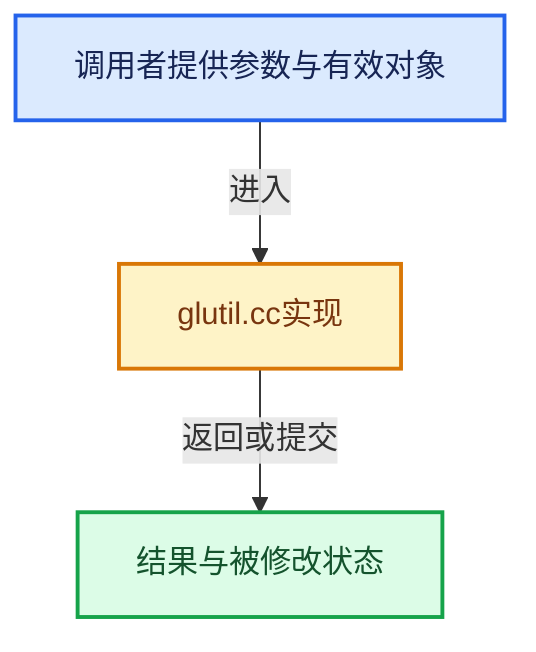

# 实现依赖专题：source/blender/editors/screen/glutil.cc

[实现依赖导航](../../../README.md) · [符号索引](../../../../00-课程指南/02-源码与提交索引/符号依赖与实现索引.md)

本专题从正文实际调用进入，集中保存共享实现。函数有稳定锚点，可从调用处直接跳到对应完整函数；递归与互相调用通过回链组织。

## 本文件的实现关系





## 完整成员与函数实现

<a id="f-0fff52e0ed35e2a0"></a>

### `blender::PixelBitmapDrawer::draw`

实现位置：[source/blender/editors/screen/glutil.cc](../../../../../../../../source/blender/editors/screen/glutil.cc) · L45—L119。

接口参数：

- `const float x`
- `const float y`
- `const int img_w`
- `const int img_h`
- `const gpu::TextureFormat gpu_format`
- `const bool use_filter`
- `const void *rect`
- `const float scale_x`
- `const float scale_y`
- `const float color[4]`

**教学注释版**

<!-- annotated:d5dbc99bf58d17 -->

```cpp
void PixelBitmapDrawer::draw(const float x,
                             const float y,
                             const int img_w,
                             const int img_h,
                             const gpu::TextureFormat gpu_format,
                             const bool use_filter,
                             const void *rect,
                             const float scale_x,
                             const float scale_y,
                             const float color[4])
{
  const float draw_width = img_w * scale_x;
  const float draw_height = img_h * scale_y;

  /* When scaling down by more than 2x, create mipmaps for the texture and
   * use trilinear filtering. */
  const bool use_mipmap = use_filter && (scale_x < 0.5f || scale_y < 0.5f);
  const int mip_len = use_mipmap ? 9999 : 1;

  eGPUTextureUsage usage = GPU_TEXTURE_USAGE_SHADER_READ;
  if (use_mipmap) {
    usage |= GPU_TEXTURE_USAGE_SHADER_WRITE;
  }
  gpu::Texture *tex = GPU_texture_create_2d(
      "immDrawPixels", img_w, img_h, mip_len, gpu_format, usage, nullptr);
  if (tex == nullptr) {
    return;
  }

  const bool use_float_data = ELEM(gpu_format,
                                   gpu::TextureFormat::SFLOAT_16_16_16_16,
                                   gpu::TextureFormat::SFLOAT_16_16_16,
                                   gpu::TextureFormat::SFLOAT_16);
  eGPUDataFormat gpu_data_format = use_float_data ? GPU_DATA_FLOAT : GPU_DATA_UBYTE;
  GPU_texture_update(tex, gpu_data_format, rect);

  GPU_texture_filter_mode(tex, use_filter);
  if (use_mipmap) {
    GPU_texture_update_mipmap_chain(tex);
    GPU_texture_mipmap_mode(tex, true, true);
  }
  GPU_texture_extend_mode(tex, GPU_SAMPLER_EXTEND_MODE_EXTEND);

  GPU_texture_bind(tex, 0);

  /* NOTE: Shader could be null for GLSL OCIO drawing, it is fine, since
   * it does not need color. */
  static const float white[4] = {1.0f, 1.0f, 1.0f, 1.0f};
  if (this->shader != nullptr && GPU_shader_get_uniform(this->shader, "color") != -1) {
    immUniformColor4fv((color) ? color : white);
  }

  const uint pos = this->pos, texco = this->texco;

  immBegin(GPU_PRIM_TRI_FAN, 4);
  immAttr2f(texco, 0.0f, 0.0f);
  immVertex2f(pos, x, y);

  immAttr2f(texco, 1.0f, 0.0f);
  immVertex2f(pos, x + draw_width, y);

  immAttr2f(texco, 1.0f, 1.0f);
  immVertex2f(pos, x + draw_width, y + draw_height);

  immAttr2f(texco, 0.0f, 1.0f);
  immVertex2f(pos, x, y + draw_height);
  immEnd();

  if (this->shader) {
    immUnbindProgram();
  }

  GPU_texture_unbind(tex);
  GPU_texture_free(tex);
}
```

<details>
<summary>核对原始源码：source/blender/editors/screen/glutil.cc · L45—L119</summary>

<!-- original:d5dbc99bf58d17:source/blender/editors/screen/glutil.cc:45:119 -->

```cpp
void PixelBitmapDrawer::draw(const float x,
                             const float y,
                             const int img_w,
                             const int img_h,
                             const gpu::TextureFormat gpu_format,
                             const bool use_filter,
                             const void *rect,
                             const float scale_x,
                             const float scale_y,
                             const float color[4])
{
  const float draw_width = img_w * scale_x;
  const float draw_height = img_h * scale_y;

  /* When scaling down by more than 2x, create mipmaps for the texture and
   * use trilinear filtering. */
  const bool use_mipmap = use_filter && (scale_x < 0.5f || scale_y < 0.5f);
  const int mip_len = use_mipmap ? 9999 : 1;

  eGPUTextureUsage usage = GPU_TEXTURE_USAGE_SHADER_READ;
  if (use_mipmap) {
    usage |= GPU_TEXTURE_USAGE_SHADER_WRITE;
  }
  gpu::Texture *tex = GPU_texture_create_2d(
      "immDrawPixels", img_w, img_h, mip_len, gpu_format, usage, nullptr);
  if (tex == nullptr) {
    return;
  }

  const bool use_float_data = ELEM(gpu_format,
                                   gpu::TextureFormat::SFLOAT_16_16_16_16,
                                   gpu::TextureFormat::SFLOAT_16_16_16,
                                   gpu::TextureFormat::SFLOAT_16);
  eGPUDataFormat gpu_data_format = use_float_data ? GPU_DATA_FLOAT : GPU_DATA_UBYTE;
  GPU_texture_update(tex, gpu_data_format, rect);

  GPU_texture_filter_mode(tex, use_filter);
  if (use_mipmap) {
    GPU_texture_update_mipmap_chain(tex);
    GPU_texture_mipmap_mode(tex, true, true);
  }
  GPU_texture_extend_mode(tex, GPU_SAMPLER_EXTEND_MODE_EXTEND);

  GPU_texture_bind(tex, 0);

  /* NOTE: Shader could be null for GLSL OCIO drawing, it is fine, since
   * it does not need color. */
  static const float white[4] = {1.0f, 1.0f, 1.0f, 1.0f};
  if (this->shader != nullptr && GPU_shader_get_uniform(this->shader, "color") != -1) {
    immUniformColor4fv((color) ? color : white);
  }

  const uint pos = this->pos, texco = this->texco;

  immBegin(GPU_PRIM_TRI_FAN, 4);
  immAttr2f(texco, 0.0f, 0.0f);
  immVertex2f(pos, x, y);

  immAttr2f(texco, 1.0f, 0.0f);
  immVertex2f(pos, x + draw_width, y);

  immAttr2f(texco, 1.0f, 1.0f);
  immVertex2f(pos, x + draw_width, y + draw_height);

  immAttr2f(texco, 0.0f, 1.0f);
  immVertex2f(pos, x, y + draw_height);
  immEnd();

  if (this->shader) {
    immUnbindProgram();
  }

  GPU_texture_unbind(tex);
  GPU_texture_free(tex);
}
```

</details>

**沿实际写入检查状态**

- `usage |= GPU_TEXTURE_USAGE_SHADER_WRITE;`

**继续追踪实现**

- `GPU_texture_create_2d` → [blender::GPU_texture_create_2d · L308](../../gpu/intern/gpu_texture.cc.md#f-5aa2a42234aebbda)。
- `ELEM` → [ELEM · L88](../../../07-Intern运行时与平台/ghost/intern/GHOST_utildefines.hh.md#m-d28724a15928)；[ELEM · L135](../../../01-BLI基础库/BLI_utildefines.hh.md#m-d6572de7cae0)。宏定义由构建条件选择。
- `GPU_texture_update` → [blender::GPU_texture_update · L619](../../gpu/intern/gpu_texture.cc.md#f-4a6c14a1d8e5e73e)。
- `GPU_texture_filter_mode` → [blender::GPU_texture_filter_mode · L683](../../gpu/intern/gpu_texture.cc.md#f-ba1abb2050b81b6b)。
- `GPU_texture_update_mipmap_chain` → [blender::GPU_texture_update_mipmap_chain · L379](../../gpu/intern/gpu_texture_mipmap.cc.md#f-ae3d338615e86225)。
- `GPU_texture_mipmap_mode` → [blender::GPU_texture_mipmap_mode · L692](../../gpu/intern/gpu_texture.cc.md#f-8170dabb7d89f6dd)。
- `GPU_texture_extend_mode` → [blender::GPU_texture_extend_mode · L724](../../gpu/intern/gpu_texture.cc.md#f-1ef72047fd6052e5)。
- `GPU_texture_bind` → [blender::GPU_texture_bind · L633](../../gpu/intern/gpu_texture.cc.md#f-5c590570f3fbea5c)。
- `GPU_shader_get_uniform` → [blender::GPU_shader_get_uniform · L524](../../gpu/intern/gpu_shader.cc.md#f-2275be29b0215181)。
- `immUniformColor4fv` → [blender::immUniformColor4fv · L664](../../gpu/intern/gpu_immediate.cc.md#f-f598e90144bdeef6)。
- `immBegin` → [blender::immBegin · L202](../../gpu/intern/gpu_immediate.cc.md#f-d20e080325dd293f)。
- `immAttr2f` → [blender::immAttr2f · L384](../../gpu/intern/gpu_immediate.cc.md#f-6595ef33a220f4c8)。
- `immVertex2f` → [blender::immVertex2f · L539](../../gpu/intern/gpu_immediate.cc.md#f-c5aa0ff286be3978)。
- `immEnd` → [blender::immEnd · L252](../../gpu/intern/gpu_immediate.cc.md#f-ef4c47367ce69810)。
- `immUnbindProgram` → [blender::immUnbindProgram · L70](../../gpu/intern/gpu_immediate.cc.md#f-1534593ba1cbfc41)。
- `GPU_texture_unbind` → [blender::GPU_texture_unbind · L639](../../gpu/intern/gpu_texture.cc.md#f-4bd2dd4244c18f3f)。
- `GPU_texture_free` → [blender::GPU_texture_free · L735](../../gpu/intern/gpu_texture.cc.md#f-3f23c7904f8ea87f)。
