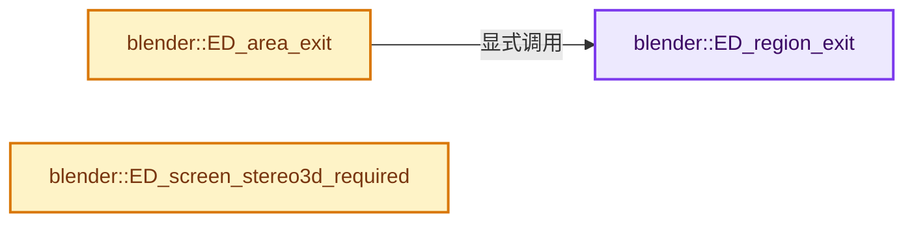
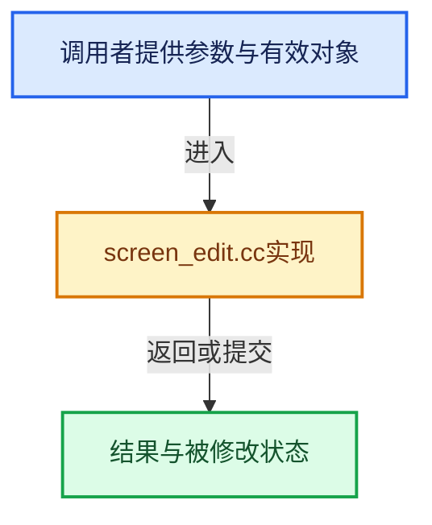

# 实现依赖专题：source/blender/editors/screen/screen_edit.cc

[实现依赖导航](../../../README.md) · [符号索引](../../../../00-课程指南/02-源码与提交索引/符号依赖与实现索引.md)

本专题从正文实际调用进入，集中保存共享实现。函数有稳定锚点，可从调用处直接跳到对应完整函数；递归与互相调用通过回链组织。

## 本文件的实现关系






## 完整成员与函数实现

<a id="f-6015caa78b7725c9"></a>

### `blender::ED_region_exit`

实现位置：[source/blender/editors/screen/screen_edit.cc](../../../../../../../../source/blender/editors/screen/screen_edit.cc) · L878—L923。

接口参数：

- `bContext *C`
- `ARegion *region`

**教学注释版**

<!-- annotated:cdc11915d58674 -->

```cpp
void ED_region_exit(bContext *C, ARegion *region)
{
  wmWindowManager *wm = CTX_wm_manager(C);
  wmWindow *win = CTX_wm_window(C);
  ARegion *prevar = CTX_wm_region(C);

  if (region->runtime->type && region->runtime->type->exit) {
    region->runtime->type->exit(wm, region);
  }

  CTX_wm_region_set(C, region);

  WM_event_remove_handlers(C, &region->runtime->handlers);
  WM_event_modal_handler_region_replace(win, region, nullptr);

  /* Stop panel animation in this region if there are any. */
  for (Panel &panel : region->panels) {
    ui::panel_stop_animation(C, &panel);
  }

  if (region->regiontype == RGN_TYPE_TEMPORARY) {
    /* This may be a popup region such as a popover or splash screen.
     * In the case of popups which spawn popups it's possible for
     * the parent popup to be freed *before* a popup which created it.
     * The child may have a reference to the freed parent unless cleared here, see: #122132.
     *
     * Having parent popups freed before the popups they spawn could be investigated although
     * they're not technically nested as they're both stored in #Screen::regionbase. */
    WM_event_ui_handler_region_popup_replace(win, region, nullptr);
  }

  WM_draw_region_free(region);
  /* The region is not in a state that it can be visible in anymore. Reinitializing is needed. */
  region->runtime->visible = false;

  MEM_SAFE_DELETE(region->runtime->headerstr);

  if (region->runtime->regiontimer) {
    WM_event_timer_remove(wm, win, region->runtime->regiontimer);
    region->runtime->regiontimer = nullptr;
  }

  WM_msgbus_clear_by_owner(wm->runtime->message_bus, region);

  CTX_wm_region_set(C, prevar);
}
```

<details>
<summary>核对原始源码：source/blender/editors/screen/screen_edit.cc · L878—L923</summary>

<!-- original:cdc11915d58674:source/blender/editors/screen/screen_edit.cc:878:923 -->

```cpp
void ED_region_exit(bContext *C, ARegion *region)
{
  wmWindowManager *wm = CTX_wm_manager(C);
  wmWindow *win = CTX_wm_window(C);
  ARegion *prevar = CTX_wm_region(C);

  if (region->runtime->type && region->runtime->type->exit) {
    region->runtime->type->exit(wm, region);
  }

  CTX_wm_region_set(C, region);

  WM_event_remove_handlers(C, &region->runtime->handlers);
  WM_event_modal_handler_region_replace(win, region, nullptr);

  /* Stop panel animation in this region if there are any. */
  for (Panel &panel : region->panels) {
    ui::panel_stop_animation(C, &panel);
  }

  if (region->regiontype == RGN_TYPE_TEMPORARY) {
    /* This may be a popup region such as a popover or splash screen.
     * In the case of popups which spawn popups it's possible for
     * the parent popup to be freed *before* a popup which created it.
     * The child may have a reference to the freed parent unless cleared here, see: #122132.
     *
     * Having parent popups freed before the popups they spawn could be investigated although
     * they're not technically nested as they're both stored in #Screen::regionbase. */
    WM_event_ui_handler_region_popup_replace(win, region, nullptr);
  }

  WM_draw_region_free(region);
  /* The region is not in a state that it can be visible in anymore. Reinitializing is needed. */
  region->runtime->visible = false;

  MEM_SAFE_DELETE(region->runtime->headerstr);

  if (region->runtime->regiontimer) {
    WM_event_timer_remove(wm, win, region->runtime->regiontimer);
    region->runtime->regiontimer = nullptr;
  }

  WM_msgbus_clear_by_owner(wm->runtime->message_bus, region);

  CTX_wm_region_set(C, prevar);
}
```

</details>

**沿实际写入检查状态**

- `region->runtime->visible = false;`
- `region->runtime->regiontimer = nullptr;`

**继续追踪实现**

- `CTX_wm_manager` → [blender::CTX_wm_manager · L928](../../../02-BKE几何与数据/intern/context.cc.md#f-158f36db7379fbe8)。
- `CTX_wm_window` → [blender::CTX_wm_window · L938](../../../02-BKE几何与数据/intern/context.cc.md#f-a1996003b2409854)。
- `CTX_wm_region` → [blender::CTX_wm_region · L965](../../../02-BKE几何与数据/intern/context.cc.md#f-6cc0a26bc4539ae0)。
- `region->runtime->type->exit` → [外部契约](https://eel.is/c++draft/)：这个边界按实际表达式及所属类型核对参数、返回值、寿命与失败行为。这里提供接口入口，不声称已解释该第三方版本的内部实现。
- `CTX_wm_region_set` → [blender::CTX_wm_region_set · L1240](../../../02-BKE几何与数据/intern/context.cc.md#f-7c17937537b1c2fc)。
- `WM_event_remove_handlers` → [blender::WM_event_remove_handlers · L2315](../../windowmanager/intern/wm_event_system.cc.md#f-e79652491b717af4)。
- `WM_event_modal_handler_region_replace` → [blender::WM_event_modal_handler_region_replace · L4871](../../windowmanager/intern/wm_event_system.cc.md#f-4c5e7ee76ba9d2bd)。
- `ui::panel_stop_animation` → [blender::ui::panel_stop_animation · L2988](../interface/interface_panel.cc.md#f-d35bd01c69983cbf)。
- `WM_event_ui_handler_region_popup_replace` → [blender::WM_event_ui_handler_region_popup_replace · L4888](../../windowmanager/intern/wm_event_system.cc.md#f-907d6ccb488614e9)。
- `WM_draw_region_free` → [blender::WM_draw_region_free · L1773](../../windowmanager/intern/wm_draw.cc.md#f-c681b37646206f41)。
- `MEM_SAFE_DELETE` → [MEM_SAFE_DELETE · L436](../../../07-Intern运行时与平台/guardedalloc/MEM_guardedalloc.h.md#m-eadb3bc5b902)。宏定义由构建条件选择。
- `WM_event_timer_remove` → [blender::WM_event_timer_remove · L2620](../../windowmanager/intern/wm_window.cc.md#f-b9a941dd92720408)。
- `WM_msgbus_clear_by_owner` → [blender::WM_msgbus_clear_by_owner · L69](../../windowmanager/message_bus/intern/wm_message_bus.cc.md#f-e919252b73b679b6)。

<a id="f-f0e14f1392d19269"></a>

### `blender::ED_area_exit`

实现位置：[source/blender/editors/screen/screen_edit.cc](../../../../../../../../source/blender/editors/screen/screen_edit.cc) · L925—L945。

接口参数：

- `bContext *C`
- `ScrArea *area`

**教学注释版**

<!-- annotated:e22937271db199 -->

```cpp
void ED_area_exit(bContext *C, ScrArea *area)
{
  wmWindowManager *wm = CTX_wm_manager(C);
  wmWindow *win = CTX_wm_window(C);
  ScrArea *prevsa = CTX_wm_area(C);

  if (area->type && area->type->exit) {
    area->type->exit(wm, area);
  }

  CTX_wm_area_set(C, area);

  for (ARegion &region : area->regionbase) {
    ED_region_exit(C, &region);
  }

  WM_event_remove_handlers(C, &area->handlers);
  WM_event_modal_handler_area_replace(win, area, nullptr);

  CTX_wm_area_set(C, prevsa);
}
```

<details>
<summary>核对原始源码：source/blender/editors/screen/screen_edit.cc · L925—L945</summary>

<!-- original:e22937271db199:source/blender/editors/screen/screen_edit.cc:925:945 -->

```cpp
void ED_area_exit(bContext *C, ScrArea *area)
{
  wmWindowManager *wm = CTX_wm_manager(C);
  wmWindow *win = CTX_wm_window(C);
  ScrArea *prevsa = CTX_wm_area(C);

  if (area->type && area->type->exit) {
    area->type->exit(wm, area);
  }

  CTX_wm_area_set(C, area);

  for (ARegion &region : area->regionbase) {
    ED_region_exit(C, &region);
  }

  WM_event_remove_handlers(C, &area->handlers);
  WM_event_modal_handler_area_replace(win, area, nullptr);

  CTX_wm_area_set(C, prevsa);
}
```

</details>

**继续追踪实现**

- `CTX_wm_manager` → [blender::CTX_wm_manager · L928](../../../02-BKE几何与数据/intern/context.cc.md#f-158f36db7379fbe8)。
- `CTX_wm_window` → [blender::CTX_wm_window · L938](../../../02-BKE几何与数据/intern/context.cc.md#f-a1996003b2409854)。
- `CTX_wm_area` → [blender::CTX_wm_area · L954](../../../02-BKE几何与数据/intern/context.cc.md#f-f8ad7c2c364d711c)。
- `area->type->exit` → [外部契约](https://eel.is/c++draft/)：这个边界按实际表达式及所属类型核对参数、返回值、寿命与失败行为。这里提供接口入口，不声称已解释该第三方版本的内部实现。
- `CTX_wm_area_set` → [blender::CTX_wm_area_set · L1226](../../../02-BKE几何与数据/intern/context.cc.md#f-d1a016e39c2c0baa)。
- `ED_region_exit` → [blender::ED_region_exit · L878](screen_edit.cc.md#f-6015caa78b7725c9)。
- `WM_event_remove_handlers` → [blender::WM_event_remove_handlers · L2315](../../windowmanager/intern/wm_event_system.cc.md#f-e79652491b717af4)。
- `WM_event_modal_handler_area_replace` → [blender::WM_event_modal_handler_area_replace · L4857](../../windowmanager/intern/wm_event_system.cc.md#f-962e6bbf7640c456)。

<a id="f-1b641ecccdf80faf"></a>

### `blender::ED_screen_stereo3d_required`

实现位置：[source/blender/editors/screen/screen_edit.cc](../../../../../../../../source/blender/editors/screen/screen_edit.cc) · L2071—L2141。

接口参数：

- `const bScreen *screen`
- `const Scene *scene`

**教学注释版**

<!-- annotated:82246ae012a6cf -->

```cpp
bool ED_screen_stereo3d_required(const bScreen *screen, const Scene *scene)
{
  const bool is_multiview = (scene->r.scemode & R_MULTIVIEW) != 0;

  for (ScrArea &area : screen->areabase) {
    switch (area.spacetype) {
      case SPACE_VIEW3D: {
        View3D *v3d;

        if (!is_multiview) {
          continue;
        }

        v3d = area.spacedata.first_as<View3D>();
        if (v3d->camera && v3d->stereo3d_camera == STEREO_3D_ID) {
          for (ARegion &region : area.regionbase) {
            if (region.regiondata && region.regiontype == RGN_TYPE_WINDOW) {
              RegionView3D *rv3d = static_cast<RegionView3D *>(region.regiondata);
              if (rv3d->persp == RV3D_CAMOB) {
                return true;
              }
            }
          }
        }
        break;
      }
      case SPACE_IMAGE: {
        SpaceImage *sima;

        /* images should always show in stereo, even if
         * the file doesn't have views enabled */
        sima = area.spacedata.first_as<SpaceImage>();
        if (sima->image && BKE_image_is_stereo(sima->image) &&
            (sima->iuser.flag & IMA_SHOW_STEREO))
        {
          return true;
        }
        break;
      }
      case SPACE_NODE: {
        SpaceNode *snode;

        if (!is_multiview) {
          continue;
        }

        snode = area.spacedata.first_as<SpaceNode>();
        if ((snode->flag & SNODE_BACKDRAW) && ED_node_is_compositor(snode)) {
          return true;
        }
        break;
      }
      case SPACE_SEQ: {
        SpaceSeq *sseq;

        if (!is_multiview) {
          continue;
        }

        sseq = area.spacedata.first_as<SpaceSeq>();
        if (ELEM(sseq->view, SEQ_VIEW_PREVIEW, SEQ_VIEW_SEQUENCE_PREVIEW)) {
          return true;
        }

        break;
      }
    }
  }

  return false;
}
```

<details>
<summary>核对原始源码：source/blender/editors/screen/screen_edit.cc · L2071—L2141</summary>

<!-- original:82246ae012a6cf:source/blender/editors/screen/screen_edit.cc:2071:2141 -->

```cpp
bool ED_screen_stereo3d_required(const bScreen *screen, const Scene *scene)
{
  const bool is_multiview = (scene->r.scemode & R_MULTIVIEW) != 0;

  for (ScrArea &area : screen->areabase) {
    switch (area.spacetype) {
      case SPACE_VIEW3D: {
        View3D *v3d;

        if (!is_multiview) {
          continue;
        }

        v3d = area.spacedata.first_as<View3D>();
        if (v3d->camera && v3d->stereo3d_camera == STEREO_3D_ID) {
          for (ARegion &region : area.regionbase) {
            if (region.regiondata && region.regiontype == RGN_TYPE_WINDOW) {
              RegionView3D *rv3d = static_cast<RegionView3D *>(region.regiondata);
              if (rv3d->persp == RV3D_CAMOB) {
                return true;
              }
            }
          }
        }
        break;
      }
      case SPACE_IMAGE: {
        SpaceImage *sima;

        /* images should always show in stereo, even if
         * the file doesn't have views enabled */
        sima = area.spacedata.first_as<SpaceImage>();
        if (sima->image && BKE_image_is_stereo(sima->image) &&
            (sima->iuser.flag & IMA_SHOW_STEREO))
        {
          return true;
        }
        break;
      }
      case SPACE_NODE: {
        SpaceNode *snode;

        if (!is_multiview) {
          continue;
        }

        snode = area.spacedata.first_as<SpaceNode>();
        if ((snode->flag & SNODE_BACKDRAW) && ED_node_is_compositor(snode)) {
          return true;
        }
        break;
      }
      case SPACE_SEQ: {
        SpaceSeq *sseq;

        if (!is_multiview) {
          continue;
        }

        sseq = area.spacedata.first_as<SpaceSeq>();
        if (ELEM(sseq->view, SEQ_VIEW_PREVIEW, SEQ_VIEW_SEQUENCE_PREVIEW)) {
          return true;
        }

        break;
      }
    }
  }

  return false;
}
```

</details>

**沿实际写入检查状态**

- `v3d = area.spacedata.first_as<View3D>();`
- `sima = area.spacedata.first_as<SpaceImage>();`
- `snode = area.spacedata.first_as<SpaceNode>();`
- `sseq = area.spacedata.first_as<SpaceSeq>();`

**结果出口**

- `return true;`
- `return false;`

**继续追踪实现**

- `area.spacedata.first_as<View3D>` → [调用协议](../../../../00-课程指南/01-路线与规范/模板宏与动态分派协议.md)：接收对象类型依赖auto、返回值或模板实例；不按同名猜测目标。调用位置L2084。
- `area.spacedata.first_as<SpaceImage>` → [调用协议](../../../../00-课程指南/01-路线与规范/模板宏与动态分派协议.md)：接收对象类型依赖auto、返回值或模板实例；不按同名猜测目标。调用位置L2102。
- `BKE_image_is_stereo` → [blender::BKE_image_is_stereo · L3990](../../../02-BKE几何与数据/intern/image.cc.md#f-d86d6fd5d6feb1ec)。
- `area.spacedata.first_as<SpaceNode>` → [调用协议](../../../../00-课程指南/01-路线与规范/模板宏与动态分派协议.md)：接收对象类型依赖auto、返回值或模板实例；不按同名猜测目标。调用位置L2117。
- `ED_node_is_compositor` → [blender::ED_node_is_compositor · L135](../space_node/node_edit.cc.md#f-4ff6ef79678737c8)。
- `area.spacedata.first_as<SpaceSeq>` → [调用协议](../../../../00-课程指南/01-路线与规范/模板宏与动态分派协议.md)：接收对象类型依赖auto、返回值或模板实例；不按同名猜测目标。调用位置L2130。
- `ELEM` → [ELEM · L88](../../../07-Intern运行时与平台/ghost/intern/GHOST_utildefines.hh.md#m-d28724a15928)；[ELEM · L135](../../../01-BLI基础库/BLI_utildefines.hh.md#m-d6572de7cae0)。宏定义由构建条件选择。
