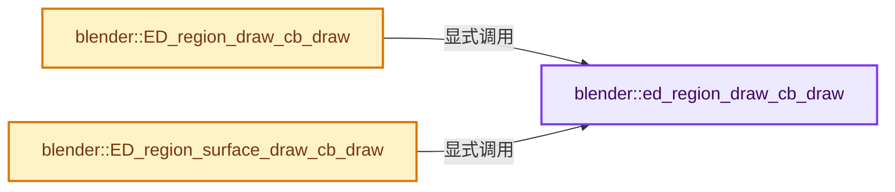
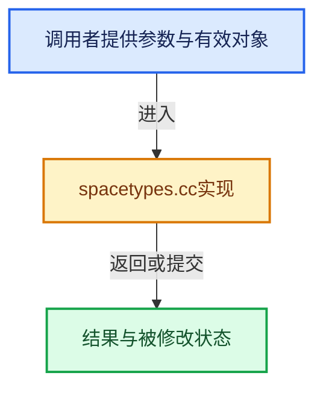

# 实现依赖专题：source/blender/editors/space_api/spacetypes.cc

[实现依赖导航](../../../README.md) · [符号索引](../../../../00-课程指南/02-源码与提交索引/符号依赖与实现索引.md)

本专题从正文实际调用进入，集中保存共享实现。函数有稳定锚点，可从调用处直接跳到对应完整函数；递归与互相调用通过回链组织。

## 本文件的实现关系






## 完整成员与函数实现

<a id="f-812cc7e03af3b84c"></a>

### `blender::ed_region_draw_cb_draw`

实现位置：[source/blender/editors/space_api/spacetypes.cc](../../../../../../../../source/blender/editors/space_api/spacetypes.cc) · L252—L259。

接口参数：

- `const bContext *C`
- `ARegion *region`
- `ARegionType *art`
- `int type`

**教学注释版**

<!-- annotated:aafbe0c2dff556 -->

```cpp
static void ed_region_draw_cb_draw(const bContext *C, ARegion *region, ARegionType *art, int type)
{
  for (RegionDrawCB &rdc : art->drawcalls.items_mutable()) {
    if (rdc.type == type) {
      rdc.draw(C, region, rdc.customdata);
    }
  }
}
```

<details>
<summary>核对原始源码：source/blender/editors/space_api/spacetypes.cc · L252—L259</summary>

<!-- original:aafbe0c2dff556:source/blender/editors/space_api/spacetypes.cc:252:259 -->

```cpp
static void ed_region_draw_cb_draw(const bContext *C, ARegion *region, ARegionType *art, int type)
{
  for (RegionDrawCB &rdc : art->drawcalls.items_mutable()) {
    if (rdc.type == type) {
      rdc.draw(C, region, rdc.customdata);
    }
  }
}
```

</details>

**继续追踪实现**

- `art->drawcalls.items_mutable` → [调用协议](../../../../00-课程指南/01-路线与规范/模板宏与动态分派协议.md)：接收对象类型依赖auto、返回值或模板实例；不按同名猜测目标。调用位置L254。
- `rdc.draw` → [调用协议](../../../../00-课程指南/01-路线与规范/模板宏与动态分派协议.md)：接收对象类型依赖auto、返回值或模板实例；不按同名猜测目标。调用位置L256。

<a id="f-342de5537b1cfeba"></a>

### `blender::ED_region_draw_cb_draw`

实现位置：[source/blender/editors/space_api/spacetypes.cc](../../../../../../../../source/blender/editors/space_api/spacetypes.cc) · L261—L264。

接口参数：

- `const bContext *C`
- `ARegion *region`
- `int type`

**教学注释版**

<!-- annotated:eed1b9a5644b7b -->

```cpp
void ED_region_draw_cb_draw(const bContext *C, ARegion *region, int type)
{
  ed_region_draw_cb_draw(C, region, region->runtime->type, type);
}
```

<details>
<summary>核对原始源码：source/blender/editors/space_api/spacetypes.cc · L261—L264</summary>

<!-- original:eed1b9a5644b7b:source/blender/editors/space_api/spacetypes.cc:261:264 -->

```cpp
void ED_region_draw_cb_draw(const bContext *C, ARegion *region, int type)
{
  ed_region_draw_cb_draw(C, region, region->runtime->type, type);
}
```

</details>

**继续追踪实现**

- `ed_region_draw_cb_draw` → [blender::ed_region_draw_cb_draw · L252](spacetypes.cc.md#f-812cc7e03af3b84c)。

<a id="f-7ac06ee2f8684fa0"></a>

### `blender::ED_region_surface_draw_cb_draw`

实现位置：[source/blender/editors/space_api/spacetypes.cc](../../../../../../../../source/blender/editors/space_api/spacetypes.cc) · L266—L269。

接口参数：

- `const bContext *C`
- `ARegionType *art`
- `int type`

**教学注释版**

<!-- annotated:ce45a3b72b7d0a -->

```cpp
void ED_region_surface_draw_cb_draw(const bContext *C, ARegionType *art, int type)
{
  ed_region_draw_cb_draw(C, nullptr, art, type);
}
```

<details>
<summary>核对原始源码：source/blender/editors/space_api/spacetypes.cc · L266—L269</summary>

<!-- original:ce45a3b72b7d0a:source/blender/editors/space_api/spacetypes.cc:266:269 -->

```cpp
void ED_region_surface_draw_cb_draw(const bContext *C, ARegionType *art, int type)
{
  ed_region_draw_cb_draw(C, nullptr, art, type);
}
```

</details>

**继续追踪实现**

- `ed_region_draw_cb_draw` → [blender::ed_region_draw_cb_draw · L252](spacetypes.cc.md#f-812cc7e03af3b84c)。
